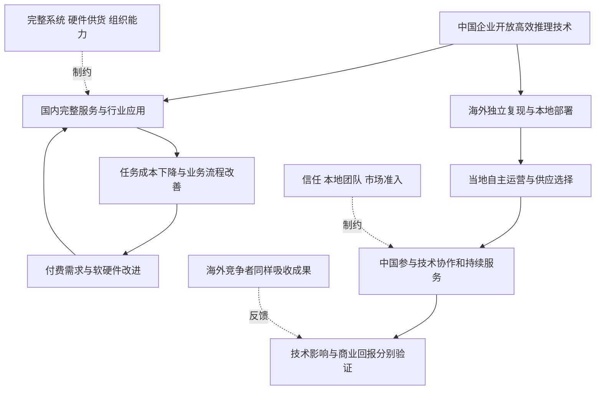
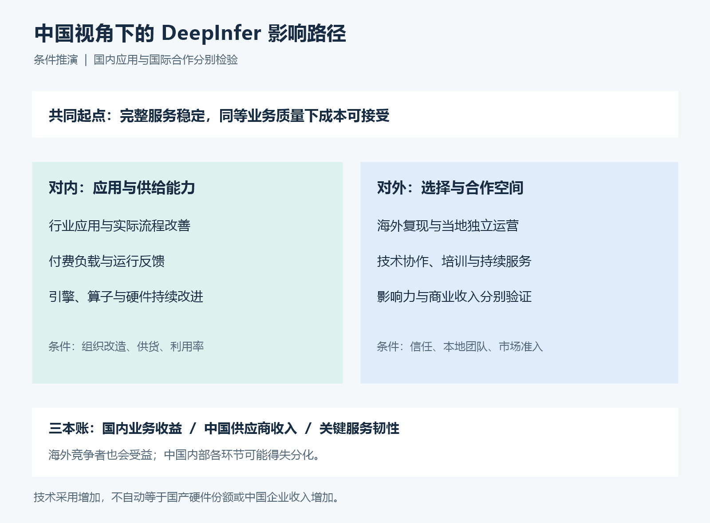
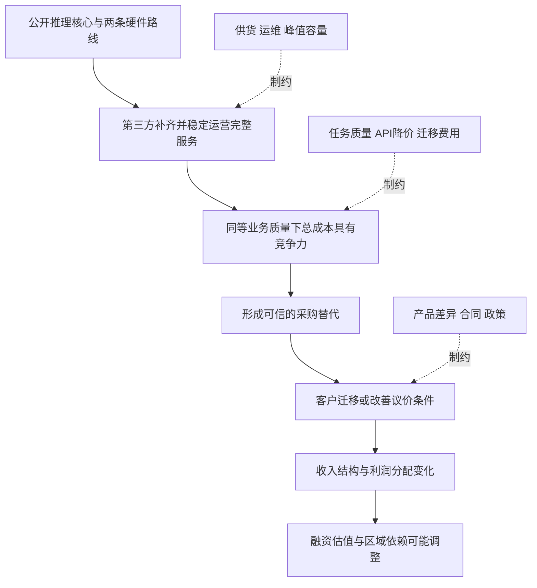
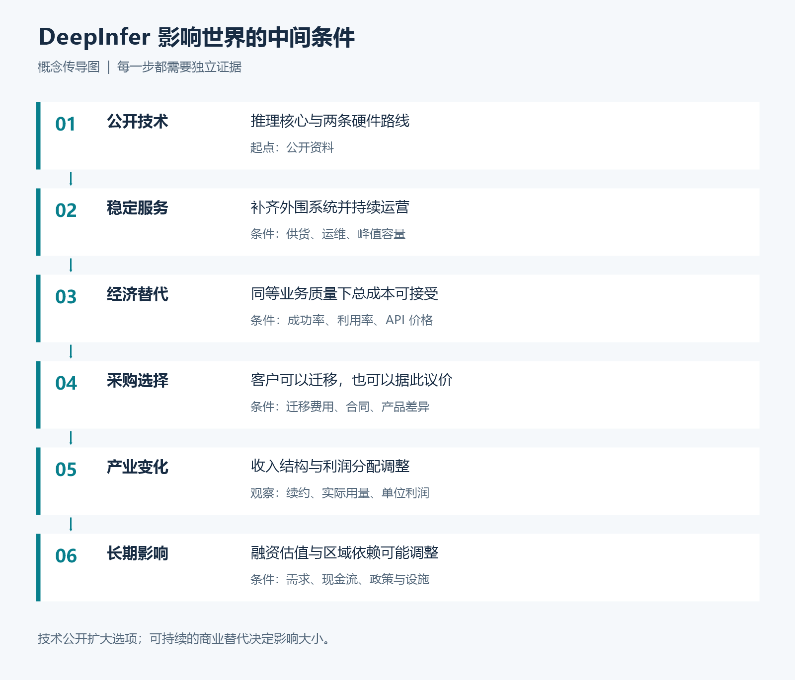
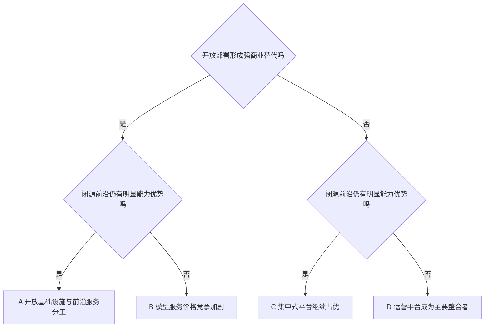
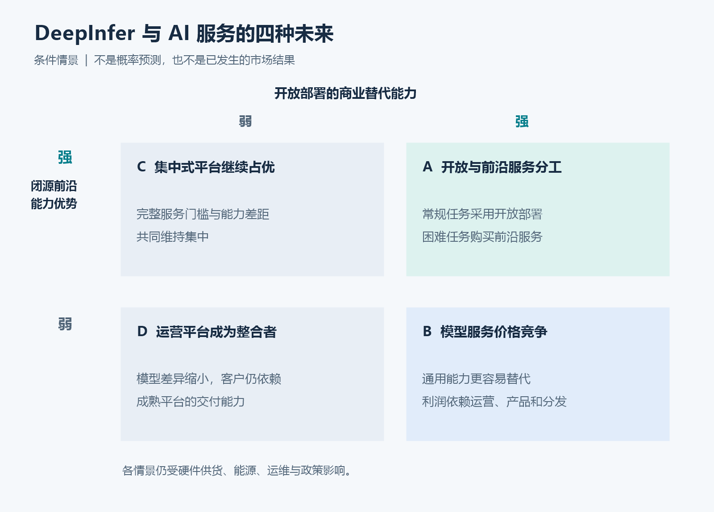

# 中国视角下 DeepInfer 的简书文章写作方案

建议写一篇约 6000 至 7500 字的产业分析长文，面向有 AI 基础知识、关心中国发展与世界格局的读者。以中国如何将技术开放转化为自身的发展能力与国际合作机会为主线，将私有部署、双硬件路线、模型估值和地缘关系融入同一条论证。

全文的中心判断是：高效开放推理若能形成可信的商业供给，中国的收益可能分布在行业生产率、供应选择和国际服务之中；这些收益能否实现，取决于应用落地、价值获取和信任建设。中国的模型企业、硬件企业、云平台与使用 AI 的行业，可能出现不同方向的得失。

本文件是文章设计与示范段落，完整论证依据见 [思考方案](01-思考方案.md)。配图与公式属于概念解释，假设算例均不代表 DeepInfer 实测结果。

文章若采用更乐观的产业条件，以[十五五乐观情景再评估](03-十五五乐观情景再评估.md)为深化版本：将硬件持续供给、开放推理、国内应用与后续制造能力的互补关系写入主线。开篇明确这是条件情景；2030 年前 EUV 工程样机属于情景假设，不能代替已核实的规划条款或量产结果。

## 一 标题与表达立场

首选标题：**中国视角下 DeepInfer 对产业与世界的影响**。

备选标题：

- DeepInfer 与中国 AI 的应用和生态机会
- 中国开放推理技术如何影响全球 AI 供给
- DeepInfer 能否将技术贡献转化为产业优势

开头给出中国视角下的主问题，随后让读者看到成立条件。中国视角体现为优先分析中国的应用、产业与供应处境，并充分考虑其他国家和企业的自主选择。通过成本、替代、商业回报与现金流解释影响。原分享对话可以在文末作为问题来源，技术事实则链接官方资料。

## 二 文章的八个段落单元

| 单元与建议字数 | 读者要解决的问题 | 写作任务 | 留给下一节的问题 |
| --- | --- | --- | --- |
| 开篇 450 字 | 中国公开推理技术为何值得关注 | 提出国内发展与全球供给两个问题 | 技术开放提供了什么 |
| 技术边界 600 字 | 可获得的能力增加了多少 | 区分引擎、完整服务与实际替代 | 中国谁能用得起 |
| 国内应用 1100 字 | 中国整体如何获得收益 | 成本临界点、行业应用、组织改造、学习循环 | 什么条件支持长期供给 |
| 双硬件路线 850 字 | 如何同时连接全球与增加国内选择 | 分析 NVIDIA 的采用条件与昇腾的商业验证 | 中国如何获取世界市场收益 |
| 国际生态 1050 字 | 他国自主部署如何形成合作 | 本地能力、信任、维护与商业回报 | 各参与者如何应对 |
| 产业与金融 1000 字 | 谁获得利润，谁承担调整 | 国内外模型、算力、应用的得失分化与反馈 | 影响会走向哪种结构 |
| 情景与约束 900 字 | 中国有哪些可能路径 | 四情景、硬件约束、市场准入、反证 | 怎样判断机会是否兑现 |
| 结尾 450 字 | 中国需要观察什么结果 | 分别核对生产率、商业收入和供应韧性 | 保留条件判断 |

正文总量约 6400 字，优先放中国影响路径图与四情景图，通用传导图可放附录。主文保留两组公式；估值公式和详细指标可放文末附录。技术名词只解释与论点有关的部分。

## 三 开篇示范

> 一家中国企业公开推理技术之后，最先被讨论的往往是它会影响哪家海外模型公司。但从中国自身的发展看，还应该追问：这项技术能否让国内更多企业用得起、用得好 AI？它在全球被使用之后，又能为中国带回什么？
>
> 两个问题未必得到相同答案。模型服务可能更便宜，模型公司的收费空间也可能缩小；海外开发者可能广泛使用中国来源的技术，却继续购买其他国家的硬件与云服务。
>
> DeepSeek 公开的 DeepInfer，为讨论这些变化提供了具体起点。官方列出 NVIDIA SM100 与华为昇腾 950 两条硬件路线，完整在线服务仍需补足部分组件。[官方说明](https://github.com/deepseek-ai/DeepInfer)
>
> 如果它能被稳定复现，并在实际业务中证明经济性，中国的机会可能扩展到行业应用、硬件选择与国际服务。文章要追踪的，是技术开放怎样一步步转化为这些能力，以及收益可能停在哪个环节。

这段开篇直接提出中国视角下的收益与矛盾，不预设海外竞争者失利，也不推断 DeepSeek 的战略意图。技术边界一节之后可放中国影响路径图。

## 四 各节如何形成分析力度

### 技术边界要解释完整服务的价值

用“模型提供能力，推理引擎负责执行，服务平台负责持续交付”解释分工。只写与后续经济判断有关的能力：并行与调度影响利用率；缓存复用减少重复工作；双后端提供第二条实现路径。

随后说明，完整的缓存管理、负载均衡、容错和业务接入仍然决定服务效果。引出推荐的大集群部署：工程经验更容易获得，硬件和运维投入仍然可能很大。128 卡是官方推荐架构的高效单元，不能扩展成所有私有部署的门槛。[部署 Q&A](https://github.com/deepseek-ai/DeepInfer/blob/main/doc/inference_deployment_qa.md)

这一节的原创分析点：**知识门槛降低与规模门槛存在，可以同时成立。** 因而最先出现的商业形态，可能包括托管服务和行业云。

### 国内应用要区分模型公司的收入与中国整体收益

将原方案的私有部署成本分析纳入这一节。先解释企业为何可能采用，再追踪实际价值去了哪里：国内模型和云企业获得服务收入，使用 AI 的行业可能获得效率改善，但两者并不一定同幅增长。

可以用假设制造企业串联：工程人员处理设备文档，采购人员核对供应商资料，售后人员检索维护记录。每一个例子都限定任务和质量要求，随后追问流程周期是否缩短、审核是否增加、返工是否减少。不要将文档辅助扩展为工业设备自动控制。

然后提出中国内部的学习循环：真实业务需求带来付费负载，运行反馈推动算子、引擎与硬件改进，成本改善再扩大应用。每个环节都可能被数据治理、组织惯性或低利用率打断。

本节的核心句可以是：

> 中国从 AI 中取得的收益，不会全部出现在模型公司的财报里。如果更多行业获得可验证的效率改善，即使基础调用的溢价下降，应用层面仍可能产生价值。是否发生这种变化，需要从业务结果判断。

### 私有部署要把动态竞争写进去

主文展示：

$$
C_{\text{API}}=pQ,\quad C_{\text{private}}=F+vQ,
\quad Q^*=\frac{F}{p-v}\quad(p>v)
$$

用 [思考方案](01-思考方案.md) 中的假设表解释临界点。将 Q 定义为同类标准任务数量，先说明双方达到同等业务标准；不要拿不同模型的 Token 数量直接比较。

接着写两次变化：私有方案的成本下降；API 服务商跟随降价。读者由此看到，比较对象会反应，竞争优势需要持续检验。

还要交代流量高低。持续大流量容易摊薄固定成本，低流量和明显峰谷可能让设备闲置。企业重视隔离和控制时，可能愿意支付溢价，但这属于综合采购价值，不能据此宣称推理成本更低。

建议段落：

> 开源推理提高效率之后，一家企业的自建方案可能变便宜，商业 API 也可能同步降价。竞争会改变公式两边。决定迁移的，还包括任务成功率、业务峰值、运维投入，以及更换供应商时需要重做多少工作。

### 计算卡生态要从议价分析到销量

在中国视角下，本节改以“双硬件路线如何同时连接全球和增加国内选择”展开。NVIDIA 后端让海外使用者有机会沿用既有设施，昇腾后端则提供另一条可验证的实现路径。前者可能促进技术采用，后者能否形成国内供应韧性，还要看完整成本和持续供货。

保留一个反向情景：如果全球新增负载主要落在 NVIDIA 硬件上，中国来源软件影响力提升，未必带来国产硬件份额提升。软件采用率、硬件采购份额和国内供应商收入应分别记录。

先问客户是否能拿到可交付的替代报价，再讨论是否采购。一个可用的第二后端，可能先影响合同条件，随后才改变份额。反过来，仅有后端代码，没有稳定运行与供货，议价价值会很有限。

不要把软件开放当成硬件通用化。不同平台可能仍需要专门算子、通信与运维经验。也不要把单个工作负载需要更少卡，直接写成厂商总销量下降。

本节过渡句：

> 供应商可能卖出更多设备，同时在一部分客户那里失去原有溢价。技术扩散对规模和利润的影响，需要分别观察。

### 国际生态要回答其他国家为什么采用

以合作方的自主需求解释机会：它可能希望本地处理数据、避免单一 API 依赖、形成自己的运维能力。中国企业若能提供可验证的技术、培训和持续维护，就可能参与其中。代码来源本身不足以形成采购理由。

进一步区分四个结果：技术被采用、中国硬件被采购、中国企业获得服务收入、双方形成长期协作。四者可以关联，也可以分离。全球开发者采用公开技术并混合多国供应商，是需要保留的情景。

这部分可以引用《人工智能全球治理行动计划》中的开源和能力建设主张作为政策背景，但不能据此认定 DeepInfer 的企业动机。国际技术影响力由外部采用、共同维护和实际服务积累，不能只靠宣布。

段落示范：

> 对希望建设本地 AI 服务的国家而言，一套开放技术的吸引力，来自它是否可用、可维护，以及是否允许自己保留选择权。中国企业能否成为长期合作方，取决于能否帮助对方形成这些能力。海外采用增加，会扩大合作机会；商业回报仍需要具体的产品、服务和信任来取得。

### 模型公司要区分业务与能力

提出“常规任务开放部署，困难任务购买前沿服务”的混合模式。它比全量替代更容易发生，也更便于验证。

分析 OpenAI、Anthropic 等企业时，按标准任务调用、能力优势、用户产品、企业集成区分价值来源。不能由一项推理优化直接推导整体服务可被替代。也不能把 API 协议兼容视为业务迁移完成：工具调用表现、任务评估、权限和审计都可能需要调整。

可以引用企业工作流合作作为分发路径的例子，但不将公告等同于商业成功。正文讨论融资和 IPO 时，采用“可能影响投资者对长期收入与利润的判断”的表述，不依靠未经核实的上市日期或估值数字。

### 金融部分写出方向相反的力量

主文第二组公式：

$$
\frac{\text{新加速器时间需求}}{\text{原加速器时间需求}}
=\frac{\text{任务需求倍数}}{\text{单位时间效率倍数}}
$$

同类任务中，效率翻倍、需求变成三倍，总加速器时间仍增加一半。该算例解释需求反弹的可能性，不能充当行业增长预测。

再区分两种财务路径：价格下降、客户转移、成本与固定投入难调整，可能压低现金流；成本下降、需求增长、产品价值增强，则可能改善现金流。

基础设施部分写到租金、利用率、合同期限、资本开支和偿债能力即可。只有获得风险敞口和关联证据，才进一步讨论系统性金融风险。市场反应还取决于预期差，文章不预测股价。

中国内部也存在相同的重估机制：部分应用企业可能因成本下降获益，模型企业可能面对收费压力，算力运营商则取决于需求能否填满新增容量。不要把海外 AI 估值承压直接等同于中国获益，也不要把国内算力投资增加直接等同于生产率提升。

### 地缘部分比较实际选择空间

这一部分贯穿国际生态和情景章节。主要问题改为：中国能否提高自身持续供给 AI 的能力，同时为其他国家增加可靠选项？这会改变哪些依赖，又把哪些约束保留在芯片制造、能源、客户信任与市场准入上？

用一家区域运营商能否获得硬件、维护软件、持续供电、服务客户的连续条件，代替抽象的国家胜负判断。

主线包括本地数据处理、第二硬件路线、区域服务商成长与国际技术扩散。反向力量包括供货、能源、人才和市场准入。私有部署增加选择，但对芯片供应或运维体系的依赖可能继续存在。

配图二放在本节后。四情景使结论保持开放：开放部署商业能力强弱，与闭源前沿优势大小，共同决定产业分工。

## 五 配图与 Mermaid 源码

修订后主文优先使用下方新增的中国路径图与原四情景图。通用传导图保留为补充。

图一解释技术影响必须经过哪些条件。实线为概念传导，旁支为制约条件；所有节点均非已实现的结果。

图二强调未来存在分工、竞争与集中等不同路径。

图片由本地脚本绘制，Mermaid 保留为可编辑源码。发布时可优先使用 PNG，公式同步准备纯文本解释；具体编辑器的公式和 Mermaid 显示效果需在发布预览中确认。

## 六 结尾示范

> 从中国视角判断 DeepInfer，应该分别看三件事：国内企业是否得到实际的业务改善，中国供应商是否形成可持续收入，关键服务是否拥有更可靠的供应选择。这些结果可能相互促进，也可能不同步。
>
> 在世界范围内，中国来源的技术可以为其他国家增加部署选项，也会被海外竞争者吸收。中国能否从中取得长期回报，要看能否持续贡献技术、支持维护，并提供值得信任的产品与服务。
>
> 这条路径也留下现实压力：基础调用收费可能下降，低利用率的算力投资可能需要调整，硬件供给和前沿能力仍需要持续投入。
>
> 如果技术开放最终帮助更多中国企业提高效率，也帮助其他国家建设可持续的 AI 能力，它的意义就会从一项工程贡献延伸到产业关系。这个判断需要由真实应用、付费合作和长期运行记录逐步证明。

## 七 资料与发布安排

乐观情景的写作顺序可调整为：公开规划与假设边界、持续供货如何促成长期投入、硬件与软件的互补、国内应用循环、全球供给与金融地缘影响、EUV 样机及后续产业化的不同时间窗口。新增政策依据使用[十五五规划纲要全文](https://www.locpg.gov.cn/20260314/4cab36f71ce14e90957ccd9cebbaf60c/c.html)，不将所有未来产业收益归因于 DeepInfer 单个项目。

正文事实优先引用 [DeepInfer](https://github.com/deepseek-ai/DeepInfer)、[部署 Q&A](https://github.com/deepseek-ai/DeepInfer/blob/main/doc/inference_deployment_qa.md) 与 [deepseek-recipe](https://github.com/deepseek-ai/deepseek-recipe)。企业工作流例子可引用 [OpenAI 与 Atlassian 合作公告](https://openai.com/index/atlassian-partnership/)。如需政策例子，使用 [联邦公报原始通知](https://www.govinfo.gov/content/pkg/FR-2026-10-20/html/2026-21447.htm)，并严格保留适用范围。

中国政策背景可引用 [国家数据局转载的“人工智能+”意见](https://www.nda.gov.cn/sjj/swdt/xwfb/0826/20250826173046592282838_mobile.html)和[外交部发布的《人工智能全球治理行动计划》](https://www.fmprc.gov.cn/web/wjb_673085/zzjg_673183/jks_674633/zclc_674645/rgzn/202507/t20250726_11677803.shtml)。它们支持政策背景描述，不用于证明企业动机或项目成效。

成稿时逐节检查事实、条件推断与假设算例的措辞；将长公式、详细评估指标留在附录；图片上传后替换为平台图片地址；检查手机阅读宽度与公式回退文本。当前交付为本地研究及写作方案，可直接据此扩写，不涉及平台发布。
