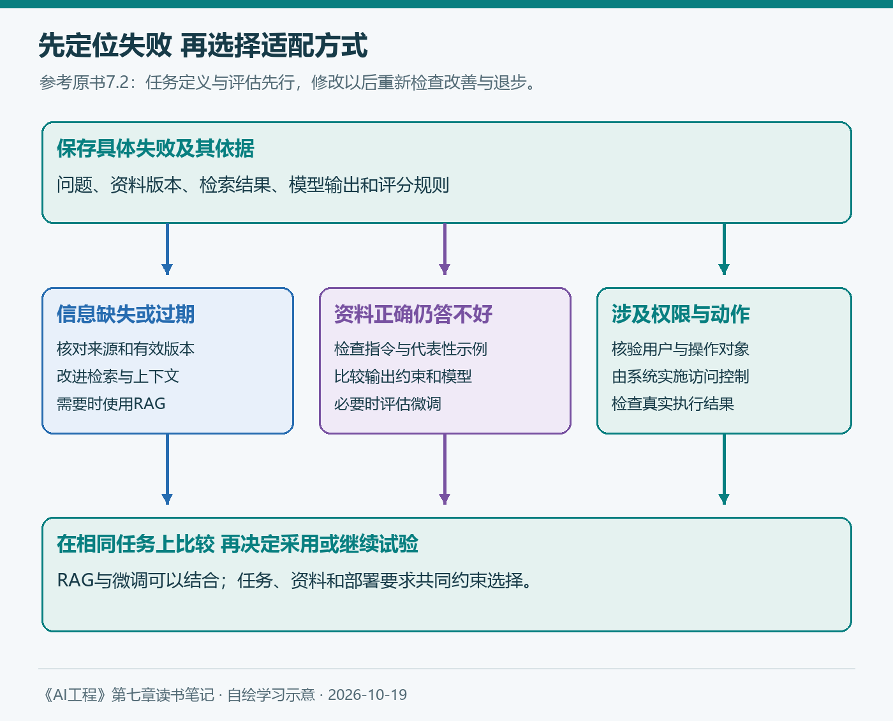

# 第七章（1/3）：微调概述与选择——什么时候需要改变模型权重

第四章让我把“回答得不错”拆成可以检查的应用要求，第五章讨论怎样把任务交代清楚，第六章则把检索、工具和记忆放进实际流程。沿着这条线读到微调，我最先想到的问题是：什么时候，仅仅改变模型看到的内容已经不够了？

继续用企业知识库和报销助手作例子。回答使用了过期制度，需要先调查资料和检索；正确条款已经提供，模型却反复遗漏适用条件，就需要进一步检查提示词、任务难度和模型行为。两种失败看起来都像“回答错误”，下一步投入却可能完全不同。

> 本篇对应Chip Huyen《AI工程：大模型应用开发实战》导言、7.1与7.2，按原书顺序展开。报销制度与应用场景均为假设；配图自绘，补充资料查阅于2026年10月19日。

**第七章三篇：** ①微调概述与选择 → ②内存瓶颈 → ③微调技术与实践。

## 7.1 微调概述

微调以已经训练过的基座模型为起点，进一步训练全部或部分参数，使它更适合目标任务。提示工程、RAG和工具主要改变本次输入及外部过程，微调则让训练数据影响模型权重。实际应用可以同时使用这些方法。

这里的基座模型是微调的起点，既可能是预训练模型，也可能已经经过指令或偏好后训练。选择起点时，需要结合目标任务理解它已经具备哪些能力，而不能只比较参数量。

### 迁移学习与样本效率

原书把微调放在迁移学习的背景下解释：将模型在一个任务中获得的能力，迁移到相关的新任务。通用语言模型已经学习语言、概念和许多任务模式，企业助手不必从识别中文开始训练。

这也是样本效率的来源。与从头训练相比，一个能力合适的模型可能用较少的示例就学会特定表达或处理方式。不过，“较少”依赖起点与目标任务的差距。几个优质示例能够改善某种固定格式，不代表同样数量足以教会模型复杂的业务判断。

迁移学习也不一定更新原模型。原书还介绍基于特征的迁移：先使用模型提取特征，再把这些特征交给其他模型。理解这种区别，有助于避免把所有利用预训练模型的方法都称为微调。

### 微调的几种形式

继续预训练通常使用未标注文本，延续模型原来的自监督学习目标。例如，先接触领域文档，再用任务样本训练。文档数量多、获取方便，是一种资源条件；它并不自动证明模型已经学会依据当前制度回答问题。

监督微调使用输入与期望输出对。对报销助手，训练样本可以包含用户问题、适用条款和目标回答，展示怎样解释条件、引用出处，以及在资料不足时追问。目标回答本身需要正确，否则模型也可能学习到遗漏和编造。

偏好微调则利用比较信息，例如同一提示词下哪一个回答更符合要求。偏好标准要与业务目标一致：如果标注者总是偏好语气笃定、内容完整的回答，却不核查证据，就可能奖励没有依据的补全。

原书也提到填充式微调和长上下文微调。前者与文本编辑、代码补全等任务有关，后者可能涉及位置表示和训练方式的调整。对当前知识库应用，先理解这些方法各自改变什么即可，无须把它们都列入第一轮实验。

## 7.2 何时进行微调

### 7.2.1 进行微调的原因

微调的一个直接用途，是改善特定任务上的表现。模型会写通用SQL，未必熟悉某个少见的方言；能够解释公开制度，也未必稳定遵循团队需要的回答结构。代表性的训练数据可以让模型反复接触目标处理方式。

对报销助手，假设每次都需要回答“适用条件、条款结论、来源、待补信息”。提示词和示例已经经过系统测试，模型仍经常省略待补信息，那么监督微调就是一个可以验证的候选。成功标准应提前定义为这些行为在新问题上更稳定，而不是训练样本上的回答更像标准答案。

原书还讨论了缓解偏见、小模型适配和蒸馏。经过任务微调的小模型，可能比更大的通用模型更适合某个狭窄场景；用较强模型生成数据训练较小模型，则需要继续检查生成数据的事实与偏差。

这些用途也与第四章的成本讨论相连。小模型可能降低推理开销，但获得训练数据、开展实验、部署和持续更新同样有成本。应比较完整任务的投入与效果。

### 7.2.2 不进行微调的原因

在项目刚开始时，任务定义、资料和评估往往还没有稳定。此时直接训练，可能把尚未弄清的问题固化进数据。第五章建立的提示词迭代过程，正好可以帮助发现要求是否明确、示例是否有代表性，以及哪些错误持续出现。

微调还可能使某类任务改善，另一类任务退步。原书用多任务场景提醒读者：只围绕当前失败训练，不一定保留其他能力。对报销助手，格式更稳定以后，仍要检查资料缺失、版本冲突、中英混合和正常咨询等原有类别。

数据与维护也是实际门槛。需要决定标注什么、怎样检查质量、如何划分开发与保留材料，并选择训练和部署方式。基座模型更新后，还要判断继续维护旧适配器，还是迁移到新的起点。

原书对领域专用模型的讨论给我另一个提醒：专业名称不等于专业效果。某个领域模型是否优于通用模型，仍要看具体任务。第四章的选型方法在这里继续有效：先筛除不满足许可、资源和部署要求的候选，再用自己的任务比较。

### 7.2.3 微调与RAG

原书建议从信息问题和行为问题判断适配方向。这个区分很实用，但需要落实到运行证据。

| 助手的假设失败 | 首先检查 | 可以尝试的措施 |
| --- | --- | --- |
| 引用了旧版住宿上限 | 文档版本、检索与排序 | 更新资料和检索流程 |
| 正确条款已提供，仍漏掉适用人群 | 指令、示例与模型理解 | 改提示词，必要时评估微调 |
| 字段无法稳定解析 | 输出约束、解析和重试 | 结构化输出与验证，再比较微调 |
| 新任务改善，原有问答变差 | 分组回归结果 | 调整数据、方法或模型方案 |

RAG让模型在回答时访问资料，适合处理需要更新、提供出处或受权限约束的信息。微调可以强化一种处理模式，例如如何使用材料、遵循格式和表达不确定性。企业制度更新后，仍应通过文档系统明确有效版本。

*图1：自绘，参考原书7.2与图7-3。先根据证据定位失败，再选择投入方向；每次修改之后都要重新评估。*

“RAG处理事实、微调处理形式”可以帮助记忆，却不宜作为绝对边界。微调能够学习知识，RAG也依赖模型正确理解和使用上下文。一个应用可能需要补充资料，同时训练模型更可靠地处理这些资料。

2026年9月的TRACE预印本，研究了检索内容与模型内部知识冲突时的训练方法，尝试改善知识来源选择和回答完整性。它为“RAG与微调怎样配合”提供了一个研究例子，结论仍应限定在其实验设置中。[论文原文](https://arxiv.org/abs/2609.30337)

对企业助手，我会进一步保留来源、时间和适用范围等业务规则。论文中利用内部知识回退的策略，不能直接替代“缺少有效制度时说明资料不足”的应用要求。

## 我的理解 先把微调写成一个可验证的决定

第四章留下的30题，可以继续用于开发和回归，帮助整理持续出现的错误。但这些题已经参与过提示词修改，就不能再被当作完全独立的最终检验。训练和调参以外，还需要保留未参与改进的代表性材料。

我会在训练前写清楚三件事：准备改善什么失败，为什么现有提示词和资料流程仍不足，以及怎样检查改善与退步。训练数据则围绕这些失败收集，同时覆盖必须保留的正常任务。

这样，微调就成为能够与换模型、改提示词和改检索比较的工程方案。下一篇进入内存瓶颈，理解为什么同一个模型可以运行，却未必能够在相同设备上训练。

## 参考与说明

- Chip Huyen：《AI工程：大模型应用开发实战》，导言、7.1与7.2。
- Huang等：[Parameters vs. Context: TRACE Fine-Tuning for Robust Retrieval-Augmented Generation](https://arxiv.org/abs/2609.30337)，2026-09-24预印本。
- 本文使用AI辅助梳理与起草；原书观点、后续研究与个人理解分别表述。业务案例与评估安排为学习方案，图为自绘概念图，没有呈现未经执行的实验成绩。
