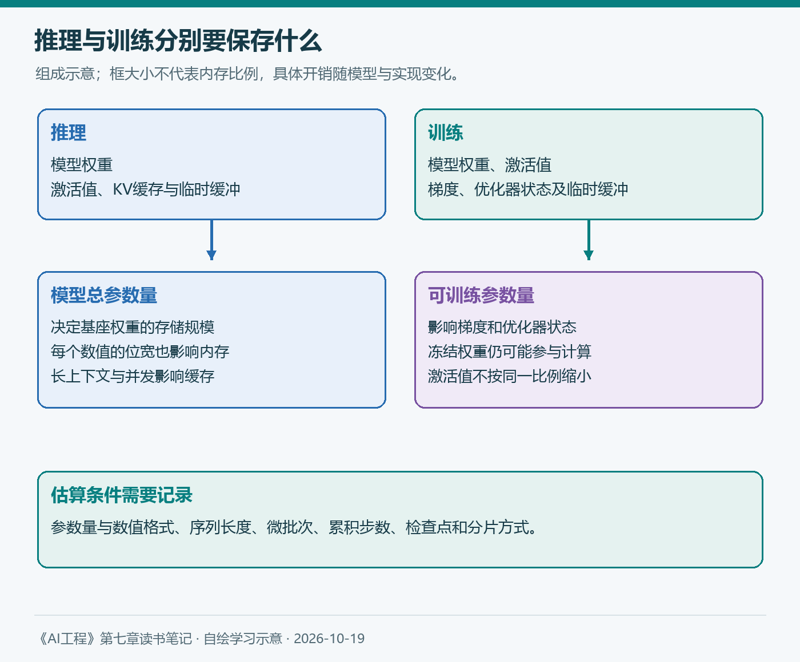
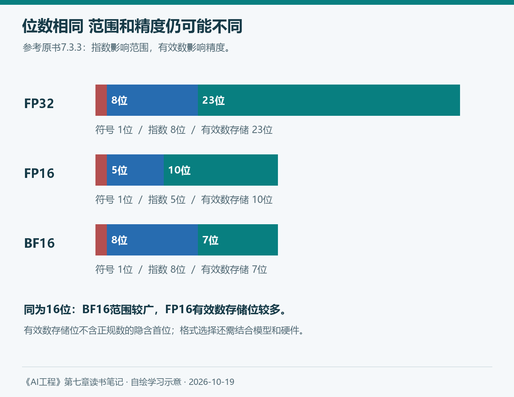

# 第七章（2/3）：内存瓶颈——为什么推理能运行，微调却放不下

上一篇先讨论是否需要微调。决定进一步尝试以后，一个现实问题随之出现：模型明明可以加载和回答，为什么开始训练就提示内存不足？

第四章把可用硬件作为选型条件，第七章的7.3进一步解释这个条件如何产生。运行模型需要存放权重，训练还要保留计算和更新所需的信息。模型文件的大小，只是估计资源需求的起点。

> 本篇对应原书7.3，依次讨论反向传播、内存计算、数值表示和量化。公式与数字为有明确假设的学习估算；配图自绘，官方实践文档查阅于2026年10月19日。

**第七章三篇：** ①微调概述与选择 → ②内存瓶颈 → ③微调技术与实践。

## 7.3 内存瓶颈

原书解释内存问题，是为了帮助读者理解后续微调技术：有的方法减少可训练参数，有的方法减少每个数值占用的位数，也有的方法用额外计算换取更低的存储需求。先知道内存用在什么地方，才容易判断优化针对什么。

### 7.3.1 反向传播与可训练参数

可训练参数是本次训练中允许更新的参数，冻结参数则保持不变。预训练通常更新整个模型；微调可以更新全部参数，也可以只更新一部分。

神经网络训练的一次更新，可以概括为三个环节：先根据输入计算输出；再通过损失函数衡量输出与目标的差异；最后计算梯度，由优化器据此调整参数。

从输入计算输出是前向传播。为了求梯度并更新参数，训练还需要反向传播。梯度描述损失对参数变化的局部敏感程度；优化器决定怎样利用这些信号形成更新。

这时出现了额外的存储需求。除了权重，还可能需要为反向传播保留激活值、为可训练参数保存梯度，以及保存优化器状态。Adam通常为每个可训练参数维护两组状态，因此可训练参数的数量会显著影响内存。



*图2：自绘，参考原书7.3.1与7.3.2。框的大小不代表实际内存比例；训练还有临时缓冲、框架等开销，具体实现可能不同。*

这里有一个容易混淆的地方：冻结一个参数，意味着不为它执行参数更新，并不意味着相关前向计算全部消失。如果它处在可训练模块之前或之间，训练仍可能需要经过它传递信号。激活值是否保存、如何重计算，要看计算图与框架实现。

因此，PEFT虽然能大幅减少梯度和优化器状态，仍需要加载基座权重，也仍可能受到长序列激活值的限制。这正是“只训练少量参数”不能直接换算成“只使用同样比例内存”的原因。

### 7.3.2 内存计算

#### 推理需要什么

假设参数数量为N，每个参数占用M字节，加载权重所需的内存可以先估为：

```text
权重内存 ≈ N × M
```

例如，一个70亿参数模型使用16位格式，每个参数占2字节，则原始权重约为140亿字节，也就是14 GB。这里采用十进制换算，1 GB为10亿字节；它与设备或软件显示的GiB口径不同。

但推理还需要激活值、临时缓冲等空间。对自回归Transformer，多次生成过程中保存的KV缓存也会占用内存，且受上下文长度、并发与模型结构影响。

原书用权重内存的一定比例估计其他开销，适合帮助初步理解。实际任务的输入很长、并发较高时，这个比例可能不适用。14 GB的权重，并不等于14 GB的可用内存就一定足够运行。

#### 训练增加了什么

训练内存的主要组成，可以写为：

```text
训练内存 ≈ 权重 + 激活值 + 梯度 + 优化器状态 + 其他运行开销
```

沿用70亿参数模型。如果所有参数可训练，并假设权重、梯度和Adam的两组状态都各用2字节，那么这四组数值需要：

```text
权重：70亿 × 2字节 = 14 GB
梯度与两组优化器状态：70亿 × 3 × 2字节 = 42 GB
以上合计：56 GB，尚未计入激活值和其他开销
```

这是理解数量级的简化算例。实际混合精度训练可能使用FP32优化器状态或额外的高精度权重副本，也可能使用分片、压缩等方式，所以不能把56 GB直接当作购买硬件的保证值。

如果只更新一小部分参数，梯度和优化器状态就可以相应减少。不过，基座权重与激活值依然需要考虑。内存估算必须分别计算这些组成，避免把模型总参数量与可训练参数量混用。

#### 激活值与梯度检查点

前向传播产生的中间结果，可以留给反向传播使用。在长序列、大批次和特定训练配置下，激活值可能成为主要开销。仅仅缩小适配器，未必解决这类瓶颈。

梯度检查点，也称激活值重计算，选择只保存部分中间结果，其余在需要时重新计算。它降低存储需求，同时增加计算量。对我而言，这个例子很好地说明了工程权衡：内存、计算时间与实现复杂度需要一起看。

CPU卸载和分布式分片则从数据放置与分配入手。它们可以减少单块GPU的压力，但可能引入传输、同步和额外配置成本。判断一个方案是否合适，还应观察完整训练过程的峰值内存与耗时。

### 7.3.3 数值表示

前面的计算把每个参数设为2字节。这实际上已经作出了一个数值格式选择。数值占用的位数越少，可以存放的数量通常越多，但表示能力也会发生变化。

浮点数通常包含符号、指数与有效数部分。指数影响可表示范围，有效数影响精度。位数相同的两种格式，可以通过不同分配获得不同的范围和精度。

| 格式 | 位数 | 符号、指数与有效数存储位 | 本篇关注的区别 |
| --- | --- | --- | --- |
| FP32 | 32 | 1、8、23 | 占用较大，精度较高 |
| FP16 | 16 | 1、5、10 | 比BF16精细，但范围较窄 |
| BF16 | 16 | 1、8、7 | 范围较广，但有效数位较少 |

表中的有效数存储位没有计入正规数的隐含首位。这里只比较格式组成，不据此推断某个模型的最终效果。



*图3：自绘，参考原书7.3.3与图7-6。FP16与BF16总位数相同，指数和有效数部分的分配不同。*

例如，转换格式可能让一个数值发生舍入，也可能使超出范围的数值成为无穷大。单次误差很小，经过大量运算和参数更新以后，仍可能影响训练稳定性。

加载模型时，应核对模型约定的数值格式及硬件支持。看到FP16和BF16都占2字节，就认为可以随意互换，会忽略它们不同的表示范围。数值格式与计算内核、累加方式和框架设置共同影响实际运行。

原书还介绍TF32及整数格式。对应用开发者，先掌握“存储用了多少位、计算用了什么格式、哪些部分保持较高精度”这几个问题，比记住所有格式名称更有帮助。

### 7.3.4 量化

量化通过更低位宽表示数值，减少存储需求。严格术语与工程实践中“量化”的使用范围有所差异；原书把它放在降低精度的整体背景下讨论。

首先要问量化什么。只量化权重，仍保留其他部分较高精度，与同时量化激活值、缓存等部分，是不同的配置。某个方案写着“4位”，并不意味着运行过程中的每个数值都只有4位。

其次要问什么时候量化。训练后量化在模型完成训练后处理数值；量化感知训练则在训练期间模拟低精度影响，帮助模型适应部署方式。模拟低精度并不必然减少训练计算量，也不能直接等同于所有运算都用低精度执行。

#### 推理量化

较低位宽可以减少权重内存，使某些模型能够在更有限的设备上运行。但速度收益依赖硬件、内核、批次和转换开销。文件变小，并不能单独证明延迟已经降低。

对报销助手，量化后仍要检查金额、适用条件、引用和资料缺失时的回应。较高的平均正确率，也可能掩盖少数关键任务的退步。第四章的分组评估在这里仍然需要保留。

#### 训练量化

训练对数值误差更敏感，因此常见做法是混合精度：一些部分使用较低精度，另一些部分保留较高精度。训练权重的存储格式、矩阵计算格式与优化器状态格式，应分别记录。

当前PEFT官方文档把量化与适配器结合，并展示低位权重加载、计算类型和训练准备的配置。它说明“降低基座权重存储”与“训练新增参数”可以共同使用；具体是否放得下，仍取决于模型和运行设置。[官方文档](https://huggingface.co/docs/peft/developer_guides/quantization)

下一篇讨论QLoRA时，会继续沿着这条线理解：它同时利用量化和低秩更新，而不是把全部训练对象都改成4位。

## 我的理解 把内存估算写成有条件的记录

如果准备第一次微调，我会先记录模型总参数量与可训练参数量，再记录权重、梯度、优化器和计算使用的格式。随后补上序列长度、批次、梯度累积、检查点、卸载和分片等设置。

理论估算帮助排除明显不可行的方案，小规模试运行则用于观察真实峰值与耗时。出现内存不足时，应先判断压力主要来自权重、激活值还是训练状态，再决定减少批次、缩短序列、使用重计算或调整微调方法。

第四章讨论的是在约束下选模型，本篇让我进一步认识这些约束。下一篇将进入PEFT、LoRA、模型合并和训练策略，理解如何在资源条件下构建与验证定制模型。

## 参考与说明

- Chip Huyen：《AI工程：大模型应用开发实战》，7.3。
- Hugging Face：[PEFT Quantization](https://huggingface.co/docs/peft/developer_guides/quantization)，查阅于2026-10-19。
- 本文使用AI辅助梳理与起草；数字为十进制单位下的简化估算，具体假设已在正文注明。两图为自绘示意，没有使用未经测量的内存比例或性能曲线。
