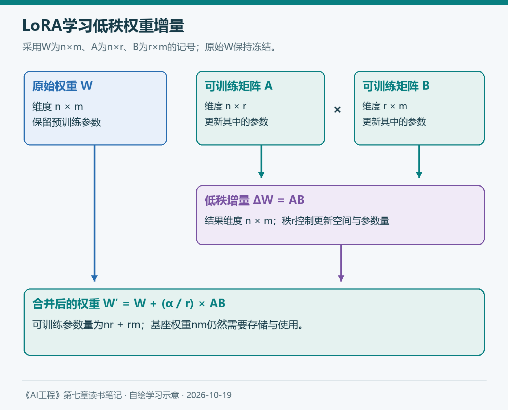
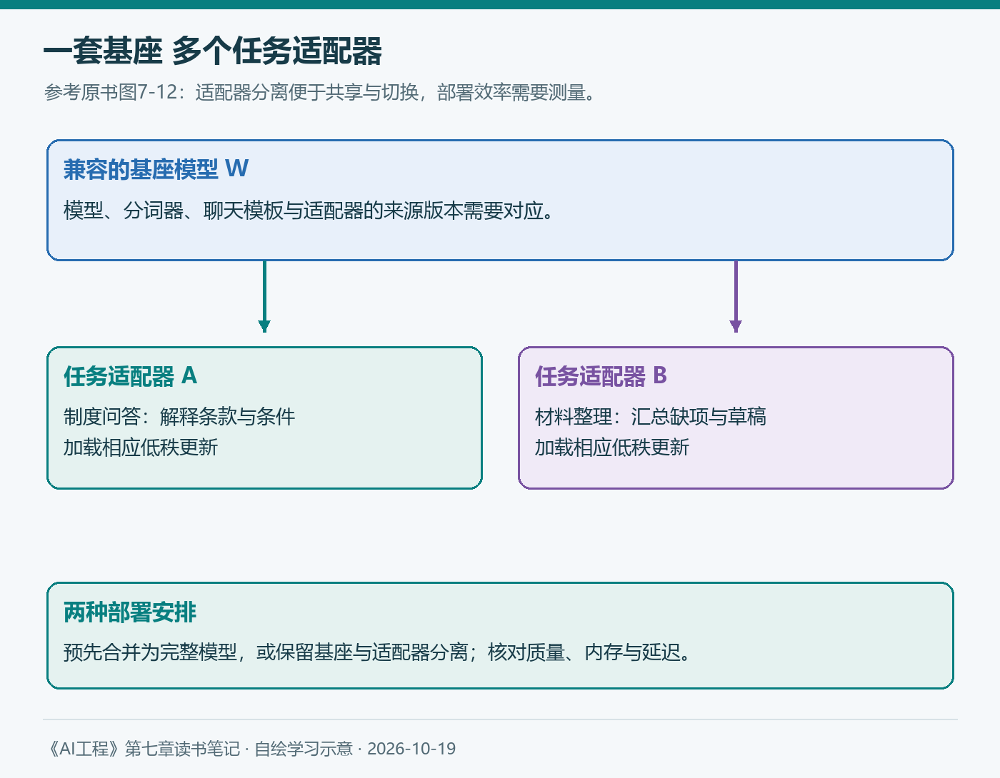
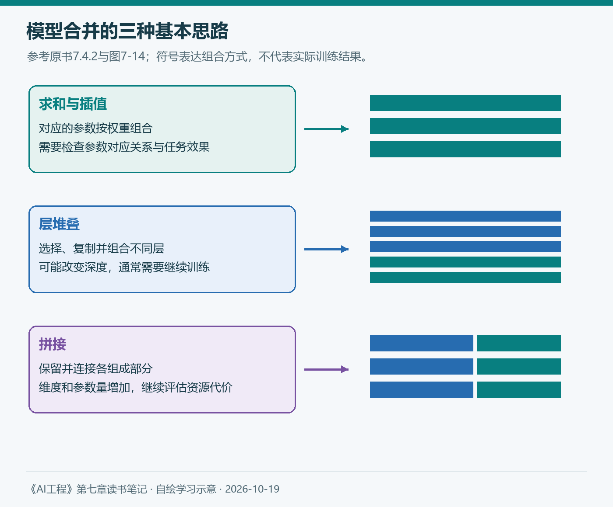
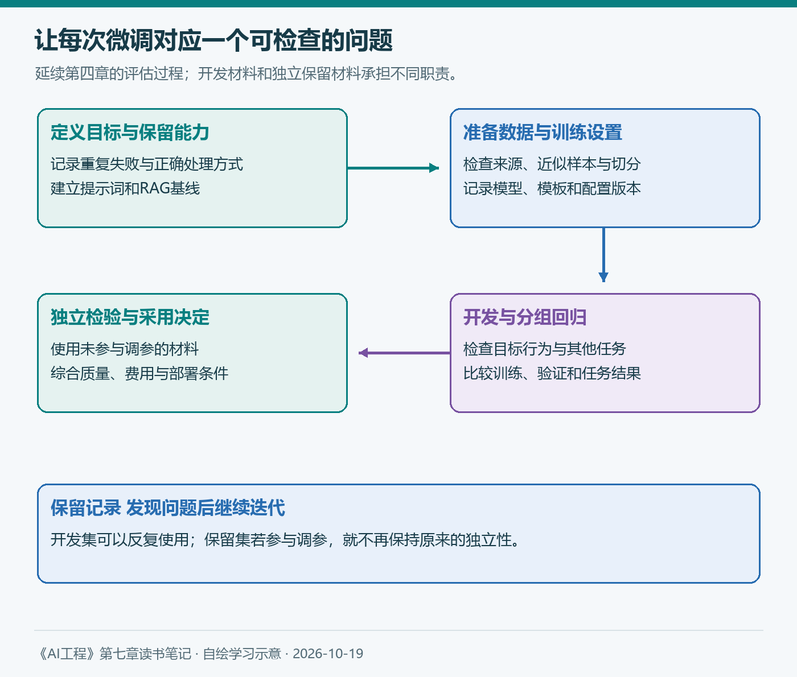

# 第七章（3/3）：微调技术与实践——从LoRA到模型合并和训练策略

第一篇先判断是否值得微调，第二篇解释权重、激活值、梯度和优化器状态怎样占用内存。进入具体技术以后，问题就可以问得更清楚：准备减少哪部分开销，改变哪些参数，又怎样判断结果值得保留？

原书7.4先讨论参数高效微调，再介绍模型合并，最后落到基座模型、框架和超参数。这个顺序很自然：先理解训练方式，再理解多个模型怎样组合，最后把选择放回自己的任务与资源条件。

> 本篇对应原书7.4与7.5，继续使用企业知识库和报销助手。业务案例与实验安排均为学习方案；配图自绘，补充资料查阅于2026年10月19日。

**第七章三篇：** ①微调概述与选择 → ②内存瓶颈 → ③微调技术与实践。

## 7.4 微调技术

### 7.4.1 PEFT

#### 从全量微调到参数高效微调

全量微调允许更新整个模型。部分微调只更新其中一部分，例如冻结前面的层，训练靠近输出的层。参数高效微调，也就是PEFT，则试图用少得多的可训练参数，获得有用的任务适配效果。

上一篇已经说明，可训练参数减少以后，梯度和优化器状态可以随之减少。但基座模型仍需要参与计算，长序列的激活值也可能占用很多内存，因此参数效率与实际训练内存之间需要分别核算。

原书介绍了基于适配器和基于软提示的两类方法。适配器通过额外模块或参数调整模型；软提示则引入可训练的连续向量，影响模型如何处理输入。它们都使用训练来改变行为，软提示也不是一段可以直接阅读的自然语言要求。

这一点接回第五章很有帮助。提示词中的示例由我们编写和选择；软提示的向量由优化过程学习。两者都可能引导模型，但保存形式、优化方式和使用条件不同。

#### LoRA怎样更新权重

LoRA可以理解为：保留原始权重，学习一个参数量较小的权重增量。

设原权重矩阵W的维度为n×m。构造A和B两个矩阵，维度分别为n×r与r×m，那么乘积AB的维度仍是n×m。r是低秩更新的秩，通常远小于原矩阵的两个维度。

```text
ΔW = AB
W′ = W + (α / r) × AB
```

α控制增量的缩放。微调时更新A和B，原来的W保持冻结。不同实现可能交换A、B的命名和乘法顺序，读代码时应以维度和实际定义为准。



*图4：自绘，参考原书7.4.1与图7-11。LoRA学习权重增量；图中采用W为n×m、A为n×r、B为r×m的记号。*

用一个小算例看参数量：W为4096×4096，共16,777,216个参数。若r为8，A与B合计有4096×8＋8×4096＝65,536个可训练参数。更新参数明显减少，但原始W仍然存在。

原书用低秩分解帮助解释LoRA。实际理解时，需要保留“增量”这个对象：普通LoRA并不把预训练权重W直接替换成两个小矩阵，也不要求W本身必须低秩。

为什么较小的更新空间仍然有效？原书从预训练已经获得的能力和内在维度讨论这一问题。对应用开发，我更愿意把它当作需要验证的经验：已有能力与目标任务接近时，有限的更新可能已经足够；任务跨度和数据需求变化以后，容量限制也可能显现。

#### 秩、缩放与目标矩阵

应用LoRA至少要决定两件事：把它加在哪些矩阵上，以及每个更新使用多大的秩。扩大秩会增加参数量，但不保证任务效果单调提高；优化是否充分、数据是否合适，也影响结果。

原书讨论查询、键、值和输出投影矩阵，并指出前馈层也值得考虑。不能把某次注意力矩阵上的成功配置，直接当成所有架构与任务的最佳选择。

2025年9月，Thinking Machines的《LoRA Without Regret》研究了LoRA与全量微调接近的条件。在其测试中，目标矩阵、训练容量、批次和学习率都会影响比较结果，覆盖MLP等矩阵也很重要。它补充了原书的经验判断：效果差距应结合配置与任务分析。[研究原文](https://thinkingmachines.ai/blog/lora/)

因此，实验记录应写清目标模块、秩、缩放方式、学习率和训练预算。仅写“用了LoRA”，还不足以复现一个方案，更不能解释两个结果为何不同。

#### 部署LoRA适配器

完成训练后，可以在兼容的权重格式下把增量合并进基座权重，再部署新的完整模型。也可以保留基座与适配器分离，在推理时使用相应更新。后一种方式便于让多个任务共享同一套基座权重。

对企业助手，制度问答与申请材料整理可以分别拥有适配器。切换时加载对应的小模块，可能比加载多个完整模型更经济，但缓存、调度和计算开销仍需实际测量。



*图5：自绘，参考原书图7-12。任务适配器共享兼容基座；是否合并权重、怎样调度以及可支持的并发，取决于部署实现。*

原书有一个存储算例值得复核：约1680万个参数的矩阵，存100份应为约16.8亿个参数，截图中的1.68亿少了一位数量级。若共享一份基座，加上100组各65,536个参数的适配器，则约为2333万个参数。这里仅比较矩阵参数量，未计入文件、运行缓存和其他组件。

#### 量化LoRA

当适配器已经很小时，继续缩小它，对整体内存的帮助可能有限。基座权重仍占据大量空间，因此QLoRA将低位权重存储与LoRA训练结合起来。

原书介绍的QLoRA使用NF4存储基座权重，在计算时按需要反量化，并训练额外的低秩参数。理解它时要分清权重存储、计算类型和优化器状态，不能把“4位模型”理解为整个训练过程的所有数值都只有4位。

上一篇引用的PEFT量化文档可以作为实现入口。选择配置后，应先做小规模试运行，检查真实峰值内存、训练速度和输出质量。量化减少了存储，也可能引入转换开销与误差，不能只看模型文件大小。

### 7.4.2 模型合并与多任务微调

#### 从多任务训练理解模型合并

如果助手要完成制度问答、票据整理和申请草稿生成，可以把这些任务混合进同一个训练集，同时微调；也可以按任务顺序训练。前者需要处理任务分布与学习难度，后者则可能发生灾难性遗忘。

模型合并提供了另一条路径：分别得到多个模型或适配器，再组合成一个模型。它可能用于汇合任务能力、减少部署实例，也可以服务于联邦学习和设备端使用。

这里需要区分模型集成。集成通常保留多个模型，各自生成结果再组合；模型合并通常直接组合参数或结构。集成需要多次推理调用，合并则需要验证组合后的单个模型是否真的保留了各项能力。



*图6：自绘，参考原书图7-14。图示只表达参数或结构的组合方式；兼容性、合并后的规模与训练需求需要分别检查。*

#### 求和与插值

线性组合可以对兼容参数求平均或加权平均。例如，模型A与B的权重分别为wA和wB时，概念上可以写成：

```text
Merge(A, B) = (wA × A + wB × B) / (wA + wB)
```

这一式子要求分母非零，并且被组合的参数能够对应。来自同一基座的微调模型，更容易建立这种对应关系；参数形状相同也不自动保证功能完全对齐。

原书还介绍任务向量：微调模型的参数减去基座参数，得到此次训练带来的变化。可以尝试组合不同任务的变化，也可以对变化进行剪枝，减少任务之间的干扰。TIES、DARE等方法从这些问题出发设计具体处理。

SLERP则把两个向量看作球面上的点，在它们之间插值。它与线性平均的路径不同，但选择了某种插值，并不意味着自动获得更好的业务效果。模型合并后的任务检查仍然不可省略。

#### 层堆叠

层堆叠从已有模型中选择、复制或组合不同层，构造新的结构。原书用模型扩容等例子说明，可以利用已训练的组件继续构建更大的模型，随后通过训练适应新的层次关系。

这里的兼容不只看参数文件能否加载。相邻层的表示、维度、位置处理和最终性能都需要考虑。堆叠增加深度后，内存、延迟和训练条件也随之变化。

混合专家模型还涉及专家副本与路由。它与把多个模型输出汇总的多智能体流程有不同机制，写作和实现时应根据实际参数结构区分，避免因为都出现“多个模型”就混为一谈。

#### 拼接

拼接保留各组成部分的参数。两个LoRA适配器的增量相加，可以通过拼接相应因子来表示，拼接后的因子维度对应两个秩之和；实际矩阵秩还受线性相关性限制。

参数增加可能保留更多更新信息，也可能提高存储与计算成本。是否采用，应比较同一任务上的收益和代价。它与“平均以后保持原来大小”的合并方式，具有不同的资源特性。

对于报销助手，我会先分别评估每个任务适配器，再评估合并版本。只汇总一个总分，可能掩盖制度问答改善、资料缺失处理却退步的情况。第四章的分组记录正好用于识别这种交换。

### 7.4.3 微调策略

#### 基座模型和微调框架

选择基座时，第四章的标准仍然有效：任务能力、许可协议、部署方式、资源需求和维护条件。较强模型可以帮助探索任务上限，但训练方案还需要满足实际预算。

原书介绍渐进与蒸馏两条开发路径。渐进路径先用低成本模型检查代码和数据流程，再用更强模型探索效果；蒸馏路径则利用强模型生成或筛选数据，再训练较经济的模型。两者都需要核查数据，而不是把强模型输出直接当作事实。

微调方法也应匹配目标。LoRA等方法可以作为较低资源投入的候选；如果不能满足要求，就分析容量、数据与优化是否构成限制，再比较全量微调。每次同时改变模型、数据和方法，会使原因难以解释。

框架方面，托管API简化资源准备，但可用模型和控制选项受到服务约束。自主训练提供更多控制，也需要管理环境、显存、检查点和部署。原书列出的PEFT、LLaMA-Factory、Axolotl等项目，可以按当前文档与模型支持情况筛选，无须为了比较框架先搭建所有方案。

实际执行前，先检查分词器和聊天模板、输入输出样本、截断位置、损失掩码，以及检查点能否保存和恢复。第五章讲过角色与模板，进入训练以后，这些信息也成为数据解释的一部分。

#### 微调超参数

学习率控制更新幅度。过大可能使训练不稳定，过小则可能进展缓慢。应连同训练与验证曲线、任务输出一起检查，不能只从某一次损失下降推断配置最佳。

批次大小是一次更新汇集的样本量。内存不足时，可以用较小的微批次配合梯度累积；记录时还应写出设备数量和累积步数。常见有效批次估算为“每设备微批次×设备数×累积步数”，但变长样本的token量与损失归一化仍可能影响实际优化。

epoch表示遍历训练数据的轮数。训练损失继续下降、验证表现开始退步，是需要调查过拟合的信号。是否增加训练，还要看新材料上的任务结果；不能因为训练样本回答更熟练，就认为应用更可靠。

提示词损失权重决定训练怎样看待输入与回答。当前TRL文档区分对话数据的`assistant_only_loss`与提示词—补全数据的`completion_only_loss`，部分选项还依赖聊天模板提供掩码。原书中的权重示例不能直接作为所有框架的默认值。[官方文档](https://huggingface.co/docs/trl/sft_trainer)

#### 把一次微调放回评估流程

接着第四、第五章，我会围绕同一个失败设计对照：提示词已经明确、资料正确提供，模型仍频繁遗漏条件。比较时保持问题、检索资料、生成设置与评分规则一致，分别记录目标行为和其他任务的变化。

| 方案 | 希望回答的问题 |
| --- | --- |
| 原模型与现有提示词 | 当前问题出现在哪里？ |
| 同一模型与优化后的提示词 | 不训练能改善多少？ |
| 上一方案增加RAG | 提供适用资料后有什么变化？ |
| 同一基座经LoRA微调，使用相同RAG流程 | 训练带来什么额外收益或退步？ |



*图7：自绘，延续第四章的评估流程。开发和回归材料用于迭代，独立保留材料用于检验泛化；是否采用还要结合费用、延迟与部署条件。*

已有30题可以继续帮助开发与回归，但它们已经参与过提示词修改。另留未参与训练和调参的代表性材料，并检查同源文档、近似问答和生成变体的泄漏。若依据保留集反复调整方案，它也就逐渐承担了开发集的作用。

训练数据既要展示希望改善的行为，也要覆盖必须保留的正常任务。评估继续检查结论依据、条件完整、资料不足时的回应、输出格式，以及第五章讨论的异常输入和误拒。权限和真实操作仍由应用系统控制，不能交给一次训练结果保证。

最终记录模型、分词器、模板、数据版本、适配器配置、训练设置与部署方式。比较完整任务的费用、延迟和维护成本，再决定采用或回退。没有跑过的实验，只能作为待执行方案，不能填入假设提升率。

## 7.5 小结

第七章从是否微调开始，解释内存瓶颈，再讨论PEFT、模型合并和训练策略。它使我把“定制模型”理解成一组相互关联的决定：任务需要改变什么，资源允许怎样改变，以及什么证据能够支持采用。

第四章提供评估标准，第五章帮助表达任务，第六章组织资料、工具和状态。进入微调以后，这些工作仍然需要保留。权重发生变化，会增加一种适配手段，也增加数据、版本和回归比较的责任。

我最想继续实践的，是让每次训练对应一个明确问题，并保存改善与退步的证据。至于训练材料怎样获得、筛选和维护，原书下一章将继续展开；选好方法之后，数据工作才刚刚开始。

## 参考与说明

- Chip Huyen：《AI工程：大模型应用开发实战》，7.4与7.5。矩阵存储算例的数量级已在正文复核并说明。
- Thinking Machines：[LoRA Without Regret](https://thinkingmachines.ai/blog/lora/)，2025-09-29。
- Hugging Face：[PEFT Quantization](https://huggingface.co/docs/peft/developer_guides/quantization)与[TRL SFT Trainer](https://huggingface.co/docs/trl/sft_trainer)，查阅于2026-10-19。
- 本文使用AI辅助梳理与起草；原书观点、后续研究与个人理解分别表述。四图为自绘概念图，数字为参数量算例；业务场景与训练对照为学习方案，没有呈现未经执行的实验成绩。
