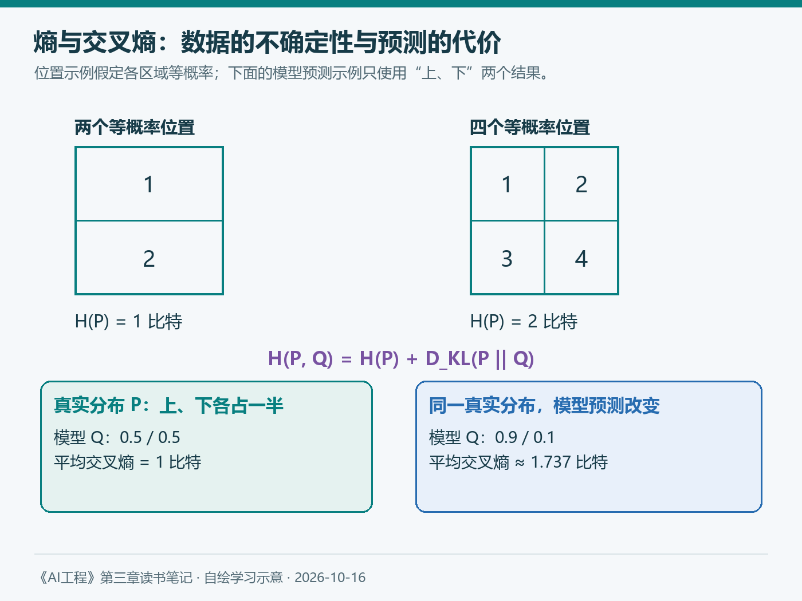
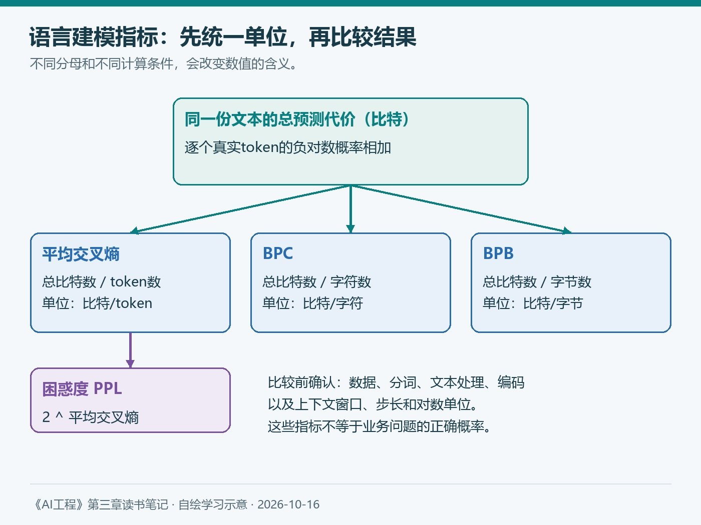

# 第三章（1/4）：评估基础模型的挑战与语言建模指标

第一章让我开始从应用目标理解AI工程：先知道什么算成功，才能判断系统是否值得使用。第二章进一步解释了模型怎样学习、怎样生成，以及为什么格式正确的回答仍可能出错。

顺着书的顺序读到第三章，问题就变得具体了：面对一个输出，我们究竟拿什么证据评价它？作者先讨论评估的困难，再介绍语言建模指标，随后才进入面向应用的评估方法。这篇沿着前两部分展开。

> 本篇对应Chip Huyen《AI工程：大模型应用开发实战》第三章导言、3.1与3.2。保留原书章节顺序，用学习笔记的方式重新解释；算例和中文图为自编学习材料，不代表项目实测。补充资料查阅于2026年10月16日。

**第三章四篇：** ①评估挑战与语言建模指标 → ②精确评估 → ③AI当裁判 → ④比较评估与模型排名。

## 3.1 评估基础模型的挑战

本章导言把评估放回整个系统：我们需要降低风险，也需要发现改进机会。因此，评估首先要使问题可见。如果知识库助手答错了，我们至少需要知道它看到了什么资料、采用了哪个版本，以及最终答案是否超出了证据。只有一个总分，很难帮助定位错误。

### 模型越有能力，判断它也可能越费力

一个明显错误的答案通常容易识别。真正困难的是逻辑流畅、术语准确，却在某个关键条件上出错的回答。对于专业摘要，核查者可能需要重新阅读原始材料；对于复杂代码，可能需要理解需求并运行测试。

这里有一个值得警惕的变化：生成变快以后，验证并不会自动变快。我们节省了起草时间，也可能增加阅读、核对和纠错的工作。评估成本应该放进应用的整体成本中考虑。

### 开放式任务很难穷举正确答案

传统分类任务通常有预先定义的类别，预测结果可以直接与标签比较。开放式任务则可能有许多可接受的表达。

假设制度写着“普通员工境内出差住宿标准为每晚500元”。“上限是500元”和“按规定每晚最多报销500元”都可能正确。把参考答案只写成第一句，再要求字符串完全一致，就会惩罚第二种有效表达。

反过来，写成“上限是650元”只改动了一个数字，表面仍非常相似，却改变了业务结论。怎样容纳合理变化，同时发现重要错误，是开放式评估的难点。

### 黑盒、基准饱和与能力范围扩展

书中还讨论了三种困难。其一，开发者未必知道模型的训练数据和内部机制，只能通过输入输出观察能力。其二，公开基准会逐渐饱和，模型在旧测试上接近满分以后，分数不再容易区分能力。其三，通用模型可能完成训练任务之外的新任务，评估还承担了探索能力边界的责任。

这些因素共同说明：一份公开成绩单很有参考价值，但它无法直接给出“我的应用是否可靠”的答案。第二章讨论过语言与领域分布，这里就需要回到实际资料、问题和成功标准。

原书通过评估论文和开源仓库的增长，说明研究兴趣正在增加，同时提醒评估基础设施仍然不足。那些统计属于书中的历史背景。我更想保留它带来的提醒：工具数量增长以后，任务定义、参考数据和错误分析依然需要自己完成。

## 3.2 理解语言建模指标

第二章讲到，自回归语言模型根据前文预测下一个token。语言建模指标评价的正是这件事：真实后续内容出现时，模型给它分配了多大的概率。

理解这组指标，可以帮助我们阅读训练报告和解释分布差异。但它们主要提供预测层面的证据。知识库助手是否引用了正确制度、是否遗漏适用条件，还需要后续的任务评估。

### 3.2.1 熵

熵描述一个分布平均有多少不确定性，也可以理解为在理想编码条件下，表示一个结果平均需要多少信息。

沿用书中描述正方形位置的思路：如果只有“上、下”两个位置，而且出现概率相同，区分一次位置需要1比特；如果分成四个等概率区域，就需要2比特。



*图1：自绘学习示意。左侧例子假定每个区域等概率；区域数增加时，不确定性才按这里的方式增加。*

离散分布的熵可以写成：

```text
H(P) = -Σ P(x) log₂ P(x)
```

其中，P(x)是真实分布中结果x出现的概率，Σ表示把所有可能结果的贡献加起来。概率越小的结果，出现时带来的“意外程度”越大；熵按它们实际出现的频率计算平均值。

等概率条件非常重要。四个区域中，如果一个区域出现的概率是97%，另外三个各占1%，我们经常能猜中最常见的区域，其熵就低于四个区域各占25%的情况。可选结果更多，并不单独保证熵更高。

语言也有类似现象。在“请填写您的姓名和”之后，“联系方式”可能比许多别的词更容易预测。不过真实模型以token为单位，具体拆分方式要看分词器。

### 3.2.2 交叉熵

熵关注数据本身的不确定性；交叉熵还要考虑模型怎样预测这些数据。

设真实分布为P，模型预测的分布为Q。交叉熵是在P产生的数据上，使用Q计算得到的平均预测代价：

```text
H(P, Q) = -Σ P(x) log₂ Q(x)
H(P, Q) = H(P) + D_KL(P || Q)
```

第二行把代价分成两部分：数据本身的不确定性，以及模型分布与真实分布不匹配带来的额外代价。KL散度通常不对称，不能随意交换P和Q。

用一个自编例子理解：真实数据中，“上、下”各占一半。如果模型也预测各占一半，交叉熵就是1比特。如果模型认为“上”的概率是0.9、“下”是0.1，那么遇到“下”时就会付出较大代价，平均交叉熵约为1.737比特。

真实数据没变，代价上升来自预测分布不合适。对语言模型而言，这意味着不能只看它有没有猜中最高概率的词，还要看它如何给真实后续内容分配概率。

### 3.2.3 BPC与BPB

按token报告交叉熵有一个比较问题：两个分词器可能把同一段文本切成不同数量的token。一个token平均承载的信息不同，数值就不适合直接横向比较。

书中介绍了两种归一化单位：

| 指标 | 含义 | 计算时要明确什么 |
| --- | --- | --- |
| BPC | 每字符比特数 | 字符计数规则、文本处理方式 |
| BPB | 每字节比特数 | 原始文本编码、字节计数方式 |

在同一段已评估文本上，如果总预测代价是600比特，文本包含200个字符、300个实际编码字节，那么BPC为3，BPB为2。这是计量示例，不是某个模型的测试结果。

原书用字符与字节的换算说明BPB。实际计算应以所用编码的真实字节数为准：例如UTF-8下，常见ASCII字符通常占1字节，不能把历史上7比特的ASCII码位长度直接当成文件中的7/8字节。

换成BPC或BPB能缓解token单位不一致的问题，但仍需统一文本、编码和评估方法。它们也不能单独证明模型具有更好的业务判断能力。

### 3.2.4 困惑度

困惑度是交叉熵的指数形式，通常写为PPL。如果交叉熵以比特计算，使用2为底；如果以自然对数计算，单位为nat，使用e为底：

```text
PPL = 2^(平均交叉熵，比特/token)
PPL = exp(平均交叉熵，nat/token)
```

两行表达相同关系，只是单位不同。对于一个等概率、每次从四个结果中选择的理想例子，交叉熵为2比特，困惑度就是4。可以把它理解为等效的不确定性大小。

真实语言分布并不均匀，所以“困惑度为4”不能直接翻译成“模型有25%的概率答对业务问题”，也不能直接当作逐词预测准确率。

对一个长度为n的token序列，常见的计算形式是：

```text
L = -(1/n) × Σ ln Q(xᵢ | x₁, …, xᵢ₋₁)
PPL = exp(L)
```

计算时，把真实前文交给模型，取真实下一个token的概率，累加负对数再求平均。这里是在对给定文本评分，并非让模型自由生成一段回答以后，凭语气判断它有多自信。

### 3.2.5 困惑度的解释与应用场景

在相同评估条件下，困惑度越低，表示模型对这份文本分配的概率总体越高。训练和微调时，它能帮助观察语言预测目标有没有改善；在数据处理时，也能作为异常检测、数据筛选或污染分析的一个信号。

理解数值需要同时看三个条件。

首先是数据。结构规律明显的代码、模板文本与开放的自然语言，不应被当成同一种难度。其次是分词。同样内容被切成不同单位以后，按token计算的困惑度会变化。最后是上下文。模型可利用的前文不同，计算出的结果也可能不同。



*图2：自绘。比较数值前先检查数据、分词、上下文和对数单位；指标之间可以换算，应用结果仍需单独验证。*

Hugging Face的固定长度模型困惑度文档特别讨论了上下文切分：把长文本切成互不重叠的小块，会让许多位置失去本来可用的前文；滑动窗口可改变这一条件。因此，报告PPL时需要同时说明窗口和步长。[官方计算说明](https://huggingface.co/docs/transformers/perplexity)

书中还提到用低困惑度寻找可能见过的数据。这里应保留判断边界：常见句式本来就容易预测，低困惑度可以提供调查线索，单靠它不能证明某段文字进入过训练集。后训练改变行为以后，语言预测指标与任务质量之间的关系也需要重新验证。

## 延伸阅读与个人思考：评估条件也是结果的一部分

2026年2月，Anthropic报告，同一模型在Terminal-Bench 2.0中的成绩会随运行资源配置变化；其最紧与最宽松配置之间相差6个百分点。这是特定实验的结果，说明运行环境可能参与决定测得的表现。[原始报告](https://www.anthropic.com/engineering/infrastructure-noise)

这与前面的PPL计算形成了一个联系：模型保持不变，测量条件改变，数值也可能变化。由此，我会在记录评估结果时，把模型版本、数据版本、上下文、参数和资源条件放在一起。比较两次结果，先确认它们是否在回答同一个问题。

读完这一部分，我更清楚了：语言建模指标提供的是一类基础证据。下一篇沿着书的顺序进入精确评估，看看怎样直接检查任务结果，以及怎样比较生成答案与参考答案。

## 参考与说明

- Chip Huyen：《AI工程：大模型应用开发实战》，第三章导言、3.1、3.2。本文保留其叙事顺序，未逐项复现历史统计和脚注。
- Hugging Face：[Perplexity of fixed-length models](https://huggingface.co/docs/transformers/perplexity)，查阅于2026-10-16。
- Anthropic：[Quantifying infrastructure noise in agentic coding evals](https://www.anthropic.com/engineering/infrastructure-noise)，2026-02-05。
- 本文使用AI辅助梳理与起草；图表自绘，解释和取舍为学习笔记中的理解。正式比较应保留完整计算条件。
