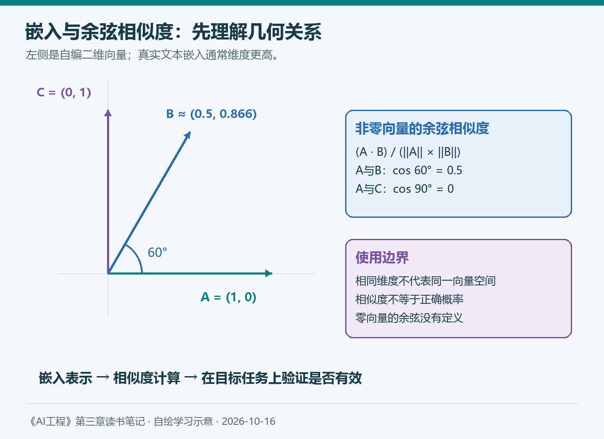
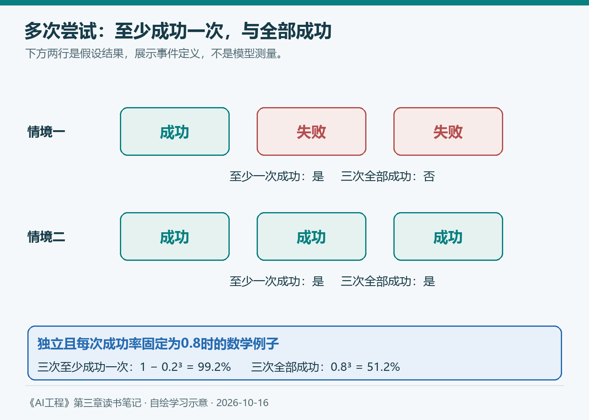

# 第三章（2/4）：精确评估

上一篇沿着原书介绍了评估的挑战，以及熵、交叉熵和困惑度。它们帮助我们理解模型预测文本的表现。继续读下去，关注点转到应用：生成的代码是否能用，答案是否满足任务要求？

本篇保留3.3的顺序，先讲功能正确性，再讲与参考数据的相似度，最后补充嵌入基础。

> 本篇对应Chip Huyen《AI工程：大模型应用开发实战》3.3。中文图与算例为自编学习材料；业务案例是假设情境，不代表真实制度或项目实测。补充资料查阅于2026年10月16日。

**第三章四篇：** ①评估挑战与语言建模指标 → ②精确评估 → ③AI当裁判 → ④比较评估与模型排名。

## 3.3 精确评估

原书把能够给出明确计算结果的评估，与依赖评判者的主观评估区分开来。选择题是否选中指定答案、程序能否通过一组测试，可以按既定规则检查；回答是否优美、解释是否让人满意，则更依赖标准和判断者。

这里我会区分“计算明确”和“指标充分”。即使某个分数可以精确计算，也不意味着它已经覆盖任务的全部质量。测试可以遗漏边界条件，相似度也可能忽略关键事实。

### 3.3.1 功能正确性

功能正确性检查的是系统是否实现预期功能。第二章最后一篇已经区分了格式、内容和业务结果；这里进一步把这些要求转化为可以验证的条件。

例如，让模型编写最大公约数函数，评价重点应包括函数能否运行、典型输入是否正确，以及零值或负数等情况是否符合约定。代码读起来像正确答案，只提供了很有限的证据。

假设任务明确限定输入为两个正整数，可以先写几个检查：

```python
def check_gcd(candidate):
    assert candidate(15, 20) == 5
    assert candidate(13, 7) == 1
    assert candidate(8, 8) == 8
```

这是说明评估方式的小例子，并不是完整测试集。若接口允许其他输入，还要补齐定义和检查。功能正确性必须相对于任务规格解释，测试中偷偷增加需求，也可能把有效实现判错。

#### pass@k回答什么问题

书中用代码生成解释pass@k。对于同一问题生成k个候选，如果至少一个通过要求，就认为这组尝试解决了该问题。汇总许多问题，可以衡量给定尝试预算下的解决能力。

需要注意，正式基准可能从较多样本中使用统计估计器计算pass@k，并不等同于把“样本中有几个正确”直接除以k。HumanEval论文介绍了相应评估方法。[原始论文](https://arxiv.org/abs/2107.03374)

比较不同系统时，还要交代候选数量、采样方式和测试条件。如果一个系统只允许尝试一次，另一个系统可以尝试十次，分数对应的资源预算已经不同。

对应用开发，我还会追问：谁来识别可用候选？如果有可靠测试，系统可以自动筛选；如果正确性只能由专家判断，多生成的候选也增加了审核负担。

#### 从程序输出走向业务结果

假设知识库助手还能创建工单。它回复“创建成功”，与数据库中确实存在一张字段正确、没有重复的工单，是两件不同的事。功能正确性要检查任务对应的外部状态。

对于开放任务，有时只能验证部分目标。比如可以自动检查引用能否打开，但引用是否真正支持结论还需要另外判断。应把已经验证的部分与尚未验证的部分分清楚。

### 3.3.2 与参考数据的相似度度量

有些任务很难自动验证最终效果，于是我们准备参考响应，把生成响应与它比较。参考数据通常包含输入及一个或多个可接受答案。

这里的前提是参考数据足够正确、覆盖有效表达。如果参考答案漏掉合法方案，或者本身已经过期，相似度评分就可能引导系统学习错误目标。

#### 1. 精确匹配

精确匹配要求生成结果与某个参考结果一致。它适合短答案、类别、标识符，以及经过规范化处理的结构化字段。

例如，将“500元”“人民币500元”和数值500先按明确定义的规则归一化，再检查金额字段，可以避免单纯的格式差异。规则必须预先明确，不能在看到模型输出以后临时放宽。

“输出中包含正确答案”是一种宽松变体，但它容易接受错误结果。对于金额问题，“不是500元，而是650元”包含500，却不表示回答正确。检查日期和实体名称时也有类似风险。

精确匹配适合明确目标，长段开放回答则常有许多有效措辞。容纳这些变化，需要继续看下面两类相似度。

#### 2. 词汇相似度

词汇相似度根据词、字符或n-gram的重叠衡量接近程度。编辑距离则统计从一个字符串变成另一个需要多少次插入、删除或替换。

BLEU、ROUGE、METEOR、TER和CIDEr是书中介绍的相关指标。它们的具体计算不同，不能把名字不同的分数当成同一种量，也不能只因为数值更高就直接判定业务更好。

用一个假设制度说明。参考答案是“住宿报销上限为500元，超出部分自行承担”。响应甲为“每晚最高报销500元，其余费用由本人支付”，表达改变较多，含义仍可能一致。响应乙为“住宿报销上限为650元，超出部分自行承担”，只改一个数字，却改变了核心事实。


*图3：自绘。这里只分析方法的关注点，不给未实际计算的BLEU、ROUGE或嵌入相似度编造数值。*

词面重叠可以提供线索，但需要与任务结合。书中图像描述的例子也说明：参考描述不完整时，一个正确的新描述仍可能得到低分。评估结果同时受参考集合质量影响。

#### 3. 语义相似度

语义相似度希望识别意思接近的不同表达。常见做法是把文本表示为向量，再计算向量之间的相似程度。

它通常比单纯词面重叠更容易容纳同义改写，但同样需要检查关键差异。两个句子可能主题相同、绝大部分措辞相近，却在金额、时间、否定关系或适用对象上不同。相似并不自动代表相互蕴含。

BERTScore使用上下文token表示进行匹配；它不是简单地把两篇文档各变成一个向量后算一次余弦相似度。不同语义指标有不同设计，应按具体定义理解。[BERTScore论文](https://arxiv.org/abs/1904.09675)

在知识库助手中，我会将语义相似度作为一种辅助信号，同时对数字、实体、条件和证据支持关系设置更明确的检查。这样更容易解释某个回答为什么被接受或拒绝。

### 3.3.3 嵌入简介

书中随后补充嵌入，帮助解释前面的语义相似度。嵌入是把原始数据表示成向量的一种方式，其目标通常与所用模型和训练任务有关。

一个文本可能表示成几百或几千个数。向量中的每一维，通常不能直接解读成“这一维是财务知识，那一维是准确性”。它们共同形成可用于计算的表示。

#### 相似度怎样计算

设两个非零向量为A和B，余弦相似度为：

```text
cos(A, B) = (A · B) / (||A|| × ||B||)
```

分子是点积，分母是两个向量的欧几里得范数之积。方向一致时为1，正交时为0，完全相反时为-1。零向量的余弦相似度没有定义。

这是几何关系，不能直接解释为业务正确概率。两个向量相似度为0.9，并不表示答案有90%的概率正确。



*图4：自绘二维几何示意。箭头与数字仅解释夹角关系，不是实际文本嵌入，也不代表模型测量结果。*

#### 嵌入从哪里来

可以使用专用嵌入模型，也可以在适当条件下从其他模型中提取表示。不同模型生成的向量通常处于不同空间，不能仅因维度相同就直接混合比较。

判断嵌入是否有效，要看它能否帮助具体任务：检索相关材料、聚类相似内容、发现近似重复，或者支持分类。一个模型在某种语义基准上表现良好，也需要在自己的语言、领域和文档长度条件下验证。

原书还介绍了跨模态联合嵌入。CLIP通过图像与文本的配对训练，让两种模态的表示能够在共同空间中比较。这为文字搜图等任务提供基础，但不等同于自由生成图文的能力。[CLIP原始论文](https://arxiv.org/abs/2103.00020)

到这里，3.3形成了一条完整路线：能检查任务结果时，优先理解功能正确性；需要参考数据时，区分精确匹配、词汇与语义相似度；使用语义度量时，再检查嵌入和计算方法是否适合任务。

## 延伸阅读与个人思考：至少成功一次，还是每次都成功

Anthropic在2026年1月的Agent评估文章中区分pass@k与pass^k：前者关注k次尝试中至少一次成功，后者关注k次全部成功。这为原书的pass@k讨论补充了稳定性视角。[官方工程文章](https://www.anthropic.com/engineering/demystifying-evals-for-ai-agents)



*图5：自绘假设结果。格子展示事件定义，没有把少量演示结果当成统计估计。*

假设每次尝试独立、成功概率固定为0.8，那么三次至少成功一次的概率为99.2%，三次全部成功为51.2%。这是数学示例；真实任务的失败可能相关，不能直接套用独立假设。

由此，我会先问产品允许怎样使用结果。有人审核的创意探索，可以容纳候选筛选；自动处理业务的助手，更需要检查反复使用时的失败情况。次数增加以后，成本、审核和副作用也要计入判断。

下一篇继续跟随原书，讨论当明确规则不足以评价开放回答时，AI怎样参与评估，以及怎样判断这个裁判是否可靠。

## 参考与说明

- Chip Huyen：《AI工程：大模型应用开发实战》，3.3。
- Chen等：[Evaluating Large Language Models Trained on Code](https://arxiv.org/abs/2107.03374)，2021。
- Zhang等：[BERTScore](https://arxiv.org/abs/1904.09675)，2019，后发表于ICLR 2020。
- Radford等：[Learning Transferable Visual Models From Natural Language Supervision](https://arxiv.org/abs/2103.00020)，2021。
- Anthropic：[Demystifying evals for AI agents](https://www.anthropic.com/engineering/demystifying-evals-for-ai-agents)，2026-01-09。
- 本文使用AI辅助梳理与起草，图表自绘；示例均不作为项目实测结果。
