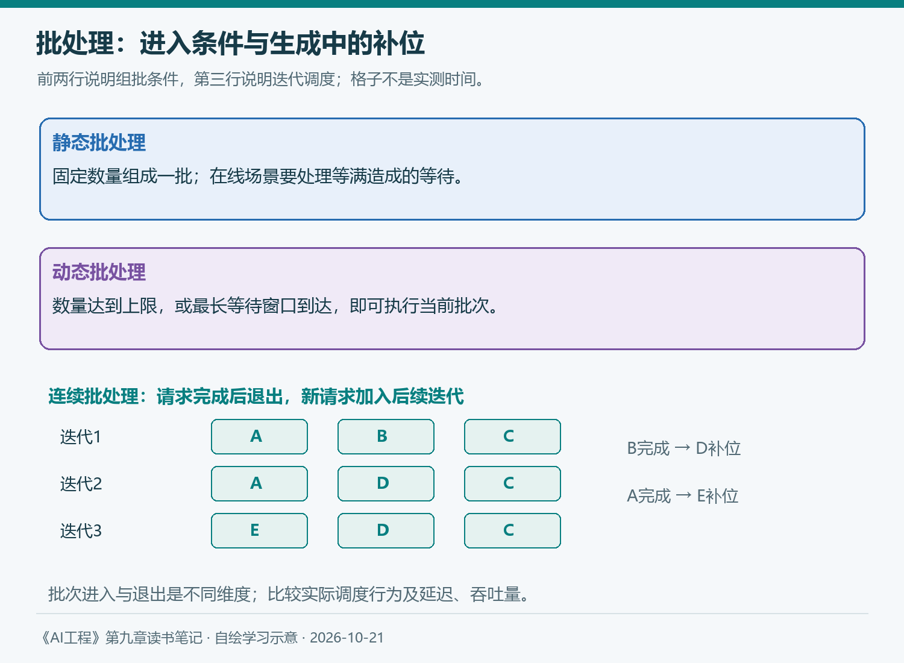
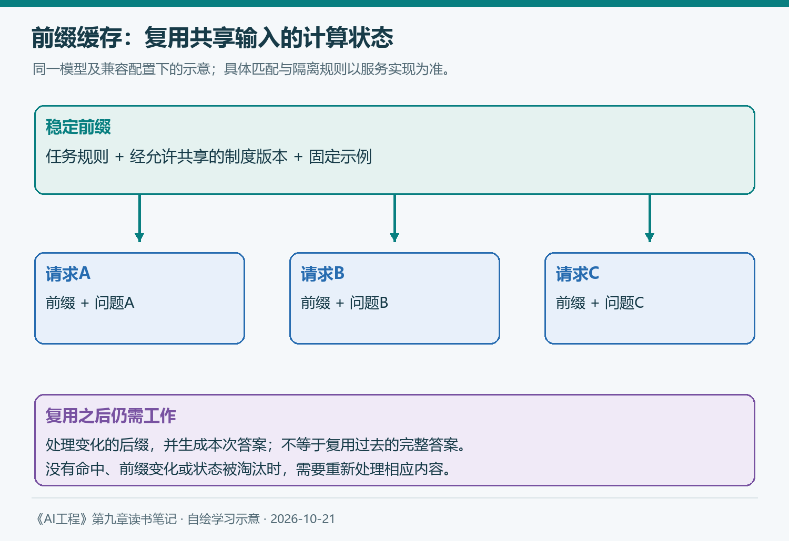
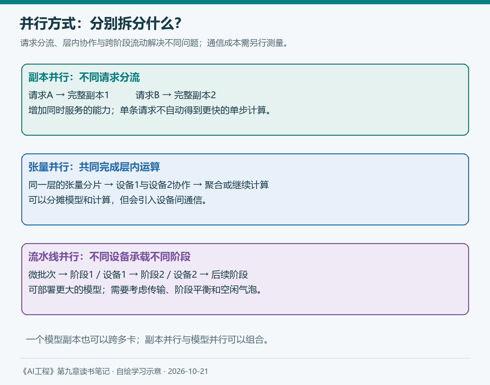

# 第九章（3/3）：推理服务优化——批处理、缓存与并行化

前两篇讨论怎样定位等待，以及怎样减少模型内部的存储、计算和搬运。进入生产环境后，还会遇到另一个问题：模型接到的请求长短不同、到达时间不同，资源却是有限的。

报销助手可能同时收到一句短问题、一份长制度和一段持续追问。只优化单条请求，仍可能让短问题排在长任务后面。原书9.2.2把视角转向服务，依次讨论批处理、预填充与解码解耦、提示词缓存和并行化。

> 本篇对应原书9.2.2与9.3，延续知识库助手案例。配图自绘，实验安排为学习方案；补充资料查阅于2026年10月21日。

**第九章三篇：** ①理解推理优化 → ②模型优化 → ③推理服务优化。

### 9.2.2 推理服务优化

服务层面的优化主要改变资源怎样分配、计算怎样调度。它通常希望保留模型的任务行为，同时减少资源浪费和用户等待。实际实现仍可能受到精度、截断、超时或配置变化影响，需要继续做回归检查。

#### 1. 批处理

批处理把多个请求的部分计算合并执行，提高设备使用效率。代价可能是请求需要等待其他请求，或者为了更大批次付出更多排队时间。

**静态批处理**可以把固定数量的输入组成一个批次。它适合任务事先齐备的离线工作；在线场景如果必须等满才开始，就需要处理低流量时的等待问题。

**动态批处理**根据请求到达情况组织批次，通常同时设置数量上限和最长等待窗口。达到其中一个条件即可执行，不必无限等满。实际批次可能较小，因此效率与延迟之间仍有权衡。

**连续批处理**把调度推进到生成迭代层面。某个请求完成后可以退出，把可用位置交给新的请求，其余请求继续生成。对于输出长度不同的语言模型请求，这有助于减少空等。

*图6：自绘，参考原书9.2.2。前两行说明进入批次的条件，第三行说明生成过程中的退出与补位；示意格不是实测时间，具体调度受框架实现约束。*

要注意，这里比较了两个相关但不同的维度：请求怎样进入批次，以及完成后怎样退出。不能只凭“动态批处理”这个名称，就断言某个实现一定要求所有用户等到最长响应完成。

对员工问答，我会先记录排队和生成时间。扩大批次后吞吐量提高，但p95等待超过服务目标，未必值得采用；也可以考虑离线任务与交互任务分别调度，而不是让两者无区别地争用资源。

#### 2. 将预填充和解码解耦

预填充处理输入，解码持续生成输出，二者的计算与带宽需求不同。在同一组资源上混合执行时，新到来的长输入可能干扰正在生成的请求。

解耦把这两阶段安排到不同实例或资源池，并传递必要的KV状态。这样可以分别配置两类资源，让首个输出等待与后续生成间隔更容易单独调节。

但跨实例传输、调度和资源空闲同样有成本。是否值得解耦，取决于输入输出分布、网络、负载和服务目标，小规模部署不必照搬大集群方案。

当前vLLM的相关文档仍将该功能标为实验性，并强调独立调节TTFT和ITL、控制尾部输出间隔。文档明确提醒该功能本身不提升吞吐量。因此，应区分特定实现的总吞吐量、满足延迟约束后的有效吞吐量与论文报告的条件，不能把解耦写成普遍加速结论。[官方说明](https://docs.vllm.ai/en/latest/features/disagg_prefill/)

2026年3月16日发布的NVIDIA Dynamo 1.0，则提供了近期服务工程的例子：协调GPU与内存资源，根据已有KV状态进行请求路由，并安排状态迁移和存储。它把原书分开介绍的缓存与资源管理联系起来。[官方发布说明](https://nvidianews.nvidia.com/news/dynamo-1-0)

对我的启发是，优化还包括“把请求送到哪里”。这一工程思路值得理解，厂商在特定平台上的性能数字则需要连同测试配置阅读，不能直接当成自己的收益。

#### 3. 提示词缓存

第五章介绍了系统提示词、示例和背景资料。知识库助手的不同请求，可能反复携带相同规则或同一份长文档，模型因此重复处理相同输入。

提示词缓存可以保留可复用的前缀状态，使后续请求跳过部分预填充。它与第二篇的KV缓存有关，但复用范围不同；它也不同于直接返回过去的完整答案。

| 机制 | 复用什么 | 仍需完成什么 |
| --- | --- | --- |
| 单次生成中的KV缓存 | 已处理位置的键和值 | 新位置计算与后续生成 |
| 跨请求前缀缓存 | 匹配前缀的计算状态 | 新后缀预填充及答案生成 |
| 答案缓存 | 先前生成的最终结果 | 检查匹配条件、版本与有效性 |

*图7：自绘，参考原书提示词缓存。按相同模型和相关配置复用匹配前缀；实际匹配粒度、隔离方式与缓存生命周期由服务实现决定。*

当前vLLM文档说明，自动前缀缓存可以复用共享前缀的KV状态，适用于重复查询长文档和多轮对话。它减少的是预填充工作，不直接缩短新token的解码过程；输入没有可复用前缀，收益也会受限。[官方文档](https://docs.vllm.ai/en/latest/features/automatic_prefix_caching/)

因此，稳定的任务说明和经允许共享的资料可以放在适合复用的位置，而变化的用户问题放在后面。但不能为了缓存命中率，删掉当前请求必需的制度版本、用户条件或权限信息。

“文字相似”也不等于“状态可复用”。模型、模板、token序列及相关配置必须满足服务的缓存规则；资料版本发生变化后，应让新请求使用正确内容。跨用户使用时，还需要遵守租户和访问边界。

缓存还会占用资源。实验时应区分首次请求、已有可复用状态的请求，以及状态被淘汰后的请求。只挑重复输入测试，容易把理想命中情况误当成真实流量表现。

#### 4. 并行化

原书最后讨论把模型或请求分配到多块设备。选择策略之前，要先区分两个目标：扩大同时服务的能力，以及让一个模型或单个请求能够运行。

**副本并行**创建多个模型副本，再把不同请求分配过去。它可以增加处理并发请求的能力，也可能减少排队，但同一请求并不会因为其他副本存在，就自动获得更快的单步计算。

**张量并行**把模型运算涉及的张量拆到多个设备，设备协作完成一层或一个算子。它可以分摊模型与计算，也会引入通信，实际延迟要看设备连接和拆分方式。

**流水线并行**把模型的不同层或阶段放到不同设备，微批次沿阶段流动。它帮助部署单机放不下的模型，但存在阶段间传输和空闲气泡；吞吐量、单请求延迟与设备利用率需要分别比较。

*图8：自绘，参考原书9.2.2。分别表示请求分流、层内协作和跨阶段流动；不包含特定模型的通信量或性能成绩。*

原书还提到上下文并行和序列并行。以Megatron Core训练框架文档为概念参照，前者把上下文位置分布到设备上，注意力仍需要相关位置的信息和通信；后者常在特定算子上按序列维度分布激活，具体含义应按框架确认。不能把它简单等同于“每台机器各算一段文本，最后直接拼接答案”。

副本和模型并行可以组合。模型太大时，一个副本可能本身就跨多卡；再部署多个这样的副本，需要继续考虑设备预算、通信和请求路由。

## 9.3 小结：把优化带回评估与实际负载

第九章从瓶颈和指标开始，走到模型内部的压缩、解码、注意力与内核，再讨论服务如何调度不同请求。它让我更明确地看到，每项技术都需要回答：解决哪个瓶颈，在什么负载下成立，付出什么代价。

第四章给出了评价依据，第五章帮助表达任务，第六章组织检索与工具，第七、八章处理适配和训练材料。推理优化则把这些选择进一步放进持续运行的资源条件中。

对报销助手，我会先保留一组固定质量题，再单独设计性能负载。以下是准备执行的实验安排，并非已取得的成绩：

| 比较项目 | 主要观察 | 需要固定或记录 |
| --- | --- | --- |
| 前缀缓存关闭与开启 | TTFT、命中与显存 | 冷热状态、重复前缀比例 |
| 批处理配置变化 | 吞吐量、p95等待、失败 | 请求到达方式、输入输出长度 |
| 精度或解码方法变化 | 耗时、显存与回答质量 | 模型、硬件、版本与生成配置 |

性能测试可以先从低负载开始，逐步增加请求速率或并发，观察何时排队和超时明显增加。固定并发与固定到达速率代表不同测试方式，应说明选择哪一种；比较期间还要记录实际输出长度，避免将答案变短误判为内核变快。

质量回归继续检查金额、条件、引用、追问和资料不足处理。已有30题适合起步与发现退步，性能容量结论则需要更充分的负载样本和持续测试。

每次只改变一个主要因素，保留基线、失败请求与运行记录。成本以明确口径统计，例如每个完成请求的费用，再同时报告质量与服务目标达标率，不能靠遗漏失败请求得到漂亮数字。

我读完这一章最想建立的习惯，是把“更快、更便宜”写成可以检查的结果：在什么条件下，哪些用户得到什么质量的答案，又用了多少资源。接下来进入第十章，才有依据把模型、资料、工具与服务组织成完整应用。

## 参考与说明

- Chip Huyen：《AI工程：大模型应用开发实战》，9.2.2与9.3。
- vLLM：[Automatic Prefix Caching](https://docs.vllm.ai/en/latest/features/automatic_prefix_caching/)、[Disaggregated Prefilling](https://docs.vllm.ai/en/latest/features/disagg_prefill/)，查阅于2026-10-21；实现能力与状态以所用版本为准。
- NVIDIA：[Dynamo 1.0官方发布说明](https://nvidianews.nvidia.com/news/dynamo-1-0)，2026-03-16。
- NVIDIA：[Megatron Core Context Parallelism](https://docs.nvidia.com/megatron-core/developer-guide/latest/user-guide/features/context_parallel.html)，用于补充上下文并行与序列并行的区别，查阅于2026-10-21。
- 本文使用AI辅助梳理与起草；原书、官方资料和个人学习方案分别表述。配图为自绘示意，没有使用虚构的实测曲线，实验计划不代表已经完成生产验证。

