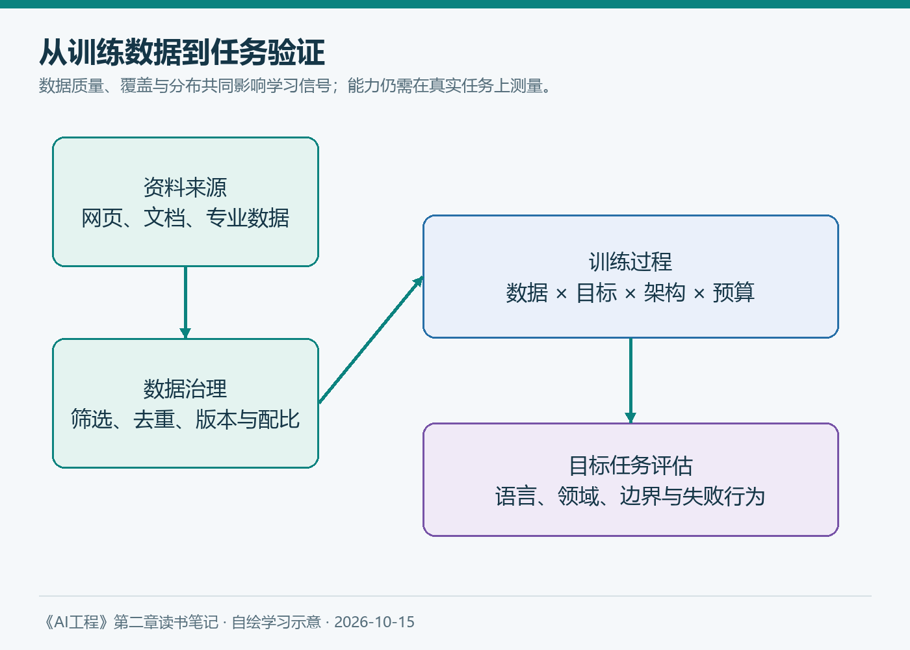

# 第二章（1/6）：模型能力从哪里来——训练数据、语言与领域

同一个模型，可以把一个概念解释得很清楚，却在另一类问题上连续出错。遇到这种情况，我以前容易先怀疑提示词：是不是问得不够具体，示例给得不够多？

阅读《AI工程》第二章后，我想把问题再往前推一步：这个模型在训练时，究竟接触过什么？我们要求它完成的任务，与它学到的内容之间，又隔着多远？

> 本文是《AI工程：大模型应用开发实战》第二章的阅读笔记之一，对应2.1“训练数据”。概念框架参考Chip Huyen原书，案例与图表为重新组织的学习材料。补充资料查阅于2026年10月15日；假设场景不代表实际项目测试。

**阅读导航：** 本系列分为训练数据、模型架构、规模与成本、后训练、采样与推理、可靠输出六篇。

**本章六篇：** ①训练数据 → ②模型架构 → ③规模与成本 → ④后训练 → ⑤采样与推理 → ⑥可靠输出。

---

## 1. 模型从数据中学到了什么

可以先从语言模型最基本的任务理解：给出前面的token，预测后面的token。训练时，模型根据真实后续内容计算误差，再调整参数，让类似上下文中的预测更符合训练数据。

这里的“学到”不是把所有文档完整保存到一个可查询的文件夹。模型会形成分布式的表示，也可能记住某些具体片段；但生成回答时，我们不能默认它在逐字查询原始资料，更不能默认它记得最新版本。

我把这一过程理解为：**训练数据影响模型习惯于怎样解释世界，训练目标则决定它依据什么信号调整自己。** 数据、架构和后训练共同塑造能力，不能把任何一次错误都简单归因于“没见过”。

*图1：本笔记自绘。数据分布经过训练过程影响模型能力，目标任务仍需单独验证；图中的箭头不表示确定性的因果保证。*

原书提醒我注意“现有数据”与“理想数据”的差别。互联网文本容易获得，但包含噪声、重复、偏见和过期信息。某些业务资料则可能根本没有进入公开互联网。

因此，能搜集多少数据，与这些数据是否支持目标任务，是两个需要分别回答的问题。

## 2. 数量、质量和覆盖，不能只选一个看

假设准备训练一个设备维修助手。十万份描述模糊、型号混乱的问答，和一万份带有型号、适用条件及正确操作步骤的记录，提供的学习信号并不相同。但如果后一批资料完全没有覆盖新设备，也无法仅凭“质量高”解决覆盖缺口。

| 维度 | 我会问的问题 | 可能暴露的缺口 |
| --- | --- | --- |
| 质量 | 内容是否正确，条件是否完整 | 模型学到错误关系或省略关键条件 |
| 覆盖 | 是否包含目标语言、任务与场景 | 一般问题会答，专业问题不稳定 |
| 分布 | 高频与罕见情况占比怎样 | 常规场景表现掩盖边界错误 |
| 去重 | 同一内容被重复多少次 | 重复不等于新增知识，评估可能失真 |
| 时效 | 资料对应哪个版本 | 旧制度与新制度混在一起 |

这些维度之间存在取舍。严格筛选可以降低噪声，也可能误删少数群体的表达和不常见的专业材料。数据治理因此需要明确目标，而不只是追求一个看起来整洁的数据集。

对应用开发者，我得到的启发不是立刻去训练模型，而是先把测试集按任务拆开。如果只计算一个总准确率，最需要关注的业务类别可能被平均值藏起来。

## 3. 能说一种语言，不等于所有任务都做得一样好

原书讨论了语言在训练资料中的代表性差异，也讨论了分词带来的成本差异。它引用的早期GPT-4测试和Common Crawl统计，应当放回当时的数据与模型条件下阅读，不能直接用来判断2026年的全部模型。

不过，问题本身仍然值得保留：一个模型在英语测试中表现优秀，是否意味着它能用中文稳定理解合同条款、行业简称和隐含条件？这需要实际测量。

语言差异也不是把句子翻译一下就全部消失。敬语、称谓、地方表达以及法律术语，可能在翻译中丢失关系。翻译本身还会引入一条新的错误路径。

另一个容易忽视的细节是token。同样意思的文字，不同语言、不同分词器可能得到不同数量的token。因此不能采用固定的“一个汉字等于多少token”去估算所有模型的成本。最终还要结合供应商的实际计费规则、缓存和输出长度。

我的做法会是准备三组对应样本：自然中文、行业中文和中英混合表达。分别检查理解、事实、格式与费用，而不是只看它是否能流畅回复。

## 4. 通用模型与领域模型，要回到任务上比较

原书以生物医学等领域说明：互联网通用文本，不等于所有专业数据。蛋白质结构、医学影像与工厂传感器具有不同的数据形式、获取条件及评价标准。

领域模型也不是“名字里带行业词，就一定更准确”。它是否适合某项工作，还取决于数据、模型能力、训练方式和部署条件。通用模型加上合适资料，有时已能满足要求；另一些任务则需要专门模型或传统算法。

为了避免把所有问题都交给微调，我会先区分下面几种情况：

| 观察到的问题 | 优先调查的方向 |
| --- | --- |
| 回答缺少公司最新制度 | 资料更新、检索和上下文是否正确 |
| 有资料但反复误解任务 | 指令、示例、模型能力和评估标准 |
| 长期无法遵循某种稳定格式或风格 | 约束输出、示例及微调的收益 |
| 输入主要是特殊影像或专业信号 | 模态支持、领域模型和专用算法 |

这是一张排查入口表，不是自动选型规则。尤其不能把RAG理解成训练的替代品，也不能把微调当成随时更新事实的数据库。

## 5. 补充阅读：合成数据让“更多”变得容易，也让筛选更重要

在2025年的Qwen3官方介绍中，团队披露使用模型辅助文档文本提取，并生成数学和代码材料。这是一个有时间背景的案例，说明训练资料已经不只来自直接收集的人类文本。[Qwen3官方介绍](https://qwenlm.github.io/blog/qwen3/)

我的理解是，合成数据的价值在于补充可控的任务形式和训练信号。但生成器也会出错，多个生成结果还可能共享相同偏差。生成量增加，并不自动意味着知识和难度增加。

如果为维修助手生成问答，我会要求每个问题能追溯到资料，答案经过规则或人工检查；将近似重复样本分组；另外保留独立测试材料。让同一个模型出题、答题、评分，再据此宣称效果提升，很容易形成自我确认。

截至本次查阅，我更愿意把“合成—筛选—验证”看作一条完整流程。只有生成这一步的成功，还不足以说明数据可用。

## 6. 一个可以真正执行的小练习

假设要给企业知识库助手选模型，我会先收集30个问题，作为起步练习：常见问题、专业术语、资料缺失、版本冲突和中英混合各6个。这只是学习样本量，不能据此宣称达到生产可靠性。

固定模型版本、提示词与资料，记录每题是否找到依据、结论是否被支持、是否遗漏条件，以及依据不足时是否诚实说明。错误出现以后，先分类，再决定补资料、改检索还是更换模型。

读完这一节，我留下的判断是：**模型整体有多强，与它在我的任务上是否可靠，需要两份证据。** 训练数据帮助我们理解能力从哪里来；真实任务的评估，帮助我们决定能把什么交给它。

下一篇继续追问：数据进入模型以后，Transformer究竟怎样组织这些信息？

---

**参考与说明**

- Chip Huyen：《AI工程：大模型应用开发实战》，第二章2.1。
- Qwen Team：[Qwen3: Think Deeper, Act Faster](https://qwenlm.github.io/blog/qwen3/)，2025年。
- 本文使用AI辅助梳理与起草；示意图为本笔记自绘，个人判断不代表原书作者观点。
