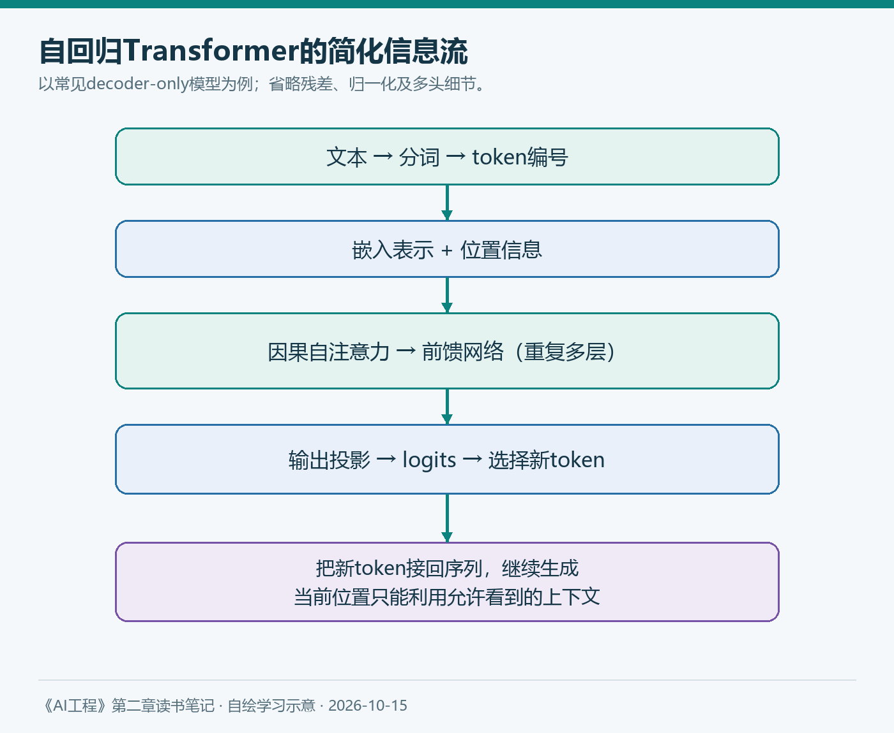
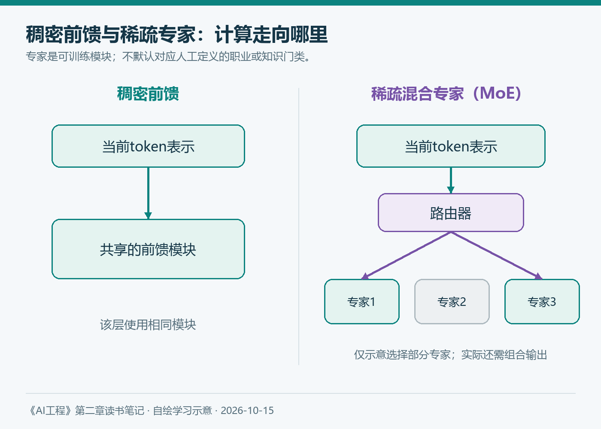

# 第二章（2/6）：从Transformer到MoE——模型如何处理信息

模型介绍里经常出现注意力、MoE、KV缓存和长上下文。如果只记住这些名称，看到新模型时，仍然很难判断它改变了什么。

阅读《AI工程》第二章的架构部分，我希望先建立一条能讲通的路径：文字怎样变成数值，信息怎样在序列中流动，最后又怎样变成下一个token。

> 本文对应原书2.2.1“模型架构”，以常见的自回归Transformer为主要例子。基础原理与后续技术补充分开说明，查阅日期为2026年10月15日。

**阅读导航：** 第1篇讨论数据；本篇讨论架构；后续依次讨论规模、后训练、采样与可靠输出。

**本章六篇：** ①训练数据 → ②模型架构 → ③规模与成本 → ④后训练 → ⑤采样与推理 → ⑥可靠输出。

---

## 1. 从文字到向量：模型的输入是什么

输入文本首先经过分词器，得到token编号。嵌入层将编号映射成向量。向量中的数值由训练塑造，不是我们预先为每个词指定的一组完整语义标签。

如果序列有T个token，每个表示有d个维度，那么输入可以看成一个T×d的矩阵。模型还需要处理顺序信息，否则“甲帮助乙”和“乙帮助甲”只看词的集合就难以区分。位置编码和旋转位置嵌入等方法解决的是这一类问题，具体设计随架构变化。

随后，信息经过一层又一层的处理。以一种常见的decoder-only模型为例，层内包括因果自注意力、前馈网络，以及残差连接与归一化。不同模型的连接顺序和实现细节会有差别。



*图2：本笔记自绘。展示常见decoder-only模型的信息流，省略残差、归一化及多头等细节，不代表所有模型都使用相同结构。*

## 2. 注意力：当前表示怎样利用上下文

注意力可以先理解成：对当前位置来说，上下文里不同位置的信息，应该以多大权重参与当前表示的计算。

Q、K、V是输入表示经过不同线性映射得到的向量。一个便于入门的类比是：Q表示当前要匹配什么，K用于计算匹配分数，V提供被汇总的信息。但它们是可训练的数值表示，并不是三份人类可读的问答资料。

经典缩放点积注意力写成：

```text
Attention(Q, K, V) = softmax(QKᵀ / √dₖ + M) V
```

这里，QKᵀ得到匹配分数，除以√dₖ控制数值尺度；M是掩码，允许位置取0，被禁止的位置取负无穷；softmax把每一行转成权重，再用这些权重汇总V。dₖ是键向量的维度。

用一个极小例子看加权过程：假设一个查询对两个可见位置得到的缩放分数为1、2，softmax权重约为0.269、0.731。若两个值向量分别是(1,0)与(0,1)，汇总结果就是(0.269,0.731)。这里展示的是表示向量的加权，不是最终词表中两个词的输出概率。

对于因果语言模型，位置t不能利用未来位置的token，否则训练时相当于提前看到了要预测的答案。多头注意力则在多个表示子空间中分别计算，再组合结果。

需要提醒自己：注意力权重不是天然的事实依据，也不能直接等同于模型对答案的完整解释。计算中某个位置权重大，不表示那段资料真实，更不表示最终结论一定由它正确推出。[Transformer原论文](https://arxiv.org/abs/1706.03762)

## 3. 为什么既有注意力，也有前馈网络

注意力负责根据上下文混合信息；前馈网络对每个位置的表示进行进一步变换。后者通常包含线性变换和非线性，也可能采用门控设计。

残差连接让一层的输入能够与变换结果相加，归一化帮助控制表示的数值行为。大量层叠加以后，最后一层表示经过输出投影，得到词表中各候选token的分数，也就是logits。

再经过概率转换与选择策略，就得到一个新token。把它接回已有序列，继续下一步，便形成自回归生成。

训练时，因果掩码允许许多位置的预测计算并行完成；生成时，下一个token依赖已经生成的结果，通常需要逐步推进。因此，“训练可以并行”并不意味着“整段回答可以一次同时生成”。

## 4. 编码器、解码器，不能只靠名称猜用途

| 常见结构 | 基本信息流 | 典型理解 |
| --- | --- | --- |
| Encoder-only | 表示能够利用输入两侧信息 | 适合某些理解与表示学习任务 |
| Decoder-only | 因果约束下持续生成后续内容 | 常见于自回归文本生成 |
| Encoder–decoder | 编码输入，再按条件生成输出 | 原始Transformer采用的结构 |

这张表是基础地图，不是永久的产品分类。掩码设计、预训练目标和模态接口都可能变化；某种结构也不只对应一种任务。

原书还讨论了循环模型、状态空间等其他路线。它们提醒我，Transformer不是自然界唯一可行的方案。不同路线在长序列处理、计算方式、训练稳定性与任务质量上各有取舍，不能只凭理论复杂度宣布全面胜出。

## 5. MoE：把部分前馈计算交给被选中的专家

混合专家模型通常在某些层中使用多个专家，由路由器为每个token选择其中一部分参与计算。这里的“专家”是训练出来的神经网络模块，不应默认对应“法律专家”“数学专家”这样的人工职业划分。



*图3：本笔记自绘。简化展示稀疏路由；实际模型可能还有共享专家、不同路由策略及负载均衡机制。*

这解释了为什么需要区分总参数与激活参数：模型保存的参数很多，但一次token计算可能只使用部分专家。它可能减少某些计算，却仍面临权重存储、专家通信和负载均衡等成本。

所以，看到“激活参数较少”，不能直接推断整套部署只需要同等规模稠密模型的显存。

## 6. 2026年的补充：架构正在围绕不同计算阶段做取舍

2026年9月10日，DeepSeek的V4.1-Flash官方发布说明介绍了因果编码器—解码器架构，并区分输入侧与输出侧的激活参数，还强调KV缓存占用的改善。这里引用的是官方披露，不是本笔记的独立复测。[官方发布说明](https://www.deepseek.com/en/news/deepseek-v4-1-flash/)

它对我的启发是：不能把早期常见的decoder-only结构当成所有新模型的固定模板。阅读技术报告时，应继续问：输入处理和输出生成分别做了什么，信息是否保持因果约束，成本主要落在哪个阶段？

KV缓存则是另一条应用相关线索。常见自回归Transformer会保存历史位置的键和值，避免每一步重新计算它们。但缓存会占用存储，随着上下文、并发及结构不同而变化；它也不是让模型永久记住用户资料的长期记忆。[Hugging Face运行优化说明](https://huggingface.co/docs/transformers/main/en/llm_tutorial_optimization)

## 7. 放回知识库助手：架构知识怎样帮助判断

如果知识库助手越聊越慢，我会同时检查上下文长度、输出长度、并发、缓存命中与部署，而不是只问“是不是参数太多”。如果模型漏掉长文中的关键条件，也要区分上下文窗口允许放入多少内容，与它能否有效利用这些内容。

读完这一节，我不要求自己能从头训练一个模型，但希望做到三件事：沿着数据流解释主要模块；看到新架构时知道它改动了哪里；把改动与质量、延迟、吞吐和资源联系起来。

下一篇讨论另一个经常与架构混在一起的问题：参数量、数据量和计算量，应该怎样放在同一张账本上？

---

**参考与说明**

- Chip Huyen：《AI工程：大模型应用开发实战》，第二章2.2.1。
- Vaswani等：[Attention Is All You Need](https://arxiv.org/abs/1706.03762)，2017年。
- DeepSeek：[V4.1-Flash官方发布说明](https://www.deepseek.com/en/news/deepseek-v4-1-flash/)，2026-09-10。
- Hugging Face：[Optimizing LLMs for Speed and Memory](https://huggingface.co/docs/transformers/main/en/llm_tutorial_optimization)，查阅于2026-10-15。
- 本文使用AI辅助梳理与起草；示意图自绘，解释与取舍属于本笔记的学习理解。
