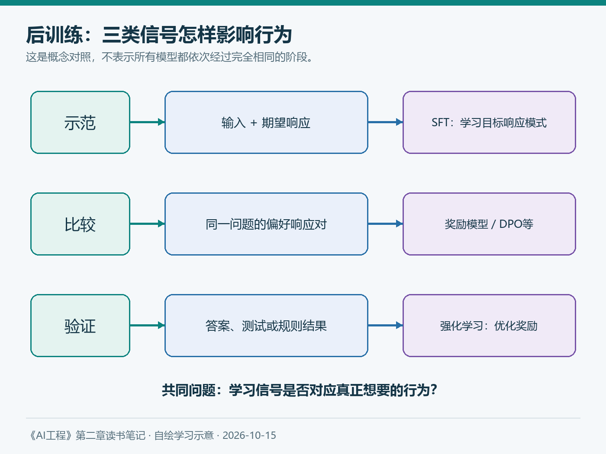

# 第二章（4/6）：从会续写到会回答——后训练改变了什么

一个模型能够预测下一段文字，为什么还需要教它回答问题？如果已经掌握了很多知识，为什么仍会不恰当地拒绝、过度迎合，或者把不确定的内容说得很肯定？

《AI工程》第二章把我的注意力从“模型知道多少”带到另一个问题：训练过程究竟在鼓励它产生什么样的行为？

> 本篇对应原书2.3“后训练”，补充DPO、推理强化学习与GRPO的基本区别。资料查阅于2026年10月15日；示例为假设场景。

**阅读导航：** 前三篇讨论数据、架构与规模；本篇讨论行为怎样被塑造，后两篇讨论生成与验证。

**本章六篇：** ①训练数据 → ②模型架构 → ③规模与成本 → ④后训练 → ⑤采样与推理 → ⑥可靠输出。

---

## 1. 预训练给出了起点，交互还需要适配

以常见语言建模为例，预训练目标是提高后续token的预测概率。用户输入“如何修复这个错误”，模型可能继续写一个类似的问题，也可能续写论坛对话，而不是按照产品期望给出答案。

后训练是在预训练基础上继续调整模型。它可以涉及指令遵循、输出风格、安全行为、推理能力和工具使用等目标。不同团队的阶段安排不同，不应把某张流程图当成所有模型的标准生产线。

需要先分清一个边界：后训练会更新参数；在应用里补充提示词、检索文档和工具结果，则通常发生在推理时。把一份制度放进上下文，不等于已经微调模型。

## 2. 监督微调：用示例告诉模型应该怎样回答

监督微调，常简称SFT，可以使用“输入—期望响应”数据。对语言模型而言，训练通常让模型在给定输入后，提高示例响应中token的概率；哪些位置计算损失，还取决于具体配置。

它像是给出示范，但示范的质量直接影响模型习得的模式。若训练材料在缺少依据时仍然给出完整答案，模型可能学到的就是“尽量答满”，而不是“先说明缺失”。

假设知识库助手收到“我还能申请去年的补贴吗”。一个好的示例需要说明年份、政策版本和适用条件。只展示一句礼貌的回答，无法让模型凭空理解业务边界。

我会把SFT理解为学习稳定行为和任务形式的一种方法，而不是保证每条新事实都能被可靠记住的机制。是否值得微调，仍要与更简单的提示、约束和检索方案比较。

## 3. 偏好数据：比起这一个，我更希望得到哪一个

开放式问题往往有多个可接受回答。与其要求标注者写出唯一标准答案，有时更容易让他们比较两个响应：哪个更准确、清楚、适度，或更符合既定规则？

但“更喜欢”需要操作性定义。简洁与完整可能冲突，不同用户的偏好也可能不同。标注者如果更容易被自信的长答案说服，偏好数据就可能把这种偏差带进训练。

原书因此讨论奖励模型：给定问题x和响应y，模型输出一个评分r(x,y)，用于近似某套偏好标准。评分是学习出来的代理信号，不是可以直接解释成“事实正确概率”的权威数字。

一个简化的成对损失可以写成：

```text
L = -log σ(r(x, y优) - r(x, y劣))
σ(z) = 1 / (1 + exp(-z))
```

它推动被偏好的响应获得更高分。公式没有证明偏好标签本身正确，也没有赋予奖励模型理解一切任务的能力。



*图5：本笔记自绘。展示示范、偏好与可验证结果三类信号；实际训练可以组合多种阶段。*

## 4. RLHF：优化奖励，也要防止把代理目标当成真正目标

一种经典流程是：先用示例得到初始策略，收集比较数据训练奖励模型，再使用强化学习调整生成策略，使其更倾向于获得高奖励的响应。

优化通常还需要限制策略过度偏离参考模型，例如引入KL相关约束。否则模型可能学会利用奖励模型的漏洞，牺牲语言质量或其他能力，只追求分数。

“奖励黑客”可以用一个假设例子理解：如果评分器把回答长度当成认真程度，模型可能不断扩写，却没有解决问题。若只看有没有引用，模型可能提供看似完整、实际不支持结论的引用。

我的理解是，训练的难点不只在优化器，还在奖励有没有对应真正想要的行为。奖励提高以后，仍要用独立任务与人工检查验证。

## 5. DPO：也可以直接利用成对偏好训练

DPO在特定偏好建模与正则化目标下，把优化转化为直接作用于策略的损失。它利用偏好响应相对参考策略的概率关系，避免经典流程中单独训练显式奖励模型再进行在线策略优化的那一套步骤。[DPO论文](https://arxiv.org/abs/2305.18290)

因此，不能把DPO理解成“完全不需要偏好标准”，也不能把它简单描述成只把好答案做一次普通SFT。它依然依赖偏好数据的覆盖与质量，其适用效果需要验证。

| 方法 | 主要学习信号 | 我会特别检查 |
| --- | --- | --- |
| SFT | 期望响应示例 | 示范是否正确、完整且有代表性 |
| 经典RLHF流程 | 人类偏好及奖励模型 | 奖励偏差、策略漂移与优化稳定性 |
| DPO | 成对偏好及参考策略 | 偏好质量、数据覆盖及泛化 |
| 可验证奖励的强化学习 | 程序或规则能验证的结果 | 验证器漏洞、任务覆盖与迁移能力 |

## 6. 后续进展：后训练也被用于强化推理

DeepSeek-R1的研究展示了利用强化学习促进推理行为的路线；论文最初发布于2025年，当前页面记录了2026年1月的修订。需要区分不先做SFT的R1-Zero探索，与包含多阶段训练的R1流程。[DeepSeek-R1论文](https://arxiv.org/abs/2501.12948)

这让我扩大了对后训练的理解：它不只是把语言变得礼貌，也可以围绕可验证任务继续塑造能力。但数学答案正确、代码通过测试，与面对所有开放问题都可靠，仍是不同结论。

GRPO可以粗略理解为：对同一问题生成一组响应，依据组内奖励的相对表现构造学习信号，并进行策略更新。它不是在用户每次聊天时自动改写权重。Hugging Face当前TRL文档提供了GRPO训练器与奖励接口，也列出训练中的不同实现选择。[GRPO文档](https://huggingface.co/docs/trl/main/en/grpo_trainer)

当验证器能够检查最终答案或运行结果，奖励可以减少部分人工比较成本；但测试不完整、格式漏洞和投机行为仍可能让高分偏离真实质量。

## 7. 对应用开发，我会留下哪几条判断

第一，模型说话更像助手，不等于它的每个事实更可信。指令遵循、用户偏好和事实准确性应分别评估。

第二，不要默认微调解决所有知识问题。业务事实经常变化时，资料更新和检索可能更直接；反复出现的稳定行为缺陷，才值得进一步评估训练方案。

第三，训练前先写清楚失败的定义。以知识库助手为例，我会同时保留正确作答、依据不足、错误前提、版本冲突和超出权限的测试，避免“回答率提高”掩盖编造率上升。

读到这里，我更关心的已经不只是模型受过多少训练，而是：**什么信号让它获得奖励，这个信号与我的目标有多接近？**

下一篇转向推理阶段。即使权重完全相同，怎样选择下一个token，也会让回答产生明显变化。

---

**参考与说明**

- Chip Huyen：《AI工程：大模型应用开发实战》，第二章2.3。
- Rafailov等：[Direct Preference Optimization](https://arxiv.org/abs/2305.18290)，2023年。
- DeepSeek-AI：[DeepSeek-R1](https://arxiv.org/abs/2501.12948)，2025年首发，2026年修订。
- Hugging Face：[GRPO Trainer](https://huggingface.co/docs/trl/main/en/grpo_trainer)，查阅于2026-10-15。
- 本文使用AI辅助梳理与起草；图表自绘，案例为教学假设。
