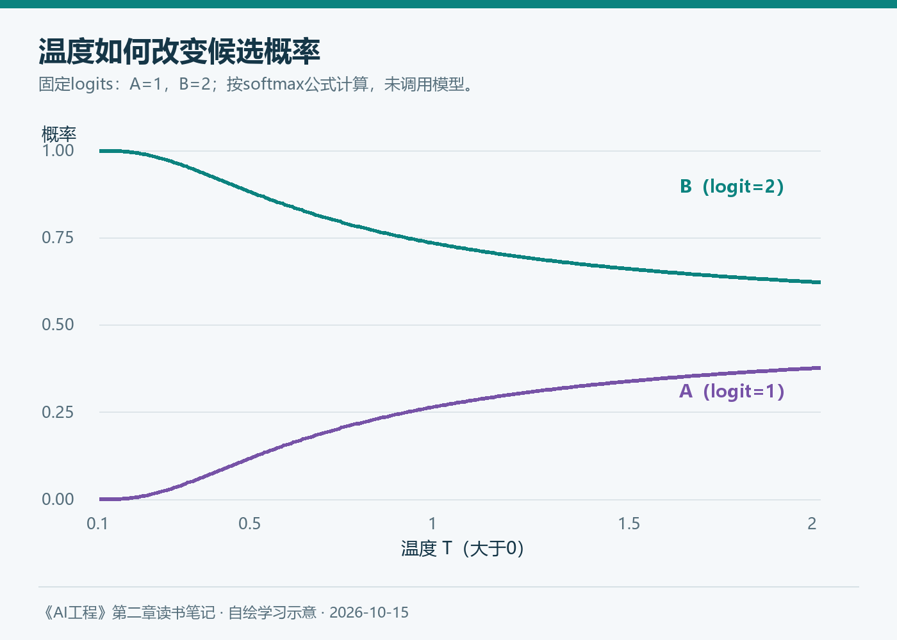
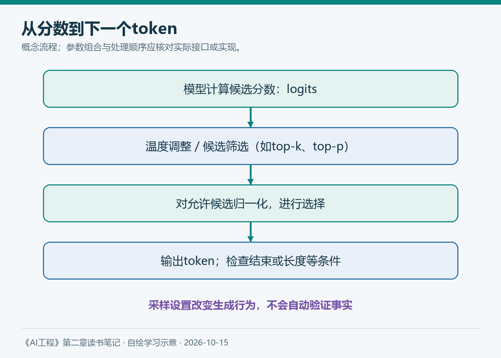

# 第二章（5/6）：同一个问题为何回答不同——概率、采样与推理计算

同一个问题，连续问几次，回答可能不一样。把温度调成0以后，是不是就永远一致？让模型多想一会儿，又是否一定更正确？

《AI工程》第二章让我意识到，理解模型还不能停在训练。权重确定以后，生成过程中的选择同样会影响结果。

> 本篇对应原书2.4.1～2.4.3。概率表由公式直接计算，不是模型实测；技术资料查阅于2026年10月15日。

**阅读导航：** 本系列第5篇，连接前面的后训练与下一篇的可靠输出。

**本章六篇：** ①训练数据 → ②模型架构 → ③规模与成本 → ④后训练 → ⑤采样与推理 → ⑥可靠输出。

---

## 1. logits不是概率，softmax才完成转换

模型最后通常为词表中的候选token计算一组实数分数，称为logits。它们不要求非负，相加也不要求等于1。

softmax把分数转换为概率分布：

```text
pᵢ = exp(zᵢ / T) / Σⱼ exp(zⱼ / T)    （T > 0）
```

zᵢ是候选i的logit，T是温度，分母对全部候选求和。实际计算会使用数值稳定的实现，这里只展示数学含义。

如果两个候选A、B的logits分别为1、2，可以得到：

| 温度T | A的概率 | B的概率 |
| --- | --- | --- |
| 0.5 | 11.92% | 88.08% |
| 1.0 | 26.89% | 73.11% |
| 2.0 | 37.75% | 62.25% |

降低温度会放大分数差异，提高温度会让分布变平。温度本身没有加入新的事实，也不会检查答案依据。



*图6：由logits=[1,2]的softmax公式计算。曲线是数学演示，未调用模型。*

T=0不能直接代入上面的除法。产品里所谓“温度为0”，通常按贪心选择或相应约定实现，需要看具体接口说明。

## 2. 贪心与采样，是两种不同的选择方式

贪心解码每一步选择当前分数最高的候选。采样则按分布随机抽取，所以不是每次都选择最大概率项。

当前token最可能，也不代表整段回答最正确。序列由很多步组成，前一步的选择又会改变后续上下文。因此逐步概率、整段概率和事实正确性，不能混成同一个指标。[Hugging Face生成策略](https://huggingface.co/docs/transformers/main/en/generation_strategies)

语言模型还会为一个完整序列分配概率。自回归分解是把每一步的条件概率相乘；实际计算常转成对数概率相加，避免极小数连乘的数值问题。

这也解释了为什么比较不同长度文本时需要谨慎：长度越大，直接相乘的序列概率通常越小。原书讨论的交叉熵和困惑度，关注预测数据的表现；它们有助于分析模型，却不能直接替代知识库回答的正确率。

更具体地，若使用自然对数，长度为n的目标序列对应平均负对数概率H，困惑度就是exp(H)：

```text
H = -(1/n) Σₜ log p(xₜ | x₍<t₎)
PPL = exp(H)
```

H越低，表示模型对这些实际出现的token分配的概率整体更高。比较PPL需要注意分词器、测试资料与上下文条件；不同分词方式改变了预测单位，数值不能随意横向排列。

## 3. top-k与top-p在筛选什么

温度调整分布形状，top-k与top-p则限制参与抽样的候选集合。以下用一个假设分布说明：A到E的概率依次为0.40、0.25、0.20、0.10、0.05。

| 设置 | 保留的候选 | 选择依据 |
| --- | --- | --- |
| top-k=2 | A、B | 只保留概率最高的两个 |
| top-p=0.8 | A、B、C | 按概率排序，累计首次达到或超过0.8 |

筛选后，需要在保留集合内重新归一化。top-p中保留的数量会随分布变化；top-k固定数量，但不同问题的分布可能尖锐，也可能平坦。

多个参数一起使用时，具体处理顺序、支持范围和默认值由实现决定。不要从一个模型复制一组参数，就假定另一个接口具有同样行为。



*图7：本笔记自绘的概念流程。温度、筛选与选择的实际组合顺序应以具体实现为准。*

我的实验习惯会是先建立基线，再一次只调整一个关键因素。事实问答看依据与准确性，创意任务则还要评价多样性，二者不能共用一个“越随机越好”的结论。

## 4. 停止条件也是结果的一部分

生成可以因为结束token、停止字符串、长度限制或其他终止条件而停止。达到最大输出长度，并不意味着模型已经完整回答。

如果让模型生成JSON，长度截断可能留下半个对象；如果它在工具调用中断了，应用不能把不完整参数直接交给工具。流式输出时，已经展示的文字也未必构成完整结果。

所以我会记录终止原因，并区分“正常完成”“达到上限”“拒绝”“工具调用”和“运行错误”。具体字段名称按照接口核对，不能只判断有没有返回文本。

## 5. 温度为0，也不是业务上的确定性保证

即使采用贪心选择，模型版本、提示上下文、检索结果、数值计算、服务后端及工具状态也可能发生变化。固定随机种子通常有助于控制部分随机性，但不是跨版本、跨硬件完全一致的承诺。

更重要的是，重复得到同一个错误，只证明它稳定地错了。降低随机性可以服务于某些重复性要求，不能被当成消除幻觉的办法。

若希望复现实验，应记录模型版本、提示词、输入资料、参数、调用时间及工具结果。不要只截取一次回答作为全部证据。

## 6. 推理时计算：多花的计算用在什么地方

原书讨论增加推理阶段计算的方式，包括生成多个候选、选择较好结果，以及对多个解题路径做聚合。它们都引出同一个问题：怎样判断哪个结果更值得保留？

多数表决依赖错误是否足够独立。十份答案如果共享同一条错误前提，投票不能把错误变成事实。选择器本身也可能判断失误，验证器的质量必须进入评估。

2025年Qwen3官方介绍展示了思考与非思考模式，并讨论思考预算。这是理解推理时计算的一个有日期的案例，而不是对2026年所有模型接口的通用描述。[Qwen3官方介绍](https://qwenlm.github.io/blog/qwen3/)

截至本次查阅，我会继续区分三类设置：控制词元选择的采样参数、允许推理投入的预算，以及应用是否调用检索与工具。它们可以共同影响结果，但不是同一个旋钮；具体模型可能限制某些参数的使用。

延长推理并不必然改善每项任务。对于简单抽取，多余步骤可能只增加延迟；对复杂推导，更充足的预算也需要正确的验证标准。

## 7. 一张可以动手填写的实验表

假设测试知识库助手，我会先固定20道问题及资料，再重复运行，记录下面几项。这个规模适合学习对比，不足以给出生产可靠性结论。

每题分别记录内容正确性、引用支持和格式有效性，再记录完成任务的时间与费用。为了便于比较，可以按下面四组配置逐步增加复杂度：

| 配置 | 质量比较 | 时间与费用 |
| --- | --- | --- |
| 固定基线 | 逐题建立记录 | 记录实际总量 |
| 仅调整采样 | 与基线逐项比较 | 记录变化 |
| 增加推理预算 | 与基线逐项比较 | 计入额外推理 |
| 多候选加验证 | 计入选择、证据与解析错误 | 计入全部调用 |

这篇笔记让我改变的认识是：**生成结果既取决于模型，也取决于如何使用它。** 但无论参数怎样调整，都不能省去对任务结果的检查。

下一篇将这些检查具体化：格式正确、事实正确与业务动作正确，究竟需要哪些不同的证据？

---

**参考与说明**

- Chip Huyen：《AI工程：大模型应用开发实战》，第二章2.4.1～2.4.3。
- Hugging Face：[Generation strategies](https://huggingface.co/docs/transformers/main/en/generation_strategies)，查阅于2026-10-15。
- Qwen Team：[Qwen3官方介绍](https://qwenlm.github.io/blog/qwen3/)，2025年。
- 本文使用AI辅助梳理与起草；概率示例为公式计算，未虚构模型测试结果。
