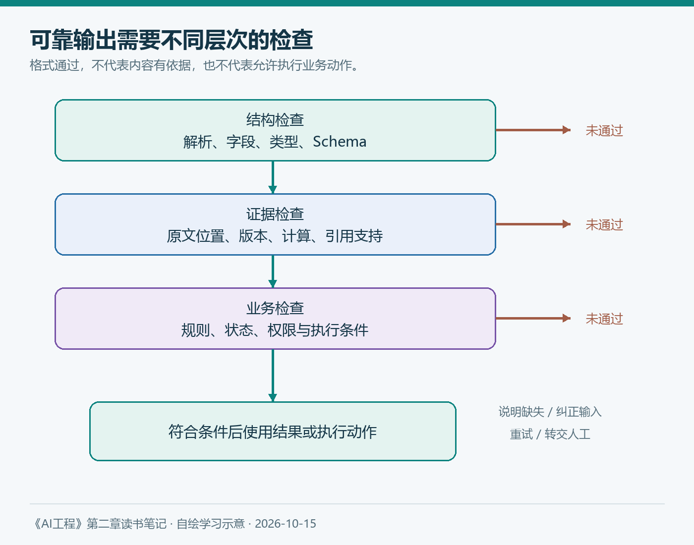

# 第二章（6/6）：输出JSON就可靠了吗——结构化输出、不一致与幻觉

如果模型已经能够稳定输出JSON，一个AI功能是否就算可靠了？这个问题看似偏工程，却把第二章前面几部分连到了一起。

数据影响能力边界，架构与规模影响计算，后训练塑造行为，采样决定生成选择。最后，应用拿到一个结果，还要决定是否可以使用它。

> 本篇对应原书2.4.4、2.4.5与2.5，结合当前结构化输出与评估资料整理。查阅日期为2026年10月15日；案例为假设场景。

**阅读导航：** 第二章六篇的最后一篇，讨论把模型输出交给应用之前需要检查什么。

**本章六篇：** ①训练数据 → ②模型架构 → ③规模与成本 → ④后训练 → ⑤采样与推理 → ⑥可靠输出。

---

## 1. 先把三种正确分开

假设模型从合同中提取以下内容：

```json
{"amount": 10000, "currency": "CNY", "effective_date": "2026-01-01"}
```

它可能是合法JSON，却仍有三类问题：字段类型不符合应用约定，金额与原文不符，或者日期对应签署时间而不是生效时间。

| 层次 | 检查的问题 | 可以使用的证据 |
| --- | --- | --- |
| 语法与结构 | 能否解析，字段和类型是否符合约定 | JSON解析、Schema校验 |
| 内容与依据 | 值是否被原始资料支持 | 原文定位、数值计算、交叉核对 |
| 业务与操作 | 结果是否满足规则，是否允许执行 | 业务校验、状态检查、权限与确认 |

所以，“解析成功”只是第一道门。可靠输出需要把后两道门也设计出来。

## 2. 原书中的四条结构化路径

第一条是提示：明确字段、类型、格式和示例。它开始容易，但模型仍可能额外解释、漏字段或被输入中的其他文字干扰。

第二条是后处理：从输出中提取、解析与修复。这里要谨慎区分修复语法和改写含义。补一个明确缺失的括号，与猜一个合同金额，是完全不同的动作；不确定时应报错或重新请求。

第三条是约束解码：在每一步选择token时，根据当前语法或Schema状态，屏蔽不允许的候选，再在允许集合中选择。它能改善形式约束，但并没有验证被允许的数值是否真实。

第四条是微调：通过训练提高某种输出模式的稳定性。它需要数据与评估，也不能代替运行时的解析和业务检查。



*图8：本笔记自绘。结构检查、证据检查和业务检查分别处理不同问题；验证失败进入可解释的处理路径。*

## 3. 当前结构化输出能力，解决的是哪一部分

Claude当前官方文档说明了JSON Schema约束输出及严格工具输入等能力，同时列出拒绝、输出截断和Schema支持限制等边界。正式接入时需要按模型与接口版本逐项核对。[结构化输出官方文档](https://platform.claude.com/docs/en/build-with-claude/structured-outputs)

我的理解是，这类能力把部分格式问题从“期待模型遵守”变成了更强的生成约束，能够减少解析失败。但它并没有把语言模型变成事实数据库。

Schema可以要求金额为数字，却不知道原文中哪个数字才是合同总额；可以要求输出来源编号，却不知道该来源是否支持结论。遇到资料没有给出的值，应在设计中允许明确的缺失状态，而不是强迫模型填一个答案。

工具调用也是如此。参数符合Schema，不代表用户已经授权这次操作，也不代表业务状态允许执行。将“生成参数”与“实际执行”分开检查，才能避免格式成功掩盖动作错误。

## 4. 不一致性：先问哪些条件发生了变化

原书讨论同一输入可能得到不同回答。上一篇已解释采样，但真实应用还有资料更新、对话历史、工具返回和服务版本等变化。

排查时，我会先保存完整输入条件，再比较结果。如果两次检索得到的资料不同，就不应直接把差异全部归因于随机性。若要求相同任务得到一致业务结论，还需要稳定资料版本、字段定义和规则。

低温度也不是事实验证器。模型可以稳定输出同一个错误。重复性与正确性应分成两个指标，分别设定验收标准。

## 5. 幻觉：顺畅地生成，不等于有依据地回答

我在这里把幻觉理解为生成了不受事实或给定资料支持的内容。不同研究的定义与评测范围可能不同，引用数据时必须说明。

问题可能来自知识不足、过期资料、检索错误、上下文误读、问题中的错误前提，也可能受到训练目标与偏好优化影响。仅用“模型是概率性的”解释一切，会让排查停留在一个过于宽泛的结论上。

例如，问题问“某项已经取消的补贴怎样申请”，模型如果直接给申请步骤，就接受了错误前提。即使每一步都写得像政策说明，也可能没有任何当前依据。

更值得检查的是：资料是否存在，版本是否合适，引用能否定位，结论是否超出证据，信息不足时是否说明限制。

## 6. 常见补救措施，各自能覆盖什么

| 方法 | 可能改善的问题 | 仍需检查的地方 |
| --- | --- | --- |
| 提示中要求依据不足时说明 | 降低无条件作答倾向 | 模型是否能正确识别信息缺口 |
| RAG与引用 | 提供任务相关资料与追溯入口 | 检索漏召回、资料错误、引用不支持 |
| 计算器或业务工具 | 将精确计算和实时查询外部化 | 输入参数、工具结果与执行权限 |
| 结构化输出 | 降低格式与类型错误 | 字段值和业务含义 |
| 多候选与复核 | 发现部分分歧和明显错误 | 错误相关性、复核器自身偏差 |
| 人工审核 | 处理需要专业判断的结果 | 审核成本、标准及注意力限制 |

这些措施可以组合，但没有哪一项自动保证消除所有错误。模型自己再检查一遍，也不能被视作独立证据。

概率需要特别谨慎。某个token的概率高，表示它在给定上下文下更可能被生成，不表示包含它的事实有同样的正确概率。让模型给自己的答案打95分，也不自动得到经过校准的置信度。

## 7. 从回答文本，走向可验证的任务结果

Anthropic在2026年1月9日的智能体评估文章中，区分执行记录与环境中的实际结果，并讨论不同评分方式。这对知识库助手也有启发：模型声称完成了任务，还需要检查外部世界是否真的发生了相应变化。[官方评估文章](https://www.anthropic.com/engineering/demystifying-evals-for-ai-agents)

对一个只读问答功能，我会检查结论是否有依据、关键信息是否遗漏、资料缺失时行为是否合适。若功能还会创建工单，就增加工单是否真实存在、字段是否正确、是否重复创建等检查。

学习阶段可以整理一组正常、缺失、冲突、错误前提和格式异常的样本。每次改变模型、提示词、检索或约束，都重新运行并记录失败类别。模型评分可作为辅助，但需要与人工判断对照，不能让单一评分器包办所有质量结论。

## 8. 读完第二章，我形成的一张地图

现在，我会沿着五个问题理解一个AI功能：

1. 数据：模型可能擅长什么，资料缺口在哪里？
2. 建模：信息怎样处理，资源主要消耗在哪里？
3. 后训练：什么信号塑造了它的行为？
4. 生成：采样与计算预算怎样改变输出？
5. 验证：哪些证据足以支持使用这个结果？

对于知识库助手，这张地图意味着先把资料、引用和失败行为做好，再决定是否增加训练、推理预算或自动执行。每个改动都应对应一个已识别的问题，并通过回归比较确认收益。

**理解基础模型的价值，是让我们更准确地提出工程问题。** 当回答不可靠时，能够沿着数据、上下文、模型、生成和验证逐项调查，比不停更换模型更有机会得到可解释的改进。

---

**参考与说明**

- Chip Huyen：《AI工程：大模型应用开发实战》，第二章2.4.4、2.4.5与2.5。
- Anthropic：[Structured outputs](https://platform.claude.com/docs/en/build-with-claude/structured-outputs)，查阅于2026-10-15。
- Anthropic：[Demystifying evals for AI agents](https://www.anthropic.com/engineering/demystifying-evals-for-ai-agents)，2026-01-09。
- 本文使用AI辅助梳理与起草；图表自绘，假设案例未作为实际测试结果呈现。
