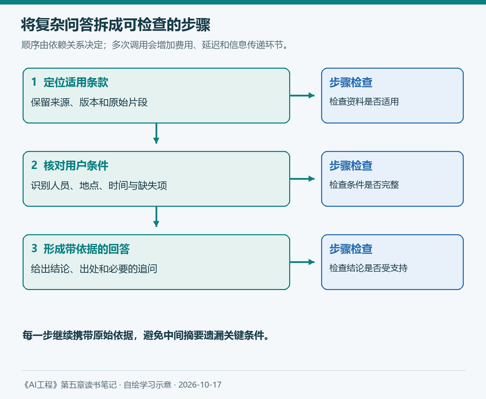
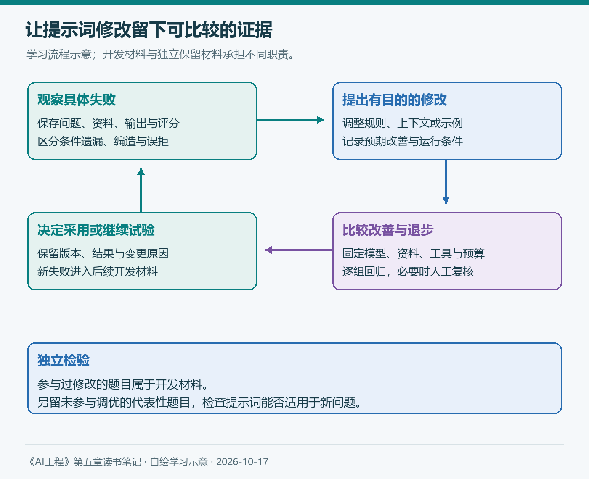

# 第五章（2/3）：提示工程最佳实践——从明确指令到迭代与版本管理

上一篇区分了指令、示例和上下文。真正动手时，问题会进一步变成：提示词需要改到什么程度，怎样判断改动有用，模型更新以后又该保留什么？

第四章已经给出一个基础：先定义评估标准，再比较系统变化。提示词也可以沿着同样的方法迭代。每次修改，都应该对应一个观察到的问题和一个可以检查的预期。

> 本篇按原书5.2的七项实践顺序组织，小节名称采用中文概括。结合官方提示文档与自编案例展开个人理解，知识库案例沿用上一篇的假设制度；补充资料查阅于2026年10月17日。

**第五章三篇：** ①提示词简介 → ②提示工程最佳实践 → ③防御性提示工程。

## 5.2 提示工程最佳实践

### 5.2.1 编写清晰明确的指令

“请认真回答，务必准确”表达了愿望，却没有说明什么算准确。对于知识库助手，需要进一步约定答案依据、适用范围、输出内容，以及信息不足时的处理方式。

可以把“回答报销问题”改成“先确认制度的适用人群、地点和时间，再依据相应条款回答；给出来源编号；条件缺失时追问”。这让模型知道应该关注哪些信息，也让评估者有明确的检查对象。

输出要求同样需要具体。如果业务需要JSON，就约定字段及缺失状态；如果用户只需要一句条款解释，就避免强迫生成很长的报告。第二章已经讨论过，格式约束有助于解析，但内容是否正确仍要核查。

### 5.2.2 提供充分上下文

用户问“650元住宿费能报多少”，模型无法自行知道公司制度、员工类别和出差城市。把这些信息补齐，比反复强调“专业”更能解决当前问题。

沿用上一篇的假设：普通员工在A市境内出差，住宿按实际合规金额报销，每晚最高600元。若问题只问条款中的金额上限，可以据此回答；若问最终到账金额，就需要进一步核对审批和凭证等条件。

所以，充分上下文既要覆盖必要条件，也要允许指出缺口。检索到了一个包含“600元”的段落，还不够证明它适用于当前用户。来源、版本和人群也要进入判断。

我的做法会是先列出完成任务所需的信息，再检查输入是否提供了这些信息。让模型指出缺失项，可以作为辅助；关键资料是否齐全，仍应结合文档管理和业务规则检查。

### 5.2.3 将复杂任务拆成简单子任务

如果一次请求同时要求查制度、判断版本、计算金额和写审批意见，出错以后很难定位原因。可以先拆成三个可检查的步骤：定位适用条款，核对用户条件，形成带依据的回答。

*图3：自绘。每一步留下可检查的结果；原始依据随步骤保留，避免中间摘要丢失条件。*

拆解有两种常见实现：在一次请求中说明步骤，或者由应用组织多次模型调用。前者不能保证中间判断可独立检查；后者便于验证和重试，却增加调用成本、延迟和信息传递环节。

存在前后依赖的步骤应按顺序执行。可以独立核对的事项，才考虑并行处理。如果上一步遗漏了“普通员工”这个条件，后一步再严谨地计算也可能得到错误结论，因此应保留原始条款供复核。

### 5.2.4 给模型思考时间

对于需要计算或多条件判断的任务，适当的推理过程可能帮助模型发现中间约束。但推理文字变长，并不能直接证明答案更可靠。它仍可能围绕错误前提展开一段自洽说明。

当前模型的推理能力和控制方式存在差异。Anthropic的提示文档也针对不同模型讨论推理投入、过度探索和验证开销。具体配置应按模型版本确认，并在任务中比较质量、费用与延迟。[官方文档](https://platform.claude.com/docs/en/build-with-claude/prompt-engineering/claude-prompting-best-practices)

在住宿案例中，我更关心模型能否指出适用条款、识别缺失条件，并给出可核对的计算依据。用户可见的简明依据与模型内部推理属于不同内容；实际验收应检查前者支持的结论和最终任务结果。

### 5.2.5 迭代提示词

假设初版助手遇到制度缺失仍然回答，下一版可以加入信息不足时的处理要求；若它开始对所有问题都说“不清楚”，就需要检查新增要求是否过于笼统，以及正常案例是否仍能作答。

下面展示三个版本各自要解决的问题，具体文字需要通过测试调整。

| 版本 | 主要改动 | 重点检查 |
| --- | --- | --- |
| V1 | 明确任务、依据和出处 | 基础题能否正确引用制度 |
| V2 | 增加缺失与版本冲突的处理 | 是否追问必要条件，是否误拒正常题 |
| V3 | 针对观察到的失败补充规则或示例 | 目标问题是否改善，其他分组是否退步 |

第二章提出的30题起步练习，可以继续帮助收集常见问题、专业术语、资料缺失、版本冲突和中英混合等失败。但用于挑选示例、修改提示词的题目，已经参与适配，不能再作为完全独立的最终检验材料。

我会另留一组未用于修改的题目。比较时固定模型、资料、工具和预算，分别记录正确作答、条件遗漏、无依据回答与误拒。若条件也发生变化，就将它作为新的实验设置保存。

*图4：自绘学习流程。开发材料支持修改，保留材料检查泛化；最终成绩依赖有代表性的实际测试。*

### 5.2.6 评估提示工程工具

提示管理和优化工具可以帮助保存模板、生成候选、运行比较。但工具搜索的是某种评分规则下的改进。若评分只检查JSON能否解析，它可能选出格式稳定、内容却缺乏依据的提示词。

选择工具时，我会问三个问题：它改变了哪些内容，依据什么反馈挑选候选，每轮需要多少调用与人工复核？尤其要检查它如何区分开发数据与保留数据，能否导出最终提示词和运行记录。

近期的GEPA研究提供了一个具体方向：利用执行轨迹和自然语言反思诊断问题，提出并测试提示词更新。论文于2025年提出，2026年2月修订，在其考察任务中报告了相对基线的收益。[论文原文](https://arxiv.org/abs/2507.19457)

对我的启发是，可以将优化过程组织成“观察失败—提出修改—检验修改”。论文中的收益需要结合任务、模型和预算理解；自己的知识库应用仍应通过独立材料检验。

### 5.2.7 组织与版本管理提示词

提示词进入应用后，就成为会持续变化的一项配置。保存一段文本，还不能完整复现一次结果，因为模型版本、资料内容、示例顺序和推理配置也可能改变行为。

一份简明的变更记录，可以包括以下内容：

| 项目 | 记录内容 |
| --- | --- |
| 提示词版本与变更原因 | 改了哪条要求，预期改善哪种失败 |
| 运行条件 | 模型版本、生成配置、工具与资料版本 |
| 比较证据 | 评估集及规则版本、分组结果、关键失败 |
| 使用决定 | 采用、继续试验或回退，以及对应原因 |

这与第一章的维护规划、第四章的持续评估相连。模型更新后，可以重跑既有任务，再决定哪些旧要求仍然需要、哪些已经冗余。

读完这一节，我最想建立的习惯，是在改提示词之前先写一句话：这次准备解决什么问题，用什么证据判断？它能让每次试验留下可继续利用的经验，也为下一篇检查异常输入提供基础。

## 参考与说明

- Chip Huyen：《AI工程：大模型应用开发实战》，5.2；七项顺序核对自[作者官方目录](https://github.com/chiphuyen/aie-book/blob/main/ToC.md)。
- Anthropic：[Prompting best practices](https://platform.claude.com/docs/en/build-with-claude/prompt-engineering/claude-prompting-best-practices)，查阅于2026-10-17。
- Agrawal等：[GEPA: Reflective Prompt Evolution Can Outperform Reinforcement Learning](https://arxiv.org/abs/2507.19457)，2025年提出，2026-02-14修订。
- 本文使用AI辅助梳理与起草；配图自绘。版本表与评估流程为学习方案，未作为已执行实验的成绩呈现。
