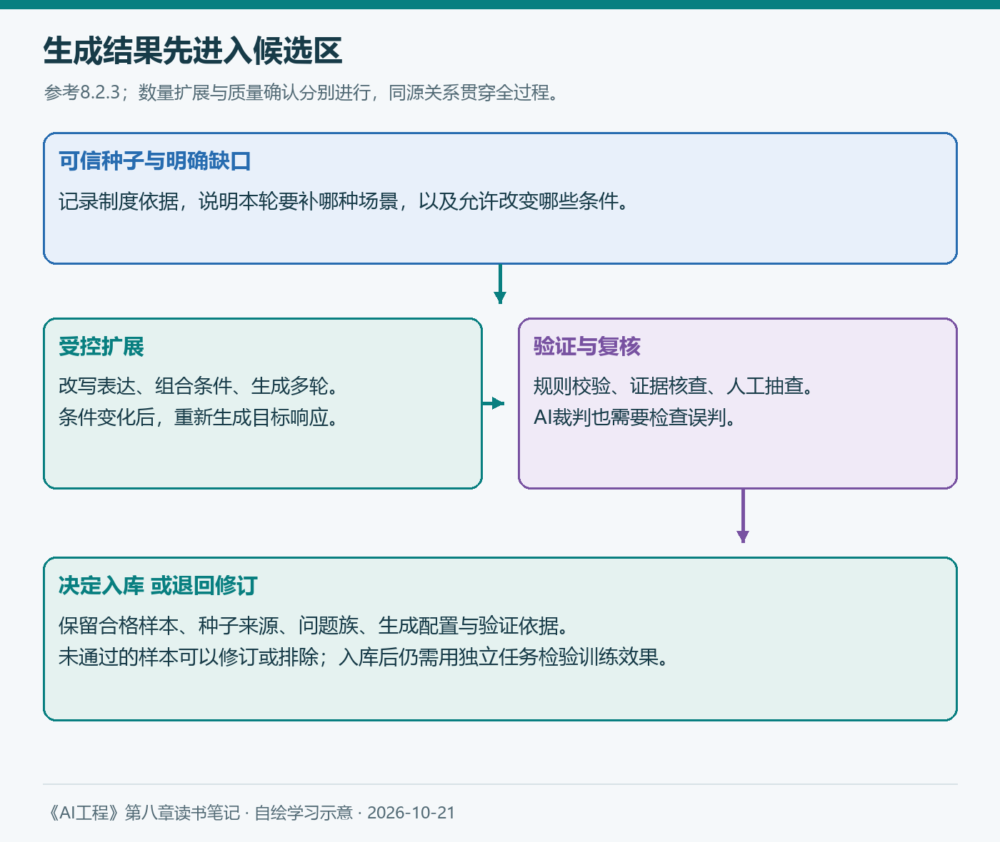
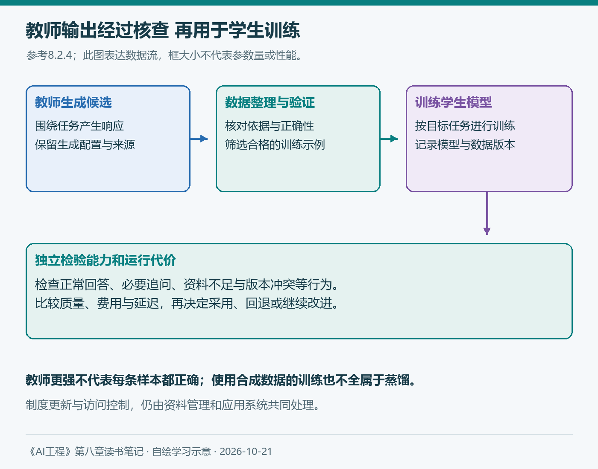

# 第八章（2/3）：数据增强与合成——从生成样本到验证质量

上一篇讨论了需要什么数据。真正开始准备时，很容易遇到另一种困难：知道缺少哪类场景，却没有足够的现成样本。

对报销助手，普通条款问答比较容易收集，用户漏说条件、制度存在冲突、多轮追问后才能回答的对话则更费时间。如果能利用已有材料扩展这些场景，数据准备会更灵活。但批量生成只是中间步骤，生成的内容还需要满足任务要求。

> 本篇对应原书8.2，按合成动机、传统方法、AI驱动的方法与模型蒸馏展开。业务制度与操作流程均为假设学习案例；配图自绘，补充资料查阅于2026年10月21日。

**第八章三篇：** ①数据策展 → ②数据增强与合成 → ③数据处理。

## 8.2 数据增强与数据合成

原书区分数据增强与数据合成。增强从已有真实数据出发，通过变换创建新样本；合成则人工生成数据，替代或补充真实数据。本章也会用“数据合成”统称这两类自动创建方法。

例如，改写一条已确认的问题属于扩展已有数据；根据制度与规则构造一段新的咨询对话，则可以看作合成。无论叫法如何，都要记录哪些条件发生变化，以及目标响应是否仍然成立。

### 8.2.1 为什么要进行数据合成

原书首先讨论增加数据量。对于真实数据稀缺、难以采集的场景，合成可以提供候选材料，也能降低部分重复劳动。但生成十万条记录，不等于获得十万条合格训练样本。

第二个动机是提高覆盖度。我们可以有目的地补充罕见事件、特定表达、对抗输入和少数类别。对知识库助手，我更愿意从实际缺口开始：没有城市、适用身份不明确、问题日期早于制度生效时间，分别需要怎样处理？

第三个动机是提高质量。人类标注可能存在遗漏和不一致，模型也可能帮助规范格式、补充候选答案或辅助复核。但质量优劣需要依据具体任务验证，不能按“人工”或“AI生成”直接下结论。

原书还介绍缓解隐私顾虑与辅助模型蒸馏。合成可以减少对部分真实记录的依赖，但如果种子或生成结果暴露了敏感内容，仍然会带来问题。使用前需要检查材料本身及其适用条件。

### 8.2.2 传统的数据合成方法

#### 1. 基于规则的数据合成

最直接的方法是模板与规则。假设制度规定按每晚实际合规费用计算，A市上限为600元，可以生成不同住宿费用，再由规则计算答案。

在审批与凭证条件都已满足的假设下，两晚每晚分别为700元和500元，可报金额为：

```text
min(700, 600) + min(500, 600) = 1100元
```

这里必须逐晚计算。若直接使用“min(总费用, 天数×上限)”，会得到1200元，与该假设规则不符。这也说明，模板里的字段与计算规则需要一起设计；不能只有随机数字和看起来合理的答案。

规则还可以生成日期、城市、身份与表达组合。若只改变说法，原答案可能继续有效；若改变适用条件，就需要重新核对条款和响应。原书介绍的同义替换、扰动和图像变换，同样需要考虑标签是否仍成立。

对文本进行性别替换或表达变换，可以帮助检查某些偏差。但替换后的内容仍需符合语义和场景，不能假定每次替换都保持事实不变。

#### 2. 模拟

模拟可以创建行动及其后果。原书以自动驾驶、机器人和工具使用为例：先在可控环境中尝试动作，再利用验证结果整理训练数据。

报销助手也可以模拟多轮过程：用户先问“这次住宿能报多少”，助手追问城市和每晚金额，用户补充后，助手检索制度并计算。若模拟工具返回的是旧制度，还可以观察助手是否识别日期不匹配。

但模拟环境的规则来自我们。若它永远返回整洁且完整的制度，生成的数据就难以反映真实文档缺页、检索不全和资料冲突。模拟成功后，仍需要回到真实任务验证适用性。

### 8.2.3 AI驱动的数据合成方法

AI扩展了可生成内容的范围。原书介绍了模拟API、模拟用户、自我对弈、改写、翻译与回译等方法。这些方法共同依赖一个问题：怎样判断生成结果保留了任务需要的含义？

例如，翻译回原语言后与原句相似，可以提供质量线索，但不能保证两个翻译模型没有共同误解。代码回译也需要结合程序行为检查，不能只比较文字是否相近。

#### 1. 指令数据合成

监督微调通常需要指令与响应。两者可以分别由人工或AI生成，也可以从一组可信种子示例出发进行扩展。

原书通过Alpaca等案例解释这种方法。对自己的助手，我会先选择已核对制度依据的种子，再明确允许变化的范围：调整措辞、增加无关背景、移除必要条件，或者组合多个已有条款。

这些变化应对应不同处理。仅改写问题，可以保留答案供复核；移除城市以后，目标行为可能变成追问；移除支持材料以后，则不能继续要求模型给出确定金额。



*图3：自绘，参考原书8.2.3。生成结果先进入候选区，验证与复核后再决定是否用于训练；同源派生关系需要保留。*

原书还介绍反向指令：从已有高质量内容出发，生成能够引出这些内容的问题。它能利用人工写好的长文，但生成的问题仍应由原文支持，不能把一个相关主题误写成文章已经回答的问题。

对于长文档，可以先在片段中生成问答，再将完整文档作为上下文。整理时需要检查截断、答案位置和材料长度，避免问题依赖的证据在训练输入中已经消失。

2026年9月更新的NVIDIA实践说明强调，以可信种子限定生成范围，通过采样或模板增加受控变化，再验证、预览与迭代。这与本书的思路相连：扩展应服务于覆盖缺口，而不是反复复制少数种子。[官方实践说明](https://perspectives.nvidia.com/synthethic-data-generation/best-options-generating-synthetic-training-data/)

这个方法给我的启发，是让每次生成对应一项具体变化。先说明想增加哪种场景，随后才决定生成提示词和数量，比较容易发现数据是否偏离任务。

#### 2. 数据验证

第四章的评估方法，到这里可以继续使用。能够程序化核验的部分，优先使用规则或执行结果；需要理解语义的部分，再结合AI裁判与人工复核。

例如，金额计算可以核对每晚费用与上限；输出字段可以检查类型和必填项；引用是否支持结论，需要对照原文、日期和适用人群。JSON合法，只证明格式可解析，不能证明字段里的事实正确。

| 检查内容 | 适合的证据 |
| --- | --- |
| 数字、日期与字段 | 规则计算、类型与范围检查 |
| 结论是否受资料支持 | 对照原文、资料版本与适用条件 |
| 多轮与工具行为 | 对话记录、工具返回和执行状态 |
| 边界与争议样本 | 人工复核及标注指南 |

AI裁判可以帮助筛选，但要用已核对的样本检查它会错在哪里。生成模型和裁判若共享同一错误，互相赞同也不能替代外部依据。多个候选里选最好的，还要允许“所有候选都不合格”。

原书也介绍了去除重复、过长或过短、输入输出重复等启发式过滤。阈值需要联系任务：过长可能是冗余，也可能包含必要例外；空响应可能是数据损坏，也可能涉及特定任务定义。

2025年的DeepSeek-R1论文提供了一个代表案例：它在部分阶段为同一问题采样多个响应，筛选正确响应，并进一步处理可读性问题。论文中的数据筛选说明，模型生成与样本入库是两个环节；最终答案通过核验，也不自动证明每一步解释都正确。[论文2.3.3节](https://arxiv.org/html/2501.12948v1#S2.SS3.SSS3)

最后仍要检查这些数据是否改善实际模型。若只在裁判分数上变好，独立任务却没有收益，就需要调查评分规则、数据分布和训练设置。

#### 3. AI生成数据的局限性

**质量控制。** 模型可能写出流畅但错误的制度解释。答案无法验证时，扩大生成量会同时扩大复核负担，甚至让错误更难被发现。

**表层模仿。** 学生模型可能学会教师的语气和格式，却没有获得相同的能力。长篇推理尤其需要谨慎：看起来像解题过程，并不意味着过程成立。

**潜在的模型坍塌。** 原书讨论递归使用生成数据可能丢失少见情况、放大既有偏差的研究。合成比例、真实数据是否保留、筛选方式与迭代条件都会影响结果，不能据此推断所有合成训练必然失败，也不能认为混入一点真实数据就一定安全。

对报销助手，一个具体风险是：生成器不断围绕常见城市和标准问法扩展，少见的制度例外逐渐消失。需要主动保留和检查这些场景，而不是只看总样本量。

**数据溯源困难。** 模型输出可能复现其训练内容，也可能包含测试题的改写。生成工具不会自动补全来源和使用条件，记录教师版本、种子来源与派生关系十分重要。

这也接回第四章的数据污染讨论。一个测试问题即使换了说法，仍可能属于已经参与训练的同一问题族。独立检验需要考察内容关系，而不只比较字符串是否完全一致。

### 8.2.4 模型蒸馏

蒸馏利用教师模型提供的行为或输出信号训练学生。原书先介绍用较小学生获得更经济部署的常见目标，同时提醒我们，使用合成数据训练并不自动意味着蒸馏。



*图4：自绘，参考原书8.2.4。教师输出经过整理与验证后用于学生训练，最终在独立任务上检查能力和运行代价。框大小不表示参数比例。*

DeepSeek-R1论文使用整理后的约80万条样本对Qwen和Llama系列模型进行监督微调，展示了这种蒸馏路径；该组蒸馏实验并未给学生增加强化学习阶段。它为第七章提到的开发路径提供了具体参照。[论文2.4节](https://arxiv.org/html/2501.12948v1#S2.SS4)

对自己的任务，还需要确认输出数据的允许用途、学生容量与训练方式。教师在通用榜单上更强，不意味着它生成的每条业务答案都正确；学生在特定任务上也可能因数据选择与训练而取得不同表现。

我会比较学生是否保留必要能力，费用与延迟是否改善，以及资料不足、版本冲突和异常输入有没有退步。制度更新仍需要资料管理与检索，不能期待一次蒸馏永久记住未来规则。

读完8.2，我最想保留的是一条完整路径：先明确数据缺口，再生成候选，最后用证据决定哪些值得训练。下一篇进入数据处理，继续解决候选样本的检查、去重、清理和格式化问题。

## 参考与说明

- Chip Huyen：《AI工程：大模型应用开发实战》，8.2。
- NVIDIA：[小规模真实数据如何支撑合成数据生成](https://perspectives.nvidia.com/synthethic-data-generation/best-options-generating-synthetic-training-data/)，页面更新于2026-09-02。
- DeepSeek-AI：[DeepSeek-R1论文](https://arxiv.org/html/2501.12948v1)，2025-01-22，重点参考2.3.3与2.4。
- 本文使用AI辅助梳理与起草；原书框架、研究实践与个人方案分别表述。两图自绘，计算与制度为假设示例，未声称执行过业务训练或测得提升率。
