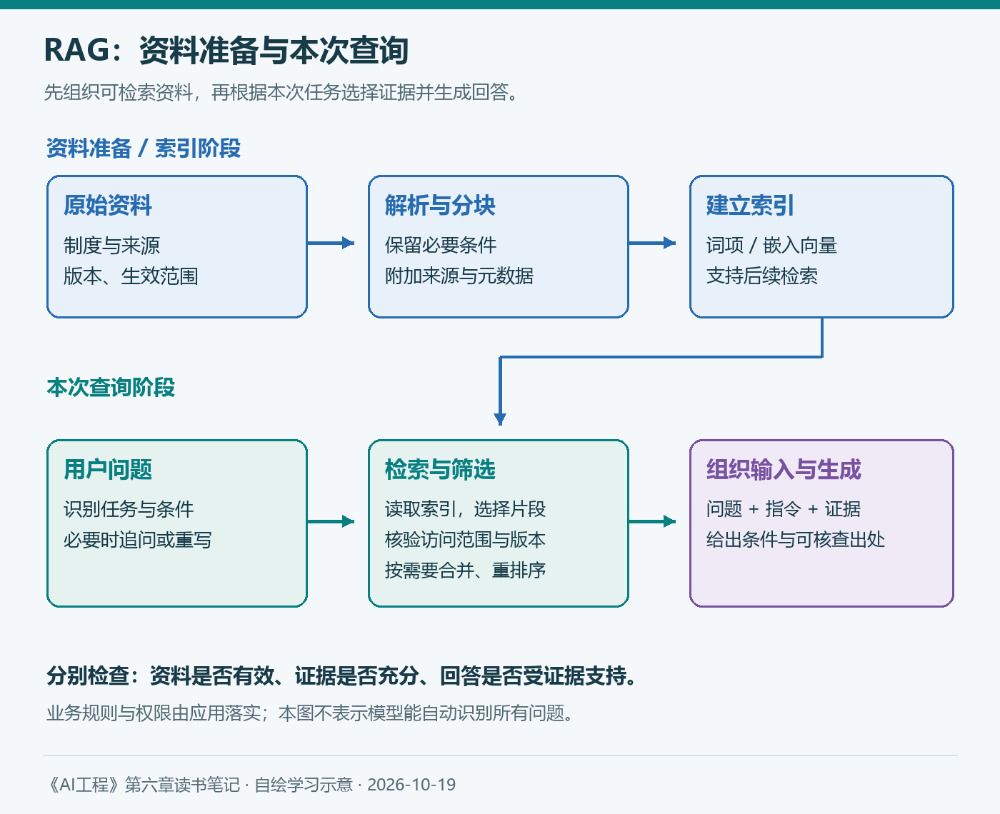
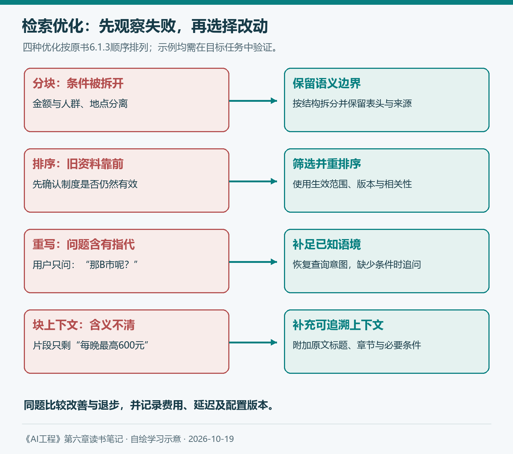

# 第六章（1/2）：RAG——为每个问题找到合适的上下文

第五章讨论怎样把任务交代清楚，也反复遇到一个条件：模型需要充分的上下文。此前的例子中，我们直接把一段住宿制度放进提示词。真正的知识库却可能包含数百份文件，既有现行制度，也有历史版本，用户的部门和出差地点还各不相同。这次应该给模型看哪些资料？

第六章从这里展开。RAG负责从外部资料中寻找与当前问题相关的信息，再交给模型生成回答。对前几章的企业知识库助手而言，它把手工挑选制度片段，变成了一套可以设计、检查和持续改进的过程。

> 本篇对应Chip Huyen《AI工程：大模型应用开发实战》第六章导言与6.1，按架构、检索算法、检索优化、超越文本的RAG依次展开。报销制度和任务均为假设，配图自绘；补充资料查阅于2026年10月19日。

**第六章两篇：** ①RAG与上下文获取 → ②智能体、工具、规划与记忆。

## 6.1 RAG

RAG即检索增强生成。它从数据库、文档、历史记录或互联网等外部来源检索信息，用这些信息增强模型本次生成。模型参数中的知识、当前输入中的资料以及外部存储，分别承担不同职责。

原书提醒，RAG的价值包括突破上下文限制、使用较新的资料，以及减少不必要的输入。即使上下文窗口能够容纳整本制度汇编，也要继续比较：模型能否有效利用它，每次重复输入的费用与延迟如何，资料更新以后怎样保持一致。

对一个规模较小、内容稳定的知识库，直接提供全文可以成为参照方案；资料规模、更新频率或访问范围变化后，再评估是否需要检索。具体方案应由任务证据决定。

### 6.1.1 RAG架构

一个基本RAG系统包含检索器和生成器。检索器找到与查询相关的资料，生成器结合资料与用户问题形成响应。实现时，需要先区分索引和查询。

索引是在用户提问之前或资料更新时，对文档进行解析、分块和组织，便于之后查找；查询是在用户提出问题后，根据本次输入寻找相关内容。采用嵌入检索时，还要为块生成向量，并为查询生成相应向量。



*图1：自绘，参考原书6.1.1与图6-3。索引准备可检索的资料，查询阶段按当前任务选择证据。权限核验与版本选择是知识库案例中的应用设计。*

继续用第五章的假设：2026年版制度规定，普通员工在A市境内出差，住宿按实际合规金额报销，每晚最高600元。用户问：“我在A市住了一晚，650元能报多少？”

检索前需要识别这次问题所涉及的人员、地点和时间；必要条件缺失时，可以追问。检索时应限定当前用户可访问的资料，并核对制度生效范围。生成时保留条款出处和适用条件，回答该条款支持的金额上限。票据或审批条件尚未提供，就需要说明最终报销还需核对哪些事项。

这接回第四章的事实一致性：模型即使准确复述了旧制度，也可能回答错“现在适用什么”。资料是否有效、检索是否正确、回答是否受资料支持，应当分别检查。

### 6.1.2 检索算法

#### 基于词项的检索

如果用户输入准确的制度名称、编号或错误码，直接匹配词项通常很有帮助。词频反映某个词在文档中出现多少次，逆文档频率则反映这个词在整个文档集合中有多常见。TF-IDF结合二者，突出文档中的重要词项；BM25进一步考虑词频饱和与文档长度等因素。

倒排索引可以把词项映射到包含它的文档，减少逐篇扫描。分词、大小写、停止词和多词短语的处理，也会改变检索结果。“差旅管理办法2026”这类精确名称，应当在自己的语料中验证怎样切分和匹配。

#### 基于嵌入的检索

用户也可能问：“出差住酒店，公司能承担多少？”它与“住宿费用报销上限”未必共享相同措辞。嵌入模型把查询和资料转换为向量，再依据向量相近程度寻找候选内容，帮助处理语义接近、表达不同的情况。

这里至少有两个可检查的环节：嵌入是否保留了任务所需含义，向量搜索是否找到了合适的候选。向量库中的相似结果，仍需要核对适用人群、版本和条件。

原书介绍k近邻以及近似最近邻搜索。前者可以逐个比较，数据大时开销较高；后者通过索引结构和近似计算，在召回、速度、构建时间和存储之间取舍。HNSW、LSH、IVF和乘积量化属于不同设计思路，选型时应结合实际数据和负载测试。

#### 检索算法比较

| 方法 | 在案例中值得测试的情况 | 需要关注的代价或失败 |
| --- | --- | --- |
| 词项检索 | 制度编号、产品名称、准确术语 | 同义表达可能匹配不足 |
| 嵌入检索 | 日常说法与正式条款之间的语义对应 | 精确编号、否定条件与版本差异可能丢失 |
| 混合检索 | 同时存在精确词项和语义查询 | 多路结果的合并、去重与运行开销 |

这些是实验方向，具体表现取决于语料、模型和实现。第四章的模型选择方法在这里仍然适用：先明确任务要求，再比较能够满足要求的方案。

检索评估可从上下文精度和召回率开始。精度关注取回的资料中有多少相关内容；召回率关注所有应当取回的相关资料中找到了多少。排序质量还可以使用NDCG、MRR等指标。对于大量文档，完整标注相关集合可能很困难，需要说明评估范围与标注方式。

最终还要检查回答。检索片段相关，并不能保证它们共同覆盖全部必要条件；模型也可能误读正确片段。组件结果帮助定位问题，完整任务结果决定应用是否有效。

#### 组合检索算法

原书讨论了顺序组合与并行组合。可以先用一种方法获取候选，再用另一种方法精排；也可以同时运行词项与嵌入检索，合并两路结果。后一种方式需要处理不同评分尺度。

倒数排名融合RRF根据文档在各结果列表中的名次合并排序，基本思路是让多路检索共同支持、且排名靠前的候选获得更高分。它提供了一种组合办法，但合并规则本身仍需用业务题检查。增加一路检索是否值得，也要同时记录质量、费用和延迟。

### 6.1.3 检索优化

#### 分块策略

块太小，金额可能与适用条件分开；块太大，又可能带入大量无关条款。按字符数拆分很容易实现，按段落、标题或文档结构拆分，则可能更好地保留语义边界。重叠能缓解边界截断，也会增加重复内容和索引量。

报销制度中的“普通员工、A市、每晚、600元”共同限定一条规则。分块时应检查这些条件是否仍可一起获取，表格的表头、行列关系和脚注是否被保存。块大小还需受嵌入模型和生成模型的输入限制约束。

#### 重排序

初次召回可以优先覆盖更多候选，再通过重排序选择更适合当前问题的片段。不同步骤优化的目标和成本应当说清楚。

版本尤其需要注意。最新上传的文件可能是补录的历史制度，所以有效性应依据生效日期、适用范围和替代关系确定。重排序可以参考这些信息；明确的业务约束也可以在检索过滤阶段落实。

#### 查询重写

用户接着问“那B市呢？”，单独检索这几个字，很难表达真实意图。系统可以结合当前对话，将它重写为“普通员工在B市境内出差时，当前有效的每晚住宿报销上限是多少”。

重写过程也会出错。前文未提供员工类别时，就不能擅自补上“普通员工”。我会同时保留原始问题、重写查询和使用的上下文，以便判断错误发生在理解阶段还是检索阶段。

#### 上下文检索

这一项容易和“把检索结果加入模型上下文”混淆。原书此处讨论的是：在建立索引时，为内容块补充标题、摘要、实体或它能回答的问题，帮助检索器理解块的含义。

例如，一个块只有“每晚最高600元”，可以附上来自原文的制度名称、年份、适用人员和章节信息。若补充说明由模型生成，就要防止它把原文没有的条件写进去，并继续保留可追溯的原始内容。



*图2：自绘，参考原书6.1.3。每项改动对应一个可观察的问题，是否改善需要通过同题比较验证。*

这让我重新理解第五章的迭代方法：修改分块、查询重写或排序，也应先写明目标失败。若同时更换全部配置，即使总分提高，也难以知道真正起作用的部分。

### 6.1.4 超越文本的RAG

#### 多模态RAG

知识库可能包含扫描件、流程图、票据和截图。只提取文字，有时会失去版面、箭头和图中关系。检索时可以利用图片说明、OCR结果，也可以采用支持图文的嵌入模型；生成器则需要具备使用相应模态的能力，或通过转换工具处理。

我会把文本与视觉信息分别检查：内容有没有提取完整，相关页面是否找到，模型是否正确理解表格和图形。检索到整张图片，也不自动代表其中的小字和关系能够被正确识别。

#### 使用表格数据的RAG

当用户问“我这个月已经报销了多少住宿费”，依据来自业务记录。可以先把自然语言问题转换成SQL，再执行查询，将结果交给模型解释。系统还需要选择正确的数据表，处理员工标识、时间范围和业务状态。

例如，在一份虚构的业务表中，可以按以下思路汇总已报销记录：

```sql
SELECT SUM(paid_amount) AS total_paid
FROM reimbursements
WHERE employee_id = :authorized_employee_id
  AND category = 'lodging'
  AND status = 'paid'
  AND paid_at >= :month_start
  AND paid_at < :next_month_start;
```

这是参数化查询的学习示例。员工身份应由应用核验，日期口径、状态定义和字段含义也需要业务确认。执行器可只开放必要的只读查询权限，并限制可访问的表与运行资源。

到这里，助手已能够使用检索器和SQL执行器。下一篇将继续讨论：工具如何进入计划，多个动作怎样协作，以及系统如何判断任务完成。

## 延伸阅读与我的实践计划

Google在2026年5月的File Search更新中，将多模态支持、自定义元数据和页级引用放在一起介绍。这为原书6.1.4提供了具体的工程例子：资料形态扩展以后，过滤条件和可核查出处仍然重要。[官方说明](https://blog.google/innovation-and-ai/technology/developers-tools/expanded-gemini-api-file-search-multimodal-rag/)

对我的启发是，来源信息应伴随资料进入检索与生成过程。页码能帮助用户找到原文，结论是否得到该页支持，仍应按照第四章的标准检查。产品提供这些功能，也不能替代自己语料中的验证。

前几章的30题起步练习可以继续使用：常见问题、专业术语、资料缺失、版本冲突、中英混合各6题。我会增加以下记录，而不急着先更换模型。

| 检查位置 | 保留的证据 |
| --- | --- |
| 查询理解 | 原始问题、必要条件与重写后的查询 |
| 资料选择 | 应使用的证据、实际返回片段和版本 |
| 回答生成 | 结论、引用、条件遗漏和资料不足时的行为 |
| 运行代价 | 检索配置、输入规模、完整任务费用与耗时 |

这是一份待实施的学习方案，没有实测成绩。参与调优的题目用于发现失败，另留独立材料检查改动能否泛化。

读完RAG部分，我更愿意把知识库助手看成一条证据流：资料先经过组织和选择，再进入回答。每一步都可能改变用户最终看到的信息，也都值得留下可以复核的依据。

## 参考与说明

- Chip Huyen：《AI工程：大模型应用开发实战》，第六章导言、6.1.1至6.1.4。
- Google：[Gemini API File Search is now multimodal: build efficient, verifiable RAG](https://blog.google/innovation-and-ai/technology/developers-tools/expanded-gemini-api-file-search-multimodal-rag/)，2026-05-05。
- 本文使用AI辅助梳理与起草；原书框架、近期资料与个人理解分别表述。制度、SQL、优化案例和评估计划均为学习示例，配图为自绘概念图。
