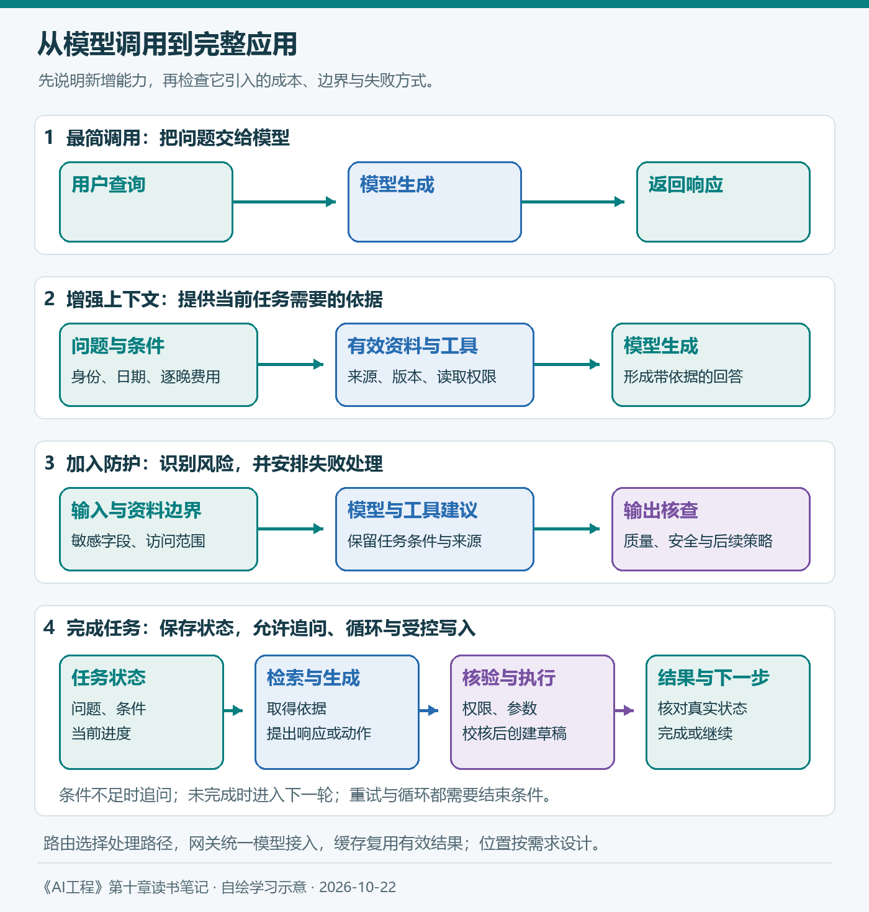
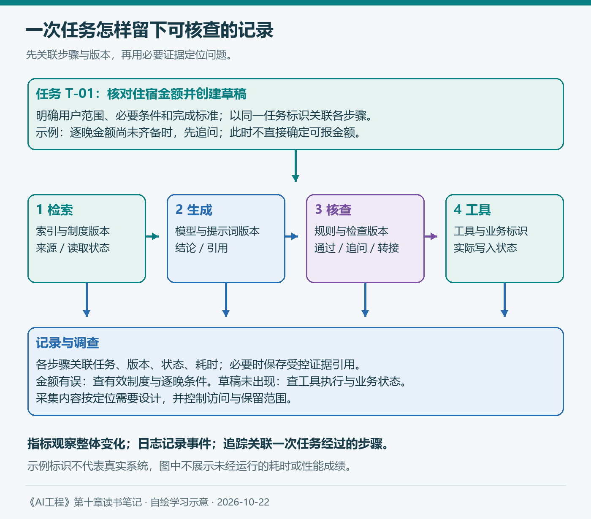

# 第十章（1/2）：AI工程架构——让知识库助手成为可运行、可诊断的系统

第四章让我开始用明确标准判断应用，第五章把要求落实到提示词，后面的检索、工具、微调和推理优化又各自解决了一部分问题。读到第十章，我最想弄清楚的是：这些能力放进同一个应用以后，怎样一起工作？

仍以企业知识库和报销助手为例。它可能已经能够回答几道住宿制度问题，但多人使用以后，还会遇到旧资料、越权请求、模型服务故障和重复查询。即使最后答错了，也需要知道错误发生在哪里，才有办法修改。

> 本篇对应Chip Huyen《AI工程：大模型应用开发实战》导言与10.1，保留原书七个小节的顺序。报销制度、任务与运行记录均为假设；配图自绘，补充资料查阅于2026年10月22日。

**第十章两篇：** ①AI工程架构 → ②用户反馈。

## 10.1 AI工程架构

原书从最简单的结构开始：用户提出查询，应用调用模型，再把响应返回给用户。随着具体问题出现，逐步加入上下文、防护、路由、缓存和执行动作，最后讨论监控与编排。

这个展开方式很适合学习。每增加一个组件，都能问清楚它解决什么问题、承担什么职责，以及带来多少复杂性。实际项目可以按需求调整次序，也可以让同一组件承担多项职责。

*图1：自绘，参考原书图10-1、10-2、10-4和10-10。四层表示能力逐步增加，箭头表示各层中的主要关系；实际路由、防护和缓存的位置需要结合系统设计。*

### 10.1.1 增强上下文

用户问“在A市住两晚，共1400元，能报多少”，模型需要知道制度、适用人群和日期。沿用前文的假设：普通员工在A市合规住宿，每晚最高600元，超出自理。如果两晚各700元，单看住宿上限可报1200元，自付200元；最终报销还可能涉及凭证与审批等条件。

如果只有“总计1400元”，没有逐晚金额，便不能直接断言能报1200元。比如一晚400元、另一晚1000元，逐晚计算的上限合计是1000元。这个差别说明，上下文既包括制度，也包括计算所需的用户条件。

原书把检索和工具调用纳入上下文构建。检索可以提供制度正文和版本，工具可以查询员工类别或当前业务状态。第五章讨论怎样组织输入，第六章讨论怎样获取资料，这里把它们放回完整应用。

我会为回答保留来源、版本、适用范围及必要的原始条件。检索片段与问题有关，仍需检查是否有效、是否允许当前用户访问。模型善于处理已有信息，却无法凭空补齐组织没有提供的业务依据。

### 10.1.2 设置防护措施

#### 输入防护

输入防护主要处理敏感信息和可能改变应用行为的恶意内容。第五章已经讨论过提示词注入；在实际架构中，需要进一步检查资料从哪里进入、会被发给谁，以及模型能够调用哪些工具。

例如，查询制度只需要员工类别，却把完整员工档案一起送给外部服务，就扩大了数据暴露范围。可以在检索与调用前减少不必要字段，对部分信息掩码，并通过受控映射恢复确有需要的内容。

权限过滤应在资料返回给模型之前生效。把所有制度和私人记录取出来，再要求模型自行隐藏不该说的部分，会让后续防护承担更大的负担。

#### 输出防护

原书将输出故障分为质量和安全两类。对报销助手，质量问题包括无效JSON、金额错误、条件遗漏和引用不能支持结论；安全问题则可能涉及敏感信息泄露、越权工具调用等。

发现故障后，还要确定处理策略。格式错误有时可以修复或重试，资料缺失可能需要追问，复杂争议则适合转人工。重试次数需要上限，否则一个异常请求可能持续消耗预算。

模型输出“已经创建报销草稿”，也不能代替工具执行结果。应用应核对工具状态，再向用户报告成功、失败或待处理。第四章强调端到端任务，这里继续检查实际业务状态。

#### 防护的实施与取舍

检查会增加延迟、成本，也可能误拒正常请求。流式输出尤其需要安排好检查时机：内容已经展示以后，后续拦截无法撤回用户刚刚读到的信息。

因此，我会按风险选择处理方式。例如，普通解释可以流式展示，涉及敏感字段或关键动作的结果先完成相应核验。安全指标同时观察违规与误拒，并记录失败原因，避免用一项笼统的“通过率”掩盖问题。

### 10.1.3 添加路由器和模型网关

#### 路由器

应用不必把所有请求交给同一个处理方式。查询固定条款、解释多版本制度、创建草稿和联系人工，需要的能力与代价不同。路由器根据意图、任务难度或其他条件，选择处理路径。

例如，“在哪里下载报销模板”可以返回确定的页面；缺少出差日期时先追问；需要判断多项制度适用条件时，再调用更适合的模型。路由本身也可能判断错误，因此需要评估，并保留无法确定时的处理方式。

原书提醒，路由可以发生在检索前，也可以发生在检索后。图上把路由归入某个模块，不代表所有请求只能按图中从左到右的顺序执行。

#### 模型网关

模型网关为不同模型提供统一接入，便于管理凭据、访问、调用量和回退。某个模型接口变化时，可以在网关处适配，减少各个业务应用重复修改。

| 组件 | 主要问题 | 报销助手中的例子 |
| --- | --- | --- |
| 路由器 | 这项任务交给谁处理？ | 条款查询、复杂判断或人工服务 |
| 模型网关 | 怎样统一访问和管理模型？ | 凭据、限额、接口适配和故障回退 |
| 编排器 | 多个步骤怎样协同完成？ | 追问、检索、核验和创建草稿 |

回退也要考虑能力差异。备用模型如果不支持相同工具、上下文长度或输出格式，直接替换可能产生新故障。可以提供降级回答、暂缓执行或人工接管，同时保留服务切换记录。

### 10.1.4 通过缓存技术降低延迟

#### 精确缓存

精确缓存只在满足相同匹配条件时复用结果，可以缓存完整回答，也可以缓存某个检索或计算步骤。它能减少重复工作，但关键在于如何定义“相同”。

两位员工都问“住宿最多能报多少”，文本一样，员工类别、地点和制度版本却可能不同。只用问题文字作缓存键，可能返回错误金额，甚至泄露其他用户的信息。

因此，缓存设计需要明确用户或租户范围、权限、资料版本、有效期和相关生成配置。需要哪些条件，取决于所缓存的对象；涉及个人业务状态的结果，通常更需要谨慎处理。

#### 语义缓存

语义缓存允许措辞不同但足够相近的问题复用结果，通常借助嵌入和相似度检索。它可能提高命中率，也增加了误匹配的机会。

“住宿标准是多少”与“我的住宿费能报多少”很相似，后者却需要个人条件和逐晚金额。语义相似度只能提供候选，不能直接证明答案可以复用；阈值应结合具体失败与成本测试。

| 复用对象 | 需要重点检查 | 常见失效原因 |
| --- | --- | --- |
| 制度检索结果 | 权限、查询条件与索引版本 | 制度或索引更新 |
| 通用条款解释 | 适用范围、来源与生成配置 | 规则或回答要求改变 |
| 个性化金额结果 | 身份、逐晚费用与业务状态 | 条件变化或状态更新 |

第九章的KV缓存、前缀缓存主要复用模型计算状态；这里的系统缓存复用检索或应用结果。它们可以同时存在，但验证条件和失效机制需要分别设计。

### 10.1.5 添加智能体模式

随着任务变复杂，应用可能需要循环、并行和条件分支。助手先检索制度，发现缺少逐晚费用，向用户追问；得到补充后再次计算，再生成草稿。这已经超出一次固定的“检索—生成”流程。

一旦允许创建草稿、修改记录或发送通知，系统就开始改变环境。第五章的权限边界在这里更加具体：模型可以提出动作，应用需要核验用户身份、对象、参数和当前业务状态，再执行允许的操作。

近期框架提供了可参考的实现方式。LangGraph官方文档通过中断与持久化支持暂停、等待外部输入和恢复执行，并提醒恢复时节点中的部分代码会重新运行。[官方文档](https://docs.langchain.com/oss/python/langgraph/interrupts)

对报销草稿，可以在执行前展示对象与内容，校核后再写入，并用业务唯一标识避免重复创建。框架恢复了状态，仍需要应用保证重试、超时和重复提交不会产生多份业务记录。这是将工具能力接入生产流程时必须继续解决的问题。

### 10.1.6 监控与可观测性

#### 指标

指标帮助观察系统整体变化。原书提到检测问题、解决问题所需的时间，以及变更引发失败的比例。对报销助手，还需要继续追踪第四章定义的质量、费用、延迟和正常任务误拒。

指标最好能够按用户范围、任务类型和版本细分。总体正确率变化不大，可能掩盖某类员工全部取到了旧制度；平均耗时正常，也可能掩盖少量请求持续超时。细分可以帮助定位，但样本量和统计口径也应一并记录。

#### 日志和追踪

日志记录事件，追踪把同一任务的相关事件连接起来。当用户说金额不对，我们需要知道它取了哪份制度、获得哪些条件、调用哪个版本的模型，以及工具是否真正执行。

*图2：自绘，参考原书10.1.6。任务与版本标识为示例，不包含实测耗时；证据引用指向受控资料，不要求把完整私人内容复制进每条日志。*

OpenTelemetry当前GenAI约定为模型、检索和工具等操作提供追踪语义，便于关联不同环节。查阅时相关页面仍标注Development，字段及约定应随所用版本记录。[官方约定](https://github.com/open-telemetry/semantic-conventions-genai/blob/main/docs/gen-ai/gen-ai-spans.md)

这些记录能帮助我们复现问题，也会形成新的数据管理需求。我会保留定位所需的标识、版本、状态和必要证据，明确访问与保留范围。完整执行记录意味着步骤之间可关联，具体内容的采集仍应按需要设计。

#### 漂移检测

系统提示词、用户行为和底层模型都可能变化。同一接口名称没有改变，也不代表应用行为一定保持不变。资料、检索和工具配置同样需要纳入变更调查。

如果输出逐渐变短，可能是用户学会要求简洁，也可能是提示词更新、服务配置变化或生成被截断。指标能提示现象，日志、追踪、版本记录和具体样本共同帮助解释原因。

### 10.1.7 AI流水线编排

原书先讨论组件定义，再讨论链式组合。前者说明可使用哪些模型、数据源和工具，后者说明接收查询以后，各步骤怎样传递数据、分支、重试和结束。

第五章已经提醒，任务拆解会增加中间信息传递的风险。编排时，需要明确每一步输入输出以及失败状态，避免上一步漏掉员工类别，下一步仍然继续计算。

顺序也要服从依赖。制度与用户条件齐备后才能作出金额判断；相互独立的检查可以考虑并行。循环应有结束条件、步数或预算限制，避免助手一直检索却无法完成任务。

选择编排工具时，我会按原书检查集成和扩展能力、复杂流程支持，以及易用性、性能和可伸缩性。开始时可以先把过程写清楚，再判断是否需要框架；引入工具后，也应能导出状态与执行记录。

读完10.1，我更重视组件之间的关系。上下文决定模型看见什么，防护与权限决定允许做什么，路由和缓存影响处理代价，编排组织过程，可观测性则帮助解释实际发生了什么。

已有30题可以继续作为质量回归的起点，并逐渐加入越权、过期缓存、工具超时和重复提交等场景。它们需要明确预期行为与独立验证材料，不能仅凭少量题目断言系统已经可靠。下一篇进一步观察用户怎样使用应用，以及这些行为能告诉我们什么。

## 参考与说明

- Chip Huyen：《AI工程：大模型应用开发实战》，第10章导言与10.1。整理来源截图未展示10.1.2标题，本篇依据上下文使用“设置防护措施”作为该节工作标题。
- LangGraph：[Interrupts](https://docs.langchain.com/oss/python/langgraph/interrupts)、[Persistence](https://docs.langchain.com/oss/python/langgraph/persistence)，查阅于2026-10-22，用于补充中断、状态恢复和重复副作用的工程讨论。
- OpenTelemetry：[Semantic conventions for generative client AI spans](https://github.com/open-telemetry/semantic-conventions-genai/blob/main/docs/gen-ai/gen-ai-spans.md)，查阅于2026-10-22，页面状态为Development。
- 本文使用AI辅助梳理与起草，图表自绘。原书框架、官方资料与个人学习方案分别表述；制度、金额及运行过程为假设，没有将其写成已部署系统或实测成绩。
