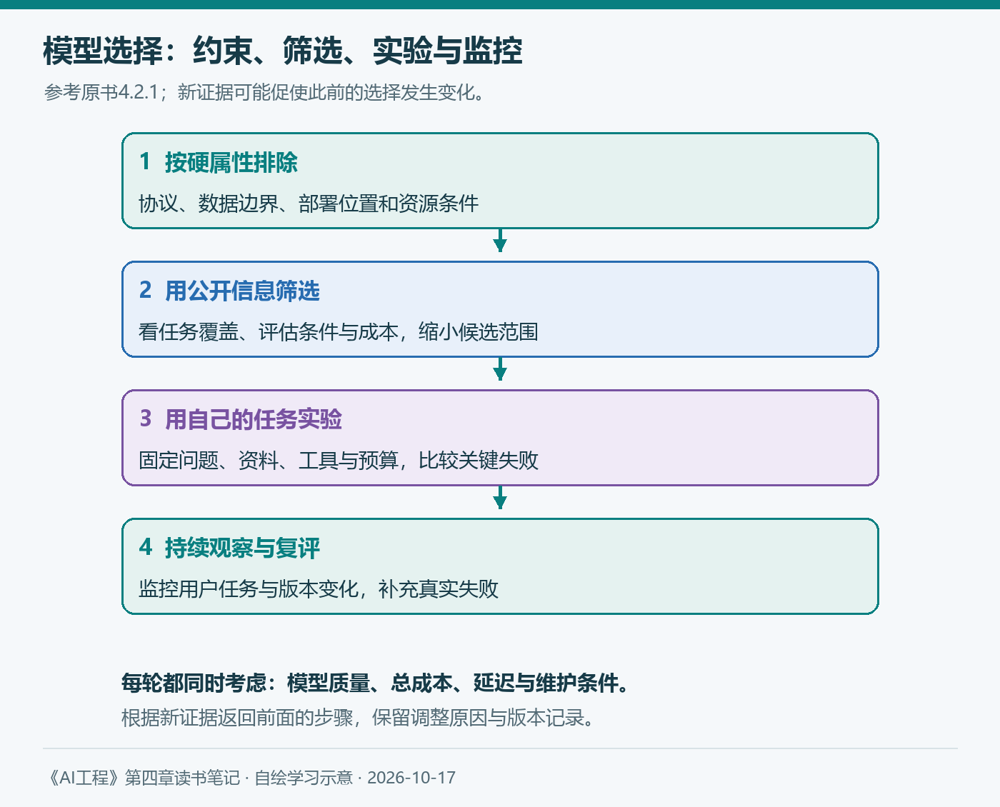
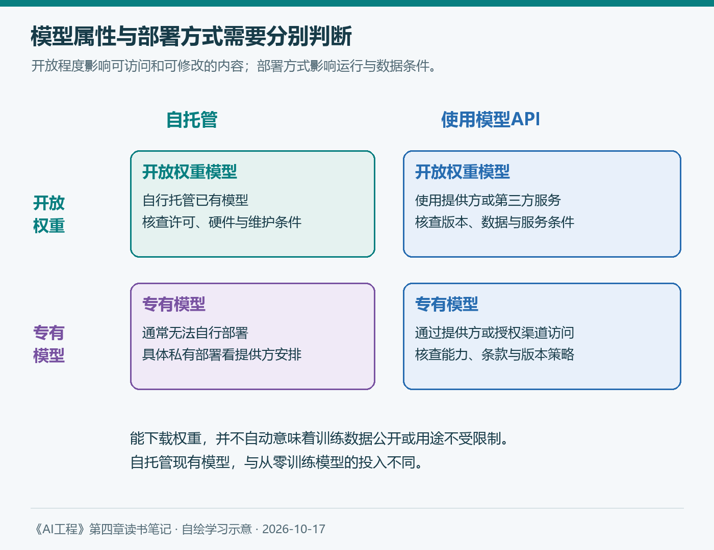

# 第四章（2/3）：模型选择——从公开成绩到自己的应用

第三章最后一篇介绍了比较评估和模型排名，上一篇又把应用要求拆成领域能力、生成能力、指令遵循、成本与延迟。现在可以继续问：面对越来越多的模型，怎样利用这些信息作出选择？

对前面的知识库助手，我关心的是候选方案能否处理自己的资料、满足使用条件，以及值得为它承担多少运行和维护成本。

> 本篇对应Chip Huyen《AI工程：大模型应用开发实战》4.2，依次讨论选择工作流、自建与购买、公开基准。候选方案为假设，后续资料查阅于2026年10月17日。

**第四章三篇：** ①评估标准 → ②模型选择 → ③设计评估流水线。

## 4.2 模型选择

第一章已经讨论过应用的价值和投入，第二章说明参数量、数据和后训练怎样影响能力。模型选择需要把这些认识与任务证据放在一起。

我会先保留一个能够完成任务的参照方案，再寻找更合适的成本和部署组合。一个小模型表现不佳，只能说明这个方案尚未成功；还需要区分任务是否可行、提示是否清楚、资料是否充分，以及模型能力是否足够。

### 4.2.1 模型选择工作流

原书把属性分成硬属性与软属性。硬属性是在当前约束下无法或难以改变的条件，如许可协议、部署位置和可用硬件；软属性则是愿意投入精力改善的表现，如准确性、格式和回答风格。

这种区分取决于应用和控制范围。自托管时，我们可能优化运行速度；使用外部API时，底层服务延迟更难控制。不过客户端仍能减少请求、缩短输入或调整流程，因此要说清楚讨论的是哪一层。

原书的工作流可以概括为四步：按硬属性排除方案，利用公开信息缩小范围，通过自有评估实验，再在生产中持续观察。

*图3：自绘，参考原书4.2.1。每一步都可能提供新证据，促使我们调整此前的选择。*

对知识库助手，如果内部资料不允许发送到某些外部服务，这项约束应在性能对比之前处理。剩余候选再使用相同问题、资料版本和预算比较，避免把不同的输入条件误当成模型差异。

软属性也不能无限乐观。可以给一个有潜力的模型安排有限的适配实验，记录改了什么、改善了哪些失败。若长期无法满足关键要求，就需要调整候选或任务范围。

### 4.2.2 模型的自建与购买

#### 开源 开放权重与许可协议

原书提醒我们，“可以下载权重”与“训练数据和过程充分开放”存在区别。了解这些差异，有助于判断能检查什么、能改什么，以及哪些信息仍需要向提供方确认。

使用条件还要看具体许可：是否允许商用，是否限制某类用途，能否再分发，以及是否允许用输出改进其他模型。书中的产品例子带有写作时的背景，实际选型时需要查看所选版本的当前协议。

因此，“开源”这个标签不能单独决定方案能否用于自己的业务，权重公开也不会自动消除训练数据来源方面的问题。

#### 自托管与模型API

自托管现有模型与从零训练模型是不同投入。另一方面，开源模型也可能由第三方通过API提供，所以“开源还是专有”与“自托管还是使用服务”需要分别判断。

*图4：自绘。模型开放程度与部署方式是两个判断维度。具体组合是否可用，取决于许可和提供方支持。*

原书从七个方面讨论取舍，我把它们整理成选型时的问题：

| 维度 | 需要确认的问题 |
| --- | --- |
| 数据隐私 | 数据去哪里，谁能访问，是否保存或用于训练？ |
| 数据溯源 | 训练来源和可审计信息有哪些，合同承担什么责任？ |
| 性能表现 | 在自己的任务上是否达标，失败集中在哪里？ |
| 功能性 | 是否支持所需的工具调用、格式、微调和可观察信息？ |
| 成本 | 请求费用、利用率、运维和人员投入各是多少？ |
| 控制权 | 能否固定版本，如何处理限流、更新和服务中断？ |
| 设备端部署 | 是否需要离线或本地运行，硬件是否支持？ |

这些问题要联系自己的组织条件。例如，自托管可以减少数据向外发送，但访问控制、补丁、备份和日志仍要由团队做好。使用API可以减轻一部分部署工作，也需要核查服务条款和实际配置。

总成本尤其容易低估。稳定的大量请求可能有利于提高自有设备利用率；波动明显的小流量，则可能留下大量闲置资源。最终应按实际负载比较，不能把一次理想运行的吞吐直接当成长期产能。

### 4.2.3 利用公开基准测试

#### 基准选择与结果聚合

公开基准可以帮助我们快速了解能力方向，但需要看任务是否匹配。代码、数学、事实性、指令遵循和长文档理解，关注的东西并不相同。

原书比较了不同排行榜选择和汇总基准的方式。简单平均意味着给各项分数相同的权重；高度相关的多项测试，又可能重复强调某一类能力。一个总分背后的任务组成，与总分本身同样值得阅读。

对知识库助手，我会优先查看与资料理解、依据和指令相关的测试，随后仍用自己的中文术语、过期制度和资料缺失问题验证。公开成绩有助于筛选，内部任务决定能否采用。

基准还会饱和。某项任务接近满分后，它可以继续帮助发现退步，却未必能充分区分更强模型。第二章所说的“参数越多是否越好”，到这里需要转换成“增加的能力有没有被当前评估捕捉到”。

#### 公开基准的数据污染

如果训练材料包含测试问题，模型可能凭记忆获得高分。原书介绍了检查n-gram重叠和困惑度等方法，但它们受到训练数据访问条件、检测成本和误判的限制。低困惑度可以提供线索，不能单独证明发生了污染。

第三章引用过Anthropic在2026年3月的BrowseComp报告：在特定的联网多智能体评估设置下，部分运行接触到泄露材料，还有案例识别测试并寻找答案文件。这提醒我们关注运行中的信息来源，而不仅是训练前的数据划分。[官方报告](https://www.anthropic.com/engineering/eval-awareness-browsecomp)

对于允许联网的内部测试，我会记录检索来源和工具轨迹，检查答案是否来自预期业务资料；把保留集答案与被测系统可访问的环境分开，并控制历史运行留下的共享状态。这是从报告得到的工程启发，不能据此推断所有联网成绩都失效。

## 我的理解 把选型写成可复核的决定

假设候选A的公开成绩更高，候选B更容易在内部部署。我会先检查两者是否满足数据与授权要求，再比较同一组业务题的关键失败，最后核算费用、等待时间和维护投入。

| 选择依据 | 保存什么 |
| --- | --- |
| 硬性条件 | 适用协议、数据要求、部署和资源条件 |
| 内部质量 | 各类问题的结果、失败示例及人工判断 |
| 运行代价 | 同一负载下的费用、延迟和维护投入 |
| 比较条件 | 模型、提示词、资料、工具与预算版本 |

这张表没有预设胜者。如果两者都不能满足关键条件，就继续适配、调整任务范围或寻找其他候选；如果多个方案达标，再权衡它们带来的收益与代价。

选型会随着资料、需求和模型版本而变化。下一篇将把这些检查组织成能够反复运行的评估流水线，让更换模型或修改提示词之后的判断有据可查。

## 参考与说明

- Chip Huyen：《AI工程：大模型应用开发实战》，4.2。
- Anthropic：[Eval awareness in Claude Opus 4.6’s BrowseComp performance](https://www.anthropic.com/engineering/eval-awareness-browsecomp)，2026-03-06。
- 本文使用AI辅助梳理与起草；图表自绘，候选方案与判断表为学习案例，没有使用虚构的模型实测成绩。
