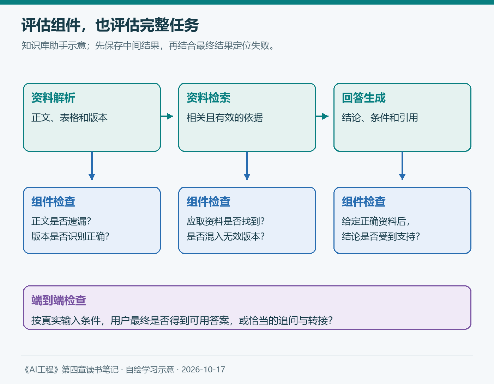
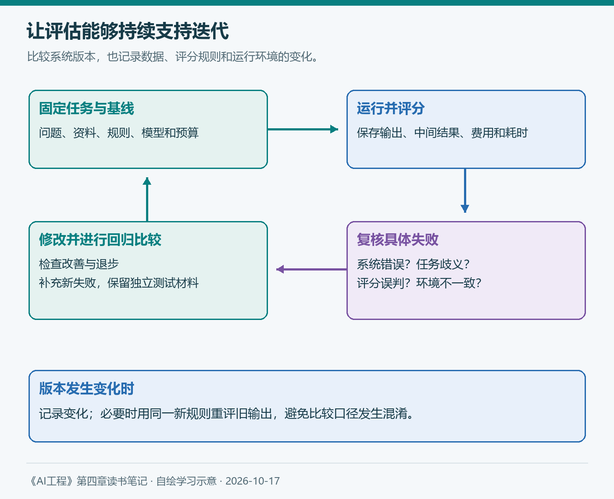

# 第四章（3/3）：设计评估流水线——把一次判断变成持续验证

第一篇明确评什么，第二篇讨论怎样选模型。接下来，每当我们更换模型、修改提示词或更新资料，都需要知道：系统改善了什么，又有没有破坏原本能完成的任务？

第二章曾提出30题练习：常见问题、专业术语、资料缺失、版本冲突和中英混合各6题。第三章用它讨论评估方法。第四章最后一篇，继续把这组题组织成可以反复使用的学习方案。

> 本篇对应Chip Huyen《AI工程：大模型应用开发实战》4.3与4.4。知识库助手及评分例子均为假设；30题是起步练习，不代表生产可靠性证明。补充资料查阅于2026年10月17日。

**第四章三篇：** ①评估标准 → ②模型选择 → ③设计评估流水线。

## 4.3 设计你的评估流水线

评估流水线可以理解为一套有记录的工作过程：准备任务和资料，运行系统，按规则检查结果，分析失败，再验证改动。它的价值在于让不同版本的证据能够被比较。

### 4.3.1 步骤1 评估系统中的所有组件

知识库助手可能依次解析文档、检索资料、组织上下文并生成回答。最终答错，可能来自解析遗漏、检索不到、取到旧版本，或者模型误读了正确资料。

*图5：自绘。中间结果帮助定位失败，端到端结果判断整个应用是否满足用户任务。*

组件评估可以分别检查正文是否提取完整、相关有效资料是否被检索到、给定正确资料时回答是否受其支持。端到端评估则检查：在实际流程下，用户是否得到有依据的有效回答。两类检查相互补充。

原书还区分轮次与任务。助手先追问出差城市，再查询标准，两轮对话可能共同完成一个任务。第一轮没有直接给金额，不一定是失败；如果缺少必要条件，恰当追问反而可能是正确行为。

因此应事先定义任务何时开始、何时完成，以及允许什么追问。如果助手还能创建工单，就要核查工单实际状态；一句“已经创建”不能代替执行结果。

### 4.3.2 步骤2 创建评估指南

#### 定义标准并给出示例

“答案不错”很难形成一致判断。我会把知识库回答的要求拆成依据、完整性和边界，再给每项写出判断规则。

例如，假设有效制度规定：“A市住宿上限600元，每晚计算，超出部分自理。”问题是“在A市住两晚，共1400元，可以报销多少？”

| 假设回答 | 如何判断 |
| --- | --- |
| 按该上限最多1200元，超出200元自理 | 金额与条件得到材料支持 |
| 最多报销1200元，但未说明超出部分 | 主要金额正确，完整性仍需单独检查 |
| 可以全额报销1400元，并引用这份制度 | 引用存在，结论却与材料矛盾 |

评分应针对已经定义的维度。若规则要求说明自付部分，第二个回答就未通过该完整性检查；不应等看完输出以后临时改变标准。

简单项目可以采用通过、不通过、无法判定。复杂属性也可以用多级评分，但每一级都需要示例。两位评估者意见不同，先看是资料、规则还是判断出了分歧，再决定如何修订。

#### 联系业务指标

原书提出把评估指标与业务指标关联起来。我理解，这需要业务数据和实验：正确率提高后，用户是否更快解决问题，人工接管和返工是否减少？

不能仅凭“事实一致性达到90%”，就断言能够自动处理某个比例的业务。还要看错误集中在哪类任务，以及哪些失败绝对不能接受。资料缺失时给出编造答案，可能比措辞不够简洁带来更高代价。

### 4.3.3 步骤3 定义评估方法和数据

#### 选择评估方法

不同要求适合不同方法：程序检查格式和必填字段，规则核对明确的金额或日期，AI裁判辅助判断证据支持关系，人工复核复杂争议。语义相似度可以帮助比较内容，但不宜直接当成正确概率。

评分规则应能识别“引用存在但不支持结论”的反例。对AI裁判，可以先用人工判断的样本检查误判，再决定它适合覆盖哪些任务。对数概率反映模型的生成倾向，也需要与事实核查区分。

实验时可能有参考答案，生产环境却未必能立即得到真实标签。因此，离线评估、人工抽查和用户反馈要各自说明用途，不能把一个点赞直接当作事实正确的确认。

#### 标注与切分评估数据

沿用30题练习，我会给每题补上以下记录：

| 记录 | 内容 |
| --- | --- |
| 任务输入 | 问题、类别、用户权限和必要上下文 |
| 判断依据 | 资料版本、支持片段、预期行为 |
| 评分规则 | 检查哪些条件，何时无法判定 |
| 运行条件 | 模型、提示词、检索配置和工具预算 |
| 评估结果 | 各项结果、失败类型、复核、费用与耗时 |

其中“资料缺失”题应明确允许或要求说明缺口，“版本冲突”题应先定义有效资料的选择规则。预期行为也可以是追问或转人工。

除了总体结果，还要分别看五类问题。下面沿用原书表4-6的数字说明辛普森悖论：

| 模型 | 组1 | 组2 | 合计 |
| --- | --- | --- | --- |
| A | 81/87，约93.1% | 192/263，约73.0% | 273/350，78.0% |
| B | 234/270，约86.7% | 55/80，约68.8% | 289/350，约82.6% |

A在两组中分别领先，总体却落后，因为两者的样本构成不同。该表只说明统计现象；实际模型对比应尽量使用相同任务与权重，并保留分组结果。

30题能帮助发现明显问题，但每组只有6题，一个结果变化就会明显改变比例。需要识别更小差异时，应增加有代表性的数据，并报告不确定性。有放回的自助抽样可以帮助观察结果波动，却无法补足原样本没有覆盖的任务。

保留固定回归集，另收集新失败。若反复根据同一组题调整系统，也应保留独立的保留集；进入训练或适配过程的样本，需要重新考虑其评估用途。

#### 评估你的评估流水线

原书提醒我们检查评估是否给出了正确、可靠且有用的信号。我会重点看四件事：

1. 正确答案是否被奖励，关键错误是否被识别？
2. 相同条件下重复运行，差异来自系统还是评分器？
3. 多个指标是否提供不同证据，是否存在冗余？
4. 检查本身增加了多少费用和延迟？

降低采样温度可以减少部分变化，但不能保证完全一致。环境、模型服务和裁判版本同样需要记录。两个指标相关性低，也可能因为它们测量不同属性，应结合案例解释。

*图6：自绘。固定比较条件，阅读具体失败，再决定修改系统、评估规则或测试数据。*

#### 迭代与近期工程实践

Anthropic在2026年1月的智能体评估实践中，建议从真实失败和明确任务开始，保持运行环境稳定，并阅读执行记录以检查评分是否公平。[官方文章](https://www.anthropic.com/engineering/demystifying-evals-for-ai-agents)

我会把这条思路落实到每次修改：保留基线，说明改动，用同题比较查看改善与退步；然后区分系统错误、任务歧义和评分器误判。若评估规则也变了，就记录版本，必要时用新规则重评旧输出。

新出现的失败进入后续回归集，但分布也要与目标用户相匹配。只增加罕见难题，可能让总分越来越低，却难以反映常见使用体验。

## 4.4 小结

从第一章到这里，我逐渐形成了一条具体路径：明确应用价值，理解模型能力和错误来源，选择合适的评估方法，再把标准、任务、数据与复核组织起来。

第四章让我最重视的，是评估结果能否帮助下一步行动。检索失败，就调查资料与检索；格式错误，就检查约束；模型改进了某类任务，也要确认其他类别有没有退步。

接下来进入提示工程，每一次改写都可以成为一个可比较的假设：预期改善哪种行为，用哪些样本验证，需要承担什么代价。评估流水线使这样的学习能够持续积累。

## 参考与说明

- Chip Huyen：《AI工程：大模型应用开发实战》，4.3、4.4；辛普森悖论数字参考原书表4-6。
- Anthropic：[Demystifying evals for AI agents](https://www.anthropic.com/engineering/demystifying-evals-for-ai-agents)，2026-01-09。
- 本文使用AI辅助梳理与起草；配图自绘，评分案例为假设。原书框架、近期实践与个人学习方案分别表述。
