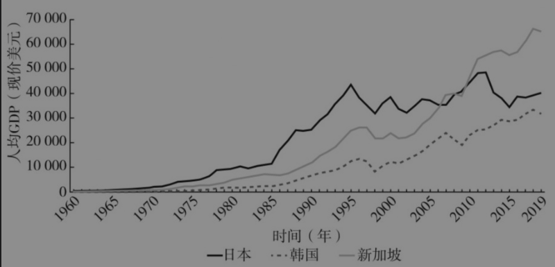
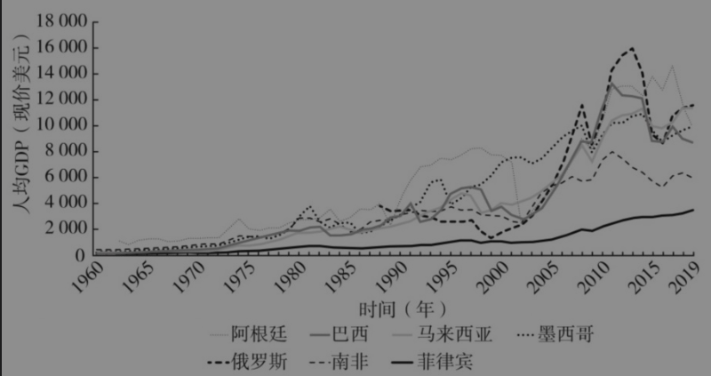
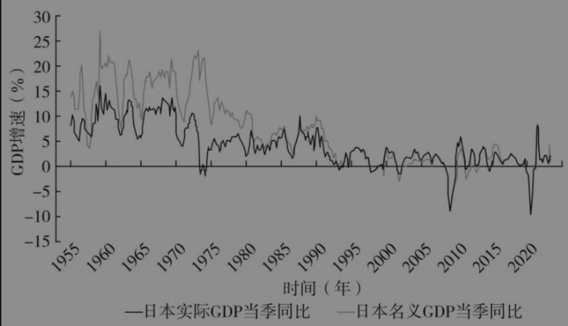
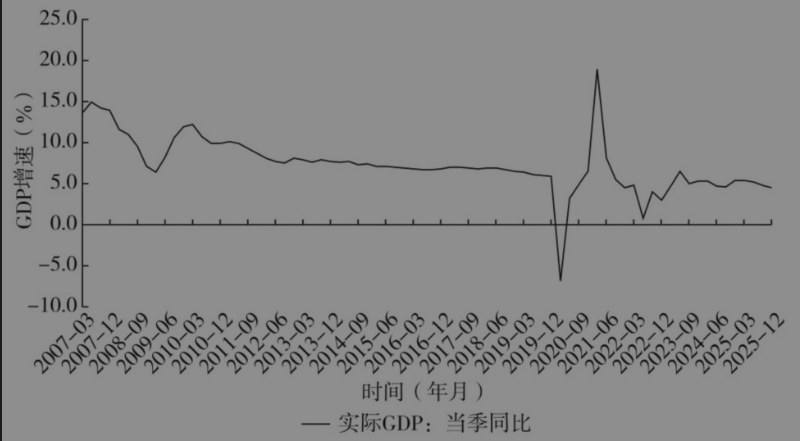
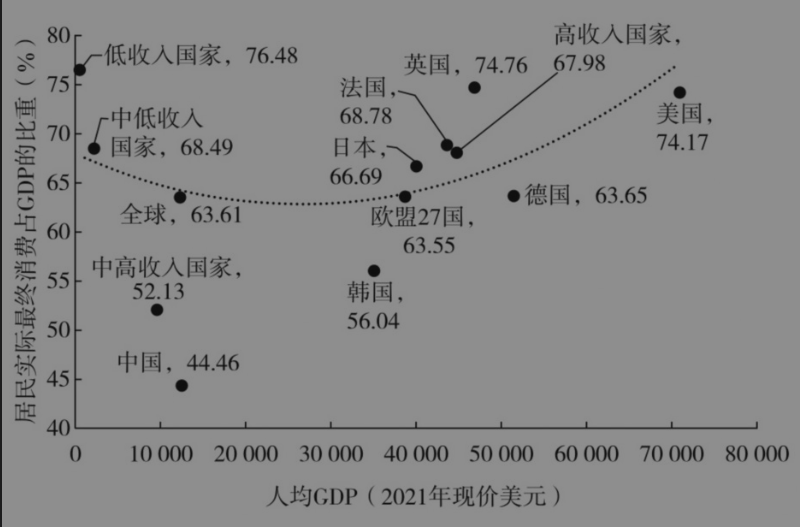
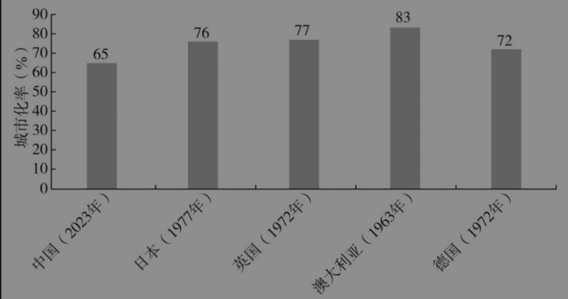
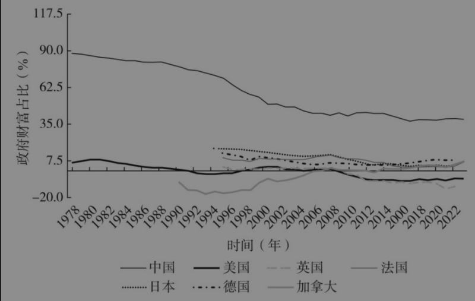

# 第一章 扩消费、稳增长、稳预期与结构性改革[^1]

<!-- 按来源截图1-1.png、1-2.png顺序整理；阅读器导航与装饰分隔线已省略；正文恢复为可复制文本；7幅图表保留原图，存于img目录；2条注释恢复为Markdown脚注。原始截图备存于本书“原始图片”目录，便于核对。 -->

刘世锦[^2]

近年来，尽管中国经济在疫情后的复苏进程比较曲折，但总体呈现回升向好的态势。一方面，2023年和2024年分别实现5.2%和5%的增长目标，在全球各大经济体中是靠前的。另一方面，宏观经济面临日益增大的总需求下降的压力，2025年GDP平减指数已连续7个季度处于负增长状态。2025年《政府工作报告》中提出“国内生产总值增长5%左右”的预期目标，突出迎难而上、奋发有为的鲜明导向。这需要“跳一跳才能达到”，虽有难度，但必须努力争取。

高质量发展是全面建设社会主义现代化国家的首要任务。中国式现代化不仅有五个方面的特色，而且也有量化的增长指标，到2035年，“人均国内生产总值迈上新的大台阶，达到中等发达国家水平”。从国际比较角度看，到2035年，我国人均收入水平要上三个台阶：第一，人均收入1.4万美元，成为高收入国家；第二，人均收入2万美元左右，进入发达国家行列；第三，人均收入三四万美元，平均3.5万美元，达到中等发达国家的收入水平。

2021年，我国人均GDP达到80976元，按人民币兑美元年平均汇率折算约12551美元，非常接近2021年7月世界银行发布的高收入国家标准12695美元。2024年，我国人均GDP按人民币兑美元年平均汇率折算约为13445美元，同年世界银行发布的高收入国家标准为13845美元。与2021年相比，差距略有扩大。原因是多方面的，疫情冲击等因素导致实际增速波动较大，价格低迷或通缩使名义增速低于实际增速，人民币兑美元汇率贬值等。

国际经验值得重视。通常，一个国家从中等收入阶段上升到高收入阶段，人均收入在1万美元左右时，往往会进入一个特殊的不稳定阶段。世界银行的一项研究发现，二战后上百个经济体开始工业化，但在25年以上保持7%增速的经济体只有13个。如图1-1、图1-2所示，大型经济体中只有日本、韩国、新加坡成功进入高收入阶段。更多国家落入“中等收入陷阱”，典型的有拉丁美洲的阿根廷、巴西、墨西哥，亚洲的菲律宾、马来西亚，以及近年的南非、俄罗斯。其原因包括创新能力不足、收入分配差距拉大、人力资本发展滞后、资源环境压力加大、外部冲击等。

上述问题和挑战在中国均不同程度地存在。摆脱“低收入贫困陷阱”，进入现代经济增长进程不易；摆脱“中等收入陷阱”，进入高收入社会更难。过去10多年，我国较为稳定地从高速增长转入中速增长，没有出现过大的波动，这在全球范围来看是很不容易的，但我国至今仍未跨过高收入国家门槛。

图1-1 二战以后成功跨越“中等收入陷阱”的经济体

资料来源：世界银行。

图1-2 未能跨越“中等收入陷阱”的经济体

资料来源：世界银行。

高收入国家的标准是动态调整的，近些年每年大概增长4%。这意味着如果我国人均收入按现价美元计算的年增长率不足4%，则难以跨越该门槛。长时间以来，中国经济增速较高，人们普遍认为中国跨越该门槛不会有大的问题。但近几年，我国在高收入门槛徘徊的情况表明，我们也要防止落入“中等收入陷阱”，有了这种风险意识，才能务实有效地推进我国的现代化进程。我们对跨越高收入国家门槛仍充满信心。

从增长速度来看，改革开放以来到21世纪第一个10年，中国经济经历了30多年10%左右的高速增长。东亚成功追赶型经济体，如日本、韩国、中国台湾、新加坡等，都经历过类似增长。从2010年一季度开始，中国经济在达到一个高点后开始减速，从高速逐步转为中速。这种变化可以表述为增长阶段转变。这里以日本经济为参照，它有上亿人口，属于大型经济体，与中国具有一些可比性。

日本在20世纪五六十年代经历了9%左右的高速增长；70年代初遭遇石油危机，进入中速增长，增速在4%左右；90年代初减速，低速增长在2%左右，甚至出现了零增长和负增长（见图1-3）。如果与日本比较，中国目前处在中速增长的后期。日本经历了20年的中速增长，中国经济增速自2010年开始下台阶，到目前为止已将近15年，还有5年的中速增长期，但中国是一个大型经济体，我们希望这个增长期再长一点（见图1-4）。

图1-3 20世纪90年代日本GDP增速

资料来源：作者整理。

图1-4 中国经济增长从高速到中速的转型期

资料来源：作者整理。

在这种转型过程中，有两个概念非常重要。一个是历史需求峰值（这是我在研究过程中提出的一个概念），也就是在几十年甚至上百年工业化、城市化的进程中，需求增长最快，或需求量最大的那个点或区间。到了这个点或区间，增长速度就开始降低。2010年一季度，中国经济增速达到了历史需求峰值。另一个是需求结构，需求结构的背后是收入结构。简单地说，是中高收入群体与低收入群体的分布结构。一种结构是中高收入群体比重低，低收入群体比重高；另一种结构是中等收入群体比重高，低收入群体比重低，也就是通常说的“橄榄型”结构。历史需求峰值决定了从高速向中速的转折点，而需求结构决定了转折以后中速增长的持续时间。

有人把目前中国的情况与20世纪90年代初的日本相比。除了发生过类似的房地产泡沫破裂，其他差别实际上相当大。20世纪90年代初的日本已经经历了20年的中速增长，人均收入超过3万美元，一度高于美国，在发达经济体中位于前列。此外，日本的社会保障体系较为完善，城乡差距基本消除，而中国目前尚未跨过高收入国家门槛。我们过去强调要避免过高的增长速度，是因为当时中国经济具有较高的增长潜力。现阶段需要强调的是经济增长速度不能过低。今后5年有潜力保持中速增长，目标为5%，并应将4%作为不能破的底线。

我国宏观经济面临的问题是需求不足，居民实际最终消费占GDP的比重较全球平均水平低约20个百分点（见图1-5）。

图1-5 我国居民实际最终消费占GDP的比重

资料来源：作者整理。

用购买力平价口径比较中国与经济合作与发展组织（OECD）成员国在相似发展阶段的经济结构，可以得出三组数据。第一，家庭消费占比，中国和OECD分别占39.12%和57.27%，中国相当于OECD的68.3%。第二，最终消费占比，中国和OECD分别占55.06%和73.73%，中国相当于OECD的74.6%。第三，服务消费占比，中国和OECD分别占17.68%和25.03%，中国相当于OECD的70.6%。中国现阶段的消费需求不足，与OECD相同阶段的均值相比偏差1/4至1/3，这不是平均水平上的偏差，而是一种“结构性偏差”。住房消费统计由成本法转为虚拟租金法，不足以改变上述基本判断。

消费需求不足有以下几个原因。

第一个原因，基本公共服务总体水平低、城乡差距大。

我们把消费分为生存型消费和发展型消费。包括低收入群体在内，以吃、穿和其他日常基本消费为主的生存型消费趋于稳定，或者说我们已经基本解决以商品消费为主的温饱问题，消费总量扩大、结构升级。消费增长更多由教育、医疗卫生、保障性住房、社保、文化体育娱乐、金融服务、交通通信等发展型消费拉动。消费实现方式的差异也很重要，基本公共服务与发展型消费密切相关。生存型消费以个体消费方式为主。发展型消费与政府的基本公共服务均等化水平直接相关，它较多采取集体消费或公共服务方式，如医保、社保采取互助共济方式，学校教育采取集体学习方式等。仅靠个人努力来扩大发展型消费是不够的，需要政府搭台子、建制度、出资金，将政府消费支出与居民消费支出组合起来。

多年来，我们在基本公共服务均等化方面做出很大努力，也有很大进展，但总体上来讲水平还是偏低。政府基本公共服务均等化水平滞后，直接拖累发展型消费的增长。城市居民面对“三座大山”——教育、医疗、住房的压力。近3亿农民工、近2亿外出农民工等基本公共服务欠账问题更为突出。4亿多中等收入群体与9亿多中间偏下及低收入群体之间的收入差距，大部分源于基本公共服务分享水平。目前统计收入水平主要关注个人可支配收入，如果把个人实际分享的基本公共服务加进来，那么收入差距会更大。

以养老保险为例，我国机关事业单位退休人员平均月养老金约6000元，城镇企业退休人员的平均月养老金约3000元，城乡居民基本养老保险的领取者（95%是农村居民）平均月养老金约220元，相当数量的农民工、灵活就业人员、新就业形态劳动者等人群没有纳入社会保障体系，机关事业单位和城镇企业职工与农村居民养老金的差距分别约为28倍和14倍。基础养老金作为一项基本公共服务，其缩小差距的职能发挥得还不够。

第二个原因，城市化水平和质量仍然滞后。

服务消费较多地依赖规模经济和集聚效应，与城市化水平直接相关。城市集聚效应降低公共服务供给成本。在传统农村地区，现代基础设施、基本公共服务成本过高，因此很难触达。比如，在分散居住100多户的村庄里建设供水与排水设施的成本很高，但在城市这种成本就比较低。又如，过去推动农村教育时建设了很多希望小学，现在希望小学已经不多了，因为很多农村人口去了城市。乡村教师一人同时教授几门课的情况比较常见，虽然他们的奉献精神令人感动，但客观上难以保证教学质量。现在大部分农村学生到县城上中学，这实际上就是集聚效应。再如，大家都说“北京看病难”。在县级或者乡镇医院，患者并不是很多，原因就是北京丰富的优质医疗资源带来了集聚效应。此外，文化娱乐消费也集中在大城市。总之，一个重要的底层逻辑是，以往我国重视生产的规模经济和集聚效应，而忽视了消费，特别是服务消费的规模经济和集聚效应。没有一定密度的城市化水平，就难以实现教育、医疗、保障性住房、社保、养老、文化娱乐等领域较高水平的基本公共服务。

按照常住人口计算，中国现在的城市化率是67%，而与中国处于大致相同发展阶段的发达经济体，其城市化率大多超过70%，有的甚至超过80%（见图1-6）。中国的户籍城市化率是48.3%，占比还不到一半，城市中也只有一部分人能够享受基本公共服务。所以，中国的城市化发展水平，特别是城市化质量，决定了当前服务消费水平并不高。

图1-6 与中国大致相同发展阶段的各国城市化率

资料来源：作者整理。

更进一步看，制度层面存在着不利于提高以人为中心的城市化的制约因素，集中体现在城乡之间的不平等，包括与户籍制度相关的身份和居住迁徙权利不平等、基本公共服务分享权利和财产（不动产）权利不平等。就财产（不动产）权利而言，城市居民在国有土地上建造的房屋可以交易，农民在集体土地上建造的房屋不能在集体之外交易。大家知道，在市场经济条件下，可流动、可交易、可抵押、可担保的财产与不可流动、不可交易、不可抵押、不可担保的财产市场估值和价格差异很大。这是农民财产性收入低，进而消费水平低的重要原因。

第三个原因，收入差距较大，中等收入群体规模偏小。

从国际经验看，中速增长保持较长时间的经济体一般基尼系数比较低，在0.4以下时，收入差距相对较小，存在一个规模较大的中等收入群体。这样的中等收入群体可以释放较大规模、较长时间的需求，从而支撑较长时间的中速增长。相反，如果收入差距较大，中等收入群体规模较小，当这个群体的需求潜力大体释放后，就容易出现明显的增长减速，导致陷入低速、停滞甚至后退的困境。现阶段我国的基本情况是：中等收入群体大体占1/3，有4亿多人；中间偏下及低收入群体占2/3，有9亿多人；基尼系数多年保持在0.4以上，有些研究认为在0.45或更高的水平。当前面临的需求不足，与这种结构直接相关。

第四个原因，政府部门的财富占社会净财富比重较高。

在改革开放初期，我国政府部门的财富占社会净财富比重近90%。在改革开放过程中，这个比重逐步下降，到2008年以后基本稳定在40%左右。居民部门财富占社会净财富比重逐步提高，到2010年左右稳定下来。根据《中国国家资产负债表1978—2022》的数据，中国全社会净资产是756万亿元，其中政府净资产是291万亿元，大概占38%。OECD成员国的政府部门财富占社会净财富的比重在-5%～5%（见图1-7）。

图1-7 不同国家政府部门的财富占社会净财富比重

资料来源：作者整理。

GDP可以分为消费和储蓄，与低消费相对应的是高储蓄。如果把高储蓄的起因说清楚了，就可以在很大程度上解释为什么会出现低消费。从国际比较看，我国储蓄率不仅比中高收入国家平均值高出十多个百分点，也高于其他高储蓄的东亚经济体。近年来我国国民储蓄中政府部门储蓄占比有所下降，企业部门储蓄波动中小幅回升，居民储蓄略有下降，总体水平依然偏高。最新的全国资金流量表数据显示，2022年我国GDP总量约为121.02万亿元（现价），储蓄率为46%。在55.2万亿元的总储蓄中，企业部门储蓄27万亿元（其中非金融企业储蓄23万亿元），政府部门储蓄0.57万亿元，居民部门储蓄27.6万亿元。简单地说，在全社会储蓄中，企业部门和居民部门大体上各占一半。

从企业储蓄看，高储蓄的直接原因是企业分红少。我国企业给居民的分红收入明显低于全球平均水平，2022年我国居民财产收入中只有10.2%来自企业分红，低于全球55.7%的平均水平。企业储蓄属于所有者的资产收益，是用于分红还是留存企业作为储蓄，与企业的股权结构和治理机制密切相关。国家资产负债表数据显示，2022年政府部门持有154.8万亿元股票与投资基金资产，约为居民部门的两倍，其中股权资产方面，政府部门持有143.1万亿元，居民部门持有31.5万亿元，居民部门约为政府部门的1/5。政府持有资产实际上就是国有资本。国有企业曾经长时期不分红，2007年起推行的国有资本经营预算制度使这种状况有所改变，随着国企改革深化和国有资本治理体系改进，上市国有资本分红增加，但仍有大量非上市的国有企业分红较少。国有资本收益较少用于分红，大部分留存企业作为储蓄并用于投资，同时国有股权占全社会股权的大部分，因此就出现了全社会企业储蓄率偏高的状况。

从居民储蓄看，储蓄率也处于较高水平，但进入居民部门内部观察，把居民收入由高到低分组排序，就会发现主要是高收入群体的大量储蓄抬高了居民整体储蓄率。2024年招商银行年报显示，其金葵花客户（日均总资产在50万元及以上的客户）占其零售客户的2.49%，但却贡献了81.90%的资产；相比2023年，金葵花客户新增资产占全部新增资产的87.48%。这表明，少数高净值客户贡献了银行绝大部分的储蓄资产，而且呈现出集中度进一步提升的态势。在居民收入分配差距较大的背景下，居民部门中占多数的相对低收入人群对总储蓄贡献甚小，虽然也可以通过减少储蓄增加消费，但空间有限。而高收入人群消费不足的问题并不突出，减少储蓄、增加消费的动力和空间并不大。有人认为，近些年我国每年新增十几万亿元储蓄，引导居民把这些储蓄转为消费就可以了。这种观点显然是只看总量不看结构，在实践中是行不通的。

政府部门净资产和国有权益资本占全社会净资产比重较高，这些资产的收益主要用于储蓄和投资，而非消费，在工业化和投资驱动阶段是具有优势的，这一点要给予充分肯定。同时，我们也要认识到这在一定程度上导致宏观消费率偏低。在消费结构性偏差问题凸显的情况下，我们面临一个重要问题：政府所有的财富，尤其是国有资本的收益使用，应当做出何种调整和转型？这些收益应从主要用于投资转向更多地向消费领域倾斜，推动经济从投资驱动转向消费驱动。

消费不足不能泛泛而论，而要明确重点和痛点。从消费内容看，主要是指服务消费不足，重点是教育、医疗、保障性住房、社保、养老等与基本公共服务相关的发展型消费不足。从人群看，城市居民面对教育、医疗、住房“三座大山”的压力，但缺口最大的是农村居民，重点是近2亿农民工、近2亿外出农民工。从体制机制上看，根源还是由来已久的城乡二元结构问题，要找到破题之道，得以人为中心发展权利平等的城市化，并推动以城乡融合发展为主的结构性改革。

中国消费占GDP比重长期以来较国际平均水平低15～20个百分点并非新问题，为什么以往能够保持经济的高速增长？这里先讲一个概念“终端需求”，就是消费加非生产性投资，后者主要是与民生相关的房地产和基础设施建设。过去相当长时间内，房地产和基建高速增长，从国际比较看，实际存在着超前和透支的问题。近年来，房地产市场大幅下跌，基建也在减速，原先被掩盖的消费结构性偏差的问题“浮出水面”，成为终端需求中“卡脖子”的短板。这个短板如果不尽快补上，终端需求的收缩将导致经济增速滑落。

我们可以把问题分为派生性问题和源头性问题。当前中国经济面临诸多问题，包括价格低迷、名义增长低于实际增长、债务负担重、城市白领群体消费降级、产能过剩等，根源都指向终端需求不足。解决消费比重过低的问题，把终端需求提到合理水平，就能有经济运行的源头活水，经济全局才能活跃起来，诸多由终端需求不足引起的问题就会迎刃而解。这符合解决当前需求不足问题的第一性原理，通俗地说，这是解决当前需求不足问题的“牛鼻子”。把刺激政策的资金用在这个地方，将事半功倍。

经济增长空间可以从高度和宽度上理解。“高度”是指社会要素生产率的提升，由技术创新、体制改革、对外开放等推动。“宽度”是指全部社会成员中的不同部分（比如分成10个组别）在多大程度上能够形成对已有生产能力的有效需求，由教育、社保、人力资本建设、社会流动性等推动。近期我国在创新领域呈现出令人鼓舞的新气象，人形机器人等新兴技术主要提升增长的高度，并不能代替扩展增长的宽度，反而可能引起宽度上的问题，如人工智能（AI）技术减少现有的工作岗位，有可能扩大收入分配差距。2024年，一家公司在武汉投放无人驾驶出租车，遭到网约车司机和出租车司机发声抵制，他们担心仅有的生计被抢走。网约车司机和出租车司机之所以从事这项职业，是因为他们中大部分人工作技能有限，难以有其他就业机会。科技创新是硬道理，稳就业也是硬道理，二者发生冲突时如何处理？这种问题实际上就是经济增长的高度和宽度存在矛盾。目前，我们面临的更为紧迫的问题是增长宽度问题。如果解决不好，增长高度的提升也会受到约束。

对扩大消费、改善民生问题的认识要有新的内涵和角度。对低收入群体增加收入、提高公共服务水平等，不仅涉及社会公平，更重要和紧迫的是经济增长速度问题。对根深蒂固的城乡二元结构问题而言，量力而行、循序渐进或许是有道理的，但我们能否容纳或接受由此引起的增速下滑？长期以来，我们敢于抓投资、上项目，动辄出手几百亿元、几千亿元、上万亿元甚至十几万亿元，但对改善民生比较谨慎，注重节约，账算得很细。我们能不能像过去重视投资那样重视消费，用抓投资的政策力度和资金投入去抓消费呢？下一步，我们应缩小消费比重的结构性偏差，在较短的时间内把消费占GDP的比重提升至合理水平，将其作为稳增长的一项“硬任务”。

如何才能有效提振消费？一种思路是着力解决老百姓不想消费、不敢消费、不会消费的问题，如补贴消费等，主要通过促销增加消费。这种办法短期内是有效的，这个月发钱了、补贴了，消费指标虽然会变得好看，但下个月怎么办？发钱补贴这种办法不具有可持续性，对于亿万富翁来说也是没有意义的，其精准性不够。而对于低收入群体来说，虽然多买几个面包是好事，但他们真正需要解决的是教育、医疗、保障性住房、社保、养老等问题，补贴消费往往无济于事。

另一种思路是推进结构性改革，试图解决一些深层的体制性、结构性问题，目标是使消费潜力最大的低收入群体明显提升消费能力，重点是教育、医疗、保障性住房、社保、养老等发展型服务消费。这不是一次性的，而是要有持续稳定增长的制度安排。基于此，我们要认真学习和贯彻落实党的二十届三中全会提出的有关改革的思路和政策举措。这方面要做的事情很多，我认为应集中于两个重要领域。

一是提高以农民工为重点的低收入群体的基本公共服务水平。

具体来说，有以下方面。以扩大中央政府基本公共服务均等化事权为突破口，加强社会保障，提升人力资本的能力建设，适度调整中央和地方基本公共服务权责。将养老、医疗保障的基础部分（如养老保障的第一支柱）以及扩大义务教育范围（如扩展到高中教育阶段）作为中央政府事权，将社会保障的其他部分、保障性住房、教育培训等作为地方政府事权。大力提升以进城农民工为主的新市民在保障性住房、教育、医疗、社保、养老等方面的基本公共服务水平。短期重点是由政府收购滞销的住房并转为保障性住房，面向新市民或租或售。农民不再是进城打工者，而是在城市家庭团聚、安居乐业。增加保障房供应，扩大房地产的有效需求，改善住房可以带动装修、家具、家电等消费，家庭团聚可以带动教育、医疗、养老等需求，完善社保可以减少后顾之忧，降低预防性储蓄。

以农村居民养老金改革为重要突破口。农村居民养老金改革是目前扩大内需中一项比较容易上手而且能够短期见效的改革举措。城乡居民基本养老保险主要覆盖农村居民，其占全国参保人数的一半以上，是收入水平最低、消费增长潜能最大的人群。改革要多管齐下，比如，短期刺激计划中的部分资金可用于这部分养老金支出；又如，探索较大规模的国有权益资本划拨；再如，完善养老缴费制度，重点是农民工大量就业的领域。

根据《2022年度人力资源和社会保障事业发展统计公报》发布的数据，城乡居民基本养老保险的人数是54952万人（其中95%是农村居民），将近1.7亿人领取养老金，全年城乡居民基本养老保险基金支出4044亿元。从现有刺激政策资金中划出一部分，如5000亿元，注入城乡居民基本养老保险基金用于支出，可使人均每月领取的养老金从大约220元提升至大约400元，大体上可以翻一番。

探索把较大规模的国有金融资本划拨到城乡居民基本养老保险领域。从理论上说，国有资本在某种意义上是全国人民的社保基金。2023年国有资本权益总额为102万亿元，国有金融资本权益总额为30.6万亿元，两项合计132.6万亿元。可以考虑分步稳妥地把较大规模的国有金融资本划拨到城乡居民基本养老保险，如划拨10万亿元国有金融资本到城乡居民基本养老保险，按照全国社保基金7.66%的年均收益率计算，可以增加近两倍的养老金收入。城乡居民低收入群体预防性储蓄高，边际消费倾向也高，把国有资本划拨到低收入人群养老保险，将会把大量预防性储蓄转化为现实的消费能力，直接增加消费需求。

假如用三年时间将养老金提升至600多元，这一水平并不算高，再进一步设想，能否在两年内将其提升至1000元左右？即便如此，与城市退休职工和机关事业单位退休人员相比仍存在数倍差距。经测算，农村居民作为中国收入水平最低的群体，其消费倾向反而较高。若向其提供1万亿元资金，其消费倾向系数约为0.8，即8000亿元用于直接消费。从宏观经济角度看还有消费乘数效应，消费系数大致为1.5，由此可拉动约1.2万亿元的GDP增长。这将为年度经济增长提供近1个百分点的支持，在刺激政策各项资金支出对增速的拉动力度上靠前，对稳定经济增长具有重要作用。

二是以城乡要素双向顺畅流动带动中国第二轮城市化浪潮。

推动城乡之间人员、土地、资金等生产要素双向顺畅流动，解放城乡融合发展中的社会生产力，带动第二轮城市化浪潮。以这一改革为牵引，加快都市圈中小城镇建设。我国城市核心区建设已达到较高水平，甚至出现了一定程度的拥堵。从国际经验看，城市群、都市圈范围内的核心城市通常占城市人口的30%左右。核心城市之外的中小城镇还有巨大的发展空间，可容纳60%以上的城市人口，其中包括原有城市的疏解人口，但更多的是农村和其他城市的流入人口。这一区域也适合制造业和中低端服务业的集聚，基建和房地产还有一定的增长空间。

通过提高城镇化的比例（在75%以上）和质量（缩小甚至消除城乡居民基本公共服务水平的差距），我们力争用10年左右的时间实现中等收入群体倍增的目标，从现阶段中等收入群体4亿人口增长到八九亿人口。城市化水平提高将实质性拉动消费，特别是以发展型为主的服务消费，这有助于稳定和延长中速增长期。在推动这些改革的同时，还应配套推动农村土地制度、财税制度、收入分配制度等的改革，以及做出相应的政策调整。

现阶段我们面临的是经济增长方式转型的问题，要从以往以投资和出口为主驱动的经济，转向以创新和消费为主驱动的经济。“消费结构性偏差”这个短板是一个很大的挑战，解决好了就能转化为重要机遇，提供或许并不亚于房地产曾经提供的增长动能，为经济持续稳定的中速增长提供支撑。

“十五五”期间，我们要加快转入实现高质量发展的“三支柱”国民经济运行新格局。

第一支柱：在需求侧，以发展型消费为重点的服务消费带动消费结构升级和规模扩大，推动消费对出口的结构性替代和再平衡。房地产恢复到正常状态，不再负增长，而是有一个正的低速增长。服务消费作为继基建、房地产之后新的终端需求增长动能，其体量并不小，要调动起来。提升基本公共服务均等化水平，扩大发展型消费。适应各个层次居民的多样化、个性化需求，以基础性消费托底，允许并鼓励合理的中高层次消费需求。进一步放宽服务业准入，解除不合时宜的限制，以负面清单进行准入管制，进而逐步缩短负面清单。扩大服务业对外开放，让自贸试验区先行一步，倡导并善于学习相关领域的国际先进经验，因时因地主动开放、单边开放。加快城市化进程，合理提高城市密度和集聚效应，大幅提高服务消费的可及性，推动服务消费降低成本、提升效率。

第二支柱：在要素侧，以城乡融合、权利平等的基本公共服务为重点，全面提升人力资本。高质量发展以提高全要素生产率为核心，更多依靠创新驱动，全面提升人力资本是重中之重，即高质量发展需要高素质人力资本。在转换政府职能、调整财政支出结构的基础上，增强中央政府在基本公共服务均等化中的权责，加快形成强大的社会保障和人力资本建设支撑体系。国家在经济社会发展中提供公共产品，在过去较长一段时间内投资的是基础设施等物质资本，下一步要转向基本公共服务，投资人力资本，也就是“投资于人”。突出社会保障体系，提高劳动者体力、智力水平，增强稳定性、流动性等功能，形成灵活且有韧性的劳动力市场，有效改善人力资本质量。强大的社会保障体系将有利于扩大消费需求，加快城市化步伐，发展全国统一市场，避免劳动力市场僵化，创造条件推动低效、无效过剩产能退出。

第三支柱：在产业侧，各种所有制投资者、各类企业公平竞争，企业能退能进，推动产业在价值链中高端转型升级。产业升级的基本特征是提升技术含量和附加价值，可比较的指标主要是行业要素生产率、劳动生产率等。依法长久可信地保护各种所有制产权，各类企业平等发展、公平竞争，这是稳定预期和信心，进而推动创新和产业转型升级的关键。取消不合理的政策优惠“洼地”，推动全国统一尺度、效率导向的公平竞争。高速增长和泡沫膨胀期形成的低效、无效过剩产能退出，是供求关系再平衡过程中无法回避的任务。疫情期间，救助是首要选项，保企业是为了保就业，客观上延缓了实现高质量发展所必不可少的市场结构调整过程。在系统性风险可控的条件下，允许并加快低效、无效过剩产能通过破产、关闭、兼并、重组等方式退出市场。

上述“三支柱”相互依托、相互促进，形成国民经济运行的新循环，实现高质量发展的新格局，进而推动中国进入高收入阶段后的持续稳定增长。

企业家和地方主要领导者是中国特色市场经济发展的两个“关键少数”，或者说两台发动机。要采取得力、管用的措施，提振这两台发动机的活力和创新精神，既不能避责，也不能安于现状，要为具有开拓意识和能力的各级干部、各类人才营造宽松的环境。

在新时期，改革仍然要摸着石头过河。有人认为改革开放已经40多年了，还有这个必要吗？答案是肯定的，因为不同时期要解决不同的问题、过不同的河。改革开放初期，我们面对的是家庭联产承包责任制能不能搞、经济特区能不能办之类的问题，而现阶段面临的是如何建设高标准市场经济、实现高质量发展等问题，我们仍面临大量未知和不确定的因素。坐在办公室里是找不到答案的，不能只用“文件”落实“文件”。我们既要有顶层设计，明确方向和底线，也要重视地方、基层、企业和个人的积极性、创造性；既要做好规定动作，也要允许和鼓励自选动作，要在改革和创新中把党的二十届三中全会精神落到实处。

[^1]: 本章根据2025年5月22日长安讲坛第427期的内容整理而成。

[^2]: 刘世锦，中国经济50人论坛成员、中国环境与发展国际合作委员会中方首席顾问、国务院发展研究中心原副主任。
