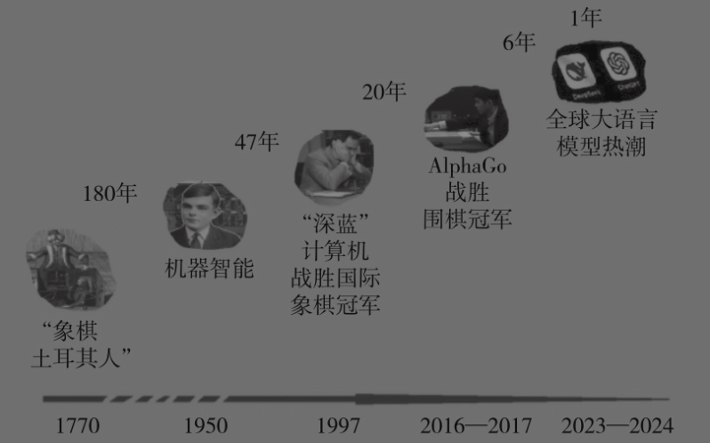
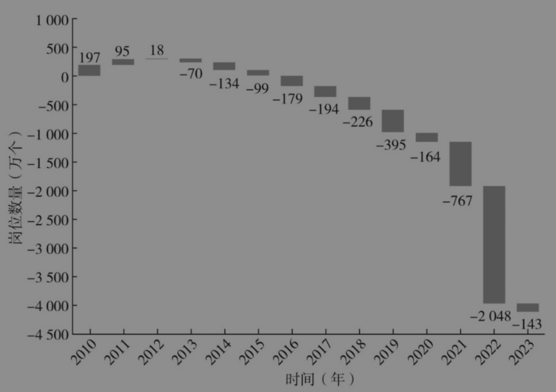
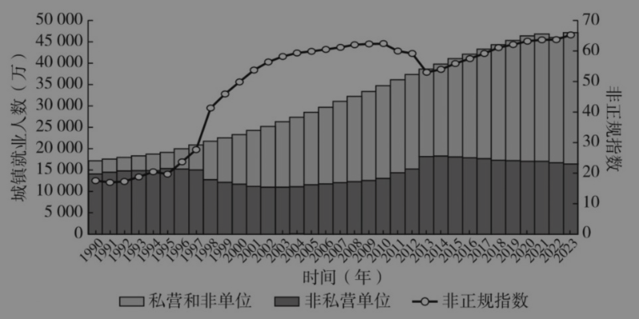
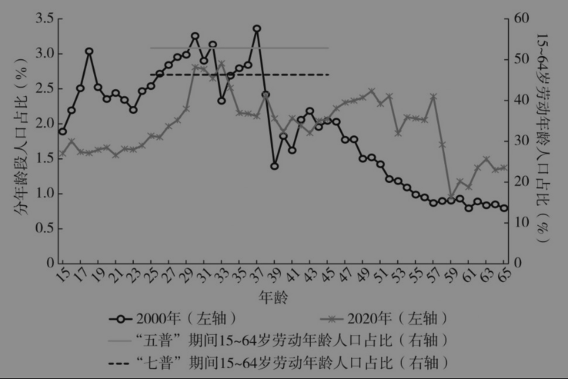
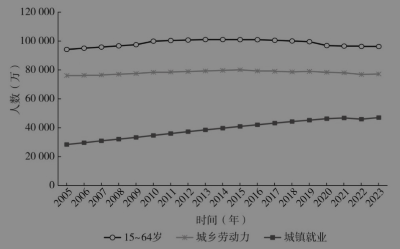

# 第七章 人工智能和数字经济对就业的影响[^1]

<!-- 按来源截图7-1.png至7-7.png顺序整理；阅读器导航与装饰分隔线已省略；正文恢复为可复制文本；图表保留原图，存于img目录；注释恢复为Markdown脚注。原始截图位于本书“原始图片”目录，便于核对。截图中的观点、提问和引文均为书籍内容。7-4.png存在来源缺失，已就地注明；图号按原截图保留，现有截图未见图7-3、图7-4。 -->

蔡昉[^2]

本章的标题有赶时髦之嫌，但实际上并非如此。人工智能和数字经济不是我的主要研究领域，但就业问题是我的研究领域，所以不算是赶时髦，而且就业这个问题无法回避。当前就业问题的结构性矛盾突出，表现为“有人没活干”和“有活没人干”两种现象并存。研究人工智能和数字经济对就业的影响，特别是造成这种结构性失业的原因，是我们的当务之急。

## 一 “这次真的不一样！”

“这次真的不一样！”这是经济学家爱用的一句话，不论是乐观主义者还是悲观主义者，都习惯把这句话作为开头和立论，对事物当前和历史上的相似度进行比较。就技术对就业的冲击而言，从历史上看，有两种观点。一种观点是技术会破坏就业，导致人们失去工作后无法回到劳动力市场。另一种观点是，经济史证明人们最后都能找到工作，岗位和职业也比过去多得多。因此，虽然技术会破坏就业，但是最终仍会创造就业。

这次确实不一样，体现在人工智能的发展速度、广度、深度与以往任何科技都不同。回望历史长河，人类在12000年前发明农业，这是一次重大的革命；人类在几百年前完成工业革命，这也是一次了不起的革命；人类历史上还有几十次关键性的通用技术变革，都带来了生产方式的进步以及产业的革新。但以上这些革命并不能与人工智能相比，因为人工智能的每一次进步都可以被视为一次关键性的通用技术进步，赋能其他科技领域和产业领域。当今人工智能的发展呈现出三个特征。

第一，颠覆性技术的出现频率越来越高，技术路径也趋于多样化。科学技术的发展，归根结底就是一种试错的过程。如传统的育种方式，以前是一年种一两季，如果没有结果，便等第二年重新试，有的育种专家可能终其一生也没有培育出新品种。如今，随着数字技术的应用，可以通过基因编辑技术育种，这个过程的推进速度越来越快。有人说人工智能最核心的竞争力是便宜，把什么事情都变得非常廉价。但其实更重要的是速度，它能在很短的时间内完成无数次试错。

第二，技术的影响范围越来越广，涉及科技、教育、政府、个人等。在早期的技术革命中，机器人替代操作型工人，承担脏活、累活和危险的工作。但现在的人工智能更倾向于替代高智能岗位，其对就业的影响几乎无远弗届。

第三，人工智能赋能技术得到深度应用，虽然实现了提高生产率的目标，但也造成了就业破坏。发展人工智能投入了大量资源，特别是国外的大语言模型，在数据、算力、能源等方面的研发投入巨大。花了这么多钱，最终是想赚回来，最直接的办法就是推动深度应用，提高劳动生产率。提高劳动生产率最传统的办法就是减少劳动投入，这自然对就业造成巨大冲击。

我用一张图来说明技术的快速进步。1770年，欧洲工程师发明了自动机器“象棋土耳其人”，虽然后来被证明是骗局，但“人造智能”的想象力开始出现；180年后的1950年，图灵从科学理论上提出机器智能的可能性；47年后的1997年，“深蓝”计算机战胜国际象棋世界冠军卡斯帕罗夫。大约20年后，2016—2017年，AlphaGo分别战胜围棋世界冠军李世石和柯洁。大约6年后，2023—2024年，ChatGPT在全球引爆大语言模型热潮（见图7-1）。在此之后的一年内又涌现了大量模型，其中就有来自中国的DeepSeek。可以说，人工智能的发展速度越来越快，影响也越来越深远。

图7-1 技术的快速进步和加速度：从“人造智能”到“人工智能”

资料来源：作者整理。

## 二 为什么卢德主义绵绵不绝？

要从经济学角度来理解人工智能对就业的影响，就不得不提到卢德运动和卢德主义。学经济学的人，脑海里一般会假设卢德主义是错误的，我们不妨回顾一下其发展过程。

在工业革命时期，有一批手工艺人发现随着新机器的使用，他们的工作被替代和剥夺了，特别是一些技术性工人（匠人），他们的手艺不再有用武之地。这些人迁怒于机器，成立了一个所谓的“卢德组织”，一开始偷偷地毁坏机器，后来发展到武装对抗政府。英国曾颁布法令并镇压卢德运动，将破坏机器的工人处以绞刑。尽管如此残酷，卢德运动仍时有发生。经济学家始终认为卢德主义是错误的。实事求是地说，工业革命之后，工作岗位越来越多，就业越来越充分，收入越来越高。从表面看，机器替代了工人的工作；实际上，技术进步创造了更多的工作。一直到今天，仍有很多人认为卢德主义是错误的。我们在讨论人工智能的就业影响时，首先要澄清这一认识。

技术进步固然会创造新的就业，但是就业破坏与就业创造之间有巨大的不对称性。

第一，就业创造可能长期滞后于就业破坏。事实证明，在相当长的时间里，被破坏的岗位多于被创造的岗位。几十年后被创造的岗位和当时失去工作的人几乎是没有关系的，可能他们的子孙到那时都已经退休。

第二，归根结底，提高劳动生产率对人们有利，可以提高收入，也有机会让人们获得新的工作，但这不是自然而然产生的，需要有制度性的安排。技术进步对就业没有涓流效应。

第三，搜寻和匹配模型可以将卢德主义纳入当代经济学的分析框架。从劳动经济学的分析方式来看，工人和雇主之间相互搜寻，然后讨价还价，最后各自让步，达成一个匹配的契约，形成雇佣关系。

为什么卢德主义至今没有被令人信服地批倒呢？首先，机器在工厂中普遍运用是一下子发生的，工人瞬间丢掉工作，即使后来找到新的岗位，也需要一个搜寻和匹配的过程，两者在时间上的付出是不对称的。其次，在劳动力市场上，每个求职者都有保留工资（对工资预期的心理价位），企业家也有保留生产率（愿意接受的生产率水平）。每当应用新技术以后，企业家的保留生产率便会提高，只有对那些达到保留生产率的求职者，企业家才会雇佣并给予应有的收入水平。这时，被替代的工人显然达不到企业家的保留生产率，因此要么找不到工作，要么降低自己的保留工资。新技术应用导致的最典型现象，就是劳动力市场的两极化。比如美国制造业的岗位实现自动化，人力资本高的工人进入更高端的服务行业，没有对应人力资本的工人退回低端岗位。他们或许都能维持生存，但是收入差距拉大，劳动力市场的两极化态势由此形成。所以，简单地批评卢德主义解决不了今天的问题。

这些年我国机器人安装数量的增长速度是世界上最快的，更不用说一般机器替代人工的普遍趋势了。自从出现劳动力短缺，企业便用更多的资金购买机器以替代人工。这既会创造就业岗位，也会破坏已有的工作岗位，两者之间究竟是什么关系？我们尚不能给出准确的答案，但可以通过一些数据进行初步观察。自党的十八大以来，城镇新增就业年均1300万人，而我国劳动年龄人口早已经历负增长，为什么还会有这么多新增就业？因为这里的数据其实是“毛创造”，只记录了新增加的岗位，没记录损失的岗位。

那么到底是创造的岗位多还是损失的岗位多呢？我们用“净增就业”（当年城镇就业总量减去上一年总量）减去“新增就业”，就能得到“净就业创造或破坏”（这个数值为负就意味着岗位净破坏）。从这个数值来看，2012年之前还有一些净创造，2012年之后净破坏数额逐步加大，而且呈现持续累积的趋势（见图7-2）。这就是现在自然失业率相对较高以及存在就业困难的原因。

图7-2 净就业创造或破坏趋势（2010—2023）

资料来源：作者整理。

对于新的就业冲击，我们不应该再靠批判卢德主义保持乐观，而是应该引入一些新的理念，构建有益的认知框架。达龙·阿西莫格鲁是2024年诺贝尔经济学奖得主之一，他几乎对这个领域的所有话题都有研究。我们总结他的相关理论和经验证据，有助于构建分析框架。我把他得出的一些结论称为“阿西莫格鲁事实”。

#### 事实一：老龄化是自动化加速的动因

历史上自动化和老龄化没有关系，老龄化是当今世界出现的特殊现象。……

> 来源说明：原始截图7-4.png未显示本节标题，正文在“历史上自动化和老龄化没有关系，老龄化是当今世界出现的特殊现象。……”处结束；下一张7-5.png已进入第四节。此处可能存在原始内容缺失，现有截图亦未见图7-3、图7-4，未补写或重排图号。

## 四 技术冲击下的就业可能性

人工智能的发展会导致机器对工人的替代，被替代的工人去哪里呢？学者们对此做过一些分析，我总结为以下四种。

第一，“索洛生产率悖论”。1987年，诺贝尔经济学奖获得者、美国麻省理工学院教授罗伯特·索洛在一篇发表了的简短书评中说出一句名言：“我们随处都能看到计算机，但在统计数据中却看不到生产率的提高。”尽管计算机技术飞速发展，但是生产率并没有随之提高，这就产生一个悖论。如何解释这个悖论？很多学者试图通过研究找到答案。

我认为一种可能的解释是，在美国和中国的劳动力市场上都可以看到，使用新技术的企业、地区和行业往往不是均衡的，它们只有在具备条件时才会使用新技术，这个时候就会产生劳动生产率的差距。劳动生产率提高的企业会减少对人工的使用，从而促进生产率进一步提高。被裁的人会经历失业，最终流向生产率本来就偏低的部门，特别是服务行业，从而造成工资和生产率进一步降低。从全社会的角度看，生产率最终没有明显的提高，因为生产率提高和降低的效果互相抵消了。过去有人研究发现，至少从20世纪90年代到21世纪初的一段时间里，美国的就业增长中没有一个岗位来自制造业，所有新增岗位都是服务行业，并且主要是社会保障等领域，这些领域的劳动生产率低于制造业，所以美国没有出现劳动生产率显著提高，而且很多人的收入水平还下降了。

第二，“鲍莫尔成本病”。在全社会劳动生产率整体较高的情况下，总有一些行业的生产率不那么高，如理发业，从过去的剃头匠到后来的理发师、美容师、形象设计师，不管从业者的称谓如何改变，或者他们使用何种高端工具，其服务过程决定了只能逐个完成理发过程，不可能通过机械化流程同时给好几个人理发，因此劳动生产率的提高是有限的。但是，由于人们都有理发的需求，该行业从业者的收入也会不断提高，与全社会平均收入水平大体相等。

鲍莫尔最早提出这个现象的时候，是以表演艺术市场为例的。比如歌剧院，从过去的人工拉幕变成现在由机器完成，在场景中增加了现代科技应用，但是演员规模和表演方式没有本质变化，所以劳动生产率没有明显提高。尽管如此，人们仍愿意花钱听歌剧、看京剧、听交响乐，此外还有政府提供的消费补贴。这是以整体劳动生产率提高为基础，保留一些没有提高劳动生产率的行业。

第三，阿西莫格鲁所说的“正确的AI”。阿西莫格鲁指出，AI在教育、医疗、增强现实、虚拟现实等领域的应用符合“正确的”方向，可以少破坏岗位、多创造就业、共享劳动生产率提高的成果。

第四，“凯恩斯可能性展望”。1930年世界经济大萧条期间，人们认为资本主义经济的未来堪忧，在一片悲观的海洋里，凯恩斯发表了一篇名为《我们孙辈的经济可能性》的文章。他预言100年以后劳动生产率会提高8～10倍，每人每周只需要工作15个小时。我在前几年以西欧国家为样本进行过测算，结果证明凯恩斯对劳动生产率提高的预测是正确的。2024年，国际货币基金组织总裁格奥尔基耶娃受邀到剑桥大学国王学院发表了同名演讲。据她所说，国际货币基金组织的学者也证实凯恩斯关于劳动生产率提高的预测已经实现，但是还没有做到每人每周只工作15个小时。

凯恩斯在文章中写道：“这是人类自诞生以来，第一次面对他真实的、永恒的困境，即如何打发休闲时光。”劳动生产率达到很高的水平，社会财富充分涌流，人们当然不需要工作那么长时间。到时候，你的工作不需要别人为你支付报酬，而是由国家支付。你可以休息，也可以工作，做自己觉得有意义的事情。凯恩斯对未来的展望不像一个资本主义经济学家的想法，更像马克思主义者的想法。

马克思和恩格斯讲到两种分配方式：一种是按劳分配，付出多少劳动就得到多少报酬，如果不这样分配，大家都不工作，不能养活自己，更不能养活整个社会；另一种分配方式，按照马克思的设想，是指未来生产率提高以后，财富将充分涌流，可以按需分配。这一种分配方式的表现就是，你可以白天务农、打鱼，晚上参加辩论会，回家以后再写一篇文艺评论。当劳动生产率足够高的时候，就会实现人的全面发展，有些事即使没有报酬也有人愿意做。凯恩斯展望的是一种可能性，但是在今天，我们比以往任何时候都有条件设想这种可能性。

回到现实，从中国的情况来看，“索洛生产率悖论”可能更有普遍性。在很大程度上，我们的新就业形态，包括灵活就业、非正规就业等，会出现原有岗位消失，从业者只能退而求其次迁移就业的情景。国际劳工组织对非正规就业的定义是“制度化经济结构之外的经济活动”，如地下经济、家庭帮工、自我雇佣等。我国对非正规就业既没有正式定义，也没有正规统计。但是我国有一个特殊的表现，可以从分部门、分单位的相关就业指标中观察哪些具有非正规就业的特征，如工资偏低、劳动时间偏长、社会保障不完善、权益不能得到充分尊重、工作不安定等。最后，我们发现有三个集中的特点：第一，不是在单位就业，而是打零工或者劳务派遣；第二，就业部门可能向私营经济和个体经济转移；第三，户口可以脱离常住地。

有一个概念叫“非单位就业”，它不能被笼统地称为“非正规就业”，但其性质比较明显，目前私营部门和非单位就业的人数高达3.1亿。还有一个概念是“灵活就业”，官方统计这部分数据是2亿人。最后有一个最窄的口径，就是中华全国总工会调查的新就业形态，主要包括大卡车司机、网约车司机、快递员等。由于劳动力市场的波动、替代和调整，出现了非正规就业、非单位就业、灵活就业等新就业形态，新就业形态的人数目前是8400万。我们把私营部门和非单位就业在全部城镇就业中的占比粗略地定义为“非正规指数”（见图7-5）。

解决问题的出路在哪里？虽然“这次真的不一样”，但仍有一个不变的特点。当你受到就业冲击、面临被机器替代的时候，只能寄希望于两个方面：一是自己的技能和人力资本，这可以通过教育和培训获得；二是社会保障或社会福利，这是国家提供的。前面介绍的几种观点对中国都有借鉴意义，这可以从中国“一老一小”劳动群体的分析中看到。

图7-5 中国城镇就业规模变化与非正规指数（1990—2023）

资料来源：作者整理。

阿西莫格鲁认为，由于中间年龄段劳动力短缺，所以这部分岗位率先实现自动化，其结果就是留下“一老一小”。中国也有这个趋势，是人口老龄化的一个特征。我们从2000年第五次全国人口普查（“五普”）和2020年第七次全国人口人工普查（“七普”）的数据看一下人口结构。“五普”的时候，15～64岁劳动年龄人口占总人口的比重还比较高，但到“七普”的时候已经下降，这意味着“一老一小”问题更加突出（见图7-6）。“一老一小”表现的是一种不利的人力资本组合。年轻人的优势是受教育程度高，弱势是缺乏工作经验。老年人的弱势是受教育程度低，优势是工作经验丰富。所以对于“一老”和“一小”来说，人力资本比较优势分别有强有弱。中间段的劳动力相对来说具有一个合理的人力资本组合，受教育程度高于老年人，工作经历强于年轻人。但是由于中间年龄段的劳动人口在减少，所以“一老一小”是我们关注的重点，要以不同方式来补人力资本的短板。

图7-6 “五普”“七普”人口结构分布图

资料来源：作者整理。

## 五 培养什么样的人力资本？

我们长期以来都在说人力资本很重要，特别是教育很重要，现在看来仅仅这样说是不够的，人工智能时代人力资本已经有并且仍将有新的变化和新的特征。

第一，人力资本竞争从人与人之间演变为人类智能与人工智能之间。过去我们对孩子投资，这是人与人的竞争。假如我的孩子受教育年限达到17年，别人的孩子只有9年，那么我的孩子在劳动力市场就具备竞争优势。但现在人工智能技术对岗位的替代几乎是无差别的，最近的趋势反倒是替代受教育程度更高的岗位。因此，人力资本竞争已经从人与人之间的竞争变成人类智能与人工智能之间的竞争，这是一个很大的变化，背后有深刻的含义。

第二，人力资本的培养必须是终身的，衡量标准也不仅仅是“受教育年限”。随着人工智能的快速发展，知识和岗位技能变化得更快。人力资本培养不再受限于“上学”，人们必须不断学习，通过在职培训和再学习等方式，全生命周期积累和更新技能。

第三，人类特有的能力通常是在早期儿童发展和学前教育阶段形成的，所以教育要向前延伸。人与人之间的竞争力是同质的，所以可以通过学习来提高竞争力。但人类智能与人工智能的竞争力不是同质的，我们必须找到自己最有竞争力的人力资本相对优势。在体力劳动、操作性能、认知能力等方面，新的人工智能已经超过人类。在非认知能力方面，譬如人际交流、领导力、团队精神、同情心、同理心、隐性知识以及实践智慧方面，人类一直具有优势。

有人提出所谓的“莫拉维克悖论”，认为人类所独有的高阶智慧能力，如推理，只需要非常少的算力，但是要让人工智能或机器人掌握无意识和依靠直觉的技能却需要极大的算力。举个例子，人工智能通过深度学习可以战胜国际象棋和围棋世界冠军，但要让机器人具有三四岁孩子那样的感知和行动能力，譬如端着一杯水越过障碍从这里走到那里，却相当困难，至今仍未做到。在新生儿出生后的前1000天里，这个阶段的学习决定了一个人的非认知能力，这是更深层的人力资本，能够让人受益终身。因此，教育应该向学前阶段甚至儿童更早期阶段延伸。

培养人力资本要“三管齐下”。第一，根据发展阶段，教育的公共产品性质越发突出，公共教育支出的水平水涨船高。终身学习、终身教育向更早阶段延伸，这些都需要大规模增加投入。迄今为止，我国公共教育投资占GDP的比重是4%，大约是世界的中位水平，多年保持这个水平属于难得的成就。不过，一方面，如今面临的人力资本挑战十分严峻；另一方面，中国即将进入高收入国家行列，因此增加教育投入的确有必要。第二，明显改善教育资源配置的均衡性和公平性，这可以在既定投入的基础上明显提高教育质量和人力资本投资回报率。第三，点燃教育发展的“第三级火箭”，促进报酬递增。教育推动经济增长曾经有两级火箭：“第一级火箭”是20世纪90年代开始普及的九年制义务教育；当教育对经济增长的促进效应递减时，“第二级火箭”，即高校扩招，成为经济增长新的驱动力。现在要启动“第三级火箭”，包括义务教育分别向前后阶段延伸等举措。

## 六 从菲利普斯曲线到贝弗里奇曲线

宏观政策也要做出相应的调整。菲利普斯曲线反映了在失业和通货膨胀之间权衡取舍的关系。过去我们在宏观经济遭遇冲击的时候，通常出台一些扩张性的宏观经济政策，包括宽松的货币政策和财政政策，以此来刺激经济增长，使其回归潜在的增长能力，这就意味着回归充分就业、消除周期性失业。

现在的问题是，在消除劳动力市场周期性冲击以后，失业率也跟着提高了。早在新冠疫情暴发之前，我们估算的自然失业率大概是5.1%，相当于充分就业的失业率，是可以接受的水平。疫情的冲击导致实际失业率高于自然失业率，说明疫情期间大多数处在周期性冲击之中，疫情之后虽然逐渐回归自然水平，却保持偏高。同时，青年失业率保持高位也是结构性矛盾加剧的表现。这些都意味着自然失业率趋于提高，因此关注点要从应对周期性冲击转向解决结构性矛盾。

还有一点需要关注，就是从长期趋势来看，中国劳动力丰富但就业不充分的总量矛盾也得到缓解。在过去10多年里，劳动年龄人口、城乡劳动力、城镇就业等不同口径的劳动力资源都已经进入或即将进入负增长阶段，意味着总量性就业矛盾转变为结构性就业矛盾，这是伴随发展阶段产生的现象，在趋势上不可逆转（见图7-7）。

图7-7 中国劳动年龄人口、城乡劳动力与城镇就业人数变化（2005—2023）

资料来源：作者整理。

解决结构性问题除了人力资本的应对之策，还有一个举措是显著提高社会保障水平。这里要区别于以往的含义。过去强调“不能养懒汉”，要严格识别哪些人具备享受待遇的资格。未来劳动生产率得到极大提高，在人工智能的冲击下，可能很难识别谁是“懒汉”。这个时候社会保障体制将越来越具有普惠性。这也符合“瓦格纳法则”所揭示的现象，即随着经济发展水平的提高，政府支出占GDP的比重也相应提高。

从现在起到2035年基本实现现代化，是大幅提高政府支出比重的一个关键时期。不能忽视的是，未来劳动力市场的制度仍然非常重要，要顺应人工智能带来的技术挑战，与时俱进构建新型劳动力市场制度，形成一套应对新矛盾的制度安排。

[^1]: 本章根据2025年3月20日长安讲坛第422期的内容整理而成。

[^2]: 蔡昉，中国经济50人论坛学术委员会成员、中国社会科学院学部委员。
