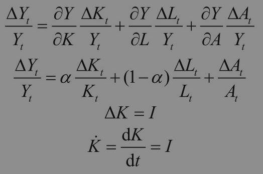
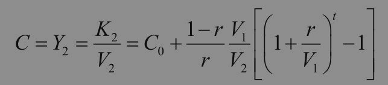
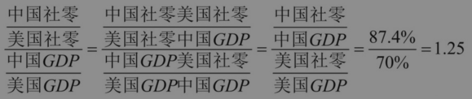
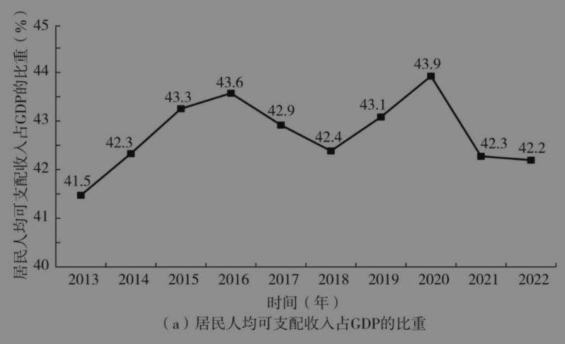
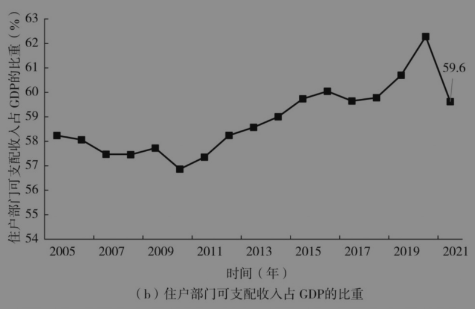
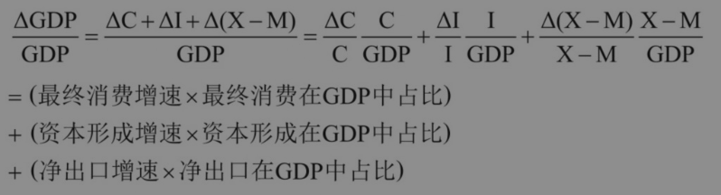
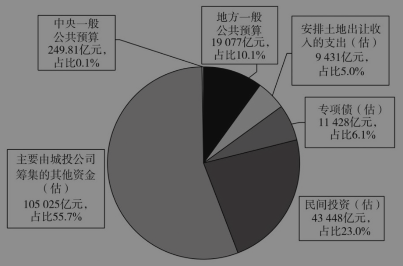

# 第三章 对当前宏观经济与政策问题的几个认识[^1]

<!-- 按来源截图3-1.png至3-9.png顺序整理；阅读器导航与装饰分隔线已省略；正文恢复为可复制文本；4处公式与3幅图表保留原图，存于img目录；注释恢复为Markdown脚注。原始截图位于本书“原始图片”目录，便于核对。截图中的观点、提问和引文均为书籍内容。 -->

余永定[^2]

非常高兴和大家分享我的一些思考。我的观点不一定符合理论界的主流，有的也未必正确，只是希望坦率交流，欢迎大家批评。我认为经济学家首先要遵循“不唯上、不唯书、只唯实”的原则，要实事求是。我们要有科学的思维方式。我对经济学的学习和研究始于《资本论》，从马克思主义政治经济学到西方经济理论，最后回到中国的实际经济问题。我有一个强烈的感受：我们对形式逻辑教育的重视不足，特别是在大学阶段，因而在应用经济学原理讨论经济问题时，常常因逻辑错误而得出错误的结论。

我想谈一谈在中国宏观经济政策讨论过程中出现的一些概念错误和逻辑错误。

## 一 不应该用长期因素和慢变量来解释短期现象

长期因素（长期稳定、不可量化的条件）和慢变量（可测度，但相对于被解释变量，其变化速度缓慢）无法解释短期现象（时间维度为年度和季度）的变化。长期因素和慢变量通过累积的、渐进的方式影响GDP增速，它们的变化对特定年度和季度GDP增速的影响是微小的、难以测度的。例如，人口老龄化是一个慢变量，我们不能直接用人口老龄化的某个特定指标，来解释为何某个季度的经济增速低于预期。2011年我国经济增速为9.5%，2015年降到7%，2015年的适龄劳动年龄人口数量和增速都低于2011年。中国确实已经进入老龄化阶段，但当前的主要问题是失业，而非劳动力短缺。

不仅如此，现实中还存在许多有利于增长的长期因素和慢变量，如城市化、产业升级、科技革命（如大数据和人工智能）、人力资本等。我们难以事先判断不同的长期因素和慢变量相互抵消后的净结果是什么。

有人认为，中国经济增速下降（或者下降到目前这种程度）是不可避免的。我很喜欢富兰克林的一句名言：“在这个世界上，只有死亡和税收是确定无疑的。”世界上没有那么多不可避免的事情，我们要发挥主观能动性。在很多情况下，事在人为。如果我们事先在脑海中设定某个长期因素决定经济增速必然下降，那么就会根据这种预判来行动，进而形成预期的自我实现。

经济学家喜欢使用的一种论证方法就是以某种指标（如人均收入）划分经济发展阶段，然后进行横向对比，证明或预言中国发生的某种现象具有必然性，或中国必将发生这种现象。这种做法很容易产生“轻率概括谬误”（fallacy of hasty generalization）。

2024年，中国人均GDP大约是1.33万美元。一般来讲，一个国家人均GDP超过1万美元时会出现这样或那样的情况。这些情况对于中国而言有一定的参考价值，但离开对具体原因的具体分析，仅根据人均收入水平就断言中国经济已经进入低增长阶段是非常不靠谱的。

20世纪以来，美国经济经历了三个黄金期，即20世纪20年代（GDP年均增长率为4.7%）、1945—1973年（GDP年均增长率超过4.1%）和1992—2000年（GDP年均增长率超过4%，1999年甚至达到4.8%）。按2023年美元购买力计算，在上述时期美国人均收入分别为1920年0.8万美元、1947年2.1万美元、1992年4.2万美元。以上三个时期都是经济快速发展阶段，但人均收入差异巨大。这种情况说明不能根据人均收入是否超过某个水平，就断言一国经济增速一定进入低速增长阶段。

还要强调一点，经济学家在推理过程中不能随意跨越中间环节。因果关系的链条一环扣一环，不能直接从a到d。从解释变量到结果变量，之间存在漫长的因果链条。例如，从“中国正在老龄化”出发，一旦跳过因果链条中的多个环节，解释2019年中国经济增速为什么降到6.1%，就会犯形式逻辑上的“推不出谬误”（fallacy of non sequitur）。

## 二 不应该将不同领域、不同时间维度、不同性质的问题混为一谈

经济学不仅横跨许多领域，而且研究的问题有不同的时间维度。例如，宏观经济研究短期问题（1年、1个季度甚至更短），而经济增长研究长期问题（5年、10年、20年），经济增长理论和宏观经济学的概念是在不同的假设前提下提出的，含义有很大不同，因此不能混为一谈。在长期问题和短期问题、经济增长理论和宏观经济学中，“经济增长”的含义是非常不同的，因此也不能混为一谈。

经济现象是可以归类的。经济增速下降、通货收缩、产能过剩、资产泡沫、贫富差距，以及市场扭曲、产业发展、城市化、人口等问题都是独立的研究领域。与问题相对应的是宏观经济政策、体制改革、结构调整、竞争政策、产业政策、城市规划、人口政策等。不同领域的政策不能混为一谈。例如，宏观调控是短期问题，政策可能是按季度或年度调整的；城市化问题是长期问题，相关政策的时间跨度是5年、10年、20年。城市化政策对克服年度通缩问题有帮助，但作用有限；贫富差距的缩小对经济增长有正面影响，但不能解决当年的通缩问题。

在研究经济现象的时候，一定要注意以下问题：它属于什么领域？时间维度是什么？性质如何？应该用哪种经济理论来分析这个现象？只有厘清这些问题，做到分类施策、协调配合，才能避免“一锅炖”。

## 三 “产能过剩”不是宏观经济问题

无可否认，中国存在产能过剩问题。但产能过剩是行业和产品问题，是结构问题，而不是宏观经济问题。

2012年，钢铁、水泥、平板玻璃、电解铝、造船等传统重工业领域存在着严重的产能过剩。但与此同时也存在着很多供不应求的行业和领域，如半导体芯片及智能手机关键部件、精密机床与工业机器人、婴幼儿奶粉与高端消费品、光伏产业链的高端材料、污水处理与空气净化设备、云计算与大数据服务等。即使在产能过剩的行业，许多细分行业和产品也存在供不应求的情况，比如高端汽车板（尤其是高强钢和镀锌板）、硅钢（尤其是高牌号无取向硅钢和取向硅钢）、高端轴承钢（如GCr15）、高铁齿轮钢、不锈钢（高端品种）、特种合金钢（高温合金、耐蚀合金）、超厚或超宽钢板等。

产能过剩主要靠市场机制来解决，竞争、价格下跌、亏损、倒闭或并购等因素会加速过剩产能的消失，因而可以在一定程度上通过产业政策、环保政策加速此进程，减少调整成本。

长期以来，经济学界对中国宏观经济形势的看法是：“产能过剩”（总供给大于总需求）是中国宏观经济的主要问题，宏观经济政策的目标应该是“去过剩产能”。从理论角度看，宏观经济政策的目标有4个：充分就业、经济增长、物价稳定和国际收支平衡。一般来说，市场经济国家（澳大利亚、新西兰等）的宏观经济政策目标是抑制通货膨胀率。发达国家的通胀目标是2%，而发展中国家的目标高于2%。美国有两个宏观经济政策目标，一个是通货膨胀率，另一个是就业。其他国家没有把“产能过剩”作为宏观经济政策的目标。

在凯恩斯之后，宏观经济层面不存在产能过剩的问题。产能过剩的叙事少了一个时间维度：总供给是前期投资决定的，这一点是给定的。在当期，决策者只能改变总需求，无法改变总供给。这样，在宏观经济层面只存在两种不平衡的状态：一是总需求大于总供给（通货膨胀使经济过热）；二是总需求小于总供给（通货收缩使经济过冷）。采取扩张性还是紧缩性宏观经济政策，主要看两个指标——经济增速（就业率）和通货膨胀率，而不看是否存在产能过剩。宏观经济政策工具箱中不存在解决行业层面产能过剩的工具，市场的价格机制才是解决产能过剩问题的主要办法。我们要充分发挥市场机制的优胜劣汰功能。地方政府对产能过剩的产业进行补贴，让本该被收购、兼并或关闭的企业继续存活，这一点是要避免的。

一个人不可能同时往东走和往西走，但可以在用宏观经济政策刺激有效需求的同时，利用市场价格机制、竞争政策、产业政策、环保政策、税收政策等解决产能过剩问题。它们并行不悖、相辅相成。

## 四 不存在“消费驱动”的增长方式

克鲁格曼、萨默斯等学者认为中国“投资驱动”的增长方式已经走到尽头，中国应从“投资驱动”转变为“消费驱动”。经济增长是由资本积累、有效劳动力投入和技术进步推动的。中国资本的快速积累是中国成为世界第一制造大国、具有强大国际竞争力的最重要原因。

现实中并不存在“消费驱动”的增长方式。根据哈罗德-多马模型，经济增速=储蓄率/资本产出率，假定储蓄率等于投资率。需要注意的是，在经济增长理论中不考虑需求约束问题。经济增长理论隐含的假设是“有供给就有需求”（类似萨伊定律）。在经济增长理论中，产出或GDP代表的是供给，经济增速既是实际经济增速，也是潜在经济增速。在宏观经济学中，在有效需求不足的情况下，实际产出小于供给能力（产能），实际经济增速低于潜在经济增速。宏观调控的目的是增加有效需求、弥补有效需求不足的缺口，使实际经济增速等于潜在经济增速。在宏观经济学中，为了简化分析，假设供给是无限的，实际产出（或GDP）受有效需求的制约。可见，经济增长理论和宏观经济学中的“增长”不是一回事，在长期增长不受需求约束，在短期增长不受供给约束。

生产函数的动态化模型的公式如下：

可以看出，生产函数有三大要素——资本、劳动和技术进步，这三大要素共同决定了GDP的增长。该模型中没有“消费”这个自变量。在英国工业革命爆发前漫长的历史进程中，经济增长极其缓慢。原因很简单，由于劳动生产率极为低下，除了维持简单再生产所需的产出，用于补偿生产资料以外的其他产出会被消费掉。没有生产资料的积累，自然也就没有经济的增长。

显然，并非消费驱动经济增长，而是建立在储蓄基础上的投资驱动经济增长。消费只是在有效需求不足的情况下弥补了有效需求不足的意义，之后才谈得上对经济增长的“拉动”作用。消费不能提高经济增长潜力，只能使经济增长潜力得到充分发挥。

但是我们并不否认消费的重要性。马克思指出，“没有消费，就没有生产，因为如果没有消费，生产就没有目的”，但“生产的扩大，要取决于剩余价值到追加资本的转化，也就是要取决于作为生产基础的资本的扩大”，“资本的扩大”按定义就是“投资”。在给定的时间内，消费和投资是互相排斥的，多投资就少消费。新中国成立后，我们勒紧裤腰带过苦日子，少消费、多储蓄（投资），结果是消费下降。现在，年轻人更喜欢消费，消费所占的比重也更大一些。因此，消费和投资不是根本对立的，而是一个取舍的问题，而取舍的不同又取决于社会福利函数的不同。

庞巴维克在《资本实证论》中提出迂回生产的概念，指出要先生产生产资料（资本品），再用这些生产资料去生产消费品。例如，鲁滨孙最初徒手抓鱼，每天只能抓几条；后来他制作渔网，每天捕到的鱼达到50条；再后来制作木筏、渔船，渔获量大幅增加。

苏联经济学家菲尔德曼于1936年提出，如果把较多的资本品分配给资本品生产部门（即更多投资于资本品生产部门），消费品生产部门的产出就会减少。但由于资本品产出的快速增长，即便分配比例不变，用于消费品生产的资本品也会快速增长。随着时间的推移，消费品的产出规模会越来越大，最终赶上甚至超过最初更多投资于消费品生产所带来的消费品规模。

现在多消费还是将来多消费？菲尔德曼解决了这个问题。菲尔德曼模型中的一个关键变量是投资品的分配，I表示所有的资本品，I₁表示用于生产资料的资本品。r=I₁/I，代表投资于第一部类的投资品在全部资本品中所占的比重。从下面的公式中可以看出：当t较小时，r越大，C越小。但随着时间t的推移，r越大，C越大。r取值小意味着“先甜后苦”，取值大意味着“先苦后甜”。

其中，C、Y、K、V分别代表消费品、第二部类产出、资本和资本产出率。下标1、2表示部类。

从长期来看，消费和投资不存在非此即彼的矛盾。两者之间的选择其实是现在多消费、将来少消费，还是现在少消费、将来多消费。至于如何选择，取决于公共意愿。

东亚国家的经济增长表现优于西方、非洲及拉美国家，这在一定程度上与儒家文化的影响密不可分——我们重视家庭观念，为了后代强调积累与传承。东亚国家的储蓄率和投资率比较高，经济增长速度也比较高。在改革开放前，中国存在强迫储蓄问题，消费率和消费水平普遍过低，但现在的情况已经很不一样。

一些研究显示，固定资本形成净额占GDP比重越高，GDP增速就越高；GDP增速越高，消费量增速就越高。

## 五 应该正确解读中国的消费数据

一种流行观点认为中国消费率太低，但实际情况究竟如何？

从官方数据横向比较来看，中国的消费率确实较低。比如，2023年美国消费率范围是80%～82%，中国是53%～55%，其他主要国家的消费率也都高于中国。但是这里存在消费结构不同的问题，美国服务消费占居民消费的比重超过2/3。2022年，中国人均服务消费支出占居民人均消费支出的比重为43.2%。与中国相比，国外的服务价格非常高，所以消费率大大高于中国。如果剔除这些因素，实际上中国消费率虽然低一些，但差距可能不是很大。从中美最终消费中商品消费占GDP之比来看，通过简单推算可知，中国是美国的1.25倍。应该说，中国的消费率并不是特别低。

中国的服务消费与GDP之比明显低于美国的服务消费与GDP之比，其中多少由量导致，多少由价格导致，还需要进一步研判。但经验告诉我们，美国和西方国家的服务价格明显高于中国。

在现实中，消费水平是比消费率更重要的概念。事实上，一些消费率最高的国家是世界上最贫困的国家，如一些非洲国家的消费率就高达100%，甚至超过100%。根据2021年世界银行的报告，对价格数据进行调整之后，可以发现中国居民在居住、教育、休闲和医疗领域的消费水平，大约是用市场汇率度量的消费水平的两倍。从实物消费指标来看，中国居民的消费水平不输于发达国家，甚至在有些方面领先于美国。中国人均预期寿命高于美国，2021年中国人均预期寿命是78.2岁，美国人均预期寿命是76.1岁。

另外一种流行观点是中国居民人均可支配收入占比太低。国家统计局列出两组居民人均可支配收入数据。第一组数据是通过住户调查得到的全国居民人均可支配收入占比，第二组数据来自资金流量表。由于种种原因，住户调查可能存在系统偏差。虽然国家统计局利用税收数据做了调整，但最终统计可能仍然偏低。总之，叠加定义、统计口径和其他原因，两个统计序列的差异相当明显。以2021年为例，根据不同来源数据计算的居民人均可支配收入占GDP比重的差距竟高约16个百分点（见图3-1）。但可以肯定的是住户部门可支配收入统计更准确地反映了居民收入在国民收入分配中的实际占比。

图3-1 居民人均可支配收入占GDP的比重：不同统计口径的显著差异

图3-1 居民人均可支配收入占GDP的比重：不同统计口径的显著差异（续）

资料来源：作者基于国家统计局数据计算得出。

虽然中国居民人均可支配收入占GDP的比重要小于大多数发达国家，但差距也并非一些分析所认为的那样大。例如，2022年日本的居民人均可支配收入占比为56.22%，丹麦为46.1%，都低于按资金流量计算的中国居民人均可支配收入占比；英国为61.47%，仅略高于中国。各国国情不同，简单比较不足以说明问题。增加居民人均可支配收入意味着减少税收和社保缴费等，但中国的宏观税负在全球主要国家本来就已经处于中下水平。因而，尽管中国可以考虑进一步提高居民人均可支配收入占比，但很难说有多少余地。

按照收入法核算，GDP=居民人均可支配收入+企业留利和折旧+政府净收入，在GDP给定的情况下，如果增加居民人均可支配收入，那么其他两项就要减少。

从企业留利和折旧来看，企业需要有足够的资金进行技术创新，近些年中国之所以有大量企业实现重大技术突破，离不开这些企业的大量投资。中国GDP统计中的折旧占比非常高，因为中国制造业占世界制造业的比重超过30%，是制造业第一大国，折旧自然多于其他国家。企业折旧占GDP比重较高，同中国制造业在经济中的占比远高于一般国家有关，但是否同技术更新较快有关，还需要进一步研究。我们要维持制造大国地位，搞技术创新和技术革命，企业留利和折旧这一项是不能减的。

政府净收入=政府税收（含增值税、所得税等）-政府补贴。中国财政收入占GDP的比重最低时为11.2%（1994年），随着分税制改革的实施，这一比重逐步上升超过20%，2024年又降至16.29%。总体来看，我国财政收入占GDP的比重在国际上处于较低水平，发达经济体一般为35%～40%。

总之，为了提高居民人均可支配收入占GDP的比重，中国政府是否应该进一步减税、中国企业留利和折旧占比是否应该下调以及如何下调，这些复杂问题都需要逐一论证。未经详细论证，仅通过简单的国际对比就断言中国居民人均可支配收入占比过低，未免草率。

中国居民消费领域的主要问题是收入分配差距过大，中国的基尼系数虽然有所下降，但仍处于较高水平。浙江大学共享与发展研究院院长李实是中国研究收入分配的权威人士，他在2024年中国基金会发展论坛的年会上表示，在过去近20年中，中国收入差距出现了一个先上升、后下降，现在基本稳定的高位水平。2008年的基尼系数是0.491，接近0.5的水平，如果一个国家的基尼系数超过0.5，通常会被国际社会认为收入分配极不平等；基尼系数达到0.5之前出现了一个转折，收入差距出现缓慢回落，但下降的幅度并不很大，在7年的时间里下降了不到3个百分点；从2016年开始，基尼系数处在相对稳定的0.46～0.47波动的状态，这意味着从2016年开始，我们的收入差距没有出现进一步缩小的趋势，而且收入差距仍然处在一个高位水平。

## 六 在有效需求不足的情况下，促进消费需求是GDP增速的有效路径

在长期消费不能驱动经济增长，但短期有效需求不足的情况下，消费需求增长可以拉动经济增长。[^3]在总需求不足的情况下，年度GDP增速可以通过确定总需求的各构成部分可能实现的增速，以及总需求各构成部分在GDP中的占比得出。

2024年的GDP增速是5%，消费、投资、净出口（贸易顺差）对GDP增长的贡献分别为2.2个、1.3个、1.5个百分点。特朗普政府加征关税以来，我曾担心中国进出口会受到很大影响，没想到2023年出口大幅上升，2024年实现了双位数增长，成为推动经济增长的重要动力。这种局面不符合我国长期发展形势，也不符合“双循环”新发展格局，反而会导致贸易冲突愈演愈烈，引起其他国家反感，进而采取贸易保护主义措施。2025年的经济增长主要依靠内需，内需主要包括消费需求和投资需求。

我本人是支持促消费的。很多学者提出了促消费的相关建议，综合来看可以归为三类。

第一类，直接发钱或消费券。主流的消费理论认为，消费是收入、收入预期和财富的函数，或者说是永久性收入的函数。如果居民人均可支配收入占比不增加、预期不改善，则居民消费难以增加。一个低收入者得到政府提供的临时补贴，这是暂时性收入，而不是永久性收入，他或许会把补贴的一部分存起来，以备不时之需。

从相对微观的层面来看，应该针对哪些商品发放消费券或补贴也是一个问题。2024年中国社会消费品零售总额同比增长3.5%，其中增速下降最快的项目首先是金银首饰零售额，其次是建筑及装潢材料类，而生活必需品是保持增长的。显然，政府不会为高档消费品发放消费券或补贴。但为购买生活必需品发放补贴，在很大程度上不会影响消费需求。政府结合产业政策为购买电动汽车和某些电子产品发放消费券或进行补贴，对刺激消费发挥了重要作用。但由于这些产品普及率迅速提高和其他原因，这种作用正在逐步减少。

当然还有财富效应，房价下跌会降低房产所有者，特别是房地产投资者的消费需求。在这种情况下发钱或者发各种形式的消费券，对他们的消费行为的影响应该是比较有限的。一个实际问题是地方政府财力有限，难以持续、大规模发放消费券和提供补贴。不仅如此，未来这类政策的通胀后果也不能不预防。

第二类，降低个人所得税。这一建议在学理上没有问题，但恐怕效果也有限。中国每年的个人所得税总量约为1.45万亿元，而经济体量超过135万亿元，个税占比相对有限。政策调整并非取消个税，而是通过提高起征点、降低税率等方式实施，预计仅能释放几千亿元，其对消费的刺激作用应该比较有限。

第三类，改革社保制度。这一领域其实有可探讨的空间，我在这里不展开过多评论，仅聚焦核心观点，即降低社保缴费费率。目前我国社保体系包含基本养老保险（城镇职工基本养老保险、城乡居民基本养老保险）、基本医疗保险、工伤保险、失业保险、生育保险等五大险种；在养老保险中，城镇职工基本养老保险最为关键。国际社会将城镇职工基本养老保险主要分为“缴费确定型”和“待遇确定型”两类，而我国现行制度兼具两者的特征，属于混合模式。

主张降低缴费费率（例如从20%降至12%）的核心逻辑是通过释放部分当期收入来撬动居民消费，但这里面存在多重复杂的关系。其一，需要精准测算降费规模。每降低1%的费率能释放多少资金，这些资金又有多大比例能真正转化为消费，而非被居民储蓄。其二，存在明显的跨期利益取舍。社保缴费遵循“多缴多得”的精算原则。当期缴费费率降低，如果降幅不够大，则可以释放的消费资金有限；如果降幅足够大，则可能影响未来养老金的发放。其中是否存在李嘉图等价定理，值得考虑。其三，不同收入群体（高、中、低收入群体）对降费政策的反应存在差异，进一步增加了政策效果的不确定性。其四，费率的降低大概只能逐步推进，短期内恐怕难以发挥重要的刺激消费的作用。

城镇职工基本养老保险建立在精算基础上，相当于既定合同，调整难度大、周期长，短期内难以落地。但社保体系中仍有两大可探索的优化方向：一是城乡居民基本养老保险，其本质并非纯粹的保险制度，而是以政府投入为主（80%～90%的经费来源于政府）的社会福利制度，目前农村地区的平均水平仅一两百元，水平很低，应提高标准；二是低保制度，当前低保标准同样偏低，尽管城乡低保差距不及养老保险显著，但仍有提升空间。不过这两项调整的前提是政府需要承担相应的资金投入，如何解决资金来源则是政策落地的关键。

总体而言，上述三项“促消费”建议均有积极作用，但都需要通过严谨的计算和实证研究给出答案，其实际效果要打一个问号。

居民收入、收入预期和财富、永久性收入是决定消费行为的关键变量。只有永久性收入得到稳定提升，消费才能实现可持续增长。那么，如何实现永久性收入的提升呢？当前最为可行的路径是提高基础设施投资。一笔基础设施投资可以立即转化为企业和居民的等额收入。居民新增收入导致居民消费支出增加，政府投资创造的“挤入效应”导致私人企业投资支出增加。新增消费支出和投资支出通过乘数效应导致新一轮收入增加，以及在此基础上新一轮消费需求和投资需求的增加。这样，在基础设施投资的带动下，有效需求不足的缺口最终得以填补。

## 七 基础设施投资远未饱和，应对基础设施投资效率做全面分析

针对基础设施投资存在两种常见的质疑：一是投资饱和，二是效率太低。首先应该明确指出，中国的基础设施投资远未饱和。

首先看交通运输网络。中国交通运输网络发达，但航空运输网络依然不完整。例如，中国的小型机场数量仅几百个，而美国的小型机场有上万个之多，两者数据悬殊，足见航空运输设施仍有巨大的发展空间，中国的小型机场数量目前难以满足经济发展的需要。其次看城市电力设施，我家门口至今还能看到上百条电线杂乱地悬挂在半空的景象。这种裸露且无序的架设方式存在极大的安全隐患，一旦遭遇大风等恶劣天气，不仅可能导致电力和通信中断，还会存在严重的安全风险。最后看地下排水系统，我曾经趴在地上拍过一张米兰城市下水道的照片，虽然照片上的下水道看上去并不深，但实际深度十几米，而这样的工程竟是上百年前建成的。

从机场、电线到地下排水管道，无不说明我国基础设施建设在数量、质量和规划理念上仍与发达国家存在差距，需要提升的空间很大，“投资饱和”的说法显然站不住脚。还有报告指出，仅城市地下排水系统所需的基础设施投资资金就高达4.5万亿元。

我国的基础设施投资空间也很大。以能源网络为例，中国西北地区在太阳能资源方面拥有得天独厚的优势，那里日照充沛，大多为平坦地貌，并且是暂无太大其他经济价值的戈壁，极其适合建设大型光伏基地。一条长达3 000千米的输电线，每天可实现2亿度的电力输送。2025年，中国的日均用电量约为274亿度。理论上，100条这样的输电线便能满足全国的用电需求。当前光伏发电成本已大幅降低，总体成本仅为火电系统的一半。通过电池储能技术，有望实现光伏发电的全天候稳定供电。不少研究认为，中国在能源、电力、通信等领域进行基础设施投资的空间依然巨大。

“十五五”时期，党中央提出政策措施进一步推动“西部大开发”形成新格局，沿河西走廊向中亚进一步开展大规模基础设施投资建设，并建立相应的经济走廊。中亚位于欧亚大陆腹地，是连接欧亚大陆中心地带和边缘地带的关键区域，将西部大开发与建设中亚经济走廊相联系，对于刺激内需、维护国内安全和提升地缘政治地位都具有重要意义。

近期我在西北考察时深切感受到这里土地广阔、自然条件适宜、闲置空间充足，具备充分开发利用的巨大潜力。从地缘政治的视角看，布局这一地区更具有深远意义：昔日有海权、陆权之争，如今我们完全可以传承张骞出使西域的开拓精神，打通一条贯穿新疆、吉尔吉斯斯坦、乌兹别克斯坦、土库曼斯坦等国家和地区的通道，让西部成为国家发展的“稳固大后方”。目前我国拥有充足的钢铁、水泥等建材资源，以及大量闲置的生产设备，能为西部及跨境基础设施建设提供坚实支撑。无论是西北的交通网络、民生设施，还是西藏的基础设施配套能力，都有海量可落地的投资项目。

2024年党中央提出国家重大战略实施和重点领域安全能力建设（简称“两重”建设），其中重点领域安全能力建设涵盖粮食安全、资源安全等，这一部署兼具战略性与前瞻性。

2020年党中央提出“两新一重”建设（“两新”指“新型基础设施建设”和“新型城镇化建设”，“一重”指重大工程建设），之后已经推出了一系列政策举措，这一方面我不再展开细说。从“十一五”到“十五五”时期，我作为国家发展规划专家委员会委员，特别希望看到一份完整的投资项目表，我也曾向有关部门询问能否查阅这类资料，但目前暂未得到明确答复。其实，我们的项目储备是充足的。回想应对2008年国际金融危机时，各地积极向国家发展和改革委员会争取项目。当时相关负责人就提出，为对冲危机，不少此前被搁置的项目已重新启动。尽管推进过程中难免出现一些问题，但当时项目落地的动作非常快。现在我还是希望能够尽快看到“两重”建设、“两新”政策的投资项目清单。我在前一段时间去雅砻江考察，全流域1 571千米内规划建设22级水电站，总落差3 830米。在我国西部地区，开发这类清洁能源的优势还有很多，我国在基础设施与能源项目建设上有着得天独厚的条件。

关于基础设施投资的效益问题，有人认为没有效益就不该投资，否则就是赔钱，这种观点是错误的。基础设施项目具有基础性、公益性、长期性特征。所谓公益性，就是以社会效益为首要目标，而非单纯追求商业利润，市场往往投资不足，需要政府主导或支持。

以我国高铁建设为例，如果过分强调经济收益，那么高铁项目根本不会有今天的规模。事实上，高铁网络的修建改变了整个中国的经济与社会，成为一张亮眼的“国家名片”。不可否认，部分高铁线路确实上座率不高，但这是所有基础设施投资的共同特点，即公共服务的核心是满足社会整体需求，而非追求单一的商业回报。

我在英国考察时曾特意观察过火车运营：一辆列车上午10点从肯特开往伦敦，很多车厢几乎空无一人，但早晚高峰时却拥挤不堪。这种“潮汐式”的运营特征决定了公共设施无法实现全天候的高利用率，也难以用纯粹的商业收益来衡量其价值。评价基础设施投资的效益，不能局限于短期经济回报，而要看到其长远的社会回报和深层的社会意义。

但是，我们也必须看到基础设施投资确实存在重复建设、浪费资源、效率低下等问题。事实上，有关部门对这些问题是高度关注的。2024年12月22日，国务院办公厅发布《地方政府专项债券禁止类项目清单》，为基础设施投资明确设定了红线。对于已经建成的低效、浪费的项目，纠结过往无济于事，更重要的是立足当下，严格把控新增投资的审批关，让后续投资聚焦于真正有需求、有价值的领域，避免重蹈覆辙。

除了项目储备，当前基础设施投资面临的另外一个重要问题是缺少资金。我认为，自2008年一揽子计划实施以来，中央政府一般公共预算对基础设施投资的直接贡献有所降低。基础设施建设的主体责任一般在地方政府，即便部分重大项目由中央统筹，具体融资压力也大多落在地方。回顾2008年，中央财政直接投入1.18万亿元。但到了2021年，在基础设施投资融资结构中，中央一般公共预算仅为249.81亿元，占比低至0.1%（见图3-2）。中央投入不足，地方为推进项目只能通过多种渠道筹措资金。在这些融资渠道中，银行贷款等低成本资金的占比有限，而信托等高成本资金的占比较高。再加上部分地方基建项目存在浪费、低效等问题，债务风险的累积便成为必然。这是当前基础设施投资领域必须正视和解决的重大问题。

图3-2 2021年基础设施投资融资结构估算

资料来源：作者整理。

不仅如此，财政部对地方政府负债的限制越来越严。按照财政部的定义，地方政府负债率=地方政府债务余额÷综合财力。其中，综合财力涵盖一般公共预算收入、政府性基金预算收入、国有资产经营收入等项目。不少地区负债率已处于120%～200%，部分地区甚至突破300%。

地方政府负债率对地方政府债务融资形成严格制约。2022年1月29日，财政部根据负债率数据，将债务风险由高到低分为红（债务率≥300%）、橙（200%≤债务率<300%）、黄（120%≤债务率<200%）、绿（债务率<120%）4个等级。加强对债务风险的监控是完全必要的。但是，同负债率相关的追责制度也严重影响了地方政府对基础设施投融资的积极性。对于上述负债率，是否应该根据不同地区的不同经济发展状况进行某些调整，以及如何在严格防控债务风险与保障合理基建融资需求之间找到平衡点，都是当前面临的重要挑战。

从地方政府债务与中央政府债务之比的国际比较来看，截至2024年末，中国地方政府债务余额（47.54万亿元）与中央政府债务余额（34.57万亿元）之比为138%，美国不到10%，日本是16%～17%，法国大约为10%，英国更低。如果说2025年中央政府对地方政府转移支付的增长方向是正确的，那么是否可以考虑对财政体系（特别是中央和地方的责权分配）进行改革，增加地方政府的财权？这一问题值得进一步探讨。

中国应该调整中央政府和地方政府之间的债务结构，以及明显提高国债在中国政府全口径债务总额中的占比。具体实施途径可以另行讨论。在基础设施融资中，中央财政所占的比例更应该明显提高，中央政府应该尽快偿还疫情期间本应由中央政府但实际由地方政府偿还的债务。

## 八 关键在于财政的可持续性，而非财政收支平衡

中央财政向来秉持谨慎原则，这一点值得肯定，但中央财政的运行逻辑与地方财政存在本质区别：地方财政需要坚持“量入为出”，中央财政应该关注“财政的可持续性”，而不是“财政收支平衡”。

当前中国仍拥有相当大的财政政策空间。但长期以来，“赤字率不超过3%”的规则成为不少人认知中的“红线”，这一规则的起源其实与中国并无直接关联。1991年，在《欧洲联盟条约》谈判阶段，该条约草案为约束南欧国家的财政扩张行为（避免其过度花钱导致其他成员国兜底），设定了“成员国财政赤字不得超过GDP的3%”这一红线，这个规则本身并无特别的理论根据。

日本的实践更能印证传统财政规则的局限性。1996年，日本财政赤字率约5%，国债占GDP比重为91%，桥本政府认为日本财政已濒临崩溃，随即采取紧缩政策（削减财政支出、提高消费税），导致1998年日本陷入严重衰退。现在日本国债占GDP比重已达250%，虽然经济增长乏力，但并未出现财政崩溃的局面。事实证明了传统财政指标的片面性。

财政可持续性源于公众对国债的需求。若投资者相信国家前途与未来发展，就会主动抢购国债，推动国债收益率走低。反之，若市场信心不足，政府只能通过大幅提高收益率吸引投资（如欧洲主权债务危机期间，希腊10年期国债收益率一度飙升至44%）。当前，中国10年期国债收益率仅1.7%，最低时甚至达到1.5%，低收益率背后是市场对中国经济的坚定信心，同时充分证明了我国财政政策仍有广阔的操作空间。

我和研究团队在访问日本之后发现一个规律：国债占GDP的比重通常会趋于“赤字率/GDP增速”这个极限值。假如赤字率为3%，GDP增速为5%，则国债占GDP比重的极限值为60%。后来我们得知，当年欧盟的决策者认为欧元区的经济增速将达到5%，在规定赤字率不得超过3%以后，容易算出国债占GDP比重的极限值为60%。可见，“3%”或“60%”并非“放之四海而皆准”。另外，如果经济增速为零，国债占GDP比重的极限值就是无限扩大的；增速越高，国债占GDP比重的极限值越低。2001年，中国曾就“是否采取扩张性财政政策”展开辩论，当时我们坚决主张扩张性政策。尽管有人提出中国的国债占GDP比重因不良债券的存在而高于12%，因而不应该进一步扩大财政赤字，但我们根据模型得出的结论是，无论当前的国债占GDP比重有多高，这一比例只是微分方程数值解的初始条件。只要能把赤字率控制在3%左右，并能使GDP增速保持在7%左右，国债占GDP的比重就不会超过50%，完全在安全范围之内。利息率和经济增速是保持财政可持续性的两个关键因素。

中国的财政完全是可持续的，目前的通货膨胀率很低，政府完全应该加大财政政策的扩张力度，提高赤字率，增发国债，特别是长期国债，为基础设施投资提供资金，尽快消除通缩压力，实现5%左右的经济增长速度。如果过于谨慎、犹豫不决，一旦通货膨胀形势因某种原因（如能源冲击等）恶化，我们的政策空间就会迅速收窄，以后将难以使用扩张性的财政货币政策刺激经济增长。届时，我们将不得不面临更加复杂严峻的挑战。

[^1]: 本章根据2025年10月29日长安讲坛第431期的内容整理而成。

[^2]: 余永定，中国经济50人论坛成员、中国社会科学院学部委员。

[^3]: 需要强调的是，拉动消费并不能增加产出（或总供给以及产能），给定时期的产出或产能是由前期各项投入决定的。在短期有效需求不足的情况下，消费需求的增加可使已有的供给能力得到充分利用，使现实产出等于潜在产出、现实的经济增速等于潜在的经济增速。
