# 第二章 中国的经济结构转型和相关治理问题[^1]

<!-- 按来源截图2-1.png至2-4.png顺序整理；阅读器导航与装饰分隔线已省略；正文恢复为可复制文本；13幅图与2张表保留原图，存于img目录；表格另恢复为Markdown表格；注释恢复为Markdown脚注。原始截图位于本书“原始图片”目录，便于核对。截图中的观点、提问和引文均为书籍内容。 -->

白重恩[^2]

2025年是“十四五”收官之年，2026年是“十五五”开局之年。2025年是一个很关键的年份，我们有必要对中国经济的一些深层次问题进行讨论。

我在开始讨论之前，先跟大家分享两个指标。一个是发明专利数量/不变价GDP，单位是每10亿元GDP对应专利数。从图2-1可以看到，这个数字在不断增加，特别是最近几年的增加速度很快，说明我们在创新方面做得很好，这符合高质量发展理念中创新驱动发展的要求。另一个是工业企业利润率，从最近几年的趋势看，2021年之后开始下降（见图2-2）。对比两个指标可以发现，2021年以后创新仍然活跃，但工业企业利润率却在下降。很多创新成果受到市场的欢迎，如深度求索（DeepSeek）公司研发的系列大模型（DeepSeek Models），但企业利润不升反降，这个现象令人困惑。我在后面会谈到结构转型的问题，这两个看似矛盾的指标其实是结构不合理造成的。

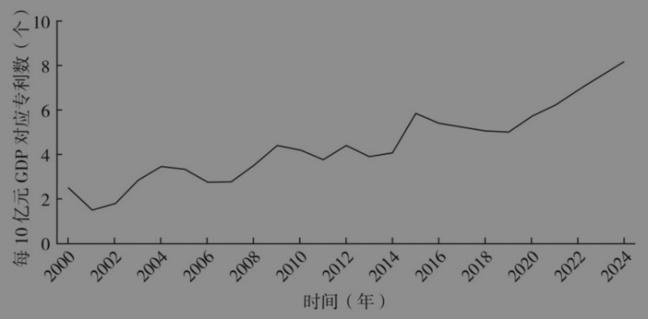

图2-1 2000—2024年我国发明专利数量/不变价GDP

资料来源：作者整理。

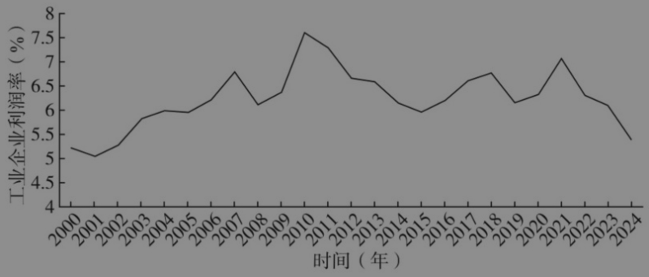

图2-2 2000—2024年我国工业企业利润率

资料来源：作者整理。

## 一 缘起：“三期叠加”

2013年，党中央提出我国经济处于增长速度换挡期、结构调整阵痛期、前期刺激政策消化期“三期叠加”阶段。

第一，增长速度换挡期。从2010年第一季度到2019年第四季度，经济增速持续下行，2013年之前快速下滑，之后趋于平稳（见图2-3）。

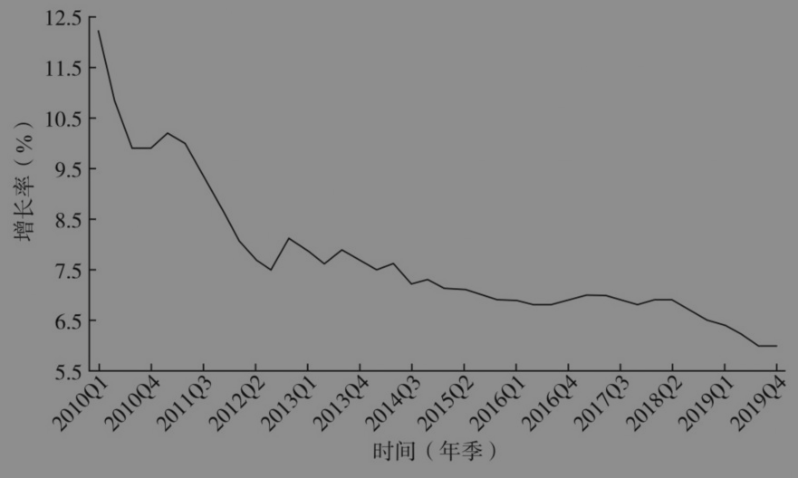

图2-3 我国季度年化经济增长率

资料来源：作者整理。

当然，经济学家对这个现象并不感到吃惊。成功经济体的劳动生产率的增长很有规律，可以利用这个规律来预测中国未来劳动生产率增长的潜力。图2-4中的纵轴代表某个经济体劳动生产率增速，横轴代表该经济体劳动生产率和当年美国劳动生产率的比值，从中推断该经济体的经济发展水平。可以看到，随着经济发展水平的提升，劳动生产率的最高增速在不断下降。图中显示4个亚洲经济体和14个欧洲经济体处于上边界，即使这些经济体取得成功，但随着经济发展水平的提升，其劳动生产率增速也在下降。

第二，结构调整阵痛期。一旦投资回报率下降，就需要调整结构。适度降低投资率并提升消费率，这种结构转型通常会带来阵痛。从2022年开始，阵痛变得更加剧烈。我们今天面临的很多问题，都是结构转型阵痛的体现。

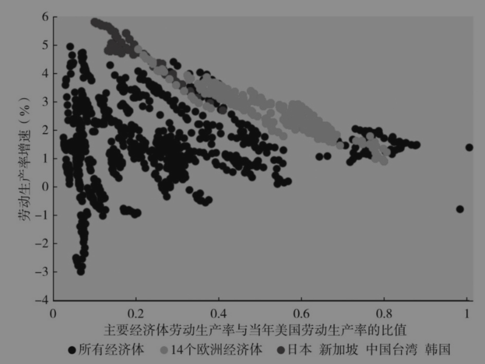

图2-4 劳动生产率增速与经济发展水平之间的关系

资料来源：作者整理。

第三，前期刺激政策消化期。如图2-5所示，中国的投资率历来比较高，为了应对2008年国际金融危机，我们推出一揽子计划（实际执行过程中远超4万亿元），投资率高达47%，超过G20其他19个经济体的投资率平均值（22%）的两倍。这样的投资率一定是不可长期持续的，之后确实开始慢慢下降。投资率下降是一个痛苦的过程。当年的一揽子计划主要包含以下内容：一是地震灾区恢复重建，二是基础设施建设投资，三是关键产业发展（包括钢铁、建材等）。在投资率下降的过程中，钢铁和水泥出现产能过剩。2015年党中央提出实施供给侧结构性改革，核心任务是“三去一降一补”。

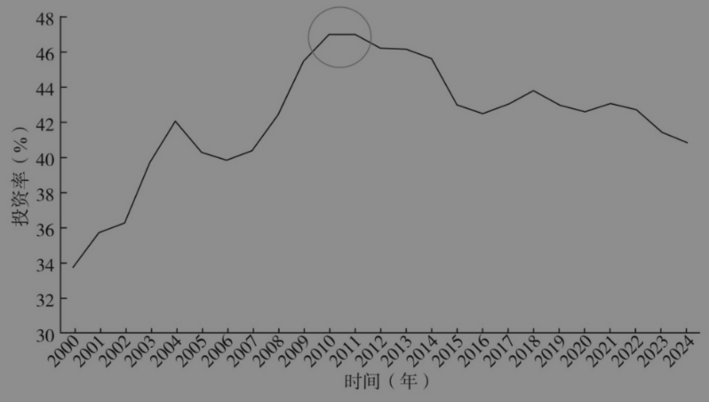

图2-5 2000—2024年我国的投资率

资料来源：作者整理。

从投资回报率来看，2008年之前基本围绕一条水平线波动，2008年之后围绕一条下斜线波动，总体是在不断下降的（见图2-6）。

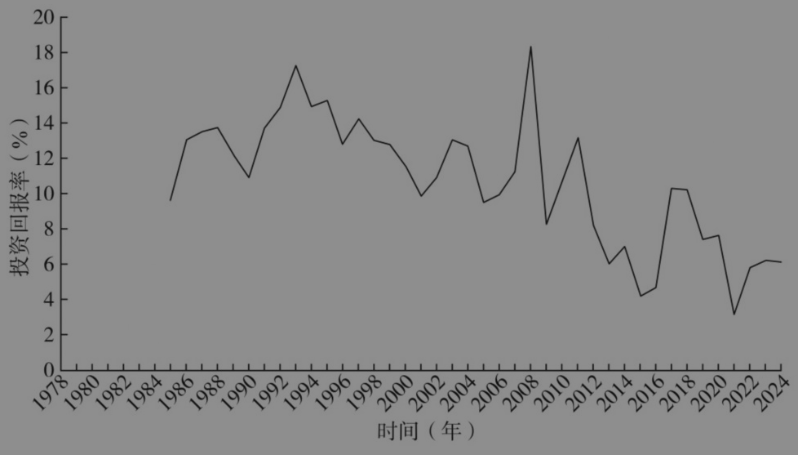

图2-6 1978—2024年我国的投资回报率（税后并且剔除价格因素）

资料来源：作者整理。

## 二 需求结构和供给结构的转型

### （一）需求结构的转型

#### 1. 需求结构：投资、消费、出口

根据GDP核算的支出法，GDP包括居民消费、政府购买、投资和净出口，我们可以从居民消费占比、政府消费占比、资本形成占比、贸易顺差占比来观察需求结构。2008年国际金融危机爆发时，我们已经进行了一次非常大的结构转型。2007年贸易顺差占GDP的比重为9%左右，在短短4年间，降到2011年的2%左右，外需大幅缩减（见图2-7）。有跌就有涨，贸易顺差下降后，投资上升到47%的高位；随后，投资逐步下降，消费有所上升。2015—2016年，消费占GDP的比重上升到39%左右，之后进入平稳状态。可见当时已经进行了一次结构性转型，虽然贸易顺差快速下降，但是投资和消费有一定的增长，进行了补充。

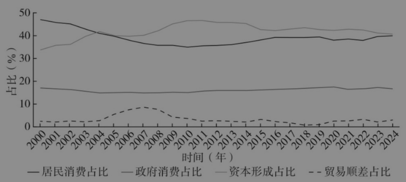

图2-7 2000—2024年我国的需求结构

资料来源：作者整理。

#### 2. 投资的情况

关于投资情况可以看两个指标，一是全社会固定资产投资增速，二是房地产投资增速。整体下滑的趋势在一定程度上和统计口径改变有关，2017年之前的数据来自CEIC数据库，2018年及之后的数据来自国家统计局。我更加关心两组数据之间的关系。2022年之前二者上下交织，2022年之后房地产投资明显下降，二者发生分离（见图2-8）。2022—2024年，房地产投资负增长10%，2025年前8个月比2024年同期负增长12%。是什么原因造成房地产投资突然出现负增长呢？有人认为“三道红线”（即2020年推出的重点房地产企业资金监测和融资管理规则）刺破了经济泡沫，但除此以外，还有其他方面的原因。

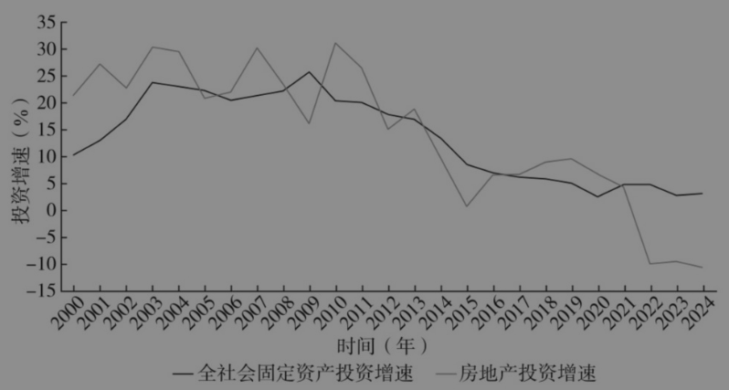

图2-8 2000—2024年我国的投资情况

资料来源：CEIC、国家统计局。

比较联合国《世界人口展望》报告在不同年份对中国人口的预测，可以看出人口变化超出预期（见图2-9）。一个很明确的变化是，2022年的人口预测和2019年有很大不同，虽然人口规模达峰以及之后的下降趋势没有变，但达峰的时间提前了，下降的速度加快。这几年我国人口出生率下降，有人说是因为现在生育年龄人口减少。从生育首个子女的平均年龄来看，一般男性是33岁，女性是30岁，如果倒退30～35年（也就是今天新生儿的父母出生的那段时间），当时正处于一个生育小高峰。30多年前的生育高峰为什么会变成现在的生育低谷？迄今为止还没有让人信服的研究结论。但这必然会影响人们的预期，如果人们预期30年后购房人口减少、住房刚需下降、房地产价格下降，那么他们现在的购房意愿就会下降。人口变化超预期，是造成房地产下行的根本原因之一。

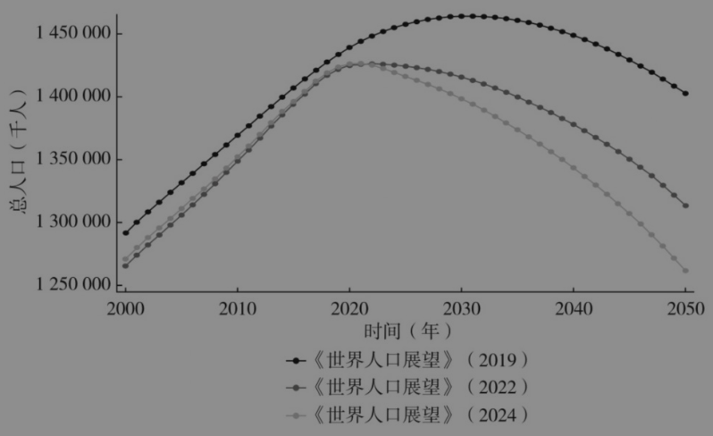

图2-9 不同年份《世界人口展望》对我国人口的预测

资料来源：作者整理。

另外，从开发商的角度看，如果开发商相信中国经济还能保持20年8%的增速，那么就会认为现在建完的房子都能卖掉。但如今的经济增速不是8%，而是5%，增速下降超出一些人的预期，这会造成房地产市场下行。房地产开发有周期，如果建完房子之后面临人口变化和经济增速换挡，房地产行业就会出问题。这种变化带来的影响是非常深入和广泛的，因为房地产行业的体量非常大，不考虑上下游的话，房地产行业的经济增加值占GDP的比重曾经超过8%，现在下降到6%，缩水了25%。

由于地方政府过于依赖土地财政，房地产下行带来土地财政下降，地方财政遇到困难（见图2-10）。当然还有其他困难，比如疫情期间财政收入减少，但财政支出并没有减少；再如在结构转型中地方政府增加一些债务，使地方的债务问题变得更加严峻。

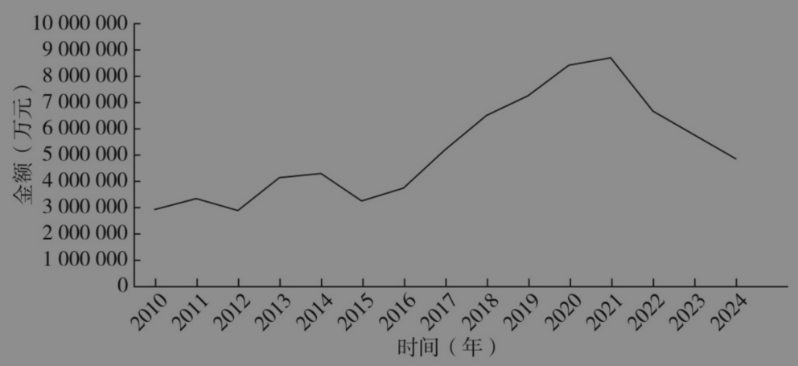

图2-10 2010—2024年我国土地财政情况

资料来源：作者整理。

从投资数据来看，2024年固定资产投资增长3.2%，其中房地产投资同比下降10.6%；基础设施投资同比增长4.4%，难以对冲房地产投资的下降速度；制造业投资同比增长9.2%，快于GDP的名义增长速度；房地产和基础设施投资减速后，制造业投资导向更强；全国工业生产者出厂价格同比下降2.3%。考虑到价格下降，制造业投资实质增速远高于GDP增速。由于产能增加速度快于需求增加速度，这就加剧了内卷。当实现增长的压力较大时，为了实现增长目标就要增加投资，而其他投资疲软就要增加制造业投资，制造业投资增加过快就会造成内卷，从而造成我们如今面临的两难困境。2025年1—8月的数据有较大变化，固定资产投资增长0.5%。其中，房地产投资同比下降12.9%；基础设施投资同比增长2.0%，制造业投资同比增长5.1%，全国工业生产者出厂价格同比下降2.9%，希望这样的改变能降低未来的内卷程度。

我国GDP占全球的17%～18%，制造业增加值占全球的30%。如果不考虑地缘政治、就业和制造业安全等因素，那么中国提供的物美价廉的商品本应受到全世界的欢迎，但现在更多的是抱怨，最后可能形成政治阻力，并对中国出口产品造成更高的贸易壁垒。我国制造业顺差占GDP的比重是10个百分点左右，这个比重是很大的，如果外需有较大变化，对我们的影响就会比较大。

从投资的情况来看，制造业投资增长过快会加剧内卷；地方政府基础设施投资受限于财力，效率不高；中央政府支持的基础设施投资受财力限制也比较弱，且效率未知，不好评估。

#### 3. 出口增长困难

中国提供的基础设施、绿色产品等可以为全球造福。但全球化遇到了巨大的阻力，包括地缘政治冲突、各国降低对外依赖度（所谓“增强经济韧性”）以及贸易保护（保护竞争力相对下降的产业）等因素。

#### 4. 居民消费需求不足，消费结构变化

居民消费占GDP的比重是39%～40%，应该稳中有增，但实际上并没有增加。同时消费结构也在变化，在总投资中增加较多的是制造业投资，形成制造业产能，但居民消费的增长不快，而且呈现服务消费占比上升、制造品消费占比下降的趋势（见图2-11）。在这种情况下，对制造品的需求不足以消化制造业的供给能力，投资效率就不高。

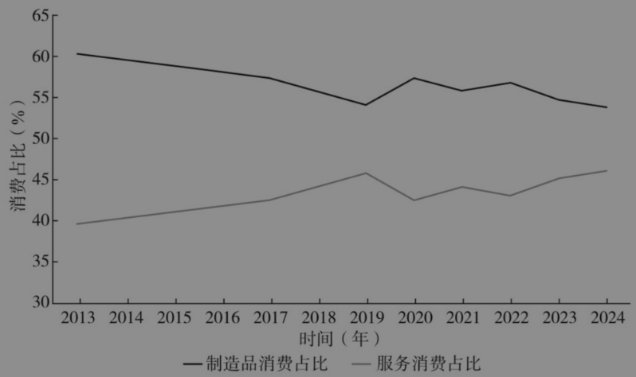

图2-11 2013—2024年我国的消费结构变化情况

资料来源：作者整理。

消费占GDP的比重是被低估的，因为对消费的统计是不足的，如虚拟租金，我们住在自己购买的房子里，这是一种消费，但是没有准确的数据进行核算。然而，在测算全社会的投资回报率时并没有使用消费数据，只看过去投资多少、折旧多少、价格如何变化，从而计算当前的资本总量和资本收入，估算结果不受消费数据被低估的影响。正如前面图2-6所示，2008年国际金融危机之后，全社会投资回报率是下降的。这是判断消费不足更加可靠的依据。

#### 5. 制造业供需不平衡

大量制造业投资产生了很强的供给能力，但需求不足，这包括房地产投资需求不足、基础设施投资需求不足、外部需求面临重重障碍、居民消费需求不足、消费结构变化等。在供需不平衡的情况下，无论是居民消费价格，还是工业生产者出厂价格，二者都显疲软。

我们在消费额10万亿元以上的行业中选择两个进行观察。一是汽车行业，2023年投资增长19.4%，2024年利润下降8%。二是电气机械和器材制造业（含电池），2023年投资增长32.2%，2024年利润下降2%。海关出口数据显示，2024年1—7月，我国太阳能电池出口物理量较2023年同期增长29.3%，但以美元计价的出口金额同期下降大约31.2%。

#### 6. 消费是未来可持续增长的主要来源

从居民消费占比来看，2008年之前有一段时间下降很快，2008年国际金融危机之后有所恢复，但2016年之后居民消费占GDP比重的增长有所停滞（见图2-12）。

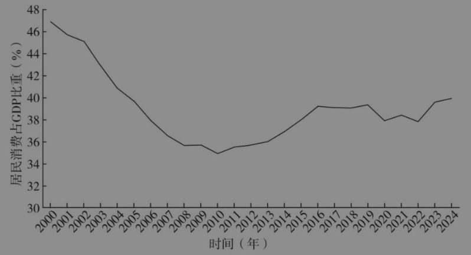

图2-12 2000—2024年我国居民消费占GDP的比重

资料来源：作者整理。

居民消费有很大的增长潜力，特别是在健康消费等领域。我国健康总支出占GDP比重、政府健康支出占GDP比重和政府教育支出占GDP比重，与全球处于相当发展阶段国家的平均情况相比都较低。中国人均预期寿命在不断提高，但与亚洲其他经济体（日本、新加坡、韩国、中国香港和中国台湾等）相比还有差距。

医疗消费不仅与居民福祉直接相关，对医药产业的长期高质量发展也有很大影响。2025年以来，多家医药企业出现原研药开发一半就卖掉的情况，引起广泛关注。带量采购等政策实施以后，药品价格大幅下降。开发原研药的企业认为新药上市之后价格太低企业会亏损，所以选择把开发一半的项目卖掉。原本中国在医药产业的整个价值链的竞争力都在变强，有潜力诞生一个在全球极有竞争力的产业，但价格和其他方面的限制可能影响这个潜力的实现。从医保相关部门的角度看，药品价格不能再上涨，否则收支缺口将进一步扩大，这是一个结构性问题。我们不仅需要，也可以不断完善健康保障制度，为医药产业实现其巨大潜力创造条件。

2025年《政府工作报告》中的重点工作，第一条就是“大力提振消费、提高投资效益，全方位扩大国内需求”。提振消费不是权宜之计，而是长期战略方向，它既包括降低外部需求方面的风险，也包括为创新提供市场，让创新更加可持续。

### （二）供给结构的转型

供给应该满足新的需求，要做大做优做强服务业，做优做强制造业。

尽管供给也会影响需求，但这样的影响不足以弥补幅度较大的供需不平衡，所以当出现这类情况时，既需要在需求侧发力以激发潜力，也需要调整供给以适应需求现状。通常对服务的需求有较大的增长潜力，所以我们一方面要努力清除服务需求增长的堵点，另一方面要将服务业做大做优做强，提高服务供给的能力。

## 三 经济治理的转型

我们需要什么样的治理转型来适应经济结构的转型呢？有两个方面值得注意：第一，怎样更好地提振消费；第二，高质量发展给治理带来哪些新挑战。

### （一）怎样更好地提振消费

#### 1. 为什么投资动力较大？

2011年以后，贸易顺差在GDP中的占比是2%左右，2025年稍有提高。在外需不振的情况下，消费和投资的关系是此消彼长的，提振消费的另一面是拉动投资。在我国的发展过程中，各级地方政府起到非常重要的作用，而地方政府更倾向于推动投资。首先，地方官员任期短且以增长为核心考核指标，愿意把更多精力放在拉动投资上。其次，地方官员关心财政收入，只有增加收入，才能有更多资源来实现施政目标。税收是财政收入的主要来源，其中重要的税种是增值税和消费税。从理论上来说，增值税是消费税，但从生产端征收，从而使增值税与生产端的关系变得更密切。从消费税来看，如我们到加油站加油，付给加油站的款项中有很大一部分是消费税，但消费税是从炼油厂征收的，与加油站所在地不相关。因此，主要的税收来自生产端而非消费端。无论是从政绩考核的角度看，还是从税收的角度看，地方政府都用较强的激励来推动投资，并发展本地生产。

政府也更容易通过投资来拉动经济。消费者有自主决策权，地方政府不能强迫消费者去消费，但可以动员国有企业去投资，从而吸引和支持其他企业去投资，政府对大项目保持高度关注，推动投资的抓手也更具体。

地方政府大力推动投资这种模式在短缺经济中得到良好运行。在改革开放之前，中国实行计划经济体制，因为供给不足，很多商品要凭票供应。在当时的短缺情况下，地方政府对投资的关注起到积极作用，生产很快发展起来。但当短缺不再是主要问题之后，即使投资能够促进增长，也会导致消费不足，还可能带来产能过剩的问题。当经济快速增长时，消化产能相对比较容易，如出现电力过剩，政府两年内暂停新建电厂项目，到了第三年电力就会短缺。但目前经济增长速度放缓，需求增长没有那么快，一旦出现产能过剩，就很难快速消化。

#### 2. 经济增长目标的影响

在房地产投资下降的情况下，为了保持一定的增长速度，我们加大制造业投资，但这又造成供需不平衡。有人说，增长目标设定高一点可以提振大家的信心，没有负面影响。我在前面说过，如果预期未来20年经济年均增速达到8%，那么开发商就会加大投资；如果实际增速只有5%，那么开发商建完的房子就很难都卖掉。因此，如果增长目标设定过高，可能就带来很高的成本。首先，投资效率低，为了达到过高的增长目标就需要进行更多投资。举例来说，全国有将近3 000个县，而太阳能组件企业超过3 000家，这些企业并不都是按照市场原则去投资的，有些是地方政府招商引资过来的。光伏行业存在一种极端现象，即开工之日就是倒闭之时。其次，金融风险加大。举个例子，地方政府有融资平台甲和融资平台乙，甲有一块价值1亿元的土地，它以2亿元的价格转让给乙。从“1亿元”变成“2亿元”，实现了1亿元的增值，GDP和税收都增加了，看上去没什么坏处。问题在于，乙向甲购买土地支付的2亿元是银行贷款，而土地作为抵押品的价值只有1亿元，这就会给银行带来风险。

#### 3. 相关研究观点

我在一篇研究论文中提出，部分行业的投资补贴可能抑制消费并降低效率。[^3]要想提振消费，首先要实现自上而下的理念转变，从投资驱动变成消费驱动。有人担心，变为消费驱动会让地方政府不重视投资。消费者是理性的，地方政府推动的低效率投资不能给他们带来信心，无法引导他们去消费。当消费者看到投资是高效率的，能够创造高质量的就业并带来稳定的收入时，他们就有信心去消费。所以，把居民消费作为主要指标，并不会让地方政府不重视投资，反而会引导地方政府推动更高效率的投资。

#### 4. 经济治理要更加重视消费

居民消费是一个重要的指标，不仅能拉动消费，更是促进高质量发展的指标，前提是把指标体系理顺。

消费需求受很多因素的影响，包括就业机会、家庭收入、老龄化保障、医疗保险，以及通过优化教育等公共服务减轻家庭负担。在教育方面，我国9年义务教育成绩显著，3～6岁儿童的入园率高达90%，但0～3岁儿童的入托率不足6%（OECD成员国3岁以下的幼儿平均入托率达到35%）。现在我国生育率降低，有人建议实施一次性生育奖励2万元，其实很多国家的经验已表明，这种政策收效甚微，不如对幼儿教育阶段免费更有效。为了鼓励各级政府加大支持与民生密切相关的公共服务，我们建议在统计口径上把政府公共支出的这部分纳入居民消费的统计。

另外，制造品消费也有很大的增长空间，如中国每千人汽车保有量约为200辆，而大部分东亚经济体的这一数据为七八百辆。提升这样的消费需要增加居民收入、保障居民就业。当然，相对于制造品消费，服务消费的成长空间更大。

从消费供给来看，一是提高消费服务质量，如年轻的父母对托儿所不放心，宁肯让爷爷奶奶在家带孩子，这就属于供给的问题；二是改善营商环境，与制造业相比，服务对营商环境的依赖更大。

地方政府要发挥关键作用。研究发现，一个国家的服务业发展与其制度有密切关系，所以我们要不断地改善营商环境。很多消费服务是由公共部门提供的，或者深受公共政策的影响，如教育、医疗、养老等，其中大多属于地方层面。此外，消费创新还需要更大的政策空间。

#### 5. 完善全口径消费统计制度

以消费为导向的指挥棒需要高质量的消费数据来支撑，现有的统计数据还不能达到这个要求。2025年《政府工作报告》提出，要“完善全口径消费统计制度”。居民消费支出的数据不包含实物社会转移，不能全面反映居民的实际消费。《中国统计年鉴》提供居民实际最终消费的数据，既包含居民消费支出，也包含居民收到的实物社会转移，这是一个更好的指标。“居民消费支出”和“居民实际最终消费”都没有分地区的数据，难以作为地方政府的考核指标。建议统计部门发布各地的居民消费支出和居民实际最终消费数据，以利于将指挥棒调整为消费导向。“社会消费品零售总额”和“服务零售额”有市一级的数据，但没有县一级的数据。还有一个问题是，线上销售按照网店的经营所在地统计，不能如实地反映各地的消费。因此我们建议统计部门对线上销售按消费发生地进行统计，并且统计到县一级。在现有的数字技术背景下看，这样的完善措施应该是可行的。

#### 6. 改革与消费相关的税收制度

增值税和消费税都是基于消费的，如果将这两种税的征收都下移到消费地，那么征收难度就会加大，甚至会导致比较严重的偷税漏税问题。如果继续在生产环节征收，但将收入按各地消费比例分配，则会推动各地促进居民消费。要做到这一点，前提是需要可靠的消费统计。

### （二）高质量发展给治理带来哪些新挑战

#### 1. 经济结构的转型——从高速增长转向高质量发展

在高速增长阶段，增长速度的确是一个测度指标。从高速增长转向高质量发展，如果没有一套完整的衡量高质量发展的指标体系，或者说这个指标体系特别复杂，就会给治理带来挑战。单目标的治理和多目标的治理，其难度是不同的。高质量发展是一个极具挑战性的治理目标，从经济角度看，高质量发展有丰富的内涵，包括效率与创新（新质生产力和新质生产关系）、以人民为中心（先富促共富）、人与自然和谐（绿色转型）、统筹安全与发展（防范化解风险）等。

从效率来看，它在不同时期起到的作用各有不同，效率提升对GDP的贡献有的阶段大一点，有的阶段小一点。但在未来，主要贡献一定来自效率的改善。从表2-1可以看出，人力资本要素的贡献占比在下降，但（物质）资本产出比的贡献占比一度达到41%，我们曾经对它特别依赖，但这是不可持续的，最重要的是提高全要素生产率。

表2-1 不同阶段的经济增长核算：各要素对GDP增长的贡献占比

| 时间段 | GDP增长率（%） | 人力资本贡献占比（%） | （物质）资本产出比贡献占比（%） | 全要素生产率贡献占比（%） |
| --- | ---: | ---: | ---: | ---: |
| 1978—2007 | 10.06 | 35 | 4 | 61 |
| 2008—2015 | 8.68 | 19 | 41 | 40 |
| 2016—2019 | 6.65 | 19 | 20 | 61 |
| 2020—2024 | 4.88 | 26 | 14 | 59 |

资料来源：作者整理。

表2-1 原图

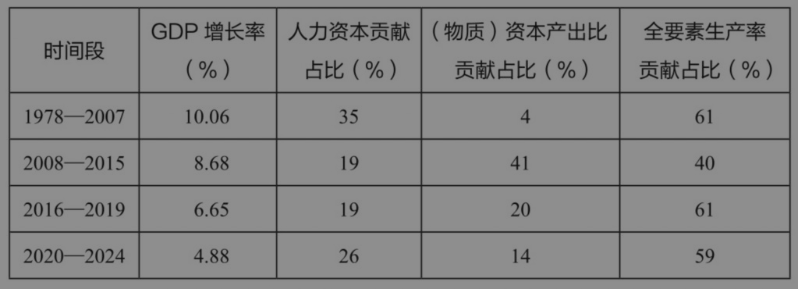

#### 2. 高质量发展下的经济治理：科技创新与效率

中国企业的创新能力令世界刮目相看。科技创新是提升消费的必要条件，但不是充分条件，由此引出两个问题。

第一个问题：我们的创新是否取得了经济效益？答案是“不全是”。没有创新一定不行，有了创新不一定行。“新三样”曾是我们引以为傲的领域，但太阳能电池和电动汽车行业的经济效率都不理想；光伏产业一度是全世界最有竞争力的，但光伏企业不赚钱，也不是我们的目标。一般情况下，企业投资是基于市场的自主决策，当出现普遍亏损时，一部分企业就会退出。如果退出渠道不畅，问题就会长期存在。如果企业投资一块钱，其中有一部分是由政府支付的，那么企业在核算时就会低估投资成本，造成过度投资和内卷的问题。强调市场在资源配置中起决定性作用，在一定程度上可以解决这些问题。在进行创新的时候，企业投资以市场为导向，如果市场预期未来可以盈利，企业就投资；如果行业出现过剩，企业就退出。创新和效率密切相关。

第二个问题：我们的创新潜力是否得到了充分发挥？答案是“没有得到充分发挥”。这里仍以原研药为例，中国在医药行业具有极大的发展潜力，很多研究团队在前半段的研发非常出色，所以出售半成品时有人愿意买。应该说前半段更难，但到了后半段，如临床试验等，我们是得心应手的。为什么后半段不在中国进行？一种担心是我们的医药产品价格管制方式使创新得不到足以覆盖成本的回报，进而制约创新的可持续发展。

简言之，我们要重视发展新质生产力，但是新质生产力需要有与之相适应的新质生产关系，否则创新不一定带来经济效益。

#### 3. 创造条件，让创新能够取得商业上的成功

虽然企业本身对创新很重要，但在有些情况下，政府也可以通过财政支持对创新起到推动作用。但当产业发展到一定阶段以后，持续的补贴就会带来产能过剩。我通过下面图2-13来分析。

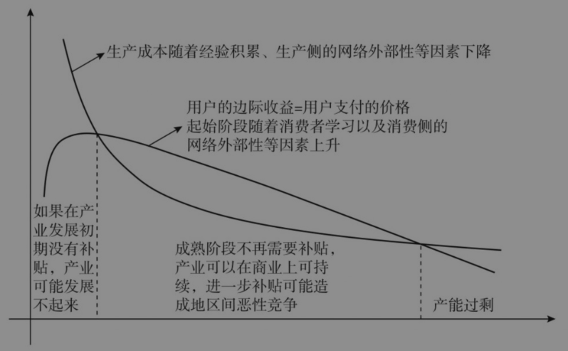

图2-13 生产成本与用户收益随产业累计产量的变化

资料来源：作者整理。

图中有两条曲线，其中一条呈单调减的走势，可以视为生产成本随着生产量的提升不断下降。过去10年，电动汽车、太阳能电池等行业的发展都符合这个走势，刚开始时成本很高，随着不断学习并积累经验，以及叠加规模效应，成本开始下降。

第二条曲线是产品给消费者带来的收益。这条曲线不是单调增或单调减的，而是开始时上升，之后下降。消费侧也受网络外部性因素的影响，一旦规模大了，单位产品对消费者的价值可能随之提升。以电话为例，如果你有幸成为世界上唯一有电话的人，那么这部电话对你而言仅仅具有炫耀价值，因为当其他人都没有电话时，你也打不了电话。只有当其他人也有电话时，你的电话才会更有价值。这种情况就叫作网络外部性。

电动汽车刚进入市场时也遇到过同样的问题，消费者只能在家附近安装充电桩进行充电，其他地方没有更多充电桩，因此充电不方便，而且当时人们对于电动汽车的安全性也有很大疑虑。随着电动汽车消费者的增多，充电桩越来越多，使用起来才更加方便。此外，随着人们对安全的疑虑开始减少，也愿意支付更高的价格来购买电动汽车。当发展到一定阶段时，特别喜欢电动汽车的（消费者）已经完成消费，其他消费者的支付意愿就不那么高了。

从两条曲线来看，某些产业在发展初期，单位生产成本高于消费者愿意支付的价格，这时需要补贴企业才能生存。每个国家都会出现这种情况，如特斯拉曾在发展初期遇到销售疲软的问题，当时美国联邦政府进行了一定的补贴。当然，有的产业（通常聚集于平台产业）没有国家补贴，而是由资本市场提供长期支持，但像电动汽车、太阳能电池这些相对集中度不高的产业，资本市场不可能持续支持，一般由政府提供支持。

在两条曲线的第一个交叉点发生之后，生产成本低于价格，这时政府不应继续支持，否则就会越过第二个交叉点，价格低于生产成本，造成产能过剩。关于产业政策有很多争论，应该说不同阶段的产业政策起到的作用也不同，在第一个阶段要实施产业政策，但在第二个阶段要停下来，这是一个难题。成功的经验是对产业支持设有时限，如支持5年，之后再看发展状况。如果不设时限，就可能造成产能过剩。产业创新需要政府支持，但当发展到一定阶段之后，政府的支持就要及时退出。何时启动、何时叫停，这对治理提出了新要求，是一个巨大的挑战。

#### 4. 新阶段对监管和市场体系的需求更强

数字智能经济比传统经济更加难以监管，因为数字智能产业更加复杂。

电力系统的绿色发展需要更加完备的市场体系。传统电力系统以火电为主，是很稳定的，24小时烧煤以持续发电；而新的电力系统以新能源居多，发电是间歇性的，如太阳能、风能等会受到天气和季节性因素的影响。因此我们要建立新型电力市场，包含电力价格体系，鼓励绿电生产高峰时多使用绿电，鼓励投资储能和其他调峰手段，此外还要与碳市场连接。

关于养老，如果居家养老，那么谁来照顾老人？效率如何？如果集中养老，到时候年轻人不多，那么谁来提供养老服务？有人认为只要提供足够多的养老金就行了，其实人们在乎的不仅仅是养老金，更是养老金能购买什么服务。在提供养老服务的问题上，要通过制度设计给人们一定的预期，以降低不确定性。这涉及市场与政府之间的分工以及监管问题。

#### 5. 高质量发展需要高质量的治理体系

在1978—2007年，中国经济以年均10.06%的速度增长，每7年翻一番，30年增长20倍。如果参照经济学教科书的定义，当时中国的一些制度并不完善，为什么仍然能够实现快速增长呢？一项研究认为，制度完善是一件任重道远的事，但在这个过程中，我们通过特事特办解决了一些问题。在追求经济增长时，特事特办不难做到，因为企业的利益与政府的利益是一致的；但在推进高质量发展时，政府的目标与企业并不完全一致，如治理污染，企业希望成本越低越好，而政府希望污染越少越好。政策目标的多元化使特事特办更加困难，也使规则制定更加困难。特事特办与高速增长目标需要更加相容。

#### 6. 治理体系的现代化

要把握创新和监管的平衡，防止监管捕获并考虑企业的合理诉求。要加强监管能力，包括决策方式和决策能力。要做好沟通（事前、事中与事后）与预期管理。要解决多部门政策不一致的问题，形成更好的协调机制。要促进监管者和被监管者之间更加有效的沟通，使监管变得更加合理。另外，科学的监管需要大批专业人才，我们在培养监管人才方面存在很大不足，这也是亟须解决的问题。

#### 7. 未来还有较大的增长空间

我国人均GDP按照市场汇率计算是美国的1/6，按照购买力平价计算是美国的1/4，因此还有很大的增长潜力，后发优势仍然存在。如表2-2所示，我们估算“十五五”期间，我国GDP区间平均潜在增长率是5.09%，到2050年，我国人均GDP大约是美国的一半，GDP总量大约是美国的1.6倍。这个增长潜力是在假设国际环境良好、国内经济处于长期稳定状态等前提下估算的，要实现这个潜在增速会面临巨大的挑战，但我们仍然预计中国的经济增速将高于发达国家的平均经济增速。

表2-2 我国经济增长潜力预测以及中美经济差距预估

| 时间段 | 区间平均潜在增长率：GDP（%） | 区间平均潜在增长率：人均GDP（%） | 期末相比2020年累计增长：GDP（%） | 期末相比2020年累计增长：人均GDP（%） | 期末中国相当于美国的水平：GDP（倍） | 期末中国相当于美国的水平：人均GDP（倍） |
| --- | ---: | ---: | ---: | ---: | ---: | ---: |
| 2026—2030 | 5.09 | 5.36 | 68.43 | 71.79 | 1.35 | 0.34 |
| 2031—2035 | 4.23 | 4.60 | 107.15 | 115.09 | 1.48 | 0.39 |
| 2036—2040 | 3.17 | 3.64 | 142.11 | 157.13 | 1.54 | 0.43 |
| 2041—2045 | 3.06 | 3.63 | 181.48 | 207.34 | 1.60 | 0.46 |
| 2046—2050 | 2.53 | 3.27 | 218.96 | 260.93 | 1.62 | 0.49 |

资料来源：作者及其团队整理。

表2-2 原图

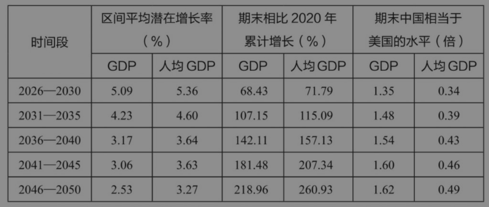

很多国家由于没有创新能力而落入中等收入陷阱，但中国企业具有很强的创新能力，我们要想办法把这些创新能力激发出来，由此产生经济效益。我们现在面临的很多问题，在很大程度上是结构转型带来的阵痛。我们要有信心，因为我们有发展潜力，并且能够应对挑战。现阶段我们正处于转型的阵痛期，只要通过改革化解风险，成功度过这一阶段，就能实现比较稳定的增长。

[^1]: 本章根据2025年10月9日长安讲坛第429期的内容整理而成。

[^2]: 白重恩，中国经济50人论坛学术委员会成员、清华大学经济管理学院院长。

[^3]: Chong-En Bai, Qing Liu, and Wen Yao, “Earning Inequality and China's Preferential Lending Policy”, Journal of Development Economics, Volume 145, 102477, 2020.
