# 第八章 “扩中、提低”的战略与实现路径[^1]

<!-- 按来源截图8-1.png至8-6.png顺序整理；阅读器导航与装饰分隔线已省略；正文恢复为可复制文本；图表保留原图，存于img目录；注释恢复为Markdown脚注。原始截图位于本书“原始图片”目录，便于核对。截图中的观点、提问和引文均为书籍内容。3张表另恢复为Markdown表格。 -->

李实[^2]

我长期从事收入分配领域研究，至今已有30余年。2021年浙江大学成立共享与发展研究院，我受邀担任研究院院长。该研究院主要研究共同富裕的理论与实践问题，实现共同富裕的关键在于破解收入分配失衡、促进社会公平正义，因此研究院的研究领域涵盖共同富裕、收入分配与社会保障。其中，“扩中”（扩大中等收入群体）与“提低”（提高低收入群体收入）是我们重点攻关的研究课题。今天，我就围绕这一课题，梳理我们研究院的相关研究成果。

## 一 “扩中、提低”的背景

### （一）共同富裕战略目标的提出

党的十九大报告提出，到2035年“全体人民共同富裕迈出坚实步伐”，到21世纪中叶“全体人民共同富裕基本实现”。党的二十大报告提出，“中国式现代化是全体人民共同富裕的现代化”。党的二十届四中全会进一步提出“十五五”时期经济社会发展必须“坚持人民至上”，“以满足人民日益增长的美好生活需要为根本目的”，“加大保障和改善民生力度”，“扎实推进全体人民共同富裕”。自党的十九大以来，党中央的一系列会议都在强调推进共同富裕，这是一个很重要的背景，而“扩中”和“提低”正是推进共同富裕的重要内容。

共同富裕的基本内涵包括两个层面。第一个层面，“富裕”。蛋糕要做大，人民生活水平要提高。富裕目标可以分解为三个重要变量：一是居民收入水平高，二是居民财富多，三是公共服务优。这三个变量决定了人民的生活水平和福祉水平，为人民能力发展提供条件。第二个层面，“共享”。人与人之间是有差距的，包括收入差距、财富差距、享有基本公共服务的差距等，要尽可能地缩小这种差距。缩小差距不是搞平均主义甚至打土豪、分田地，而是要实现一个公平合理的差距。

### （二）“三大差距”及其变化

党的十九届五中全会提出，到2035年，城乡区域发展差距和居民生活水平差距显著缩小。

2021年，中共中央确立浙江为共同富裕示范区，将缩小“三大差距”（城乡差距、地区差距、收入差距）作为推进共同富裕的主攻方向。在缩小“三大差距”方面，浙江省这几年取得很大成效，但从全国范围来看，缩小“三大差距”仍面临很大挑战。

#### 1. 城乡差距

首先要说明，中央提出的城乡差距不仅仅是收入差距，而是整体上的发展差距，体现在收入、人力资本积累、财富积累、公共服务质量等多个方面。

先看城乡收入差距。图8-1是改革开放40多年来中国城乡居民收入比，2008年之前，城乡收入差距持续扩大，并在2008年达到历史高点（当时城镇居民收入是农村居民收入的3.3倍）；2008年之后，城乡收入差距呈现持续和显著的缩小态势，直到现在仍在稳步收窄。城乡收入差距缩小，对于全国收入差距缩小起到重要的推动作用。

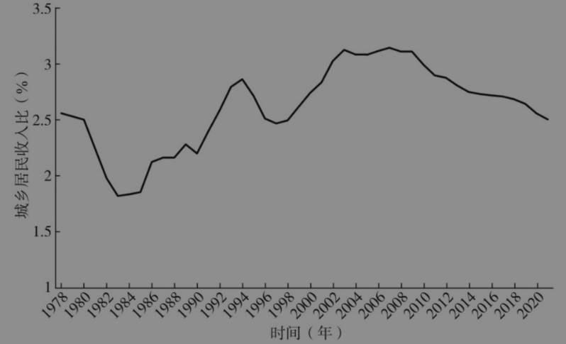

图8-1 中国城乡居民收入比（1978—2020）

资料来源：作者整理。

以2007—2013年的数据为例，我们对此做了相关的分解和分析。2007年，城乡收入差距对全国收入差距的解释力占比很高；到2013年，这一比重出现明显下降，反映城乡收入差距的变化主导着全国收入差距的走向。2007—2013年，组间数值大幅下降，说明城乡之间收入差距对全国收入差距的贡献率降低；而组内数值上升，说明同期城镇内部、农村内部的收入差距有所扩大，成为影响全国收入差距的重要因素（见图8-2）。

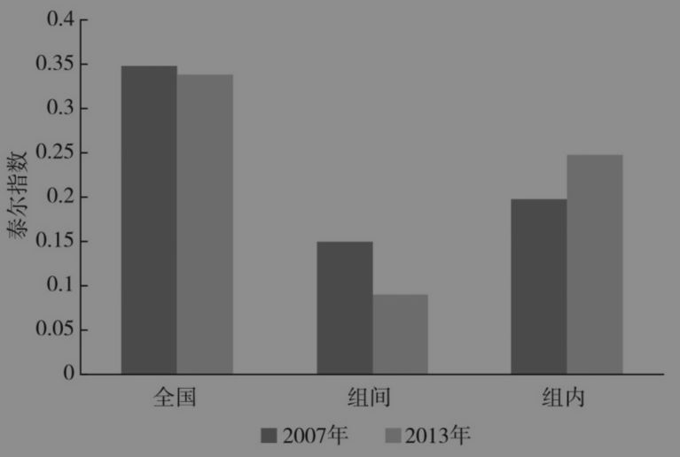

图8-2 2007年和2013年城乡收入差距

资料来源：作者整理。

#### 2. 地区差距

我们可以用人均GDP在一定程度上衡量各地区的整体发展水平差异。图8-3显示，从2020年全国各省、自治区、直辖市的数据来看，北京、上海的人均GDP显著偏高。如果剔除直辖市的数据，江苏人均GDP超过12万元，处于较高水平；浙江人均GDP虽然略低于江苏，但人均可支配收入高于江苏；而像甘肃这样的相对欠发达地区，人均GDP不足4万元，与江苏相差2倍以上。可见，我国不同地区之间的发展差距依然较为显著。

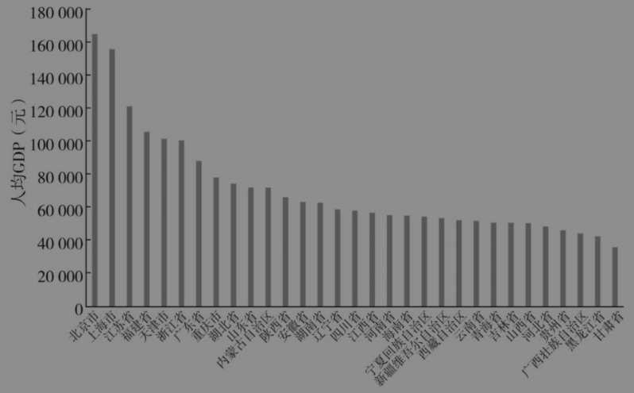

图8-3 2020年全国各省、自治区、直辖市人均GDP

资料来源：作者整理。

#### 3. 收入差距

图8-4反映出近20年来全国收入基尼系数的走势。2008年以前，全国收入基尼系数不断攀升，至2008年达到历史峰值0.491。从国际对比来看，全球基尼系数超过0.5的国家占比不足10%，绝大多数国家处于0.3～0.4的区间。2008年以后，全国收入基尼系数进入持续7年的缓慢下降阶段，这一变化主要由城乡收入差距缩小推动。但从2015年起，全国收入基尼系数呈现相对稳定的态势，始终在0.46～0.47的狭窄区间小幅波动。需要强调的是，这一“相对稳定”仍处于全球范围内的高位水平，这也正是我国明确提出缩小收入差距的背景之一。

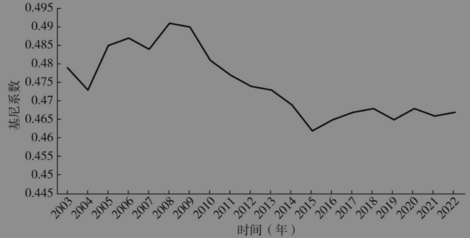

图8-4 全国收入基尼系数（2003—2022）

资料来源：作者整理。

### （三）推进共同富裕面临的主要挑战

#### 1. 第一个挑战

第一个挑战是两大难以抑制的扩大收入差距的因素，即财产分配差距急剧扩大和人力资本差异导致的工资差距效应不断强化。

##### （1）财产差距效应

回想30年前，大部分年轻人几乎没有个人财产，即便有少量存款，也不过几百元。当时，我的梦想是一年能攒下1000元存款。

21世纪以来，中国居民财富在20多年里实现快速积累。我从中国社会科学院经济研究所开始，后来到北京师范大学，再后来到浙江大学，一直致力于收入分配的研究。从1988年到2023年，在长达35年的时间里，我和我的团队先后开展了7次全国范围的居民收入调查，每隔五六年调查一次，覆盖收入、财产、消费等多个维度。我们的研究就是基于这些调查数据得来的。

以2002—2013年居民财富调查数据为例，这11年间居民净资产的年均实际增长率超过16%，增长显著住房净值年均增长率超过20%（见图8-5），而同期居民收入年均增速仅为7%～8%。多年来房价的大幅上涨直接推动居民财富的不断增值，使居民财富积累进入高速增长阶段。

居民收入由4个部分构成——工资性收入、经营性收入、财产性收入和转移性收入，而财产性收入占居民总收入的比重在一定程度上反映了财产分配格局，以及财产增长对居民收入增长和收入分配的影响。拥有财产便会产生相应的财产性收入，而财产性收入作为总收入的重要组成部分，通过这一传导机制作用于整体收入增长和收入分配结构的变化。

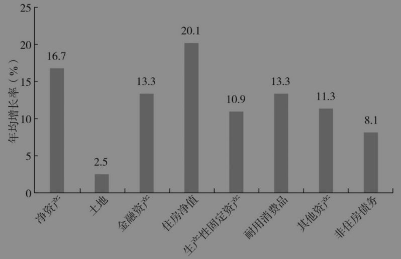

图8-5 中国居民财富年均增长率（2002—2013）

资料来源：作者整理。

2003年，居民财产性收入占比仅为2%左右，城镇居民收入占比没有明显差距（见图8-6）。此后，伴随着居民财富的快速积累，财产性收入实现大幅增长。2023年，城镇居民财产性收入占可支配收入的比重已超过11%，而农村居民收入的这一比重相对较低，核心原因在于农村居民的财产积累相对薄弱。财产性收入的快速增长对居民收入增长和收入分配产生了重要影响。

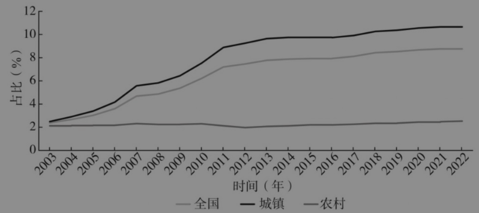

图8-6 中国居民财产性收入占家庭收入的比重（2003—2022）

资料来源：作者整理。

此外，居民财富分配差距也在持续扩大。我们按财产总量从低到高将全体居民排序，平均划分为10个组（每组人数占比相同），从中观察各组所拥有的财产占全社会总财产的比重。图8-7为2002年和2013年按十分位分组的家庭财产份额（%）。2002年，财产最少的10%群体，其财产份额仅占全社会总财产的1%；而财产最多的10%群体，财产份额高达37%，这意味着最富的10%与最穷的10%，两个群体财产差距达到36倍。到了2013年，财产差距进一步扩大。财产最少的10%群体的份额从1%降至0.4%，财产最多的10%群体的份额则从37%上升至48%，两组差距高达120倍。2013—2018年，财产差距持续扩大。2018—2023年，虽然差距扩大幅度有所缩小，但整体仍呈上升态势。

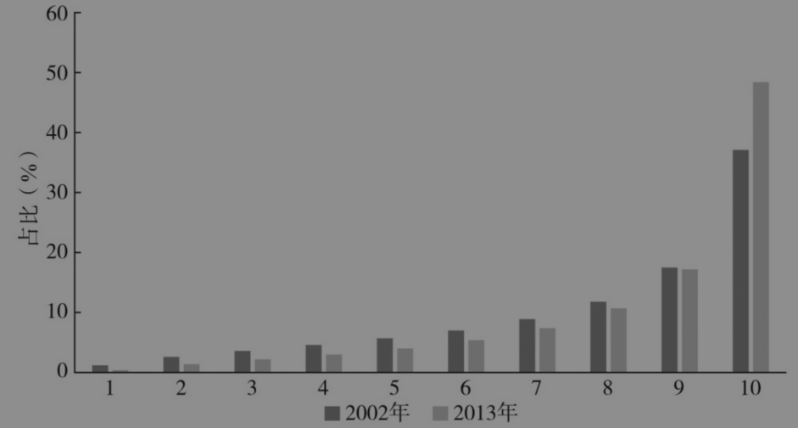

图8-7 2002年和2013年不同分组的家庭财产占比

资料来源：作者整理。

财产差距的扩大必然会加剧收入差距。高收入群体与高财产群体高度重合，收入水平越高，越有能力积累更多财产，而财产积累越多，越能通过财产性收入进一步推高总收入，由此形成一种循环。反过来，收入差距扩大也会进一步拉大财产差距，二者相互强化，这正是我们当前面临的关键问题。如果不能有效遏制财产分配差距扩大的趋势，即便加大收入再分配政策的力度，收入差距仍可能继续扩大。

##### （2）人力资本效应

所谓人力资本，指的是劳动者通过教育、技能培训、工作经验等积累的知识与能力。近年来，随着人工智能、数字经济的兴起，各类新兴产业快速发展，这些产业对高素质人力资源有着极大的需求，为了吸引顶尖高校的青年才俊，为他们提供了优厚的薪酬待遇（虽尚未达到美国硅谷的薪资标准，但在国内就业市场中已具备显著竞争力）。我经常往返于杭州与北京，在高铁上总能看到不少青年从业者随身携带电脑，旅行全程都在进行编程等工作，跨城市流动办公已成为他们的常态。这种现象反映了市场对高素质人力资本的需求，而这一需求直接推动了人力资本（或教育）收益率的持续上升。

图8-8是不同学历人群相对工资的变化趋势，数据来源于我和我的团队多年的调查。以高中学历人群的相对工资为基准（设定为常数），其余学历人群的工资水平均与这一基准进行对比。从整体趋势来看，不同学历人群的相对工资呈现明显的“喇叭形”扩散特征，即高学历人群的相对收入不断上升，而低学历人群的相对收入不断下降。

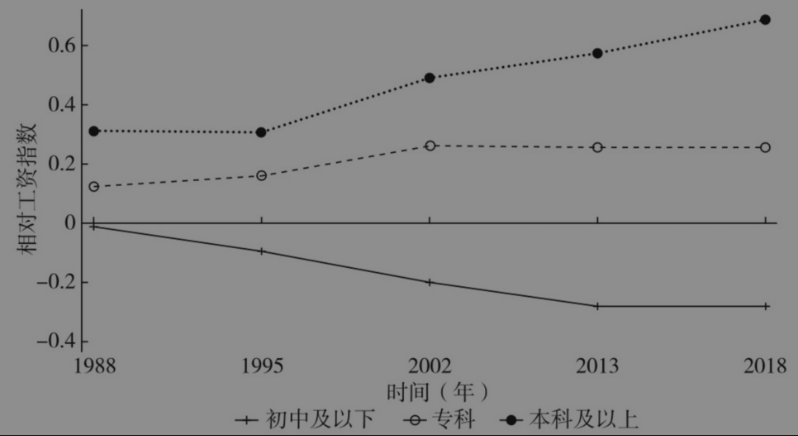

图8-8 我国不同学历人群相对工资的变化（1988—2018）

资料来源：作者整理。

为突破直观观察的局限，我们引入国际前沿的分析方法，对工资差距进行分解研究。首先，测算城市职工工资差距的基尼系数，如1988年约为0.27，2018年上升到0.4以上；其次，把基尼系数分解到不同的影响因素，包括教育、性别、工作经验、省份、企业所有制等变量。我们重点观察学历差异对收入差距的影响，分解结果显示，1988年学历差异能够解释工资差距基尼系数的2.3%。这与时代背景有关，改革开放之前我国提出缩小“三大差别”，即缩小工农差别、城乡差别、体力劳动与脑力劳动差别。特别是缩小体力劳动与脑力劳动差别，当时人们认为脑力劳动者工资过高，因此通过制度和政策压低了教育的收益率，即便接受过高等教育的人也并未获得更高的薪酬，这使学历差异带来的收入差距较小。2018年，学历差异可以解释工资差距基尼系数的18.34%。需要说明的是，我们这项研究中的学历变量并未考虑“985”“211”高校与普通高校的教育质量差异。即便如此，我们仍然发现学历差异对收入分配非常显著的影响。

总的来说，我们还没有相应的政策能够弱化财产差距效应和人力资本效应，这两大因素仍会对收入差距扩大起到明显的推动作用，这是我们当前面临的第一个挑战。

#### 2. 第二个挑战

第二个挑战是提高经济增长速度。

共同富裕的长期目标包括富裕目标和共享目标。2019年以前，我们对富裕目标关注得不多，当时普遍认为，如果能长期保持8%以上的经济增长率，30年后就能基本解决富裕问题，到那时我国居民收入将达到发达国家水平。因此，当时我们的研究重点更多放在共享目标上，也就是如何缩小差距。近年来，我国经济形势发生显著变化，对共同富裕两个目标的重视程度要随着经济形势的变化加以调整。事实上，中央对共同富裕的目标已有明确的设定：到2035年，我国人均GDP达到中等发达国家水平，收入差距明显缩小；到2050年，我国人均GDP赶上发达国家水平，收入差距更加明显缩小

要实现2035年达到中等发达国家水平的目标，首先需要明确当前中等发达国家的发展水平。“中等发达国家”这一概念，在国际上并无明确界定。国内之所以提出这个概念，是因为中国式现代化采取分步分阶段推进的策略，每个发展阶段都需要确立对应的参照系。5年前制定相关发展目标时，考虑到短期内直接追赶发达国家的难度较大，于是提出“中等发达国家”这一介于发展中国家与发达国家之间的参照层级，为阶段性发展划定了更具可行性的目标。从实际发展水平来看，中等发达国家尚未达到发达国家的标准，但其人均收入水平显著高于我国。

根据相关测算，2020年中等发达国家人均GDP的平均值为33650美元，最低值为25059美元（爱沙尼亚）；而我国2020年的人均GDP约为10500美元，与中等发达国家之间存在明显差距。如果2035年我国人均GDP达到25000美元（中等发达国家最低值），需要年均名义增长6%；达到33650美元(中等发达国家平均值），需要年均名义增长8%。这一增长目标的实现还要建立在人民币对美元汇率相对稳定的基础上。如果人民币兑美元贬值，就需要更高的增长率；如果人民币兑美元升值，年均增长3%～4%即可实现目标。

基于以往的增长率，我们可以预测2035年中等发达国家人均GDP的平均值为52400美元，最低值为39000美元。相应地，如果2035年中国人均GDP达到39000美元，需要年均名义增长9.1%；若要达到52400美元，需要年均名义增长11.3%，这无疑具有很高的难度。2010年以后，我国经济发展进入新常态，经济增长不再维持过去的高速水平，而是呈现逐步放缓的态势。近年来，受到疫情、外部环境冲击等多重因素的影响，我国经济增长率保持在5%左右。

消费需求不足没有得到扭转。2024年中期，社会消费品零售总额增长率一度在2%左右，在“以旧换新”政策的刺激下，出现一年的增长期（超过6%），2025年7、8月又回落到4%以下（见图8-9）。要从根本上扭转消费需求不足的态势，需要进一步探索更有长效性的解决方案，加大促消费的政策力度。

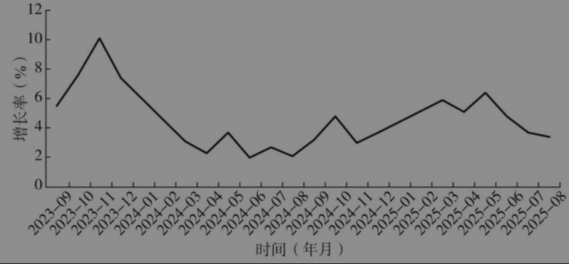

图8-9 我国社会消费品零售总额增长

资料来源：作者整理。

2019年以来，我国经济增长率徘徊在5%左右。根据OECD的预测，2026年中国经济增长率将下降到4.4%。从近期的增长来看，前景并不乐观。

#### 3. 第三个挑战

第三个挑战是居民和财政收入增速下降。图8-10显示的是2019年以来我国居民收入增长率与消费增长率的变化。

可以看出，居民收入增长率和消费增长率基本同步，通过短期刺激是很难改变消费行为或提高边际消费倾向的。所以提振消费的一个很重要的条件就是增加收入，如果没有增加收入的话，刺激政策只能发挥短期效应，不可能长期化。

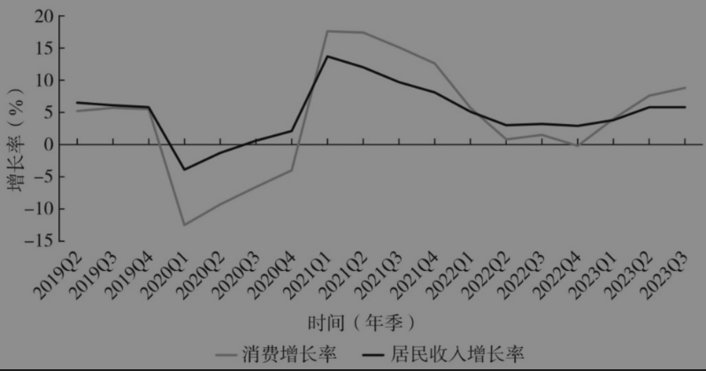

图8-10 我国居民收入与消费增长率

资料来源：作者整理。

我们对入户调查数据进行了分析，重点观察两个5年周期的居民消费增长率，同时关注不同收入组的收入增长情况，具体结果见图8-11。

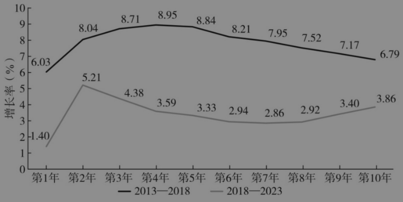

图8-11 我国两个5年周期的居民消费增长率

资料来源：作者整理。

在第一个5年周期（2013—2018），无论是低收入人群还是高收入人群，年均实际收入增长率均保持较高增速；收入最低的人群，其收入增长率超过6%，这一水平相当可观；收入最高的人群，其收入增长率接近7%；最关键的是中等收入人群，其收入增长率接近9%，高于低收入人群和高收入人群。在这一个周期内，中等收入人群的规模在扩大。

在第二个5年周期（2018—2023），收入最低的人群受到的影响最大，其年均实际收入增长率仅为1.4%。当经济面临冲击、遭遇危机或陷入衰退时，低收入人群往往是最先受到波及的群体，相关数据也印证了这一现象；收入最高的人群，其收入增长不及前一周期，但仍高于低收入人群；中等收入人群的收入增长率降至3%以下，与前一周期“增长最快”的表现形成鲜明反差。要说明的是，虽然中等收入人群的收入增速放缓，但这只是相对增长速度的变化，还不能得出“中等收入人群规模在缩小”的结论。

从投资来看，图8-12显示，过去一年我国固定资产投资主要依靠预算资金和相关投资，而外企投资出现大幅度下滑，民间投资出现负增长（-20%～-10%）。投资增长动力不足，反映的是民营企业投资信心不足的问题。在这种情况下，如何保证经济持续稳定增长，是我国当前面临的一个很大挑战。

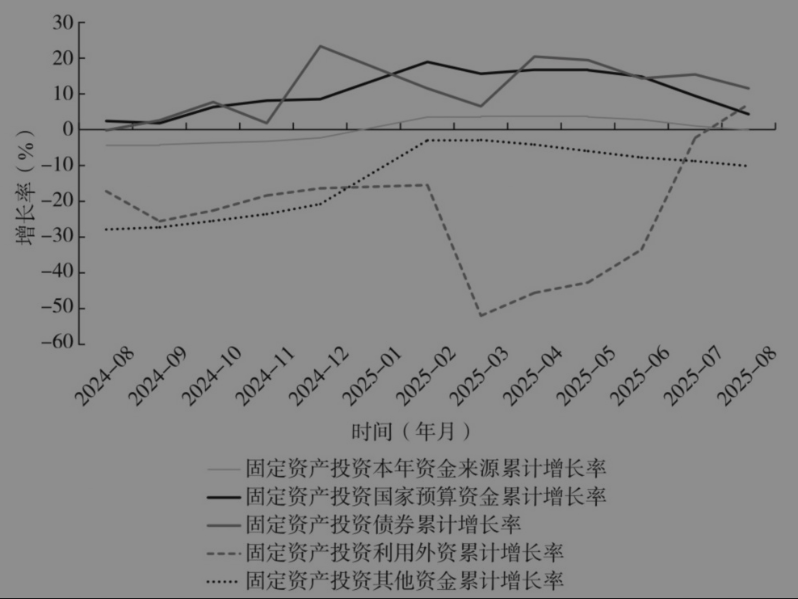

图8-12 固定资产投资不同资金来源增长率

资料来源：作者整理。

从就业来看，图8-13显示，全国城镇调查失业率从2024年底的5%上升到2025年8月的5.3%；25～29岁劳动力的失业率从6.6%上升到7.2%；16～24岁劳动力的失业率从16%上升到19%，创一新高。如何稳定就业，成为一个重要问题。

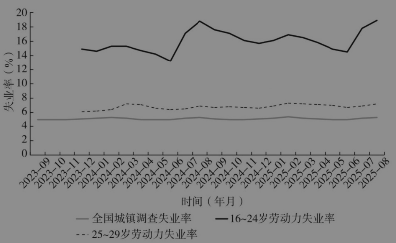

图8-13 2023年9月—2025年8月全国城镇调查失业率

资料来源：作者整理。

## 二 中等收入人群的划分标准及其基本状况

要分析如何“扩中”和“提低”，首先要搞清楚中等收入人群是怎么划分的。

### 1. 绝对标准与相对标准

世界各国都开展过中等收入人群的界定工作，且基本上采用两类标准——绝对标准或相对标准，这与贫困测量标准的逻辑类似。

发展中国家大多采用绝对标准，如每人日均收入在10～100美元，绝对标准一般由世界银行、亚洲开发银行等国际机构制定。我曾在几年前参加亚洲开发银行举办的会议，当时的核心议题是讨论发展中国家中等收入人群的界定标准。根据亚洲开发银行提出的方案，对于发展中国家而言，每人日均收入在10～100美元就被界定为符合中等收入人群的标准。按当时的汇率换算，10美元约合人民币70元。我提出这一标准偏低，因为如果按此计算，我国不少农民工将被纳入中等收入人群，如装修小工（日均收入约120元）和装修大工（日均收入可达240元）的日均收入明显高于70元的下限。亚洲开发银行的专家认为我的视角更多聚焦于中国，而全球许多发展中国家的经济发展水平较低，对于这些国家而言，10美元的日均收入已属于较高水平。亚洲开发银行提出的标准是否合理，我在这里不展开讨论。总的来说，绝对标准是发展中国家界定中等收入人群的主流选择。

发达国家大多采用相对标准。首先确定一个国家、地区或特定人群的收入中位数（把所有收入数据从高到低排序后，位于中间位置的收入数值），然后把收入中位数的60%作为中等收入的下限，把收入中位数的200%～300%作为中等收入的上限，收入落在下限和上限之间的人群被界定为中等收入人群。相对标准会随着收入中位数的变化而变化，当经济增长带动居民整体收入提高时，收入中位数会随之上移，中等收入的上下限会同步提高；反之，如果收入中位数下降，中等收入区间也会相应下调。

要注意的是，在相对标准下，中等收入人群的规模与收入差距直接相关，但与收入增长关系不大。如果收入差距不缩小，即便居民平均收入水平提升，中等收入人群的占比基本也不会发生变化，因为收入分布的相对结构未变，只是整体区间随中位数上移而已。只有收入差距缩小，中等收入人群的规模才可能扩大。如果采用绝对标准，当一个国家经济持续增长时，居民收入稳步提升，那么中等收入群体的规模就会不断增加；如果采用相对标准，在收入差距没有缩小的前提下，即便收入提高，中等收入人群的规模也会保持稳定，基本不会发生变化。

### 2. 我国采取的标准

我国采取的是绝对标准。根据国家统计局的界定，按照2018年的价格水平，三口之家（标准家庭）年可支配收入在10万～50万元人民币的为中等收入人群，或者家庭年人均收入在33333元～166667元的为中等收入人群。为什么我国采用绝对标准，而不是相对标准呢？从实际效果来看，这一绝对标准能清晰呈现中国在经济增长、居民收入水平提升的过程中，中等收入人群的规模正不断扩大，这恰恰是决策者期望达成的目标。或许存在这样一种认识：当一个国家中等收入人群的规模更大、占总人口比重更高时，往往被认为其文明程度或发展程度相对更高、社会更加稳定。当然，这一标准并非一成不变，当将其应用到其他年份和地区时，需要根据物价指数和购买力指数进行调整。

总体而言，这一标准已得到默认。“中国拥有全球规模最大的中等收入人群，数量有4亿多人”，其统计依据就是上面所说的绝对标准。

### 3. 我国中等收入人群的规模和结构

在上述标准的界定下，我国中等收入人群的规模有多大成为大家普遍关心的问题。我们用2018年的数据测算的结果是，我国中等收入人群占比不到30%。中等收入人群的规模偏小，低收入人群仍然是全社会的主体（见图8-14）。

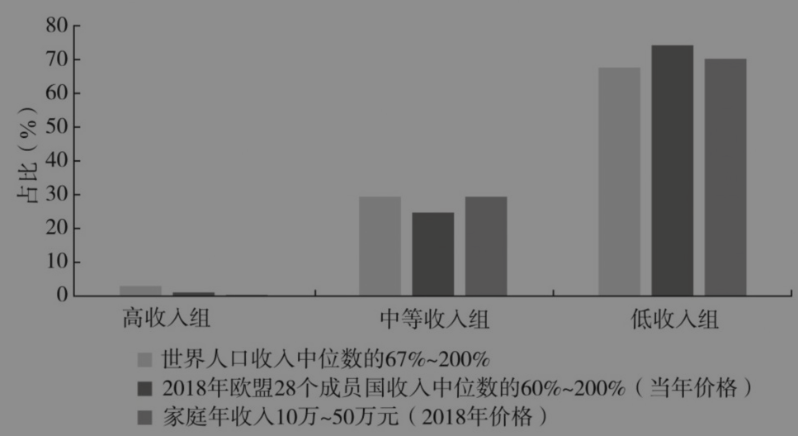

图8-14 2018年世界、欧盟与我国不同收入组规模对比

资料来源：作者整理。

2021年我们用新的数据重新测算，结果是中等收入人群占33%左右，与2018年相比，大概每年增加1个百分点，这得益于经济增长和收入增加，但比重仍然偏低。从结构上看，农村中等收入群体比例更低，2018年不足10%

从表8-1可以看到近些年我国中等收入人群占比的变化过程。尽管2018年测量得出的中等收入人群占比并不是很高，但相较于过去，其增长趋势十分明显。1995年，全国中等收入人群占比仅为0.24%，不足1%；2002年，突破1%，达到1.55%；2007年，接近10%；2013年，进一步提升至25.35%；2018年，增至29.40%。可见，我国中等收入人群占比不仅持续上升，而且增幅很大。原因很简单，在中等收入标准保持不变的前提下，如果居民收入增长，自然会有更多人进入中等收入区间。从城乡对比来看，1995年城镇中等收入人群规模不足1%，农村地区99%以上的人口属于低收入人群，中等收入人群占比非常低。以上数据反映了我国中等收入人群从规模微小到逐步壮大的变化过程。

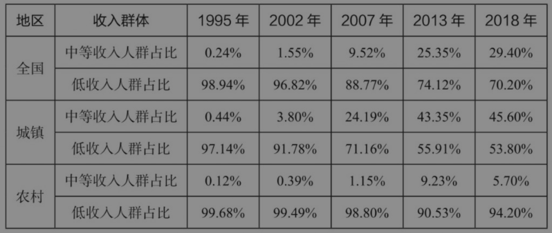

表8-1 我国中等收入人群占比的变化

| 地区 | 收入群体 | 1995年 | 2002年 | 2007年 | 2013年 | 2018年 |
| --- | --- | --- | --- | --- | --- | --- |
| 全国 | 中等收入人群占比 | 0.24% | 1.55% | 9.52% | 25.35% | 29.40% |
| 全国 | 低收入人群占比 | 98.94% | 96.82% | 88.77% | 74.12% | 70.20% |
| 城镇 | 中等收入人群占比 | 0.44% | 3.80% | 24.19% | 43.35% | 45.60% |
| 城镇 | 低收入人群占比 | 97.14% | 91.78% | 71.16% | 55.91% | 53.80% |
| 农村 | 中等收入人群占比 | 0.12% | 0.39% | 1.15% | 9.23% | 5.70% |
| 农村 | 低收入人群占比 | 99.68% | 99.49% | 98.80% | 90.53% | 94.20% |

资料来源：作者整理。

## 三 低收入人群的标准界定与相对贫困

在收入分配改革中，我们不仅要推动“扩中”，还要着力“提低”，而“提低”的前提是如何科学地识别低收入人口。国家统计局曾对外公布中等收入人群的划分标准，但对低收入人群并未提供一个绝对的界定标准。我和我的团队从逻辑上进行合理推导：当中等收入人群的收入区间确定后，那些家庭收入未达到该区间下限的群体，从性质上而言就应归为低收入人群。以此为标准推算，2021年我国低收入人群占比约为65%，这一群体中有相当大的比例分布在农村地区。

尽管低收入人群缺乏绝对的划分标准，但不少学者参考国家统计局发布的中等收入人群标准，依然推算出低收入人群的界定依据。由此，一个关键的问题随之产生：低收入人群与贫困人口是否属于同一个概念？答案是否定的，二者在内涵上存在明显的差异。2020年中国向世界宣布消除了贫困，有关表述十分严谨，强调这是“消除了一定标准下的贫困”。这意味着当时消除的是“低于特定贫困标准（或贫困线）的贫困人口”。由此可见，贫困标准的设定至关重要，如果标准定得过高，就难以消除贫困；如果标准定得较低，就能更早地实现“消除贫困”的目标。上述标准是在2010年制定的，与当时一些国际机构倡导的标准（世界银行提出每人每天2美元的贫困标准）比较一致。正是在这一标准下，我们消除了绝对贫困。而世界银行的贫困标准是动态调整的，随着全球社会经济发展和整体收入水平提升，贫困标准也逐渐上调。如果按照世界银行最新的贫困标准来衡量，中国目前仍存在一定规模的绝对贫困人口。更需要明确的是，消除绝对贫困并不意味着消除相对贫困。相对贫困在任何一个社会都存在，只要有收入差异，就会有相对贫困，相对贫困无法消除，但可以缓解。

关于相对贫困，我们此前已开展过相关研究，重点之一就是测算中国相对贫困人口的规模。我曾担任国务院扶贫开发领导小组专家委员会委员，承担相关课题的研究。按照专委会的设想，在消除绝对贫困后，国家扶贫战略需要转向缓解相对贫困，我们围绕这一主题做了大量研究工作。

相对贫困标准的设定通常与居民收入中位数挂钩，不同国家的标准存在差异，欧洲国家一般将其设定为收入中位数的60%，也有国家设定为50%甚至40%。基于现有的数据和研究方法，我们对相对贫困人口规模进行了推算。根据表8-2所示，以2021年为例，如果以收入中位数的40%作为相对贫困标准，农村相对贫困发生率为23.6%，对应的贫困人口规模超过2亿，而城镇贫困发生率不到4%，贫困人口约1500万。如果将标准提高为收入中位数的50%，农村贫困发生率上升至33.9%，贫困人口规模超过3亿。由此推算，中国相对贫困人口规模在2亿～3亿，这与通过低收入人口标准测算的低收入人群规模存在较大的差别。

我们可以将“相对贫困人口”理解为低收入人群中收入水平最低的群体。结合具体收入标准来看，这一群体大致对应月收入不足1000元的人群，2021年我国这一群体规模约为3亿人（见表8-3），因此可以将这部分人大致视为相对贫困人口。低收入人群是规模更大的群体，其范围涵盖低于中等收入下限的所有群体；而相对贫困人口是低收入人群中的极低收入群体，占低收入人群的20%～30%。以2021年的数据为例，月收入不足1000元的约为3亿人，这3亿人基本上可以划入相对贫困人口。

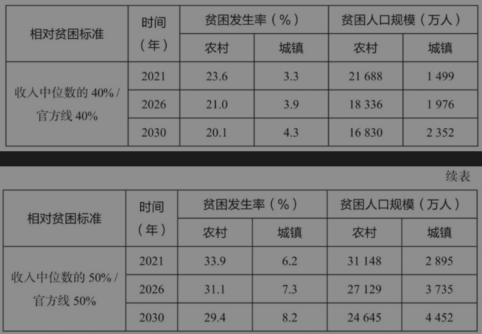

表8-2 相对贫困标准下的贫困发生率和贫困人口规模

| 相对贫困标准 | 时间（年） | 农村贫困发生率（%） | 城镇贫困发生率（%） | 农村贫困人口（万人） | 城镇贫困人口（万人） |
| --- | --- | --- | --- | --- | --- |
| 收入中位数的40%／官方线40% | 2021 | 23.6 | 3.3 | 21 688 | 1 499 |
| 收入中位数的40%／官方线40% | 2026 | 21.0 | 3.9 | 18 336 | 1 976 |
| 收入中位数的40%／官方线40% | 2030 | 20.1 | 4.3 | 16 830 | 2 352 |
| 收入中位数的50%／官方线50% | 2021 | 33.9 | 6.2 | 31 148 | 2 895 |
| 收入中位数的50%／官方线50% | 2026 | 31.1 | 7.3 | 27 129 | 3 735 |
| 收入中位数的50%／官方线50% | 2030 | 29.4 | 8.2 | 24 645 | 4 452 |

资料来源：作者整理。

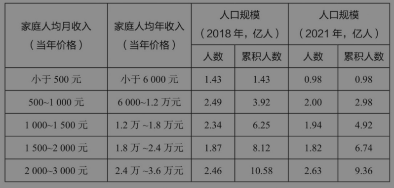

表8-3 不同收入群体的人口规模

| 家庭人均月收入（当年价格） | 家庭人均年收入（当年价格） | 2018年人数（亿人） | 2018年累积人数（亿人） | 2021年人数（亿人） | 2021年累积人数（亿人） |
| --- | --- | --- | --- | --- | --- |
| 小于500元 | 小于6 000元 | 1.43 | 1.43 | 0.98 | 0.98 |
| 500～1 000元 | 6 000～1.2万元 | 2.49 | 3.92 | 2.00 | 2.98 |
| 1 000～1 500元 | 1.2万～1.8万元 | 2.34 | 6.25 | 1.94 | 4.92 |
| 1 500～2 000元 | 1.8万～2.4万元 | 1.87 | 8.12 | 1.82 | 6.74 |
| 2 000～3 000元 | 2.4万～3.6万元 | 2.46 | 10.58 | 2.63 | 9.36 |

资料来源：作者整理。

## 四 “扩中”的重点方向

“扩中”的路径大概有三种。

### （一）稳定现有中等收入人群的收入增长

中等收入标准是年收入10万～50万元，这是一个跨度很大的区间。在中等收入人群中，年收入在10万～20万元的占很大比例，这部分人刚刚越过低收入线，进入中等收入人群行列。他们大多就业于个体或私营企业等私有部门，就业和收入存在很大的不稳定性，部分人享受不到像城镇居民那样完善的社会保障和公共服务，未来生活存在很大的不确定性。一旦遭遇失业、收入下降等情况，他们很容易从中等收入人群退回低收入人群。这种脆弱性源于他们尚未具备足够的能力、财力与条件来维持收入稳定增长，哪怕外界因素的轻微冲击都可能导致其收入下滑，他们是中等收入人群中的脆弱群体。

首先要稳定这部分脆弱人群的就业和收入，否则就难以推动低收入人群进入中等收入人群，中等收入人群的规模也难以实现稳定增长。一种有效的办法是通过减负来稳定中等收入人群，在教育、医疗和养老保障等方面要增加公共投入，减轻中低收入人群的支出负担，从而保障他们的生活水平不断改善。

### （二）识别和瞄准中等收入人群的潜力人群

中等收入人群规模的扩大，关键在于促进低收入人群的收入不断增长，使其逐步进入中等收入人群。低收入人群的收入区间跨度很大，收入较低者月收入仅约500元，而收入较高者已接近中等收入人群的标准。在实施扩大中等收入人群的战略中，应该识别低收入人群中最有潜力成为中等收入人群者，并对其采取更加有针对性的扶持政策。

需要强调的是，这并不意味着放弃那些短期难以进入中等收入人群的人，而是从政策制定的科学性出发，政策需要进一步细化，针对不同群体的实际条件与需求来提供更多的支持，政策才能真正落地见效。具体来说，如果能够得到有效支持，低收入人群中约有20%的人，经过三五年的努力，有望进入中等收入人群行列。对于这部分群体，政策的关键在于精准破解他们当前面临的收入瓶颈，是职业技能、就业环境还是其他现实障碍？只有找准问题、定向发力，才能推动这部分群体的收入尽快提升，从而起到扩大中等收入人群的效果。

我们尤其需要关注农民工群体。从实际情况来看，农民工的收入并非普遍偏低，尽管仍有部分农民工面临较大的生活困难，但多数具备一定技能的农民工，其个人收入已基本达到中等收入人群的标准。不过，如果将他们的收入纳入家庭总收入，按家庭人口计算人均收入，其经济状况仍会显得紧张。对于这部分农民工而言，最关键的是提升城市的包容度，让他们能够平等享受市民化待遇，从而获得更稳定的收入，真正实现向中等收入人群的跨越。

### （三）产业升级与增加人力资本投资

中等收入人群规模的扩大，本质上是伴随经济增长的过程。而经济增长要推动这一目标实现，需要解决两个方面的问题。一方面，从对劳动力需求的角度来看，要创造更多的高收入就业岗位，这类岗位的供给主要依赖产业升级、技术进步以及各类新兴产业的发展。只有当企业在产业升级与技术创新中产生对高素质劳动力的需求时，高收入就业岗位才能持续涌现，为中等收入人群的形成提供基础支撑。另一方面，从劳动力供给角度来看，要培养足够多的高素质、高人力资本的人才，以满足高收入就业岗位的需求。高技能人才的储备要靠长期的人力资本投资，包括高等教育的不断普及、专业人才培养体系的完善等。这两个方面都是不可缺少的，如果都能做好，中等收入人群的规模扩大就是自然而然的过程。

## 五 构建“提低”的制度与政策

这几年我一直在关注“提低”的问题。在研究共同富裕问题的过程中，我发现很多政策建议其实是不切实际的。在提高居民整体收入、提升发展水平、提高创新能力等方面，我们可以提出很多思路，但更重要的是关注低收入人群。我国低收入人群规模庞大，大约占总人口的2/3。这一群体未来的收入增长情况、生活富裕程度，在很大程度上决定了我们能否真正实现共同富裕。试想一个国家仍有大约50%的人月收入仅有（甚至不足）2000元，如果宣称实现了共同富裕，恐怕既难以让外界信服，也无法让我们自己认同。

这样来看，当务之急是把低收入人群的收入提上来。通过不断提升这一群体的收入水平，使他们的收入增长超过社会平均水平，这样逐步缩小收入差距；同时，在保持一定经济增长速度的前提下，再经过10～20年的持续努力，我们将完全有能力实现共同富裕的目标。我对实现共同富裕很有信心。大家可以去浙江看一看，浙江在推动共同富裕、改善低收入人群生活方面做得非常好。既然浙江能做到，其他省份也能做到。只要方向正确、措施得当，我相信我们一定能实现这一目标。

低收入人群规模庞大，总人数超过8亿，家庭人均月收入跨度从500元到3000元，如果采取“一刀切”的单一政策，显然难以起到实际效果。因此，针对低收入人群，我们要构建一套相对完整的制度与政策。

### （一）“赋能”：加大对低收入人群的人力资本投资

低收入人群收入偏低，在很大程度上是因为其发展能力不足，而这种能力短板往往与过往接受的教育相关，他们没有获得足够多的人力资本投资。相关研究及人口普查数据显示，我国农民工群体中80%以上为初中毕业生。如果仅依靠现有的知识技能让这一群体实现收入持续提升、劳动生产率提高乃至技术创新，显然并不现实。因此，赋能变得非常重要。我们要对现有的劳动力进行培训，通过再学习、多渠道积累工作经验等方式，帮助他们提升技能、增加人力资本。但更关键的是将重心放在他们的下一代身上，为低收入人群的子女提供更公平、更合理的受教育机会，让他们能享受优质的教育资源。只有这样，这些孩子未来的处境才有可能好于父辈。

一是未来加大对教育的投资，更加向低收入人群倾斜，缩小教育机会的差距。实践中存在一个规律：当教育投资总量不足时，教育资源往往更集中于发达地区，因为发达地区的话语权更强，更容易获得资源；只有当教育投资持续增加时，落后地区、农村地区、少数民族地区等才能通过“滴漏效应”共享资源。当前多地已在推进教育资源均衡分配，帮助困难家庭的孩子及弱势儿童获得公平的机会，这是一个好的开端。

二是教育投资从婴幼儿抓起，加大对婴幼儿的喂养及学前教育领域的公共投资。过去婴幼儿养育常被视为家庭私事，现在国际社会已达成共识，儿童的发展不仅是家庭的责任，更是社会与政府共同的责任，因此公共政策要重点关注这一群体。这一点对中国而言尤为重要。在许多落后地区，我们能明显看到不少年轻的母亲缺乏科学的育儿知识，她们甚至不清楚如何正确喂养孩子。对此，中国发展研究基金会多年来持续推进儿童家访项目，在落后地区招募家访员（其职责类似“育儿嫂”），让她们每个学期定期入户，教孩子一些基础知识，更重要的是向家长传授科学喂养方法和儿童辅导技巧。国际社会高度重视这类婴幼儿发展支持工作，我们也要切实做好这一领域的工作，关键在于在这方面加大公共投资。

三是实施针对相对贫困家庭的儿童营养补贴方案。目前相关工作已在推进，旨在通过专项补贴改善这类儿童的营养状况，保障其健康成长。

四是实施儿童的免费体检和免费医疗政策，提高儿童的健康水平。从当前我国的财政收入与经济实力来看，我国完全有能力承担这一政策的费用支出。政策落地以后将重点惠及低收入家庭，特别是农村地区的儿童。这是“投资于人”战略最有代表性的体现。

五是实施农村落后地区义务教育教师的特殊补贴举措，吸引高质量师资。提升农村教育质量，需要着力解决优质师资流失问题。当前优质师资呈现从农村向城市、从小城市向大城市、从西部向东部的转移趋势，农村落后地区难以吸引和留住优秀教师。对此，我们建议由政府出台特殊补贴及配套政策，提高农村落后地区教师的待遇与保障，吸引高质量师资扎根，从根本上改善当地教育资源的配置。

六是义务教育从现在的9年扩展为12年或13年。我国现行的义务教育制度与当前发展水平已不适配，许多发展中国家已实行12年甚至更长年限的义务教育，我国也应该扩展义务教育年限，可以考虑往前扩一年（将学前教育的最后一年纳入义务教育），以及往后扩三年（将义务教育延伸至高中阶段教育）。

七是健全终身职业技能培训制度，对低收入人群等重点群体给予培训补贴。对于许多低学历劳动力来说，让他们重新去接受正规教育显然是不太现实的，提高他们技能的最有效的办法就是参加技能培训。对于劳动力来说，接受培训是有益的，这可以提高劳动生产率、提升技能、带来更高的工资收入，但参加培训也是要有付出的，不仅要缴纳培训费，还要承担机会成本（因参加培训失去的收入）。这对于低工资劳动力来说是一种艰难的选择，在培训费用过高或者机会成本过高的情况下，他们往往不愿意参加培训。如果实行免费培训或培训补贴制度，就可以激励他们参加培训。我们更应该看到，提高低学历劳动力收入最有效的途径是提高他们的技能和劳动生产率，这样提高他们的收入才具有可持续性。

### （二）“平权”：给低收入人群提供更多的创收机会和条件

低收入人群收入偏低不能简单归因于个人能力，很多农民工，特别是具备专业技能的农民工，能力十分突出。但是，由于制度和政策尚未完善，这一群体未能获得应有的公平对待。因此，为低收入人群创造更加公平的发展条件和机会十分重要，这也是我们全面深化改革的重点领域。

一是促进充分就业，实施就业优先政策，提供更多就业机会。历史经验表明，在经济危机和衰退带来失业增加的情况下，首先受到影响的是低收入人群，他们往往是第一受害者，而且缺乏抵御失业风险的能力，失业会导致他们的生活陷入困境，使他们成为贫困人群。因此，保持充分就业的状态，特别是劳动力市场出现供不应求的局面，首先要关注的是低工资劳动力，在劳动力需求增长的情况下，使他们不仅没有后顾之忧，而且工资可以保持稳定增长。2008年之后的10年，是我国城镇农民工工资增长最快的时期。高速经济增长，特别是基础建设的大力投入，带来了更多对劳动力的需求，尤其是对低技能农民工的需求，从而拉动农民工的快速增长。

二是消除户籍制度的约束以及就业歧视性制度，实现劳动力市场的公平竞争；取消教育机会歧视制度，实现择学自由。城市中的农民工和外来人口大多属于低收入人群，在户籍制度和地方歧视性法规的约束下，就业、收入、社会保障、公共服务等方面都会受到不同程度的影响，收入水平和增长被压低。他们的子女在择学方面也受到限制，其中最令人困扰的是随迁子女不能在常住地参加高考，低收入人群往往是这些歧视性政策的直接受害者。现在迫切需要的是对这些政策加以清理，制定出取消时间，给低收入人群多一些机遇。

三是改革农村的土地制度，让农民获得更多财产性收入的机会。为什么城乡发展差距那么大？因为低收入人群绝大部分来自农村，而农民财产性收入的增长率长期处于极低水平。农民的可支配财产不多，唯一重要的资产是土地，却不具备完整的财产权。土地只能由农民自己耕种或使用，无法进入市场交易，这就意味着难以通过盘活资产实现增收，直接限制了农民财产性收入的增长。

在这一背景下，农村土地制度改革的必要性凸显，尤其是宅基地改革方面。我曾在几次会议中提及，农村土地制度改革可以先从宅基地改革入手，相较于耕地改革涉及的利益面更广、情况更复杂，宅基地改革的试错成本更低。

当前农村存在大量闲置住房，许多农民建好房屋后常年空置，却受限于制度而无法灵活处置。与此同时，不少城镇居民想体验田园生活，希望能在农村购置宅基地，建造心仪的住宅。如果能打通这一渠道，允许宅基地在规范框架下合理流转，那么既能盘活农村闲置资源，也能满足城镇居民的需求。

这种改革本质上是解决城乡资源流动的问题。城镇居民到农村居住，不仅能直接改变农村的人口结构与生活方式，更能带去城市的先进观念、多元文化与消费需求，这些都将成为推动乡村发展的重要动力。我一直强调，如果不能在土地问题上取得实质性突破，乡村振兴可能成为一个遥远的目标。土地制度不改革，社会资本就难以顺畅地进入农村；没有资本注入，农村特色产业就无从发展；缺乏产业支撑，就不可能吸引人才下乡。要破解农村发展困境、推进乡村振兴，首要任务就是解决土地制度改革问题。

### （三）善行：加大对低收入人群转移支付的力度

农村的低收入人群较多，不少家庭人均月收入不足1000元，一些家庭缺少劳动力，一旦受到疾病、自然灾害的冲击，就很容易陷入贫困。对于这类人群，“造血式”的帮扶效果往往有限，即便为他们提供就业机会，对于残疾人、孤寡老人和因病致贫的人群来说，又能真正获得多少就业机会呢？实际上，这类特殊群体的基本生活在很大程度上仍要依赖社会救济。目前我国的低保制度虽然承担兜底保障的职能，但实际覆盖范围和保障效果有待进一步完善，真正能被低保“兜底”的规模非常有限。有些地方为追求政绩，将“低保人数越少越好”视为工作成效的体现，因此制定了极为苛刻的低保申请条件，这样难免出现“漏保”的问题。

因此，我们要完善社会福利与社会救济政策，有针对性地帮助那些无劳动能力、因家庭特殊变故而陷入贫困的群体，不仅要保障他们的基本生存，更要让他们体面地生活，这是现代文明社会应有的担当。

其中特别需要强调的是农村居民养老金问题。北京、上海的养老金水平较高，这与其雄厚的地方财政实力直接相关。即便浙江这样的经济大省，农村老年人每月能领取的养老金也仅有200多元。我们知道，2010年我国制定的贫困标准是年收入5000元（折合月收入约417元），而现在浙江农村老人的养老金甚至低于10多年前的贫困线标准。当前农村养老金水平过低这一话题，在2025年两会以后成为社会热点，引发广泛讨论。正因如此，在2025年两会期间，不少专家纷纷发声，呼吁提高农村居民养老金水平。我也非常同意大幅提高农村居民的养老金水平，当然也有人不同意，认为他们的养老金待遇低是制度规定的，“合规合法”。对此，我是不认同的，只能说在制定农村居民养老金制度时，没有充分考虑到农村养老问题的复杂性和特殊性，导致其制度与实际脱离。

总之，解决低收入人群的保障问题，要通过不同的途径制定差异化政策，增强帮扶的针对性。只有精准施策，才能从根本上解决低收入人群的收入增长与生活保障难题。

[^1]: 本章根据2025年11月13日长安讲坛第434期的内容整理而成。

[^2]: 李实，中国经济50人论坛特邀专家、浙江大学共享与发展研究院院长。
