# 第四章 学习党的二十届四中全会精神的几点体会[^1]

<!-- 按来源截图4-1.png至4-6.png顺序整理；阅读器导航与装饰分隔线已省略；正文恢复为可复制文本；图表保留原图，存于img目录；注释恢复为Markdown脚注。原始截图位于本书“原始图片”目录，便于核对。截图中的观点、提问和引文均为书籍内容。 -->

杨伟民[^2]

2025年10月23日，中国共产党第二十届中央委员会第四次全体会议通过《中共中央关于制定国民经济和社会发展第十五个五年规划的建议》（以下简称《建议》），习近平总书记就《建议》起草的有关情况向全会作说明。

学习好贯彻好党的二十届四中全会精神，是当前和今后一个时期全党全国的一项重大政治任务。对此，我谈一谈我的学习体会。

首先，我谈一谈对《建议》基本逻辑的理解。一篇好文章，一定是逻辑严谨、层层贯通的。《建议》是对“十五五”时期经济社会发展作出的系统性、总体性的战略部署，有着贯通全篇的基本逻辑，具体体现在以下五个方面。

第一，逻辑起点是“两个推动”和“一个确保”。“两个推动”就是“推动经济实现质的有效提升和量的合理增长，推动人的全面发展、全体人民共同富裕迈出坚实步伐”。“两个推动”是为了“一个确保”，即“确保基本实现社会主义现代化取得决定性进展”。

第二，“两个推动”落在哪里？落在“经济增长保持在合理区间”，这是“两个推动”的具体目标。经济增长保持在合理区间，才能到2030年实现“人均国内生产总值达到中等发达国家水平”，从而基本实现社会主义现代化。

第三，如何使经济增长保持在合理区间？也就是说，新增的GDP从哪里来？《建议》在供需两端都作了明确部署。在供给侧，要发展新质生产力，建设现代化产业体系；在需求侧，要促进形成消费拉动的发展模式。《建议》提出“促进形成更多由内需主导、消费拉动、内生增长的经济发展模式”，这是一个新亮点。此外，在空间上要“发挥重点区域增长极作用”，“支持经济大省挑大梁”。

第四，坚持全面深化改革和扩大高水平开放，为高质量发展提供动力、增添活力。

第五，统筹发展和安全，在发展中固安全，强化底线思维。

## 一 “十四五”时期的重大成就

《建议》指出：“‘十四五’时期我国发展历程极不寻常、极不平凡。面对错综复杂的国际形势和艰巨繁重的国内改革发展稳定任务，以习近平同志为核心的党中央团结带领全党全国各族人民，迎难而上、砥砺前行，经受住世纪疫情严重冲击，有效应对一系列重大风险挑战，推动党和国家事业取得新的重大成就。”“我国经济实力、科技实力、综合国力跃上新台阶，中国式现代化迈出新的坚实步伐，第二个百年奋斗目标新征程实现良好开局。这些重大成就的取得，根本在于以习近平同志为核心的党中央领航掌舵，在于习近平新时代中国特色社会主义思想科学指引。”《建议》概括了12个方面的成就，我重点说一下经济实力和科技实力的跃升。

2025年7月9日，国务院新闻办公室在高质量完成“十四五”规划系列主题新闻发布会上公布的数据表明，“经济总量连续跨越110万亿、120万亿、130万亿，今年预计可以达到140万亿左右；增量预计超过35万亿”。虽然“十四五”时期的增长速度并不是很快，但随着基数增大，每个百分点的增量还是很可观的。人均GDP将接近10万元，也跃上新台阶。按2024年人民币对美元年平均汇率折算，我国经济总量超过19万亿美元，占世界经济的比重是17%。“十四五”时期，我国对世界经济增长的年均贡献率保持在30%左右。这些数据反映了我国的经济实力显著增强，综合国力中最基础的还是经济实力。

“十四五”时期的经济增长分两个阶段：前期受疫情冲击起伏较大，后期平稳中速发展。2023年以后，季度同比基本保持在5%左右的合理区间，环比增长在1%～1.4%的区间（见图4-1）。

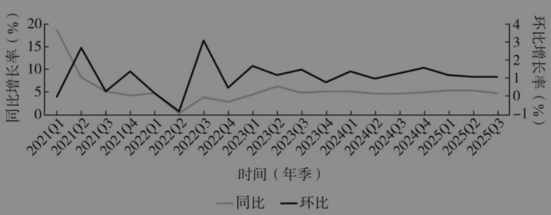

图4-1 “十四五”时期我国的经济增长

我国科技创新实力显著提升。2025年春节期间，DeepSeek在科技界掀起一场风暴，向世界展示了中国在科技创新方面的实力和潜力。科技实力提升的背后离不开研发经费的大幅增加。2024年，全社会研发经费达到3.6万亿元，较2020年增长48%。研发投入总量居世界第二，仅次于美国。其中，企业投入占80%，政府投入占17%，企业已成为创新主体。人工智能、量子通信、高端芯片等领域自立自强的能力显著提升。我们在发展过程中曾面临“卡脖子”的6个领域，有些已经取得新的突破。

经济增长的来源发生了明显变化，摆脱了“十二五”时期和“十三五”时期主要依靠房地产、金融、建筑拉动的发展模式。在21世纪第二个10年以后，我国基本上是这样的发展模式：以土地开发为中心，房地产拉动金融，建筑拉动钢材、水泥，金融业增加值有相当一部分来自房地产。从图4-2可见，“十四五”时期房地产业（-0.31%）、金融业（5.53%）和建筑业（5.47%）共拉动10.69%的增长，工业（特别是制造业）拉动作用显著增加，从“十三五”时期的22.95%提高到“十四五”时期的29.98%。制造业拉动多，意味着更多靠创新驱动，创新驱动主要凝聚于制造业。这同“十二五”时期到“十三五”时期，房地产业（8.84%）、金融业（10.22%）和建筑业（7.4%）拉动了26.46%的增长，制造业拉动了19.43%的发展模式有很大不同。

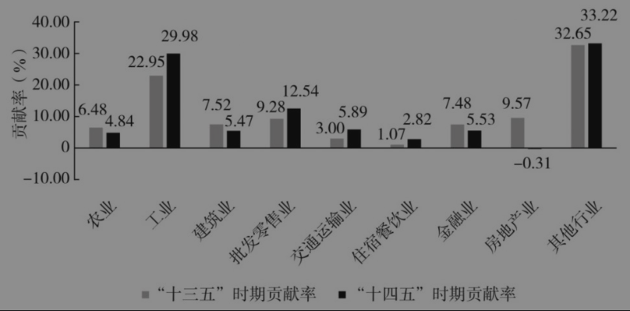

图4-2 “十三五”时期和“十四五”时期（前4年）我国经济增长来源

## 二 “十五五”时期的重要地位

我参加过6个五年规划（计划）的编制工作。“十一五”时期，将“计划”改为“规划”，因为“规划”更适合社会主义市场经济体制。在汉语中，“规划”还带有空间的内涵。发展规划要增强空间指导和约束功能，而不是仅聚焦于产业发展。

这里，举一个例子说明发展规划在国家发展中的作用。国家发展和改革委员会组织编制了一个空间发展方面的规划——《全国主体功能区规划》，把全国国土空间划分为不同的主体功能区，即城市化地区、农产品主产区、生态功能区。青海、西藏的大部分空间属于生态功能区，不适宜大规模、高强度的工业化和城镇化开发，甚至不适宜大规模的农产品开发。这是我们在实际调研中得出的结论。一些高海拔地区不仅难以进行大规模工业化，甚至连树木和庄稼都难以成活，这些地区增加GDP的唯一来源就是放牧，而若为了增加产量和GDP而超载过牧，结果就是生态损害或破坏，最后不得不花费巨资进行生态修复。根据《全国主体功能区规划》的要求，现在青海设立了三江源国家公园，改变了过去的开发方式，维持了生态平衡，实现了人与自然的和谐共生。

所以，在新中国成立以来的经济社会快速发展中，发展规划发挥了重要作用。2025年4月30日，习近平总书记在部分省区市“十五五”时期经济社会发展座谈会上的讲话中指出，“科学制定和接续实施五年规划，是我们党治国理政一条重要经验，也是中国特色社会主义一个重要政治优势”。习近平总书记高度概括了发展规划的作用，2020年8月24日，他在经济社会领域专家座谈会上的讲话中指出，“从1953年开始，我国已经编制实施了13个五年规划（计划），其中改革开放以来编制实施8个，有力推动了经济社会发展、综合国力提升、人民生活改善，创造了世所罕见的经济快速发展奇迹和社会长期稳定奇迹”。所以，正如《建议》所指出的，“十五五”规划的制定实施，必将“续写经济快速发展和社会长期稳定两大奇迹新篇章，奋力开创中国式现代化建设新局面”。

“‘十五五’时期在基本实现社会主义现代化进程中具有承前启后的重要地位。”1987年10月25日，党的十三大报告提出“三步走”的战略部署。第一步，实现国民生产总值比1980年翻一番，解决人民的温饱问题。这个任务已经基本实现。第二步，到20世纪末，使国民生产总值再增长一倍，人民生活达到小康水平。第三步，到21世纪中叶，人均国民生产总值达到中等发达国家水平，人民生活比较富裕，基本实现现代化。我们通过8个五年规划（计划）的制定实施，到2020年实现了全面建成小康社会的宏伟目标。到2035年基本实现社会主义现代化的宏伟目标，需要再通过3个五年规划，“十五五”规划是其中的第二个五年规划，具有承前启后的重要地位。

因此，“‘十五五’时期是基本实现社会主义现代化夯实基础、全面发力的关键时期。”“十四五”取得的成就为后续发展奠定了坚实的经济、科技和社会基础，“十五五”时期要把这些基础进一步加厚加实。全面发力，特别是在“人的全面发展”和“全体人民共同富裕”方面。因为即便人均GDP达到中等发达国家水平，但是人的发展，特别是居民人均收入和人均消费与中等发达国家水平还有很大差距的话，就会影响中国式现代化的成色。所以“十五五”时期要“推动事关中国式现代化全局的战略任务取得重大突破，为基本实现社会主义现代化奠定更加坚实的基础”。总之，“十五五”时期的指导思想、重大原则、发展目标、重点任务，都是由“十五五”的历史方位决定的。

## 三 “十五五”时期的发展环境

2002年党的十六大作出重大判断，“综观全局，二十一世纪头二十年，对我国来说，是一个必须紧紧抓住并且可以大有作为的重要战略机遇期”。回头看，我国确实抓住了这一战略机遇，在这20多年间快速发展起来了。

《建议》指出，“十五五”时期，“我国发展处于战略机遇和风险挑战并存、不确定难预料因素增多的时期。从国际看，世界百年变局加速演进，国际力量对比深刻调整，新一轮科技革命和产业变革加速突破，我国具备主动运筹国际空间、塑造外部环境的诸多有利因素”。战略机遇不是单一变量的外部环境问题，我国不再是国际环境的被动接受者。战略机遇是基于经济全球化发展的大趋势，我国是经济全球化的重要推动者。战略机遇期是同科技革命紧密相关的，我国做好了迎接新的技术革命和产业变革技术革命的战略储备，在新一轮科技革命中必将赢得主动。但未来风险挑战明显增多，大国博弈更加复杂激烈，国际环境充满不确定性。我们要做好应对风险挑战的准备。

《建议》将国内环境概括为“一个趋势”和“四个优势”。“一个趋势”是“我国经济基础稳、优势多、韧性强、潜能大，长期向好的支撑条件和基本趋势没有变”；“四个优势”是“中国特色社会主义制度优势”“超大规模市场优势”“完整产业体系优势”“丰富人才资源优势”。发展是发挥优势的结果。其中，制度优势和产业优势无须赘述。但我们要进一步培育市场优势，现在毕竟不是世界第一大市场。我国的人才规模是世界最大的，每年有1000多万高校毕业生，人才资源非常丰富，虽然人口红利下降，但人才资源优势增强。这几年我们取得科技创新的丰硕成果，很重要的一条就是得益于庞大的创新人才。

在这种国际国内形势下，最主要的是集中力量办好自己的事。把自己的事办好，国际上一些不利因素就会发生转变或转化。要全方位办好自己的事，不仅要靠发展，还要靠改革开放。

《建议》讲了国内面临的7个方面的问题，包括：发展不平衡不充分问题仍然突出；有效需求不足，国内大循环存在卡点堵点；新旧动能转换任务艰巨；农业农村现代化相对滞后；就业和居民收入增长压力较大，民生保障存在短板弱项；人口结构变化给经济发展、社会治理等提出新课题；重点领域还有风险隐患。其中有些是长期存在的问题，有些具有阶段性特征。

需要注意的是，习近平总书记在关于《建议》的说明中提出，“现阶段国内经济下行压力加大”。

对此，我谈一点认识。从图4-3可以看出，从2023年到2025年上半年，中国经济实际增长速度保持在5%左右，这是符合增长潜力的，但是名义增长低于实际增长，GDP平减指数为负，2023年是-0.56%，2024年是-0.77%，2025年前三季度是-1.2%。

在过去20多年的发展过程中，曾经出现三次名义增长与实际增长相近的情况。2009年名义增长和实际增长比较接近，GDP平减指数是-0.23%。2015年，GDP平减指数为0.04%。这一年12月18日至21日召开的中央经济工作会议提出供给侧结构性改革的重大举措，2016年开始实施，通过“三去一降一补”，一是解决了生产价格指数（PPI）连续50多个月为负的问题；二是解决了增长速度连年下行的问题。2017年经济增长速度比2016年提高了0.1个百分点，没有持续下行。2020年名义增长和实际增长比较接近，这次是受到疫情影响，大家待在家里没法消费，但由于生产旺盛，GDP平减指数仍然是正的0.54%。最近几年，GDP平减指数是负的，而且幅度增大。所以我认为，经济下行压力更应该关注的是名义增长的下行压力。未来我们能不能实现人均GDP达到中等发达国家水平，既取决于实际增长，也取决于名义增长，因为人均GDP达到中等发达国家水平是按照现价计算的。

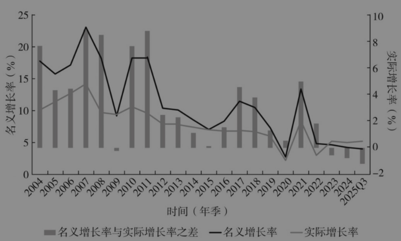

图4-3 2004年至2025年前三季度我国经济的名义增长率与实际增长率

GDP平减指数是从哪里来的呢？2023年制造业名义增长与实际增长之差是-2.6%，2024年是-2.5%，2025年前三季度是-2.8%。所以，GDP平减指数为负主要在于制造业更多靠出口，出口量大，但价格上不去，对拉低整体的平减指数贡献显著。

“十四五”期间，在需求侧，内需对增长的贡献率呈下降趋势，从2019年的87.7%降到2025年前三季度的71%，下降了16.7个百分点；前三季度净出口的贡献率是29%，提高了16.7个百分点，达到2005年以来的最高值（见图4-4）。

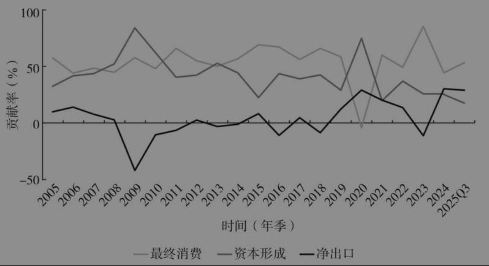

图4-4 2005年至2025年前三季度我国三大需求的贡献率

“十四五”时期取得了巨大成就，但也呈现出新的阶段性、结构性特征，供给和需求的驱动力均发生明显变化，需求侧更多靠出口拉动，供给侧更多靠制造业拉动。制造业与出口的循环，并不是一个完整、全面的经济循环。制造业与出口的相互促进，虽然保持了实际增长稳定在5%左右，但带来的问题是名义增长低于实际增长，CPI和PPI是负值或徘徊在0上下，企业利润、财政收入增长乏力，城镇居民收入增长放缓。所以我们不仅要看实际增长，更要看名义增长。

这种阶段性、结构性特征既有周期性、外部环境变化等因素的影响，也反映出中国经济的长期结构性矛盾。所以，《建议》提出要“促进形成更多由内需主导、消费拉动、内生增长的经济发展模式”，我认为这一点是非常重要的。

## 四 “十五五”时期的总体要求

《建议》提出的“十五五”时期经济社会发展的指导思想落在“推动经济实现质的有效提升和量的合理增长，推动人的全面发展、全体人民共同富裕迈出坚实步伐”上。“两个推动”具有主线意义。编制规划的重点在于主题和主线，主题是我们要举什么样的旗帜。我们过去提出“发展是硬道理”“发展是解决我国一切问题的基础和关键”“发展是党执政兴国的第一要务”；“十四五”时期我们提出的主题是“高质量发展”，党的二十大报告提出，“高质量发展是全面建设社会主义现代化国家的首要任务”。主题确定后，“怎么走”就是主线问题，即基本思路或基本路径。

“十二五”时期以加快转变经济增长方式为主线，“十三五”时期以供给侧结构性改革为主线，“十四五”时期以深化供给侧结构性改革为主线，“十五五”时期的历史使命是“确保基本实现社会主义现代化取得决定性进展”，“两个推动”是“一个确保”的基本路径，是“十五五”时期经济社会发展的总体性要求。

习近平总书记在关于《建议》的说明中指出，“2035年基本实现社会主义现代化，一个重要标志性指标就是人均国内生产总值达到中等发达国家水平，这要求“十五五”时期经济社会发展保持适当速度”。《建议》提出的目标之一是“经济增长保持在合理区间”。

对于“十五五”时期的“合理区间”，国内外都有很多研究，大体上认为增长速度会保持在4.5%～5%。在计划经济时代，指标是指令性的，目标由中央制定，各地区、各部门都是执行主体。但是在市场经济条件下，实现增长速度的目标要靠企业和消费者，国家可以通过各种政策来引导市场主体和消费者向确定的目标前进。因此，增长速度是一种预期性指标。

在编制“十一五”规划的时候，我国正处于高速增长阶段，大家普遍预测经济增长速度是8%～9%，但最后确定的增长指标是7.5%，这是经过反复研究的。为什么呢？因为如果中央确定8%的目标，那么地方至少要把目标定为9%。发展快的地区会认为，“我们有条件，应该发展得更快”；发展相对滞后的地区会认为，“我们同全国的差距大，所以要发展得快一点，否则差距会继续扩大，不符合共同富裕的原则”。从省到市，从市到县，层层加码。但是对于能耗指标，各地区都会降低。“十五”计划期间，重化工业快速发展，能耗迅速增加，污染严重。对此，“十一五”规划提出两个约束性指标，一个是单位国内生产总值能源消耗降低20%左右，另一个是主要污染物排放总量减少10%。但是从各地确定的指标来看，只有少数地区把能耗强度降低的目标定为20%，多数地区低于20%。对于降低污染物排放指标，各地也不积极。如果按此执行，那么这两个约束性指标都无法实现。后来就提出了分解落实的办法，最后这两个指标都实现了。

什么是经济增长的合理区间呢？要实现人均国内生产总值达到中等发达国家水平，“十五五”时期就要保持合理的增长速度，并扭转价格疲弱态势。按美元计，若人均GDP年均名义增长5%，则2035年人均GDP达到2.3万美元；若名义增长6%，则达到2.56万美元；若名义增长7%，则达到2.84万美元。

如图4-5所示，改革开放以来的经济增长走势有上行期，也有下行期。10年前，关于中国经济走势有不同的判断，包括L型、V型、U型等。2012年劳动年龄人口开始负增长，10年后人口总量减少。经济总量达到一定规模之后，增长速度会下行，这是规律。现在来看，在国际金融危机之后，经济增长走势以下行为主。目前阶段仍然处在下行期，但其谷底在哪里？

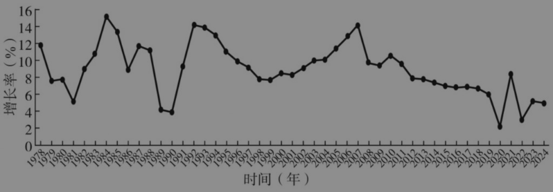

图4-5 我国经济增长走势（1978—2024）

未来五年我国经济增长保持在合理区间是有条件、有基础的。关键是要解决快速发展中遗留的结构性问题，使结构性问题变成结构性动力或结构性增长空间。结构性问题主要有：总供求不均衡、居民消费占比过低、居民收入占比低且降低、消费型产业特别是服务业供给不足、民营经济预期不稳、城乡二元结构尚未破解等。

举例来说，中国约有3亿的农业转移人口，如果他们都能变成真正的市民，那么中国经济保持5%的增长速度就没有问题。这3亿人中的绝大多数在就业地没有稳定的住房，如北京有700多万外来人口，他们中间相当一部分人买不起房子，那么用什么办法来解决他们的住房问题呢？目前还没有一致的思路。这些外来人口在大城市打工，单凭自己买不起房子，只能在老家的县城买房。他们在就业地花钱租房住，在老家的县城花钱买房但不住。有限的收入要分成两笔且都用在房子上。或许有人会问，他们为什么不在县城就业呢？因为县城就业岗位少，收入不足以覆盖房贷。这既是我国最大的一个结构性问题，也蕴含了结构性的发展空间。此外，我国的经济治理、经济体制、制度型开放还有很大空间。加快市场化改革、扩大制度型开放、完善经济治理，也会激发活力、增添动力。

习近平总书记指出，“《建议》稿在指导思想中突出强调全体人民共同富裕迈出坚实步伐，这是指导“十五五”时期经济社会发展的一个总体性要求”。中国式现代化是全体人民共同富裕的现代化。基本实现现代化的一个重要标志是人的全面发展、全体人民共同富裕取得更为明显的实质性进展。人的全面发展内涵丰富，但基础是居民收入、居民消费及其差距。“十五五”时期，要推动人的全面发展、全体人民共同富裕迈出坚实步伐，必须着力提高居民收入，增强居民消费能力，并把收入和消费差距控制在社会合意的范围。所以，“十五五”时期会更加重视民生问题，重点是增加收入、提振消费。

《建议》提出的十二个战略任务和举措，是围绕“两个推动”“一个确保”展开的。第一、二个任务解决供给侧GDP的来源问题；第三个任务解决需求侧GDP的来源问题；第四、五个任务既涉及发展动力，也是回答外需带来的GDP增长问题；第六个和第七个任务涵盖农业现代化，既涉及GDP在产业维度的构成，也界定GDP在空间上的分布格局；第八个任务既涉及GDP从何而来，也是人的全面发展的基本内涵；第九个任务涉及扎实推进全体人民共同富裕的基本内涵，体现了需求侧GDP的来源；第十个任务既是满足建设美丽中国的需要，也是要求GDP要更多地从绿色转型中产生；第十一个和第十二个任务是平安中国和国防现代化建设。

《建议》确定了“十五五”时期经济社会发展必须遵循的六大原则，六大原则构成一个系统，缺一不可。党的全面领导是根本保证，人民至上是价值导向，高质量发展是主题，全面深化改革是根本动力，有效市场和有为政府建机制，统筹发展和安全守底线。

“十五五”时期经济社会发展的主要目标同“十四五”规划相比增加了两个：一是“科技自立自强水平大幅提高”，反映了要通过发展新质生产力，创新建设现代化产业体系的思路；二是“国家安全屏障更加巩固”，反映了在错综复杂的新的国际环境下，要更加重视安全发展的思想。

## 五 “十五五”时期的任务举措

《建议》提出的12个战略任务，我重点讲其中的7个。

### （一）“建设现代化产业体系，巩固壮大实体经济根基”

要“保持制造业合理比重，构建以先进制造业为骨干的现代化产业体系”，我们绝不能像有些国家那样把制造业丢掉。新中国成立初期一穷二白，工业基础十分薄弱，通过边制定、边实施“一五”计划，初步建立了工业体系。经过改革开放40多年的发展，我国成为全球制造业大国。而同一时期有些国家逐步丢掉了制造业，影响了综合国力，这是我们要汲取的教训。

中国要保持制造业的合理比重。21世纪初，各地大搞工业，到处都在建开发区，“工业强市”“工业立市”“工业强省”的口号不绝于耳。当时我在国家发展和改革委员会工作，曾提倡大力发展服务业，规划司还设立了服务业办公室，要推进服务业发展。后来服务业比重确实提高了，但主要依靠房地产和金融的快速发展。所以，“十四五”规划提出保持制造业比重基本稳定。“十五五”规划《建议》提出“保持制造业合理比重”，这更加符合实际。制造业比重还会降低，但不能降得过快，比重要保持在合理水平。

《建议》提出“巩固提升矿业、冶金、化工、轻工、纺织、机械、船舶、建筑等产业在全球产业分工中的地位和竞争力”。我重点说一下矿业，我认为未来更重要的资源不是石油、煤炭，而是有色金属和其他稀有金属。中国的有色金属和稀有金属既有资源优势，也有加工优势，在今后的发展中将越来越重要，新能源、数字化、数智化都离不开它们。

要在4个领域着力打造新兴支柱产业，“加快新能源、新材料、航空航天、低空经济等战略性新兴产业集群发展”。要在6个领域前瞻布局未来产业，“推动量子科技、生物制造、氢能和核聚变能、脑机接口、具身智能、第六代移动通信等成为新的经济增长点”。核聚变能被放到很高的位置，虽然其成为经济增长点为时尚早，但要提早研究布局，这个领域是瞄准未来的。

促进服务业优质高效发展，“分领域推进生产性服务业向专业化和价值链高端延伸，促进生活性服务业高品质、多样化、便利化发展”。构建现代化基础设施体系，“适度超前建设新型基础设施，推进信息通信网络、全国一体化算力网、重大科技基础设施等建设和集约高效利用，推进传统基础设施更新和数智化改造。完善现代化综合交通运输体系，……优化能源骨干通道布局，加力建设新型能源基础设施。加快建设现代化水网”。

在现代化产业体系中，消费产业，特别是服务型消费产业是我们的短板。我们在消费品行业要有中高端产品（服务）甚至奢侈品，而不是大家一拥而上、同质化的产品。我国产业门类齐全，产能很大，但部分消费产业，特别是消费型服务业领域是净进口的（见图4-6）。原因一是资源不足，二是创新不足，三是政策不足。

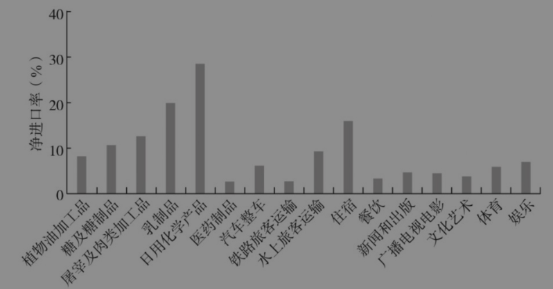

图4-6 2020年部分消费型行业的净进口率

部分具有公共属性的产业，政府负担过多，导致供给不足。要放宽准入限制，让企业积极参与，减少财政在这方面的支出，如体育、影视、文化艺术等。现在体育领域80%的消费由政府支出，过度依赖政府投入会挤压社会力量的参与空间。“苏超”（江苏省城市足球联赛）的创新之处，在于打破了过去地方政府“找项目、靠投资”的传统发展模式。它不依赖大量政府投资，而是搭建群众足球赛事平台，通过激活群众的参与热情（踢球、观赛、呐喊），带动餐饮、文旅等关联消费，回归体育的大众性、群众性，形成良性循环的发展模式。

### （二）“加快高水平科技自立自强，引领发展新质生产力”

以人工智能为引领的数智革命和绿色低碳革命，是百年来我国最有可能抓住的战略机遇。要“加强原始创新和关键核心技术攻关”，“全链条推动集成电路、工业母机、高端仪器、基础软件、先进材料、生物制造等重点领域关键核心技术攻关取得决定性突破”，“培育壮大科技领军企业”，“深入推进数字中国建设”，“建设开放共享安全的全国一体化数据市场”，“强化算力、算法、数据等高效供给。全面实施‘人工智能+’行动，以人工智能引领科研范式变革”。

### （三）“建设强大国内市场，加快构建新发展格局”

保持经济增长在合理区间，首要问题是推动总供求趋向均衡，这是我国最大的结构性问题。20多年来，国内总供给一直大于国内总需求（见图4-7）。2008年国际金融危机后，我国确立扩大内需战略，供需差距缩小，2018年降至最低点。进入“十四五”时期，供需之差进一步扩大，2024年达到4.4万亿元。

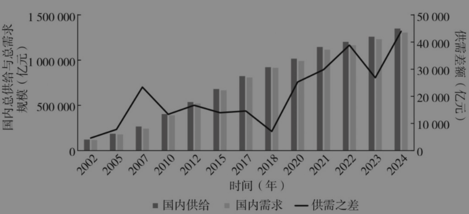

图4-7 我国国内总供给与总需求规模及其差额（2002—2024）

总供求不均衡，主要是制造业高度依赖出口。21世纪第二个10年，制造业最终需求中的出口占比大多在40%～50%区间（见图4-8）。近一半的制造业靠出口，制造业的增长在很大程度上依靠外需的增长。

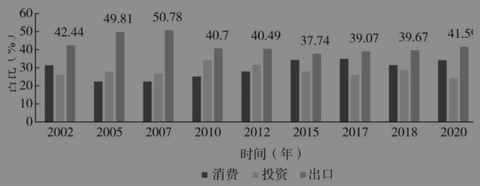

图4-8 我国制造业的最终需求结构（2002—2020）

过度依靠出口，导致量的增长快于金额的增长。如图4-9所示，2025年1—8月，100多种出口商品中的绝大多数金额增长不及数量增长。例如，稀土数量增长14.5%，金额增长-17.1%。

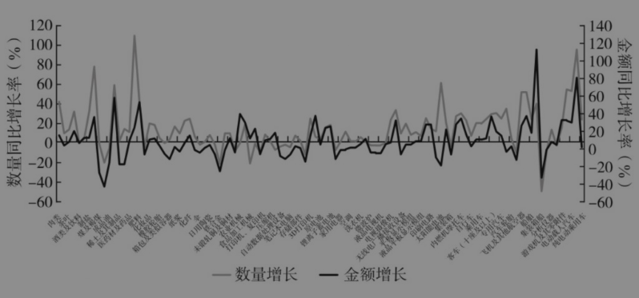

图4-9 2025年1—8月100多种出口商品的数量和金额增长

总供求不均衡和制造业过度依赖出口，主要原因是居民消费不足。2001年以来，居民消费占总需求的比重趋于下降，从2001年的45.7%降至39.2%。资本形成占比已从峰值期的46%降至目前的40%（见图4-10）。

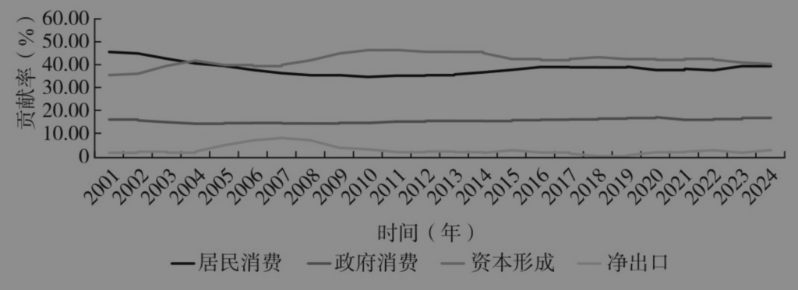

图4-10 我国需求结构中各组成部分的贡献率（2001—2024）

2002—2024年，政府消费占最终消费比重提高3.95个百分点，居民消费比重下降3.95个百分点。政府消费比重提高，主要是政府对公共管理和公共服务的消费增长较快。2020年政府消费支出17万亿元，用于公共管理的支出占43%，用于教育、卫生、社会保障等公共服务的支出占34%。政府对公共管理消费增长快，主要是公职人员增长快，因为公共管理增加值的82.4%是“人头费”。2023年，城镇单位公共管理（含社保和社会组织）就业1986万人，比2012年增加419万人，是所有行业中增长最多的。

过去在“三驾马车”中，投资是第一动力，现在最终消费是第一动力（其中70%是居民消费，30%是政府消费），出口是第二动力，投资变成了第三动力。未来，投资虽然仍有很大空间，但很难再提高其在总需求中的比重。投资增速从21世纪第一个10年20%的台阶，降至第二个10年10%的台阶，“十四五”时期降至5%左右。2025年前9个月总投资增长-0.5%，这是改革开放以来所罕见的。

《建议》提出“坚持人民至上”，“推动人的全面发展、全体人民共同富裕迈出坚实步伐”，“促进形成更多由内需主导、消费拉动、内生增长的经济发展模式”。《建议》把消费问题提升到发展模式的高度，明确了发展模式的内涵：内需主导、消费拉动、内生增长。消费问题不仅是拉动增长的主要源泉，也是中国发展的价值导向。“十五五”时期要做到“四个提高”：提高居民消费占总需求的比重（“居民消费率明显提高”），提高居民可支配收入占国民收入的比重（“提高居民收入在国民收入分配中的比重”），提高公共服务支出占财政支出的比重，提高国有资本收益上缴公共财政的比例（“继续划转国有资本充实社保基金”）。

### （四）“加快构建高水平社会主义市场经济体制，增强高质量发展动力”

《建议》提出“加快构建高水平社会主义市场经济体制，增强高质量发展动力”。什么是高水平社会主义市场经济体制，我认为，就是“充分发挥市场在资源配置中的决定性作用”，在此基础上“更好发挥政府作用”的体制；归属清晰、权责明确、保护严格、流转顺畅的产权制度；经济在法治轨道上运行的体制；宏观经济治理能增强动力、激发活力的体制；人民群众充分分享改革发展成果的体制；激励创新并催生新质生产力的体制；中央与地方财权与事权相匹配的体制；金融有效服务实体经济的体制；城乡要素平等交换、双向流动的体制；有效发挥不同国土空间主体功能的体制；同国际通行规则相通相容、全面开放的体制，等等。《建议》在党的二十届三中全会通过的《中共中央关于进一步全面深化改革推进中国式现代化的决定》的基础上又提出一些新的改革措施。如“加强对查封、扣押、冻结等强制措施的司法监督”；“完善工商业用地使用权续期法律法规，依法稳妥推进续期工作，推进全国行政事业单位存量国有资产盘活共享”；“依法有效盘活被查封冻结财产”；“优化金融机构体系，推动各类金融机构专注主业、完善治理、错位发展”。

### （五）“优化区域经济布局，促进区域协调发展”

《建议》中关于区域发展方面有很多新意。《建议》提出，“发挥重点区域增长极作用”，“巩固提升京津冀、长三角、粤港澳大湾区高质量发展动力源作用”，“提升成渝地区双城经济圈发展能级”，“推动长江中游城市群等加快发展，培育发展若干区域性中心城市”。2024年，京津冀经济总量11.5万亿元、长三角33万亿元、广东14万亿元、成渝接近10万亿元、长江中游城市群接近15万亿元，这5个重点区域的经济总量占全国的比重是62%，只要这些区域的经济稳住了，全国增长在合理区间就稳住了。

高质量发展的空间表现就是经济的极化过程。核心逻辑是发展靠创新驱动，创新驱动需要人才，人才需要相应的创新氛围和生活条件，只有大城市特别是中心城市才会有这种条件。高端人才等研发资源很难向中小城市集中。从最大的空间单元看，城市化地区会进一步集聚经济和人口，农产品主产区和生态功能区的人口会转移出去；从次一级的大空间单元看，中心城市或以中心城市为核心的都市圈会进一步集聚经济和人口。这是市场规律和自然规律共同作用的结果。

我国城乡二元结构还没有破解，户籍人口城镇化和常住人口城镇化差距仍然很大，这是我国快速发展中遗留的一个结构性问题。城镇化的堵点是户籍制度改革难，根源在于农村户籍是与农村集体所有制挂钩的，农村户籍是土地（耕地、宅基地、集体建设用地）等集体产权的产权证书，农业转移人口落户意愿不强。当前，我国约3亿农业转移人口在城市务工，他们要在城市租房住，如果鼓励他们回县城购房，就会耗尽他们毕生的收入，挤压其消费空间。如何既激活房地产市场，又释放消费潜力？破解之道在于提高市民化比例。比如可以把享受公共服务和住房保障作为市民化的核心标准，以此降低改革阻力。难点是特大城市的教育问题，如果农民工的子女能够在当地读高中、考大学，这会涉及高考录取指标的重新分配，问题复杂且敏感。

### （六）“加大保障和改善民生力度，扎实推进全体人民共同富裕”

我重点讲收入分配问题。

需求格局是由分配格局决定的，我国居民消费占总需求的比重降低，主要是居民收入占国民收入的比重降低。初次分配中劳动报酬占比从1992年的65.5%降至2022年的62%，下降3.5个百分点。再分配中居民可支配收入占比从1992年的68%降至2022年的61%，下降7个百分点。再分配中，居民收入占比的下降幅度大于初次分配的下降幅度。

在企业部门中，金融部门占国民收入比重明显提高。2005—2022年，初次分配、再分配分别提高2.25个、1.72个百分点。这与房地产驱动、土地驱动、投资驱动的发展方式相关。

从居民人均可支配收入占人均GDP的比重看，从2001年的47%降至2024年的43%，下降4个百分点(见图4-11)。

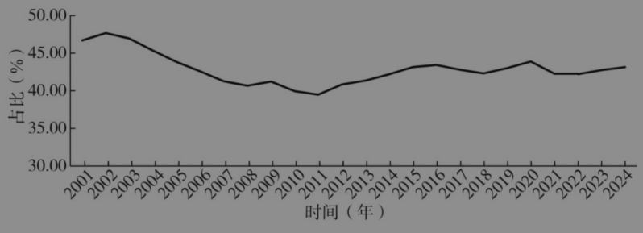

图4-11 2001—2024年居民人均可支配收入占GDP比重

如图4-12所示，2013—2024年，按五等分收入分组，高收入组与低收入组相对差距总体是10倍左右，绝对差距从4万元扩大到8万元。2.8亿低收入组人口的月收入只有800元，即使100%用于消费，月消费支出也仅为800元。所以，居民消费不足的一个重要方面是低收入群体收入低、规模大、消费能力不足。

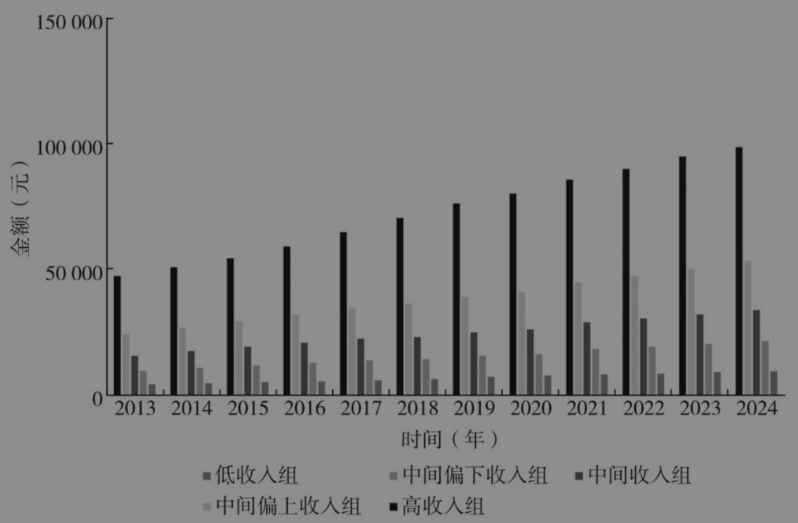

图4-12 2013—2024年五组人均可支配收入

我国相当一部分消费型产业，出口占最终需求的比重相当高，如2020年，纺织制成品的最终需求中，出口接近90%（见图4-13）。这是生产能力太大，还是消费能力过小？过剩是相对于市场而言的，若5.4亿低收入组和中间偏下收入组的消费水平达到中等收入群体的消费水平，一些产业可能就不过剩了。

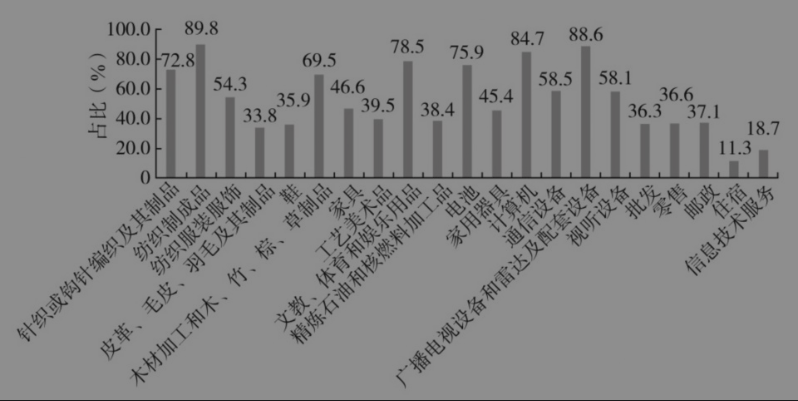

图4-13 2020年部分消费型行业出口占最终需求比重

分配是总供求趋向均衡的桥梁。居民消费能否持续扩大，取决于居民收入能否更快增长。《建议》提出完善收入分配制度，并作为独立一节，提出了很多新举措。应该确立居民人均可支配收入增长快于经济增长的目标，这样才能提高居民收入占国民收入的比重，特别要提高中低收入群体的收入。低收入群体收入增加了，就会壮大中等收入群体规模，逐步形成“橄榄型”分配格局。所以，要普遍提高全体劳动者的工资水平，较大幅度提高最低工资标准，提高城乡居民基础养老金水平等。

### （七）“加快经济社会发展全面绿色转型，建设美丽中国”

碳达峰是“十五五”时期发展的重要任务，也是对经济发展的一个约束，既要保持经济增长在合理区间，又要实现碳达峰。《建议》提出了基本方向以及一些新政策和新措施，要“以碳达峰碳中和为牵引”，落实“加快经济社会发展全面绿色转型”的总体要求。要“加快建设新型能源体系。持续提高新能源供给比重，推进化石能源安全可靠有序替代，着力构建新型电力系统，建设能源强国。坚持风光水核等多能并举，统筹就地消纳和外送，促进清洁能源高质量发展。加强化石能源清洁高效利用，推进煤电改造升级和散煤替代。全面提升电力系统互补互济和安全韧性水平，科学布局抽水蓄能，大力发展新型储能，加快智能电网和微电网建设。提高终端用能电气化水平，推动能源消费绿色化低碳化。加快健全适应新型能源体系的市场和价格机制。”要“积极稳妥推进和实现碳达峰。实施碳排放总量和强度双控制度。深入实施节能降碳改造。推动煤炭和石油消费达峰。完善碳排放统计核算体系，稳步实施地方碳考核、行业碳管控、企业碳管理、项目碳评价、产品碳足迹等政策制度。发展分布式能源，建设零碳工厂和园区。扩大全国碳排放权交易市场覆盖范围，加快温室气体自愿减排交易市场建设。建立健全绿色低碳标准体系，推动引领国际规则标准完善和衔接互认。”

我们要更加紧密地团结在以习近平同志为核心的党中央周围，为基本实现社会主义现代化而共同奋斗，不断开创以中国式现代化全面推进强国建设、民族复兴伟业新局面。

以上学习体会，仅是个人的认识，供大家参考。

[^1]: 本章根据2025年11月6日长安讲坛第432期的内容整理而成。

[^2]: 杨伟民，中国经济50人论坛学术委员会成员、第十三届全国政协常委、经济委员会副主任。
