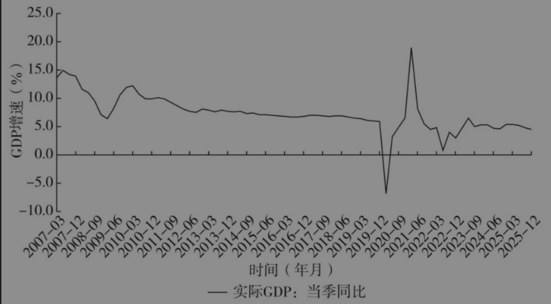
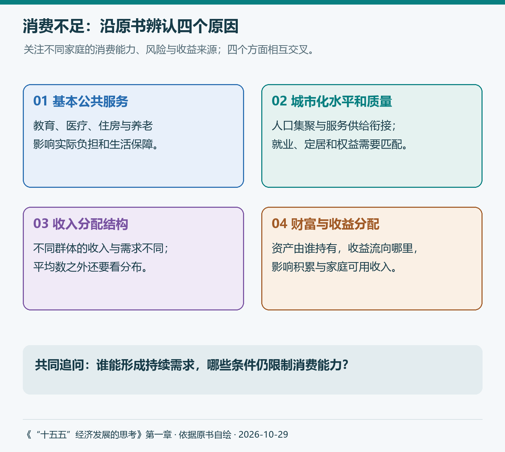
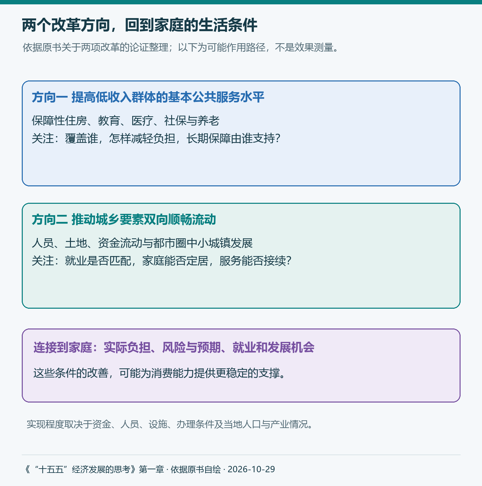
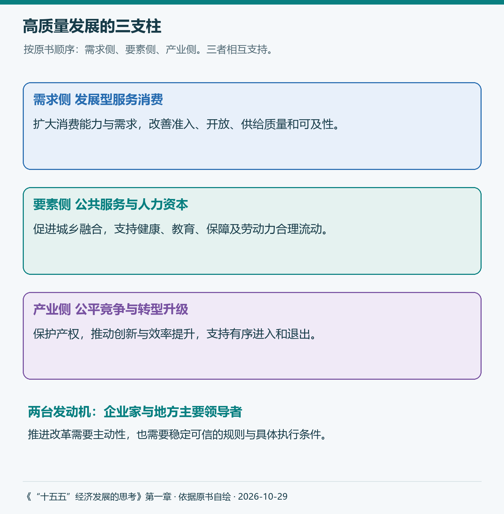

# 《“十五五”经济发展的思考》第一章：扩消费、稳增长、稳预期与结构性改革

以前看到“提振消费”，我首先想到的往往是消费券、以旧换新和商场促销。如果再往前问一步，大概就是收入能不能增加，大家愿不愿意花钱。

读刘世锦这一章，我开始注意到更具体的问题：谁还有比较大的消费需求，什么条件限制了这些需求，教育、住房、医疗和养老的安排，又怎样影响一个家庭今天的支出与未来的打算？

作者先讨论增长阶段，再分析消费不足的原因，随后进入改革路径，最后提出国民经济运行的“三支柱”。我想沿着这个顺序理解：扩大消费为什么会与稳增长、稳预期和结构性改革连在一起。

> 本文对应《“十五五”经济发展的思考》第一章，原章根据刘世锦2025年5月22日长安讲坛第427期内容整理。以下保留原书论证顺序，小标题为阅读整理。原书观点、个人理解与近期资料分别交代，补充资料查阅截至2026年10月29日。配图包括1幅原书图与3幅自绘概念图。

## 一、从增长阶段看需求结构

这一章的起点，是中国经济怎样在新的发展阶段继续增长。作者讨论2035年的发展目标，并把进入高收入阶段、继续提高人均收入，放进国际比较之中。

收入门槛并非固定的一条线，跨过去以后也不意味着增长问题自然解决。这里还需要区分统计口径：原书用汇率折算的人均GDP讨论与高收入门槛的距离，世界银行收入分组正式使用的则是Atlas方法计算的人均GNI。两者能够提供不同观察，不能直接混成同一个指标；“高收入经济体”与“发达国家”也不是完全相同的分类。[世界银行收入分类方法](https://datahelpdesk.worldbank.org/knowledgebase/articles/378833-how-are-the-income-group-thresholds-updated)

作者接着把中国增长放回时间之中。改革开放后，中国经历了较长时期的高速增长；2010年前后，增长速度开始逐步下台阶。原书以日本作参照，讨论高速、中速和低速增长的阶段变化。

这个比较帮助提出问题，但不能直接拿日本的时间表给中国倒计时。人口规模、发展水平、城乡差距、社会保障及外部环境都有差别。原书关于“今后5年”、增长目标和增速底线的讨论，也应放回作者2025年的判断背景。

图1：原书图1-4，中国经济增长从高速到中速的转型期。资料来源：原书，作者整理。历史曲线用于观察阶段变化，不直接给出未来增速预测。

在这个过程中，作者特别强调两个概念。

第一个是“历史需求峰值”。按本章的解释，它指工业化、城市化长期推进过程中，需求增长最快，或需求量最大的点或区间。作者用这个概念理解高速增长转向中速增长的转折。

第二个是“需求结构”。社会中不同收入群体的规模、收入和消费能力各不相同。一个中等收入群体较大、更多人能够持续改善生活的社会，与一个只有较少人具备较强购买力的社会，能够形成的需求也不同。

我对这部分的理解是：增长速度变化以后，还要看支撑增长的人群结构。生产能力继续扩大，需要有人能够持续使用这些产品和服务。这里的“有人”，不能只看全国平均数，还要看具体是哪些家庭。

## 二、消费不足的四个原因

作者认为，消费不足具有结构性特征。它既涉及消费内容，也涉及不同人群获得收入、资产收益和公共服务的方式。原书依次讨论四个原因。

### 第一个原因：基本公共服务总体水平低、城乡差距大

作者把消费区分为生存型消费和发展型消费。吃、穿等基本生活需要得到较充分满足后，教育、医疗、住房保障、养老等需求会更加突出。

这些需求与公共服务联系紧密。医疗保险通过风险共担减轻个人负担，学校依靠集体组织提供教育，养老保障则影响一个人年老以后的生活安排。仅靠家庭自己增加支出，未必能同时解决服务供给、风险分担和长期稳定性的问题。

这里要把两个分类分开：商品与服务是一种划分，生存与发展是另一种划分。基本服务也可能满足生存需要，商品也可能支持个人发展。读本章时，更值得关注的是，哪些发展需要依赖个人与公共制度共同实现。

可以设想一个外出务工家庭。这是帮助理解的假设，并非实地采访：夫妻都在城市工作，但孩子在哪里上学、老人怎样养老、看病如何报销，还没有稳定安排。即使当月工资没有变化，他们是否愿意长期租住更合适的住房，是否把孩子接到身边，怎样保留备用金，都可能受到这些条件影响。

因此，公共服务改善会改变家庭面对的实际负担与风险，也可能改变对未来的判断。作者把基本公共服务均等化放在扩大消费的重要位置，背后有这样一条生活中的联系。

### 第二个原因：城市化水平和质量仍然滞后

服务消费往往需要一定人口规模。学校、医院、养老服务和公共交通都有设施、人员与持续运营成本。人口适当集聚，有助于分担成本，也使专业服务更容易形成。

原书用教育、医疗等例子说明这种集聚效应。与此同时，人口更多并不自动意味着服务更好，还要看学位、医护、住房和交通能否跟上，拥堵和资源分布也会影响实际体验。

这使“城市化质量”变得重要。一个人已经进入城市就业，与一家人能够稳定生活、使用相应公共服务，是不同层面的变化。常住人口城镇化率与户籍人口城镇化率之间的差别，正提示我们继续追问这些实际条件。

作者随后讨论城乡财产权利与财产性收入。资产能否依法流动、交易和用于融资，会影响资产价值及收益机会。这涉及土地和产权制度，不能把“让资产流动起来”简化成每个家庭立即多出一笔可支配现金。

读到这里，我想到《基层中国的运行逻辑》第四章：服务最终要通过具体组织和工作人员触达居民。新增服务承诺以后，学位、设施、人员和经费是否跟着到位，直接影响家庭能否真正用上这些服务。

### 第三个原因：收入差距较大，中等收入群体规模偏小

作者认为，中等收入群体的规模关系到中速增长能否持续。更多家庭能够稳定改善住房、教育、健康和文化生活，需求才有较广的基础。相反，部分家庭已经具有较强消费能力，另一部分家庭仍受收入和保障条件约束，仅看总量容易看不清这种差别。

原书用基尼系数和国际经验讨论收入分配与增长。这里可以把它理解为作者提出的重要分析线索；具体经济体的增长仍受多种因素影响，不能只靠一个系数解释全部差异。

近期数据提供了一个观察背景。国家统计局公布，2026年前三季度，全国居民人均可支配收入34230元，同比名义增长5.3%；人均消费支出22354元，名义增长3.6%。收入与消费的变化需要分别观察，这组数据本身还不足以判断差异由什么因素造成。[国家统计局，2026年10月19日](https://www.stats.gov.cn/sj/zxfb/202610/t20261019_1965612.html)

我的认识变化在于：听到“居民收入增长”以后，还应该继续问，增长发生在哪些群体，他们原来有什么需求、又面临哪些约束。

### 第四个原因：政府部门财富占社会净财富比重较高

这一部分先谈财富分布，再进入企业和居民的储蓄。作者关注的是，资产掌握在谁手中，收益怎样分配，又有多少收益进入家庭当期可使用的收入。

从企业看，利润用于分红还是留存，会影响企业积累与所有者收入。原书进一步讨论国有资本收益的使用方向：在工业化和投资驱动阶段，较多留存并用于投资具有其历史作用；消费结构变化以后，是否需要调整收益使用方式，成为新的改革问题。

从居民看，总体储蓄较多，也不能直接推成每个家庭都有大量闲钱。原书借招商银行金葵花客户的资产分布说明内部差异。这个材料来自单家银行，客户资产也包含多类金融资产，不能改称全国居民存款分布，但它提示了一个有价值的问题：总量增加背后，分布可能很不均衡。

对一些家庭来说，消费能力本来就有限；对另一些家庭来说，多一点资产未必转化为同等比例的新增消费。因此，“把新增储蓄拿出来花”还需要回答，储蓄属于谁、是什么资产、为什么持有，以及有哪些真实需求。

这里也要分清净财富、当期收入和当期储蓄。财富是存量，收入与储蓄是一定时期的流量；企业、政府与家庭的资金安排也不同。只有把这些关系展开，原书对高储蓄与低消费的分析才不会变成一句笼统判断。

图2：依据原书自绘。四个方面相互交叉，图中不表示各因素的贡献比例。

## 三、从终端需求理解增长的高度与宽度

这四个问题并非突然出现，为什么作者认为它们现在更加突出？

原书用“终端需求”来解释，指消费加非生产性投资，后者主要涉及与民生相关的房地产和基础设施。这是本章的分析口径，需要与统计中的最终消费等概念分别理解。

作者的判断是，过去房地产和基建的快速增长支撑了需求，一部分消费结构问题因此没有充分显现。随着房地产调整、基建增长变化，消费不足对整体需求的约束变得更加明显。这个解释帮助我理解为何作者强调抓住需求的源头，同时也要结合各地区、行业的实际情况分析。

接下来，作者讨论经济增长的“高度”与“宽度”。高度侧重生产率提升，由技术创新、体制改革、开放等推动；宽度则关注不同社会成员在多大程度上能够形成对已有生产能力的有效需求。

原书以人工智能和无人驾驶出租车为例，讨论技术进步与就业转换之间的张力。技术能够提高效率，也可能改变工作岗位和收入分配。原有劳动者能否转岗、能否获得培训、过渡期间有什么保障，会影响技术进步怎样进入更多人的生活。

我觉得这部分特别值得与技术类阅读放在一起思考。过去读AI应用时，我容易关心功能、效率和成本；从这一章回看，还需要追问效率改善如何分配，哪些人获得新的机会，哪些人需要支持。创新与需求之间的联系，要经过收入、就业、价格和公共服务等具体环节。

## 四、两个改革方向怎样支持消费能力

看清需求约束以后，作者把讨论推进到政策选择。

促销、补贴能够影响当期购买，在特定条件下也能缓解实际约束。结构性改革进一步关心，这些家庭以后是否具有稳定增加消费的能力。两者的作用期限和着力点不同，可以结合使用；本章重点放在后者。

### 一是提高以农民工为重点的低收入群体基本公共服务水平

作者先讨论公共服务权责和财政支出结构，再谈保障性住房、教育、医疗与社保。比如，收购符合条件的存量住房转作保障性住房，目的不仅涉及房地产需求，也关系到新市民能否改善居住、实现家庭团聚。住房安排稳定以后，还可能带动家具、教育和生活服务等需要。

这些是作者提出的作用机制。具体措施仍要看房源位置、就业分布、价格、管理和资金条件，住房有供给与家庭实际住得进、住得稳之间还有工作要做。

养老金改革是本章着重讨论的另一个突破口。对于收入较低的老年人，稳定增加基本保障，既影响当期生活，也可能减轻家庭对未来的担忧。

原书提出国有资本划拨、养老金逐步提高等设想，并用资金投入与消费倾向作情景测算。例如，按1万亿元投入、0.8的消费倾向和1.5的乘数计算，得到约1.2万亿元的GDP增量。这是给定假设下的推算，实际效果还取决于资金来源、实施方式、供给条件和时间跨度。国有资本权益也不等于可以直接全部支出的现金，历史平均收益率不能视为未来保证收益。

近期四川的一项调整，让“提高保障”有了更具体的制度形式。公开通知规定，自2026年7月1日起，省定城乡居民基础养老金最低标准每人每月提高30元，达到223元，其中包括国家提标20元、省级提标10元，并明确资金分担。这是基础养老金最低标准，并非全国平均养老金或每个人最终领取的总额。[中国老龄协会转载四川通知，2026年10月10日](https://cncaprc.gov.cn/xwllxw/773250.jhtml)

这一安排能帮助理解标准与财力怎样衔接。它对消费的具体影响，还需要后续数据；我更愿意先观察，实际覆盖了谁、是否足额发放，以及家庭的保障感怎样变化。

### 二是以城乡要素双向顺畅流动带动第二轮城市化

原书接着讨论人员、土地、资金等要素的流动，以及都市圈中小城镇的发展空间。核心关注仍然是人的生活和发展条件：能否有合适的就业，公共服务能否接续，家庭能否稳定下来。

作者提出，通过提高城市化比例与质量，扩大中等收入群体，为服务消费和中速增长提供支撑。这些是改革目标与判断，具体建设仍需看人口趋势、产业和财力，不能把每个中小城镇都当成具有相同扩张条件。

2026年国务院《关于推行常住地提供基本公共服务的实施意见》，提供了与此相联系的政策进展。文件涉及随迁子女教育保障、就业地参加职工社会保险等事项，并要求逐步消除基本公共服务与户籍挂钩因素。[国务院实施意见，2026年5月18日落款，国家医保局5月27日转载](https://www.nhsa.gov.cn/art/2026/5/27/art_104_20751.html)

把这些事项放回前面的假设家庭，就更容易理解它们为什么与消费有关。孩子教育、参保和居住安排更加清楚，家庭更有条件作长期打算。不过，文件提出要求之后，还要落实到地方的学位、办理条件、资金和部门协作。

这也让我重新想到《基层中国的运行逻辑》第五章。地方负责人既要承担任务，也受到财政与组织条件约束。因此，评价一项改革，除了看目标，还应看谁提供资源、谁组织服务、怎样持续运行。

图3：依据原书自绘的机制概括。图中联系表示可能的作用路径，实际结果取决于改革执行与当地条件。

## 五、三支柱如何把改革连接起来

前面的分析，最后汇入作者提出的“三支柱”国民经济运行格局。

**第一支柱在需求侧。** 以发展型消费为重点的服务消费带动结构升级和规模扩大，同时改善准入、开放与城市服务供给。居民需要有能力消费，也需要市场上有质量可靠、能够方便获得的服务。

2026年《加快培育服务消费新增长点工作方案》提出完善养老、家政、旅游等消费领域信用体系。这个例子让我注意到，服务消费还涉及信任：家庭愿意付费，也要能够判断质量、了解承诺、维护权益。[国务院办公厅工作方案，2026年1月25日落款，生态环境部2月2日转载](https://www.mee.gov.cn/zcwj/gwywj/202602/t20260202_1143389.shtml)

**第二支柱在要素侧。** 以城乡融合、权利平等和基本公共服务为重点，提高人力资本。教育、健康、社保和流动条件，既影响生活，也影响劳动者能否学习新技能、适应岗位变化并参与更有效率的生产。

这使我对“投资于人”有了更具体的理解。它涉及今天的生活保障，也关系到未来的能力与机会。公共服务改善能够同时连接消费与生产，两方面要放在一起看。

**第三支柱在产业侧。** 各类企业公平竞争，依法保护产权，推动技术与附加价值提升，并在风险可控的条件下推进低效、无效过剩产能有序退出。

这一支柱补足了前面的供给问题。需求扩大之后，服务和产品怎样有效提供，经营者是否愿意长期投入，都与规则、产权、竞争环境和退出机制有关。社会保障也可能为劳动者流动和产业调整提供支持。

图4：依据原书自绘。三支柱相互支持，各自承担不同任务；“两台发动机”指推动改革与发展的主体。

作者最后把企业家和地方主要领导者称为两台发动机，并强调改革仍需“摸着石头过河”。这与标题中的“稳预期”联系起来：家庭需要对未来生活有较稳定的安排，企业需要对产权和经营规则有可信判断，地方也需要清楚的职责、资源与发挥主动性的空间。

读完这一章，我对扩大消费的理解更具体了。消费券和促销之外，还要看到收入怎样分配、公共服务怎样提供、人口怎样融入城市，以及企业怎样在稳定规则下提供产品和服务。

以后再看一项公共服务改革，我会尝试多问几步：覆盖了谁，减轻了什么负担，资金由谁承担，是否能够持续？这些问题把增长与民生连接到具体制度和日常生活，也让我更容易理解作者为什么把扩大消费放进结构性改革之中。

## 参考与说明

- 刘世锦：《“十五五”经济发展的思考》第一章。本文以本地截图整理稿为阅读依据，保留四个原因、两个改革方向、三支柱及两台发动机的论证顺序。
- 近期统计与政策链接附在相关段落。原书2025年的判断、改革建议和测算，均不作为2026年已经实现的结果。
- 第一幅为原书图1-4，其余三幅为中文自绘概念图。本文使用AI辅助整理与起草；假设家庭不代表真实调研样本。
