# 第一章 “条块结合”是中国国家治理的根本特征

<!-- 按来源截图1-1.png至1-5.png顺序整理；阅读器导航与装饰分隔线已省略；正文恢复为可复制文本；13幅插图及1张表格保留原图，存于img目录；41条注释恢复为Markdown脚注。原始截图备存于本书“原始图片”目录，便于核对。 -->

对于所有研究中国问题的学者来说，有一个关键问题如同“黑洞”，它既令人无限着迷，又吞噬着一切智力的努力。这个问题就是：什么是中国国家治理或统治的根本逻辑？[^1]

与世界上其他国家相比，中国具有三个显著的特点。一是文明或文化源远流长。中国是“四大文明古国”[^2]之一，而且中华文明是世界上唯一绵延不断且以国家形态发展至今的伟大文明。二是国家政权的延续时间很长。如果从公元前21世纪中国的第一个王朝夏朝开始计算，那么中国作为一个国家的历史已经超过了4000年。虽然经历了无数次王朝更迭和内部分裂，但是中国的国家政权在多数时候维持了统一或趋于统一的局面，并且在制度上保持了很强的连贯性。[^3]三是国家规模很大。在历史上多数时期，中国都属于全世界疆域最辽阔和人口最多的国家之一。

一个有趣又重要的问题是，对中国这样一个地大物博、地区差异很大的国家来说，尤其是在交通和通信都非常不发达的古代，统治者怎么能够维持国家的长治久安呢？这个问题就是中国国家治理的根本逻辑问题。只有理解了国家治理背后的根本逻辑，才能解释自古以来统治者或执政者所采取的国家战略、重大政策、行政体系和基层治理措施，才能解释上述政策措施所带来的治理绩效，才能解释王朝更替背后的因果循环。

比如，唐朝为什么会形成藩镇割据的格局，以至于发生“安史之乱”而气数殆尽？宋朝为什么在经济实力上空前强大，然而在军事能力上羸弱不堪？清朝的江南省为什么一分为二，变成了安徽省和江苏省？在江苏省内，为什么南京和苏州会形成“瑜亮情结”，以至于今天仍然难分伯仲？这些问题背后的共同逻辑，就是中国国家治理的根本逻辑，也揭示了几千年来中国国家治理的密码。

本章将按照从现实到历史，再上升到理论的顺序回答上述重大问题。在第一节，我将介绍当代中国国家治理的基本架构，从“条块结合”的角度为大家提供一个理解国家权力运行的视角。在第二节，我将从行政区划的角度，用历史素材阐述中国的央地关系。在第三节，我会解释自古以来国家权力的有效边界，从而帮助大家更好地理解基层的运行空间和内在逻辑。在第四节，我将从制度经济学的角度提供一个内外部冲突的双均衡分析框架。这个分析框架试图总结自古以来中国国家治理的根本逻辑，并且将贯穿全书，因此理解它有助于把握全书的主要内容和分析思路。

## 第一节 当代中国的治理架构

### 一、基层最怕“属地责任”

要理解当下中国基层的权力运行和治理逻辑，首先要从宏观上理解中国的制度体系。在这套制度体系中，最关键的制度安排是中央和地方之间的权力关系，因为它决定了基层政权的组织架构、权力空间、施政方式、绩效考核和治理成效等方方面面的事情。在现实中，央地之间的权力关系最形象地表现为“条条”（职能部门）和“块块”（地方政府）的关系。我将这套制度体系称为国家治理架构。[^4]在我看来，当下关于基层治理的诸多争议或疑虑，都源于对国家治理架构的理解存在差异。

每次和基层干部，特别是地方主官（党委或行政首长）交流时，我都会问同一个问题：请问你任职期间最具挑战性的三类事情是什么？多数官员会说“社会稳定”“招商引资”“化解债务”。[^5]不过，2024年暑假我在南方调研时，一位身处江南富庶地区的区县官员用了一个更抽象的词语概括了他面临的困境：属地责任。他说，现在基层最怕这四个字了，因为“属地责任”意味着最终落实要靠基层，也就是我们“块块”，责任也在基层，可是安排任务的往往是“条条”部门，制定政策的也是“条条”部门。有意思的是，在另一个经济欠发达地区，一位镇长在回答我的同一个问题时，把“权责不对等”列为基层官员面临的最大挑战之一。他举了一个例子：县里到本镇某村检查退耕还林情况时，发现一户农民占用了林地，要求限期整改，否则该项工作指标就要扣分。镇里经过调查发现，农户不认为那是林地，而且要求经济补偿。问题是，林地的认定政策归县自然资源局管，补偿资金归农业农村局管，而镇里对农户的行为既没有执法权，又没有决策权，但不管如何，板子都要打在乡镇上。

读者可能要问：什么是“属地责任”？什么是“条条”部门？什么又是“块块”部门？为什么基层最怕“属地责任”？一级地方政府的主官，是不是什么事情都可以自己“做主”？要回答这些问题，就必须从制度上理解中央和地方、上层和基层之间的逻辑关系，就必须了解基层治理所嵌入的国家治理架构。

为什么一定要从制度上解释这些问题呢？为什么不能“具体问题具体分析”呢？因为中国的基层治理千变万化、千头万绪，仅仅停留在理解某些具体政策上就无法把握政策的变化原因和趋势。比如，过去纪委是普通单位，为什么现在变成了强势单位？“上面千条线，下面一根针”的基层治理困境为什么长期以来难以解决？党的二十届三中全会审议通过的《中共中央关于进一步全面深化改革、推进中国式现代化的决定》提出要“深化财税体制改革”，“建立权责清晰、财力协调、区域均衡的中央和地方财政关系”，那么这意味着基层的财权和事权会发生什么变化呢？要回答这类问题，显然不是理解几项具体政策就能做到的。只有从制度上理解问题，才算是掌握了底层框架，才能举一反三、透过现象看本质，就好比掌握了武林秘籍中的“独孤九剑”。因此，我总是强调：公说公有理，婆说婆有理；究竟谁有理，关键看逻辑；逻辑要自洽，关键看框架。

### 二、“条块结合，以块为主”的中央集权体制

#### 1. 条块结合，以块为主

什么是当代中国的治理架构呢？我把它概括为一句话：“条块结合，以块为主”的中央集权体制。这句话包含三个关键词：条、块、中央集权。下面我来解释一下。

首先，全世界不管什么样的组织，国家、企业、家族、军队、医院，尽管在管理绩效上可能千差万别，在制度安排上各有千秋，但是都离不开两种最基本的组织结构或管理体制。一种是偏向集权的“直线职能制”或称U型体制（unitary structure），即上级机构的职能部门直接管理下级机构的职能部门，下级再管下一级。比如，中央政府下属的国家税务总局直接领导省税务局，省税务局又直接领导市税务局。这些职能部门就像线条一样自上而下串联在一起，所以俗称“条条”。另一种是偏向于分权的“事业部制”或称M型体制（multidivisional structure），即总部根据地区或者产品分为若干个分部（事业部），每个分部有相对独立的决策权，负责领导分部下设的职能部门，并且上级职能部门和下级职能部门之间是协调关系，不是领导关系。

组织经济学或契约理论认为，组织形式会影响组织内部的权力配置，从而影响代理人（下属或下级）的激励，并最终影响组织的行为和绩效。2007年诺贝尔经济学奖得主、哈佛大学教授埃里克·马斯金（Eric Maskin）和钱颖一、许成钢两位中国经济学家，在全球经济学顶级期刊《经济研究评论》（The Review of Economic Studies）上发表了一篇论文，认为苏联的改革之所以失败，而中国的改革之所以成功，主要源于U型体制和M型体制的差异（Maskin et al.，2000）。如今，这篇论文已经成为研究中国国家治理的经典论文，为了便于大家理解，我略微修改了他们论文中的图示来为大家介绍他们的成果。

苏联的国家治理架构属于U型管理体制。图1-1展示了一个国家层面的U型管理体制。在这个U型体制下，中央的农业部直接管理每个地区的国有农业企业，工业部直接管理每个地区的国有工业企业，每个州政府（相当于中国的省政府）只能协调本州的工业企业或者农业企业，而无权直接管理它们。U型体制的好处是，在这种集权制度下，中央通过地方的“条条”（农业部）一竿子插到底，因此中央的协调能力和地方的政策执行力都特别强。一旦中央制定了正确的政策，那么它的治理效果会很好；但一旦方向错误，那么它的效果就非常差，而且会有放大作用。

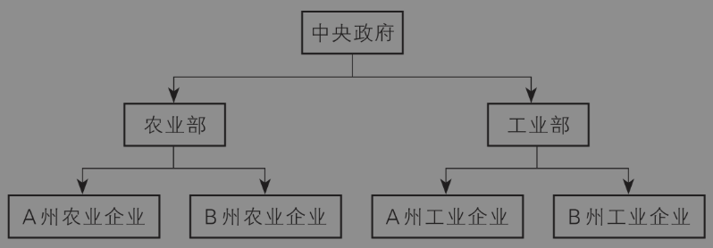

图1-1 U型管理体制

中国的国家治理架构属于M型体制（如图1-2）。在这个M型体制下，中央管理省级行政单位，每个省负责管理本省所有的国有工业企业或者国有农业企业，形成一个巨大的“块块”。中央的农业部或者工业部只是负责协调不同省份的企业，但无权直接管辖。M型体制的好处是，每个“块块”（省、市或县）拥有一定的自由裁量权，可以根据自身情况去“试错”，因此比较适合“摸着石头过河”的改革探索。但缺点是，中央的协调成本比较高，特别是在地方“各自为政”时。

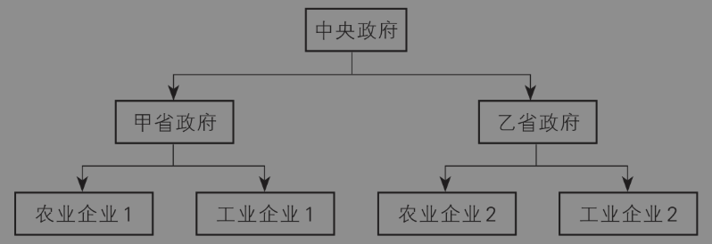

图1-2 M型管理体制

其实，世界上多数组织在管理体制上都不是纯粹的U型或者M型，而是“条块结合”，即职能部门（“条”）和分部（“块”）一纵一横，构成了一个矩阵，但是侧重点不同。有的是偏向U型体制，比如军队，这是集权的极端案例；有的是偏向M型体制，比如中国周朝时期的诸侯国，这是分权的极端案例。

在几千年的王朝更替中，中国的国家治理架构在多数时候采取的模式都是“条块结合，以块为主”的中央集权体制，差异主要体现在“块块”的自由裁量权有多大：“条块结合，以块为主”体现的是偏重M型的矩阵管理模式；而中央集权意味着，虽然“块块”有相当的自由裁量权，但是在大政方针上必须与中央一致，所谓利出一孔、政出一门。形象地说，这种治理架构具有中央调控下的“政治责任承包制”特点。[^6]这一点特别具有中国特色。从历史上看，秦朝之前属于“分封建国”，作为地方的“块块”权限很大，中央的“条条”存在感很低；秦朝全面推行郡县制之后，皇帝可以直接任命各地的郡守和县令，此时“块块”的权限变小；汉初，在中央直辖的郡县之外，又重设了封国，各诸侯王在各自封地内拥有较大权力，这就是所谓的“郡国制”，实际上就是U型和M型混合的矩阵体制。

与古代国家不同的是，现代国家的中央政府治理事务非常庞杂，因此中央政府下属的职能部门非常多。例如，中国国务院目前有40多个下属职能部门，包括26个“组成部门”（类似于“内阁成员单位”），15个“直属机构”，这还不包括直属事业单位。这些职能部门又可以分为两类。第一类是“属地管理”部门，即它在地方的对应部门归地方政府领导（归“块块”管），不归中央部委领导，中央部委只有“指导”权。“领导”和“指导”有什么区别呢？我在地方调研时，一位地方官员给过我这样一个形象的比喻：“领导”是亲爹，“指导”是干爹。大多数地方政府的下属职能部门都实行属地管理，例如发展改革委、财政局、工信局和教育局。第二类是“垂直管理”部门，即它在地方的对应部门归中央部委领导（归“条条”管），不归地方政府领导，地方政府甚至连“指导”权也没有。这样的职能部门不多，主要包括海关、税务、矿监、金融和证券监管部门。此外，还有一些部门实行省以下垂直管理，包括工商、质监、食品药品监管部门（现在合并为市场监管局）以及环保执法部门等，它们也属于“条管单位”。总之，地方政府所有的下属职能部门，要么是属地管理机构（对应于M型体制），要么是垂直管理机构（对应于U型体制）。不过，属地管理和垂直管理的边界在中央和地方关系下是经常变动的。[^7]

#### 2. 中国党政机构示意图

前面抽象地分析了中央和地方、上级和下级部门之间的隶属关系。下面，我以中国行政机构和党政机构的组织结构图，来具体地说明“条块结合，以块为主”的中央集权体制是如何体现的。之所以先介绍行政机构的组织模式，是因为越是基层单位，跟行政部门打交道越多。特别是普通老百姓和企业主，多数时候都是和行政部门打交道。比如，上户口是跟公安局的派出所打交道，结婚登记是跟民政局打交道；企业主注册企业是跟工商局（现在叫市场监管局）打交道，纳税是跟税务局打交道。我们从简单到复杂，先看中国行政机构示意图（图1-3）。

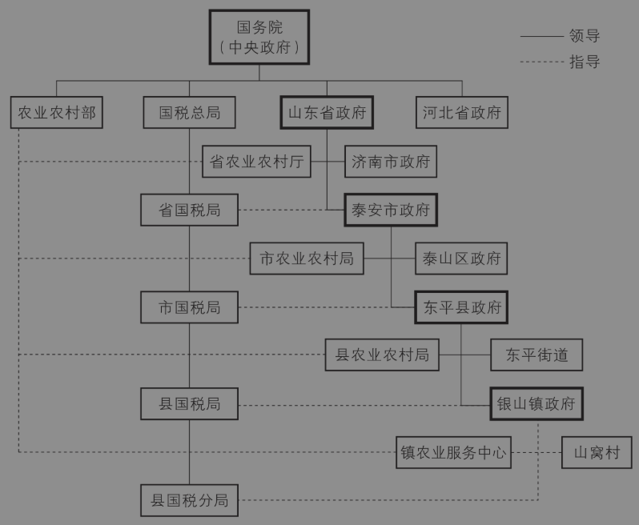

图1-3 中国行政机构示意图

首先看图1-3的最上方，它是国务院，代表中央政府。接着往下还有山东省政府、泰安市政府、东平县政府和银山镇政府，它们分别代表省、市、县和乡镇四级“块块”。为了和“条条”区分，我用加粗的方框表示它们。然后再看第二行，除了山东省和河北省，还有农业农村部、国家税务总局（简称国税总局）作为例子，后两者是国务院的下属职能部门，和山东省政府并列，因此都属于省部级单位。但农业和税务不同，前者实行属地管理，后者实行垂直管理。农业农村部和山东省农业农村厅之间有一条虚线连接，表示前者“指导”后者，而省农业农村厅和山东省政府之间是实线连接，表示省政府“领导”省农业农村厅，即农业主管部门实行属地管理。前面说了，大部分职能部门都属于属地管理机构，所以我们在这张图上看到，与地方政府连接的实线比虚线要多，这就体现了“以块为主”的特征。与农业农村部不一样的是，国税总局下面有山东省国税局，它们之间是一条实线连接，一直连到县国税分局，形成了一个“条条”。这表示国税总局直接领导山东省国税局，省国税局领导市国税局，市国税局再领导县国税局，直到县国税分局。这里有一个秘诀，从名字上就可以看出来哪些单位属于垂直管理或条管单位。山东省国税局的全称是“国家税务总局山东省税务局”，这就明确了省局是国税总局的直属单位。在级别上，山东省国税局和泰安市政府是并列的，都属于厅局级单位。之后再回到第二行，农业农村部、国税总局、山东省政府、河北省政府是并列的，它们都是通过实线与国务院连接，表明它们都归国务院领导。形象地说，“下面有分，上面管总”。因为国务院代表中央政府，所以这就体现了“条块结合，以块为主”的中央集权体制[^8]。省以下的部门和地区设置也类似地体现了“条块结合，以块为主”的特征，此处不再赘述。

在当代中国，广义的“政府”包括党、政、军等多种机构，这些机构本身也是条块结合的。因此，在行政机构基础上扩展开来，当代中国的国家治理架构实际上是在执政党领导下的“条块结合，以块为主”的中央集权体制。加入党、政、军等机构之后，我们就得到了下面这张更复杂但也更全面的组织结构图（图1-4）。

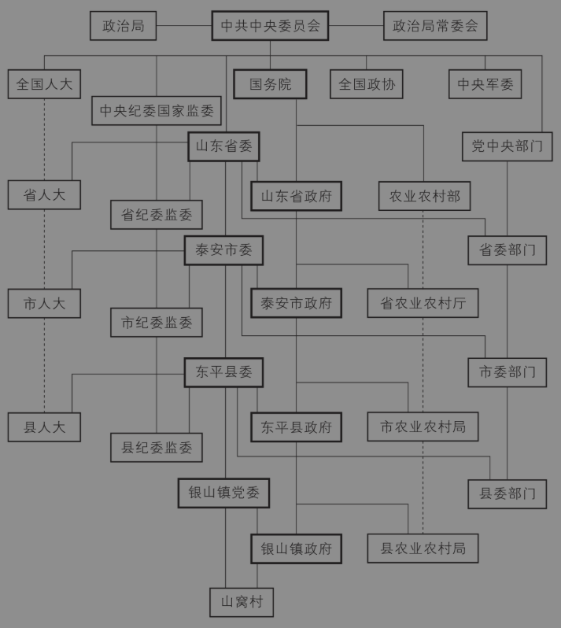

图1-4 中国党政机构示意图[^9]

先看图1-4的第一行。在中国，党是领导一切的，而全党要服从中央，所以党中央就是最高领导机构。党中央通常指中共中央委员会，它一般每年开会一次，在休会期间，由中央政治局及其常委会执行其职责。在党中央的领导下，除了中央政府（国务院），还有全国人大、全国政协、中央军委，它们都属于正国级单位，分别代表政府、人大、政协和军队。再加上党，这五个部门就构成了国家层面的“五套班子”，省市县每一级地方都有对应的地方“五套班子”。与政府部门类似，党的部门也有下属机构，比如纪委、组织部、宣传部。由于中纪委书记是政治局常委（属于正国级），而党中央其他下属部门的负责人一般是政治局委员或者更低级别，因此我把中央纪委国家监委单独拿出来，放到比全国人大和国务院低半格的地方，表示“副国级”单位。和政府下属部门不同的是，党委的下属部门一般实行双重领导体制，但是不同部门重点不同。纪委主要受上级纪委领导，非常接近于“垂直管理”体制；党委其他下属部门（例如组织部），仍以同级党委领导为主，以上级党委部门领导为辅。因此，在图1-4中，党委下属部门（包括纪委）和同级党委、上级部门之间都是实线连接。然后再看第三行，山东省委和党中央下属部门同级，都是正部级，但是实际地位高于第四行的山东省政府，因为党领导政府。而第五行的省纪委监委又比省政府低半格，因为它相当于副省级单位。最后，在这张图的两侧，全国人大、省人大和市人大之间，以及农业农村部、省农业农村厅和市农业农村局之间，都是虚线连接，表示它们之间是指导关系。同时，为了突出自上而下的纵向领导关系，我在上图的中间部分用粗线框表示山东省的相关机构，以便和前面的图1-3对比。

这张党政机构示意图是中国国家治理架构的缩影。如果理解了这张图，就可以从一个宏观组织的角度来理解中国体制内上下级之间、不同部门之间以及政府和企业之间的互动关系。

#### 3. 条块结合体制的韧性

“条块结合，以块为主”的中央集权体制具有一个优势，就是可以根据国内外形势进行动态优化，通过加强“条”或“块”的权力来提高集权程度或提高分权程度，而不是实行静止的、极端的分权或集权体制，这其实就是一种制度韧性。例如，20世纪50年代到70年代，在毛泽东主席的推动下，中央多次向地方分权，包括将财政收支权、物资管理权以及一批中央国营企业下放到地方，并且动员了上千万人搞“三线建设”[^10]，这实际上就是在减少“条条”的权限，增加“块块”的权限。推动管理体制从U型向M型如此转变的重要原因，与当时国家领导人对国际形势和战争威胁的判断不无关系。我将在第四节介绍一个内外部冲突的双重均衡框架，根据这个框架我们可以得出：当外部冲突比内部冲突更严重时，最优的制度安排倾向于分权；反之，则倾向于集权。因此，“条块结合，以块为主”的中央集权体制的动态变化，正是不同内外部环境下制度韧性的体现。

当然，外部冲突只是导致组织结构变迁的一种原因。组织经济学或契约理论的研究表明，集权的优势是加强协调，减少合谋，而分权的优势是发挥基层的积极性和创造性。因此，当加强协调比发挥基层积极性更重要时，中央就会适度集权，偏向垂直管理（U型）；反之，当基层的积极性比协调更重要时，中央就会适度分权，偏向属地管理（M型）。在中国经济社会体制转型过程中，税务、食品药品、环境保护和纪委等部门的隶属关系，都曾经发生过“集权—分权”的变迁，有的部门还曾反复调整，以便实现最优配置。

以税务部门为例。税收是国家财政收入的最主要来源，同时税收又容易因为地区差异而出现偷税漏税现象。为了加强统一征管，自新中国成立之初到1993年，税务行政部门一直实行中央垂直管理的体制。1994年，中国正式开启实行分税制改革，这是中国改革开放以来最重要的一次央地关系调整。为了配合分税制的实施，特别是发挥地方做大税基和推动经济发展的积极性，1993年底中央决定将国税局和地税局分设，由国税局收取中央税（例如消费税）以及中央和地方共享税（主要是增值税），由地税局收取地方税（例如营业税）。在管理体制上，国税局是垂直管理，而地税局是属地管理。此后，由于中央跨地区转移支付的压力逐步增大，因此需要加强税收的统一使用。2002年，原本属于地方税的企业所得税改为中央和地方共享税，并且分配比例在2003年进一步向中央倾斜（中央占60%）；2016年，原来地方税中的第一大税种营业税改为增值税，由国税局征收。此时，地税局的征收范围大为缩小，而国税局的征收压力则非常大。为了避免两者失衡，同时减少地区之间负面的“税收竞争”，2018年中央决定将国税局和地税局合并，合并的国税局成为完全垂直管理的机构。

### 三、央地关系是“兄弟”还是“父子”？

那么，我们该如何理解中央和地方的关系呢？央地关系如何影响基层治理呢？

关于央地关系，有几种形象的比喻。第一种说法是兄弟关系。这是西方政治学和经济学的基本假设。比如，著名的财政联邦主义理论[^11]就认为，美国的联邦政府和州政府之间是一种平等的契约关系，这种关系受到美国联邦宪法的保护。在美国式分权体制下，总统无权任命地方官员，包括州长、检察长等官员。一个不可忽略的历史背景是，美国是先有13个州，然后才有联邦政府。[^12]中国自秦朝以来，郡县制就奠定了中国行政区划的基本格局，而郡县制的本质是中央集权的单一制，而非联邦制。

第二种说法是父子关系，这是古代中国的政治理念。在漫长的君主专制时代，“君父”理念成为儒家礼制的重要内容。正如电视剧《神探狄仁杰》里刺史曾泰怒斥商人所言：“我堂堂天朝，自有法度，本州身为刺史，代天牧狩，岂可因一商队之私，而罔顾军国大事。”“代天子牧狩”，说白了就是把老百姓看作羊群，把皇帝看作牧羊人。与之对应，中央和地方的关系就如同父子关系，地方官员就是皇帝的代理人。然而，这种古代理念明显不符合现代文明社会。

我认为，中国当前的央地关系既不是兄弟关系，也不是父子关系，而是一种上级和下级之间的委托—代理关系。在宪法和党规的规定之下，下级要服从上级，全党要服从中央，但是中央要根据各地的实际情况，给予地方一定的自主权。不可否认的是，地方也有自己的利益，因此央地之间存在利益博弈。这种关系的法理基础是，中央是代表最广大人民群众利益的，而地方是代表地方人民群众利益的，因此中央权威来自群众基础，而地方权威部分来自上级授受，部分来自民意基础。

理解了中国的央地关系，我们就可以从宏观上更好地理解基层的权力运行和治理逻辑。

首先，不同层次的行政辖区有不同的权限，党委和政府、政府的不同部门之间又有不同的权限。比如，有人问，县政府为什么不去抓贪官？这个问题就是“伪问题”，因为反腐败是纪委监委的事情，不归县政府管。有人问，乡镇为什么不关停污染企业？这个问题问得也不准确，因为乡镇基本上没有对企业的行政执法权，这类权力通常归属于县级市场监管、环保和安全生产主管部门，这些部门在乡镇的分支机构属于垂直管理单位，不是属地管理单位，不归乡镇党委和政府管辖。

其次，我们要全面、动态地看待基层和上层的关系。上层制定了一个政策，如果不接地气，或者没有基层制定的实施细则，政策就落不了地。这就会出现“中央是好的，某些地方官员是坏的”这种“差序信任”格局。反过来，一些做法虽然在基层很管用，但是如果没有上层的认可和合法化，可能也难以持续，并且很容易出现人走茶凉、人走政息的结果。这从另一个角度印证了央地博弈的关系。

最后，理解了今天介绍的中国国家治理的基本架构，后面很多政策分析和职业道路分析就有了指导原则。比如说，对于一个县来说，它在多大程度上可以选择自己的主导产业以便推动经济增长呢？它怎么能确保地方的创新得到上级认可呢？对于想当公务员的读者来说，去中央部委、省级机关还是基层工作有什么区别呢？这些问题，我们在后面都会涉及，但底层逻辑和分析框架，离不开本节的主要内容。

## 第二节 地区边界是如何形成的？

### 一、中美两国省界差异

不知道大家是否注意到这样一个有趣的现象：在美国的地图上，各州（相当于中国的各省）的边界就像一个个小方块，总体上非常整齐。但是，相比之下，在中国的地图上，各省的边界可以说是参差不齐、犬牙交错。比如说，甘肃省插入了陕西省的腹地，而且还近乎包裹了宁夏回族自治区。而安徽省像一头黑熊一样，一掌插进了江苏省的腹地。那么，为什么中国各省级行政区的分界不能整整齐齐的呢？

除了省界的划分非常不规则之外，另一个有趣的现象是，从古代到近代，中国的省级行政区划（或者说“次国家级”行政区划）频繁发生变更。例如，大家都知道“江南多才子”，甚至还听说过“江南四大才子”，但你知道不同时期的“江南”是指哪些地方吗？作为一个行政区域，江南省的范围又是怎么确定的呢？看上去，这是一个地理问题，但实际上古代行政区划的规划与调整，折射了中央和地方的权力博弈。下面，我将从空间组织经济学的角度，谈谈中国国家内部的地区边界是如何形成的。限于篇幅，我们将聚焦于省界的确定和变化。

我首先会提供一个央地博弈的分析框架，从顶层设计的高度，解释中国古代行政区划的奥秘。然后我会介绍中国今天的“省”是怎么来的。很多人可能不知道，在中国古代大部分时间里，最高的行政区划并不是省，而且一开始省也不是一个地方行政单位，而是一个中央部委。最后，我会利用前面提供的央地博弈框架，解释中国省界的划分策略。

### 二、央地博弈决定了行政区划

中国的行政区划不是一个单纯的地理问题，而是中央和地方博弈的内生结果。国家作为一个组织，其制度安排归根结底可以概括为两种类型：集权和分权。从制度经济学上讲，集权和分权代表了不同的制度均衡。对应到行政区划上，它们表现为不同的行政层级、辖区面积（幅员）、划界原则。我们可以用下方图示（图1-5）描述最优行政区划的经济学逻辑。

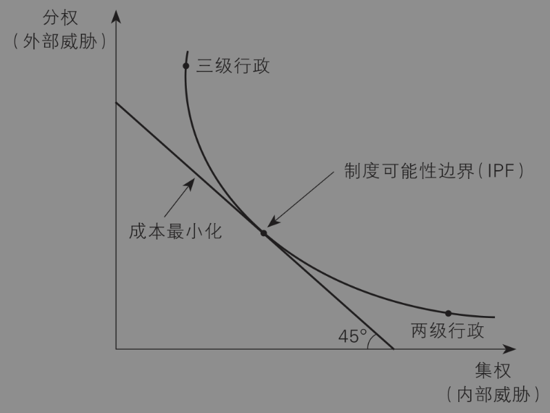

图1-5 行政区划的经济学逻辑

在图1-5中，横轴表示集权，纵轴表示分权。集权意味着减少地方行政层级（例如只设州、县两级），地方直接听命于中央。集权的好处是，有利于国家层面的统一和协调，减少内部威胁；坏处是，中央的管理跨度太大，管理成本很高，并且难以应对其他国家或周边民族的侵犯，应对外部威胁的情势相对严峻。分权意味着多设地方行政层级（例如设路、州、县三级）。分权的好处是，有利于激发地方的活力和积极性，有效应对外部威胁；坏处是，容易导致内部分裂，例如军阀割据，以及政治精英勾结地方豪强谋反，从而产生内部威胁。

除了行政层级，集权和分权还表现在辖区面积和划界原则上。在辖区面积方面，为了实现集权，中央可以将地方区域的面积划小，让每一个地方都无力对抗中央；反之，如果要实现分权，中央可以将地方区域的面积变大，让每一个地方拥有规模经济和范围经济。在划界原则上，为了实现集权，中央必须让不同地方之间相互嵌套、彼此制衡，实现“分而治之”的目的，防止任何一个地区凭借大山大江等地理屏障进行分裂活动；反之，为了实现分权，中央应该根据山川河流等自然地理条件来划分各地的边界，这样地方就可以根据本地的气候、土壤、水文等自然禀赋来发展相应的产业，实现因地制宜。

对于统治者来说，集权和分权都是“制度选择集”中的一种。从理论上讲，制度可能性边界必须与治理成本最小化的约束条件相符。这表现为图1-5中曲线IPF和直线的切点，此时可以实现最优的行政区划。在国家治理方面，特别是对于中国古代统治者而言，治理成本主要由两类因素决定：一是外部威胁的大小，这是一个外生变量；二是内部成本，主要是交通网络和通信技术。因此，一个合理的命题是：当面临严重的外部威胁时（例如北方游牧民族的侵犯），或者对于某个交通和通信技术难以触达的边陲之地，统治者会倾向于实行分权的制度安排，即设置更多行政层级、允许更大的地方辖区面积以及按照自然地理条件来划分各地边界；反之，当统治者没有面临严重的外部威胁时，为了主要应对内部威胁，那么在给定的交通和通信技术下，统治者会倾向于实行集权的制度安排，即减少行政层级、缩小地方的辖区面积以及按照制衡的原则来划分各地边界。[^13]

上述命题与历史政治地理学的观点不谋而合。根据中国著名历史地理专家邹逸麟的观点（邹逸麟，2001），中国古代王朝在行政区划上并没有统一的安排，而是主要在两级地方行政和三级地方行政的治理模式之间摇摆不定。秦朝开创了中国郡县制的先河，并奠定了两级地方行政的雏形。郡是最高行政区划，郡下设县。这一体制延续到了西汉。到了汉武帝时期，皇帝分天下为十三部（州），设置刺史巡视地方，历经职权变迁，东汉末期州变成了地方行政区划，下面管郡和县。州—郡—县三级地方行政一直延续到了魏晋南北朝时期。在隋唐的大部分时期，两级制又恢复了。到了元朝，中国正式进入行省时代，实行省（行省）—路（府、州）—县三级地方行政制度，此后三级制就定型了。

一个有趣的问题是，为什么朝廷有时实行两级地方行政，有时实行三级地方行政呢？下面，我就以唐朝为例，说明央地博弈下内部威胁和外部威胁之间的权衡取舍。西汉时大概有100个郡，1500个县。唐朝和西汉疆域面积差不多，一开始也实行州县两级制，有大约350个州（相当于秦汉的郡），1500个县。跟西汉相比，唐朝初期作为一级行政区的州面积大大减少，坚持二级行政体制的目的是加强中央集权。但是州的数目太多了，对中央来说管理跨度太大，行政成本太高。为此，贞观年间全国又被分为10个监察区（后来叫“道”），但皇帝只给负责监察的刺史临时授权，就是怕他们尾大不掉，这就变成了2.5级地方行政体制。但问题是，唐朝一直面临周边游牧民族的外部威胁。如果边地刺史没有兵权，又不能调动本地官民，就无法有效地进行军事防御。于是，不得不给地方长官实权，并不断增加权力。最后，地方长官就变成了雄霸一方的节度使，两级体制又变成了三级体制。节度使在地方坐大后，产生了内部威胁，最终爆发了著名的“安史之乱”，唐朝从此掉入了衰落的深渊。

### 三、“省”是怎么来的？

我们接下来谈谈中国的省是怎么形成的，以及省界是如何划分的，看一看行政区划的经济学逻辑是否依然有效。实际上，省的设立和划界同样是央地博弈的结果，同样是政权在内部威胁和外部威胁之间权衡取舍的结果。

元朝之后，中国最高一级的行政区划才开始叫“省”。那么，为什么改叫“省”，而不再叫“州”了呢？其实，行省制度源于魏晋以来的行台制度，原是中央部委（台、省）的派出机构。例如，金朝在靠近蒙古的地方设置了临潢、抚州[^14]、北京三个行省。蒙古灭金之后，保留了金朝的行省制度，并且将中央的尚书省和中书省合并，中央的省叫“都省”，地方的派出机构称“行中书省”，简称“行省”。在地方设立行省，本来是为了领兵打仗的将军元帅在当地调度方便。后来战争连年不断，行省的职能就由只管军事变成了兼管民政，而且地位非常高。一开始各行省由中书省负责人（宰相）挂名，后来才改为行省某官，相当于明清时期的总督。元朝时先后设立了中书省和10个行中书省，中书省直接管辖的地方相当于直辖市，其辖区相当于若干个行省，其长官为宰相（或丞相）。朱元璋建立明朝并完成统一后，外部威胁暂时解除了，此时应对内部威胁成为主要目标，因此他不断加强中央集权。在中央层面，洪武十三年（1380年），朱元璋以谋反罪诛杀了左丞相胡惟庸，并下令永久废除中书省，撤销了宰相职务。在地方层面，洪武九年（1376年）朱元璋将行省的权力一分为三，即按行政、军事和司法三类部门设立三司，直接对中央负责。具体来说，行省改为承宣布政使司，治理范围仍然是过去的行省，但是权力只有原来行省的三分之一左右。行省的长官“布政使”（别称“藩台”）相当于省长[^15]，但是不管军事和司法；行省的军权剥离给了都指挥司，其长官“都指挥使”相当于省军区司令员；行省的监察司法权剥离给了按察使司，其长官“按察使”（别称“臬台”）相当于全面主管一省司法工作的政法委书记。

到了清朝，战争时期清廷在各省设立了总督和巡抚。总督、巡抚和刺史一样，本来都是临时职务，后来都变成了一个地方的最高军政长官。[^16]巡抚的管辖范围逐渐和之前的布政使司重合了，于是行政单元就由布政使司改叫“省”。到了雍正乾隆时期，在边疆民族地区被稳固地置于中央政府管辖之下的同时，“内地十八省”的行政区划格局也已基本形成（参见图1-6）。地方最高长官包括8个总督，15个巡抚。一个总督通常管一两个省，相当于今天的省委书记；15个巡抚各自管一个省，相当于省长。其中，直隶、四川、甘肃不设巡抚，山东、山西、河南则只设巡抚，而不受总督节制。不过，虽然布政使司已改为省，但是每个省仍然下设布政使、按察使两个职位，并且都受巡抚或总督领导，此时的布政使就相当于主管经济工作的常务副省长。之后，清廷在边疆地区又增设了若干边区。到了清朝末期，一共有22个省级单位。

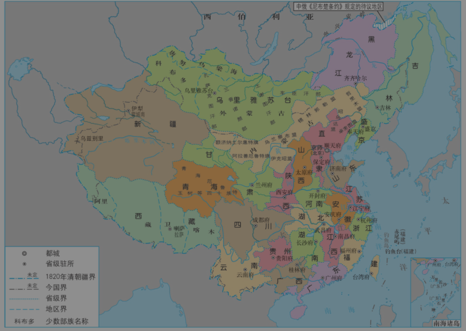

图1-6 清时期疆域地图（1820年）

### 四、省界是怎么形成的？

确定了省作为地方一级行政区划之后，各省的省界又是怎么划分的呢？为什么会出现参差不齐、犬牙交错的省份版图呢？据邹逸麟（2001）考证分析，在地方行政区划的分界问题上，历史上出现过“山川形便”和“犬牙交错”两个主要原则，但这两个原则又是冲突的。“山川形便”意味着利用山河的天然屏障作为分界线，好处是划界比较简单，容易抵抗外部威胁，但坏处是每个省都可以形成军事割据，对抗中央，从而加大内部威胁。而“犬牙交错”意味着各省份相互嵌入、相互制衡，好处是可以降低地方对抗中央的风险，减少内部威胁，但坏处是一旦外敌入侵，各地容易被各个击破。根据“内外部冲突的双均衡分析框架”理论，可以得出：如果一个王朝主要面临外部威胁，那么它倾向于依据“山川形便”的原则设置行政区划，这样便于通过分权发挥地方的积极性，从而抵御外敌入侵；反之，如果一个王朝主要面临内部威胁，那么它倾向于依据“犬牙交错”的原则设置行政区划，这样便于通过加强中央集权来防止分裂。那么，历史果真是这样吗？

历史上，唐朝前期盛极一时，内部一片太平，但外部威胁较大。当时，突厥、吐蕃、契丹和南诏等少数民族政权不断威胁着唐朝政权。为了防止外患，唐朝在设置地方最高监察区划“道”的边界时，就必须考虑分权的制度安排，在地区划界时主要考虑自然地理条件。据《新唐书·地理志》记载：“太宗元年，始命并省，又因山川形便，分天下为十道。”从地理上看，中国的主要山川都是东西走向的，与纬线平行。因此，唐朝的“道”就设置为东西长、南北窄，如同横着的油条，确实遵循了“山川形便”的原则。贞观元年（627年），全国分为十道：关内道、河南道、河东道、河北道、山南道、陇右道、淮南道、江南道、剑南道、岭南道（图1-7）。其中，江南道位于长江以南、南方五岭（越城岭、都庞岭、萌渚岭、骑田岭、大庾岭）以北，是典型的根据大江大山划界的区域。不过，当时的道只是监察区，不是实际的行政区（周振鹤，2013）。到唐玄宗时期，开元二十一年（733年），全国由十道改分为十五道，如江南道进一步细分为江南东道、江南西道、黔中道，安史之乱后，节度使兼领监察权、行政权，道逐渐与藩镇合流，唐人往往以“道”指称藩镇。道在唐后期成为事实上的州上一级的行政辖区。

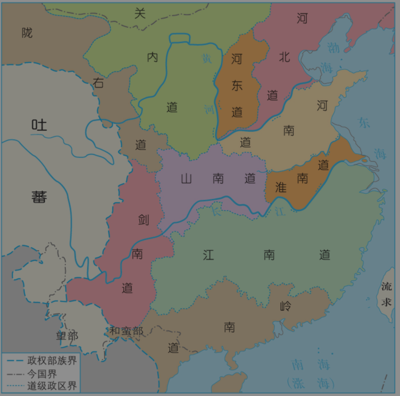

图1-7 唐朝十道地图

到了宋朝，因为宋太祖赵匡胤本人就是利用陈桥兵变这种内部冲突当上皇帝的，所以他称帝后极力加强中央集权，防止内部冲突。在中央层面，他削弱相权，牵制六部。例如，在正宰相（同平章事）和掌管财政这一原属户部核心业务的三司[^17]之外，另设参知政事为副宰相。在地方层面，宋太祖以及之后的皇帝将全国分为十几个“路”（相当于省）。并且，路的划界原则就是“犬牙交错”，以便各地之间相互制衡，避免内乱。到了元朝，虽然疆域空前辽阔，但蒙古贵族统治者最担心的就是内部威胁，于是统治者在设置行省和路的边界时将“犬牙交错”的原则发挥到了极致。与唐朝相反，元朝把很多行省的边界划成南北长、东西窄的形状，从横着的油条变成了竖着的麻花。

一个典型的例子是陕西省。元中期调整后的陕西行省辖境大部分延续至今，方便起见，我们以今天的陕西省地形示意图来理解这一例“犬牙交错”，见图1-8。秦岭本是长江和黄河流域的分水岭，也是一座天然屏障。秦岭以南属亚热带气候，以北属暖温带气候。因此，秦岭被看作中国南方和北方地理分界线的一部分。如果考虑“山川形便”，那么秦岭南北应该分出两个省。但是，在元朝的行省分界中，陕西省居然越过了秦岭，甚至囊括了汉中盆地，插入四川省境内，省界呈现为一个竖立的麻花形状。这样的分界设计，是为了防止四川省利用秦岭作为天然屏障形成军阀割据。

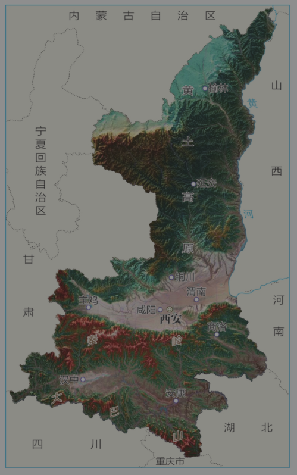

图1-8 陕西省地形图

刚才讲了元朝的例子，接下来讲讲明朝和清朝的例子。淮河和长江将华中和华东地区分为上中下三个长方形，但如果是单纯考虑“山川形便”的原则，那么淮河以北应该是一个省（比如叫淮北省），淮河以南、长江以北应该是一个省（比如叫淮南省），最后长江以南应该是一个省（比如叫江南省）。大家再回头看看图1-7，会发现真的就有三个道：河南道（相当于淮北省）、淮南道（相当于淮南省）、江南道（相当于江南省）。

但是，在明朝定都南京之后，朱元璋为了把首都做大做强，同时防止淮河南北的地区形成军事割据、对抗中央，就以南京和他老家凤阳为中心，画了一个圈设为“直隶”，纵跨淮北、淮南和江南三个根据大江大河分出的地区。迁都北京后，这块区域被称为“南直隶”。入清之后，这个南直隶就成了江南省。江南省和江西省合称“两江”，这是清朝最富庶的地区。富到什么程度呢？清朝初年，江南省的赋税占全国的三分之一，科举考试的上榜人数冠绝全国，其中被录为状元的人数更是几乎占到全国的一半！因经济实力拔群，两江总督号称“天下第一肥缺”，晚清名臣曾国藩、左宗棠都担任过这一显赫职位。问题是，江南省富可敌国，地方又大，才子又多，皇帝不放心啊。怎么办？拆！康熙六年，江南省一分为二，左半边是安徽省，右半边是江苏省（图1-9）。现在，江苏省横跨淮河和长江，相当于对着前面的淮北省、淮南省和江南省纵向切了一刀，完全破坏了淮河与长江的天然屏障。拆完之后，安徽巡抚驻安庆，江宁巡抚（后改称江苏巡抚）驻苏州，而统管安徽、江苏、江西三省的江南江西（两江）总督衙门仍然驻江宁（南京）。安徽、江苏两省分界，栩栩如生地体现了“犬牙交错”的原则。更“奇葩”的是，在清朝中期之前，管理政令、财赋出纳等事务的安徽布政使司一直寄治江宁府，而通常布政使治所应该是本省首府。在地理位置上，南京就像一只狗头，咬住了小半个安徽省。在这个意义上，南京被戏称为“徽京”，不是没有道理的。如果你被绕晕了，那就对了，因为这种相互牵制的行政机构设置，就不是用一般的思路设计出来的。这就好比说，河北省唯一的211大学——河北工业大学，它不在河北，在天津。乾隆二十五年（1760年），安徽布政使司署迁往安庆，安徽官员总算是离开了江苏省。这下江苏省该消停了吧？该设本省的布政使了吧？是设了，不过设了两个：一个在江宁（南京），另一个在苏州。为什么一个省要设两个布政使（相当于“常务副省长”）呢？因为南京和苏州两个地方的综合实力都非常强，而朝廷希望让两者相互牵制。但这种牵制是有代价的。前面说过了，按照“犬牙交错”设置边界，虽然有利于减少内乱，但是难以抵御外部入侵。太平天国从广西金田起义，到定都天京（南京），能够盘踞十年，占据清朝东南半壁江山，几乎让清朝完蛋，其实与江南地区无险可守的“犬牙交错”划界原则有很大关联。

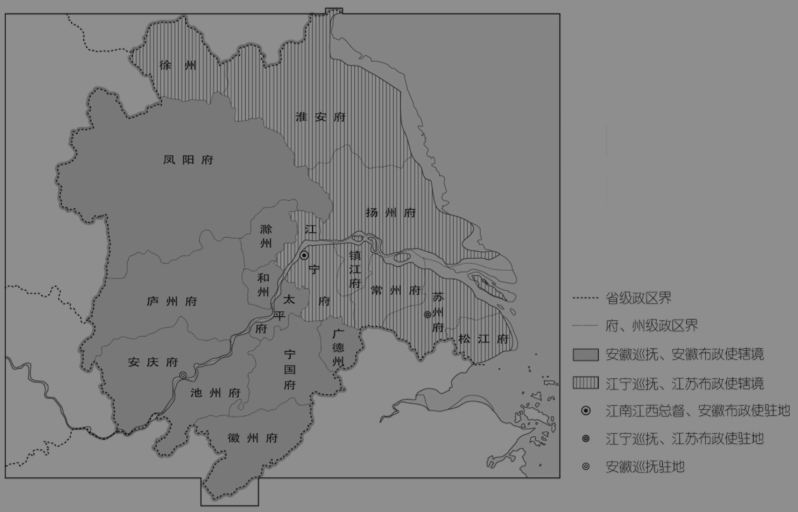

图1-9 清时期江南省分为江苏、安徽两省（1667年）

并设两个布政使分驻后，江苏省内南京和苏州两个经济中心的格局也已然形成。如今，南京是省会城市，而GDP排名全省第一的是苏州。在官员级别上，南京市委书记和苏州市委书记通常都是由省委常委兼任，都是副部级。上述两地的建制沿革，恐怕也是导致江苏省至今缺乏“龙头”、形成了“散装十三太保”局面的历史原因之一。可见，历史的一次“小折腾”，就可能导致当代的一个大转折。亦可见，经济的背后是政治，政治的背后是历史，而历史的背后是政治经济学。因此，我经常说“中国的问题，归根结底都是政治经济学问题”。

当然了，理论往往是极端的，现实往往是复杂的。“山川形便”和“犬牙交错”代表了两种极端，现实中很多省份的边界都经历了漫长的演变，而不是一成不变的。而且，一旦省界确定，再要调整，还会产生额外的行政成本。因此，从当代中国地图上看，中国的省界既有参差不齐的地方，也有依山川河流划界的地方。起码从地名上看，中国大陆31个省份，不少都带有“山”“河”“江”字。

回到一开始的中美地图差异问题。中国今天的省级行政区划版图，很大程度上来自明清时期的历史遗产，而明清时期正是中国的大一统时期，朝廷主要面对内部威胁，因此会倾向于集权的制度安排，这就导致了省界的犬牙交错。而美国是先有各州殖民地，后有联邦政府，并且在英国殖民时期内部威胁较小，再加上西部开发，客观上造就了一种分权的制度安排，由此促成了相对整齐的地区边界。

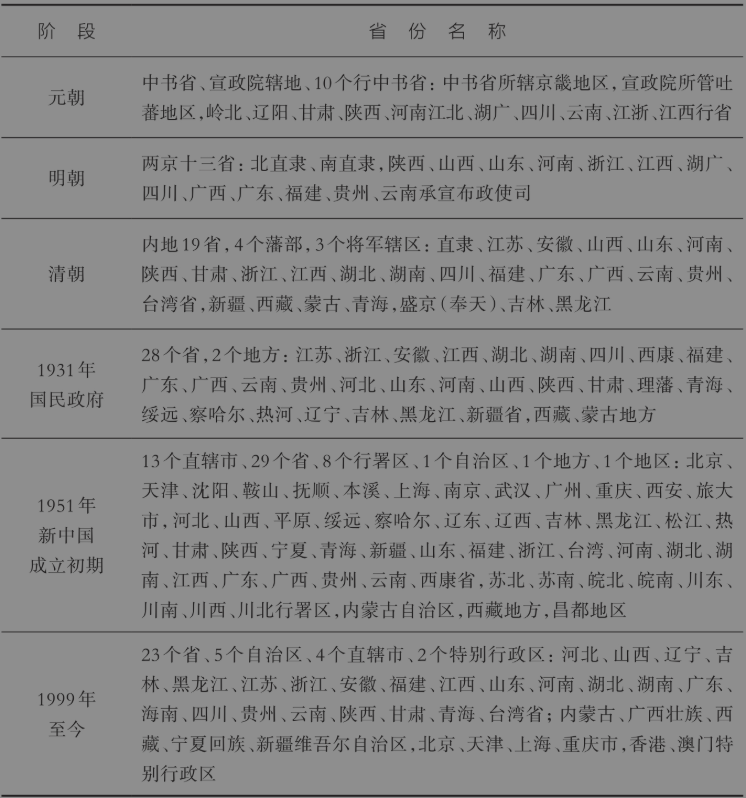

表1-1 中国省份名称演变

注：到了1931年国民政府时期，省级行政区划跟现在非常接近。1951年新中国成立初期，中国一度有13个直辖市，这段历史也可以解释为什么现今有些地方“蠢蠢欲动”，想成为中国第五个直辖市。实际上，1999年澳门回归之后，省级行政区划就没有再变动过

## 第三节 古代为什么皇权不下县？

### 一、中国古代基层治理架构

在过去的2000多年里，中国的基层治理架构、行政区划并没有根本上的变化，都是沿袭了自秦汉以来的传统。因此，要从根本上理解中国的基层治理，除了从理论上理解国家治理的顶层设计，还要从历史中汲取国家治理的经验和教训。秦汉时期，国家治理最核心的架构就是郡县制，全面推行郡县制也是秦始皇统一中国之后的一大政绩。所谓郡县制，就是地方行政区划主要分郡、县两级，郡的行政级别相当于今天的省，郡下设县，郡守与县令都由皇帝直接任命，而不是在封建时代那样由领主或贵族世袭。郡县制的确立，标志着封建制的瓦解。所谓封建制，就是分封建制，将国土分为若干个封国或者诸侯国来治理。正因为秦始皇在全国范围内推行了郡县制，奠定了中国基层治理架构的雏形，所以毛主席对秦始皇的历史功绩给予了充分评价，其中有两句最广为流传，一句是“劝君少骂秦始皇”，另一句是“百代都行秦政法”。

为什么说“百代都行秦政法”呢？因为自秦汉之后，中国基层的行政层级基本上都是沿袭郡（州）—县两层结构或者省—府—县三层结构。例如，清朝时期的地方行政层级如下图（图1-10）。除了两京（首都北京、陪都盛京）和边疆特殊政区，地方上级别最高的行政单元是省（相当于秦朝的郡），省下面有府（相当于今天的地级市），跟府平行的行政区划还有少数的直隶州和直隶厅。府下面主要是县，此外还有一些散州和散厅跟县平行。[^18]

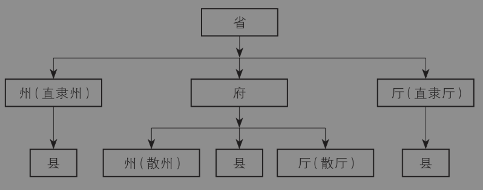

图1-10 清朝行政层级

跟今天对比，我们会发现，过去的省还在，省下面的府变成了今天的地级市，而省下面的州、厅依然是和地级市平行的厅局级单位，府下面的县也在。而且，有人统计后发现，“县”作为一种地方基层行政建制，其数量基本一直保持在1500个左右，甚至许多县初始的名称和治所位置都保留至今。大家应已注意到，在图1-10中，县以下就没有正式的行政区划了。所谓“万事胚胎，皆在州县”。我们看各种历史题材的电影电视，就会发现最小的地方官员是知县，属于“七品芝麻官”。知县再往下，就没有朝廷正式任命的官员了。可见，在古代，皇帝的指令一般到达县级为止，县以下皇权不再干涉，主要依靠乡村自治。这种治理体制就是所谓的“皇权不下县”，这是古代国家治理和政治制度的重要特征。因为县以下就是乡，所以这个观点也称“皇权不下乡”。

“皇权不下县”这个观点最有名的支持者，应该是著名社会学家费孝通先生。他在1948年出版的《乡土重建》这本书中指出，中国虽然自秦始皇之后确立了中央集权的行政制度，但专制政治受到两道防线的严厉限制。一是政治哲学里的无为主义。例如，古代君主很多都推崇“黄老”思想，强调“无为而治”，这甚至被视为开明君主的一种“德治”境界。二是行政机构在治理范围上受到严重限制。中国地大物博，疆域辽远，从京城到省城，再从省城到县城，还有专门的“官道”，但是再往乡村，交通就非常不便利了。因此，中央所派遣的官员就到知县为止。俗话说，“天高皇帝远”。由于这种思想上和地理上的限制，“集权的中央悬空起来，不使它进入人民日常有关的地方公益范围之中”。费孝通把这种治理结构称为“双轨政治”，一轨是自上而下的专制皇权的轨道，另一轨是自下而上的绅士自治的轨道。在这种“双轨政治”格局下，基层地方官的职责“近于闲差”，其任务“不过于收税和收粮，处理民间诉讼”。[^19]

著名历史学家秦晖（2003）进一步指出，“皇权不下县”的完整表述其实是：“国权不下县，县下惟宗族，宗族皆自治，自治靠伦理，伦理造乡绅。”这里说的“乡绅”，主要由两部分人组成：第一部分是有官职而退居在乡者，即所谓的“绅”或“大夫”；第二部分是乡村里以族长为代表的实际事务治理者。比如说，小说《白鹿原》里的白嘉轩，便是后一类乡绅的典型代表。

既然县以下的乡村自治主要依靠乡绅，那么有必要介绍一下乡绅的作用。古代的乡绅至少有三重职责。第一，依靠伦理道德维持乡村秩序。在小说《白鹿原》里，白嘉轩作为族长，要负责惩罚违背祖宗家法或者乡规民约的人。比如，他命人用一条麻绳把八个赌徒的双手捆绑在槐树上，然后又命人用干枣刺刷子抽打，打得他们鬼哭狼嚎。第二，提供乡村公共物品。这里说的公共物品是一个经济学概念，指具有非排他性和非竞争性的劳务和商品，包括社会治安、集体设施和教育文化等。比如，白嘉轩率领村民求雨，排解村里纠纷、兴修祠堂，甚至还暗中组织了抗税活动。第三，帮助官府征税，主要是收缴钱粮。没有乡绅的合作，官府别说收粮，连每家每户有多少人都搞不清楚，更不用说每家的土地有多少，亩产是多少。因此，乡绅在很大程度上承担了“包揽钱粮”的任务，而征收钱粮是最重要的国家治理活动之一。[^20]

地方官员和乡绅之间存在既合作又竞争的关系。一方面，地方官员不得不依赖于乡绅的合作，另一方面又经常面临乡绅凭借信息优势和特权逃税的麻烦。根据清代经济史专家王业键（2008）的估计，明清大部分时期国家的正式财政收入主要来自农业税（清朝晚期除外），而农业税大概只占到农业产出的3%。如果按照古代长期盛行的什一税（也就是10%）来计算实际税率，那么这就意味着剩下的7%都被地主和乡绅攫取了。在地主乡绅和朝廷之间，朝廷居然只拿到了小头，地主乡绅拿走了大头。因此，有学者认为，乡村治理过程中，绅士与地方官员各自以不同的方式行使着自己的权力，从而形成了二者既协调合作又相互矛盾的关系格局。总之，不管是维持秩序，还是征收钱粮，这些功能在县级以上，都是由朝廷任命的地方官员来承担的。因此，乡绅就相当于乡村的实际管理者，但他们并非国家任命的地方官员，因为不从国家领取俸禄。

除了费孝通先生，一些外国学者对中国古代的治理特征也持有与“皇权不下县”类似的看法。例如，早在20世纪初，大名鼎鼎的社会学家马克斯·韦伯（1993，第110页）就认为，“事实上，中华帝国正式的皇权统辖权只施行于都市地区和次都市地区。……出了城墙之外，中央权威的有效性便大大地减弱乃至消失”。美国的中国问题专家罗兹曼（1988，第272页）也说：“在光谱的一端是血亲基础关系，另一端是中央政府，这二者之间我们看不到有什么中介组织具有重要的政治输入功能。”

对于“皇权不下县”作为中国古代基层治理的特征，学术界也并非没有争议，争议的焦点是，究竟怎么理解“皇权不下县”。如果理解为“官不下县”，即国家正式的行政机构和官职只到县一级，县以下没有官僚机构，那么这一观点多数人都同意。如果理解“权不下县”，即朝廷对县以下的区域缺乏实际控制力，那么很多人可能不会同意。例如，秦晖（2003）就认为：“只要处在帝国官府的控制下，那里的乡村仍然是编户齐民的乡村，而不是宗族的乡村。”

中国古代从汉朝到唐朝一直实行“乡里制度”。所谓“乡里制度”，就是由“乡”“里”构成的乡村控制制度。秦汉时期，朝廷建立了“郡—县—乡—里（亭）—什—伍”的行政管理架构（图1-11）。五户为伍、十户为什，百户为一里，十里为一乡。我们今天说的“乡里乡亲”，里面的“乡”和“里”都是治理单元。有人认为，从汉到唐，乡、里的头目都算是朝廷的官职。不过到了宋代，他们已经完全失去了“官”的身份，属于“职役”，就是给政府打杂的，出了事要顶包的“临时工”。不过，到了20世纪30年代推行保甲制度后，这些职役又有了“体制内”的身份。比如，《白鹿原》中的另一个男主角鹿子霖所担任的“乡约”，就相当于民国政府任命的乡长。按鹿子霖的话来说：“乡约，下辖包括白鹿村在内的十个村庄，起码不在白嘉轩之下了吧？”

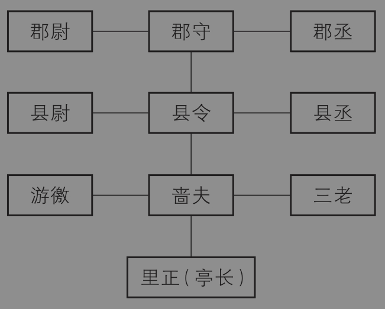

图1-11 秦汉时期的乡里制度

### 二、为什么古代皇权不下县？

问题是，在“普天之下，莫非王土；率土之滨，莫非王臣”的专制时代，为什么会出现“皇权不下县”这种皇权真空地带呢？对比之下，为什么新中国成立后，中国共产党能够成功地在最基层的村和乡建立组织呢？基于内外部冲突的双均衡分析思路，我提供一个活力—秩序分析框架（图1-12）。[^21]任何一个国家都面临“活力”和“秩序”的权衡取舍。要让社会保持活力，就要充分分权，中央把权力下放给基层。但分权可能导致社会混乱，失去秩序。反过来，要让社会保持秩序，就要加强国家干预，这会导致集权。但集权时缺乏监督，会导致官僚主义和腐败问题。这意味着任何一个社会都面临两类成本或者风险：一类成本是集权导致的腐败成本，另一类成本是分权导致的失序成本。在这里，我们将活力或秩序纳入了与分权或集权对应的均衡制度集合之中，从而进一步拓展了双均衡分析框架的解释力。

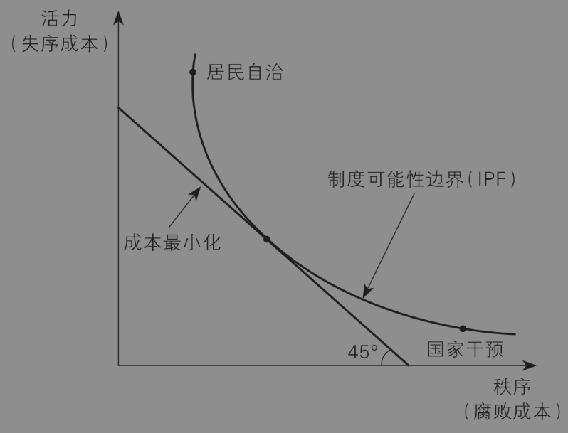

图1-12 活力与秩序的权衡取舍

在图1-12中，横轴表示社会秩序，它同时对应了腐败成本；纵轴表示社会活力，它同时对应了失序成本；中间那条直线表示成本最小化的约束线，类似于微观经济学中的预算约束线；上面那条曲线代表制度可能性边界（IPF），即可以选择的制度集合，类似于微观经济学中的无差异曲线。“居民自治”和“国家干预”分别代表自治和秩序的两种极端状态。因此，一个国家能够采取哪种制度安排，主要取决于如何实现失序成本和腐败成本之和最小化。而这两类成本在很大程度上是由信息不对称决定的。这里所谓的信息不对称，是指中央和地方之间、上层和基层之间存在信息不对称，后者相对于前者具有信息优势。例如，某个县发生洪水灾害时，中央和省里可能并不清楚究竟有多少人受灾，导致了多少经济损失，哪些人需要政府救助，但是县里和乡里显然更了解这些信息。要解决信息不对称，降低腐败成本和失序成本，关键是需要两类技术：一是通信技术，二是交通技术。比如，打个电报，或者开通铁路，就可以快速了解当地的民情、灾情和军情，中央就可以改善相对于地方的信息不对称状况。有趣的是，慈禧太后作为一个顽固的保守派，最后之所以同意开设电报局和修建铁路，正是因为考虑到地方平叛的需求。毕竟，对于危如累卵的晚清政府来说，这简直就是“刚需”。

在中国古代，直到晚清之前，通信技术和交通技术都非常落后，而中国又是一个疆域广阔、地区差异很大的国家，因此信息不对称导致的成本非常高。而且，越是基层，越是山区，越是不发达地区，或者语言交流有一定困难的少数民族地区，这两类成本就越高。在这种情况下，朝廷要减少治理成本，就要在基层单位实行放权，借助乡绅实现自治，即靠近曲线上的“居民自治”那个点。因此，“皇权不下县”其实是一种在通信技术和交通技术不发达条件下实现治理成本最小化的理性选择，是一种“次优”方案。它既不体现皇帝“无为而治”的道德理念，也不是皇帝对小民的仁慈关切，更不表明皇帝把乡绅当作“体制内”的人。

我提出的这个分析框架，与著名历史学家黄仁宇的“数目字管理”理论是高度一致的。黄仁宇（2008）在他最有名的著作《万历十五年》中指出，中国社会是一个上层和下层构成的潜水艇式“三明治”，上下层之间缺少同期欧洲资本主义生产关系中的那种中层黏合剂，这种黏合剂就是一整套可以用数字进行测量的政治和社会组织机构。中国传统社会讲究“以德治国”，试图通过官僚集团的个人品德修养来维系上下层关系。和“数目字管理”方式相比，“以德治国”是非常低效的，不足以维系整个社会的有机运转。这就必然造成了中国传统社会最高权力和下层民众的分离，因此无一例外最终都会导致整个社会的失控、动乱乃至改朝换代。在黄仁宇看来，国民党继承的就是这样一个有待通过数目字进行整合的传统社会，以至于当蒋介石通过对日宣战的方式将整个国家至少表面上统一起来的时候，不少地方的税收使用的居然还是明代的土地和人口信息！如果你把“数目字管理”理解为一种解决信息不对称的方式，那么我的框架和黄仁宇的观点就是一致的。

与国民党不同，共产党是依靠农工群众起家的，革命成功的战略就是“农村包围城市”。因此，对共产党来说，基层的信息不对称是不存在的，而且这种信息优势反而构成了革命成功的基础。并且，在新中国成立之后，中国政府已经建立起了直达村庄的组织体系。

讲到信息不对称，有人可能会问：难道历代皇帝君主不知道信息的重要性吗？他们建立驿站、建立锦衣卫、重用军机处、扩大“密折奏事”，不就是为了解决信息不对称吗？没错，历朝历代无数君主都想减少中央和地方之间的信息不对称，甚至为此付出了巨大的代价。但是，这些尝试基本上注定是失败的。马伯庸（2019）的历史纪实作品《显微镜下的大明》生动地还原了历史情景，其中就有一章叫《天下透明——大明第一档案库的前世今生》。听名字，你就知道这是大明王朝试图解决信息不对称的努力，但是成功了吗？并没有！

户口制度是每个朝代收税、征兵的基础数据，可以理解为我前面讲的信息技术。明朝开国皇帝朱元璋雄心勃勃，试图构建一个天下第一的超级大型户口档案馆。洪武十四年（1381年），朱元璋下令以户为单位，每户详列籍贯、姓名、年龄、人口、田宅、资产等，逐一登记在册。每一百一十户人家统一编入一册户籍档案。因为封面用黄纸，故称“黄册”。黄册的规格有非常严格的要求，用纸要好，规格要齐，最关键的是，每一页如果有一个字写错，就必须整页重抄，不得涂抹挖补。为了保护黄册，朱元璋费尽心思，将存放地点定于南京玄武湖的湖心小岛上，以保证“防火、防盗、防丢失”。黄册库正式建立后，正册共计53393册。以后每十年要更新一次，每次大约增加六万到七万册。每到新册入库之年，朝廷都要从国子监调来1200名监生，进行“查册”工作。

看到这里，你不得不佩服朱元璋的野心、远见、严谨。但即便如此，也无法解决古代户籍制度以及其他数目字管理所面临的三重困境。第一，技术上难以实现信息更新。古代没有计算机，无法进行精确计算，而且纸质文件也很难保存和修改。遇到灾荒、战争、瘟疫等重大冲击，百姓流离失所，乡村根本不可能准确地统计人口，更不用说统计资产了。想想看，直到2023年中国才实现了房地产信息全国联网，而这一浩大工程在当代中国也耗时约10年。第二，在经济层面上，不断发展的商品经济冲击着传统的农业生产秩序，加剧了人口和财富的变化。明朝正是古代商品经济发展的高峰，是部分学者眼中的资本主义萌芽时期。如果是秦汉时期，这事没准还真能办成。第三，制度上存在腐败漏洞。黄册库的管理者对内容拥有“一票否决权”，这就给了他们敲诈地方政府的天然借口，而地方政府又可以借机敲诈当地百姓。所以，这个管理制度本身就存在一个悖论：信息不出错，官吏就没油水；信息如果出错，那要它有何用？一个天大的笑话是，明朝在崇祯十七年（1644年）就灭亡了，但一位清初的官员发现，黄册库中居然编制了崇祯二十四年的户口人丁数字。这简直就是反向穿越了。

## 第四节 中国国家治理的根本逻辑

### 一、制度是解开中国治理之谜的钥匙

在前面的分析中，我将当代中国国家治理的根本特征归纳为“条块结合”，然后回溯历史，从央地博弈的角度分析了中国省界划分的依据，并解释了自古以来“皇权不下县”的经济学逻辑。在本节中，我将提供一个统一的分析框架——内外冲突的双均衡分析框架。这个统一框架不仅能将之前的“条块结合”、行政区划和基层治理纳入其中，并且可以解释官员治理、政策实施等更为丰富的制度安排，从而厘清中国国家治理的根本逻辑。横向来看，国家治理是一连串互补的制度安排，因此我们不能孤立地看待某一项制度或政策；纵向来看，中国国家治理的根本逻辑似乎贯穿古今，这印证了制度经济学的一个重要理论：过去的制度决定了现在的制度，现在的制度决定了经济绩效（Acemoglu et al.，2001）。

中国国家治理之谜的答案隐藏在制度之中。在历史的长河中，由于人类的欲望是无限的，而资源总量是有限的，因此国家之间或者一国内部不同政权之间，通常存在激烈的竞争。从长期来看，竞争的结果应该是效率更高的国家或政权更可能生存下来并且不断扩张，而效率更低的国家或政权会衰退、缩小甚至被消灭。国家治理的前提当然是国家本身是存在的，因此生存效率是国家治理的首要问题。

那么，是什么决定了一个国家或政权的效率呢？经济学家的答案是：制度（institution）。根据1993年诺贝尔经济学奖得主道格拉斯·诺斯（Douglass North）的观点，制度是指“人为设计的一系列规则、程序、道德和伦理规范，以便约束试图最大化委托人财富或效用的个人”（North，1981）。从17世纪西欧的兴起到18世纪开启的工业革命，乃至自16世纪到21世纪发生在欧洲多个海外殖民地的“财富逆转”，经济学家们通过大量长时段的经济史研究证明，“制度是重要的”（institutions matter），而且制度是长期经济增长的根本因素。因为制度塑造了一个社会中关键经济主体的激励，特别是影响了对物质和人力资本、技术和生产组织的投资。[^22]从逻辑上讲，制度决定了各类要素的投入—产出效率，因此制度不仅决定了经济效率，也应该决定了行政效率和军事效率。总之，效率决定生存，而制度决定效率。既然制度在长期中决定了国家的生死存亡，我们当然要从制度上总结几千年来中国国家治理的基本规律。

其实，中国古代先贤很早就意识到制度的重要性。在北宋司马光编撰的《资治通鉴》中，开篇的两段话就很有代表性：

臣闻天子之职莫大于礼，礼莫大于分，分莫大于名。何谓礼？纪纲是也。何谓分？君臣是也。何谓名？公、侯、卿、大夫是也。

夫以四海之广，兆民之众，受制于一人，虽有绝伦之力，高世之智，莫不奔走而服役者，岂非以礼为之纪纲哉！[^23]

这两段话的大意就是：皇帝只有一个人，能够治理国家主要是依靠“礼”这种制度。礼在本质上就是一种等级制度，皇帝管大臣，大臣管百姓。大家都按制度来，这样才能实现国家治理。要知道，司马光起初编撰《通志》的一大目的，就是给皇帝治理国家提供借鉴，所以他在开篇就点明了制度的根本作用。宋神宗也以其“鉴于往事，有资于治道”赐名为《资治通鉴》。在我看来，开篇这两段话就是《资治通鉴》的精髓，也是中国古代乃至现代国家治理的精髓。

既然制度是打开中国国家治理之谜的钥匙，我们就从制度的角度来解释国家治理的根本逻辑。这意味着，我们把国家治理体系理解为一整套制度体系。广义的制度不仅包括政治、经济和法律制度，也包括重大的政策和措施。对于国家治理而言，核心的问题是官员治理，这包括官员的考核、激励、选任和履职等一整套制度。制度决定了组织的行为和绩效。本节一方面是论证从古至今，在漫长的历史演进中，为什么会形成不同的国家治理体系，另一方面是分析不同的国家治理体系对经济效率、行政效率和军事效率的影响。

### 二、一个内外冲突的双均衡分析框架

#### 1. 基本假设和主要命题

为了回答何为中国国家治理的根本逻辑这个重大问题，下面我将系统地推论前文提到的分析框架。我将这个分析框架命名为“一个内外冲突的双均衡分析框架”。这里的“内外冲突”是指内部稳定和外部稳定两者之间存在一定程度的冲突，这种冲突关系决定了组织必然在集权（centralization）和分权（decentralization）这两种均衡之间作出选择。从组织经济学的角度讲，古今中外，不管是国家、企业还是军队，所有的制度类型或者组织架构归根结底可以分为两类：集权制度和分权制度。[^24]集权意味着上级、中央或总部拥有一些重大决策权，而下级、地方或分部只是执行机构。相反，分权意味着下级、地方或分部拥有一些重大决策权。例如，在一个企业集团中，如果下属公司是利润中心，或者在重大投资、人事招聘、产品研发和市场战略方面拥有较大的自主权，就说明企业集团向下属公司实行了分权体制。当然，集权和分权本身是相对的，不是绝对的。如前所述，制度决定效率，效率决定国家的存亡。那么，为什么不同的国家或者同一个国家在不同的时期会形成集权或分权这两种不同的制度均衡呢？这是我们的分析框架要回答的核心问题。

我们的分析框架有三个关键假设。

**假设1：稳定是最高目标。**

古今中外，政权的最高目标都是维持稳定，这包括内部稳定和外部稳定。内部稳定是指国内政局比较稳定，社会秩序较好，没有严重的灾害。内部稳定意味着消除内部威胁，确保内部安全。外部稳定是指统治者与统治集团外部势力（包括外部敌对政权及外国统治者）之间没有大规模的战争，统治者没有被外部势力推翻的威胁。外部稳定意味着外部威胁可控，确保外部安全。[^25]一般认为，发展经济和提供公共服务是现代国家的基本职责和主要目标。但是在漫长的历史上，特别是18世纪工业革命之前，技术进步非常缓慢，世界各国的生产力水平都比较低且差异不大，[^26]在这种情况下，确保稳定成为政权“字典式偏好”中的最高目标。

即便到了生产力水平已日新月异的今天，即便已经走出了农耕时代，对稳定的迫切诉求依然不减分毫。2023年，我在基层调研时，一位镇长对我坦言：我最近一个星期都在乡下，带着驻村干部一起来的，主要是处理维稳问题。我们是一个乡镇，基本上没有啥工业，招商引资来的企业都入驻县里的工业园区了，但是税收可以跟我们分享一些。说白了，现在的基层治理，还是稳字当头。你要是闹出一点舆情来，比如村民与干部发生冲突，村民上访，或者因为环境污染被媒体曝光了，有人在网上发帖声称腐败了，我们干部都吃不了兜着走。十八大之后，讲究全面从严治党，就是政治规矩第一，纪律第一，稳定第一。我是这么理解的。经济增速慢一点没事，我们现在没有严格的GDP考核，但是稳定出了问题的话，那是要动干部的，就是要掉乌纱帽了。我跟村干部都是这么要求的，他们更是挺在一线。

**假设2：内忧外患是一对永恒的矛盾。**

虽然每一个政权都想维持稳定，但是在资源有限并且国家内部差异很大的前提下，统治者通常必须在实现内部稳定和实现外部稳定之间权衡取舍。为了实现外部稳定，统治者需要协调全国各地的经济、军事和人力资源来消除外部威胁，此时内部稳定只能退而求其次；反过来说，为了实现差异化较大的国内各地区的稳定局面，统治者又需要一个比较安全的外部环境。[^27]《左传》说：“国之大事，在祀与戎。”[^28]即国家的大事就是两件：祭祀和战争。祭祀是统治者通过祭拜神明、祖宗等仪式强化执政合法性，本质上是通过意识形态投资实现内部稳定，而战争则是通过军事征服或者威慑实现外部稳定。古人这句话充分揭示了治国者面临的两大权衡取舍——内部稳定和外部稳定，此即“内外冲突”。

**假设3：交通网络和通信技术决定治理成本。**

统治者确定将内部稳定或外部稳定作为工作重点之后，将面临两类约束：内部约束是资源有限，即资源约束；外部约束是存在于国家之间或者政权之间的竞争，即竞争约束。因此，在效率决定政权存亡的压力下，统治者希望设计出治理成本最小化的制度安排。如前文的历史探讨中所提到的，我们分析框架的一个关键假设是，国家治理的成本主要取决于两项技术因素：交通网络和通信技术。交通网络在维护内部稳定和外部稳定两个方面都发挥了作用。在维护内部稳定方面，交通网络的通畅性决定了资源在空间上的调动成本，在生产技术给定的前提下直接影响了资源配置效率。在维护外部稳定方面，地理上的交通条件起到了对抗外部威胁的屏障功能。[^29]例如，黄河、长江、山海关、雁门关和长城往往是保护政权的地理屏障。通信技术决定了信息在时间上的传递成本，直接影响了最高统治者的决策效率和决策质量，同样对维护内部和外部稳定具有关键作用。对任何组织而言，信息始终是决策的关键，而交通网络和通信技术都能影响信息的传递。例如，在电报大规模使用之前，中国古代一直高度依赖驿站来运输货物、人员以及传递情报信息。当然，交通和通信这两种技术可以相对分离。例如，古代中国的运河主要功能是运输货物，而传递信息主要依靠驿站。

接下来，我将使用博弈论和契约理论[^30]等经济学方法，推演出关于中国国家治理的若干重要命题。

**命题1：当外部威胁较大时，统治者将优先考虑维护外部稳定，反之则优先维护内部稳定。**

看上去，这与大家熟悉的“攘外必先安内”正好相反，但却是最优的。考虑这样一种情况：一个国内统治者P1，拥有的各种经济、政治和军事资源总和是K1；国内有一个潜在的政权挑战者（比如地方诸侯或军阀）P2，他拥有的资源总和是K2；与此同时，有一个相邻国家E对本国政权构成了威胁，其资源总和是K3；三个政权的资源大小排序为：K2<K1<K3<K1+K2。这意味着，敌国的实力超过了本国在位者或挑战者，但是弱于本国实力的总和。在这种情形下，我们可以说本国政权面临的外部威胁较大，否则敌国对本国就不构成严重威胁。此时，从博弈论的角度讲，在位的统治者的最优策略是联合潜在的挑战者一起应对敌国的入侵。他们战胜敌国之后，再来分配国内的利益蛋糕。假设可供分配的国内利益蛋糕份额总和是100，那么他们博弈的纳什均衡[^31]是X1+X2≤100，其中X1和X2分别代表在位者和挑战者的份额。相反，如果在位者和挑战者先进行内斗，此时敌国的最优策略是先等待再入侵，并且采取各个击破的策略，那么在位者和挑战者的份额都将归零，敌国将获得全部份额。这就是“鹬蚌相争，渔翁得利”。

历史上，当外部威胁足够大时，会对现存政权构成重大威胁，包括影响执政合法性，损害政权完整性，消耗大量资源和注意力，甚至威胁统治基础。因此从理性的角度讲，统治集团内部不同的利益集团应该暂时性地团结起来，一致对外，然后再处理内部的权力和利益分配问题。例如，清朝雍正皇帝刚一登基，罗卜藏丹津就在西北发动叛乱。为了平定西北叛乱，雍正几乎是举全国之力，为负责远征的年羹尧部队提供兵马钱粮的支持。直到西北平叛之后，雍正才腾出手来整顿吏治和财税体制，并且逼迫年羹尧自杀。

当外部威胁较弱或者不存在时，政权将优先维护内部稳定，不轻易发动对外战争。因为战争需要动员大量资源，耗费大量时间，而且存在一定的失败风险。即便没有失败，通常在经济回报上也是不划算的。所谓“杀敌三千，自损八百”，说的是对外战争总体上对双方而言是一种零和博弈。此外，下面的分析将进一步证明，对于大国而言，为了应对外部威胁而进入战争状态往往意味着分权的制度安排，这会进一步削弱政权的稳定。[^32]相比之下，大国的统治者将工作重心放在维护内部稳定上，可以有较大概率获得收益。历史上，大多数王朝对外用兵的时间都只占统治时间的少部分。而且即便对外用兵，也都是在巩固了内部稳定之后。当然，如果把“攘外”理解为对外主动出击，而不仅是被动应对外敌入侵，那么“攘外必先安内”也是一种动态最优的国策。

**命题2：当统治者以维护外部稳定为主要目标时，最优的制度安排是实行分权。**

为了讨论集权—分权的制度安排，我们假设本国的中央政府为P1，下辖两个地区A1和A2。如果中央政府直接决定两个地区的重大事务，我们称这种组织状态为集权；如果两个地区有权决定本地区的重大事务，我们称之为分权。中央政府关心全国的政权稳定，但是两个地区之间存在差异，并且中央和地方之间存在信息不对称。在这种情形下，就会出现所谓的代理问题，即每个地区为了实现本地区的利益最大化，可能会偏离全国利益最大化。

那么，什么情况下集权或者分权是最优的制度安排呢？契约理论的基本结论是：集权有利于加强地区之间的协调，但是会削弱地区的激励水平和加剧信息不对称程度。[^33]因此，统治者必须在加强总体协调和保护下属积极性之间权衡取舍。按照这个逻辑，当统治者面临的外部威胁比较大时，为了维持外部稳定，相对于维护全国政令的统一（协调的重要性），统治者更加依赖下属的激励和信息，因为下属的激励和准确的信息在很大程度上决定了打败外部敌对势力和维护政权安全的成功概率。特别是在通信技术不发达的古代，地区负责人能否根据自己掌握的信息及时作出应敌之策，直接决定了战争的胜负。所谓“将在外，君命有所不受”，就是指在信息不对称的前提下，前线军官的决策权至关重要。因此，当外部威胁足够大时，为了维护外部稳定，分权是最优的制度安排。

雍正初年，为了平息西北叛乱，雍正皇帝不仅调拨全国多省大量粮草支持前线，而且给予年羹尧充分授权。其时，年羹尧身为抚远大将军，是西北战区的最高指挥官，甚至可以节制战区内的总督、巡抚、提督、将军等封疆大吏和当地驻军的一品高级军官。他统领的西北大军有二十万人，几乎占到了当时全国精锐兵力总数的一半。除了军务方面是“一把手”，他还掌握着战区内的政务大权，对西北地区的地方人事任免、钱粮调度都拥有决定权。年羹尧成为事实上的西北地区最高统领。当然，这种空前的授权也助长了他的气焰，加速了他最后的灭亡。

**命题3：当统治者以维护内部稳定为主要目标时，最优的制度安排是实行集权。**

内部不稳定的来源主要有两个：一是地区之间的差异太大，二是地方的权力太大。地区差异太大会导致两个后果。一是加剧地区之间的冲突，资本和劳动力会进一步从贫困地区流向富裕地区。二是由此导致少数有实力的地区更加强大，甚至具备挑战中央的实力。国家治理的基础是国家能力，国家能力主要体现为征税、转移支付和加强监管的能力。已有研究表明，地区之间的竞争可能导致地区差异太大，从而削弱了中央政府的税收能力和维护统一的能力。[^34]而地方的权力太大则直接削弱了中央维护政权稳定的实力。因此，为了维持内部稳定，统治者一方面要缩小地区之间的差异，加强地区之间的协调，另一方面要控制地方的权力，并且自己直接去获取信息。相对而言，在这种情况下，地方的积极性和信息传递的质量就没有那么重要。因此，为了维护内部稳定，集权是最优的制度安排。

仍以雍正皇帝为例。在西北平叛之后，雍正集中精力维护内部稳定，主要工作是整顿吏治和财税体制，主要的改革举措包括清理亏空、实行官绅一体纳粮，以及摊丁入亩、耗羡归公。为了推进“新政”，雍正大权独揽，通过设立军机处削弱内阁的实权。他不仅在中央层面高度集权，而且通过重用“粘杆处”搜集情报、扩大“密折奏事”制度等措施大大强化了中央的信息获取能力。

**命题4：集权和分权是两个均衡的制度体系：集权意味着监督、忠诚和大一统，而分权意味着激励、能力和多样化。**

在中央和地方的博弈关系中，集权和分权形成了两种不同的均衡，本身没有优劣之分。集权和分权不仅是两种组织形式，而且是两套有体系的制度安排，或者说是两套激励系统（incentive system）。在官员治理机制上，集权和分权分别包含了不同维度的要素，这些要素之间是相容的，并且不同维度的要素不能随意在集权或分权的场域中调换，否则会导致总体激励扭曲。[^35]

在集权制度下，为了维护中央的协调权威，减少地区之间的差异，中央会设计一整套制度安排。在激励机制方面，中央必然会加强对地方的监督，而不是通过以结果为导向的激励机制来鼓励地方自主发展。在选拔官员方面，中央会更看重地方官员的忠诚，即不折不扣地执行中央的政令。在政策执行方面，为了减少地区差异，中央制定的政策在地方执行过程中不能留下太多空间，甚至会实行“一刀切”。在行政区划方面，为了削弱地方挑战中央的实力，防止内乱，中央会倾向于按照“犬牙交错”的原则来划分地区边界，即打破由山川河流构成的自然地理边界，人为地将不同地理单元的行政区划相互嵌入，以防止某个地方形成割据和对抗中央。因此，集权作为一种均衡的制度体系，它实际上至少包含了监督、忠诚、“一刀切”、“犬牙交错”这些组成要素。这样一套集权制度体系可以有效维护内部稳定。

在分权制度下，中央首先要考虑如何尽可能地调动地方的积极性，联合起来应对严重的外部威胁。因此，在激励机制方面，中央会提高对地方的激励强度，表现为主要依据结果对官员进行考核，而不是主要监督其工作过程。在选拔官员方面，中央会更看重地方官员的专业能力，因为它需要地方官员充分发挥创造性和创新精神。在政策执行方面，既然是分权，那么就会允许地区根据自身情况优化中央的决策部署，即因地制宜制定细化政策，形成多样化的格局。在行政区划方面，为了让地方有能力应对外敌入侵，中央在设置地区边界时会倾向于按照“山川形便”的原则来划界——根据山川河流的自然地理特征来划分行政区域，使行政区域与自然地理区域相一致，尽量避免一个行政区域内部存在山川河流的阻隔。因此，分权作为一种均衡的制度体系，它至少包含了激励、能力、多样化、“山川形便”这些组成要素。

**命题5：交通网络和通信技术会影响治理成本。其他条件不变，交通网络越是发达，或者通信技术越是发达，最优的组织形式就越是倾向于集权。**

前面在分析集权和分权两种制度均衡时，我们主要分析了外部威胁的作用。但正如前面所言，外部威胁和治理成本都会影响制度安排。下面重点分析交通网络和通信技术对制度均衡的影响。我们把这两类技术的变化看作是一种外生的冲击，因此命题5其实是一种比较静态分析[^36]的结果。假如交通条件实现重要进展或重大技术进步，例如大型运河的开凿或者铁路、飞机的发明，那么交通网络就会更发达，运输成本就会更低。此时，人流、物流和资金流的充分流动，会导致地区之间的差异缩小，从而降低中央的协调成本。另一方面，交通网络发达会促进统一大市场的形成，从而加剧地区之间的竞争，此时竞争会迫使各个地区更加努力。两者结合起来，一方面是提高了中央的协调收益，另一方面是降低了中央对地方的激励成本，因此会使均衡的制度从分权向集权方向移动。通信技术的进步，例如电报、电脑、互联网和大数据等产品或信息技术的发明，会降低通信成本，从而减少中央和地方之间的信息不对称程度。因此，当地方没有信息优势时，中央就可以降低激励成本，提高监督力度，加强协调功能，此时集权就优于分权了。现有的契约理论或者组织经济学研究主要强调信息在组织结构设计中的中心角色，但回顾漫长的中国历史，会发现事实上信息技术在当代之前很少发生重大进步，反倒是交通网络频繁发生变动。例如，黄河多次改道，大部分朝代都曾整治运河。[^37]因此，相对而言，交通网络对组织结构的影响明显超过了通信技术。[^38]从强调交通网络重要性的角度来说，这一分析框架也可以称为“一个空间组织经济学模型”。

图1-13总结了上述五个命题的主要内容，这也是本书最重要的分析框架。

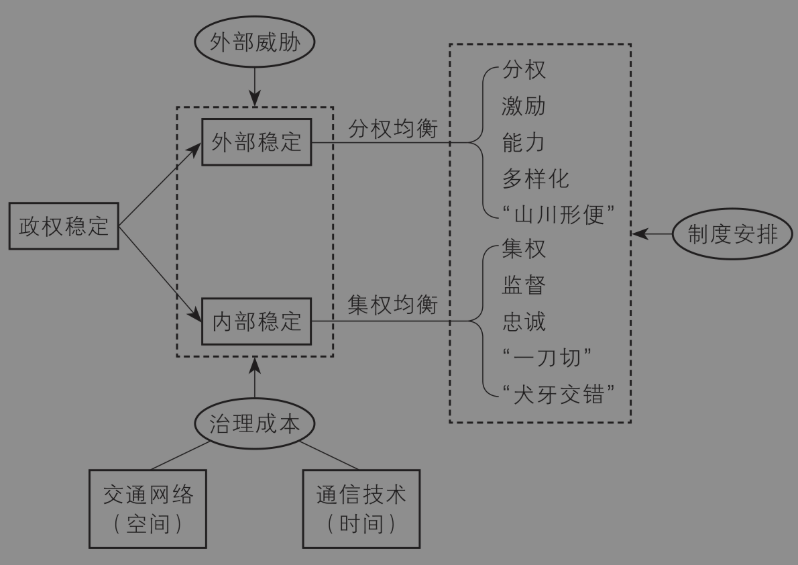

图1-13 一个内外冲突的双均衡分析框架

#### 2. 对历史和现实的解释

##### （1） 唐朝的“山川形便”和藩镇割据

历史上的“盛世”唐朝其实一直面临严重的外部威胁。突厥、吐蕃、契丹和南诏，这些边境的少数民族政权不断威胁着唐朝政权。唐太宗李世民刚刚掌权时，颉利可汗带领的东突厥军队直接杀到了与大唐都城长安近在咫尺的渭河，迫使李世民签订城下之盟，“以金钱换和平”。终唐之世，长安甚至先后六次被敌军或叛军占领。为了应对严峻的外部威胁，唐朝前中期一直把维护外部稳定作为首要目标，因此总体上采取了分权的制度体系。在治理架构上，如前文所介绍的，唐初在地方只设州县两级，而州的数量超过了300个，中央直接管理多有不便，故而在州之上设置了负责监察的道。唐太宗依据“山川形便”的原则将天下划成十道，这种划界方法一方面有利于各地利用地理屏障抵御外敌入侵，另一方面有利于各地区利用地理上的相似性和均一性促进农业经济的发展。先沿着黄河、秦岭—淮河、长江以及南岭横切四刀，再沿着南北向的次要山川太行山、西河（山陕间黄河）、陇山、桐柏山和嘉陵江竖切五刀，就自然地形成十个区域，构成了全国的十道（参见图1-7）。除山南道东西界外，其他各道之间都有明确的山川界线（周振鹤，2013）。这种基于地理边界的分权有利于各个区域因地制宜地发展，但显然会加大地区间差异，而且导致中央政府无法实现有力监管。为此，唐朝在原本虚置的各道设立按察使，对各州行使监察权，但没有行政权。同时，为了加强边境地区的军事防卫能力，朝廷在军事重镇设立节度使。最后，负责监察的道与负责军事的节度使合流，节度使又兼任驻地行政长官，唐代的藩镇由此形成。这种军政合一又缺乏制约的封疆大吏成为爆发安史之乱的制度根源。为了尽快平息安史之乱，朝廷不得不进一步放权，导致后期的藩镇割据，再加上农民起义等因素，最终繁华的唐朝归于尘埃。盛唐的衰败体现了一条曲折的历史主线：外部威胁→分权→内部威胁→国家衰败。

##### （2） 北宋的强干弱枝和守内虚外

北宋显然吸取了唐朝的分权教训。宋太祖赵匡胤陈桥兵变之后，一方面通过“杯酒释兵权”，解除了“创业元老”的权力威胁，另一方面从制度上加强了中央集权。

在中央层面，皇帝削弱了宰相和六部的权力，并且让各部官员相互制衡。以吏部为例。吏部的本职是主管文武官的选试、差遣、升迁、考核等重大人事任免权，因此吏部尚书被称为“天官”。然而，北宋时期的文武官铨选分属中书、审官院、枢密院、三班院，后中下级文选属审官东院、流内铨，中下级武选属审官西院、三班院，上级文武官铨选则分属中书和枢密院，吏部最后只负责州县幕职官，以及京朝官叙服章、申请摄官、讣吊祠祭、拔萃举人等普通的人事问题。这就好比原本可以任命省部级干部的强势单位，变成了一个只能任命厅局级干部的普通单位。

在中央和地方的关系上，实行“强干弱枝”：一是虚化了地方节度使的职权，由朝廷命官担任知州、知府；二是剥夺了地方财权，将地方大部分赋税集中到中央；三是把精兵强将都纳入中央军，削弱了地方军的实力。

在处理内部威胁和外部威胁的关系上，对内保持中央对地方的绝对控制，对外只有形式上的强大，此即“守内虚外”，它其实是强干弱枝的必然结果。集权虽然降低了内部威胁，但是难以应对外部威胁，因为地方缺乏足够的财力、军力应对外敌，而中央层面又相互制衡甚至是相互掣肘。终宋一朝，一直处于辽国、西夏、金国和蒙古接踵而至的严重威胁之下，屡屡被迫割地赔款，甚至出现了两代皇帝都被敌军俘虏的“靖康之变”，最终为蒙古铁骑所灭。

看起来，宋朝的衰亡并没有吸取唐朝的教训，而是走向了另一个极端：内部威胁→集权→外部威胁→国家衰败。

##### （3） 回答“黄炎培之问”

唐朝和北宋曾是中国历史上的“盛世”，它们由盛转衰的过程从不同的角度为我们提供了一幅历朝历代治乱循环的拼图。一个国家在建政初期如果面临比较严重的外部威胁，此时会采取分权的制度安排。分权会促进地区经济发展，但会导致地区差异扩大以及地方势力坐大，从而加剧内部威胁。为了应对内部威胁，中央试图削减地方权力。地方势力不满，进而挑战中央，引发内乱。内乱加上外患，导致国家灭亡。相反，如果一个国家建政初期面临比较严重的内部威胁，则会采取集权的制度安排，但中央过度集权又会削弱地方力量，从而在面临外部威胁时，无法有效抵制入侵，此时如果内部权力过度集中导致腐败行为，则政权很快会走向崩溃。总之，由于外部威胁的存在以及内部稳定和外部稳定之间的冲突，一个国家必须根据形势变化灵活地调整集权或分权制度，这就导致国家治理在制度上总是体现为集权或分权的交替。套用《三国演义》中的经典名句来说，就是：天下大势，分久必集，集久必分。我们可以把王朝更替的原因简单地总结如下：面临内忧（或外患）→实行集权（或分权）→无法平定外侮（或内乱）→国家衰败。

那么，导致国家衰败的原因是集权制度或者分权制度本身吗？并非如此。如前所述，从静态的角度讲，在面临外部威胁和内部资源约束的前提下，统治者实行分权或者集权是一种均衡。关键问题是，很多政权难以根据内外部形势的变化进行动态调整以达成新的均衡，从而偏离了最优的制度安排，出现了制度僵化（institutional rigidity）。制度僵化阻碍了效率提升，并最终导致政权在竞争中失败。从内外冲突的双均衡分析框架的内部检视，我们通常可以看到一个政权出现制度僵化的三种原因。

一是形势误判，即错误地判断了内部稳定和外部稳定中哪个才是主要的挑战。在科层中，自下而上传递的信息通常是不完整的、扭曲的，这会导致政权错误地判断维护内部稳定或者外部稳定的代价。比如，秦始皇在决定修建长城时，隋炀帝在决定大规模修凿运河时，很可能高估了这两项重大工程带来的收益，而低估了需要付出的内部稳定成本。

二是路径依赖，即从旧的制度转向新的制度需要承受巨大的沉没成本和时间成本，并且一旦这种制度改革的收益不能尽快兑现，就更容易遭遇既得利益集团的阻碍，以致改革失败。比如，安史之乱后，唐朝几任皇帝都想削藩，结果功败垂成。先是唐顺宗李诵即位后立即发动了“永贞革新”，试图削减宦官和藩镇的权力，结果被宦官集团反扑，只做了大半年皇帝便被迫退位，并很快去世。他的儿子唐宪宗李纯吸取教训，通过军事手段逐步削藩，但是后期因为重用宦官并且政事懈怠，在位16年最后蹊跷暴崩。其子唐穆宗李恒即位后，高估了削藩成果，采取消兵之策，结果重蹈藩镇之祸。此后的皇帝虽然也想抑制宦官、裁撤藩镇，但终究没有成功。

三是制度兼容性，即某项改革举措与已有的制度不兼容，或者缺乏配套改革措施，导致改革失败。不管是集权制度还是分权制度，都是一整套制度体系，内部不同机制或政策之间是相互兼容的。因此，当总体制度不合适时，单靠某项制度的改革并不能扭转方向，有时不仅于事无补，反而雪上加霜。经济学中有一个“次优理论”（second-best principle），指的是当存在多种扭曲时，减少一个扭曲未必提高效率，增加另一个扭曲也未必降低效率。因此，成功的国家治理体制的改革通常是系统性改革，然而系统性的改革又往往因为积重难返而失败，这就是制度不适应形势导致国家衰败的重要原因。从相反的角度讲，只有那些能够根据内外部形势灵活地调整制度，从而让新的制度再次提高效率的国家，也就是具备“制度韧性”（institutional resilience）的国家，才能实现长治久安。

内外冲突的双均衡模型为历代王朝的更迭提供了一个可能的解释，呼应了“黄炎培之问”。1945年夏，民主人士黄炎培先生应邀走进中共领袖毛泽东的窑洞。黄炎培在谈话中指出，历史上的政权都是“其兴也勃焉，其亡也忽焉”，很难跳出这种周期率的支配力。毛泽东从民主监督的角度提出了破解之道，回答了“黄炎培之问”。不妨进一步追问，为什么会出现历代政权的兴亡周期呢？根据上文分析可以认为，政权兴盛往往是国家确立了适应当时内外部形势的集权或分权制度，而衰亡则是因为已有的制度无法适应新的内外部形势。毕竟，领导人的判断力、路径依赖和制度兼容性都会对一个国家能否长期保持制度韧性造成影响。从这个意义上讲，所有的王朝兴衰实际上就是制度失灵和制度错配。

##### （4） 当代官员治理机制的转变

一个好的分析框架，不仅能解释历史，还要能解释现实，因为现实就是未来的历史。本书所构建的这个内外冲突的双均衡分析框架，从信息和交通两种技术变迁入手，分析内部冲突和外部冲突对国家治理结构的影响，它不仅适用于古代中国，同样适用于当代中国。

十八大以来，在中国的国家治理体系中，特别是官员治理机制方面，出现了两个重要转变（李靖和聂辉华，2024）。一是在治理方式上，从强调激励转变为强调监督。这突出表现在十八大以来中央通过高频次常态化的中央巡视、中央生态环保督察等形式，加强了对中央部委和地方领导人的日常监督管理。相比之下，十八大之前更加侧重对领导人的任期绩效考核，而对部委或地方的巡视和督察，则频次较低。二是在考核内容上，从强调以GDP为代表的单一经济指标转变为强调经济社会发展的多元化指标。这突出表现为环境保护、党风廉政建设和脱贫攻坚等非经济指标，在十八大之后开始纳入官员考核的“一票否决”范围。为什么十八大之后会出现上述两个重要转变？

要理解十八大之后官员治理机制的重要转变，首先要考虑到一个重要的时代背景，即中国加速进入“数字时代”。移动互联网、大数据、人工智能等数字技术的革新与应用，极大地提高了信息收集能力，降低了信息处理成本和监督成本，因此减少了上级和下级、中央和地方或者委托人和代理人之间的信息不对称问题。数字技术消弭了委托人和代理人之间的信息不对称，可能会产生两个方面的结果。一是委托人对代理人的考核从结果导向转向过程导向。在信息不对称的前提下，委托人只能通过代理人的产出来推测其努力水平，因此在治理方式上会强调激励，包括物质激励和晋升激励。当信息不对称减少时，委托人不仅可以观测到产出，还能部分地观测到努力，于是，委托人会加强监督，减少对产出信息的依赖，即从强调激励转向强调监督。二是委托人对代理人的考核内容从单一指标转向多元指标。数字技术降低了监督成本，使得委托人可以从多个维度收集代理人的努力和产出信息，根据多样性预测定理（diversity prediction theorem），委托人可以更加精准地度量代理人的努力水平，从而提高激励效果。上述分析表明，官员治理机制作为现代国家治理体制的一个侧面，依然体现了一个内外冲突的双均衡分析框架的解释力。事实上，它还可以解释央地关系、官员考核、政策执行等当代国家治理的重要内容。我们将在后面的章节里具体分析。

#### 3. 解释中国国家治理的相关理论

中国悠久的历史跌宕起伏，王朝兴衰更替的故事就像一块磁石，吸引了无数学者的努力，并产生了若干有影响力的观点或学派。下面简要介绍的代表性观点力图解开中国古代王朝兴衰之谜，相当于从不同的角度探讨了中国国家治理的根本逻辑问题，对理解当今国家治理仍然具有启示意义。

**观点一：地理论。**地理环境作为一种几乎是绝对外生的变量，经常被经济学家和其他领域的学者用来解释古代中国的治理结构。这方面最有名的观点是“治水社会”理论，代表人物是德裔美籍学者魏特夫（Karl August Wittfogel）。他从治水的角度解释了古代中国中央集权体制的形成（魏特夫，1989）。在传统的农业经济时代，对水源的控制和利用决定了经济活动和政权的稳定。为了治理黄河等大江大河的水灾，政府必须调集大量人力物力，“集中力量办大事”，并且防止有限的资源被转移到其他地方，这种治水社会必然导向一种集权体制。

**观点二：文化论。**文化被认为是一种非正式制度，它在漫长的社会变迁中影响了人的行为和正式制度。中国最主要的文化就是儒家文化，因此有很多学者从儒家文化的角度解释古代中国的治理结构和兴衰。美国学者费正清（John King Fairbank）认为，儒家文化塑造了中国的政治、经济、军事、外交等各个方面，但是也阻碍和延缓了中国的近代化过程（费正清，2008）。金观涛和刘青峰（2011）提出的超稳定结构观点也属于文化决定论。在他们看来，“占主导地位的封建地主经济”“统一的封建官僚政治”和“以儒家经典为正统的社会思想和文化传统”这三方面构成了一个相互兼容的超稳定结构。王朝更替既消除了三者不兼容的因素，又巩固了超稳定系统的存在。

**观点三：社会结构论。**这一派观点认为，精英的社会结构决定了政治结构，从而影响了国家兴衰。哈佛大学政治学教授王裕华在其新著中，从政治精英网络结构的角度提出了一个分析框架（Wang，2022）。他认为，古代中国的统治者面临着一个基本的权衡取舍：一群团结一致的政治精英可以提高国家能力，但是也可能推翻统治者。当政治精英通过婚姻关系建立起全国性的社会网络时，政治精英会倾向于加强中央集权，但也会威胁统治者，这会导致很强的国家能力和不稳定的政权（例如唐朝）；相反，如果政治精英都是地方化的，他们对统治者很难形成威胁，这会导致虚弱的国家能力和较稳定的政权（例如宋朝）。

**观点四：内卷论。**为了回答著名的“李约瑟之谜”[^39]，英国历史学家伊懋可（Mark Elvin）提出了一个“高水平均衡陷阱”观点。他认为，一个国家的农业技术越发达，人口增长就越快，劳动力就越是过剩，就越是没有动力去发展节约劳动力的工业技术。这与黄宗智（1986）的“内卷”（involution）观点是一致的。在华北的棉花经济和长江三角洲的蚕丝经济中，棉布的产出周期是水稻的9—18倍，但是产值才达到三四倍，这样低效的投入—产出比为什么还有经济效益呢？黄宗智认为，因为前者把劳动报酬低于机会成本的妇女、老人与儿童等家庭内部成员卷入了市场（此即“内卷”），从而维持了边际报酬递减的高水平产出。

**观点五：天命论。**最后一个观点是所谓的天命论或者说王朝周期论（dynastic cycle）。这个观点的主要意思可以借用杨联陞（2005）的一句话概括：朝代有兴亡，正如人有生死。这个观点只是描述了王朝具有的兴起、繁荣、衰落和灭亡周期，但并没有提供有价值的理论分析，故此处不再赘述。

### 三、上下同治：国家治理与基层治理的互动

既然本书的主要内容是讨论基层的权力运行和治理机制，为什么我要提出一个关于国家治理的分析框架呢？原因在于，几千年的历史说明，成功的国家治理一定是“上下同治”，这才是“中国之治”的精髓。所谓“上下同治”，是指在国家治理体制中，上层充分发挥领导和协调作用，基层充分发挥激励和信息优势，实现政权稳定和国强民富。用毛泽东同志在《论十大关系》中的话来说，就是充分发挥“中央和地方两个积极性”，“在巩固中央统一领导的前提下，扩大一点地方的权力，给地方更多的独立性，让地方办更多的事情”。下面，我从三个角度分析上下同治对于理解基层治理的重要性。

第一，从行政职能上讲，基层主要是执行上层的政策。因此，只有从全国的高度理解了国家治理的根本逻辑，才能理解中央和上层制定政策的意图，才能理解基层执行政策的效果。正如北宋著名政治家和诗人王安石所言：“不畏浮云遮望眼，自缘身在最高层。”此外，中国是一个“低文本社会”，因此即便是面对基层自身制定的政策文件，研究者和观察者也需要自上而下地将国家治理的逻辑、中央和上级的政策与之结合起来，才能理解政策的意图和效果。另外，要分析基层治理的动向和发展趋势，就要预测上层未来的政策走向，这同样需要从根本上把握国家治理的根本逻辑。从基层的政策执行者角度讲，对于上层政策，不仅要知其然，还要知其所以然，这样才能全面、准确地贯彻上层制定的政策，也才能根据本地实际情况调整政策和把握政策执行的力度。我在很多场合和文章中强调过，“中国的问题归根结底都是政治经济学问题”。在理解基层治理方面，道理同样如此。

第二，国家治理机制从根本上决定了基层的经济社会发展。经济学家早已证明，制度是长期经济增长的根本因素。国家治理机制本质上是一套制度体系。根据我们的分析框架，给定外部威胁和治理成本，最终国家治理机制要么表现为集权制度体系，要么表现为分权制度体系，要么是两者的线性组合。从制度经济学或组织经济学的角度讲，这一套制度体系决定了基层的经济社会发展。如果最高层以应对外部威胁为主，那么分权制度体系是最优的。此时，在发展重点上，地方将在经济和社会发展方面拥有更多自主权，并且政绩导向的考核会促使地方官员将经济发展作为主要目标。在区域经济发展中，交通网络往往会影响首都的选址，反过来首都的选址又影响了交通网络的调整。对地方而言，与首都的距离以及是否处于交通网络中的节点位置，都会在很大程度上影响当地的经济发展、人口流动和资源交换。根据同样的逻辑，在一个区域之内，不管是全省、全市还是全县（区），中心城市和交通网络的互动同样会对基层的经济社会发展产生重大影响。[^40]

第三，历史和当代经验都表明，只有充分发挥中央和地方两个积极性才能保持制度韧性。中国历史和现实中繁荣昌盛的局面，无一不是上下同治的结果。给定建政初期的制度安排，一旦内外部形势发生变化，中央要推动制度变革，往往要允许地方进行试点和创新。地方试点成功，然后向全国推广，从而完成渐进式、成体系的制度变革，这就是前面提到的制度韧性。这样的上下同治，不仅降低了制度变革的成本和风险，而且充分发挥了地方的激励，因此被不少经济学者认为是中国在过去40年中保持中高速经济增长的关键因素（Xu，2011）。在中国改革开放的过程中，农村家庭联产承包责任制始于1978年11月安徽省凤阳县梨园公社小岗村18位农民签下的一份“生死状”。分田到户的改革见效后，先是在安徽省推行，之后被中央肯定，并从1980年开始以中央文件和政策的形式在全国推广。农村改革成功后，试点改革的火焰传递到了城市。除此以外，不必说曲折前进的国企改革，也不必说1994年开始的分税制改革，更不必说遍地开花的经济开发区和自贸区，即便是中央的宏观经济调控也离不开地方政府的充分参与。[^41]在历史上，康乾盛世是中国古代最后一个盛世。康乾盛世的重要支撑是雍正年间持续增长的财政收入，而财政收入的增长在相当程度上得益于当时推行的改革举措“耗羡归公”和相关的“养廉银”制度。这一政策的成功，离不开地方官员在湖南、山西等重点亏空地区的实践与奏请。即位第二年，雍正皇帝决意授予此举合法性并在全国范围内推行，两年后就基本填补了国库亏空，并刷新了吏治。地方的活力加上官员的激励，为提升当时清朝的国力和政权的稳定性起到了不可替代的作用。而“耗羡归公”政策其实是清朝版的改革试点经验，它同样是上下同治的结果。

## 思考题

1. 一个市辖区的税务局，是属于所在区的属地管理部门还是所在市的垂直管理部门？

2. 从安徽省合肥市坐高铁到江苏省南京市，最快的车次不用一个小时，而马鞍山、芜湖和滁州等安徽省的其他几个地市要前往南京甚至耗时更短，因此很多人笑称南京是“徽京”（安徽的首府）。请问，如果你是马鞍山、芜湖或滁州的市长，你会加强和南京的经济联系吗？如果你是安徽省省长呢？请简述你的理由。

3. 请阅读小说《白鹿原》，然后根据小说情节作出判断，这部小说是支持了“皇权不下县”的观点，还是反驳了这一观点？

4. 俗话说，“要想富，先修路”。请结合这句话以及本章提出的内外冲突的双均衡分析框架，从空间组织经济学的角度，解释如何促进当今的“统一大市场”建设。

5. 请结合京杭大运河的历史，分析为什么中国历史上会出现经济重心不断南移的现象，并尝试从这个角度解释当今的南北经济差异现象。

6. 在数字时代，很多人认为可以彻底地解决基层存在的信息不对称问题，请问你是否同意这一观点？如果不同意，请举一个反例。

## 注释

[^1]: 为了表述方便，本书将“统治”和“治理”等同使用。

[^2]: 四大文明古国是指古代埃及（尼罗河流域）、古代巴比伦（幼发拉底河和底格里斯河流域）、古代印度（印度河流域）、古代中国（黄河和长江流域），它们被认为是大型人类文明最早诞生的四个地区。据学者考证，这一说法最早可能来自梁启超于1900年创作的《二十世纪太平洋歌》。另一种较为流行的说法是，中国是人类文明的五大发源地（西亚地区、北非地区、印度地区、希腊地区、华夏地区）之一。

[^3]: 例如，有一种观点是“百代都行秦政法”，即自秦朝开始在全国范围内推行的中央集权制和郡县制，就是中国古代王朝的主要治理体制。

[^4]: 广义的国家治理架构不仅仅是中央和地方之间的权力安排，而是一整套“政治制度”或者“国家权力结构”。白钢（2011）全面地梳理了中国古代到民国时期的政治制度，并强调了皇权和相权之间的冲突如何影响了中央机构的设置。方志远（2008）深入地分析了明朝的国家权力结构，并揭示了中国历代国家权力“内廷机构外廷化、中央机构地方化、监察机构行政化”的普遍规律。

[^5]: 相关内容请参考本书第五章《地方主官的挑战》。

[^6]: 吴毅（2018）以一个乡镇的运作为观察对象，阐述了上级通过掌控下级主要领导升迁的方式向下层层传递政治压力的体制。这与荣敬本等（1998）提出的“压力型体制”具有类似性。

[^7]: 以食品安全监管体制为例。在过去的20多年中，几乎每隔五年就变动一次。刘鹏和张苏剑（2015）将1992—2015年中国食品安全监管体制的变迁概括为地方分级管理、半垂直管理和以地方分级为主的混合型管理体制三个阶段。

[^8]: 需要说明的是，虽然“以块为主”体现了向地方分权，但它与“中央集权”并不矛盾。前者是指地方享有高度的自主权，后者是指中国是一个单一制国家。一些经济学家将这种国家治理体制视为一种向地方分权的集中体制（Xu，2011）。

[^9]: 本图所指的党政机构，不包括法院和检察院系统。

[^10]: 20世纪60年代初，中央将全国各地区根据战略位置的不同，分为一、二、三线。一线是沿海和边疆的省份，三线是西南和西北一些省份，二线是介于一线和三线之间的省份。三线建设的主要内容是国防工业和基础设施，目的是在突发的战争威胁下，分散资源和分散风险。

[^11]: 杨其静和聂辉华（2008）批判性地梳理了财政联邦主义文献及其在解释中国经济奇迹方面的局限性。

[^12]: 1607—1733年，英国在北美洲东部大西洋沿岸先后建立起13个殖民地，它们构成了美国最早的13个州。1776年7月4日，北美13个英属殖民地宣布独立，后续才进一步从邦联转向联邦。

[^13]: 具体的论证过程参见本章第四节。

[^14]: 此“抚州”不是江西省的抚州市（古代也称临川）。

[^15]: 从明朝中期（明宣宗之后）开始，中央陆续在各省份设立固定的巡抚和总督。

[^16]: 这验证了方志远（2008）总结的一个古代政治制度的规律：内廷机构外廷化、中央机构地方化、监察机构行政化。

[^17]: “三司”原本是唐朝后期分别负责财政收支、租赋及盐铁专卖事务的三个使职，后来三使合并为一使，即三司使。北宋初期沿用了这一官职，后来三司和户部的职能多次变动。

[^18]: 关于府下属县以外的厅、州，赵希鼎（1980）认为，大抵边疆要地或民族杂处之地设厅，地居要冲者为州。

[^19]: 以上引文均出自费孝通（2012）。

[^20]: 从组织经济学的角度讲，国家治理的核心问题是信息和激励问题。在交通和通信技术不发达的古代，朝廷缺乏关于基层乡村的基本信息，包括人口、土地、牲畜等财产。按黄仁宇的说法（黄仁宇，2008），理论上，如果代理人的努力和产出都不可观察，那么对委托人来说，最优的激励机制是实行固定工资。这正是古代包税制的理论基础。

[^21]: 图1-12关于制度可能性边界的图示，得到了Djankov等（2003）的启发。

[^22]: 诺斯及其合作者论证了荷兰与英国的崛起以及工业革命的发生，均得益于保护产权的制度安排，详见诺斯和托马斯（2022）；2024年诺贝尔经济学奖得主阿西莫格鲁及其合作者证明，较之拉丁美洲等地，1500年的北美、澳大利亚和新西兰等相对贫穷的地区经过长期发展成为现代世界中的发达地区（即“财富逆转”），主要是因为殖民时期的制度安排，而不是因为地理位置。相关研究可参考Acemoglu et al.（2002，2005）。

[^23]: 出自《资治通鉴·周纪一》。

[^24]: 有很多经济学文献分析了组织中的集权或分权问题。在组织经济学领域，这方面的集大成者是Gibbons和Roberts（2012），尤其是该书的第十章。尽管新政治经济学文献通常用“民主”或“专制”来概括现有的制度类型（例如Olson，1993；赫尔普曼，2004），但是在漫长的前现代国家时代，这种划分显然是不合适的。因此，若一个学者先入为主地用“民主叙事”来研究中国自古以来的国家治理问题，难免有削足适履的嫌疑。

[^25]: 在历史政治经济学文献中，内部威胁通常指来自统治集团内部的威胁，特别是政变或政治精英叛乱，而外部威胁通常指来自统治集团外部的威胁，例如农民起义。从统计数据上看，前者的比例明显高于后者（Wang，2018）。在中国历史上，中原政权对外征服的进攻性战争较少，应对北方游牧民族的防御性战争较多（Chen，2024），因此本书所说的应对外部威胁主要指防御性战争，而不是指有组织的攻击型战争。

[^26]: 根据经济史学家安格斯·麦迪森（Angus Maddison）的研究（麦迪森，2003），在工业革命之前，世界各国的人均收入差距很小。但是工业革命之后，各国人均收入差距开始迅速扩大。

[^27]: 对于一个小国或者城邦国家，统治者可以通过加强内部集权来一致对外，此时可能不存在内部稳定和外部稳定之间的权衡取舍。这意味着，我们的分析框架不适合解释小国的治理逻辑。

[^28]: 出自《左传·成公十三年》。

[^29]: 中国近代经济学家冀朝鼎认为：“分隔中国三大水系的各条山脉，是造成经济与政治区划的屏障，也是多少世纪以来在中国出现分治现象的天然基础。”（冀朝鼎，1981，第30页）。

[^30]: 博弈论（game theory）是研究存在互动策略时参与人如何作出最优决策的理论，也称对策论。契约理论（contract theory）通常将博弈主体区分为委托人和代理人，然后研究委托人在信息不对称的前提下如何设计一个社会福利最大化或者自身利益最大化的契约。这里的委托人是发出契约的一方，而代理人是接受契约的一方。因此，契约理论通常采取委托人—代理人的分析框架。由于契约理论主要用于分析国家、企业或非营利组织等组织的边界、权力结构等问题，因此契约理论与组织经济学（organizational economics）在很大程度上是重合的。

[^31]: 纳什均衡（Nash equilibrium）是博弈论的一个基本概念，它表达了这样一种均衡状态：给定对方的策略选择，自己的策略是最优的，并且对方也这么认为。与此同时，各方都没有单独改变自己策略的动机，因为这样做不会带来更好的结果。例如，著名的“囚徒困境”就是一种纳什均衡。

[^32]: 研究发现，对外进攻型战争会加强集权，但是防御型战争会加强分权（Chen，2024）。如前所述，在中国历史上，中原政权多数时候面临的是防御型战争，所以此处倾向于分权的制度安排与主要面临的战争状态是相符的。

[^33]: 这方面的重要文献包括Aghion和Tirole（1997）以及Alonso et al.（2008）。在一个不完全契约的框架下，以上两篇文献分别分析了分权（或授权）对代理人努力水平和信息传递的影响。

[^34]: 尽管很多经济学者认为分权是促使中国改革开放以来经济高速增长的重要原因，但是Cai和Treisman（2004）提醒大家，分权可能会助长地方上企业隐瞒税收和躲避监管的做法，从而侵蚀中央政府的国家能力。聂辉华（2013）指出，在信息不对称和片面追求GDP的前提下，会出现地方政府和企业之间的“政企合谋”现象，这包括矿难、环境污染、食品安全事故和高房价等“竞次”（race-to-bottom）问题。

[^35]: Holmstrom和Milgrom（1994）最早提出了“激励系统”的概念。他们认为，在企业的激励机制方面，以固定工资为主的报酬机制、没有所有权的员工和受监督的工作任务，这三者是激励相容的；反之，以剩余索取权为主的报酬机制、有所有权的股东和不受监督的工作任务，这三者也是激励相容的。

[^36]: 比较静态分析是一种政策分析的常用方法，它研究当外生变量发生变化时，内生变量如何相应地发生变化。

[^37]: 例如，大运河的贯通加强了隋朝对南方地区资源的汲取能力，从而强化了中央集权统治，但是也耗费了大量国力，这又加剧了内部不稳定和政权衰亡。在古代，虽然整治运河对当期政权来说是一种内生的战略决策，但是对下一期政权来说，整治结果可以被看作一种外生的技术变化，从而影响其内在的组织结构。

[^38]: 唐朝首都长安和北宋首都汴京的对比，生动地体现了通信技术并没有明显变化时交通网络的重要性。长安坐落在关中腹地，交通并不便利，因此长安城的粮食供应严重依赖于关中盆地的农业。一旦发生饥荒，长安立即陷入粮食危机。这导致朝廷不得不将洛阳作为东都，由此产生了两个行政中心。而汴京凭借发达的内河交通网络（黄河、汴河、惠民河和广济河时称“漕运四河”），保证了上百万人口的粮食供给，其中包括庞大的军队及军人家属（高峰期达到72万人）（高飏，2024）。这是北宋能够在行政和军事上加强中央集权的重要原因。

[^39]: 英国学者李约瑟（Joseph Needham）在其编著的《中国科学技术史》中提出一个问题：中国古代为人类应用自然知识作出了很多重要贡献，但为什么科学革命没有在近代的中国发生？

[^40]: 近现代以来，首都和省会城市的变迁明显影响了当地乃至一个区域的经济社会发展格局。例如，河北省的省会一度在保定、天津、北平（今北京，当时首都是南京）和石家庄之间辗转，后来北京成为首都，河北省则担负起“拱卫京师”的重任。这一系列区位变化深刻地影响了河北省的经济重心和发展道路。

[^41]: 黄益平指出，以2008年宣布的“4万亿”刺激政策为例，其中由中央承担的支出是1.13万亿，但最终实际做到了30万亿。这个放大机制主要来自地方政府。决定地方政府行为的是两个机制，一是所谓的“GDP竞赛”，二是地方政府通过土地财政与城投公司、融资平台等获得了许多资源。参见《黄益平：中国特色的宏观经济政策框架》，北京大学国家发展研究院网站，2024年7月31日。
