# 第七章 基层治理的困境

<!-- 按来源截图7-1.png至7-4.png顺序整理；阅读器导航与装饰分隔线已省略；正文恢复为可复制文本；16幅插图与3张表格保留原图，共19个图片文件，存于img目录；28条注释恢复为Markdown脚注。原始截图备存于本书“原始图片”目录，便于核对；原文数据、观点与交叉引用按截图保留。 -->

把发展当作第一要务，这是中国改革开放40多年来的宝贵经验。中国的很多治理问题，都是在发展过程中解决的，例如减贫、环境污染防治、社会治安和安全生产。经济发展既是国家治理的第一要务，也是很多基层政府面临的第一难题。现如今，逆全球化思潮在全球兴风作浪，国际地缘政治冲突不断，国内人口红利开始消失，过去经济高速增长的模式受到了严峻挑战。在此背景下，本章将讨论基层政府如何通过机制体制创新，推动地方经济实现可持续发展。[^1]

为此，本章第一节先介绍地方政府如何利用各种手段招商引资，这是过去县乡经济实现高速增长的主要抓手；第二节讨论土地财政的过去、现在和未来，这是政府推动地区经济高速增长的主要动力；第三节讨论当前市县两级政府面临的严峻问题——地方债，主要分析地方债务的现状、来源和出路；第四节讨论地方政府着力发展的一种新经济形态：电子商务。尽管很难再重现过去几十年的经济高速增长的势头，但是中国依然有全世界最大的统一市场、大量训练有素的劳动力队伍，有生生不息的创富动力，更有基层源源不断的创新活力，每个地方都有可能探索出一条适合本地区的经济可持续发展之路。

## 第一节 基层招商引资的秘诀

对于基层地方政府以及政府主官来说，几十年来招商引资都是地方推动经济发展的主要抓手。例如，我们在基层调研时，经常看到主要公路两边刷满了各种招商引资的口号或标语：“人人都是投资环境，人人都是招商主体”；“引资是恩人，投资是亲人”；“全民招商、亲情招商、建设家乡”。少数地方为了改善营商环境，甚至喊出了“谁砸××（城市名）的牌子，就砸谁的饭碗”这样的口号。[^2]各地为了招商引资，对外地客商的优待程度简直是令人瞠目结舌。有一次，我们在一个县的县医院看到这样一张告示：客商看病优先排队。总之，对基层干部而言，恐怕没有比招商引资动员力度更大、范围更广的重点工作了。

在前面介绍县委书记的挑战时，我们得知招商引资是排名第二的工作重任。[^3]事实上，招商引资不仅是县委书记们的重点工作，也是地级市、省会城市乃至直辖市党政主要领导的重点工作。我们先来看一个案例。

最近几年中国发展最快的行业之一是新能源汽车行业。据统计，2024年1月至11月17日，全国新能源乘用车累计批发993.3万辆，同比增长38%；累计零售890.9万辆，同比增长41%。[^4]放眼全国，同比增长率高达40%的行业绝对是屈指可数。在新能源汽车行业中，比亚迪是当之无愧的龙头企业。数据显示，2024年10月份比亚迪汽车销量超过50万辆，不仅排名第一，而且比第二到第十四名销量的总和还多一大截（表7-1）。[^5]假以时日，比亚迪甚至可能成为中国最大的制造业企业。

表7-1 2024年10月份中国新能源汽车销量

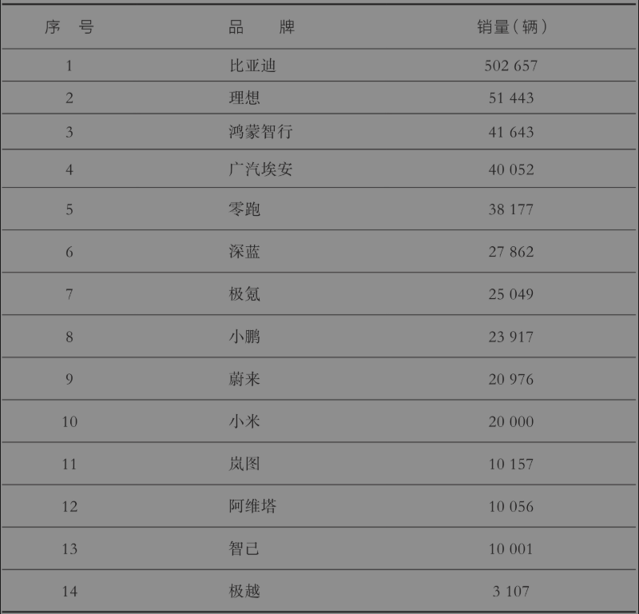

注：根据公开资料，不完全统计（“新一线商业观察”制作）

比亚迪在地方政府眼里早就是“香饽饽”了。一是因为它所属的新能源汽车产业是国家支持的重点产业，二是因为比亚迪本身是龙头企业，三是因为汽车产业的链条很长，就业带动效应明显。根据媒体报道（翟杨，2023），2022年5月中旬到6月上旬，不到一个月内，就有五个地级市的市委书记，亲自带队拜访比亚迪（表7-2），希望通过招商引资拿下比亚迪的生产基地。这张表格只是一个月内的招商引资大战，还不包括更多“暗战”。连我老家，江西省抚州市，都成功地抢到了比亚迪汽车的一块蛋糕，如今抚州已经成为比亚迪五大整车生产基地之一。除了拜访，关键是地方政府要拿出真金白银的诚意。陕西省宝鸡市扶风县，得知比亚迪汽车产业园项目有在当地落户的“意愿”，立即发出《致扶风籍在外人士返乡就业的倡议书》[^6]，号召大家返乡就业，生怕比亚迪落户了，工人却招不满。不得不说，基层为了招商引资，真的是八仙过海、各显神通，拼尽全力。

表7-2 市委书记拜访比亚迪

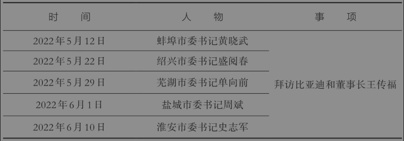

那么，基层究竟有什么招商引资的秘诀呢？第一部分给大家提供一个政企关系分析框架，从国家治理和营商环境的高度，分析招商引资成功的制度环境；第二部分总结招商引资的几种主要模式；第三部分揭示招商引资的一些乱象和陷阱。

### 一、从政企博弈理解招商引资

招商引资虽然是一项具体工作，但本质上是一种地方政府和企业之间的博弈。一方面，在中国现行干部管理体制下，省以下的地方主要官员不能是本地人，这是任职回避规定。[^7]从县城的角度，这里说的主要官员包括：县委书记、县长、纪委书记、组织部部长、公安局局长、法院院长和检察院检察长，全是实权岗位。因此，中国基层政府可谓“铁打的公务员，流水的一把手”。另一方面，企业也是可以流动的，只不过它是“用脚投票”。哪里营商环境好，企业就搬到哪里去。当地方主官和企业双方都可以流动，都有选择权时，两者的关系就不是简单的乡镇政府对农民收农业税这么传统、静态、不对称的管理与被管理关系，而是一种既有合作，又有竞争，既相互依赖，又相对独立的动态博弈关系。

政企之间的博弈关系可以概括为图7-1（聂辉华，2020）。这个二维图的横轴表示政府干预或者不干预企业的经营，纵轴表示政府对企业的干预是合法合规还是违法违规。两个维度构成了四个象限，表示四种政企关系。右上角是政企合作，表示政府深度干预企业的生产或经营活动，同时政府和企业的互动行为都符合法律法规；左上角是政企分治，表示政府和企业互不相干，各自守法，极端情况是政府“无为而治”；左下角是政企伤害，包括政府单方面伤害企业，企业单方面伤害政府，政府和企业相互伤害；右下角是政企合谋，表示政府深度干预企业的生产或经营活动，同时政府和企业之间通过违法或违规的方式进行利益交换。

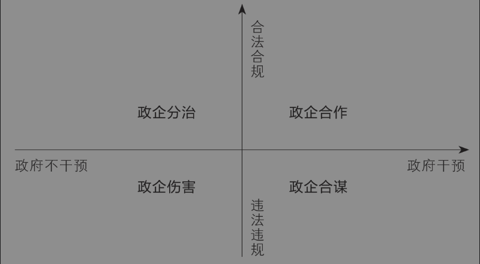

图7-1 政企关系的基本类型

政企关系的类型取决于政府、企业和第三方在博弈过程中的力量对比。如果一个地区的政府能力很强，同时企业所属的产业规模很大，那么双方建立持续的、紧密的关系就变得有利可图。用博弈论的术语来说，博弈双方都具有稳定的预期或足够大的贴现因子，可以减少短期行为，形成重复博弈关系。此时，关键的变量是监督力量。在监督力量比较弱的情况下（例如法治环境差、媒体监督少），政府和企业就可能进行权钱交易，出现政企合谋；反之，如果监督力量比较强，政府和企业就倾向于采取合法合规的方式长期合作，表现出政企合作。

上面这个框架告诉我们什么道理呢？第一，从招商引资的角度讲，最好的关系当然是政企合作。因为地方主官和企业都可以流动，所以必须采取自愿合作的市场方式，而不能采取“拉郎配”的行政方式。第二，要维持政企合作，就需要让地方政府和企业彼此都有长远的共同利益，这样才能实现激励相容。说白了，就是通过合法的长期利益捆绑在一起，这样才能避免最坏的情况——政企伤害。第三，从营商环境的角度讲，最稳定的政企合作除了互利之外，还要是平等的。因此，作为研究营商环境的学者，这些年我一直呼吁，良好的政商关系除了“亲”和“清”之外，还需要“平”（平等），这样双方才能行稳致远。

### 二、各显神通的招商秘诀

接下来，我们基于前面这个理论框架总结地方政府招商引资的各种秘诀。其实，不管是哪一种招商模式，本质上都是促成良好的政企合作关系。这才是招商引资的本质。

第一种模式是乡情招商。所谓乡情招商，就是吸引在外地的老乡回到家乡投资。不过，这里的“老乡”范围很广，既包括在本地出生或者籍贯属于本地的外省市人士，也包括港澳台同胞以及海外侨胞和华人。20世纪90年代，大陆还不太发达，那个时候吸引外资非常倚重海外侨胞。在这方面，广东和福建两省可谓占尽天时、地利、人和。广东省在利用侨胞吸引外商投资方面，据说有四个“60%”：广东省是全国最大的侨乡，拥有粤籍侨胞3000多万人，约占全国华侨华人总数的60%；广东省华侨捐赠项目约占全国同类项目的60%；侨资企业占全国同类企业的60%；侨资企业占广东省外资企业的60%以上。[^8]而论及民营经济最发达的地方，除了浙江的一些县市，非常具有代表性的还有福建省泉州市。泉州的民营经济增加值占比超过85%。一个很重要的原因是，泉州本身就是著名的侨乡。

如果一个县区或者乡镇没有海外侨胞，那就要多靠老乡了。这几年，地方政府高度重视乡情乡谊，以便服务于招商引资工作。例如，很多县乡的“一把手”，每年都要到北京、上海和广州这样的大城市来，支持老乡中的企业主成立商会，并且请出老乡中的官员、知名学者和社会贤达开各种座谈会，包括“双返双创”“三请三回”。所谓“双返双创”，就是“返乡、返程，创新、创业”；所谓“三请三回”，就是“请乡友回家乡、请校友回母校、请战友回驻地”。总而言之，就是有钱出钱，有力出力，大家齐心协力把家乡的经济搞起来。这方面，江西做得比较好。在网上输入“双返双创”“三请三回”，搜索结果大部分新闻都是江西的。这也从一个角度解释了，为什么这几年江西的GDP增速在全国名列前茅。

第二种模式是产业招商。就是利用本地已有的主导产业优势，进一步做大做强，形成规模化、名片化、极化。这是一种最保守的招商引资模式。因为本地已经有很好的产业基础，所以进一步做大之后，就形成了一张本地名片，甚至成为该产业的区域龙头。中国有很多特色产业之城，其实就是这种招商模式强化的结果。例如，“汉服之都”山东曹县、“鞋都”福建晋江、“国际泳装之都”辽宁兴城、“面包之乡”江西资溪。

但是，产业招商模式有两个局限。一是某个产业大到一定规模了，增长空间就有限，增长速度就会下降；二是中国有句古话叫“新官上任三把火”，每个县委书记、市委书记都希望打造一个有自己个人烙印的特色产业，因此对已有的主导产业未必非常有热忱。在这种情况下，地方就必须开辟新的产业，而目前在产业招商方面，最流行的模式是“产业链招商”。什么叫产业链招商呢？就是瞄准一个目标产业，然后找出龙头企业，拉出详细的产业链上下游企业。先把龙头企业吸引过来，然后再把配套企业吸引过来，这样才能形成一个产业生态系统。而且，一旦形成了产业生态系统，以后个别企业用脚投票走了，也不太担心。产业链招商的优势，就是一个字——稳。

2020年前后，我在一个地方调研时，某县负责招商的产业园区负责人给我讲了当地如何成功打造了一个“机器人产业港”。第一步，先找到被视为世界工业机器人“四大家族”之一的某国际知名企业，希望对方在本地投资生产核心零部件。该企业老板说，他需要上游供应商和下游客户。于是，第二步，当地找到了一些供应商，跟供应商说，某个龙头企业要来了，你来不来？对方一听，就答应了，只要龙头来，我肯定来。类似地，当地又搞定了下游客户。第三步，有了上下游，当地就引进了系统集成商，这就形成了产业研发、核心零部件制造、系统集成以及机器人本体制造的完整产业链。第四步，完善服务支持系统。当地搭建了由政务服务、信贷金融、人才技术、孵化加速、数据整理、供应链市场、品牌增值和生活配套等八大要素构成的产业生态服务体系。第五步，打造产业链集群。有了产业链之后，当地通过产学研结合，搭建了一个人工智能产业集群。为此，经过当地沟通联合，市里的科技企业孵化器、机器人产业技术研究院、省重大项目加速器相继落户机器人产业港。同时引进北京航空航天大学、东北大学、中国科学院机械自动化研究所等高校科研院所资源，签订战略合作协议，进一步推动机器人和人工智能产业创新升级。

产业招商是地方招商的主流模式。招产业，一定要尽可能招产业链条长的产业，因为这更有可能带动更多的相关产业和更多的人员就业。在中国这么多产业中，产业链条最长的是汽车和房地产行业，它们也因此长期成为中国的支柱产业。[^9]前面提到了很多地方政府在招商引资时向比亚迪伸出橄榄枝，就是因为比亚迪整车制造项目的落地能带来很强的带动效应。2022年4月，比亚迪在江西省抚州市的汽车整车生产基地一期项目开始投产运行。据抚州市统计局分析，2023年一季度全市汽车制造业增加值增长3.5倍，对全市规模以上工业增加值增长的贡献率为149.2%，拉动规模以上工业增加值增长9.5个百分点，是全市规模以上工业增长的关键支撑因素。[^10]看到这组数据，我们就能理解，为什么那么多地方费尽千辛万苦、说尽千言万语、想尽千方百计，一定要把比亚迪这样的龙头企业招到本地。

第三种模式是平台招商。就是发挥现有工业园区在土地储备、优惠政策和各种基础设施配套完善的现有优势，吸引企业投资落户。这种模式适合行政层级比较高的地区，比如省、市，或者经济发达的区县。前面介绍城市等级体系时强调了，中国的公共资源是自上而下按等级分配的。[^11]城市等级越高，享受的优惠政策越多。工业园区、经济开发区也是如此，级别越高，平台越高。如果是国家级开发区，那么能够享受的政策优惠就更多。

我在山东一个地方调研时，当地一个常务副区长跟我说，现在招商引资竞争太激烈了，企业除了土地、税收之外，非常看重你当地能不能帮它申请到高新技术企业或者专精特新“小巨人”企业认定。那么，企业申请到这些荣誉称号有什么好处呢？以高新技术企业荣誉为例，通过认定之后，有如下好处：（1）税收优惠，可享受15%的企业所得税税率（正常是25%）；（2）政府补贴，很多地区对新认定的高新技术企业有一定的补贴，企业还可以优先申请各种基金；（3）品牌提升，高新技术企业资质提高了企业在招投标中的竞争优势；（4）人才引进，各地对高新技术企业引进的人才都有政策倾斜；（5）优先上市，上市带来的好处就太多了，例如品牌效应、重点扶持、融资手段、并购扩张，都有极大的便利。

第四种模式是政府风投。在这种模式下，政府亲自下场，提供前期的风险投资或者配套资金，降低企业投资的风险。在实际操作中，政府当然不会直接出资，往往是通过国资平台、城投平台进行投资。很多人都听说过，安徽省合肥市的政府风投是“风头”最劲的。最有名的风投案例是，合肥市国资在新能源车造车新势力蔚来汽车处于困境时，联合其他战略投资者向蔚来注资70亿元人民币，从低谷挽救了“最惨男人李斌”，结果不仅帮助蔚来渡过了难关，而且自身也在财务上赚了个盆满钵满，合肥市也因此被媒体称为“一家伪装成地方政府的投资银行”，以及“最牛风投机构”，一时风头无二。这种模式具体来说，就是政府用财政资金加上国有资本，成立所谓的产业引导基金。在基金中，提供财政资金的政府机构一般是担任LP（有限合伙人），负责基金运营的机构担任GP（普通合伙人），一般是国资机构，也可以是市场化机构。产业基金再通过子基金将资金投入具体项目。[^12]整个模式如图7-2所示。本质上，政府是用财政资金以风险投资的形式，发挥杠杆效应，撬动更多社会资本，扶持目标企业或目标产业。需要说明的是，政府风投这种模式跟前面几种模式并不冲突，可以形成互补。不过，我们需要思考的是，合肥模式能不能学？好不好学？后面我会分析。

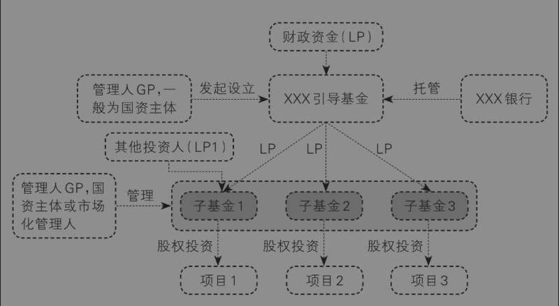

图7-2 政府产业引导基金运作示意图

### 三、招商乱象与陷阱

表面上看，招商引资似乎一帆风顺，战果辉煌，但其实，招商引资过程中，乱象横生，陷阱密布。很多招商引资过程都是一波三折，有时不仅一波三折，而且鸡飞蛋打，血本无归。基层干部在招商引资过程中要注意三点。

第一点是要警惕地区恶性竞争导致的互害式招商。所谓互害式招商，就是各地区不顾实际情况，只考虑短期利益，相互挖墙脚，形成地方之间双输的竞争结局。例如，由于各地招商考核压力大，一些地方被迫提供不切实际、无底线的补助补贴，而这些补助补贴最后往往不能如期兑现。例如，有企业主告诉新华社记者，他多次接到外省园区的招商引资电话，某高新区管委会工作人员称，在当地注册新公司或分公司、子公司，不用实际经营，只要缴纳增值税，就可享受总部经济的相关政策。每缴纳100万元增值税，即可享受35万至40万元补贴。如纳税过千万元，还可一事一议，补贴力度更高。这种优惠政策是违反国家税务法规的，属于明显的恶性竞争。关键是，这会诱使企业把公司注册地点改来改去，但是实际上并没有增加额外的价值。说白了，这就是地区之间的零和博弈。良性的地区竞争应该是努力通过做大蛋糕，在不损害别人利益的前提下，提高自己的收益。博弈的最高境界，是将零和博弈变成正和博弈，实现帕累托改进。

第二点是要理性看待合肥模式。很多人只看到合肥模式成功的一面，没看到它失败的一面。根据我的调研，实际上，合肥市第一批引进的几个重大项目，除了京东方，还有熔盛重工、彩虹集团、赛维。除了京东方之外，其余三家均以失败告终，失败率之高值得重视。政府进行股权投资的优势究竟在哪里？我个人认为，除非是一些大方向明确但需要协调各方进行系统集成或者巨额投资的产业（例如高铁、液晶显示屏），否则政府投资者并不能比市场主体更好地识别和甄选前沿的技术方向或产业模式。道理很简单，每天奋斗在一线的企业家都搞不明白的事情，其他人为什么能够搞明白呢？更何况，市场的逻辑不能复制到政府内，政府的逻辑也不能复制到市场上。[^13]因此，我主张政府投资要少一些赌博心态，少一点主导意识，多一份助推心理。

第三点则是要避免政企伤害。在招商引资的政企博弈过程中，很多人只看到政府的强势地位，没看到企业的狡黠之处。因为政府被企业骗了，媒体不方便报道，这导致很多地方政府有苦说不出。例如，著名的太阳能光伏企业汉能集团，当年在各地承诺建设的生产基地绝大多数都不了了之，这导致很多参与薄膜基地建设的地方政府和银行资金全部打了水漂，国家资金损失惨重。最终，地方政府和企业不得不对簿公堂，从政企合作（也许是政企合谋）变成了政企伤害。此外，近年恒大集团被曝光欠下2.6万亿元的天量债务。它在各地投资的房地产、新能源汽车产业、健康产业、矿泉水产业等所谓的八大产业，很可能也将让很多地方政府和老百姓的投资血本无归。

## 第二节 土地财政还能持续吗？

上一节我讲了招商引资，在招商引资过程中，政府为了吸引企业进入工业园区，需要提供很多配套设施和服务，例如土地“七通一平”，这需要进行大量前期投资。那么，政府投资的钱从哪里来呢？这就不得不说到土地财政了。2010年，中部地区某地级市的一位处长跟我说，土地出让金已经占到当地财政收入的90%了。所谓“土地财政”，是指地方政府通过城乡土地征收、储备和出让等一系列举措，获得大量土地出让金（甚至地方财政收入高度依赖土地出让金），然后借助土地出让金推动工业化和城市化，实现地方经济快速增长的一种经济发展模式。不夸张地说，不能理解土地财政，就不能理解中国的基层治理。

因此，本节主要探讨关于土地财政的三个问题：第一，土地财政是怎么来的？理论上，在多数情况下，政府的收入应该主要来自税收，而不是土地出让金这种非税收入。例如，美国联邦政府的主要收入来源是个人所得税、社会保险税和企业所得税，美国州政府的主要收入来源是个人所得税、企业所得税和房产税。因此，有必要解释一下，为什么以及什么时候开始中国的地方政府开始高度依赖土地出让金，而不是主要依靠税收。第二，土地财政会带来什么后果？我们将从高房价、收入分配、资源错配、腐败、金融风险等多个角度进行分析，让大家理解为什么土地财政是难以持续的。第三，如果说土地财政是难以持续的，那么现在有什么办法逐渐破解这种“西西弗斯困境”，让地方政府走出土地财政的困局吗？比如，有人建议地方政府应该从“土地财政”变成“股权财政”，这条路是否走得通呢？

### 一、土地财政的由来和现状

在过去的40多年里，中国经济实现了快速增长。第一波增长高峰是1984年前后，第二波增长高峰是1992年前后。尤其是1992－1994年那三年，年平均GDP增长率在13%以上，对照来看，2023年中国GDP增长率是5.2%，2024年是5%，而这已经很不容易了。为什么1992年前后出现了如此一个增长高峰呢？这归功于两项重要的制度创新：一是在邓小平南方谈话的背景下，中共十四大明确了经济体制改革的目标是建立社会主义市场经济体制，全国都要集中精力把经济建设搞上去；二是国家决定在一些沿海地区开始实施出口导向型经济战略，融入世界分工体系。为此，国家出台了一系列支持出口的重要政策。例如，1994年决定实施人民币贬值，将美元兑人民币的官方汇率从5.8元一次性提高到8.7元，贬值幅度高达50%。这也成为当时外资大量涌入中国市场的重要因素。同样是1994年，根据当时的增值税暂行条例，所有出口产品实行零税率，也就是按照产品适用的增值税税率实行全额退税。正如新制度经济学的核心观点所主张的，制度是长期经济增长的决定因素。[^14]其实，中国的改革开放和高速经济增长，就是对这一观点的最好诠释。

在上述制度变迁的背景下，东南沿海特别是苏南地区和广东等地开始大力建设各种工业园区或经济开发区，大力吸引民营企业和外资企业进入，甚至为此开展了局部地区的“GDP竞赛”。在第二章第三节《中国官员的晋升规律》和第六章第二节《干部考核指标越多越好吗？》里面，我提到了地方官员的经济绩效考核是从20世纪90年代后期的东南沿海地区开始的，源头就在这里。那么，为什么东南沿海地区要大力招商引资和发展民营经济呢？这又有两个重要背景。其一是90年代后期由于机制体制僵化，国企大量亏损，以至于1997年中央提出了“国企三年脱困目标”。既然国企经济效益不好，地方政府当然要大力对民企和外企招商引资了。其二是1994年中国实行了一项影响深远的财税体制改革，即分税制改革。所谓分税制，就是中央和地方按照不同的税种，各收各的税。在分税制之前，中国先后实行的是统收统支和财政包干制。统收统支就是地方收的税全部交给中央，然后中央再根据需要拨给地方，很显然这种税制无法调动地方政府的积极性。而财政包干制又导致地方政府把税收隐藏在本地企业里，导致超出包干基数的增量税收部分几乎没有增长，中央因此流失了税收。在分税制下，所有的税种划分为中央税、地方税、中央与地方共享税。当时规定，中央大型国有企业的所得税作为中央税，企业所得税和营业税作为地方税。最重要的是，税收中的大头即增值税作为中央和地方共享税，由中央垂直管理的国税局来征收，然后和地方按比例分成，这样既避免了地方隐藏税收的问题，也实现了地方和中央之间的激励相容。分税制改革的结果是，中央税收在全国税收中的比例大幅提高，由分税制改革前的30%左右提高到了50%以上，而地方税收的比例则相应大幅下降（图7-3）。当然，这里没有考虑中央对地方的转移支付。在财权不断上收的同时，事权则不断下沉。地方政府，特别是县乡两级政府要承担教育卫生、科技环保和社会稳定等各方面的投入，并负责公务员和事业单位的工资支出。财权和事权的不匹配，使得地方财政日益捉襟见肘，亟须开拓新的财源。正是在国企改革和分税制改革的双重背景下，地方政府不得不通过建设工业园区来拉动经济增长，获得更多财政收入。

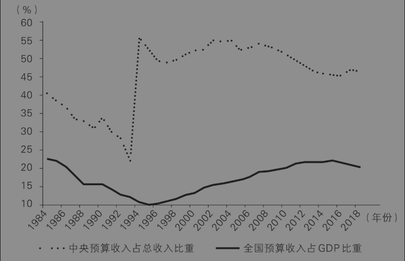

数据来源：万得数据库。引自兰小欢（2021）

图7-3 中央和全国财政预算收入状况

某种程度上，建设工业园区就相当于中国地方政府的“圈地运动”。因为工业企业需要成片的土地建设厂房，而地方政府想要吸引上下游产业，建设完整的产业链或者产业基地，更加需要大片土地。土地来自哪里呢？来自地方政府对农村集体土地的征收和城市原有住房的拆迁。1998年修改的《中华人民共和国土地管理法》规定，不管是国有土地还是集体土地，都必须经过政府征收，才能进入土地二级市场，变成建设用地或商品房用地。因此，地方政府成为土地一级市场上的垄断供应者。

地方政府通过一级市场征收到的土地一般是“生地”。地方政府拿到生地之后，还需要进行基础设施建设，例如“三通一平”，把它变成“熟地”，然后再通过协议出让方式，后来又通过比较规范的“招拍挂”方式（即招标、拍卖、挂牌出让），卖给工业企业，并收取土地出让金。所谓“三通一平”，就是通电、通水、通路以及地面平整。毕竟，地方政府不可能让企业在一块水稻田里生产汽车。土地出让金是企业为了获得土地使用权向地方政府交纳的一次性价款，它不是税，也不是交给中央政府的。而且，为了吸引优质企业，地方政府不得不提供各种优惠。在土地整理方面，开发区的基础设施建设标准不断加码，从早期的“三通一平”到“五通一平”，再到“七通一平”乃至“十通一平”。用今天的话来说，“内卷”越来越严重。在税收优惠方面，很多地方政府也开展了“逐底竞争”（race to the bottom），从“两免三减半”“三免三减半”发展到“五免五减半”。什么是“两免三减半”？就是企业在第一年至第二年免交企业所得税，第三年至第五年按照25%的法定税率减半交纳企业所得税。因为税率是全国统一的，所以地方政府私自减免税收是违规的，这一行为后来被中央禁止。税收竞争在推动招商引资的同时，也带来了很多负面效应，例如增加了环境污染、减少了地方公共物品提供以及对不发达地区造成了负外部性。[^15]

特斯拉落户上海，就是中国地方政府招商引资竞争的典型案例。当时，苏州、重庆、安徽等多个地方政府都想争夺特斯拉这个超级客户，但最终花落上海。上海市政府为了拿下特斯拉“超级工厂”，先是以超低价格给了特斯拉1300亩的工业用地，然后再提供大约200亿元的低息贷款，其中大部分是无抵押贷款，并且在建设审批方面一路绿灯，特事特办。以至于上海特斯拉“超级工厂”从奠基开工到正式交付只用了不到一年的时间，比美国的同类工厂快了两倍，创造了令人惊讶的“上海速度”。

可想而知，在这种“逐底竞争”的格局下，地方政府从工业园区的土地出让中基本赚不到什么钱。不赚钱，那地方政府是在做亏本买卖吗？当然不是。虽然土地出让不赚钱，但是企业投资生产之后还要交增值税、所得税，还能拉动上下游产业链，还能带来大量的就业。地方政府看重的是工业土地出让的附加值。

关键是，精明的地方政府发现，虽然工业用地出让本身不赚钱，但是商住用地出让却很赚钱。1978年，中国城市常住人口占比还不到18%，此后一路增加到2021年的65%左右。海量人口进城，也产生了对住房的海量需求。1998年之前，城市居民住房是以单位分配为主，住房是一种福利。《国务院关于进一步深化城镇住房制度改革加快住房建设的通知》（国发〔1998〕23号）发布后，住房分配体系从实物福利分房全面转向货币化分配，从此居民成为住房的购买主体。因此，城市化极大地刺激了居民的住房需求，也进一步带来了商业用地的需求，因为居民多了，消费的人也就多了。但是在地价方面，工业用地和商住用地差别很大。优质民营企业和外资企业可以在事前跟地方政府讨价还价，恨不得零地价拿地，而且一旦觉得营商环境不好，大不了事后“用脚投票”。但商住用地的需求者主要是商户、当地居民和企业职工，特别是后两者很难“说走就走”，这就导致商住用地的价格更高。根据浙江大学汪晖教授的估算，中国工业用地价格非常低，是平均地价的1/8，住宅用地的1/13，相比之下，美国纽约的工业用地价格是住宅用地的1/3。[^16]

基于商住用地的房地产开发，土地出让价格高只是带给地方政府的好处之一，好处之二是房地产行业的税收种类多。表7-3概括了房地产行业从建设到使用再到交易的各个环节的主要税种，加起来地方政府一共可以收11次税。不同地方略有差异，但大体如此。

表7-3 房地产行业的税收

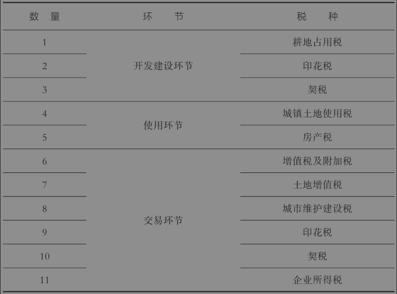

房地产行业带给地方政府的第三个好处在于它较强的产业关联效应，因为房地产行业的产业链特别长。房地产行业包括开工环节（工程机械、水泥、钢铁）、竣工环节（玻璃、建材）、使用环节（家具、家电）三个部分，这还不包括相关的金融和房地产交易等服务业。据估计，2004－2018年中国房地产业从业人数由396万增加到1264万，2023年从业人数估计达到1300万，比2020年教培行业最火热时的1000万从业者人数还多。[^17]正因为房地产行业税收多、产业关联效应强，2003年国务院在《关于促进房地产市场持续健康发展的通知》中，首次明确将房地产作为国民经济的支柱产业。

我们将土地财政背后的政治经济学逻辑[^18]总结如下（图7-4）。地方政府一方面通过低价出让工业用地，吸引企业入驻，拉动工业增长，另一方面又通过高价出让商住用地，获得大量土地出让金，然后再进一步改善基础设施和城市环境，并对工业用地进行交叉补贴。通过“左手倒右手”，地方政府实现了一个“完美的闭环”：不仅拉动了经济增长，改善了城市面貌，还获得了大量的可支配收入，并且这些政绩还会为主政者带来财政收入、政治晋升，但也可能滋生寻租的空间。这种一石多鸟的事情，天底下不好找。潘多拉魔盒一旦打开，就无法关上。这种一本万利的盈利模式被各个地方迅速克隆，在2000年之后遍地开花，愈演愈烈，终于变成了一种为城市政府普遍生财的“土地财政”现象。早在17世纪，英国古典政治经济学家威廉·配第（William Petty）就引用过一句民间谚语：“劳动是财富之父，土地是财富之母。”当土地财政成为一种现象时，这句话的后半句算是名副其实了。

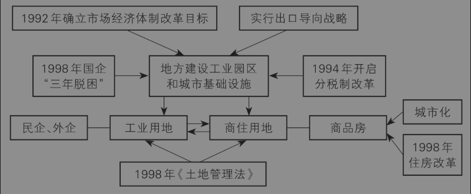

图7-4 土地财政的政治经济学逻辑

根据国家统计局的数据，1998年到2024年中国土地出让金数额如图7-5所示。1998年全国土地出让金总额不过500多亿元，大约是当年地方财政预算收入的10%；但是2007年就超过了1万亿，到了2021年已经达到了8.7万亿，相当于地方财政预算收入的78%。从1998年到2021年，全国土地出让金总额增长了170倍。

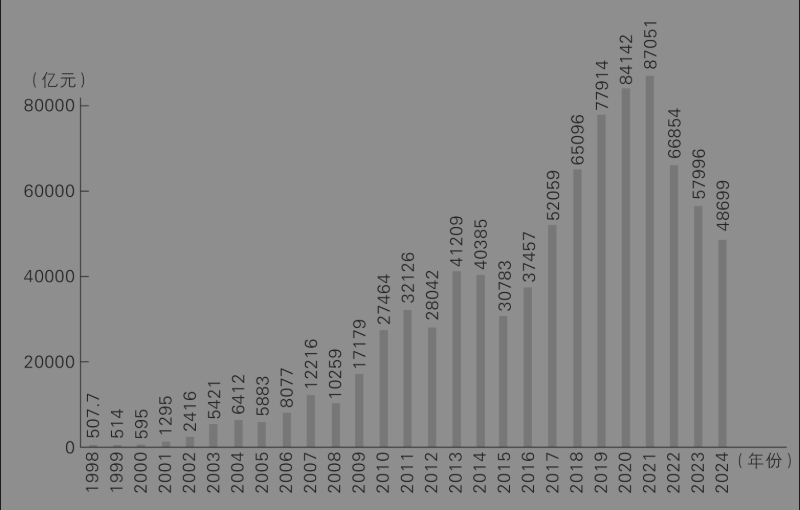

数据来源：国家统计局、财政部

图7-5 1998－2024年中国土地出让金数额

图7-5展示的是全国土地出让金增长的整体情况，为了体现区域差异，我们根据公开数据进一步计算了除港澳台之外的全国31个省（区、市）在2008年、2018年和2021年三个时点的土地财政状况（图7-6）。在下图中，我们用当年本省土地出让金占GDP的比例来度量土地财政的依赖度，这个比例越高，表示本省越是依赖土地财政。在各个省份中，土地财政依赖度最高的省份居然是浙江，江苏省排名第二，而江浙是中国最富裕的省份。第三名是贵州省，然后是重庆市和江西省，这些都是经济相对欠发达的地区。这就形成了一个很有意思的现象：相对富的地方和相对穷的地方，都高度依赖土地财政。富裕地区依赖土地财政，是因为经济越是发达的地区，土地价格越高，因此出让土地收入越高；而贫穷地区依赖土地财政，是因为除了土地，没什么值钱的资源可出让了。

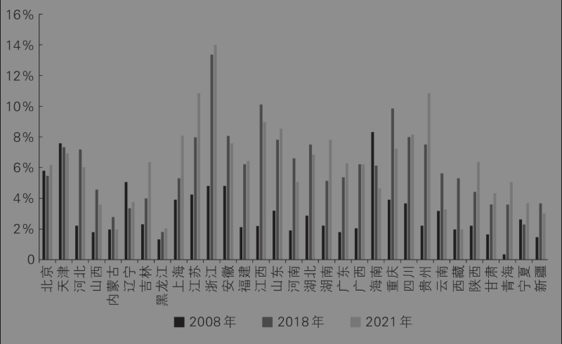

图7-6 全国31个省（区、市）土地出让金占GDP的比例

看完了全国和各省份的数据，再来看看城市数据。图7-7显示了中国37个主要城市2017－2021年平均的土地财政依赖度。不过，这里土地财政依赖度的算法和上面不同，现在是土地财政依赖度=土地出让收入／一般公共预算收入。从这张图上可以看出，土地财政依赖度最高的城市是杭州。这不奇怪，因为我们前面发现浙江省是土地财政依赖度最高的省，而杭州作为浙江省会和副省级城市，自然也是土地最贵的地方。然后是佛山、南京、武汉和广州，前5名都是发达地区。土地财政依赖度最低的城市，依次是深圳、上海和北京。

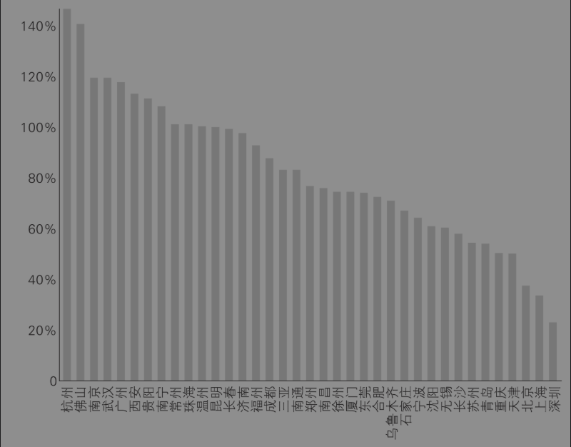

数据来源：中指研究院、各地统计年鉴。微信公众号“国民经略”制作

图7-7 中国37个主要城市2017－2021年土地财政依赖度

接下来还有一个问题，土地出让金都到了哪一级的地方政府口袋里呢？是省级政府，市级政府，还是县区基层政府？要搞清楚这个问题，首先要明白，作为一项非税收入，土地出让收入在政府的会计科目上属于政府性基金预算收入。2021年，地方政府性基金预算本级收入93936亿元，国有土地使用权出让收入87051亿元，占地方本级政府性基金收入92.67%。换句话说，政府性基金预算收入几乎都是土地出让金，此外还有城市基础设施配套费收入、车辆通行费收入、污水处理费收入等其他收入。中国人民大学吕冰洋教授近年的研究计算了政府性基金预算收入在各级政府之间的分配情况，这就可以推测土地出让金的分配情况。图7-8显示，2017年之前，县级政府获得了大约一半的土地出让金，剩下归省里和市里。但是，2018年之后，估计土地出让金太重要了，市里获得的份额开始稍微超过了县里的份额，而省里的份额一直在下降，最后不到10%。这意味着，县区基层政府既是大部分土地的实际控制者，也是土地财政的主要受益者。

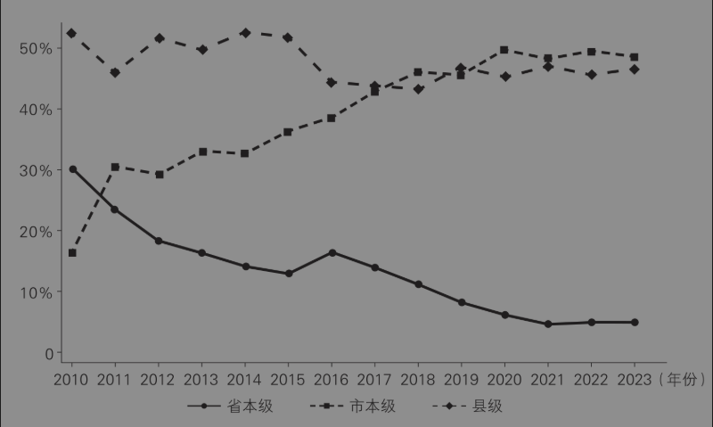

图7-8 政府性基金预算收入在各级政府之间的分配情况

### 二、土地财政的后果

俗话说，天下没有免费的午餐。虽然土地财政加速了地方政府的资本积累，推动了城市建设，但是与此同时也造成了巨大的代价和严重的后果。

其一，土地财政导致了高房价。土地成本在开发商建房成本中的占比居高不下，是房价高企的重要原因。例如在2013年的楼市热潮中，有从业者表示，在北京市，土地成本在房价中的占比基本上是50%－60%，而同期开发商如果在马来西亚建房子，土地价格是每平方米2000元人民币，房价是2万元人民币，土地成本只占房价的10%。此外，有经济学家指出，即使与不少发达国家相比，中国的土地成本在整个经济建设投资中的占比也明显偏高。因为房价和土地出让金是正相关的，所以当地方政府想不断提高土地出让金收入时，房价必然水涨船高。例如，2001年全国商品住宅的平均售价是2017元／平方米，2021年涨到了10396元／平方米，20年涨了5倍。在一线城市，房价甚至涨了几十倍。然而在此期间，城镇居民人均可支配收入的名义涨幅还不到6倍。而且，地方政府往往利用自己在土地一级市场的垄断地位，控制商住用地的供给。据统计，地方政府每年出让的土地中，一半以上都是工业用地，而住宅用地只占不到20%。显然，在房地产问题上，当前社会的主要矛盾是不断提高的土地出让金和难以承受的高房价之间的矛盾。

其二，土地财政加大了贫富差距。2014年，统计局公布的城镇居民收入的基尼系数不到0.5。与此大体同时，根据北京大学谢宇课题组的报告，2012年中国家庭净财产的基尼系数达到0.73，并且顶端1%的家庭占有全国三分之一以上的财产，而底端25%的家庭拥有的财产总量只占全国的1%左右。[^19]家庭财富的不平等超过了收入的不平等，是因为房产构成了主要的家庭财产，并拉大了收入差距。而且，相对于工资收入，以房产为主的家庭财产更缺乏弹性，更容易导致阶层固化。

其三，土地财政导致了资源错配。土地财政导致了房地产泡沫，制造了大量的“鬼楼”“鬼城”。这纯粹是资源浪费。此外，2010－2020年间中国的基础设施投资总额达到了108万亿。这些依靠土地财政支持的基础设施项目，很多只能产生很少的现金流，投资回报率并不高，而且会引发债务风险。

其四，土地财政导致腐败问题。依靠土地财政，地方政府大量投资建设各类新城区、开发区，以及城市道路交通、城市管网和生态园林等城市基础设施，而工程项目一直都是难以监督的腐败高发地带。

其五，土地财政会带来金融风险。2020年，房地产业创造增加值7.3万亿元，占GDP的7%，但房地产相关贷款已超过67万亿元，占银行贷款总额的39%，相当于GDP的66%。在负债方面，很多房地产企业的资产负债率已经超过了80%，居民的负债率接近了70%，地方政府的负债率已经超过了70%。根据国际货币基金组织（IMF）的测算，2021年中国地方政府的负债超过了80万亿元人民币，按平均利息为4%－5%计算，每年利息就高达3万亿－4万亿元。2021年地方政府的土地出让金毛收入为8.7万亿，扣除成本之后的土地出让金纯收入大概只占其中的20%－25%，甚至可能下降至10%左右。[^20]因此，现在土地出让金的纯收入连地方债务的利息都不够支付。

除了上述风险和后果，关键是，土地财政所依赖的房地产市场已经出现了严重的供给过剩。根据北京国民经济研究所研究员王小鲁（2022）的测算，假设2021年到2035年，城镇化率再提高10个百分点，达到75%，同时假设城镇人均住房面积从42平方米提高到50平方米，城镇最多还需要新建150亿平方米住宅。那么未来14年，平均每年只需新建10.7亿平方米住宅。然而在过去的三年里，平均每年新开工住宅面积已经高达15.9亿平方米。这意味着今后房地产业哪怕只保持现有建设规模不再增长，以后每年都会有大约1/3的新建住房出现过剩。再考虑到已经囤积的土地以及不断降低的人口出生率，今后地方政府的卖地收入每年都将减少至少三分之一。因此，不管是从后果来看，还是从趋势来看，土地财政都是不可持续的。

### 三、土地财政的出路

既然土地财政不可持续，那怎么办呢？起码要解决两个方面的问题，一是如何化解地方政府的现有债务，二是如何找到可持续的财源。说实话，这两个问题都不好解决。

出路之一是改革现有土地制度，打破地方政府对住宅用地的垄断供应权。比如，允许集体土地入市，允许农户闲置宅基地在不违反土地规划用途的条件下进行使用权的有偿转让，从而提高土地供应量。虽然增加土地供给可以在一定程度上降低房价，但是又加剧了住房供应的过剩问题，而且也没有解决地方政府的财源问题。

出路之二是政府收购滞销的商品房，将之转为廉租房和公租房。这种思路其实就是新加坡的住房模式。本来，中国内地的土地财政就是大量参考借鉴中国香港地区和新加坡的做法。1960年，新加坡成立了建屋发展局，负责规划兴建保障性住房（即“组屋”），并鼓励中等收入和低收入阶层购买，但房子的所有权属于政府。房主只有住满一定时间才能转售，且只能转售给符合条件的人。最终，80%的中低收入者住在政府提供的保障房里，剩下20%的高收入者通过市场渠道购买商品房。新加坡的经验表明，土地财政并不必然导致高房价。这正是成功的“政府干预+市场经济”模式，政府和市场各取所需，和谐共处。那为什么中国的很多地方政府没有“学会”呢？这在很大程度上与中国特色的官员晋升与绩效考核方式有关，并且再次印证了我反复强调的一句话：中国的问题，归根结底都是政治经济学问题。

前面介绍的出路主要是降低房价，但关键问题是，如何为地方政府找到新的财源，以便取代卖地收入呢？有人提出了出路之三，用“股权财政”取代“土地财政”。所谓“股权财政”主要是指国有企业每年上缴给地方政府的利润，以及各类政府性基金及城投企业进行股权投资的投资收益。但问题是，“股权财政”规模整体较小。一是大部分地方国企其实并不赚钱，赚钱的主要是央企，这无法给地方政府“输血”。二是很多政府的股权投资要多年才能收回，而且目前来看投资回报率并不高。从逻辑上讲，如果市场行情不好，凭什么政府投资比民间投资更能挣钱呢？三是股权投资基金分布不均匀，不利于欠发达地区。图7-9展示了全国股权基金的地区分布情况，其中计划单列市单列，数据不计入所在省份。根据中基协发布的数据，截至2022年末，已备案的私募股权、创业基金约5.1万只，合计金额约14万亿元。然而，大约一半的基金都在北京、上海、深圳三个城市。[^21]

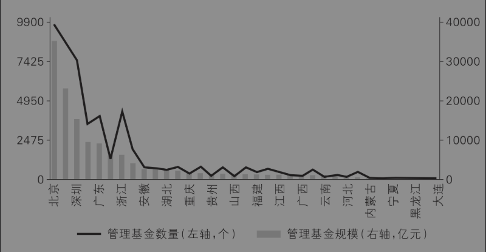

图7-9 全国股权基金分布

既然上面三条路都走不通，那还有别的出路吗？比如征收房产税，比如出售部分国有资产，又比如重新划分中央和地方税种，这些都可以在一定程度上解决地方政府的收入问题。但当务之急是，重疾不能下猛药。房地产有泡沫，但泡沫要慢慢挤；地方政府债务高企，也需要逐步化解。人们担心地方政府的收入不能持续，有一个隐性前提，那就是政府必须担纲推动经济发展的主角。但是，这个隐性前提并不必然成立，至少并不总是在经济发展的不同阶段成立。收入和支出是一枚硬币的两面。如果收入不能持续增加，降低支出同样是一个解决之道。特别是考虑到这些年政府规模的不断扩张，很多“刚性”的支出其实是弹性的，还有很大的削减空间。长期来看，要从根本上解决土地财政问题，关键在于转变理念，从发展型政府逐步转向服务型政府，厘清政府和市场的边界，这样才能遏制地方政府的投资冲动，降低金融风险，防止软预算约束。一句话，让政府的归政府，让市场的归市场。

## 第三节 天量地方债出路何在？

通过前文的讨论，我们已经知道，中国经济的动力主要取决于地方政府的激励和企业的活力。很多研究制度经济学的中外学者都同意，地方政府之间的竞争是推动中国经济高速增长的重要引擎。那么，地方政府之间怎么竞争呢？它们像企业一样，借债、投资，搞经济开发和城市建设，然后通过税收和土地出让金收回成本，再滚动开发。正因为地方政府不断借债，可它又不是一个普通的公司，所以地方债务问题才引起了高度重视。例如，2020年媒体曝光了一个巨量地方债的典型案例：贵州省独山县在2020年之前一直是国家级贫困县，2018年全县财政收入10亿元出头。但从2011年到2018年，在时任县委书记潘志立的领导下，县里耗资上百亿元建设了一批政绩工程，这导致该县累积债务高达400多亿元，是全县财政收入的40倍！如果这是一家企业，恐怕早已破产清算了。

很多人甚至认为，地方债是中国最大的“灰犀牛”事件之一，迟早会出现问题，甚至是“暴雷”。事实上，中央对于如何化解地方债高度重视。例如，2023年7月24日，中央政治局会议提出，“要有效防范化解地方债务风险，制定实施一揽子化债方案”。这应该是第一次提出“一揽子化债方案”，因此备受关注。8月份，中央批准发行1.5万亿元的特殊再融资债券，帮助包括天津、贵州、云南、陕西和重庆等12个偿债压力较大的省份和地区偿还债务。2024年11月8日，全国人大常委会批准三年内增加6万亿元地方政府债务限额，用于置换存量隐性债务。鉴于地方债问题的重要性，本节主要分析地方债的现状、原因和出路。

### 一、地方债的现状

关于地方债，我想大家关心的主要是下面三个关键问题：现在全国究竟还有多少地方债？各个地方的债务余额是多少？哪些省份的负债率更高？首先澄清一点，“地方债”是一个笼统的概念。狭义的地方债，是指由国务院批准、通过省级政府发行的债券，目的是筹措建设基础设施、提供民生服务的资金。这类债券的信用评级很高，应该不允许违约，属于“明债”。下面，我们根据财政部“地方政府债务信息公开平台”的相关数据，通过下面的图表回答这三个关键问题。

图7-10显示了2015－2023年全国总的地方债余额。2015年的全国地方债余额是13.78万亿元，之后一路增加，直到2023年高达40.74万亿元，9年间增长了将近2倍，平均每年增加大约14%。40.74万亿元，相当于2023年中国GDP总量126.06万亿元的三分之一，可谓天量地方债。

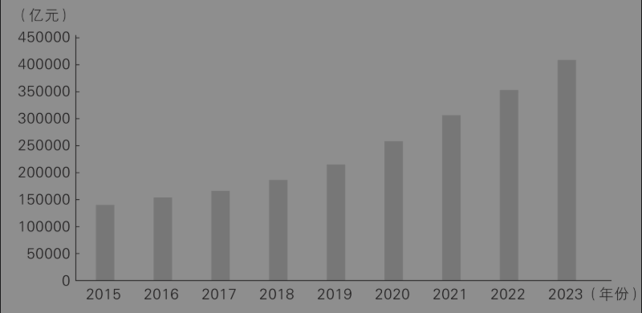

图7-10 2015－2023年全国地方债余额

图7-11显示了2023年各省（区、市）债务余额排名情况。前五名的省份依次为广东（29 879亿元）、山东（27521亿元）、浙江（22886亿元）、江苏（22733亿元）、四川（20270亿元）；后五位的是山西（7082亿元）、海南（4106亿元）、青海（3337亿元）、宁夏（2244亿元）和西藏（682亿元）。很明显，经济越是发达的地区地方债余额越多，经济越是落后的地区地方债余额越少。道理很简单，经济越发达的地方，越是能够借到钱；经济越不发达的地方，越是难借到钱。

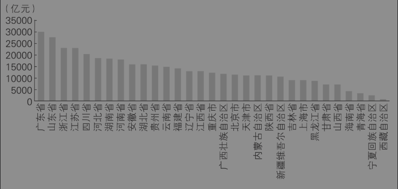

图7-11 2023年各省（区、市）债务余额

图7-12显示了2023年各省（区、市）负债率的排名情况。负债率=债务余额/GDP。负债率越高，偿债能力越低，债务风险越大。很有意思的是，虽然前面说了，债务余额最高的省份是广东，但是广东也是负债率最低的（17.55%）省份，紧随其后的四个省份是：江苏（17.73%）、上海（18.70%）、福建（22.13%）和浙江（23.12%）。负债率最高的五个省份依次是：青海（87.84%）、贵州（72.32%）、天津（66.43%）、吉林（65.56%）、甘肃（59.90%）。分地区来看，西部地区省份负债率最高，东南沿海四个省份的负债率最低。图7-11表明，越穷的地方越难借钱；图7-12则说明，越穷的地方，还钱压力越大。从理论上讲，如果越富的地方负债率越高，那么我们就不必太担心地方债问题，因为借债能力和还债能力是匹配的。相反，如果越穷的地方负债率越高，那就是一种债务错配，这才是值得担心的地方。

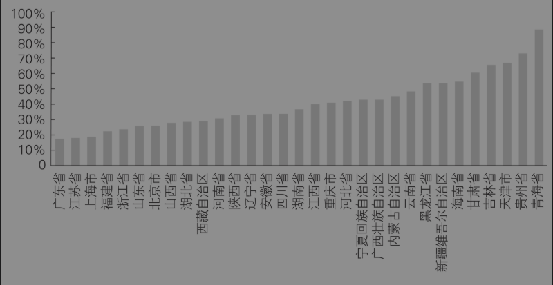

图7-12 2023年各省（区、市）负债率

前面统计的只是“明债”，还有一部分“隐性债”。财政部文件对隐性债务的定义是：地方政府在法定政府债务限额之外直接或者承诺以财政资金偿还以及违法提供担保等方式举借的债务。隐性债务的形式极为复杂，既有债券，又有银行贷款，还有明股实债、PPP（政府与社会资本合作）等多种形式。因此，理论上无法查清楚。经济学者们通常将地方投融资平台发行的“城投债”当作隐性债务的主要成分，主要是因为城投债在金融交易系统里可以公开查询。然而，我们在调研中发现，不是所有的城投债都是地方债务，因为它们可能不需要政府担保。有地方政府担保的城投债只是地方隐性债务的一部分，隐性债还包括交通投资、文旅等债务。根据万得数据，截至2022年，我国城投债券存续总规模15.26万亿元，存续债券20758只。当然，近两年伴随化债投入增加，债务规模有所收窄。

需要注意的是，近年来城投债屡屡“暴雷”，频繁违约。2018年8月13日，新疆生产建设兵团第六师国有资产经营有限责任公司2017年度第一期短期融资券，到期未能兑付，两天之后才偿还了债券本息。这被认为是第一只公开违约的城投债。截至2022年11月30日，上海票据交易所共披露了33 235项票据持续逾期情况，涉及城投企业64家。

### 二、产生地方债的原因

贵州省独山县的债务问题，只是非常普遍的中国地方债问题的冰山一角。事实上，独山县并不是借债最多的县级地区。问题是，为什么像独山县这样的地方要拼命借债呢？它们为什么能借到那么多钱呢？在这里，我提供一个政治经济学逻辑。我认为，要理解中国的地方债，离不开以下四个重要因素。[^22]

第一，激烈的地区竞争。长期以来，研究中国经济转型与发展的国内外经济学家们普遍认识到，中国地区之间的激烈竞争是中国经济维持几十年中高速增长的“第一推动力”。为什么地方政府会为经济增长而激烈竞争呢？如前文所述，已有研究表明，辖区内经济快速增长会给官员带来多种“收益”，比如更多的财政收入、更高的晋升概率，但也可能会产生更大寻租空间。

1994年分税制改革开启之后，这种地区竞争的格局更加激烈。每个地区的政府就好比一个公司，县委书记就好比董事长，县长就好比CEO。因此，中国的地方政府同时承担了公共服务和经济发展两种职能，它们既是社会的管理者，又是市场经济的主要参与者。美国社会学家戴慕珍（Jean Oi）把这种现象称为“地方政府公司主义”（Oi，1992）。对一个公司来说，要想实现利润最大化，当然首先要扩大投资，要搞大项目，要大力招商引资。然而，很多地方政府本身财力有限，上级的拨款有限，又不能像真正的公司那样接受外部股东注资或者干脆上市融资，于是地方政府就大力对外举债。

2009年之前，按照当时的法律法规，地方政府不能举债。于是，地方政府主要通过各种投融资平台，包括城投公司、交投公司、国资公司，以银行贷款和发行债券等多种方式，从政策性银行、商业银行、信托、券商和其他金融机构那里获得资金。地方政府通过投融资平台借的钱，就是前面讲到的隐性债务。此外，地方政府还通过诸如PPP、政府引导产业基金等渠道“明股实债”。通过上述渠道筹措的地方债务，既难以监管，又给地方财力带来不可控的风险。因此，2009年之后，由财政部代理各地省级政府公开发行债券，将之纳入地方政府的公共预算管理，这构成了地方政府的显性债务。之后逐步放松发债管制，从“代发代还”到“代发自还”，再到2015年新预算法实施后的“自发自还”，即允许省级政府自己在公开市场上发行债券并自行偿还。说白了，就是中央对地方政府举债实行“开正门”“堵后门”的治理思路。不过，虽然县市两级地方政府可以通过省级政府发行公开债券，但是额度却是由财政部严格控制的。

第二，地方政府成为实际上的“无限责任公司”。光是地区竞争，并不能解释地方政府的天量债务。像贵州省独山县那样，一年财政收入不到10个亿，存量债务居然高达400多亿。如果是一个普通公司，绝不可能借到这么多钱。普通的公司是“有限责任公司”，每个公司股东要对自己的出资额负有限责任，并且外部投资者也会以公司资产来评估放贷额度。而地方政府不是普通的公司，它实际上是一种“无限责任公司”。在推动辖区内经济和社会发展方面，地方政府一方面是责任无限，另一方面是权力无限、手段无限、信用无限。

我们都知道，借贷需要抵押，但地方政府能够动用的抵押物源源不断，甚至可以凭空“创造”出来。例如一块地皮，本来是不毛之地，一旦纳入城镇开发计划，价格就会水涨船高。因此，地方政府经常将“生地”（未开发的土地）或者“熟地”注入投融资平台，甚至利用政府收入为贷款单位出具担保函或者承诺函。正是凭借着三重“无限”特征，地方政府能够撬动巨大的杠杆效应，以小博大，通过各种渠道借到超过自身能力多倍的巨额债务。前面提到的各种地方投融资平台，就是地方政府常用的融资手段，而融资对象则五花八门：国家政策性银行、四大商业银行、区域性银行、本地城商行，此外还有各种信托、券商、保险以及其他金融机构。

总之，地方政府借钱的手段只有你想不到，没有它用不到。问题是，像独山县那样一个中西部地区的贫困县借那么多钱，放贷者不担心它破产吗？基本上不担心。这是因为，地方政府不是普通的民事主体，它代表一级政权，背后是国家信用。在中国，我们至今没有听说过哪个地方政府破产的事情，原因正在于此。

第三，不受制约的“一把手”权力。地方政府的特殊性质为其举债提供了便利，但最终能够成功地大规模举债，离不开当地党政主要领导的“雄心壮志”。几乎每一个债台高筑的地方，都有一个“说一不二”的强势领导。但“一把手”特征与地方政府的债务规模并不存在简单的线性关系，观察其关联性需要区分债务类型。基于省级地方债务的数据分析，我们发现，对受到中央严格监管的公开债务来说，如果领导年纪较轻、升迁空间较大，或者有中央工作经历，那么他更有可能与中央保持一致，严控地方债务。相反，对于难以监管的地方隐性债务来说，在激烈的地区竞争格局下，那些刚刚上任、年纪相对较大的“一把手”，更有可能通过大事举债，为政治前途搏一把。

独山县原县委书记潘志立就是一个强势“一把手”的典型。他从东部沿海地区交流到贵州独山县，立誓要干一番事业。经过一两年的大力整治，他优化了当地的营商环境，但也很快树立了“说一不二”的强势地位。正是他在独山县任内的“大干快上”，为他升任贵州省黔南州副州长提供了坚实的政绩基础。可见，大规模举债，推动地方经济发展，对于追求“进步”的官员来说，是一种理性的选择。虽然很多大型项目（例如“大学城”）根本不符合当地实际情况，超出地方财力，但是在不受制约的权力之下，当地谁敢质疑？如果不是其因受贿被查处，独山县的债台不知道还要累积到几层楼高。我们在调研中发现，在当下情景下，对于一个强势的县委书记或者市委书记来说，阻止其大肆举债的制度安排并不完善。

第四，隐性的政企合谋。有举债的动力，也有举债的雄心，是不是一定可以大肆举债呢？不是，还需要有人愿意放贷，这就涉及金融机构以及各类中介。不可否认，一些地方政府、监管部门、投融资平台、金融机构和各类中介在构建借债—放贷的利益联盟时，主观上有“服务地方经济”的正当动机，方式上合法合规，结果上最终推动了地方经济发展，并且没有出现债务违约，那么这是一种值得肯定的“政企合作”行为。然而，一方面，在中央三令五申严控地方债务、防止“明股实债”和各类违规举债的严峻形势下，还是有不少地方政府及其利益联盟依然违法违规大肆举债；另一方面，这些违规举债行为导致了大量烂尾工程，浪费了纳税人的钱财，让一些不法官员和商人中饱私囊。这就不是政企合作，而是一种转型经济时期典型的“政企合谋”行为。[^23]这里的“企”，不仅指国企，也包括各类金融企业。2023年6月19日，贵州省兴仁市法院一审判决，民营企业主樊某与兴仁市政府平台公司开展多次高息融资业务，融资金额3.477亿元，为出资方谋取高额融资服务费1.3772亿元，其中樊某个人分得3055.43万元。兴仁市政府平台公司支付高额的融资服务费，导致了国家利益遭受特别重大损失。为此，樊某被判处行贿罪和伪造买卖罪，并处以罚金。这个案例就揭露了地方平台公司举债过程中的政企合谋现象。

### 三、化解地方债的出路

理解了地方债的制度背景以及形成原因，那么如何规范地方政府的借债行为，有效化解天量地方债务，防止地方债务暴雷呢？我认为，可以从短期化债和长期限债两个层面解决难题。所谓短期化债，就是想办法在短期内尽可能降低债务集中爆发的金融风险，相当于先把病人的症状遏制住；所谓长期限债，就是在制度上限制地方债务无序扩张，消除病根。先说短期化债手段。

化债手段之一：中央特事特办。中央针对某些重点地区提出了特殊的“一揽子化债”政策。“一揽子化债”手段包括展期、降息、重组等方式。展期就是延长还债时间，让负债严重的地方喘口气；债务重组通常包括以资产清偿债务、减少债务本金、降低利率、减免部分利息，例如，大家比较看重的“特殊再融资债券”就是一种化解债务的应急流动性金融工具（SPV）。普通的再融资债券只能用于偿还到期的地方政府债券本金，而特殊的再融资债券还可以偿还政府存量债务，这样能够用更大力度减少存量债务。

化债手段之二：地方优化资产负债表。对地方政府来说，主要是通过盘活国有资产、推动城投平台转型和重组等方式，增加财政收入和提高偿债能力。盘活国有资产的主要方式，就是出让政府持有股权及经营性国有资产权益。一个城投平台重组的案例是：2019年，山西交控集团通过市场化重组，将政府担保的隐性债务转为企业经营性债务，在政府和企业之间建立了一道债务防火墙。

化债手段之三：扩大市场化融资渠道。财政资金不仅是有限的，而且通常来说投资效率较低。因此，地方政府应该积极吸纳市场资金来参与城市建设。对一些短期内投资金额较大，长期内投资回报比较稳定的项目，例如道路桥梁、污水处理、养老健康产业，完全可以采用和社会资本合作的PPP方式建设和运营。我的团队收集整理了全国PPP综合信息平台截至2018年发布的8 649个PPP项目。我们的研究表明，地方政府参股的PPP项目会显著降低社会资本的项目参与度，存在“挤出”民企的现象。并且这种挤出效应主要发生在非政府付费项目、国家示范项目、非本地企业和地区营商环境差的情况下。因此，政府要扩大市场化融资渠道，一是要给民企留下进入空间，避免挤出效应，二是要降低民营企业融资成本，这样才能实现“国民两利”－国家降低了负债率，民企获得了财务回报。

从长期来看，则可以考虑以下制度化的限债政策。

限债政策之一：推动地方政府由发展型政府向服务型政府转型。只要地方政府还是一个发展型政府的定位，地方政府就必然有动力像公司一样去借贷并刺激经济增长。其实，按世界银行的标准，中国已经是一个中等偏上收入国家，下一步即将迈入高收入国家（即发达国家）行列。政府不应当继续担任推动经济增长的主角，其主要职能不再是发展经济，而是提供公共服务，维持社会平等，即从过去的“裁判员”兼“运动员”逐渐变成一个纯粹的“裁判员”。政府角色的转变，不仅有利于从根本上遏制地方政府大肆举债的动力，而且有利于创造一个公平竞争的营商环境。

限债政策之二：限制地方“一把手”权力。每一堆政绩工程的背后，都可能有一个腐败的“一把手”。十八大以来，大规模的反腐败斗争成功营造了一种“不敢腐”的政治气氛。我们在调研中发现，在凡事强调主体责任的当下，“一把手”的权力可能有增无减，因此针对“一把手”的防腐机制仍然有待完善。

限债政策之三：将地方融资平台债务透明化。目前，对地方债“开正门”的效果已经实现了，但是“堵后门”的效果尚未实现。要减少地方政府通过各类投融资平台违规举债，一个有效办法是，将所有地方投融资平台的各类债务（不仅仅是城投债）完全公开，并注明是否有地方政府担保或者承担连带责任。这样做有两个好处：一是避免“隐性”担保，让地方政府的私下承诺不可置信；二是让多个放贷机构之间彼此信息对称，避免重复担保和资不抵债。

## 第四节 电商能救活小县城吗？

在开始讨论本节的主题之前，我先说两件跟县委书记聊天的事情。第一件事情是，有一次我碰到一位来中国人民大学培训的中部地区县委书记，我问他现在基层面临的最大压力是什么。他想了想，然后说：短期内最大的压力，肯定是维稳和安全；但是长期内，最大的压力是人口流失。他说的没错，我记得我们老家的市领导来北京开会时，也跟乡友们感叹，过去十年本市常住人口减少了7%。虽然人口减少不会立即影响基层的运转，但人口问题就是一种“灰犀牛”现象，长期来看会导致严重的后果。道理很简单，决定行政区划的主要因素是人口和经济规模，而经济规模又是主要由人口决定的。因此，如果一个地方人口持续减少，行政区划就要调整，一些小县城、小乡镇和小村庄可能就不存在了。古人说：皮之不存，毛将焉附？这将直接影响到无数基层公务员的“铁饭碗”。

第二件事情是，三年前的某一天，江西省某县的主要领导D给我打电话，他说：江西省属于国家生态文明试验区，我们县得到政策支持，可以发展“绿色金融”。领导说，你是著名的经济学者，能否给我们县提一点建议，如何促进我们县的绿色农产品开发？我当时想了半天，最后给领导建议：请我们江西籍影视明星刘涛带货，搞一次电商直播。不过，最终这个建议不了了之。

一件事是基层人口减少，另一件事是搞直播带货，大家可能觉得这两件事风马牛不相及。但是，我认为，搞好电商可以救活很多小县城。如何利用电商促进县域经济发展，是中国基层治理的重要命题。本节第一部分用数据说话，证明县域经济正在萎缩，人口流失问题必须严肃面对；第二部分试图从五个角度证明，搞好电商是救活小县城的有效办法；第三部分总结一下当前县域电商发展的四个瓶颈以及政策建议。

### 一、“每个人的故乡都在沦陷”

从经济学理论上讲，人口是决定经济增长最重要的变量之一。然而，近年来很多县、县级市、自治县、旗、自治旗和林区等县域辖区却面临严重的人口下降问题。根据中山大学教授周春山（2023）的估计，2000－2010年，县域常住人口减少大约128万人，但是接下来的十年，即2010－2020年，县域常住人口却减少了3782万人，是前十年的大约30倍。人口减少有两个原因，一是出生率降低，二是人口流失。判断一个地方人口是否流失到其他地方的一个简单方法，是看本地常住人口数是否少于户籍人口数。2010年，县域常住人口数比户籍人口数少了大约9181万人，人口净流出的县域有1557个；2020年，县域常住人口数比户籍人口数少了1.55亿人，人口净流出的县域增加到了1673个。2020年，全国有1817个县、县级市、自治县，它们构成了县域辖区的绝大多数。1673个县域辖区出现人口净流出，意味着大约90%的县域出现了人口净流出。

那么，人口流失到哪里去了呢？大部分是去了市辖区（不属于“县域”），尤其是东南沿海的市辖区。人口流失的直接后果，就是县域经济的比例在收缩。根据《中国县域统计年鉴2021（县市卷）》，虽然全国县域经济的GDP总量从2011年的20.18万亿元一直上升到2020年的39.12万亿元，但是县域GDP占全国GDP的比重在2013年之后却一路下滑，从2013年的将近46%下降到2020年的38.6%（图7-13）。

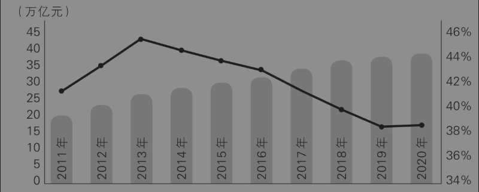

图7-13 2011—2020年全国县域经济规模及GDP占比[^24]

县域出现明显的人口收缩，从“大国大城”的角度，这可能是符合城市化发展规律的现象，不一定是坏事，但县城的主政者、公务员或者商人一定会很着急。因为没有人口，就没有人气，就没有GDP。据说，这几年很多幼儿园都招不满人了，幼儿园要是关门，幼师也要失业了。下一步，可能就是小学招不满人，中学招不满人……从一般均衡的角度讲，人口减少，人人有责，没有人可以独善其身。最终，很多小县城可能会从地图上消失。

每一年的春节返乡之际，县乡的衰落都会让我们这些“提着笔杆子进城”的人感慨不已：人口减少、田地荒芜、道路长满野草，童年的故乡从此只能在梦里出现。以至于有文人发出了最为煽情的悲鸣：“每个人的故乡都在沦陷。”那怎么才能吸引人气呢？别无他法，只有营造良好的营商环境，大力发展经济。那县域经济从哪里破局呢？我认为一个重要的突破口，就是农产品电商。

### 二、为什么只有电商才能救活小县城？

县域电商是通过互联网销售产品和服务的商业活动，主要内容是农产品上行，此外还包括少数的工业品下行、文化旅游和生活服务等多种形态。很大程度上，县域电商就是指农产品电商或者农村电商。

县域电商最早的成功模式是以“沙集模式”为代表的淘宝村。2006年，江苏省徐州市睢宁县沙集镇的三个年轻人，在淘宝上开网店，卖拼装的家具，大获成功后带动当地很多人在淘宝上创业开网店，形成了中国“淘宝第一镇”。沙集模式的核心是“互联网+农户+公司”。简单地说，农户先通过淘宝在网上找到买家，然后利用自家后院或者宅基地办工厂，实现企业化生产，最后向买家供货。[^25]

为什么说搞好电商可以救活很多小县城？有五个方面的理由。

#### 1. 产业规模足够大，就业带动效应足够强

对基层的小县城来说，要留住人口，首先就要提供良好的就业机会。经济学者们的研究表明，对大部分城镇居民和农民来说，如果能在本地找到工作，哪怕是工资比外面低一点，都不愿意外出打工。电商的出现，在很大程度上解决了本地就业难的问题。

首先，从范围上看，以淘宝村为代表的农村电商覆盖面在快速增长。图7-14显示，根据中商产业研究院的统计，2016年全国淘宝村有1311个，到了2021年已经达到了7023个，几乎每年增加1000个。并且，淘宝村的覆盖范围从原来的东部沿海地区逐渐向中西部地区辐射，甚至包括了原来的832个国家级贫困县，形成了星火燎原的态势。

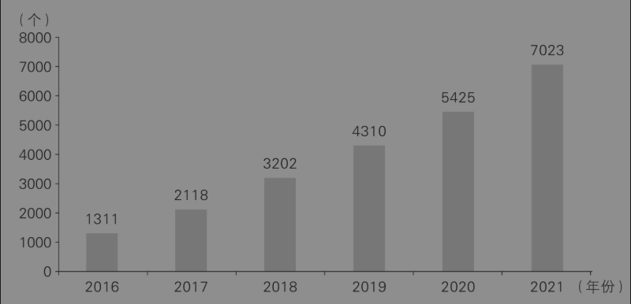

资料来源：中商情报网（WWW.ASKCI.COM）

图7-14 2016－2021年中国淘宝村数量统计

其次，从产值上看，县域电商的经济规模不断扩大。根据商务部的统计，2016年全国农村网络零售额是0.89万亿元，2021年已经高达2.05万亿元（图7-15）。六年期间，平均每年增长率大约为18%。最新数据显示，2023年全国农村网络零售额高达2.49万亿元。[^26]

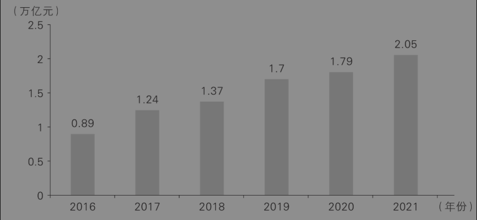

资料来源：中商情报网（WWW.ASKCI.COM）

图7-15 2016－2021年中国农村网络零售额统计

最后，从业态上看，县域电商从早期单一的淘宝店模式向多种业态演变，形成了一个庞大的产业集群，吸纳了几千万劳动力。目前主要的电商模式包括社区团购、直播电商、短视频电商、社交电商，一些农村甚至开始探索农产品众筹、预售、领养、定制等电商新业态。其中，直播无疑是目前风头最劲的赛道。图7-16显示了2017－2022年全国直播带货与网络零售产值的比较。2022年，直播带货的市场规模高达3.5万亿元，约占网络零售产值的四分之一。根据人社部的统计，截至2021年底，全国直播行业的从业者超过了1000万人（跟当年的教培行业差不多），行业主播从业人数超过123万人，覆盖的用户规模超过了8亿人口。根据《中国网络视听发展研究报告（2024）》，截至2023年底，职业主播数量已达1508万人。

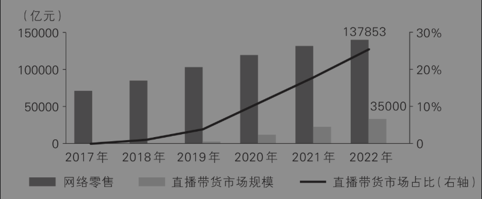

资料来源：商务部、网经社，智研咨询整理

图7-16 2017－2022年中国直播带货行业发展情况

#### 2. 国家高度重视，政策支持力度大

这些年，中央一直把县域经济发展当作统筹城乡发展、构建新发展格局的重要内容。在顶层设计上，二十大报告明确提出“以城市群、都市圈为依托构建大中小城市协调发展格局，推进以县城为重要载体的城镇化建设”。我理解，这其实就是对“大城论”的纠偏。在发展战略上，中央把数字经济作为发展县域经济的重要抓手。2021年1月，《商务部办公厅关于加快数字商务建设服务构建新发展格局的通知》发布，“数商兴农”被列为加快数字商务建设要开展的五大行动之一。所谓“数商兴农”，就是通过商务领域的数字化手段，推动乡村振兴。2022年中央一号文件提出，实施“数商兴农”工程，推进电子商务进乡村，并促进农副产品直播带货规范健康发展。2023年中央一号文件再次强调，“加快完善县乡村电子商务和快递物流配送体系，建设县域集采集配中心，推动农村客货邮融合发展，大力发展共同配送、即时零售等新模式”。为什么中央如此重视县域经济中的数字化？因为只有通过数字化手段，偏远的、小规模的县乡才能在与市辖区的市场竞争中，以网络优势换取空间优势。毫不夸张地说，只有数字经济才能搞活县域经济，搞好电商才能救活小县城；过去领导干部要懂金融，现在基层干部要懂电商。

这些年，中国政府作为发展型政府，在基础设施和营商环境方面给予了县域电商厚实、宽松和友好的政策支持。回到前面提到的“淘宝第一镇”沙集镇的案例。淘宝村刚出现时，其实面临很多致命的“短板”：产品质量参差不齐，证照不全，涉嫌逃税，品牌意识缺乏，同行恶性竞争，等等。当地官员可以“严厉整顿”，也可以“睁眼闭眼”，但他们选择了积极扶持，秉承“缺什么、补什么”的原则，在贷款申请、证照办理、人才返乡和人员培训等方面给予全方位的优惠政策，最终做大做强了电商产业集群。可以说，如果没有一些敢冒险、愿担责的主政官员，沙集镇的淘宝村随时会被消灭在萌芽状态，绝不可能成为中国“淘宝第一镇”。本书第二章第四节《重大政策是如何出台的？》，谈到了基层创新的激励机制，其中的逻辑如出一辙。

#### 3. 电商是地方政府推动经济社会发展的有力抓手

千万不要以为电商只是直播，电商只是生意。对今天的基层政府来说，电商其实是政府促进经济社会发展的有力抓手。电商工作抓得好，完全可以实现“牵一发动全身”的效果。过去，做电商就是个体户开网店。现在，电商已不再是一个人的生意经，还是平台企业的“社会责任”和政府的“政绩工程”。从业人员除了农户、商贩、平台公司，还有政府、媒体、演员以及传统的制造业企业。发展县域电商不只是发展一个营利性产业，更是地方政府提升营商环境、提高地域知名度的“出圈”战略。

2020年，因为一段七秒的抖音视频，四川省甘孜州理塘县一个名叫丁真的19岁藏族青年在两个小时内就变成了热搜对象，一个月内其微博点击量超过10亿次。来自全国各地的自媒体和粉丝们蜂拥而至，挤满了他所在的边陲小镇。在丁真爆红的过程中，当地政府协调各方力量，风风光光地宣传了本地的文旅产业，让理塘从一个不知名的小城变成了网红打卡地。甚至，当丁真说想去拉萨旅行时，理塘县这样一个县级政府的文旅部门，出人意料地妥善应对了来自西藏自治区“抢人”的竞争压力。这堪称县级政府力推县域电商的上佳案例。如果说丁真的爆红有点“可遇而不可求”，那么淄博烧烤现象则是地方政府一次成功的“电商”策划。如果没有互联网，烧烤绝不可能成为工业城市淄博的“重工业”。当然，很多人质疑淄博烧烤模式的可持续性，这涉及如何对文旅行业的“出圈”进行长期评价，是一个值得研究的课题。

#### 4. 电商能够体现后发优势的原则

2010年，我还在美国哈佛大学经济系做博士后，当时我去美国一些风景名胜旅行时，发现好多小镇居然连手机信号都没有。但是在中国，哪怕再穷的贫困县、贫困村，手机信号都是满格的。2017年，网络上开始流传“高铁、扫码支付、共享单车和网购是中国的新四大发明”这一诙谐的说法。根据中国信通院的统计，2023年中国数字经济规模为53.9万亿元，位居全球第二，占GDP的比例高达42.8%。数字经济包括数字产业化和产业数字化两个方面，电商属于产业数字化，在数字经济中占据了重要地位。上面的几个例子提醒大家思考一个问题：中国作为一个发展中国家，人均GDP刚刚超过世界平均水平，为什么能够在数字经济领域实现跨越式发展？

一个有相当说服力的解释是：中国充分利用了发达的互联网技术红利，实现了“后发优势”。互联网技术是一种新型技术，不太依赖于传统的基础设施，因此它为所有国家提供了比较公平的竞争起点。中国虽然不是互联网的发源地，但从20世纪90年代开始，中国以开放的心态积极拥抱互联网和电子商务的前沿技术，因而在这个新的赛道上一开始就没有落后之说。2018年年中，全球市值最高的20家互联网公司中，来自中国的阿里巴巴、腾讯、蚂蚁金服、百度、京东、滴滴、小米、美团和今日头条占据了9家，这是中国互联网的高光时刻。类似地，不太发达的县乡和比较发达的市辖区相比，在发展电商方面基本处于同一起跑线，尤其是在与电商相关的基础设施建设已经在毛细血管的颗粒度上也相对完善的情况下。

#### 5. 县域电商符合“长尾理论”的经济规律

统计学表明，一个样本的数据通常满足正态分布，其主体部分是头部，两边的部分像两条长长的尾巴。例如，统计某个农村50个人的身高分布，通常80%左右的人身高在1米5到1米7之间，20%左右的人身高低于1米5或者超过1米7。不过，还有一种分布叫帕累托分布，俗称“二八法则”。假设一个商店80%的利润来自20%的畅销商品，这20%就是“头部”，其他非畅销的小众商品就是“长尾”。在传统经济模式下，商家会尽量卖那些流行的大众商品，即抓住“头部”。但是，美国《连线》（Wired）杂志的总编辑安德森（Chris Anderson）发现，在亚马逊这样的电商平台上，那些数量庞大的小众商品带来的利润不仅超过了20%，甚至超过了一半。因为在电商模式下，消费者的搜索成本近似于0，平台企业的存储成本也近似于0，所以只要消费市场足够大，加总需求之后，小众商品也可以卖得好，而且单件利润还更高，就好比“大号鞋”。安德森（2006）将这个规律总结为“长尾理论”（the long tail theory）。中国有全世界数量最多的消费者，而各具特色的农产品就属于“长尾”的一部分，充分地满足了人们的各色需求。因此，县域电商的崛起是对“长尾理论”的完美诠释。不要忽略这条经济规律。如果一件事情不符合经济规律，即便有其他多种要素加持，也可能功亏一篑。

总之，中国县域电商的崛起体现了技术、政府和经济规律的三重作用，可谓“天时、地利、人和”。从这个层面讲，也可以说县域电商的崛起隐藏了中国经济增长和共同富裕的密码——这些年，中国发展最快的新能源、新能源汽车和高铁，都体现了技术、政府和经济规律这三个维度的结合。

进一步，中国在县域电商方面的跨越式发展经验，能否在数字经济时代复制到更广泛的领域，包括乡村振兴、基层治理甚至是全球治理呢？作为一个研究政治经济学的学者，我觉得这是非常值得研究的好问题，有希望催生植根中国的好理论。

### 三、县域电商的发展瓶颈和对策

尽管县域电商实现了快速的发展，但是经过了几年的沉淀和竞争，人们发现这个行业遇到了一些非常明显的发展瓶颈。如果不能克服这些瓶颈，县域电商就可能像早年的乡镇企业一样逐渐衰落，不仅不能拯救小县城，恐怕自己都要成为被拯救的对象了。

瓶颈一：食品安全问题。农产品大部分是蔬菜、水果或其他食品，都是用来吃的。俗话说，“病从口入”，加上前些年的“三聚氰胺”“苏丹红”和“地沟油”等食品安全事故，食品安全问题成为农产品面临的最严重的信息不对称问题。虽然这些年食品认证和监督体系日益完善，但考虑到农村的实际情况，食品安全的信任问题仍然不容乐观。我老家江西有很多人在广东、福建种菜。一个菜农曾亲口告诉我：卖给城里人的蔬菜，一定要品相好，否则没人买；但品相好，就要打农药，否则蔬菜就会被虫子咬得百孔千疮。所以你看，既要品相好，又要没农药，这个度是很难把握的。

瓶颈二：农产品标准化程度低。工业产品的最大优势是标准化，这样不仅品质可控，而且成本更低。然而，农产品天然就是非标准化的。比如我们江西的南丰蜜橘，自唐朝以来就是皇家贡品，2021年入选第一批全国名特优新农产品名录。但是，南丰蜜橘的主产区只有南丰县的几个地块，而且同一个地块光照和水分不同，果实的大小和品质就不同，甚至同一棵树上不同部位结的果实品质也不相同。关键是，品质好不好，一般人根本看不出来，只有吃了才知道。因此，农产品买卖，尤其是线上交易，是一种典型的不完全契约，即合同无法规定商品的详细规格、品质和重量。“有图未必有真相”“所见并非所得”，这就容易产生纠纷。尽管正宗的南丰蜜橘在品质、口感方面不输于广东砂糖橘，应该是同样会受到市场青睐的农产品，但是在偌大的北京却很难买到正宗的南丰蜜橘，相比之下砂糖橘则很容易买到。[^27]

要解决食品安全和产品标准化的问题，靠传统的小农经济是不行的，必须依靠规模化、组织化的力量。因为从信息经济学的角度讲，组织的声誉可以缓解信息不对称问题。这些年，很多地方在大力扶持“龙头公司+农户”的农业生产组织。但是，根据我自己的调查和理论研究，这种模式一方面难以解决生产过程中的品控问题，另一方面也容易导致龙头公司和农户之间的道德风险问题。我认为，“龙头公司+农场”模式应该更好，即龙头公司雇佣农户作为生产工人，严格进行生产管理，同时为工人提供符合劳动法的工作保障。

瓶颈三：物流成本高。阿尔钦和艾伦的经济学教科书《大学经济学》里有一句谚语：好苹果要卖到远方去（Alchian and Allen，2018）。为什么？因为好苹果和坏苹果的运输成本都是一样的，要抵消运输成本，就要卖出高价格，那当然就选好苹果了。这句谚语说明，农产品的物流成本太重要了。农村地理偏僻，交通不便，水果蔬菜又需要保鲜，因此物流成本很高。要解决物流成本高的问题，除了修路，地方政府还必须大力投资数字基础设施建设，包括5G网络、移动物联网和数据中心等。对于多数农产品来说，批发是主流，因此地方政府要大力推进农业批发市场、物流园、产业园区的数字化，这样能够实现以点带面的辐射效果。不过，一些学者在调研中发现，虽然很多县都建了直播基地、孵化中心、线上特产馆，但这些平台往往缺乏自生能力，一旦政府停止输血，就没法运转。因此，如何保证政府在基础设施方面的可持续投入和提升园区以及当地平台的自生能力非常重要。

瓶颈四：电商人才匮乏。在电影《天下无贼》里，葛优说了一句名言：“21世纪什么最贵？人才！”对县域电商来说，同样如此。要在互联网上把好苹果卖到远方，首先要把农货变商品，然后把商品变网货，最后把网货变爆款（吕鹏，2023）。从选品到物流仓储，从生产到运营推广，从美工设计到客服，每一步都需要专业人才。根据中国农业大学智慧电商研究院发布的《2020中国农村电商人才现状与发展报告》，农产品电商人才缺口将逐年上升，到2025年缺口人数预计为350万。

问题是，熟悉乡村或者数字经济的专业人才，一般都在一、二线城市的大型平台公司，因为只有平台付得起优渥的工资。设身处地想想，现在有几个年轻人愿意下沉到小县城去上班？孩子上学怎么办？高端医疗哪里找？休闲娱乐何处去？但这个问题也不是完全没有解决办法。前段时间，我们江西省抚州市在京博士团对接了一个农业生态企业。老板跟我抱怨，公司提供给管理层的月薪高达七千元，在本市绝对属于高收入了，但还是招不到人。我给他出了一个主意，把公司的运营总部搬到南昌或者二线城市去，把生产总部留在本市，这样可以解决管理层的安置问题。[^28]

当然，要挽救许多面临人口流失的小县城，光靠电商是不够的，还需要下好乡村振兴这盘大棋才行。如果未来的农村都像“李子柒”视频中那么浪漫，谁不愿意在农村诗意地栖居呢？

最后，请允许我引用魏晋诗人陶渊明的几句《归去来兮辞》作为结尾：

归去来兮，田园将芜胡不归？既自以心为形役，奚惆怅而独悲？悟已往之不谏，知来者之可追。实迷途其未远，觉今是而昨非。……引壶觞以自酌，眄庭柯以怡颜。倚南窗以寄傲，审容膝之易安。……策扶老以流憩，时矫首而遐观。云无心以出岫，鸟倦飞而知还。

## 思考题

1. 请举一个例子，说明在地方政府招商引资的过程中，政府和企业之间的关系从政企合作变成了政企伤害。

2. 如果你是一个县长或县委书记，如何能够避免跳进“PPT造车”这种招商陷阱？

3. 2008年，美国122位知名经济学家联名致信国会，反对救市，认为白宫7000亿美元救市计划是“用纳税人的钱去补贴投资者”，会让华尔街的企业高管们产生道德风险行为。因为既然政府总会救市，企业高管就没有激励去避免金融风险。请从这个角度分析中央是否应该为地方债务纾困，以及如何能够避免其中的道德风险问题。

4. “玻璃大王”曹德旺说，美国明星从不直播带货。你觉得原因是什么？

## 注释

[^1]: 一些学者从不同视角介绍了中国政府推动经济发展的战略或机制。例如周黎安（2008）分析了官员推动经济增长的政治晋升机制，黄奇帆（2020）从主政者视角介绍了地方政府如何创新投融资体制、发展房地产行业和改革国有企业；兰小欢（2021）从政府的视角讨论了经济发展的原因和政策；陶然（2023）从土地财政的角度剖析了地区经济增长的逻辑。与上述著作不同，本章将侧重基层的视角、实操的手法和新经济形态。

[^2]: 在压力型体制下，口号和标语是理解基层治理手段、治理理念和动员策略的重要渠道。可惜，这方面的学术研究很少。

[^3]: 参考本书第五章第一节《县委书记的“三座大山”》。

[^4]: 数据来自中国汽车流通协会乘用车市场信息联席分会（简称乘联会）。

[^5]: 数据参见《10月新能源汽车销量排行榜：比亚迪霸榜，哪吒失踪？》，澎湃新闻网，来源：新一线商业观察，网址为https://www.thepaper.cn/newsDetail_forward_29238496。这个表格没有包括特斯拉的销量。当月特斯拉在中国的销量是4万辆出头。

[^6]: 《致扶风籍在外人士返乡就业的倡议书》，微信公众号“和美杏林”（扶风县杏林镇人民政府主办），2022年11月10日发布。

[^7]: 中共中央组织部2006年制定的《党政领导干部任职回避暂行规定》第五条：领导干部不得在本人成长地担任县（市）党委、政府以及纪检机关、组织部门、人民法院、人民检察院、公安部门正职领导成员，一般不得在本人成长地担任市（地、盟）党委、政府以及纪检机关、组织部门、人民法院、人民检察院、公安部门正职领导成员。

[^8]: 沈卫红、范培：《广东吸引侨资存在的问题及对策建议》，《研究与探讨》，2005年第2期。

[^9]: 这可以从一个角度解释，为什么房地产行业发展进入调整期后，各地经济增速面临巨大压力；也可以解释，为什么各地拼命发展汽车产业。

[^10]: 数据来自江西省抚州市统计局网站，《工业科解读2023年一季度全市工业数据》，网址是http://tjj.jxfz.gov.cn/art/2023/5/6/art_4351_3987567.html。

[^11]: 详见第二章第一节《中国城市的等级体系》。

[^12]: LP（limited partner）和GP（general partner）的主要区别是：（1）LP是基金的股东，但不负责具体经营；GP是基金的管理者；（2）LP对出资部分承担有限责任，而GP要承担无限责任，当然GP可以成立有限责任公司，实际上仍然承担有限责任；（3）LP不能领取经营报酬，只能获得利润；GP有经营报酬和业绩提成。LP和GP都可以是机构或自然人。

[^13]: 诺贝尔经济学奖得主奥利弗·威廉姆森（Oliver E. Williamson）指出（Williamson，1996），市场、企业和政府都是不同的治理结构，有不同的治理机制，并且这些机制彼此之间不能串换。所谓“企业模拟市场”“政府模拟市场”在长期来看都是无效率的，否则不同类型的组织之间就没有边界了。2024年，一篇发表于国际顶尖期刊《政治经济学期刊》（Journal of Political Economy）的论文表明，基于2015－2019年中国风投和私募股权投资的数据，政府基金已经在风投市场占据了主导地位，但是投资绩效不如私募公司，这是因为政府资本存在对投资活动的政治干预（Colonnelli et al.，2024）。

[^14]: 2024年三位诺贝尔经济学奖得主阿西莫格鲁（Daron Acemoglu）、约翰逊（Simon Johnson）和罗宾逊（James Robinson）对此提供了一个全面的综述（Acemoglu et al.，2005）。

[^15]: 很多国内外学者研究了税收竞争的利弊以及“逐底竞争”的负外部性，例如沈坤荣和付文林（2006）以及van der Kamp等（2017）。

[^16]: 来自汪晖2023年1月13日在上海金融与法律研究院的一次演讲，题目是《地方经济结构、区域竞争与工业用地价格的形成逻辑》。

[^17]: 不同的统计口径可能导致从业人员数量存在差异。上述数据的来源：任泽平团队，《什么是房地产新模式？》，新浪财经，2024年8月8日。

[^18]: 陶然（2023）从讨论中国模式的角度，比较全面地梳理了土地财政的来龙去脉。

[^19]: 北京大学发布《中国民生发展报告·2014》，《光明日报》，2014年8月5日。

[^20]: 数据来自陶然（2023）。

[^21]: 参见《中国资本市场深度研究：政策新周期，创投新生态》，报告出品：中信证券，腾讯网，https://news.qq.com/rain/a/20230424A05SVK00。

[^22]: 这部分的内容参考了我们团队2020年公开发表的一篇文章（方明月等，2020）。

[^23]: 聂辉华（2013）构建了一个政企合谋分析框架，并用这个分析框架解释了十八大之前发生的诸多扭曲现象，包括环境污染、安全生产、高房价、假冒伪劣、土地违法、产能过剩。本书第一章也对此展开过论述。

[^24]: 引自《一图读懂！中国县域经济有多强？》，《新京报》，2022年8月8日。俞丰俊制图。

[^25]: 对沙集模式感兴趣的读者，可参阅《沙集模式15年：信息化时代中国农民网商的生产生活》，这本书的作者陈良曾担任睢宁县政协主席，他是沙集电商的重要推动者和支持者之一。

[^26]: 数据来源：商务部国际贸易经济合作研究院与值得买科技共同发布的2024年《中国电子商务区域发展大数据分析报告》。

[^27]: 我从经济学的角度对这个现象提出了一种解释，可参考聂辉华（2018）。

[^28]: 通过企业“脑体分离”解决跨区域的资源配置的方法，其实是我们2002年在一篇论文中提出的思路（李海舰、聂辉华，2002）。
