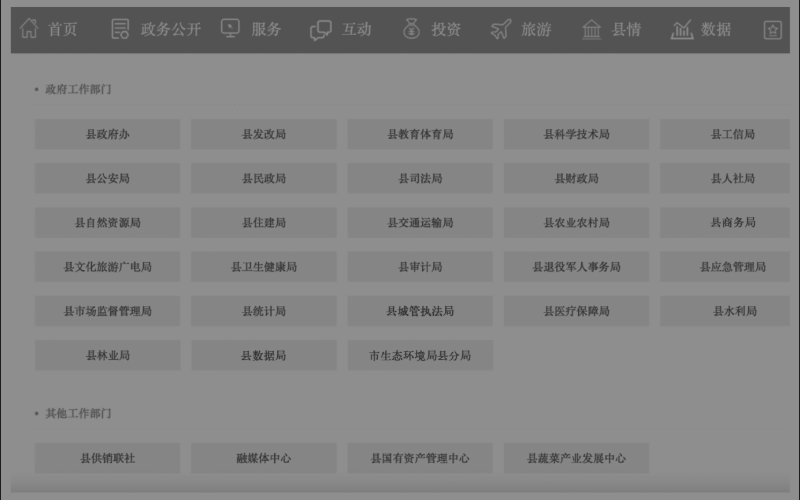
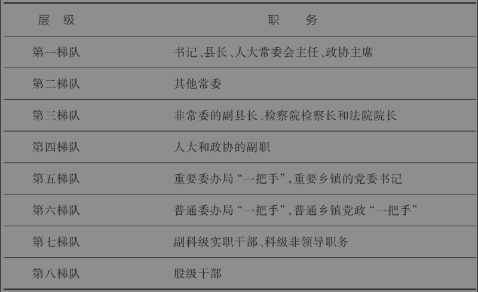

# 第三章 基层首长的权力清单

<!-- 按来源截图3-1.png、3-2.png顺序整理；阅读器导航与装饰分隔线已省略；正文恢复为可复制文本；1幅插图及1张表格保留原图，存于img目录；14条注释恢复为Markdown脚注。原始截图备存于本书“原始图片”目录，便于核对。 -->

理解中国基层治理，关键就要明白在基层权力是如何运行的，而其中最为关键的角色是基层单位的主要负责人或者俗称的“一把手”，他们是“关键的少数”，也是本章讨论的对象。

在所有基层机构的“一把手”当中，县委书记无疑是“关键中的关键”。这有几个原因。首先，县级辖区属于中国基层最完整、最重要的治理单元。中国有句古话：郡县治，天下安。除了外交和国防，县级政府拥有类似于一个国家的完备的组织机构，可谓“麻雀虽小，五脏俱全”。相比之下，市辖区反倒缺乏一些独立的职能（例如土地规划），而乡镇则没有独立的财政和政法系统。其次，县委书记作为一个县的主要负责人、“一把手”、“班长”，属于关键职位。这个关键之处在于，一方面他需要贯彻落实中央、省市的宏观政策，另一方面他又要根据本地情况制定具体的执行措施。因此，县委书记在国家治理的链条中承担着承上启下的作用。正因为县委书记是非常关键的职位，中央组织部先后在1995年、2015年和2021年三次评选了“全国优秀县委书记”，每次大约100名。另外，从数据上看，担任过县委书记职位的官员晋升速度更快。[^1]

因为县委书记的角色非常关键，所以本章第一节先介绍县委书记的权力与责任。[^2]县级辖区的基本治理单元是乡镇，因此第二节介绍乡镇“一把手”的设置，并对一些单位设置两个“一把手”的情况予以分析。俗话说，“一个好汉三个帮”。在基层权力运行与治理过程中，光靠“一把手”是不够的，还必须依赖副手。第三节分析了一个重要的副手角色——常务副职，并梳理了什么样的部门会设立常务副职。在第四节，我们以一个县为例，综合比较了各类职务的“含权量”，以便读者对基层权力运行有一个更加立体的理解。

## 第一节 县委书记究竟有多大权力？

前几年，一部名叫《县委大院》的电视剧风靡一时。这部电视剧演员阵容豪华，内容主要是讲述一位县委书记和领导班子治理光明县的故事，包括处理拆迁、招商引资、治理环境、反腐败和脱贫攻坚。很多人希望通过这类电视剧来了解中国的基层治理，甚至希望为自己“考公”或进入体制内积累一些知识。但也有很多人看了电视剧之后，觉得文艺作品和现实之间的距离还是比较大。比如，电视剧中的县委书记总给人一种权力很大的样子，经常拍板甚至是一言九鼎。电视剧的人设似乎有案例支持。例如，曾经获得全国优秀县委书记称号但是后来离开体制的陈行甲，在一次媒体采访中这样回答记者的问题：“另外一个县委书记跟我开玩笑，说你哪怕头天晚上做了一个梦，第二天你都可以把它变成现实。”

那么，在真实世界中一个县委书记究竟有多大的权力？是不是全县的事情他都能管呢？干部任命上他一个人说了算吗？

### 一、县委书记是全县的“一把手”

要理解县委书记的权力，就必须理解党委书记在中国权力结构中的地位。在中国任何一个行政辖区，关键的党政机构有四类：党委、政府、人大和政协，俗称“四套班子”。因为党领导一切，所以党委在四套班子中处于核心位置。那么，对一个县来说，党委如何实现它的领导地位呢？最关键的制度安排是县委常委会。县委常委会通常是9—11个人，包括县委书记、县长（由县委副书记兼任）、县委专职副书记，以及纪委书记、组织部部长、宣传部部长、政法委书记、常务副县长，还有统战部部长、一些重要乡镇的党委书记也会进入常委会，另外还有一位部队代表（县人民武装部部长）。其中，县委书记、县长和副书记固定排在最前面三位。县委常委会是全县最重要的政治权力机构，除了上级规定之外，它可以决定全县所有的重大事项，包括干部任命、重大方针政策的贯彻落实、重大项目的审批和突发事件的处置。关键是，只有县委书记有权召开和主持县委常委会的工作。既然县委常委会是最重要的政治权力机构，而县委书记又是这个机构的负责人，那么在这个意义上的确可以说县委书记是全县权力最大的人。不夸张地说，身处县城体制内，不管是公务员、国企干部还是中小学教师，职业前途都可能受到县委书记的影响。

县委书记通过县委常委会行使权力，这是显性的权力安排。作为“一方诸侯”，县委书记还可以利用自己的独特地位调动多方资源，包括法律没有明确规定或者属于灰色地带的资源，这属于隐性权力。比如，民营企业向银行贷款，这种事情并不归县委书记管，但是县委书记可以跟银行的负责人沟通协调。中国有句古话：强龙难压地头蛇。在中国“条块结合，以块为主”的国家治理架构下，银行虽然属于垂直管理的条管单位，按说不归属地领导，但是要在当地开展业务，不可能完全不给县委书记面子，否则以后很多事情就无法得到地方支持。

在2012年左右的一次乡村调研中，有一件小事让我对条管单位和属地政府的博弈关系留下了深刻的印象。当时，一位乡长和我们在会议室开会，突然他接到一个下属的电话，对方说移动公司想在街上建一个信号发射塔，但是附近居民不配合，因此移动公司希望乡领导出面做工作。乡长当时脸色就不太好看，对下属指示：“就是移动公司那个刘经理对不对？你告诉他，电信是条管单位，不归我们属地管，我们乡里没有义务给他协调这个事情。你们忘了，上次我们乡里新来的大学生干部小郭，他老婆想在县里找个工作，我们当时请移动公司帮忙安置一下，也算是支持乡镇工作，结果他一口回绝了。以后，我跟你说，凡是这个刘经理找我们帮忙的事情，你都别搭理他，让县（电信）局领导给我打电话。”挂完电话，乡长还骂了一句脏话，然后继续和我们开会。

2023年，山东省潍坊市昌乐县发生了一件大事。当地一家民营企业，雷丁汽车集团有限公司，其创始人李国欣在网上公开举报当地的时任县委书记王某，称书记为了彰显地方政绩，逼迫雷丁汽车在统计工业产值时造假。[^3]这件事情的是非曲直暂且不论，尤其值得注意的是李国欣向县委书记低三下四的恳求，网上流传的原话如下：“王书记，求求您救救我们企业吧！如果您不给我们续贷了，我辛苦了20年的事业可能就会因为这次您的一个决策完了！……只要您肯继续给雷丁续贷，我愿意把雷丁汽车企业捐给昌乐政府一半来报答您的支持。”管中窥豹，可见一斑。县委书记不仅能决定体制内公务员的前途，甚至还能决定一家企业的生死存亡。

### 二、县委书记的权力边界

任何权力都是有边界的。虽然县委书记是本县权力最大的人，但是他的权力并没有大家想象的那么大。在中国当下的国家治理架构下，县委书记也面临着不少显性或隐性的权力约束条件。

第一，权力边界受行政等级影响。如前所述，中国的党政机构从上到下包括五个行政等级：国家级、省部级、地厅级、县处级和乡科级。在中国五级行政体制下，县只是比乡镇高，县委书记的级别通常是正处级（少数为副厅级），属于基层干部。正处级在县里是最高级别，但是在省里就是普通的处长，在中央部委就相当于一个科室的负责人。因此，在体制内的权力等级金字塔中，县委书记的话语权有明显的天花板。

第二，权力边界受当地部门设置的影响。在一个县里，党委、政府、人大和政协这四套班子是平行的，它们的职责划分比较清楚，“一把手”也都是正处级。因此，县委书记虽然是县委一把手，但是一般不会随意干预其他几个部门的事情。县政府作为本县最高行政机关，实行县长负责制，而且一个县里大部分委办局，包括发改委、财政局、教育局、农业农村局，都隶属于政府这个体系。在一个县里，最大的实权肯定是“管人”和“管钱”。县委书记和县长分别是党委和政府的“一把手”，前者管人，后者管钱，存在一定程度的平衡。

第三，权力边界受上下级部门设置影响。根据前面介绍过的“条块结合，以块为主”的中央集权体制，我们知道，虽然县委书记是本县的“老大”，但不是本县所有的部门都归县委书记管辖。一定要区分“行政归属”和“辖区归属”两个概念。[^4]一些部门实行属地管理，就是归县里管，比如前面提到的发改委、财政局、教育局和农业农村局，这些委办局不仅在辖区上属于本地，而且行政上也属于本地管理。即便它们在外地设立了分支机构，比如县信访局在北京设立了信访工作办公室，同样归县里管。但还有一些部门实行上级垂直管理，比如银行、电信、海关、法院，这类部门属于条管单位。条管单位虽然在地理上位于本县辖区，但本县无权对其进行行政管理。因此，县委书记如果要调动条管部门的资源，那就需要去和上级单位协调，而无权直接命令。在县领导分工目录中，这些条管单位属于“联系”的对象，而不是“分管”的对象。

第四，权力边界受各方面影响。作为本县的“一把手”，县委书记要统筹考虑各方利益，对下不能太苛刻，对上不能太僵化，这就非常考验领导“综合协调”的能力。当领导，特别是当“一把手”，不是简单地发号施令就可以的。为了降低组织内的交易成本或者内耗成本，提高下属的遵从度，任何组织的领导都需要“合法性”，将“权力”（power）转化为“权威”（authority）。[^5]能够公平公正地办事，合法合情合理地处理问题，才能赢得同僚和下属的尊重，从而在政界行稳致远。即便是本地干部任命，上面如果有人打招呼，县委书记恐怕也不能不考虑，毕竟本县的发展高度依赖上级以及所有拥有重要资源的人的支持。

下面这个故事形象地说明了县委书记和本地“乡贤”之间的博弈，以及县委书记受到的隐性约束。有一次，我参加了一个饭局，请客的人是A大学的赵教授，主宾是某部委的仇处长，主管地方的项目审批。席间，赵教授随口说了一句，自己某个亲戚要从甲县调到乙县，条件完全具备，属于正常的调动。本来不用求人，但是有一道手续卡着了，导致调动程序中止了。赵教授问仇处长，是否方便给甲县书记县长打个电话。仇处长抿了一口茶，轻轻地说：“按说你这都是小事，我打个电话给书记县长，肯定马上能办成。但是呢，赵教授你也知道，咱们那么多老乡都要求人，所以我就可能把这宝贵的机会留给特别急需的老乡。你说是不是？”赵教授哈哈一笑，说：“仇处长真够义气，不愧是我们老乡的榜样！”他夹了一筷子菜，继续慢悠悠地说：“要是我那亲戚调过去了，下次想‘进步’一下，那时候你方不方便给下面打个招呼？”仇处长被将了一军，沉默片刻，微笑着说：“那也要看情况啊。你知道，人事问题是最敏感的。如果你亲戚的条件确实不错，我当然可以帮忙吹个风。不过，我也有我的顾虑，就是要看县委书记对那个位置有没有自己的盘算。我不能干扰地方的人事布局啊。”一番话滴水不漏，但我作为旁观者已经豁然开朗。

### 三、权力越大，责任越大

经济学原理告诉我们：天下没有免费的午餐；如果有，那一定有别人付出了代价。县委书记作为一方诸侯，的确拥有很大的权力，但权力不是绝对的。而且，权力越大，责任越大，风险也越大。最终，在竞争均衡中，所有大小不等的权力都会处于边际收益等于边际成本的状态，从而消除权力套利行为的空间。否则，多余的权力租金一定会在竞争中耗散的。

如果一个官员拥有很大的权力，在缺乏制约和信息不对称的条件下，一定会有很多不怀好意的人去“围猎”权力，以便获取自己的利益。这些年，反腐败反掉了很多“一把手”，包括县委书记。大家可能听说过，矿工被认为是世界上最危险的职业之一，中国的矿难问题曾经非常严重。根据安全生产管理单位所整理披露的数据，2000年前后，矿难每年最多导致六七千人死亡，但这些年国家大力治理生产安全，每年的矿难死亡人数降到了几百人。[^6]作为反腐败研究者，我也告诉大家一个事实：这几年地方党政“一把手”因为腐败被抓的概率可能高于矿工出事的概率。因此，从某种意义上说，现在很多身居敏感位置的官员从事的也是“高危职业”。要想拥有权力又想独善其身，那就必须真正做到“权为民所用，利为民所谋”。因此，年轻人如果想进入体制内，一定要为人民服务，切不可被权力的光环蒙蔽了眼睛。

本节提到了县委书记和县长分别作为党政“一把手”的分工。那么，能不能说乡镇的党委书记和乡镇长都是本地的“一把手”呢？

## 第二节 哪些单位有两个“一把手”？

### 一、乡镇没有两个“一把手”

在中国的五级行政体制下，乡镇是中国最基层的行政组织。关于中国古代“皇权不下乡”的说法，是指最基层的行政单位是县，中央任命官职到县为止，正式的行政区划中并没有“乡”。新中国成立之后，政权才扩展到乡镇一级。可以说，乡镇是中国政府治理的神经末梢，是贯彻中央大政方针的最终执行单位。这一点，决定了我们对乡镇党委书记和乡镇长关系的定位。

有一次，我们去南方某个乡镇调研当地的特色产业。调研结束时，乡党委书记请我们课题组吃饭。我们坐下后，党委书记说给我们倒酒，然后他身边的一个人立刻就站起来，热情地给我们每个人倒酒。我以为他是乡里的办公室主任，就没客气。这个人一边倒酒，一边给我们散发名片。我一看名片，哦，原来他是乡长啊。没想到，党委书记请客，乡长居然充当了“服务员”的角色。由此可见，乡镇没有两个“一把手”，只有一个“一把手”，这个“一把手”就是乡镇党委书记。

为什么在县里书记和县长都是“一把手”，到了乡镇情况就变了呢？这主要有两个原因。

第一，乡镇部门设置少，这导致作为“一把手”的乡镇党委书记的权力本身就有限。过去，一个典型的乡镇有哪些机构呢？就是一个综合办公室，外加几个办事机构，名字统称为“七站八所”，这里的“七”和“八”都是概数，具体机构设置因地而异。所谓“七站”，包括计生站、农技站、文化广播站、畜牧兽医站、林业站、农机站、客运站等。这七站都是乡镇的直属机构，是党委书记可以直接管辖的部门。现在这七站变成了若干个综合办公室，通常是：党群综合办公室、政务综合办公室、经济发展和社会事务办公室、维护稳定和综合治理办公室、财政所或财务室。此外，还有“八所”，包括（公安）派出所、土管所、工商所、财政所、司法所、供电所、税务所、民政所等。但是，这八所都是县级部门的直属单位，属于“条条”序列，不归作为“块块”的地方政府管。也就是说，乡镇党委书记和乡镇长们能直接指挥的部门其实不过五六个，权力有限。

相比之下，县虽然也是基层，但是“麻雀虽小，五脏俱全”，机构非常完整而且相对独立。一般来说，一个中等人口规模的县，有五六十个行政单位和事业单位。[^7]图3-1展示了一个典型县的下属行政单位，有30多个，还不包括十几个事业单位和十几个乡镇。县委书记管党务，县长管政务，每个人都有一大堆事务。但是在一个乡镇，总共就五六个办公室，党委书记一个人就管得过来，何况还有几个分管的副书记和副乡镇长。此时，乡镇党委书记的职权明显大于乡镇长。因此，从分工上讲，党委书记和乡镇长职责交叉，乡镇长就失去了独立性。

图3-1 某县政府官方网站上罗列的政府工作部门

第二，乡镇权力边界不清晰，乡镇长必须事事向党委书记请示。前面说过，乡镇是中国国家治理的神经末梢，是最终的执行单位。对于执行单位来说，上面往往只看结果，不问过程，不管手段。这一方面给了基层单位足够的灵活性，但另一方面也使得乡镇党委书记的自由裁量权变大。如果凡事有明确的规章制度，那么乡镇党委书记和乡镇长都照章办事就行了，乡镇长不必事事向党委书记请示。可问题是，上级只问结果，所以什么手段能用，什么程序要走，都没有一定之规，而且出了问题上级一定会拿“一把手”问责。从契约理论的角度讲，基层政府和上层政府之间也是一种不完全契约，即契约只规定最基本的考核目标，而对实现手段并没有明确的规定。从理论上讲，契约越是不完全，权力就越重要。这就导致乡镇党委书记责任越大，权力越大，而乡镇长实际上就是党委书记的副手，不太可能保持相对独立性。

根据著名社会学家迈克尔·曼（Michael Mann）的观点，个体性权力（distributive power，或译“分配权力”“个别权力”）方面的权力关系是一种零和博弈。[^8]你多了，我就少了，它注定是难以共享的。而且，蛋糕越小，就越不可能分享。

### 二、哪些部门可能有两个“一把手”？

虽然乡镇没有两个“一把手”，但是在其他部门是否存在党政两个“一把手”的情况呢？确实存在。这分四种情况。

第一种情况是政府组成部门。根据法律规定，行政部门实行首长负责制。例如县政府下属的各种委、办、局，都是主任、局长全面负责行政事务。但是，政府归党委领导，因此如果行政部门除了行政首长之外，还有一个人专门担任党委书记或者党组书记，此时就会出现两个党政“一把手”的局面。比如，国务院交通运输部和外交部在一段时间内既有部长，又有党委（组）书记。通常情况下，部长全面负责行政工作，党委书记全面负责党务工作。两者的排名顺序通常由资历决定。行政部门出现两个“一把手”，可能是因为该部门工作性质比较特殊，也可能是因为多个部门合并。例如，2018年国务院实行机构改革，原来的国家工商行政管理总局、国家质量监督检验检疫总局以及国家食品药品监督管理总局合并为新设立的国家市场监督管理总局——由于是多个机构合并，为了便于安排干部和协调工作，通常会分设局长和党委书记。

第二种情况是工作过渡。例如，某个行政单位的局长兼党委书记快退休了，组织上为了工作顺利交接，会提前安排一个新人接任党委书记，等老局长退休后再把局长职务一起接过来。这种安排的另一个好处是，防止“一把手”在临退休前突击提拔干部，限制滥用权力。因为党委书记管人事，没有他同意和召集党委会，就算是局长提名的干部提拔也难以通过。

第三种情况是大学。大学实行党委领导下的校长负责制。理论上，党委书记和校长分别是党政“一把手”，因此大学里存在两个“一把手”。在十八大之前，我们发现在113所样本大学中，最少有10所大学的校长排名在党委书记之前（聂辉华等，2011）。[^9]十八大之后，全面加强党的建设，这种情况就不再出现了。

第四种情况是国有企业。在企业里，董事会是公司治理的核心。一个公司的业务好不好，关键在于董事会。过去，国企的党委书记和董事长常常是两个人，相互掣肘，也使得在国企中坚持党的领导这一原则难以落实。按说，党委书记和董事长应该像部队的政委和司令一样，分工负责，相互配合。但问题是，在企业里，董事长管钱、管人，掌握经济大权。而党委书记的工作相对务虚，实际上沦为了配角。于是，从2017年开始，国务院国资委明确要求，要把加强党的领导与完善公司治理结构统一起来，**通过双向进入、交叉任职的领导体制，全面推行党委书记和董事长一人担任。两个“一把手”变成了一个“一把手”，这就解决了权力掣肘的问题。**

## 第三节 哪些部门可以设立常务副职？

在一个单位的领导班子中，“一把手”当然最重要，但是辅助“一把手”的副职也很重要。特别是在一些副职分管本单位的关键业务，又长期在本单位工作，对本单位的人事安排和资源配置具有举足轻重作用的情况下。在官方新闻中，我们经常看到诸如“省委改革办常务副主任”“市委组织部常务副部长”以及“县委宣传部常务副部长”这种带有“常务”的副职。其实，在中国政府部门的组织架构中，大部分部门都没有常务副职。例如，国家发改委就没有“常务副主任”，财政部也没有“常务副部长”。那么，究竟哪些部门可以设立常务副职呢？常务副职与普通副职有什么区别呢？“分管日常工作”和“主持工作”又有什么区别呢？

### 一、“高配”的部门通常设立常务副职

正常情况下，一个部门配有一位主要负责人，俗称“一把手”，配有若干副职作为帮手；“一把手”总揽全局，每个副职分管若干领域，此时就没有必要设立一个“常务副职”。但是，如果某个党委或政府部门的“一把手”是“高配”，即“一把手”本人的行政级别高于所在部门的行政级别，那就意味着“一把手”除了管理本部门事务，还要管理其他部门的事务。此时，为了减轻“一把手”的工作负担，上级就可能安排一个常务副职来协助“一把手”工作。常务副职主要分管本部门的日常工作。日常工作通常是指本部门的惯例工作、事务性工作，不包括“三重一大”（重大决策、重要人事任免、重要项目安排和大额度资金使用），这些重大决策必须经本单位“一把手”同意。

在中央部委层面，按照“党领导政府”的基本政治原则，中央核心部委负责人的行政级别通常高于同级政府部门的负责人，属于高配，因此一般都设立常务副职。例如，中宣部部长一般都是政治局委员（副国级），因此中宣部设立了常务副部长；同样，中组部、中央统战部也都设立了常务副部长。这些部门的常务副部长行政级别低于高配的“一把手”，高于同级部门的副职，属于正部长级。除了中央几大部委，中央党校也属于高配单位，因此中央党校也设立了常务副校长，级别是正部级。

在国务院部委层面，目前公安部部长属于高配，他同时担任国务委员（副国级）。这延续了2003年以来中央高度重视社会稳定工作的格局。2003—2008年，当时的公安部部长同时担任政治局委员，之后公安部部长同时担任国务委员，但级别一直保持副国级至今。因此，从2003年至今，公安部就设立了常务副部长，属于正部级职务。

高配的部门除了中共中央和国务院部委，还有最高人民法院和最高人民检察院。“两院”的“一把手”是副国级，比一般的部委“一把手”高一级。因此，“两院”之前都设立了常务副职。

在大家熟知的中央部委之外，还有一些部门也是高配的。其一是中华全国工商业联合会（简称全国工商联）。全国工商联主席一般都是全国政协副主席（副国级），于是全国工商联设置了党组书记兼任常务副主席（正部长级），这个职务通常由中央统战部一位副部长兼任（因为中央统战部也是高配部门，所以其副部长也可以是正部长级，职级是匹配的）。其二是一些党中央领导小组。例如，中央外事工作领导小组办公室常务副主任后来担任中央对外联络部部长，中央全面深化改革领导小组办公室常务副主任兼任国家发展和改革委员会副主任、党组成员。按照党的部门高于政府部门的基本规则，这些领导小组办公室的常务副主任都是正部长级。其三是全国政协。全国政协主席是政治局常委（正国级），秘书长作为主管日常工作的领导一般都是全国政协副主席（副国级），于是主管办公厅的常务副秘书长就成为高配的正部级干部。其四是中央直属的几个干部学院，后文再叙。

但是，并非所有高配的中央部门都设立了常务副职。例如，中国人民银行前任行长周小川曾同时担任全国政协副主席（副国级），但央行当时并没有设立常务副行长。基本的规则是，如果一个部门属于比较固定的高配部门，才可能设立常务副职。此外，全国总工会、全国妇联的主席都是高配（他们一般还担任副国级的全国人大常委会副委员长），但是这两个部门都没有设常务副主席职位，因为党组书记或书记处第一书记就相当于常务副主席。

上行下效，地方的对应部门也是如此。地方党委组织部、宣传部和统战部通常都设立了常务副部长；地方政府的公安局局（厅）长通常兼任政府副职（副省长／副市长／副县长），因此都有常务副局（厅）长；地方法院和检察院一般都设置了常务副院长和常务副检察长职位。这些常务副职的行政级别与地方政府的其他部委局办“一把手”相同。例如，省委统战部常务副部长、省公安厅常务副厅长、省高级法院常务副院长，这些常务副职的级别和省民政厅厅长级别一样，都是正厅级。

在上述“一把手”高配的部门，常务副职在一定程度上就是本部门的“一把手”，因此其行政级别等同于本单位的行政级别，略高于其他副职。比如，市委组织部部长是市委常委（高配，副厅级），常务副部长是正处级（等同于单位行政级别），普通副部长是副处级（级别回归至与职级相配）。

### 二、各级地方政府都设立常务副职

其实，常务副职最多的部门，并不是少数高配部门，而是各级地方政府。例如，省政府有常务副省长，市政府有常务副市长，县政府有常务副县长，一些乡镇还设立了常务副镇长或常务副乡长。为什么地方政府要设立常务副职呢？第一个原因，是地方政府管辖事务太多，需要有一个专门的副职主持日常工作或者协调重要工作。以县级政府为例。通常一个县有发改委、工信局、教育局、财政局等大约30个组成部门，有供销社、住房保障中心和公共资源交易中心等十几个直属机构，还有十几个下辖乡镇，此外机关事务管理中心、发展研究中心、中小学等几十个事业单位也是管理对象，这样加起来，县政府这个处级单位需要管理的下属科级单位有一百个左右。这一百多个单位分属于县政府一个县长、六七个副县长管理或联系。如果县长有事外出，需要一个人协调县政府各个部门的工作，因此需要设立一个常务副县长。此外，虽然政府的职能部门五花八门，但是内部人都知道不同部门之间存在轻重缓急之分，必须有人抓重点工作。除了县长亲自抓审计等核心部门之外，一般常务副县长都主抓发展计划、经济体制改革、税务、统计等重要的经济工作。

第二个原因，是设立常务副职可以区分担任常委的政府副职和非常委副职。通常县级党委有9—11个常委，常委中来自政府部门的包括县长、常务副县长，极少数情况下还包括另一名副县长。虽然同样是副县级（副处级），但是常委副县长在党内的地位高于非常委副县长，因此，常委副县长就兼任常务副县长，主抓重点工作，这也体现了党的领导处于核心地位的原则。

### 三、大学和学院的常务副职

中国的公办大学都是事业单位，但有行政级别。几年前，有不少人呼吁大学要“去行政化”，取消大学的行政级别，但是时任中国人民大学校长的纪宝成却认为：“如果官本位是前提，如果全社会都是行政级别为导向，那单独取消高校的行政级别就是贬低教育。”[^10]他说的是大实话。在中国，几乎所有体制内的资源都是按照行政等级进行分配的，前面提到的城市体系、官员级别，莫不如此。因此，单独取消某一类机构的行政级别，不仅于事无补，而且会造成新的扭曲。比如，在缺乏级别这张“体制通行证”的前提下，大学校长可能事事需要仰人鼻息，尤其在与政府部门协调工作时，更会寸步难行。这从一个角度再次验证了经济学中的“次优理论”。[^11]

中国有39所“985工程”大学，其中31所被认为是副部级大学。其实，这些大学本身都是正厅级，但是它们的党委书记和校长都是副部级，属于高配，因此也可以粗略地说这31所985大学的行政级别是副部级。[^12]按照高配产生常务副职的规则，一些985大学设立了党委常务副书记或者常务副校长，结合前文，你一定已经知道了，这些常务副职的行政级别都与单位本身的行政级别相衬，即都是正厅级。例如，北京大学目前既有党委常务副书记，又有常务副校长，2017年之前常务副校长还曾有两名（独一无二）；清华大学目前有常务副书记，没有常务副校长，但之前曾经设立了常务副校长一职；中国人民大学曾经既有常务副书记，又有常务副校长，目前仅有常务副校长。

985大学属于高配部门，设立常务副职是体制内规则的原因。但是，有一些大学下属的学院并非高配部门，也设立了常务副院长一职。例如，清华大学新闻传播学院在2022年之前一直设立常务副院长，还有一些学院是学院党委书记兼任常务副院长。这种安排通常是一些特殊情况所致，如院长是社会名流，但是不管具体业务，或者院长由副校长兼任，再或者就是院长空缺。在这样的情况下，常务副院长的行政级别仍然是比单位级别低半级的副职，而非遵循高配原则享有正职级别。

### 四、其他设立常务副职的情况

有少数部门也设立了常务副职，但不是高配部门，也不是大学。例如，共青团中央是一个正部级机构，团中央书记处第一书记是正部级，并非高配职位。但共青团中央一直设有常务副书记，行政级别为副部级，书记处的其他书记通常为正厅级（挂职或兼职书记的级别根据原单位确定）。尽管这些书记只是正厅级，但属于“中管干部”，即列入中共中央管理的干部。通常情况下，中央仅直接管理省部级以上干部，但是少数重要的机构、国企、金融机构或者大学等这些个别的央属单位的正副领导也属于中管干部。这意味着，中管干部的最低级别是副厅级。

中共中央文献研究室也不是高配部门，但这些年一直都设有常务副主任。冷溶、杨胜群都曾任中央文献研究室常务副主任。2018年机构改革后，中共中央党史研究室和中共中央文献研究室合并为中共中央党史和文献研究院（正部级），冷溶担任院长，曲青山担任常务副院长（正部级）。

这样的非高配部门设立常务副职主要是以下两个原因：一是机构合并，要解决位子不够的问题；二是要提拔重用某个干部。

### 五、不一定有常务副职这个正式名称

政府的常务副职都是党委常委，在党委职位上比其他政府副职高半级，但在行政级别上相同。一些地方政府网站在展示政府领导成员时，会特意标注常务副职。

但是，并非所有常务副职都会在官方网站显著标出。中央部委的常务副部长一般就是排名第一的副部长，通常官方网站在介绍领导成员时不会注明“常务副部长”职务，而是在介绍领导分工时注明“分管日常工作”。例如，2018年时，公安部常务副部长的官方职务介绍是：公安部党委副书记、分管日常工作的副部长（正部长级）。国家民委、外交部这两个高配部门的副职也没有特意叫“常务副主任”或者“常务副部长”，也是在分工时注明负责日常工作。查询地方政府网站会发现，这类情况这几年越来越普遍。例如，目前江苏省政府、江西省政府、苏州市政府、吉林市政府、宜昌市政府的官网上都没有在领导成员栏目标明“常务副省长”或“常务副市长”，而是在分工栏目注明“分管日常工作”。

这种做法其实更符合法律规定。《中华人民共和国地方各级人民代表大会和地方各级人民政府组织法》第七十条规定：“省、自治区、直辖市、自治州、设区的市的人民政府分别由省长、副省长，自治区主席、副主席，市长、副市长，州长、副州长和秘书长、厅长、局长、委员会主任等组成。县、自治县、不设区的市、市辖区的人民政府分别由县长、副县长，市长、副市长，区长、副区长和局长、科长等组成。乡、民族乡的人民政府设乡长、副乡长。民族乡的乡长由建立民族乡的少数民族公民担任。镇人民政府设镇长、副镇长。”可见，法律上原本就没有“常务副省长”之类的名称。因此，正式的党委或政府任职文件上，应该就没有“常务副省长”这样的头衔。当然，高校系统不在上述法律规定范围之内，因此教育部门仍然可以任命“常务副校长”。

在宣传工作和政府文件上，有时为了简便就直接称呼主持日常工作的副职为常务副职，这已经是公认的现象了。例如，上述没有在领导成员栏目标明“常务副省（市）长”的地方政府网站，其刊载的官方新闻里仍然出现了“常务副省（市）长”的称谓。

### 六、常务副职的排序和级别

既然常务副职主持日常工作，那么是不是在领导班子里一定紧居“一把手”之后排名第二呢？不一定。例如，2018年，中共中央组织部有1名部长、7名副部长和1名部务委员（副部级），当时的常务副部长姜信治（正部级）排名第三。排名第二的是副部长兼人社部党组书记尹蔚民。尹蔚民是老资格的部长，又是另一个部的负责人，因此排名更靠前。类似的情况还有当时的中央统战部。中央书记处书记兼统战部部长尤权（副国级）排名第一，全国政协副主席巴特尔（副国级）排名第二，然后才是排名第三的常务副部长张裔炯（正部级）。

常务副职不一定在班子成员中排名第二，那么非常务的副职其级别也未必就比常务副职低。在中央部委中，常务副部长通常都是正部级，但非常务副部长未必就不是正部级。例如，2018年时，中共中央宣传部一共有8位副部长，除了常务副部长王晓晖是正部级，其余7位副部长也都是正部级。当时国家发改委有7位副主任，没有常务副主任，但其中4位副主任和主任一样都是正部级。看一个部委是否能称得上是强力部委，依据之一是看它的副职级别。

部委领导的排序是很有讲究的，多数时候都是按照资历和分管事项的重要性来排序。但是在少数部委中，正部级的副部长不一定排在普通副部长前面。例如，2018年3月份新组建的应急管理部，党组书记和部长分别排名第一和第二，然后是7位副部长（副部级），排名靠后的一位副部长其实是正部级。又比如当时新组建的市场监督管理总局，一位正部级的副局长排名在其他几位副局长之后。

### 七、常务副职不同于主持工作的副职

在一些部门，因为一把手暂时空缺，上级组织部门便安排一位副职“主持工作”。此时，主持工作的副职实际上就临时代行一把手职权。因此，其他副职要向其汇报工作。临时主持工作的经历，一般是要写入组织档案的，算一种资历。另有一种类似的职务安排，即代理职务。例如，上级任命某位副市长为代理市长。政府部门的代理职务等同于实际职务，只是要等待下一次人代会召开，进行正式任命而已。因此，有些市委副书记改任看上去低半级的副市长，又同时代理市长，就是这个道理。但是，党务部门的代理职务，就纯粹是临时职务，因为它不需要等待人大开会任命，也就不存在时滞问题。

主持工作的副职不同于常务副职，实际上权责高于常务副职。不同的是，常务副职协助“一把手”分管核心业务，并主管重要业务，但与其他副职一般没有分工交集。因此，通常情况下，其他副职不需要向常务副职汇报工作，除非正职不在时授权。当然，有少数地方政府的副市长，在分工时要协助常务副市长分管一些事务，这是例外。

另一种不同的情况是党中央直管的党校或干部学院。目前，中央党校以及浦东、延安和井冈山干部学院都是中组部部长或副部长兼任，因此设立常务副校长或副院长主管日常事务。实际上，这几个干部学院的常务副院长前面除了有院长，还有第一副院长，通常由所在省的省委副书记兼任。考虑到中组部部长不太可能直接管理这些部门的具体事务，这些部门的常务副职又比其他副职高一级，因此其他副职应该需要向常务副职汇报工作。

## 第四节 哪些职务的“含权量”更高？

在中国基层治理体系中，除了区县、乡镇的党政“一把手”，县级党委和政府还有很多下属职能部门（部、委、办、局）的负责人，他们共同构成了基层权力运行的重要主体，也是中央和上级政策的执行者、推动者。因此，下面我们尝试将一个县所有科级及其以上单位的负责人纳入分析对象，并比较他们之间的职权差异，更加立体地理解基层的权力运行和治理逻辑。

事实上，关心基层治理的人经常有一个疑问：一个县里有很多职务，比如发改委主任、教育局局长和统计局局长，哪个职务的权力和影响力更大？哪个职务“含权量”更高？在一个组织中，理论上权力和责任应该是对等的，“含权量”是一个切口，可以借此机会厘清不同部门之间的责任边界。如前所述，在一个等级体系下，人跟着资源走，资源跟着权力走。这里的“等级”除了显性的行政级别（比如县处级、乡科级），其实在基层治理实践中还存在隐性的行政级别。通常来说，即便显性的行政级别相同，但权力越大的职位，拥有的资源越多，也就意味着它在同等条件下的隐性级别越高。否则，就会出现权责不对等、激励不相容的结果，从而导致资源错配。一旦我们通过职务“含权量”识别了同一行政级别中的权力差异，就可以识别出隐性级别，从而为后面分析官员晋升的隐性台阶提供一份分析基础和现实依据。

### 一、职务含权量的三要素

在电视剧《我主沉浮》中，市长田封义认为，同样是正厅级，但是实际权力和社会影响力可能差别很大。为了衡量实际权力大小，田市长创造了一个“职务含权量”公式：`Q = (S + C) / Z`，其中Q表示职务含权量，S表示实际权力支配力，C表示财政支配力，Z表示职级。这个公式的含义是，同样的行政级别，实权越大，职务含权量越高；或者反过来说，同样的实权，级别越高，职务含权量越低。[^13]

如果我们把“官场”看作一个市场，那么借鉴金融学中的“法玛三因子模型”[^14]，可以总结一个“官场三因子模型”，即一个行政职务的含权量主要由三个因素决定：行政级别、管什么人、管多少钱。行政级别是首要因素，因为根据前面的等级制理论，级别越高，能够支配的资源越多，当然权力就越大。其次，看支配力。在一个行政单位或事业单位，最重要的实权无非是两个：管人和管钱。这里说的管人，不是简单地看管人的数量，否则就会得出“一个‘村长’的权力比局长还大”这样的错误结论——关键是看管什么人。同等情况下，管的对象越重要，职务含权量就越高。至于管钱，那就可以简单地看数量了，肯定是管的钱越多，职务含权量越大。而且，级别、管人、管钱，这三个因素叠加起来会进一步放大权力的价值。

根据上面“三因子模型”的推理，我们可以得到一个明确的“职务含权量定理”：职务含权量最高的情况，是级别高，同时还管人和管钱；略低一些的，是级别较高，同时管人或者管钱；最低的，是级别不高，同时既不管人也不管钱。

### 二、全县职务含权量比较

有了上面这个“职务含权量定理”，结合当下县乡的实际情况，我们可以衡量一个县里大部分党政职务的含权量。具体来说，一个县里的职务含权量可以分为八个梯队（表3-1）。

表3-1 县域职务含权量层级

第一梯队：书记、县长、人大常委会主任、政协主席。之所以把他们四个人放到全县权力金字塔的顶层，是因为他们都是本县四套班子的“一把手”。这四位领导在级别上都是正处级，属于一个县的最高级。有少数重要的县，其县委书记可能是副厅级，但这属于高配，不是常态。县委书记不仅级别高，而且通过主持县委常委会，在干部任命和重大财务支出事项上拥有决定权，因此是本县理所当然的“大boss”。举例来说，谁能当乡镇党委书记，肯定要县委书记点头才行，县长就做不了主。而县长作为县政府的“一把手”，有管钱的权力，同时县长也一般兼任县委副书记，作为副书记可以参与干部任命，属于全县的二号人物。此外，虽然人大常委会主任和政协主席不属于县委常委会这个最重要决策机构的正式成员，但是他们作为四套班子中另外两套班子的“一把手”，通常会列席常委会。关键是，凡是重要的人事任命和重大项目的审批，县委书记和县长通常会征求他们的意见。因此，他们也属于职务含权量的第一梯队。

第二梯队：其他县委常委，其中副书记、纪委书记和组织部部长相对更重要。县委常委会是本县的权力中枢，负责一切重大事项的决策，包括管人和管钱。而“人事五人小组”属于中枢中的中枢，因为所有重要人事任命都要先经过五人小组通过，然后才能提交常委会讨论。这个五人小组由县委书记、县长兼县委副书记、副书记、纪委书记和组织部部长组成。因此，除了县委书记和县长，副书记、纪委书记和组织部部长的职务含权量相对高于其他常委。其他常委包括宣传部部长或统战部部长、政法委书记、常务副县长等人。第一和第二梯队属于“很高行政级别+管人+管钱”的组合。

第三梯队：非常委的副县长，检察院检察长和法院院长。从级别上看，他们属于副处级，位于本县行政级别的第二等级。从管辖权力上看，他们虽然不能决定本县重要的人事任命和重大财务支出事项，但是在自己分管的领域内拥有较大的人事权和财权。例如，主管教育的副县长虽然无权决定谁当教育局局长，但肯定能决定教育系统的股级干部人选。第三梯队属于“较高行政级别+管人+管钱”的组合。

第四梯队：人大和政协副职，即人大常委会副主任和政协副主席。其中，兼任实职的人大常委会副主任（如兼任乡镇党委书记、工业园区管委会主任），兼任实职的政协副主席（如兼任财政局局长）相对于没有兼任实职的人大和政协副职更加重要。第四梯队属于“较高行政级别+有一定管人或管钱权力”的组合。

第五梯队：重要委办局的“一把手”，重要乡镇的党委书记。在一个县里，通常发改委主任、财政局局长和教育局局长属于重要部门的一把手。原因很简单，发改委管重大项目，这是管钱的权力；财政局局长管钱，这个不用解释。这里我要稍微解释一下教育局局长这个位置。很多人觉得教育局没啥实权，但实际上教育局管的人多。因为每个县都有多所中学、小学和幼儿园，教师少则几百人，多则几千人。一个县里吃财政饭的主要群体，其实不是公务员，而是中小学教师。另外，在经济相对发达的地区，重要乡镇党委书记因为辖区的企业多，财力强，所以话语权比一般的委办局“一把手”要高。但是，在不发达地区，也有不少乡镇党委书记挤破头都想去县里当局长，因为局长不用经常下乡，不必整天跟农民打交道。

第六梯队：普通委办局“一把手”，普通乡镇党政“一把手”。其中，乡镇党委书记高于乡镇长。第五和第六梯队属于“一般行政级别+少量管人和管钱权力”的组合。因为在县里，正科级干部不高也不低，他们上面有几十个副处级干部，下面还有几百个副科级干部。虽然级别不高，但是对于绝大多数基层公务员来说，这已经是天花板了。

第七梯队：副科级实职干部，科级非领导职务。这里说的副科级实职干部，包括县里委办局的副手，乡镇党委副书记、副乡镇长，以及委办局下属的二级机构负责人。科级非领导职务包括过去的副主任科员和主任科员，现在改为一级到四级主任科员了。

第八梯队：股级干部。股级并非正式的行政级别，因为正式的行政级别是从科级起步的，但是因为县乡属于基层，本身行政级别就不高，所以为了鼓励大家上进，就细分出比科级更低一级的股级。第七和第八梯队属于“较低行政级别+少量管钱权力”的组合。

需要说明的是，上面的职务分类属于一般情况，总有少数职务很难直接归类，要看具体情况。比如，一个县公安局的交警队长，至少是副科级，可能高配为正科级。现在县乡的车辆多，交通事故多，因此交警队长是一个非常重要的位置，可以归入上面的第五或第六梯队。

回到本节开头的问题，县发改委主任、县教育局局长和县统计局局长，谁的权力和影响力更大？根据“职务含权量定理”，你是不是已经有答案了？发改委主任、教育局局长肯定比统计局局长“更重要”，并且这三个位置又比普通的乡镇长“更重要”。

虽然以上分析对象是县，但是因为县已经是一个完整的行政辖区，所以“职务含权量定理”可以推广到省级和市级辖区。当然，权力越大，责任越大。不管权力大小，都是人民赋予的。因此，对于公务员来说，有权不可任性，要真正做到“权为民所用，利为民所谋”。

## 思考题

1. 请通过访问某个县政府的官网，然后根据县领导分工的表述，识别出哪些部门属于“条管单位”。

2. 请问，权力和权威的区别是什么？

3. 请找到一个实例，证明某单位在党委书记和行政首长“一肩挑”的情况下，上级会先任命党委书记，然后更换行政首长。

4. 有人认为，人大或政协的副职属于“二线岗位”，因此职务含权量明显低于重要委办局的“一把手”。你是否同意？请查找某个市县最近三年的资料，梳理一下人大和政协副职的去向。

## 注释

[^1]: 吴芸（2012）收集了1998—2008年河北省115个县的348位县委书记、县长履历，发现获得晋升的样本为247个，占71%。这表明，绝大多数县委书记和县长都获得了晋升。相比之下，聂辉华等（Nie et al.，2021）发现全国省委常委的晋升概率只有5%左右。

[^2]: 已有文献对行政部门及其权力运行有一些分析，例如周庆智（2004）分析了一个县政府的权力运行。与此不同，本节的分析对象属于“政治权力”，或者说党政权力，而不是行政权力。在中国党委领导政府的政治制度框架下，区分两者显然是有必要的。而且，就理解基层治理而言，对政治权力的分析在某种程度上更为重要。

[^3]: 关于举报事件，可参考《雷丁申请破产！低速车王者没走出转型败局，举报县委书记的创始人已身居海外？》，澎湃新闻，2023年5月12日；关于省市联合调查组就此事件调查结果，可参见《雷丁汽车实际控制人实名举报县委书记，当地公布调查结果》，来源：潍坊发布，京报网，2023年7月25日。

[^4]: 杨素秋（2024）的记述可视为对这一层关系的生动写照。虽然西安市碑林博物馆位于西安市碑林区，但在行政上并不归碑林区文旅局管辖，而是归陕西省文物局管辖，即它属于条管单位。不过，按照“属地管安全”的原则，碑林博物馆的消防、卫生、文明宣传等杂事由碑林区文旅局“监督”。事实上，从行政等级上讲，碑林博物馆和碑林区文旅局都是正处级单位。因此，所谓的“监督”，也主要是协调。

[^5]: 马克斯·韦伯（2019）总结了三种合法性或者权威的来源：传统合法性，即权威来自历史传统，比如皇权；法理合法性，即权威来自某种大家都认可的规则，比如民主选举；超凡魅力合法性，比如某个人具有某种英雄气质、宗教般的个人魅力。

[^6]: 关于中国矿难的现状、原因和治理经验，可参考聂辉华等（2020）的综述性文章。

[^7]: 曲延春（2014）梳理了30年来中国乡镇政府机构变迁的历史，并归纳了当前乡镇机构运转存在的若干困境。谭同学（2003）以湖北省某县为例，对比了县乡两级机构的机构设置和人员编制，为我们理解县乡体制提供了一个生动的样本。

[^8]: 曼（2007）认为，权力有四种来源：意识形态权力、经济权力、军事权力和政治权力。对于基层政权来说，权力主要体现为经济权力和政治权力，而对中央政府来说，它具有四种完全的权力。这也是基层和上层、地方和中央的区别。

[^9]: 我们采取两种方法来识别大学“唯一”的“一把手”。第一种方法是，在大学的官方网站上，看校长和书记谁排在前面。假如我们发现校长在书记的前面或者左边，我们就认为该大学的“一把手”是校长。第二种方法是，在大学的官方新闻里，当校长和书记同时出现时，看谁排在前面。

[^10]: 新闻来源：《纪宝成：“没级别什么都干不了”》，《新京报》，2010年3月7日，网址为[《新京报》原文](https://www.bjnews.com.cn/news/2010/03/07/14779.html)。

[^11]: 第一章已经提到过“次优理论”，换一种学术的语言来说，就是如果一种分配方案离帕累托最优至少还差两个条件，那么减少一个条件未必更好，而增加一个条件未必更坏。

[^12]: 如果校党委书记或校长中仅有一人（党委书记）是副部级，那么这所大学也不是副部级大学。例如，中央民族大学的党委书记是由国家民委专职委员（副部级）兼任的，但校长仍是正厅级，因此它就不属于副部级大学，其行政级别仍是正厅级。

[^13]: 需要指出的是，电视剧中的公式有非常明显的错误。电视剧中的写法是`Q = S + C / Z`，少了一对括号。

[^14]: 法玛三因子模型（Fama-French Three-Factor Model）是一种解释股票回报的方法。该模型由尤金·法玛和肯尼斯·法兰奇提出（Fama and French，1993）。基本思想是，一只股票的收益率是由市场因子（市场超额收益）、规模因子（股票市值）和价值因子（股票的账市比）三个因素决定的。
