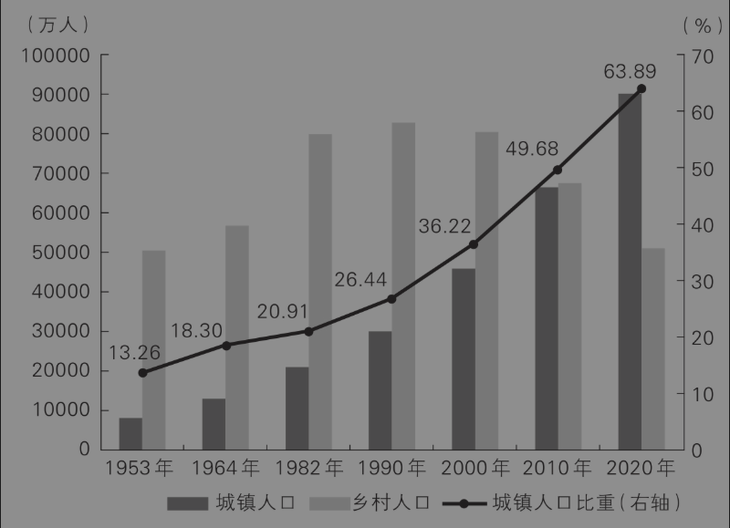
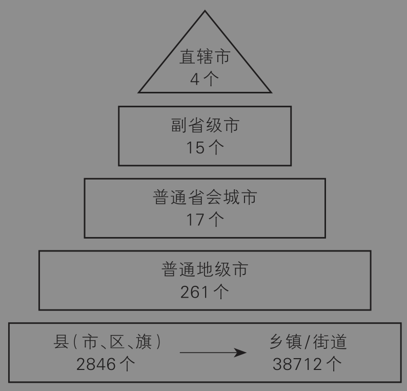
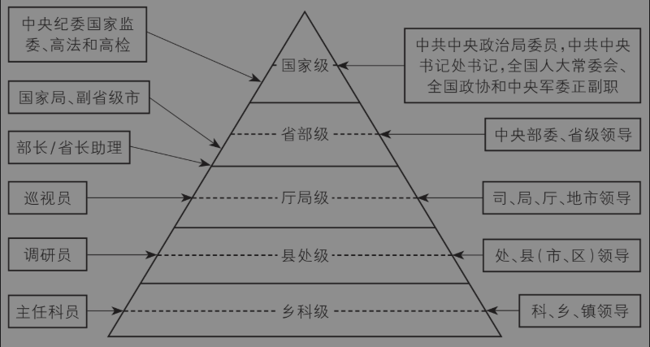
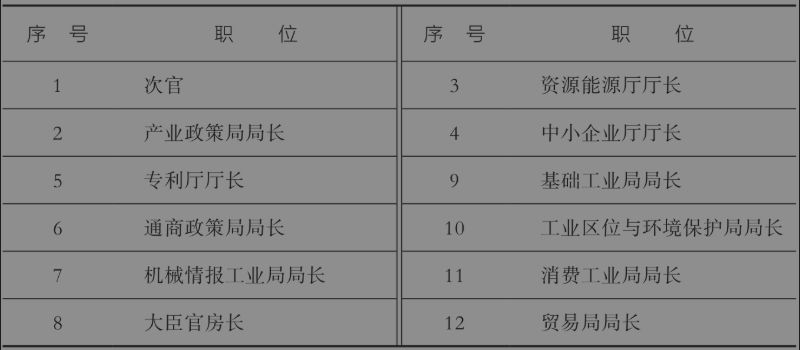
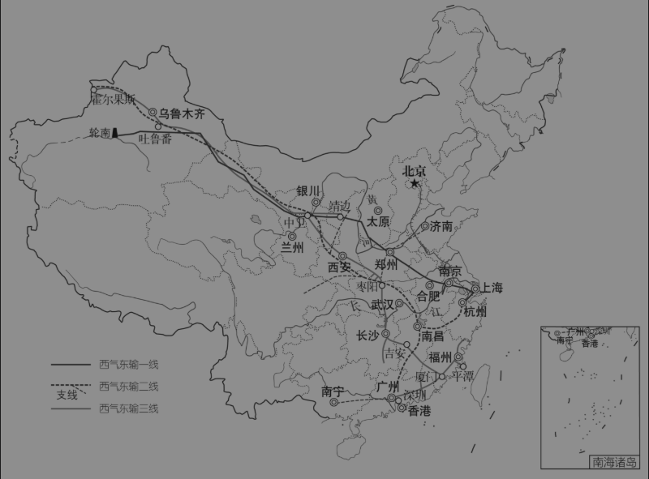

# 第二章 等级制是行政资源分配的主要方式

<!-- 按来源截图2-1.png至2-3.png顺序整理；阅读器导航与装饰分隔线已省略；正文恢复为可复制文本；4幅插图及1张表格保留原图，存于img目录；18条注释恢复为Markdown脚注。原始截图备存于本书“原始图片”目录，便于核对。 -->

西方经济学告诉我们，市场是最有效率的资源配置方式。中国也在1992年明确了经济体制改革的目标是建立社会主义市场经济体制。为什么市场能实现资源的最优配置呢？因为市场可以利用价格机制这只“看不见的手”来调整供求关系，实现供需匹配，最终实现最优的资源配置。但是，这只是真实世界的一部分。不必说，在漫长的中国古代，市场经济尚未形成，市场或商品经济本身也不发达，价格机制不可能是资源配置的主要方式。也不必说，在现代社会，很多商品或劳务的配置也不是完全由价格决定的。中央强调要“充分发挥市场在资源配置中的决定性作用，更好发挥政府作用”，这就意味着在市场作为资源配置方式的同时，政府也在资源配置中发挥着作用。

每次在给大一新生讲授《经济学原理》课程时，我都会问学生们一个问题：在你周围，有哪些资源是完全根据价格机制来分配的？作为大学生，你交的学费是国家规定的，你的住宿费是学校规定的，你出门坐公交、乘地铁，票价都是政府规定的，你生病了去医院看病，价格也是政府规定的。不夸张地说，除了你在网上买衣服和食物，你周围很大一部分商品或服务的价格都不是完全由市场定价的。[^1]

其实，在真实世界中，价格只是配置资源的手段之一，有时甚至不是主要手段。我认为，从古至今，等级制度都是一种非常重要的资源配置手段。大家想想，在市场不发达的古代，资源本来就很稀缺，怎么分配呢？按等级分配就是一种办法，而且是一种稳定的均衡解。这样的例子俯拾皆是，不胜枚举。一是王室的礼仪。例如，《逸礼·王度记》记载了周朝时期不同等级的人具有不同的马车配置：“天子驾六，诸侯驾五，卿驾四，大夫三，士二，庶人一。”二是百官的品级和俸禄。例如，清朝时，从正七品的知县到从一品的总督，每年的俸禄从45两白银到180两白银，差别很大。三是普通老百姓的衣着。例如，明朝洪武初年，普通老百姓穿的靴子不得更改款式与加金线装饰；后来进一步规定，庶民、商人、杂役等禁止穿靴子，只能穿皮扎，唯北方地寒，百姓可以穿牛皮直缝靴，除此以外，其他地方的百姓穿靴子则可能会被处以极刑。

著名华人经济学家张五常曾经在一次公开演讲中说，从资源分配的角度讲，人类社会其实只有三种制度。[^2]第一种制度是按私有产权分配，就是价格机制；第二种制度是按权力等级来分配，就是等级制度；第三种是按腐败权力来分配，张五常称之为“印度综合征”。为什么古今中外有很多资源是按等级分配的呢？我想原因有三点：第一，等级是一种比较明确的规则，比如按资历、按年龄或者按行政级别进行划分，不容易产生太多歧义或者模糊地带；第二，等级的形成是一个比较漫长的过程，不容易突变，因此比较稳定；第三，等级较高的人往往掌握着更多资源，因此他们倾向于维护等级制度。

本章我们就从等级的角度来考察中国基层治理中的资源分配，让读者们了解这一与市场并存的深层资源配置逻辑。第一节介绍中国城市的等级体系及其资源配置差异；第二节介绍体制内的等级体系；既然中国的官员有明确的行政等级体系，那么第三节我们就要介绍官员等级的晋升规律；实际上，不仅官员有等级，政策的制定也是有层次的，第四节我们将介绍不同等级的政府政策是如何制定的。

## 第一节 中国城市的等级体系

### 一、波澜壮阔的城市化进程

无论是回顾西方发达国家的发展历程，还是环顾亚洲相邻国家的现代化进程，我们都能看到，工业化和城市化是现代经济增长的两个主要动力。改革开放以来，中国经济一路高速增长，城市化功不可没。并且，中国的城镇化甚至可以说是人类历史上最大规模的城市化浪潮之一。有数据为证，根据2021年公布的第七次人口普查数据，截至2020年11月1日零时，中国大约有9亿人常住在城镇，占全国人口比为63.89%。与2010年第六次全国人口普查相比，城镇人口增加近2.4亿，乡村人口减少逾1.6亿，城镇人口比重上升了14.21%。拉长时间来看，中国的城镇人口占比从1978年的18%左右，一路增加到2021年的65%左右（图2-1）。这表明，中国的人口城镇化比例在不断提高，城镇化水平日益上升。临界点在2010年，当时城镇人口和农村人口几乎持平。毫不夸张地说，中国波澜壮阔的城镇化进程，是世界范围内最大的经济发展成就之一。

图2-1 历次人口普查城乡人口[^3]

虽然说65%的人都是“城里人”了，但是实际上“城里人”跟“城里人”又不一样，因为中国的城市在政治地位、人口规模、经济水平、交通位置等方面差异悬殊。这催生了互联网上一度流传甚广的“鄙视链”：大城市的人看不起小城市的人，小城市的人又看不起乡下人。下面，我们就来严肃地探讨一下，中国的城市之间是否存在明显的“鄙视链”？换一个角度讲，既然城镇化是中国经济高速增长的主要动力之一，那么在这个快速发展过程中，是否也可以窥见等级制在资源配置过程中所发挥的作用？此外，我还将回答一些相关的基层治理问题，这类困扰很多人已久的问题包括：同样是县级行政区，县和县级市有什么区别？撤县改区会给当地带来什么好处？国家还会设立高等级城市吗？

### 二、中国城市的等级金字塔

中国的国家治理架构是“条块结合，以块为主”的中央集权体制。在这套体制下，上级党委和政府领导下级党委和政府，并且前者决定了后者的资源配置。而上级领导下级的机制，就是通过上级的职能部门对口领导或指导下级的职能部门。比如，省政府要出资支持市政府的一个大项目，那么市发改委就需要向省发改委申报。按照类似的逻辑，县政府需要项目资金，就需要通过县发改委向市发改委申报。因此，在中国这种单一制政治制度下，国家的资源一定是自上而下分配的，高级别的城市相对于低级别的城市一定会优先获得各种资源。总之，不同于市场通过价格配置资源，体制内是通过等级来配置资源。

中国内地有大大小小几千座城市，它们构成了一个典型的城市等级金字塔（图2-2）。

图2-2 中国城市的等级（2024年）

在这个金字塔的顶端，是中国的四个直辖市：北京、上海、天津和重庆。直辖市为什么处于金字塔的顶端呢？因为它的行政级别最高，这体现在三个方面。第一，直辖市是直属于中央管理的城市，行政级别是正部级，和一个省一样。而普通的地级市通常是正厅级，后者比前者差了两级；第二，直辖市的市委书记通常是政治局委员兼任，属于副国级，普通省份的党委书记一般是正部级，普通地级市的党委书记一般是正厅级；第三，直辖市不仅“一把手”的行政级别高，而且其所有管辖区域和下属部门的行政级别都比普通地级市下辖的相应单位高出两级，可谓“雨露均沾”。比如说，在一个普通地级市，就拿我老家江西省抚州市来说，市辖区东乡区的行政级别是正处级，和县是平级的；但是在北京，所有的市辖区（比如我工作的海淀区）是正厅级。几年前，网上热烈地讨论一个哈佛博士后去了深圳市某个街道办事处当副主任，认为是大材小用。但很多人不知道的是，北京市的一个街道办事处是正处级，而深圳作为副省级市，其下属的街道办事处也是正处级，和县长的级别一样。一个博士后如果一工作就担任街道办副主任这类副处级职务，从行政级别上来说相当于副县长，这对很多渴望通过“考公”进入体制内的人来说，相当于几十年的路一天就走完——简直是终南捷径。

在这个城市金字塔的第二层，是15个副省级城市。很多人以为，一个省里面级别最高的城市一定是省会城市，错了！因为前面还有15个副省级市，而省会城市多半不是副省级市。副省级市的行政级别介于省和地级市之间，这算是中国特色，是全世界绝无仅有的。这15个城市是：哈尔滨、长春、沈阳、大连、青岛、南京、宁波、厦门、武汉、广州、深圳、成都、西安、济南和杭州。重庆市起初也位列其中，升格为直辖市后则不再是副省级市。在这15个副省级市中，有10个是省会城市，但还有5个不是省会城市（大连、青岛、宁波、厦门、深圳）。作为副省级城市，它们跟普通地级市有三点不同。一是本身的级别是副省级，高于普通地级市；二是它们的市委书记通常都是省委常委，级别是副省级或称副部级；三是它们的市直工作部门和内设机构可以参考直辖市设置。第三点是什么意思呢？就是一个副省级市辖区的局长、街道办主任是正处级，和直辖市一样，比如深圳市的街道办主任和北京市的街道办主任是一个级别的。

城市金字塔的第三层是17个普通的省会城市，比如江西省南昌市、海南省海口市。请注意，31个大陆省会城市中，大部分都不是副省级城市，只是地级市。此时如果本省有一个非省会城市的副省级市，那么它和省会城市的关系就非常微妙。比如说，福建省的省会是福州，但福州只是地级市，而不是省会的厦门却是副省级市。不过，省会城市即便不是副省级，其政治地位也相当于副省级，因为它们的市委书记通常是由省委常委兼任的，也就是说省会城市的党委“一把手”是副部级官员。[^4]因为省委、省政府和下属机构都在省会办公，所以省会的一把手如果没有很高的政治级别，就很难协调省级机关，从而根本无法履行属地管理的责任。

城市金字塔的第四层，是中国293个地级市中既非副省级市亦非省会城市的261个普通地级市，它们的行政级别是地级或者厅级。在这些地级市中，有少数城市的经济规模非常大，此时市委书记可能“高配”，比如由省委常委甚至是省委副书记兼任市委书记（即由副省级官员兼任地市级行政单位的一把手），但这并不是一种固定的制度安排。比如，同样是江苏省的地级市，苏州的市委书记一般都是省委常委兼任，但无锡市近年几任市委书记都不是省委常委。此外，还有少数地级市的市委书记是由省政协副主席兼任的。

最后是真正的“基层”。不管是直辖市、副省级市、省会城市还是地级市，它们都是由县区、乡镇或街道这些基层单位组成的。我们通常所说的“基层”就是指县级及其以下行政辖区。截至2024年底，中国有2846个县（市、区、旗）级行政区，这些行政辖区下面又包含了超过38700个乡镇或街道办事处等基层的行政单位。[^5]大家可能不知道，北京作为直辖市，虽然几年前将县全部改为区，但是区下面还有乡镇，乡镇下面还有村。不过同样是县或区，北京的区县和江西的区县在行政级别上完全不同，因此不能看见名字中有县或区，就简单地说是“县级辖区”。

理解了这个城市金字塔体系有什么用呢？最大的用处是，它从一个全新的角度告诉我们，现实中稀缺的公共资源很多时候未必是通过价格机制分配，而主要是通过另一种机制——行政等级——分配。这有助于我们理解城市之间的发展差异、发展路径和营商环境，从而为个人在读书、就业、创业或养老方面的决策提供支持。下面举两个例子，然后提供一项严谨的经济学研究。

第一个例子是财政拨款。对于地方政府来说，特别是不发达地区的政府，财政拨款简直就是最重要的资金来源。但是，在中央—省—市—县—乡五级财政体制下，拨款由上往下层层下拨，每级政府通常都会优先考虑本级政府的财力需求。因此，按照行政级别分配财政拨款的必然结果之一，就是下级政府的财源往往被上级政府“剥夺”，但是事权却层层向下累积，从而形成了财权和事权不对等的状况。我在基层调研时，遇到一位基层官员跟我“吐槽”。他告诉我：假如中央拨了100亿元给省里，省里开会讨论分配方案时，省会城市的党委书记是省委常委，副省级城市的书记也是省委常委（甚至可能是省委副书记），他们两家就要拿走一半。其他城市的市委书记谁也不敢反对，毕竟自己的升迁还取决于省委常委呢。那剩下的50亿，还有10个地级市要分，此时就算平分，每个地级市到手的资金也就是5亿。等地级市拿到5亿了，然后再开市委常委会分配，市辖区的区委书记通常是市委常委，拿走一半，剩下的2.5亿给其他10个县，最终每个县到手2500万。你看，100亿元的财政资金，说起来不少，但是基层的每个县只能拿到1/400。

为了解决这个自上而下的“财政漏斗”问题，从20世纪90年代开始，中央在一些省市试行“扩权强县”“省直管县”等改革，目的之一就是尽量避免上级截留下级的财政拨款。但这恰恰从一个侧面验证了城市等级理论，即中国的财政资源很大程度上是依靠城市的行政等级自上而下分配的。

第二个例子是大学的分布。我一直以为，在中国性价比最高的人力资本投资是考取“985大学”。因为这是投入少、见效快、相对最公平的改变命运的渠道。事实上，中国多数老百姓最大的焦虑之一就是如何让子女上好大学。[^6]遗憾的是，全中国的好大学数量基本上是按照城市的行政等级分配的。全国有116所“211工程”大学和39所“985工程”大学，平均下来中国内地每个省可以分到大约4所211大学。数据很平均，但现实很扭曲。39所985大学，绝大部分位于副省级以上城市，只有5所位于普通省会城市（长沙、兰州和合肥），只有1所（西北农林科技大学）位于“准副省级”行政区（陕西杨凌）。北京作为首都，211大学和985大学分别占了五分之一。有才的网友们自发在网上建立了一所“山河大学”，说是要给山东、山西、河南、河北这四个高考难度极大省份的343万名考生提供一个考好大学的出口。其实，要论好大学的数量，我老家江西可能是最惨的，只有一所211大学，以至具有幽默细胞的网友还绘制了一幅“环江西985大学地图”，令人颇为感慨。

前面都是举例说明，可能不够严谨，为此下面提供更严谨的经济学研究证据。2018年，我与两位合作者在《管理世界》上发表了一篇学术论文（江艇等，2018）。这篇论文使用了1999—2007年中国工业企业数据库和中国城市数据库，得出了三个主要结论。第一，行政级别越高的城市，其制造业企业的全要素生产率（TFP）平均水平也越高。我们的测算表明，城市级别提高一级，TFP水平能提高6%左右。例如，江苏省昆山市作为全国百强县之首，其行政级别仅为县处级。如果昆山变成地级市，其TFP提高6%的话，那么昆山的TFP水平将超过全国90%的地级市。第二，行政级别越高的城市，其制造业企业的资源错配程度也越严重。城市级别提高一级，以TFP离差度量的资源错配程度会增加10%左右。这表明，行政级别带来了更多的资源，但也导致了更低的效率。第三，城市级别影响企业TFP的主要渠道在于：行政级别越高的城市，企业所能获取的政府补贴更多、雇佣技术人才的优势更大、融资便利更多、承担的地方税负更小。我们的研究表明，现实世界确实存在这样的现象，即人跟资源走，资源跟权力走。

### 三、行政区划变动的影响

接下来，我们讨论城市规格变化会带来什么影响。所谓城市规格变化，看起来主要体现为名称变化，但这往往与行政等级是高度相关的。

第一个具体问题是，“撤县设区”会带来什么变化？首先要明确，县和县级市是相对独立的行政辖区，而区只是地级市的一个直属单位，缺乏足够的独立性。因此，撤县设区对县领导来说，好处是县委书记变成了区委书记，离副市长或者市委常委更近了，这是地缘政治和城市等级体系决定的；坏处是，县里有相对独立的国土规划，变成区之后就丧失了独立的国土规划，所以要卖地、要搞开发区就更难了。对老百姓来说，最大的好处是市里会加大对市辖区的基础设施投资，城市会变得更漂亮；而且，城市化会加速，农民、居民变“市民”，教育和医疗资源会更多。

第二个具体问题是，“县改市”会带来什么变化？有消息说这几年有100多个县在申请撤县设市，如此积极，那么看起来县改市的好处比撤县设区要更多。县和市的根本区别是，县是以农业为主，市是以工业和服务业为主。因此，如果一个县非农人口足够多、工业产值足够高或者是经济发展水平足够好，是可以申请撤县设市的。这至少从侧面证明了一点，撤县设市表明本地“更富裕”了——当然这是面子上的好处。里子上的好处是，县通常由地级市管辖，资源受制于地级市，而县级市虽然行政级别和县一样，但是它有可能升格为由省里直接管辖，这样就可以直接从省里得到财政和其他资源的支持，最低限度也是由地级市“代管”。一句话，县级市的权限更大、政策更灵活，当然好处就更多了。

第三个具体问题是，国家还会设立副省级市吗？如前所述，副省级市对于一个普通城市来说，就是天花板了。因此，如果能升级为副省级市，那不仅意味着城市的行政资源随级别提高，也意味着所有官员原地晋升一级。为此，近年来，有全国人大代表多次提出建议将河南郑州升格为副省级城市；还有甘肃省兰州市城乡规划设计研究院编制的《中国·兰州2030城市规划愿景》提出“创造条件将兰州升格为副省级城市”。然而，自1994年中央确定厦门等16个城市为副省级城市后，就再也没有批准新的副省级市。不过，前几年一些城市又开始申请成为“国家中心城市”。国家中心城市是一个区域中心的概念，并不是一种行政级别。2010年到2018年间，住建部和国家发改委曾经分批提出设立或支持建设了9个国家中心城市，它们是：北京、天津、上海、广州、重庆、成都、武汉、郑州、西安。它们几乎都是副省级以上城市，只有郑州例外。因此，实际上只有郑州部分地实现了从普通地级市到国家级城市的升格。

## 第二节 中国官员的行政等级

中国的问题，归根结底都是政治经济学问题。要理解中国的政治经济学问题，首先要理解中国官员的行为；要理解中国官员的行为，首先要理解官员的行政等级或者级别。[^7]为什么理解官员的等级如此重要呢？第一，官员所处的场域天然是一个等级体系，行政等级决定了资源配置。官场不同于市场，它的管理是通过很多抽象的、原则性的、有弹性的法律法规来实现的，因此官场是一种典型的不完全契约，而市场近似于一种完全契约。在激励机制上，不完全契约的最优治理模式就是等级制。[^8]俗话说“官大一级压死人”，级别就是这个场域中的明规则。在这方面，古今中外莫不如此。[^9]第二，对官员最重要的激励方式就是级别的提升和职位的重用，因此，理解官员级别才能理解地方政府及其官员的行为模式。

然而，中国官员的行政级别非常复杂，有时甚至没有明确的规定。不仅普通人难以明白，即便专门研究中国问题的专业学者，也往往需要花费很多时间才能搞明白。比如，广州市白云区副区长是什么级别？白云区教育局局长又是什么级别？正因为官员级别问题如此重要，又如此复杂，所以有必要专门介绍识别中国官员级别的若干原则。[^10]

### 原则1：机构级别决定官员级别

多数情况下，官员的行政级别是由所在机构的行政级别决定的，这是我们识别官员级别的基准体系和第一原则。中国的行政区划可以分为五个层次：中央、省、市、县、乡。对应地，所有党政官员都可以归入这五个等级，而每个等级又可以分出正副两个层级，一共构成了10个层级的金字塔（图2-3）。此外，还有最低的所谓股级干部，但股级并不属于官方认可的“领导干部”级别，此处不谈。

图2-3 中国官员等级示意图

注：箭头指向某个层级的中间虚线时，表示这类官员对应于整个层级（例如省部级，包括正、副部级）；箭头指向某个层级的下半部分时，表示该层级的副职，例如副省级市属于副部级；箭头指向两个层级之间的实线时，表示它介于两者之间，例如省长助理介于省部级和厅局级之间

在这个金字塔的最上方，是党和国家的最高领导，他们属于国家级正职，简称“正国级”，包括：中共中央总书记，中央政治局常委，国家主席，全国人大常委会委员长，国务院总理，全国政协主席，中央军委主席。

第二层是“副国级”，即党和国家最高领导机构的副职，包括：除了政治局常委以外的政治局委员或候补委员，中央书记处书记，全国人大常委会副委员长，国务院副总理和国务委员，全国政协副主席，中央军委副主席，最高人民法院院长和最高人民检察院检察长。

第三层是省部级正职，也称“正部长级”，包括：中共中央下属机构和国务院组成部门的正职领导，各省级行政单位四套班子（党委、人大、政府、政协）的正职领导。

第四层是省部级副职，包括省部级正职的副手，还有各省级行政单位的党委常委，不再列举。

第五层是厅局级正职，包括中央部委下属司局和省直机关[^11]的正职领导，各地级市（或者设区市）四套班子的正职领导。

第六层是厅局级副职，包括厅局级正职的副手和地级市的市委常委。

第七层是县处级正职，包括中央部委司局和省直机关的处室正职领导，各地级市下属委、办、局的正职领导，直辖市的街道（或乡镇）党政领导正职，以及各县四套班子的正职领导。

第八层是县处级副职，包括县处级正职的副手和县委常委。

第九层是乡科级正职，包括各地级市下属机构的科室正职领导，各县下属委、办、局的正职领导，乡镇党委书记、乡镇长和人大主席，区县街道党工委书记和办事处主任。

第十层是乡科级副职，包括各地级市下属机构的科室副职领导，各县下属委、办、局的副职领导，乡镇级正职的副手，乡镇党委委员和街道党工委委员。

有了这个金字塔体系，我们可以一眼看出大部分官员的级别。例如，按照机构级别决定职务级别的第一原则，财政部部长、浙江省委书记和北京市市长都是正部级，财政部预算司司长、浙江省财政厅厅长和江西省抚州市政协主席都是正厅级，财政部预算司地方处处长、北京市朝阳区和平街街道办事处主任、浙江省发改委综合处处长和抚州市临川区区长都是县处级。有人说，这好像很简单啊，叫处长的肯定是正处级啊。那可未必。例如，江浙一些地区重视招商引资，商务局下设若干个处，比如某某市商务局综合处，负责人叫处长，但其实根据我们的第一原则，这个处长实际是乡科级职务，而不是县处级职务。好比说，同样是“办公室主任”，既有副国级以上的中央办公厅主任，也有乡科级的县委办公室主任。这里关键的差别在于机构的级别。

如果存在兼职，就要注意还有一个“就高不就低”的原则。例如，某位领导从部长升为国务委员了，同时仍然兼任部长职务，此时他的等级就是副国级，而不再是正部级了。官方在表述兼职时，一定是先提最高职务，再提兼任职务。比如说，某人是“国务委员兼××部长”，而绝对不能说“××部长兼国务委员”。地方的兼职也是如此表述。这实际上体现了职务与职级不一致的地方，但这种情况很容易识别。

### 原则2：副省级机构高出半级

虽然大部分官员的行政级别可以通过前面的第一原则来识别，但是有些机构的行政级别不属于最基本的五级机构，而是介于两级之间，即所属机构是副部（省）级、副厅级、副县级，因此这些单位的领导比所在行政区划的基本级别相应地高出半级。这包括三种情况。

第一种特别情况是，一些由国务院或部委代管的“国家局”属于副部级单位，而不是普通的正部级单位。例如，国务院直属的国家统计局、国务院机关事务管理局，由国务院部委代管的国家能源局、国家粮食和物资储备局（均由国家发改委代管），以及国家烟草专卖局（工信部代管）等。一个简单的识别方法是，机构名称中有“总局”字样的是正部级单位，有“国家××局”的是副部级单位，而没有“国家”字样的局为部委内设的正厅级单位。例如，2001年，国家安全生产监督管理局成立时隶属国家经贸委，属于部委代管的副部级国家局，2003年成为国务院直属单位（仍属副部级），2005年升级为国家安监总局（正部级），而安监总局下属的离退休干部局就属于正厅级单位。

既然国家局是副部级，那么它的中高层干部级别都比部级单位相应低半级。参考《国务院办公厅关于印发机关、事业单位工资制度改革三个实施办法的通知》（国办发〔1993〕85号），国家局的局长、副局长、司长、副司长分别对应于部委的副部长、司长、副司长和处长，但处长以下职务级别一样。[^12]因此，国家烟草专卖局的副司长一般是正处级，而司下设的处长也是正处级。虽然国家局的副司长和处长行政级别一样，但是在业务上前者领导后者，在提升时前者优先于后者。不过有一点要注意，“国家局”只存在于中央层面，地方上无法设立国家级的局。因此，国家局在地方的分支机构一般和地方的厅局一样，都是正厅级单位。例如，国家烟草专卖局局长是副部级，但省烟草专卖局局长的级别则与省财政厅厅长一样，都是正厅级。类似的还有省统计局、省粮食和物资储备局、省林业局、省文化和旅游厅等。

第二种特别情况是，根据中央编办的中编发〔1995〕5号文，副省级市直属机关的级别，可比照国家局确定，即市直工作部门为副厅级，内设机构为处级。市辖区及其工作部门的级别，可比照市直机关相对应的关系确定；市辖县和代管的县级市的级别仍为处级，其工作部门为科级。这就是说，广州市市长是副部级，副市长是正厅级，市教育局局长和白云区区长都是副厅级，而白云区副区长和白云区教育局局长都是正处级。与国家局的情形类似，白云区副区长和下属教育局局长虽然行政级别一样都是正处级，但前者领导后者，而且在广州市内前者的级别（本地称“副局级”）略高于后者。

第三种特别情况是，检察院和法院的行政级别比当地政府下属部门要高半级。因为地方政府、检察院、法院都属于由当地人民代表大会选举产生的国家机关，即所谓“一府两院”。举例来说，北京市市长是正部级，北京市朝阳区区长是正厅级，朝阳区财政局局长是正处级，那么朝阳区检察院检察长比区财政局局长高半级，就是副厅级。以此类推，北京市朝阳区检察院的副检察长就是正处级，而朝阳区检察院公诉处处长其实是副处级。可见，叫司长的未必都是司局级，叫处长的也未必是正处级。

### 原则3：党委高于政府

在中国，执政党领导国家，因此在实际政治生活中，党委机构负责人的级别一般要高于同层次的政府部门负责人的级别。这主要通过各级党委常委会来实现。在基准体系中，各级党委的常委，除了四套班子的正职领导，其级别均比所属部门负责人高半级。例如，地级市的市委常委兼宣传部部长是副厅级，比市文化局局长（正处级）高半级。按照递推原则，市委宣传部主持日常工作的常务副部长，就和市文化局局长一样属于正处级——但普通副部长一般仍是副处级。

党委机构比政府机构高半级的另一个原因是机构性质。根据《中国共产党章程》，各级党的纪律检查委员会和党委全委会一样，都由当地党代会选举产生。因此，纪委又比党委的其他下属部门（组织部、宣传部、统战部）和政府的下属部门要高半级。例如，中纪委是副国级机构，比国家部委高半级，那么中纪委副书记就是正部级，中纪委下设的组织部、宣传部的部长是副部级。继续推理，省纪委预防腐败室主任是副厅级，而一般省委组织部研究室主任或省人社厅办公室主任是正处级。

### 原则4：干部高配只限主要领导

除了按部就班的基准体系，还有一些官员的级别高于所在单位的级别，这种情况即前文提到的“高配”。这主要包括两种类型。第一，重要部委的领导。例如国家发改委有多个正部长级的副主任，可见其强势。在地方，公安局局长通常是政府副职兼任，比政府下属部门正职领导高半级。第二，经济开发区、一些省直管县以及县级市的领导，一般比基准体系下的级别高半级。例如，一些地方的县委书记是副厅级，而不是普通的正处级。但请注意，高配的职位通常限于主要领导，其他领导可能无法享受相应的高配待遇。例如，某个经济强县的县委书记是副厅级，但县长仍然是普通的正处级，和基准情形一样。

### 原则5：企事业单位参照政府部门

除了党政机关和群团组织（共青团、妇联、工会等），中国还有庞大的事业单位，例如大学、研究所、医院、图书馆等，它们在管理上有些沿用了党政机关体系，这类机构的行政级别由其隶属关系决定，可以参照基准体系中的政府部门。例如，大部分985大学属于中央直管的大学，为副部级大学，其校长和书记为副部级，常务副校长和常务副书记为正厅级，但其余副校级领导和普通大学一样均为副厅级，部长、处长、院长和普通大学一样均为正处级。

中国的国有企业也有级别，因为国企的领导都有级别。人事关系由中央组织部管理的中央国企有50家左右，其一把手级别一般为副部级，极少数为正部级（如中国铁路总公司）；人事关系由国务院国资委管理的央企，其一把手为正厅级。类似地，人事关系由省级党委组织部管理的国企，其一把手一般为副厅级或者正厅级，由省国资委管理的国企，其一把手的级别为副厅级或正处级。

### 原则6：特殊情况特殊对待

第一类特殊情况是中央部委和政府部门的助理。中央部委的“部长助理”不是基准职务，其级别介于副部长和下属部门负责人之间，要看上级任命时的规定。例如，公安部和商务部在一定时期都设立了若干部长助理，这些部长助理在行政上一般是正厅级，但是享受副部级待遇，包括政治、医疗、住房待遇。如果部长助理同时担任党委或党组成员，那么通常是副部级，不过这并没有明文规定，因此要看具体情况。各省、市、县的政府首长助理以此类推。

第二类特殊情况是各种“总师”。例如，农业农村部目前有总经济师、总农艺师、总畜牧师，一些大学有总会计师。他们的行政级别和前面提到的部长助理类似。

第三类特殊情况是加括号的干部。前文已提及，官员所担任职务的行政级别和官员个人的职级多数情况下是一致的，除非有兼职的情况下会出现职务高配职级的现象，但有些干部在任命时，并不是兼职，仍然可能高配。此时，为了加以区分，就需要在其职务后面加注括号。例如，一些部委的副部长同时是党委副书记，一般高配为正部级。那么在正式场合的文书中介绍该官员时，会表现为“××部副部长（正部长级）。”此外，一些从外单位调入的干部，为了尊重其资历，组织部门有时也高配半级，加注括号。

除了名称上带“长”的领导职务序列，中国还有巡视员、调研员和主任科员，这三种头衔在2019年之前属于非领导职务，在2019年《公务员职务与职级并行规定》之后属于职级，不再属于职务，因此这里就不再分析了。

最后解答一个疑惑。中央委员是什么级别呢？其实，中央委员和人大代表、政协委员一样，是一种代表人士的身份，并不构成公职，也不具有行政职权，所以本身不带级别，其级别取决于其本身在行政系统中的职务级别。

## 第三节 中国官员的晋升规律

中国经济发展有两大动力：官员的激励和企业的活力。这是因为，政府掌握了最重要的资源，并且深度参与经济活动，所以政府官员的激励非常重要。而企业是市场经济的细胞，是经济发展的主体力量，其活力就是市场经济的活力。在中国特色的市场经济体制和“精英治国”的传统文化下，官员的激励在很大程度上取决于其晋升动力。因此，只有理解了等级制下官员的晋升规律，才能更好地理解官员的激励，从而更好地理解官员的行为和绩效。事实上，不管是在基层工作，还是在部委工作，不管是在政府机关上班，还是在事业单位上班，所有体制内的人都关心晋升。拿破仑说过，“每个法国士兵的背囊中都装着法国元帅的权杖”，但大多数人更熟悉的是这句话的另一个版本：不想当将军的士兵不是好士兵。在体制内，不想升迁的干部不是好干部——关键是君子升官，取之有道。因此，作为公务员、体制内干部，把升迁作为自己的奋斗目标，这是非常正常并且积极的态度。

本节主要讨论三个问题。第一，官员晋升的一般路径是什么？比如说，你现在是县城里某个局的普通科员，你就要想清楚是继续在局里从科员升到副局长，还是到乡镇去争取副乡镇长职务？第二，介绍十八大之前的官员晋升规律。关于官员晋升的决定因素，不仅群众说得口吐莲花，其实连学者也不能免俗，争得不亦乐乎。有人说政绩最重要，有人说年龄是关键。真相究竟如何呢？我们用数据说话。第三，谈谈十八大之后的新变化。从党的十八大开始，中国特色社会主义进入新时代。新时代有新规律，因此我们不能用过去的数据和案例来推测现在及未来的规律。关键是，十八大之后，不仅官员晋升规律改变了，而且政府治理逻辑也改变了，这一点尤其值得我们高度重视。

### 一、理解官员的晋升路径

与实行分权决策的市场不同，官员在体制内处于一种严格的等级制之中，不同层级的官员组成了一个金字塔体系。前文提到了中国官员的十个级别，这同时也可以看作自下而上的晋升通道，从以往的历史数据和现实情况来看，中国官员的晋升路径有四个明显的特征。

第一，几乎所有人都是逐级晋升。每个人的起点也许不同，比如有的人博士毕业进入体制内就是副处级或者正处级，但所有人都必须逐级晋升，一步一个脚印。20世纪80年代，为了解决干部年轻化的问题，中央破格提拔了一批年轻有为的干部，有不少是“跳级”的。但是，之后就再也没有这种制度性安排了。目前能够跳级晋升的，恐怕只有政治面貌为民主党派的官员了。因为一些高级别的政府机关领导班子里通常需要配置民主党派人士，于是极少数优秀的民主党派人士可能会直接从副厅级被提拔为副省级。

第二，每个人都有晋升天花板。虽然上一节的图2-3显示了从副科级到正国级的阶梯，但绝大多数人都不可能升至副部级。超过副部级，绝对称得上是天赋异禀。用我们江西老家的话来说，那是“祖坟上冒青烟了”。对于在基层工作的人来说，乡镇和县城公务员的天花板基本上就是副处级，部委公务员的天花板基本上是正厅级。

第三，起点越高，不代表终点越高。有人毕业就进中央部委，有人毕业就下到基层，还有人从“村官”做起。但是起点不代表终点。体制内有很多“起了个大早，赶了个晚集”的案例。晋升之路上，很多因素超出个人能力之外，有志于体制内工作的读者们对于晋升要平常心对待，战略上积极，战术上要脚踏实地，做好本职工作。

第四，官场晋升往往不是线性的，而是非线性的螺旋式上升。所谓线性的，就是一辈子多数时间就在一条线上晋升，比如一个纪委系统的干部，从乡镇的纪委书记到县纪委副书记，再到县纪委书记，最后到市纪委副书记，一直在垂直管理部门的“条条”里，但这种情况比较少见。因为干部晋升非常看重履历，履历越是丰富，晋升概率就越大。因此，我们看到的晋升对象，一般都是在多个条线、“条块”之间切换的。冯军旗（2010）总结了一个很有意思的规律：党政交叉的螺旋式上升。就是一个人一开始可能在党委部门工作，然后提拔到政府部门工作，然后又晋升到党委部门工作。如果一个人能够在党政两类部门都干过，那么领导对你的了解就越多，你的履历也越“好看”，当然就升得更快了。

### 二、十八大之前的官员晋升规律

其实，最关心官场晋升的，除了体制内工作者，还有经济学家。为什么经济学家要研究官员晋升呢？经济学家本来的主要职责是解释国富国穷，即经济为什么会增长或不增长。如前文中提及的，在过去的几十年里，中国经济持续高速增长，而政府官员又是推动经济增长的重要因素，因此很多人认为中国的经济增长一定与官员晋升有关。要解释中国的高速增长，就必须解释中国的官僚体制如何运作以及如何影响经济增长。我认为这是中国特色政治经济学最有魅力的地方。

相对于各种小道消息，特别是“民间政治观察家们”的分析和预测，研究官员晋升的经济学家通常没有进入“官场”的现场感，对于官员升迁或贬降的细节缺乏了解，只能听官员们“说书”。但是，经济学家的优势在于分析工具，他们可以利用大样本数据进行统计分析，找出其中的规律性现象，然后利用理论框架进行解读。饭后谈资与学术研究的重要区别在于：饭后谈资往往是不可证实的，而且即便是真实的个案也未必具有代表性；学术研究往往能找到一般规律，从而能够帮助我们更好地理解现实和改变现实。换句话说，官员讲的很多故事虽然精彩，但是外人插不上话，也未必可信，然而学者讲的逻辑往往比较清楚，而且大家都可以参与讨论。因此，下面我主要介绍经济学者或政治学者对十八大之前官员晋升的研究成果。

迄今为止，经济学界关于中国官员晋升原因的研究主要有三类观点：政绩论、关系论和其他观点。政绩论认为，官员晋升的主要原因是经济绩效，包括GDP和财政收入的增长率；关系论认为，官员晋升的主要原因是政治关系，即官员所属的派系及其与更高层官员的关系。

政绩论的最早提出者是海外华人学者薄智跃。薄智跃（Bo，1996）选取1949—1994年中国30个省份领导人的数据，研究了省级领导的晋升规律。他的样本包括了四类省级领导人：省委书记、省委副书记、省长和副省长。他发现了两个重要结论：第一，大省的领导人更可能获得提升；第二，好的经济绩效有助于提升，特别是上缴中央的税收比GDP增长率还重要。因为大省的GDP总量和财政收入都比普通的省更高，所以薄智跃的研究基本上支持了政绩论。

关于政绩论最有影响的研究成果是北京大学周黎安教授等人的几篇论文。他们提出了“晋升锦标赛”理论。由于中央掌握了地方的人事权，因此可以让地方官员为了晋升而开展经济增长的竞争。这样官员个人的利益就与整体经济增长联系在了一起，这就是经济学上所谓的“激励相容”原理。他们聚焦于1979—1995年的省委书记和省长样本，发现省级领导人升迁的概率随经济绩效增加而增加，离职的概率则随经济绩效增加而降低（Li and Zhou，2005）。

上述研究的样本都是省级干部，但这一逻辑未必适用于地市级干部以及更高级的中央干部。一位研究中国问题的美国政治学者兰德里（Pierre Landry）与合作者收集了1990—2000年2483个市长的数据，然后通过计量经济学分析发现，人均GDP每提高一个标准差，晋升的概率才提高2%，几乎可以忽略不计（Landry et al.，2018）。此外，对中央委员的研究表明，经济绩效并没有显著的作用。道理很简单，官员级别越高，政治忠诚越重要，经济绩效的重要性越低。

对政绩论的主要挑战来自香港中文大学（深圳）陶然教授等人的研究（陶然等，2010）。陶然等人的反驳理由主要可以归纳为四点。第一，从正式制度上看，改革开放以后的中国并不存在一个从中央到各级地方政府层层放大的、将政治提拔和主要经济指标直接挂钩的考核体系。事实上，直到2006年中组部才第一次制定了围绕科学发展观的具体目标考核体系。第二，如果下级官员的政治晋升与可衡量的、客观的竞赛指标挂钩，那么上级领导将在很大程度上丧失其在官员任命上的最终控制权，这就构成了一个悖论。想象一下，如果你是一个市长，你手下的县长们的晋升主要跟本县的GDP增长率有关，跟你无关，你会接受这样的制度设计吗？第三，即使我们发现了GDP增长率与官员晋升是正相关的，也未必是一种因果关系。相关性不等于因果关系，这是有本质区别的。比如说，每次天亮之前，都有公鸡打鸣，但公鸡打鸣不是天亮的原因。对于经济学来说，其实要识别因果关系是非常困难的。因为经济学不是自然科学，很难做可控实验，从而很难排除其他因素的影响。就官员晋升问题来说，因为那些拥有更强关系的官员可以被派到更容易出政绩的地区任职后再升职，这就是所谓的“样本选择”问题。如果存在这种样本选择问题，那么前面的因果关系就是相反的：不是政绩好，所以晋升了，而是为了晋升他，故意把他安排到政绩好的地方去。第四，学者们对晋升的度量是有问题的。比如，在一个地级市里，既然市委书记和市长都是正厅级，那为什么市长变成书记就是晋升呢？那市农业农村局局长变成市财政局局长算不算晋升呢？[^13]

说到这里，有一个相关证据。日本曾有一个部委叫通商产业省（MITI），类似于中国的国家发展改革委。通产省被认为是日本在20世纪50年代到70年代通过产业政策推动经济高速增长的重要原因（Johnson，1982）。通产省内设部门的领导虽然都是局长或厅长，但是他们之间有明显的排序（表2-1）。最高的是事务次官，类似于一个中央部委的常务副部长，是日本官僚的最高职位——在这之上，就是部长，日本叫大臣。大臣属于政治家或政客，不是公务员或官僚。官僚和政治家的区别是，官僚是考试选出来的文官，而且不受执政党变化的影响；而政治家是选举产生的。从表格序列下面的局长改任到上面的局长或厅长，就是晋升。这个排列就类似于英国王室的国王或女王继承人，比如威廉王子是第一顺位继承人，乔治王子是第二顺位继承人，一直可以排到第十八顺位继承人。在这个例子中，官员的此类职级不变，但受重视程度完全不同的晋升便会被排除在学者们对晋升的度量之外。

表2-1 日本通产省官员序列

来源：Johnson（1982）

如果政绩不是决定官员升迁的主要因素，那么政治背景很可能是主要因素。美国政治经济学者史宗瀚等人认为（Shih et al.，2012），在中国，没有证据表明突出的经济增长会影响官员在党内的位置，而与高层的关系以及出身背景在改革年代提升了官员的政治地位。

政绩论和关系论似乎各有各的道理，也都找到了支持证据。究竟谁对谁错？加州大学圣地亚哥分校的经济学者贾瑞雪及其合作者提出了一种折中的观点（Jia et al.，2015）：政绩和关系是互补的，两者对于升迁都很重要。政绩为领导人的能力提供了一种信号，而关系则巩固了政治忠诚。而且，对于越是年轻的领导，这种互补性越是明显。因为关系可以加强年轻领导对年老领导的忠诚，所以在位的领导人会选择有能力的、更年轻的领导来接班，这样既能推动经济增长，又能维护政治稳定。他们的分析揭示了一个有意思的结论：关系不一定排斥能力，因为上级也想找有能力且忠诚的下级。这就解释了为什么在中国这个关系文化盛行的国家仍然会有高速经济增长。[^14]

除了政绩、关系，究竟还有什么重要因素决定了一个官员的晋升呢？年龄固然是重要的，但年龄不是个人努力可以改变的。学历、专业背景也可能是重要的，但目前尚缺乏具有足够稳健的系统性证据的相关研究。总体上，学者们对于中国官员晋升机制的研究陷入了一种瓶颈状态，晋升“黑箱”有待进一步打开。

### 三、十八大之后：新常态打破了旧规律

前面讲的都是十八大之前的情况。那么在中国特色社会主义进入新时代的背景下，官员晋升的规律发生了怎样的改变？我总结了四个变化。

第一，从政绩驱动到问责驱动。过去，上级和下级之间存在严重的信息不对称。从理论上讲，当委托人看不到代理人的行为时，根据产出来考核代理人是最优方案，这就导致结果取向的政绩驱动。表现在考核指标上，就是GDP、财政收入成为核心指标。但是，十八大之后，一方面，信息技术、数字技术突飞猛进，从技术上减少了信息不对称。例如，过去上级考核退耕还林，主要依靠下级自己汇报材料。现在，中央部委依靠卫星遥感技术，在空中扫一遍就知道当地的真实情况了。另一方面，全面加强党的建设，各种监督和问责机构日益强化，从组织上减少了信息不对称。因此，考核的重点从只看结果变成了过程监督，从政绩驱动变成了问责驱动。[^15]官员治理机制方面的这种重大变化是一种进步力量的推动，但是它也会带来一些负面效应。比如，过于看重过程监督，就会导致形式主义和官僚主义。

第二，中央明确要求，提拔官员时不能“唯票取人”，也不能“唯分取人”，还要坚决杜绝年龄上的“一刀切”现象。这实际上意味着年龄不再是特别明显的优势。事实上，观察近期一大批省部级领导干部的提升案例就可以发现，年龄界限已经被放宽了。近一次地方换届时，个别省份的省委常委班子的平均年龄甚至比上一届还大了几岁，这就是一个明显的信号。

第三，政治忠诚被放到了更高的位置。这可能意味着，讲政治、识大局是官员晋升的首要因素之一。

第四，基层工作经验更加受到上级组织部门的重视。这几年，组织部门的干部不断强调韩非子的一句话：宰相必起于州部，猛将必发于卒伍。中国的高级领导人许多都具有基层工作经验。

前面四点都是理论分析，实际结果如何呢？浙江大学教授郁建兴等（2015）在十八大之后，对浙江省55名市县党政负责人的问卷调查显示，官员晋升的规律确实变了。其一，政绩的激励范围有限，激励效果有限，表现为地方干部并不都认同政绩论，而且只有少数干部认为触犯“一票否决”指标会终止晋升之路。其二，与综合性考核排名、经济绩效相比，重点工作更有助于晋升，而创新则被认为是展示治理能力的重要途径。什么是重点工作呢？就是上级最看重的工作。比如，上级严抓环境保护，那么本部门就不能为了GDP而牺牲环境，而必须在可持续发展上探索新路，这样才能创造工作亮点。

以上内容都是学者们的研究，干部们怎么看待晋升呢？冯军旗（2010）引述了一句官员升迁的民间口诀：“年龄是个宝，关系最重要，能力做参考。”当我们在基层调研中询问官员们如何看待这句话时，一位官员回答：应当说，十八大之前，这几个因素确实很重要，这句话在一定程度上反映了官员升迁的“潜规则”。不过，十八大之后，年龄的因素起码没有那么重要了。而且，过去干部晋升存在一些“隐性阶梯”。比如说，县长要干满一届才能接县委书记，现在这种条件不是硬杠杠了。一些干部到点就提拔了，这样上升的速度就加快了。另外呢，确实对GDP没有那么重视了，对综合素质的要求却越来越高了。怎么说呢，我觉得很难讲哪个因素最重要吧。

## 第四节 重大政策是如何出台的？

前文的理论分析已经表明，中国的官员体制呈现为一个等级体系，而基层正处于等级金字塔的最底层。基层几乎没有制定重大决策的权力，或者很难将基层的成功实践上升为区域性的乃至全国性的政策法规。那么，如果一个人进入体制内当公务员，或者已经主政一方，想改善基层状况，甚至是推动一些重大变革，他可以做什么呢？怎么自下而上去推动一项政策或者某个重大项目呢？这就是我将在本节告诉大家的内容。为此，我先以西气东输项目为例，说明国家级重大项目是如何从谋划到落地的；然后以江苏省昆山市经济开发区的创办为例，说明一项基层改革创新是如何成功实现的；最后，我会谈谈专家学者作为政府智囊，可以发挥什么样的作用。

### 一、国家层面的重大项目如何立项？

重大政策有很多种，主要包括重大工程或项目、重要的政策法规，以及一些国家战略决策。我们很多人都想了解国家的重大政策究竟是如何出台的，但是很遗憾，没有一本教科书会告诉你这样的知识，因为绝大多数研究者根本没有机会参与重大决策，而且极少数参与了重大决策的人，还需严守保密的要求。所以，如果真的想了解政府决策的“内幕”，就要看前任官员或退休官员的书，因为他们才是真正的“内部人”。

我下面要介绍的西气东输项目，就是一个国家层面的重大项目。什么是“西气东输”呢？大家知道，中国西部地区经济相对落后，但是资源丰富，东部地区则相反。西气东输就是把中国西部塔里木盆地等地的天然气，通过管道输送到东部地区，为工业发电和居民生活提供关键的能源。请看这幅工程地图（图2-4）。

图2-4 西气东输线路示意图（一、二、三线）

这个重大项目有多大呢？它横贯新疆、甘肃、宁夏、陕西、山西、河南、安徽、江苏和上海9个省区，全长4200千米。整个西气东输目前有四线工程，其中一线、二线工程累计投资达到3000亿元。直到2024年11月份，四线工程还没有建完，不过首段工程已经正式投入运行。西气东输工程建造了中国距离最长、管径最大、投资最多、输气量最大、施工条件最复杂的天然气管道。它是仅次于长江三峡工程的重大投资项目，也是“西部大开发”的标志性建设工程。

这么重大的项目，它是如何成功立项的呢？在立项过程中，上层和基层、不同部委之间发生了什么样的互动呢？它是怎样体现“上下同治”的呢？我发现，有一位退休官员把这件事情讲得一清二楚——他就是张国宝，曾经担任过正部级的国家发改委副主任。张国宝在国家计委以及后来的国家发改委工作期间，曾经担任过西气东输领导小组组长，因此他的回忆录在这方面是最权威的。张国宝（2018）出版了一本书，名为《筚路蓝缕——世纪工程决策建设记述》。他是诸多重大工程决策的决策者、参与者和见证人，因此他的这本回忆录为我们的政策研究和决策咨询提供了宝贵的史料。[^16]

下面，我根据《筚路蓝缕》这本书的内容，给大家梳理一下西气东输的成功立项过程。我之所以在精心挑选后选择这个项目作为案例，是因为它的整个过程非常具有典型意义。这项重大决策的立项过程可以提炼为如下九个步骤：基层单位有想法→向主管领导汇报→主管领导视察→主管领导向中央领导报告→中央领导批示→有关部委调研论证→中央开会审批→成立领导小组推进→项目实施。

西气东输最初的设想，来自当时在新疆塔里木盆地开采石油的企业员工，他们觉得在钻探过程中冒出的伴生气被白白浪费颇为可惜。有不少人便在思考如何将这里的天然气利用起来。后来，中石油公司一位副总经理提议，在地图上画一条直线，将天然气从新疆输送到上海——这条线就是西气东输的雏形了。基层工作往往是重大决策的起点，战争史作品《联合舰队》里有一句话很有意思：“从古至今，推动历史前进的固然是大人物的纵横捭阖，但在一些最关键的节点上，左右着风云变幻的却往往是小人物。”

基层有想法但是没权力，要实现想法必须沿着权力金字塔，自下而上逐级推进——越级汇报是有风险的。中石油公司将西气东输的想法向当时的主管部门国家经济贸易委员会（简称国家经贸委）作了汇报。国家经贸委当时主管工业，大家现在都觉得国家发改委是中国权力最大的部门，但实际上当时的国家经贸委权力比国家计委（也就是后来的国家发改委）还大。举个例子，1998年国务院机构改革，煤炭工业部、机械工业部、冶金工业部、国内贸易部、轻工总会和纺织总会等10个正部级单位都改组为副部级的国家局，统统归国家经贸委管理。因此，国家经贸委一度号称“小国务院”。听这个称号就知道它有多威风了！

光向领导汇报不够。这么大的超级工程，哪个领导都不敢一拍脑袋就上马，那搞不好要出大事的。要说服领导，最好是请领导来现场看一下，俗话说的“百闻不如一见”。我们最近的研究表明，领导考察太重要了，因为争取到了领导考察，就争取到了领导的注意力，事情就成功了一半！2000年前后，国家经贸委主任盛华仁专程去了一趟新疆塔里木盆地，实地调研考察，并且认可了西气东输的设想。

像西气东输这种横跨多个省份的国家级项目，肯定最终要中央领导拍板决策。因此，推动重大项目上马的牵头部委或者省份的主管领导，就要向中央领导汇报。但中央领导日理万机，而且目前项目只是一个想法，不可能马上作出决策。此时，比较合适的方式就是给中央领导写书面报告或者作口头汇报。如果中央领导觉得有谱了，他就会表态进一步推进，这就到下一步了——中央领导批示。领导批示是一门学问。一是因为领导批示非常重要，是决策的主要方式之一，二是因为领导批示通常都不公开，显得比较神秘。在西气东输这个项目上，时任国务院总理朱镕基看到国家经贸委主任盛华仁的报告后，“颇为振奋”，于是批示让国家计委研究项目的可行性。这一步至关重要。因为拿到了领导批示，才能实质性地推动重大项目开始落地，而且有了领导批示，就相当于拿到了“尚方宝剑”，可以减少项目推进过程中的很多障碍。

一旦部委开始考虑项目上马的可行性，这件事情就八九不离十了。因为国家级项目要上马，最难的就是国家有关部委不同意。而且，即便中央领导批示了，也不代表项目就一定能成功。因为中央领导只是表达了一个意向，项目能否实施，还需要更扎实的资料或数据支持，尤其是相关多个部委提供的资金和政策支持。部委调研论证的目的，主要是在战略上确定是否可行，而不是讨论细枝末节。细枝末节在后面的环节里。

部委调研论证可行后，就到了下一个环节——中央开会审批。在十八大之前，重大经济项目一般都是由国务院常务会议或者总理办公会议决定。在西气东输这个项目上，2000年2月，牵头的国家计委在调研之后，向总理办公会议汇报。通常到了总理办公会议这一层，项目很少被否决，因为如果有反对意见的话，之前不同部委或者地方政府就应该事先协调好，不太可能拿到总理办公会议上争执。

一旦中央开会批准了，就会通过会议纪要的形式，明确项目的领导小组或者牵头单位。这就进入项目的实质性推进阶段，这个时候不再讨论项目是否上马了，而是如何上马。那领导小组怎么让项目落地呢？一是找专家论证，二是协调好各方面的关系，让大家都支持项目。我们后面会单独说专家的角色，这里我想特别谈谈协调各方利益的问题。因为这是一个非常现实，也非常困难的事情。幸运的是，作者张国宝在书中披露了大量细节，可以说“信息量非常大”。对于西气东输来说，关键问题之一在于，如果大量天然气通过管道从西部运输到了东部，没人消费怎么办？西气东输一线工程涉及的几个大省包括江苏、上海和浙江。负责项目的张国宝以发改委副主任的身份，和江苏及上海的主要领导沟通了，请他们支持，他们都表示愿意大量购买。比如，江苏省同意每年认购60亿立方米天然气。但是浙江的合作意愿则有所保留，浙江出于东海油气资源开发利用等相关考虑，希望负责输气的中石油把天然气送到浙江省界就行了，然后浙江自己成立公司，建设和管理省内管网，负责省内管道的输送。了解天然气的人都知道，管道输送权就是利益分配权。最终，浙江省与中石油签订的认购合同仅为每年10亿立方米，这点天然气其实不能满足浙江自身的需求。

最后一步是项目实施。这是具体工作，这里不再赘述。

现在我们来总结一下几个特别有意思的地方。第一，重大项目的协调过程充分体现了中国特色的“条块结合，以块为主”的中央集权体制。西气东输项目的牵头方是国家部委，而且是非常强势的部委，但是“强龙难压地头蛇”。要想让地方买单消费，就必须和地方政府协调，而且只能是“协调”。如果地方不愿意，强势的中央部委也无可奈何。可见，各省作为“块块”，在地方经济社会事务上的决定权大于作为“条条”的中央部委。当然，地方也不会公然跟中央对着干，这就体现了中央集权的特色。第二，西气东输项目是自上而下推进的，这种自上而下的项目关键是得到高层认可。这体现了“上下同治”的中国经验。第三，涉及多个部委和地方政府的国家级项目，在执行过程中会逐步调整，不可能一步到位，因此在项目设计之初，一定要留有余地。西气东输项目之所以至今搞了四期工程，就是因为要逐步推进。因此，制定项目蓝图时，一定要高瞻远瞩，起码要留有余地。

### 二、地方层面的重大创新何以成功？

西气东输主要是一个自上而下推进的重大政策，接下来我讲一个自下而上推进的重大政策，这种自下而上的案例对于基层来说特别有参考价值。这个案例来自中国人民大学杨瑞龙教授。杨教授是江苏昆山人，他开发的昆山自费建设国家级开发区的案例，在我看来是地方政府推进重大创新的典型案例。今天，很多人都知道昆山在经济实力方面是全国百强县的第一名。2022年，昆山市GDP超过了5140亿元。5000亿元是什么概念？它比很多省的大部分地级市GDP都高一大截，而昆山只是一个县级市。昆山市原来叫昆山县，是苏州市下属的一个穷县。从名字中的“县”就可以看出它经济本来并不发达，在苏州市各区县经济总量上排名第六，被称为“小老六”。[^17]经济实力差，开会时昆山县的领导都是坐后排的，有时连发言机会都没有。

20世纪80年代初期，全国只有少数地方得到中央批准，可以设立经济开发区，招商引资，这都属于地方的重大政策。事实上，最近几年经济学家们的研究表明，经济开发区是一个地区经济发展的龙头，因为最好的企业基本上都落户在开发区。[^18]所以，如果一个地方的开发区企业都不行了，那这个地方经济就不行了。昆山的领导也想设立经济开发区，推动经济增长，然后开会时能够坐前排。幸运的是，昆山的地理位置非常好。昆山位于上海和苏州市区之间，而上海在当时便已是中国最发达的地区。昆山当然想利用好这种靠近上海的外溢效应。问题是，昆山只是一个县，典型的基层，级别太低，上级部门不会批准它设立开发区的。怎么办？大胆创新！怎么创新？根据杨瑞龙教授的总结，昆山用了“三板斧”。

第一板斧，“先做不说”。昆山要利用上海的溢出效应，最简单粗暴的做法就是把上海的企业挖过来，但上海肯定就不干了。于是，昆山想出了“横向合作”的妙点子。所谓横向合作，就是让上海的企业到昆山来设厂，多一个生产基地，但总部还是在上海。这样上海也不会反对。这种不触动既得利益，通过做大蛋糕来获益的方法，经济学叫“帕累托改进”（Pareto Improvement）。1981年底，昆山工业二局与上海二纺机厂、上海石油化工总厂涤纶一厂签署了一份《关于协作建设纺丝机实验工场的协议》，开启了横向联合的先例。在这份协议中，双方协作建设的是“工场”，而不是“工厂”。不要觉得这是错别字，这是昆山人的精明之处。杨教授解释，如果写成“厂”字，就需要上级审批，而换成“场”字，就相当于生产车间，可以不用审批。妙哉！

第二板斧，“做了再说”。前面说了，昆山如果公开申请办开发区，上级是不会批准的。但天无绝人之路。1985年，当时的昆山县委、县政府统筹规划，自费创办了第一个工业新区。因为背靠上海，政策优惠，所以工业新区很快发展壮大。这个时候，昆山通过专家、名人、媒体等扩大对外宣传。有两位专家学者发挥了非常重要的作用。第一位是薛暮桥先生。薛老在新中国成立之初就担任了国家统计局局长和国家计委副主任的职务，也是著名经济学家。1986年4月，薛老在昆山调研后，欣然题词：以上海为依托，发展横向经济联系，促使经济高速度发展。1988年，昆山又邀请到了大名鼎鼎的费孝通先生，他是著名的社会学家。费老自己就是江苏人，而且昆山办开发区的思路，符合他在80年代初主张的通过发展乡镇企业实现现代化的理念。费老到昆山实地考察之后，立即给人民日报社总编打电话，要求派记者来采访。1988年7月22日，《人民日报》在头版刊发了《“昆山之路”三评》的评论员文章。昆山经济开发区在全国一炮走红了。

第三板斧，“先上车，再买票”。在中国“以块为主，条块结合”的中央集权体制下，基层的政策创新最终必须得到上层的正式认可，才能可持续发展，从而实现“上下同治”。经过前面的铺垫和不懈努力，昆山自发的制度创新最终获得了中央政府的认可。1992年8月22日，国务院批复了江苏省人民政府《关于要求将昆山经济技术开发区列入国家开发区的请示》，昆山开发区终于从自费的开发区变成了国家级开发区，这是昆山发展道路上的一块里程碑。从1981年算起，到1992年成功，可谓“十年磨一剑”。

我们来总结一下昆山成功实现政策创新的案例，先从反面总结。请试想，如果昆山一开始就大张旗鼓地向上级申请设立经济开发区，结果会如何？上级万一不愿意担这个风险，就会否定或者搁置，那么昆山很可能会错失十几年发展机遇。所以曾有官员说，如果你不想把一件事情搞成，你就多向上级汇报。虽然是一家之言，但也不无道理。昆山的做法是，我先偷偷摸摸干出点业绩来，然后请上级默认，最后业绩越来越好了，上级就只好顺水推舟正式认可了。于是，昆山的基层创新就变成了一种正式的制度。其实，中国“摸着石头过河”的改革开放过程，不就是这样的吗？我将这种改革模式称为“不完全契约”下的基层和上层互动（聂辉华，2011）。之所以叫“不完全契约”，是因为中国的很多政策法规都留有灰色地带。但是我在文章中也指出了，这种政策创新需要基层干部敢担当、敢冒险。然而，如前所述，现在过程考核替代了结果考核，问责驱动替代了政绩驱动，创新的空间还在，但是风险更大了。

### 三、专家学者在重大决策过程中起什么作用？

最后，我想结合自己的亲身实践，谈谈专家学者在重大决策过程中的作用。在前面的两个案例中，我们都提到了专家学者的推动作用。著名经济学者詹小洪（2000）认为，经济学家不是“研究马尾巴功能”的，他们的作用包括“玉泉山上雕文字，人大会堂审议案，中南海里开讲座，皇城根下出思路，三里河边作规划”。听上去，简直就是“挥斥方遒，指点江山”的“国师”，但实际情况可能没有这么夸张。

我曾经负责过一家国家高端智库的工作。所谓国家高端智库，其任务主要是为中央提供决策咨询，形象地说就是向中南海“递折子，拿朱批”。在六年工作时间里，我自己撰写的内参得到了十几次党和国家领导人的批示。我自己的感受是，大部分经济学家的作用，其实是处于“研究马尾巴功能”和“国师”之间的，而且更靠近前者。我认为，专家学者在重大决策过程中的作用可以概括为以下三个方面。

第一是提供咨询，帮助论证。前面提到的西气东输项目，在领导小组成立之后，有一个专家论证环节。专家们讨论的问题之一是，输气的管道要建设多大容量。项目负责人张国宝坚持按200亿立方米／年的容量来设计，但是专家们觉得产量没有把握，坚持按120亿立方米／年的标准来建设。最后，你猜怎么着？专家赢了，但问题是事后却发现这一容量太小了，加上中亚天然气的引入，所以不得不又建设了西气东输二线工程。这个例子非常值得玩味。一方面说明，中央重视专家的意见，但另一方面又说明，专家有时“刻舟求剑”。

第二是上报内参，获得批示。有时，基层发现问题了，但是没人敢上报，因为怕上级不高兴，批评自己工作没做好。此时，专家学者经过调研，可以秉笔直书。比如说，2000年前后，农业税在全国的总收入中比例不高，但是征税成本很高，时常导致农民上访甚至引发群体性事件。基层不敢说取消，这毕竟涉及地方财源啊。据我所知，当时很多专家学者通过内参呼吁，引起领导重视和批示，最终在2006年全面取消了农业税。

第三是公开表态，形成舆论。前面讲昆山案例时，昆山为了争取上级支持，邀请了两位大牌专家学者公开声援，结果取得了不错的效果。这样的例子其实还有很多，不过作用是好是坏有时不好评价，比如当年有人以警惕国有资产流失为名，质疑整个产权制度改革及其方向和方式，促使大量国企改革停滞。我相信，于此种种，历史会作出公允的评价。

## 思考题

1. 中国的县翻译为英文是county，美国的county通常也翻译为“县”，请问两者是一个概念吗？

2. 北京市的街道办事处、深圳市的街道办事处和淄博市的街道办事处分别是什么行政级别？

3. 请问国家矿山安全监察局副司长、广州市白云区副区长、白云区教育局局长、北京市朝阳区检察院副检察长，分别是什么行政级别？

4. 利用15个副省级城市和17个地级市主要官员的数据，我们曾发现了一个有趣的现象：城市级别越高，官员在本地提拔的概率越高，调出本地的概率越低。例如，青岛是副省级市，青岛的官员就不太愿意调到淄博，哪怕是提拔一级。请问这是为什么？

5. 很多地方为了让高铁经过本地，动用了所有资源去影响上层决策。请问你们那里是否有高铁站经过基层的县或者县级市？如果有，请结合这一章的知识，思考一下当地是如何成功获得这种重大立项的。

## 注释

[^1]: 诺贝尔经济学奖得主威廉姆森教授将市场和科层（hierarchy）看作两种配置资源的方式，后者主要包括企业和政府（Williamson，1975）。根据诺贝尔经济学奖得主科斯的理论，市场通过价格机制配置资源，而科层通过命令或权威配置资源（Coase，1937）。但是，他们都只是把科层或等级视作企业的一种特征，而没有讨论更广义的资源（政治资源、社会资源）在非市场领域的配置。

[^2]: 该演讲的内容刊载于1999年7月23日的《经济学消息报》，文章题目为《人类所知道的社会体制其实一共只有三种》。

[^3]: 本图数据来自国家统计局网站。图中横轴展开的七组数据对应了历次人口普查的结果。

[^4]: 不过，省会城市的市长仍然是正厅级，而副省级市的市长和市委书记一样都是副省级，并且其下属机构的行政级别也比普通省会城市高出至少一级。

[^5]: 数据来自国家统计局网站。

[^6]: 关于为什么一些家长成为“鸡娃”的“虎妈”或“虎爸”，两位美国的经济学家对此提供了一个非常透彻的解释（德普克和齐利博蒂，2019）：如果一个国家的收入差距较大，并且教育对改变收入的作用较大，那么它就容易出现“鸡娃”现象。中国完美地符合了这两个特征；换个角度看，幸运的是，中国人还能通过教育改变命运。

[^7]: 这里说的行政级别，主要是官员所担任职务的行政级别，而不是官员个人的品级。在当代政策话语体系中，前者简称为“职务”，后者简称为“职级”。考虑到职务与职级并重，并且实际上多数情况下是一致的，两者实际上没有明显差异。

[^8]: 诺贝尔经济学奖得主威廉姆森认为，契约越不完全，其治理机制就越需要具有足够的事后调适性。相对于价格机制，基于命令和权威的资源配置方式可以更好地减少事后的讨价还价和“敲竹杠”成本，从而节约交易费用。在治理机制的光谱上，市场是完全契约的极端，而政府和军队是不完全契约的极端，中间状态是企业、企业联盟等组织形式（Williamson，1985）。

[^9]: 阎步克（2001）认为，“分科分层”是官僚制度的最基本特征，因为它提供了一个分配权力、责任和资源的等级架构，同时也提供了官僚个人获得报酬、地位和声望的基本级差。马克斯·韦伯认为：“官职组织遵循的是等级制原则，就是说，每个下级官职都要接受上级官职的控制与监督。”（2019，第399页）在中国古代，官场一直存在比较明确的等级制。例如，根据《钦定大清会典》，清朝官员分为九品十八级，最低级是从九品的钦天监博士、通判照磨、巡检等，最高级是正一品的“三公”（太师、太傅和太保），以及内阁大学士、领侍卫内大臣等。而世界各国的公务员制度，也基本都遵循等级制原则。区别在于，有些国家的公务员等级制度侧重于跟人走的“品级分类”，有些则侧重于跟职务走的“职位分类”。

[^10]: 本节内容主要来自聂辉华和顾严（2015）的文章。

[^11]: 指经省级机构编制委员会批准设立的行政单位，包括党委、政府、人大、政协、民主党派、群众团体、检察院、法院等几类。

[^12]: 根据《国务院关于宣布失效一批国务院文件的决定》（国发〔2016〕38号），此处所引文件已失效，不再作为行政管理的依据，但涉及国家局职务级别的对应规则依然成立。

[^13]: 关于这个问题，我曾经问过一位在组织部门工作的公务员，他是这么解释的：大家在说晋升时，经常混淆了“提拔”和“重用”两个词。严格来讲，只有级别提高才能叫晋升或者提拔，而从一个位置平调到另一个更重要的位置，这叫重用。

[^14]: 政治经济学的经典文献通常将“关系”（或“忠诚”）和“能力”看作一对冲突的变量，例如Egorov和Sonin（2011）。

[^15]: 李靖和聂辉华（2024）通过典型案例和数学模型分析了这一重大的国家治理机制变化的经济学逻辑。

[^16]: 据说，这本书是张国宝先生在生病期间，用手机打字录入的。令人惋惜的是，在该书出版的第二年，也就是2019年，他因病去世了。

[^17]: 这再次印证了本章第一节谈到的“撤县改市”的条件。

[^18]: 到2010年，中国有超过1600个各类经济开发区。经济学研究发现，经济开发区能够产生集聚效应，提高企业的生产率、就业数量和教育水平，从而推动当地经济增长（Wang，2013；Lu et al.，2023）。
