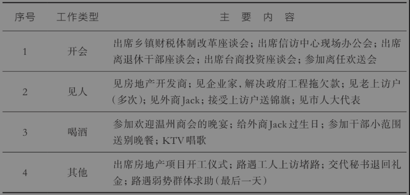
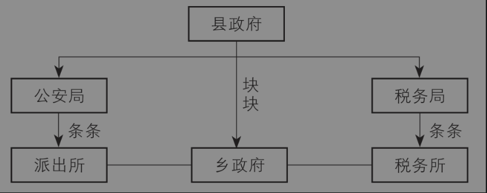
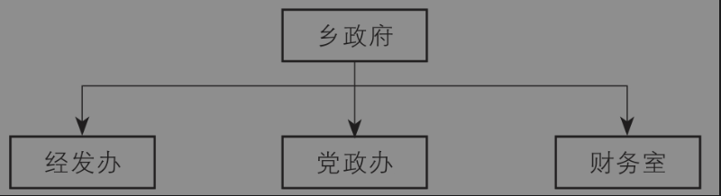

# 第五章 地方主官的挑战

<!-- 按来源截图5-1.png、5-2.png顺序整理；阅读器导航与装饰线已省略；正文恢复为可复制文本；1张表格与2幅结构图保留原图并存于img目录；原始截图备存于本书“原始图片”目录。 -->

本书第一部分从宏观上介绍了中国国家治理的框架和逻辑，第二部分介绍了基层单位的权力运行，现在进入第三部分，主要介绍基层治理的逻辑。所谓基层治理，本质上是在国家治理的大框架下，基层单位和首长如何运用所属权力来完成治理目标的过程。特别是在中国特色的“压力型体制”[^1]下，中央制定考核目标，上级将目标分解并下达至下级，下级必须调动辖区内各种资源来完成KPI（关键绩效指标），否则就会面临问责或者影响政治前程。在此过程中，地区之间的激烈竞争和信息不对称可能导致“层层加码”现象，同时基层首长承担的政治责任实际上是一种不完全契约，在一定程度上属于“无限责任”。在这种情况下，拥有“有限权力”的基层首长如何承担无限责任，就成为基层治理的严峻挑战。

考虑到县域治理的重要性，本章首先在第一节通过一个县委书记的纪录片描述县委书记如何运用权力来实现辖区内的治理，并总结县委书记在基层治理过程中的三大挑战。第二节则从对比县域治理和乡镇治理的主要差异展开，然后总结乡镇党委书记在基层治理过程中的主要挑战。

## 第一节 县委书记的“三座大山”

前文我已多次提到，县是中国最完整的基层单位，除了外交和国防，一个县的机构设置和省、市差不多，包括财政、税收、公安、教育等各类行政机构。相比起来，乡镇没有这些机构，只有县局的部分派出机构，它们不属于乡镇管辖。反过来跟市辖区比较，县和县级市还拥有相对独立的财权和土地规划权。

与此同时，从规模上看，县域人口众多，因此治理任务非常繁重。中国很多县的规模相当于外国的一个省甚至是一个小国。全中国人口最多的县可能是广东省普宁市（县级市），户籍人口高达251.6万人，其常住人口也超过了200万人。要知道，欧洲有些国家的人口都不到250万，比如斯洛文尼亚只有210万人口，而美国有大约三分之一的州（相当于中国的省）人口不到250万。因此，从治理规模上讲，中国的一个县委书记，相当于美国的一个州长。

以上两点意味着，县是观察中国基层治理的最好窗口。

本节将介绍县域治理。第一部分从“官”和“人”两个角度，走进县委书记的日常；第二部分总结县委书记面临的最重要的三种挑战。

### 一、“县委书记是最苦的一个行当”

本书第三章第一节解释了县委书记究竟有多大权力，本节主要介绍县委书记如何运用权力来治理一个县。从感性的角度讲，很多人都想知道，作为一个能够影响几十万、上百万人口的县委书记，每天究竟在忙什么呢？有一部电影纪录片，比较真实、全面地展示了一个县委书记的日常工作。这部纪录片名字就叫《书记》，导演是周浩，纪录片中的主角是河南省人口最多的一个县——固始县的G书记。下面，我就把它当作素材，梳理一下一个县委书记的日常工作状态。纪录片大概展示了县委G书记的21件事，我把它分为四类：开会、见人、喝酒、其他。请看表5-1。

表5-1 一个县委书记的日常工作

看了表中的工作总结，很多人可能觉得这跟想象中的县委书记角色不太一样。但这可能才是真实现象。因为多年负责智库工作，加上经常外出调研，所以我对县委书记的情况比较熟悉。在我看来，这部纪录片展示的县委书记的日常工作是真实可信的，也是比较丰满生动的。当然，有些内容因为涉密或者涉及上级部门，纪录片导演没有拍摄。比如，县委常委会研究决定重大事项，特别是人事问题；县委书记迎接上级的各类检查指导活动；县委书记与县委常委或者其他副处级干部私下沟通工作情况，等等。

在这部纪录片中，固始县的G书记可以说是日理万机、非常忙碌。每天从早到晚，甚至到深夜都在工作或应酬，公事私事基本上无法分开。几年前，我们江西老家的一个县委书记来北京开会，第一个晚上就陪了三顿饭，喝了三顿酒。我说，怎么要喝这么多场呢？他说，第一场是商会组织的，都是企业家，跟招商引资有关，他必须去陪一下；第二场是人才办组织的，都是在京知名贤达，他肯定要来敬酒；第三场是同学聚会，大家沟通一下感情，他不得不去。总而言之，工作状态基本上还是“5+2”和“白+黑”。职场人一定会觉得这很变态，但是县委书记觉得这就是常态。在这部纪录片里，G书记向导演“吐槽”：“县委书记是最苦的一个行当！”这句话起码半真半假。

那么，如何看待县委书记在县域治理中的角色？他究竟是“土皇帝”还是“人民公仆”？是“无官不贪的县太爷”还是“为民做主的包青天”？我认为，要全面、准确地认识县委书记角色，应该从两个方面剖析：一方面，他是一个“官”；另一方面，他也是一个“人”。

首先从“官”的角度剖析。表面上看，县委书记是一个县的“一把手”，通过两个重要途径——县委常委会这个县域最高权力组织以及在人事任命上的重要话语权——能影响几十万甚至是上百万人的升官发财，甚至是生老病死，简直是掌握了“绝对权力”。比如，在这部纪录片的开头，一个房地产开发商想在当地建一个小区，本来规划是26层，但是G书记说，你盖33层吧，圆我一个梦想，而且“33”意味着“生生不息”。县委书记轻飘飘一句话，就可能改了楼宇规划。而规划改了，容积率很可能要变动，这本来都是城镇规划中的重大问题。因为开发商拿到的土地面积是固定的，所以往往楼层越高、容积率越大，那么单位土地面积的利润就越高。因此，一些地方的开发商为了提高容积率，处心积虑甚至通过腐败方式来影响主管城建的官员。

但是，正如第一章所讲的，中国是一个“条块结合，以块为主”的矩阵式治理架构。在中央—省—市—县—乡组成的五级行政等级中，县只是一个基层单位，在它上面还有市、省和中央。在基层治理过程中，县委书记除了要遵纪守法——中央、省和市里的党政主要领导，都是县委书记的领导——与此同时，中央部委、省厅、市局等职能部门，也就是我们前面说的“条条”部门同样对县拥有“指导”权力。虽然“指导”不如“领导”，但是在中国的城市等级体系下，公共资源的分配是沿着城市等级自上而下分配的，这就意味着一些掌握公共资源的条管部门领导，即便个人的行政级别不如县委书记，也有可能影响县委书记的决策。举个例子，如果省农业农村厅一个副处长给县委书记打招呼，请他帮忙“关照”一下某个熟人，县委书记恐怕不能置若罔闻，否则下一年的农业类专项资金就会受到影响，而农口的拨款一直都是县财政收入的重要来源。正如纪录片中G书记抱怨的那样：“看起来县委书记像个土皇帝，权力很大。省里面来一个副处长，你县委书记都得像孙子一样去伺候他。”

除了权力边界，我们理解中国官员的另一个重要维度是“做事”。根据个人对官场的观察与研究，我认为多数官员，特别是各个地方或者部门的“一把手”，都有一个原始的想法：在能满足个人利益的前提下，愿意做一些事情，希望能够“名垂青史”。在纪录片中，G书记对导演说，“我在任何地方工作一定要留下我的执政痕迹”，“你要说我有一个目标的话，这就是我的目标”。这里说的个人利益，因人而异，但多数人会在乎金钱，毕竟这是市场经济时代的硬通货。很多官员愿意“5+2”“白+黑”地拼命工作，我相信个人利益和名声一定是重要动力，这也是人性的一部分，是正常的。因此，如果你要给官员提建议，你想让官员帮你做事，你就要多想想，你的建议是否对他有利，比如给他带来政绩。在经济学上，这就是“激励相容”，说白了就是有利益交集，这样才能把事办成。

前面是从“官”的角度剖析县委书记，下面从“人”的角度剖析。你把县委书记当人看，当作和我们一样的人，你就能理解县委书记的很多做法了。例如，在这部纪录片中，G书记作为一个普通人，喝多了酒也会发牢骚，说话甚至语无伦次，唱歌也会跑调，过生日时还往客人和自己脸上抹蛋糕。著名华人经济学家杨小凯说过一句话：人的一半是天使，一半是魔鬼。好的制度，就应该激发天使的一面，而遏制魔鬼的一面。因此，不要轻易去考验人性，而应该努力完善制度。我们的很多制度规定以及学术研究，可能过于强调县委书记“官”的一面，而忽视了“人”的一面。

因此，只有从“官”和“人”两个方面剖析县委书记，我们才能更加客观、公正地看待这个最重要的基层职位。县委书记不是“土皇帝”，但也不只是纯粹的“人民公仆”，因为他也有自己的利益诉求。承认这点，才是唯物主义的态度。在法治日益完善、监管日益严厉的制度环境下，县委书记不太可能是“无官不贪的县太爷”，但也别指望他成为“为民做主的包青天”。毕竟，在法治社会，一切应该按照规则来，县委书记的个人决策不能随意干涉司法，更不能逾越法律。当然，从传统的人情社会转型到现代法治社会，需要一个很长的过程。在这个过程中，人情、道德、法律、关系都有一定的权重，而且它们的权重在不同阶段可能是波动的，对此不可太理想化。

### 二、县委书记的“三座大山”

在对县委书记的角色做了立体素描之后，我们来讨论一下县委书记在县域治理中的主要难题。2023年春季，中国人民大学农发学院和农业农村部下属单位联合举办了一次“中国乡村振兴典型观测县百县联盟”的培训活动，共有130多个县的党政领导班子成员参加学习，其中包括30多名县委书记和县长。我借这个机会，和负责培训的同事一起了解了一下：现在的县委书记，最大的挑战有哪些？最头疼的事情是什么？

我的总结是，县委书记现在最头疼的是三件事：维稳、招商、借债。因为这三件事情没有一件不是难啃的“硬骨头”，可以说是县委书记身上的“三座大山”。

第一座大山是“维稳”，也就是维持社会安全稳定，辖区内不能出现群体性事件、恐怖主义事件。从2008年开始，全国掀起了一场建设“基层信访综治维稳中心”的热潮，县乡和街道办事处纷纷成立“维护稳定工作领导小组办公室”，简称“维稳办”。对基层官员来说，维稳的压力始终都是“紧箍咒”。在自上而下考核的压力型体制中，上级政府纷纷把“维稳”作为下级政府的考核指标，而且是“一票否决”的指标。也就是说，不管辖区内今年GDP增长多么快，财政收入多么高，只要有一起群众上访事件，今年本单位的考核就是不合格。考核不合格，奖金就没有了，升迁也没有了，这会严重打击下属的士气和积极性。关键问题是，辖区内是否有人上访，本身是随机的、不确定的，是超出很多人本职工作范围的。有一次，一个公务员跟我抱怨：假设你在一个县教育局上班，每天兢兢业业上班，累死累活不说，起码工作也有起色。结果某个中学有人上访，连带你的年终奖也泡汤了，你觉得这样的“一票否决”考核公平吗？冤不冤？因此，这些年，一直有人在呼吁，应该取消不合理的维稳“一票否决”政策，除了这会导致无辜连带责任，还有担心这会产生谋利型上访行为以及某些地方存在的截访过程中的暴力行为。当然了，对维稳实行“一票否决”的初衷，是敦促官员为人民服务尽心履职，但是，这种高压政策有时因为考核环境的不确定性，未必能够发挥应有的作用。相反，取消“一票否决”之后，严格按法律办事，从长远来看也许更有利于法治完善和社会稳定。[^2]

在电影《我不是潘金莲》中，一个普普通通的农村妇女李雪莲，为了证明“我不是潘金莲”，在十多年时间里，从镇到县，由市到省，再到首都，不断地上访，也不断地被截访。李雪莲第四次告状时找到了县长史为民，结果史为民不但没有帮上李雪莲，反而被她拉下马——如果县委书记、县长们处理不好上访问题，自己前程难保。在纪录片《书记》总共拍摄的21件事中，跟上访有关的就有7件，占三分之一。有意思的是，就连G书记离任走出政府大门时，还碰到了弱势群体的上访，他随手给了对方几百块钱，然后就走了。毕竟，他已经不是本县的G书记了。

地方治理中狭义的“维稳”多是针对群体性上访事件，但实际上，维稳工作不止于此，还包括社会治安维稳和安全生产两个方面，合称“安全稳定”。安全生产问题包括煤矿、非煤矿山、建筑场地以及生产工厂等生产场所发生的各类伤亡事故，还包括交通伤亡事故。因为一旦发生安全生产事故，往往会导致家属群体性聚集甚至上访，所以现在治安维稳和安全生产是联动的。而且，党委和政府都是责任主体，实行“党政同责、一岗双责”，就是领导既要管业务，又要管安全稳定。

为什么县委书记的第一职责是维稳呢？为什么有很多人呼吁但仍然没有取消维稳“一票否决”政策呢？我认为，这有两个方面的原因。一是跟中国的施政理念有关。早些年社会上一度流行过“小政府，大社会”的理念，但是现在几乎不提这个理念了。因为几千年的文化传统决定了中国老百姓对政府的认知，政府就是为民做主的，还是凡事要找政府。为人民服务，某种程度上就是为民做主，这是国情。二是跟中国的国家治理架构有关。在“条块结合，以块为主”的矩阵型体制下，出了事情实行的是“属地管理”原则，相当于对地方官员实行无限责任的“政治承包制”——理解了这点，才能理解中国的官民关系，才能理解地方主官的重大责任。

第二座大山是“招商”，就是通过招商引资促进经济社会发展。其实，在十八大之前，招商引资或者经济工作，一直是地方政府的重中之重，大约占工作考核权重的70%。为什么经济工作，这么重要？地方政府有很多刚性支出，公务员工资要发，教师工资要发，民生保障的支出必须兜底。那么钱从哪里来呢？地方政府的财政收入要么来自本级，要么来自上级。从来自本级的收入来说，由于中国的城市是一个自上而下的等级体系，公共资源、优质企业和重大项目，都是自上而下分配的，因此轮到基层的县级区域时，就只剩下“粗茶淡饭”，甚至是“残羹冷炙”了。对多数县级政府来说，能够自我造血的财政收入远远小于支出，所以必须依靠上级转移支付才能维持“吃饭财政”。比如纪录片中的固始县，作为河南省人口第一大县，在2008年的财政收入只有2.8亿元，但是支出却高达12亿元。支出是收入的四倍多，严重收不抵支。如果这个县是一个企业，早就破产了。问题是，县作为一级政府，不能破产，而且还有很多类似的困难县。没钱怎么办？话又说回来了，除了向上级要，就是自己去挣，也就是招商引资，拉企业来投资，把上级的项目跑下来。

在纪录片里，G书记的21件事情中，至少有5件事情是跟招商引资有关。例如，参加房地产开发商的奠基仪式，会见外商Jack并且给他过生日，和温州商会以及台商一起吃饭喝酒。为了表示招商的诚意，G书记甚至主动提出晚上搞“深水炸弹”[^3]。这种招待，其实是以伤身体的方式来增进感情。感情能否增进不好说，但身体肯定是损伤了。十八大之后基层喝酒的现象明显少多了，得到了很多基层干部的拥护。

这两年，地方的财政压力更大了，招商引资抓得更紧了，但恐怕也更难了。2023年底，一个在某省政府工作的朋友来北京。我问他怎么有空来北京？他说带队招商引资。他本来是一个省直部门的副厅级干部，不是有盈利压力的部门，然而现在居然要带领一个工作专班来北京招商，而且要待一年，就住在驻京办的宾馆。光是这个人力成本就很高了，可见地方为了招商是下了血本的。在招商引资方面，基层干部可谓“八仙过海，各显神通”，我在后面还会专门介绍。

第三座大山是“借债”。前面说了，收入不够，但政府的支出却很刚性，公务员、事业单位和教师的工资总不能不发吧？事实上，在财政吃紧的时候，确实会影响到体制内人员的收入。但这种情况即便持续两年、三年，也总不是长久之计，搞钱，对县委书记来说，是关乎社会稳定的头等大事。那么除了向上级要钱，招商引资赚钱，还有什么别的办法吗？只剩下借钱了。怎么借？最好的办法是发行地方债，这样可以一次性借好几年，慢慢还。但是目前只有省级政府或者副省级城市有直接发债的权力，县和市都没有这个权限（再次体现了城市级别的重要性）。于是，一些地方政府就让城投公司等平台去发债，这个不需要占用省里的配额。但是，一旦违约，很容易被债券市场拉入黑名单，以后再也发不了债了。发债不行，就只好向银行借钱了。这是短期周转办法，但地方政府要跟银行关系好才能借得到，毕竟银行的钱也不是白给的。关于地方债的话题这几年一直比较火，我在后文还会讨论。

## 第二节 乡镇党委书记的挑战

第一节介绍了县委书记的三个挑战，本节再往下一级，介绍乡镇党委书记在乡镇治理过程中的主要挑

战。乡镇是中国最基层的行政区划，不要小看乡镇党委书记，有些乡镇的人口规模非常大，全国人口最多的乡镇是广东省佛山市南海区的狮山镇，号称“天下第一镇”。该镇人口95万，是一个普通县人口数量的三倍多。有些乡镇经济实力非常强，狮山镇2022年GDP高达1313亿元，全国经济实力最强的镇是江苏省昆山市的玉山镇，2022年GDP超过1000亿元。1000亿元比很多地级市的GDP都高，甚至比某些省会城市还高，比如拉萨市2022年的GDP是700多亿元。此外，从行政级别上看，北京、重庆等直辖市的一个乡镇是正处级单位，所以乡镇党委书记相当于一个县委书记。

本节的主要内容包括两部分。在第一部分，我从功能、压力、工作对象和方式这三个方面比较一下县区治理和乡镇治理的主要差异。认识到这些差异，才能理解乡镇党委书记面临的治理困境，这也是理解中国基层的重要切入点。在第二部分，我将总结一下乡镇党委书记面临的主要难题，简单地说就是从过去的收公粮、抓计划生育，变成维稳、应对检查和考核以及解决民生问题。

### 一、县区治理和乡镇治理的差别在哪里？

治理一个县和治理一个乡镇至少有三个方面不同，而这些不同主要源于县区和乡镇在国家治理架构中的地位不同。

#### 功能不同。

县区和乡镇都属于基层，都是熟人社会。但是，它们在整个国家治理架构中的地位是不同的。县区既是决策单位又是执行单位，但乡镇只能是执行单位。请看下面这两张图，一张是县里的组织结构图（图5-1），另一张是乡镇组织结构图（图5-2），当然都高度简化了。

图5-1 县政府机构设置图

图5-2 乡镇机构设置图

县是一个完整的基层单位，有完善的职能部门，下面还有街道、乡镇等行政辖区（块块），而且它的职能部门（比如公安局和税务局）还可以在各乡镇设立垂直管理的分支机构（条条）。不夸张地说，县本身就符合“条块结合，以块为主”的架构。而乡镇虽然是一个“块块”，但是它下面没有什么职能部门（条条），只有几个办公室，像一个缺了腿的方块。乡镇与街道办事处不同。街道办的确也是最基层单位，但街道办是区县的派出机构，不像乡镇是一级行政区划。总之，乡镇是最基层的行政辖区，是行政体制的神经末梢。这就意味着，上级来了政策，下达了指标，县区还可以发个文件，压到乡镇去完成，甚至还可以层层加码。如果乡镇治理不好，或者出现什么问题，县里还可以要求各职能部门在乡镇的条管单位（比如公安派出所）予以协助。但是乡镇不能再往下发文件，更不可能层层加码，因为下面没有“腿”了。虽然说，乡下面还有行政村，村下面还有村民小组，但是此前说过，村不是行政单位，村委会主任（俗称“村长”）也不是国家干部，没有行政级别。在压力型体制下，县里下达任务给乡镇，各个乡镇如果完不成任务，县委书记可以撤了乡镇党委书记和乡镇长。但是，如果乡镇完不成任务，就不太可能撤掉“村长”。从法律上讲，“村长”是村民选举的，不是上级单位任命的。而且，客观上讲，“村长”只能在本村选，所以一个村能当“村长”的人选非常有限。但是在一个县的庞大公务员队伍中，想当和能当乡镇长的人就多了。

如前所述，县里可以发文件给乡镇，但是乡镇不能再发文件了，必须把事情干出来。县里发文件时，考虑到法律法规的严肃性和考核目标的统一性，因此通常会提出“一刀切”的要求。关键问题是，上级的政策目标和实施要求到了乡镇可能没有可实施性，但是乡镇是落实单位，它必须把事情干成了，这是检验乡镇工作的主要标准。这就决定了，乡镇的工作方式必须有弹性，必须是结果导向。乡镇不知道该怎么干，只能一遍一遍试错。比如，在脱贫攻坚期间，上级要求基层做好贫困人口的登记管理。乡镇干部就要下村入户，挨家挨户走访，跑断腿，磨破嘴。但即便这样，也未必能够将本辖区的贫困户底账摸清摸准。因为乡镇很多人都是“人户分离”，就是户口在本地，但是人早就去了外地打工。即便是本地人，有人外出了，有人走亲戚去了，剩下留守在家的老人和儿童，又难以顺利沟通。而且，很多农民经常换手机号码，去一个地方打工就换一个号码，连亲戚都不知道他的号码。这种情况下，怎么统计实际收入？怎么确定本村的贫困户名单？都没有标准答案，全靠自己摸索。

#### 压力不同。

前面从组织架构的角度对比了县和乡镇的差异，给人的感觉是，乡镇是压力传导的最后环节，所以肯定是压力最大的基层单位。其实不然，县委书记的压力比乡镇党委书记的压力大多了。因为县是一级完整的基层单位，所以也就是一个完整的考核单位，而乡镇不是一级完整的基层单位，也就意味着不是一个完整的考核单位。对乡镇党委书记来说，反正我“没腿”，所以天塌下来有县里顶着。县委书记就没有退路了，只能自己顶着，否则马上有无数同僚把你的位置给顶了。

县和乡镇比，至少有三方面的压力不同。

第一是财政压力不同。一个乡镇供养的财政人口（也就是吃公家饭的公务员和事业单位员工）一般在100人左右，但一个县供养的财政人口动辄上千人，其中大部分是中小学教师。而且，很多学者早就呼吁对县乡财税体制进行改革[^4]，因为很多乡镇没有企业，又不收农业税了，越来越不适合作为一级财政收支单位了，将来都是县里统收统支了，到那时乡镇党委书记就可以彻底“躺平”，不再有财政收支压力了。对县委书记来说，能不能按时发工资，会直接影响本县的社会稳定。

第二是招商引资压力不同。对大多数不太发达地区来说，稍微好一点的企业，都集中到县里或者区里的工业园区、经济开发区去了，乡镇留不住好企业。即便在经济发达地区，乡镇的开发区也没法跟县区比。另外，乡镇没有自己的税务局，不具备税收处置的权力，也没法给企业承诺收多少税，返还多少税。如果一个乡镇党委书记没法拍板给老板多少优惠税收，谁会来投资呢？因此，乡镇招商引资的时候，往往只能说说，很难落实，反正财政压力在县里。而县里不同，有完整的财政和税收机构，是一级预算单位，必须通过招商引资才能增加收入，改善城市面貌。正是因为乡镇没有财政压力，所以才没有招商引资的压力，这跟县里的情况正好反过来。

第三是产业发展的压力不同。作为一个完整的基层单位和一级财政预算单位，县委书记必须高瞻远瞩，出谋划策，想清楚全县的产业规划：要重点发展什么产业，未来要打造哪些新兴产业；如何与省里保持一致，又如何实现与周边的区县的差异化竞争？这些都是令人头疼的问题。据2023年7月底《南方周末》的一篇文章报道，黑龙江省哈尔滨市下面的一个县级市，著名的“大米之城”五常市，在过去20年里，居然连续五任市委书记都因为腐败落马了。[^5]落马的原因，很大程度上跟产业规划有关。每位书记上任，都要有政绩、有亮点，重点就是打造有特色的产业。在五常市，先后打造过大米产业、工业新城、蔬菜产业等。在此过程中，由于利益巨大，在一些地方出现了官商勾结，结果腐败横生，官场乌烟瘴气，最终导致书记们纷纷落马。从结果上看，五常市的历任市委书记，产业搞得好就仕途顺遂，搞得不好就要锒铛入狱。相反，乡镇党委书记更多的工作是落实上级精神，执行上级文件，保持农业和社会稳定，压力相对小多了。

#### 工作对象和方式不同。

前面对比了县委书记和乡镇党委书记的压力，现在从普通公务员的角度，谈谈基于工作对象和方式的不同所带来的治理差异。一方面，从上下级的角度讲，县区的工作对象是乡镇，乡镇下面没有“腿”，因此乡镇就是最后的压力单位。俗话说，上面千条线，下面一根针。作为最后的基层单位，在乡镇工作，每一个科室都要对口n个上级部门。比如说，图5-2里提到了乡镇有一个核心部门“党政办”，这个办公室主要承担党委、政府日常事务，既要负责机关文电、机要、保密、会务、档案、信息、信息安全、绩效考核、督查督办、后勤保障工作，又要负责重要事项的综合协调和重要文稿的起草审核。这里每一个职能，都可能对应上级一个单独的部门，十个职能就相当于上级十个部门，但这个办公室就只有七八个编制，所以一个人就得当好几个人用。有一位乡镇公务员在网上“吐槽”：有一次县统计局要求在中午12点之前报一个表，这边乡镇副书记又让帮忙写民主生活会的材料，然后县扶贫办又要求下乡入户，整个人真的不知道该如何统筹兼顾，根本就是分身乏术。

另一方面，从服务对象上看，县区服务的群众主要是市民，而乡镇服务的群众主要是农民。工作对象不同，决定了工作方式不同。

一是沟通能力和耐心程度。我国义务教育是在20世纪80年代才逐渐普及的，相对而言农民的平均受教育水平较低，有时对一些政策不太了解，对一些术语不太明白，有一些观念还没有及时转变。因此，跟农民打交道，要善于进行语言转化，还要非常有耐心。有人是这么总结的：“乡镇工作需要干部们要有一双好腿，有一张利嘴，要熟悉政策，要掌握民情，要吃得了委屈，受得了白眼。整天跟群众打交道，遇上胡搅蛮缠无理辩三分的，还要注意形象，说不得，骂不得，否则，一个投诉就让你吃不了兜着走，有时候就是一个受气包。”

二是农民多数住在村里，而且有的还在偏远山村，因此乡镇干部要经常下乡。比如，党的十八大提出到2020年全国要全面建成小康社会，消灭绝对贫困，这在当时无疑是非常宏大的目标。为了实现这个目标，很多乡镇公务员成天泡在村里，许多“挂村”干部都要跟农民同吃、同住、同劳动；不仅要动手，更要动脑，帮助农民出谋划策、发家致富。相比之下，县区公务员虽然也有驻村帮扶的任务，但基本上都是一个机关每年派出两三个人去驻村蹲点，不可能出现大部分干部都待在农村扶贫的情况。关于县区公务员和乡镇公务员的差别以及个人在其中的成长空间问题，我们后文会专门讨论。

### 二、乡镇党委书记的难题

我们刚刚一直在讲，相比于县委书记，乡镇党委书记的压力要小许多，但读者朋友们必须明白，一个乡镇的父母官也很难当，作为乡镇的“一把手”，乡镇党委书记也要面临不少工作难题。这些难题主要是表现在哪些方面呢？和县委书记的工作难题相比，有什么不同呢？

为了对比，我先介绍一下20世纪90年代乡镇党委书记的工作重点。1978年到2012年这段时期，可以用一句话概括其特征：野蛮生长、潮起潮落的大转型时代。通过对比，大家可以深刻地感受到不同阶段的乡镇治理乃至整个国家的转型与发展。在20世纪90年代，乡镇党委书记的重点工作就是两项：一是收公粮，二是抓计划生育。先说收公粮，公粮就是农业税。1978年之后，中国农村推行家庭联产承包责任制，做法就是“交够国家，留足集体，剩多剩少归自己”。因此，交公粮就是上缴国家要收的粮食。按说种粮纳税，天经地义，几千年来都如此。农业税的标准是每亩地交总产值的15%左右，这本身没啥问题。有问题的是，除了农业税，还有各种附加费用，统筹“三提五统”。“提”是村提留，“统”是乡统筹。“三提”是农户上交给村级组织的三种提留费用，包括公积金、公益金和行政管理费；“五统”是农户上交给乡镇政府的五项统筹，包括教育费附加、计划生育费、民兵训练费、乡村道路建设费和优抚费。农业税本身不重，但是加上“三提五统”就很重了。举个例子，假设1997年一家4口人有6亩地，每年的农业税大概是500元，但加上“三提五统”就要2000元左右。2000元在1997年是什么概念呢？那时中国人民大学一年的学费是2000元，而当年农民人均纯收入才2090元。可见那时农民负担是很重的，以至于湖北省一位乡党委书记李昌平向中央写信，疾呼“农民真苦，农村真穷，农业真危险”。[^6]此事中央领导高度重视，举国关注。因为负担重，很多农民都难以足额缴纳，而主要依靠农业税作为财政收入的乡镇政府，就不得不耗费大量人力物力来征收农业税，这导致当时的农民和乡镇干部关系一度比较紧张。[^7]这也是中央2006年彻底取消农业税的重要原因。

20世纪90年代乡镇党委书记的第二个重点工作就是抓计划生育。这个工作，就类似于猫捉老鼠。一个县里的局长跟我讲，当年他当乡长时，听说一个按规定应该已经落实节育措施的妇女怀孕了并且回了老家，于是连夜开车带着乡里的联防队员去村里抓人。把人抓上车了，然后赶紧往乡卫生所开，结果半路上被农民堵住了，差点连人带车被农民推到河里去。说起这件事，他至今感到无奈，又心有余悸。

2006年之后，农业税彻底取消了。2020年之后，脱贫攻坚任务也圆满完成了。那么，当下乡镇党委书记又面临哪些挑战呢？跟县委书记有所不同，乡镇党委书记面临的三个难题主要是以下三件事。

第一件事，和县委书记一样，也是安全稳定第一。稳定，这恐怕在相当长一段时期内都是基层工作的基本要求和首要目标。因为不论是安全还是稳定，考核时都是一票否决的。也就是说，其他工作做得再好，只要发生重大安全或者社会稳定事故，轻则考核不合格，重则摘掉官帽子。

第二件事，是应对各种检查和考核。因为乡镇是最基层的行政单位，所有单位都可以考核乡镇，所以乡镇面临的工作检查应该是最多的。每个单位为了表示重视，都要定期或不定期来乡镇查看考核情况，而不仅仅是年终只看考核结果。当前，官员治理机制的一个重要转变是，考核的重点从只看结果变成了过程监督，从政绩驱动变成了问责驱动。因此，考核越多，检查就越多，迎接上级检查（简称“迎检”）已经成为乡镇党委书记的重头工作了。

社会学者吴毅（2018）做过统计，21世纪初，一个乡镇每年必须应对的例行检查包括：（1）计划生育类检查：区里2次，上下半年各一次；市里2次，上下半年各一次；省里检查1—2次。（2）农民负担类检查，包括农村税费改革检查，每年最少1次。（3）各项中心工作检查：内容不一，反正每个季度都有。现在虽然没有了计划生育检查和农民负担检查，但是又多了乡村振兴、环境保护、基层党建和生产安全检查，算起来，一年到头至少要迎接上级的10次检查，这意味着每个季度至少一次，每个月几乎都有。难怪一些乡镇干部说，乡镇政府一年少说也有三分之一的时间是在迎接各种检查。某个乡镇党委书记说，高峰期乡镇每天要接待两三拨督查，谁都不能怠慢。毕竟，在“条块结合，以块为主”的治理架构下，所有上级领导部门和职能部门，都影响着乡镇党委书记的前途。最近一两年，视频会议还特别多，成为乡镇党委书记和领导班子面临的新的行政负荷。过去因为一些乡镇比较偏远，不可能参加县里委办局的所有会议；现在有了视频会议，这下没法推脱了。[^8]新技术如何才能提升新治理，这也是一个新问题。

除了应对上级检查，乡镇党委书记自己还要不停地开展内部自查和评估，及时进行进度管理。因为上级考核的目标有时非常多，而且考核单位为了自己能出亮点，都喜欢搞各种“赛马”比拼，每个行政单元会有几十甚至几百个的指标提出来晾晒，而且每个月、每季度都会公布排名情况，这就给乡镇一把手带来了巨大的压力，这种压力又会进一步传导下去。为了不出现丢三落四、顾此失彼的结果，只好面面俱到，哪根弦都不敢放松，搞得乡镇干部胆战心惊、疲于奔命。最近，某个省份的头号工程是，全省每个单位都要完成“八张问题清单、七张报表、五项机制”，总共有上百个指标。

第三件事，是解决民生问题。中国的意识形态和传统文化决定了中国政府是全能政府，不是“小政府”。这些年，中央高度重视民生问题，因为这是执政的“基本盘”。在群众眼里，基层政府是万能的：暖气不热、邻里纠纷、施工扰民、环境污染、物业不作为等等，第一时间都会找居委会、街道办或乡镇政府。而且，上级领导知道，每个行政单元都会有自己独有的、老百姓反映强烈需要解决的民生实际问题。西部地区的乡镇，最大的民生诉求大多是基础设施建设，比如农村公路硬化；东部沿海地区则可能是生活品质的进一步提升，比如通过工程措施将台风天影响降到最低。如果一些疑难杂症久拖不决，形成汹汹民意，特别是产生了网络舆情，那么上级就要考虑“动帽子”了。

除了上述三件事，舆情导控也对乡镇党委书记们造成了巨大的压力。因为现在任何人都可以是自媒体，任何人都可能会涌到舆情第一线，乡镇也必须学会如何应对舆情。尤其是，如今互联网的法律法规还不完善，造谣成本低，除了切实需要解决的疑难杂症之外，也有不少人抱着“会哭的孩子有奶吃”的心态，动辄挥动“舆论大棒”。一旦某件事情处置不当，稍不注意就会成为舆情爆点，这就影响到社会稳定了——而维稳又是一票否决的。这意味着，一个乡镇党委书记还要成为舆论专家。在前面这四件事情解决之后，乡镇党委书记才能抓其他工作，比如经济发展、城镇规划、企业服务、基层党建等等。

## 思考题

1.除了本章讲述的三件事（维稳、招商和借债），你认为县委书记还有哪些严峻挑战？

2.西方发达国家的城乡收入差距一般在1.5左右（农村居民收入=1）。中国的城乡收入差距一直较大。1978年城乡收入差距是2.36，到了2010年高达3.23，成为当时世界上城乡收入差距最大的国家之一。2021年，城乡收入差距降低到2.5。从理论上讲，伴随经济发展，人口流动，城乡之间的差距应该逐渐缩小。请问，为什么中国的城乡差距没有显著缩小？

## 注释

[^1]: “压力型体制”这个概念已经成为政治学中的重要概念。它是原中央编译局研究员荣敬本1993年到河南省新密市（时称密县）调研时总结的一个概念。荣敬本（2013）分析指出，为了实现赶超战略，上级制定了各种任务和指标，并分解到下级，然后往往会通过硬性考核方式（通常是“一票否决”）要求下级完成。压力型体制在促进了经济增长的同时，也产生了以权谋私、上下合谋等扭曲现象。他认为，压力型体制的形成跟早期实行高度集中的计划经济体制以及自上而下的官僚体制有关。杨雪冬（2012）回顾了这个概念的产生过程和理论应用，并描述了压力型体制在基层的具体表现和后果。

[^2]: 杨瑞龙等（2010）把上访看作信息不对称条件下中央对地方官员的一种问责机制，并且讨论了最优的问责力度。在此基础上，桂林等（2016）研究了谋利型上访产生的条件以及消除这种扭曲行为的政策建议。

[^3]: 在大的啤酒杯里倒三分之二满的啤酒，然后将装满了高度白酒的小杯子沉入啤酒杯，一口气喝光。这本来是一种鸡尾酒调制方法，在中国变成了一种白酒加啤酒的剧烈喝酒方式。

[^4]: 贾康和白景明（2002）提出，要解决当前的县乡财政困难，就要减少政府层级和财政层级，按照“一级政权，一级事权，一级财权，一级税基，一级预算，一级产权，一级举债权”思路推进省以下财政体制改革。

[^5]: 《连续五任市委书记落马：“大米之城”五常20年政商风云》，《南方周末》，2023年7月26日。

[^6]: 参见《硕士乡党委书记含泪上书国务院痛陈农民苦难》，中国新闻网，2000年9月1日，网址为https://www.chinanews.com/2000-09-01/26/44274.html。

[^7]: 吴毅（2018）通过湖北省一个小镇的细致观察，形象地阐述了乡镇干部在农业税征收过程中的工作压力，以及乡镇干部如何借助非正式关系来完成考核任务的“智慧”。

[^8]: 杨华（2022）也分析了县乡两级在迎接检查方面的动员情况，以及在“迎检”过程中的上下合谋和形式主义等问题。
