# 第八章 区域协同发展之路

<!-- 按来源截图8-1.png、8-2.png顺序整理；阅读器导航与装饰分隔线已省略；正文恢复为可复制文本；10幅插图与2张表格保留原图，共12个图片文件，存于img目录；13条注释恢复为Markdown脚注。原始截图备存于本书“原始图片”目录，便于核对；原文数据、观点与交叉引用按截图保留。 -->

在经济发展方面，中国最大的优势是什么？我相信，很多人的答案都是“统一大市场”。中国作为一个统一大市场，主要体现在三个方面。一是在国家治理架构方面，中国是单一制国家，不是联邦制。全国有通行的政治制度、法律法规和语言，即游戏规则是一样的。二是在人口方面，中国拥有14亿人口，是全世界人口最多的国家之一。并且，中国拥有全世界最大规模的中产阶层，他们具有旺盛的消费需求。三是中国幅员辽阔，同时地区差异较大，呈现了多层次、多元化和相互支持的市场协作体系。很多人只看到前面两点，而忽视了第三点。第三点其实也非常重要，在全球贸易中，跨国公司通常在发达国家研发新产品，接着在发达国家生产，然后将生产环节外包给发展中国家，最后直接在发展中国家投资生产，并反向出口给发达国家。这正是过去几十年国际贸易领域的“产品生命周期理论”。[^1]如果用这种全球贸易的眼光看中国各地区间的协作，那么欠发达地区、农村地区或中小城镇为发达地区、城市地区和大城市提供了源源不断的劳动力、原材料或初级产品，同时购买后者提供的各种最终产品和劳务，正是这种地区之间、城市之间的分工协作，成就了今天强大的中国制造业，缩小了地区差距，促进了社会稳定。反之，正如我们在第一章所指出的，地区差异扩大往往会引发内部冲突，影响政权稳定。因此，讨论中国国家治理和基层治理，绝不能忽视区域协同的角度。这正是本章的主旨。

为了分析地区之间的差异和协同，本章第一节讨论中国的区域发展战略，并直面一个热点问题：中国应该侧重大国大城的发展思路，还是追求大中小城市的均衡发展？两种思路似乎各有各的道理。大国大城的思路偏向纯粹的经济学思路，主要考虑经济效率，安全稳定问题相对后置；而稳定在国家治理中是非常重要的目标（如果不说是最重要的目标），均衡发展的思路是政治经济学思路，更强调发展和安全的综合平衡。实际上，中国的城镇化过程是一个动态演进的过程，在不同的阶段可能有不同的侧重点，而不是僵化地秉持一个思路。第二节旨在探讨当前基层治理的一个核心问题：如何优化营商环境？我将介绍人大课题组对中国大约300个城市的政商关系进行评价的方法、结果，并探寻背后的规律性现象。如果说之前关于城市或辖区治理的分析是个体的、孤立的，那么本章试图讨论城市或区域之间的联系和发展。

## 第一节 大国大城还是均衡发展？

城市化问题是区域发展的核心问题，因为区域发展很大程度上就是城市或者城市群的发展。同时，这也是基层治理的重要内容，因为县级市、县城和小城镇的发展，本身就是基层治理的主要对象。

从历史上看，几乎所有国家的现代化进程，都是工业化和城市化的过程。哈佛大学经济学教授格莱泽（Edward Glaeser）有一本畅销书，名字叫《城市的胜利》（格莱泽，2012）。他在书中说，城市是我们人类最为伟大的发明。中国的城镇化和经济高速增长是同步的。从1978年到2021年，中国城镇常住人口从1.72亿增加到9.14亿，城镇化率从17.92%提高到64.72%。这是一个了不起的成就。中国的城镇化是人类历史上规模最大、速度最快的一场人口流动。并且，中国也是世界上最大的城市国家之一，拥有超过100个人口规模大于100万的城市。但另一方面，中国的城市差异悬殊，大城市和小城市在人口规模上可谓天壤之别。图8-1是2022年按常住人口排名位列前五名和后五名的城市，这里的“城市”是指地级以上城市，包括直辖市。第一名是重庆市，有3212.3万人，不仅是中国人口最多的城市，恐怕也是全世界人口最多的城市之一。第二到第五名是上海、北京、成都和广州。但是，人口最少的五个城市——迪庆藏族自治州、山南市、嘉峪关市、黄南藏族自治州和阿拉善盟，只有20多万到30多万人口，就相当于一个县城的人口规模。人口最多的重庆是人口最少的阿拉善盟人口规模的大约120倍。

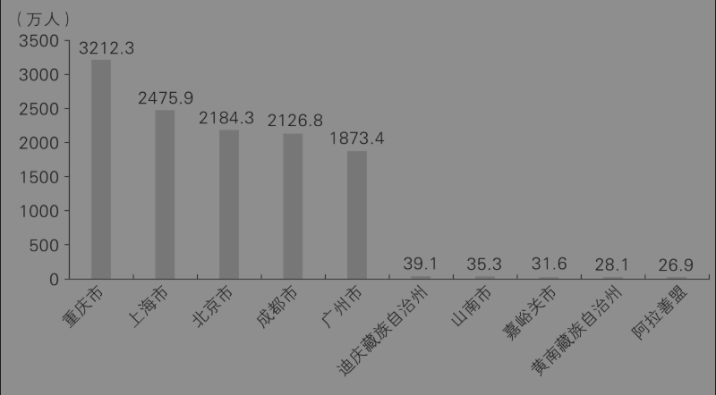

图8-1 2022年全国人口最多和最少的五个城市

图8-2是按GDP排名位列前五名和后五名的城市。上海位居第一，2022年GDP高达44 652.8亿元，之后是北京、深圳、重庆和广州。最后五名分别是大兴安岭地区、黄南藏族自治州、海北藏族自治州、玉树藏族自治州和果洛藏族自治州，在柱状图上几乎都看不见数值了，但是它们都不是普通的城市，而是地区（省级派出机构）或者民族自治州。在GDP方面，第一名的上海是最后一名果洛州的830多倍。

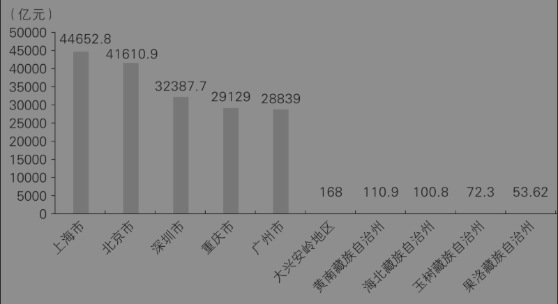

图8-2 2022年全国GDP最高和最低的五个城市

前面两张图的对比引发了一个重要的问题：无论从人口规模还是从GDP的角度来说，中国的城市大的那么大，小的那么小，那么应该强调继续做大做强大城市，还是把目光聚焦在大力发展中小城市上？是主张“大国大城”还是主张“均衡发展”？在第一部分，我会介绍一下关于中国城市化的两种主要观点或者城市化战略，即重点发展大城市的“大城论”和强调大力发展中小城市的“小城论”；在第二部分，我将提供一个分析框架，并分别评价“大城论”和“小城论”的利弊；在第三部分，我想提出中国城市化的第三条道路，即公平竞争基础上的市场化、多元化和协同化城市体系。

### 一、“大城论”vs.“小城论”

#### 1. “大城论”

主张重点发展大城市，或者让大城市继续做大做强的观点，主要理由是城市具有规模经济和集聚效应。所谓规模经济，就是城市规模越大，企业生产和居民生活的成本就越低，政府提供公共服务的平均成本也越低，因为固定成本被摊薄了。规模经济跟集聚效应有关，但后者范围更广一些。比如，城市里各种人才聚集在一起，大家通过交流可以产生更多的新思想、新创意，从而促进创新，这跟规模经济无关，跟多样化有关。总体上，其实学者们对城市集聚效应的理解并没有超越新古典经济学派的创始人阿尔弗雷德·马歇尔（Alfred Marshall）。在1920年出版的《经济学原理》这本经典教科书中，马歇尔（2019）认为，生产要素在城市中的集聚能够降低三类运输成本：一是运物的成本，主要体现为物流和生产成本的下降，二是运人的成本，主要体现为客运成本和通勤成本下降，三是运思想的成本，体现为思想碰撞产生的创新。

在主张重点发展大城市的人中，上海交通大学的陆铭教授多次使用一个指标来度量城市规模，就是“城市首位度”，即一个国家最大的城市占全国人口的比例。陆铭（2016）举了一些例子：纽约的人口占美国总人口的2.7%，伦敦占英国总人口的13.1%，东京都占日本总人口的10.3%，巴黎占法国总人口的15.9%，首尔占韩国总人口的20%左右。我们以2022年为例，当年上海市常住人口数为2475.89万，全国人口为14.12亿，上海市占全国总人口的比例仅仅是1.75%。因此，陆铭认为，上海太小了，而不是太大了。他在书中预测，在中国城市化进程结束时，上海按首位城市模型来看，人口可以达到4100万。

同样主张“大城论”的任泽平认为，决定一个城市人口集聚规模的关键是城市经济规模及该城市与本国其他地区的人均收入差距。在完全的市场竞争和个体同质条件下，一个城市的经济份额与人口份额的比值应该保持在1左右。通俗地说，就是每个城市的人均产值会趋于平均，这样人口流动就没有了额外收益，就会停止流动。任泽平（2016）在文章中提供了一组证据。例如，日本东京圈的经济—人口比值为1.15；韩国首尔圈的经济—人口比值长期在接近1的位置上下波动；而2015年北京市的经济—人口比值为2.15，上海市的经济—人口比值为2.10。因此他认为，北京市、上海市未来人口增长仍有较大潜力，即便常住人口各加200万，其经济—人口比值依然高达1.9以上。

#### 2. “小城论”

与“大城论”相反，一些学者认为，大城市存在很明显的“城市病”，而且城市化的过程应该是分阶段的，先发展小城市，然后才能发展大城市。当然，这里说的“小城论”包括主张大力发展中小城市、中小城镇的观点，因此可以说是“大城论”的对立面。

“小城论”最著名的代表人物，应该是社会学家费孝通先生。1983年，他在会议上发表了一篇影响深远的文章《小城镇，大问题》[^2]，这篇文章影响了当时的城市化政策和乡镇企业的发展。费孝通后来总结，中国现代化的起步和发展是一个从“乡土中国”向现代化都市逐步转变的过程，鉴于中国的历史、人口、城镇规模、发展速度等因素和条件，不得不走从农村小城镇开始，逐步发展城市化的道路，必须自下而上地发展多层次的犹如金字塔形的经济中心，以此来最大限度地降低现代化和都市化进程对整个社会的冲击和震荡，保证中国改革开放这一人类历史上最大规模的社会变迁的平稳进行。城市由小到大逐步发展的思路，符合人口学家拉文斯坦（Ravenstein，1885，1889）归纳的人口迁移法则，即农村人口由远及近地迁移，先是迁往小城镇，然后逐步向大城市迁移。[^3]

事实上，20世纪80年代以来，我国一直实施“严格控制大城市、合理发展中等城市和小城市、积极发展小城镇”的城市化思路。在小城镇得到了强劲发展的同时，乡镇企业也异军突起。改革开放之初的20年里，乡镇企业解决了上亿农村劳动力的就业问题，并一度创造了全国30%的GDP。大家不要觉得乡镇企业很“土”，其实今天很多位列“世界500强”的中国著名企业，当年都是从乡镇企业起家的，比如美的集团、恒力集团、荣盛集团。

### 二、最优城市化战略分析

#### 1. 活力—秩序分析框架

面对争议，还是那句话：公说公有理，婆说婆有理；究竟谁有理，关键看逻辑；逻辑要自洽，关键看框架。在第一章中，我强调了国家治理面临的一个根本权衡取舍：外部稳定和内部稳定。为了维护外部稳定，中央倾向于分权的制度安排，它有利于激发地方的活力和积极性；为了维护内部稳定，中央倾向于集权的制度安排，它有利于减少分歧和维持秩序。在城市化战略方面，同样体现了类似的权衡取舍。我们将前面的分析框架稍微修改一下，分析中央如何在活力与秩序之间权衡取舍。

图8-3中，横轴表示秩序，纵轴表示活力。在城市化战略方面，追求秩序意味着全国的区域平衡发展，比如限制大城市的规模。区域平衡发展的好处是，可以减少区域之间的收入差距，特别是城乡之间的差距，从而更好维护社会稳定和国家统一。但区域平衡发展的坏处是，它会减少区域活力，特别是发展快的区域会受到抑制。相反，如果追求活力，那就让各个区域自由发展，人口自由流动。追求活力会带来城市之间你追我赶的竞争压力，从而推动机制体制创新。但坏处是，区域发展不平衡，地区收入差距大，可能产生不公平的社会情绪，并且影响边疆安全和社会稳定。因此，没有完美的城市化战略，任何一种政策，都必须在秩序与活力之间权衡取舍。当然，经济学强调权衡取舍，并非无解，而是说要根据个体面临的约束条件，选择最优的方案。

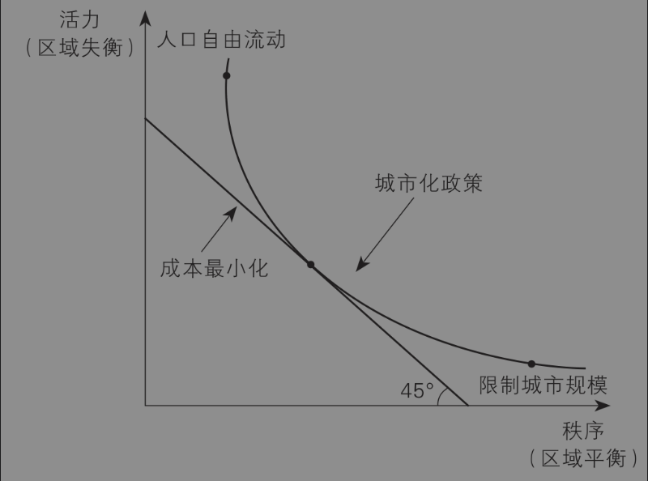

图8-3 活力与秩序的权衡和城市化战略

根据活力—秩序分析框架，如果在某个发展阶段，激发城市活力比维持区域平衡更重要，那么最优的城市化战略就应该倾向于放松管制，允许各个城市自由发展。此时，在市场力量的自发作用下，大城市可能会越来越大，小城市可能越来越小，即呈现帕累托分布或者说“二八法则”——20%的城市贡献了80%的GDP或者聚集了80%的人口。反之，如果缩小城市差距比激发活力更重要，那么最优的城市化战略就应该倾向于控制城市规模，一定程度上限制大城市的规模，缩小城市之间的经济差距。因此，按照我们的理论分析，城市规模既不是越大越好，也不是越小越好，而是由发展阶段、治理成本等多种因素综合决定。从纵向上看，20世纪80年代、90年代和现在，人均GDP不同，发展阶段不同，所需要的最优城市化战略应该不同；从横向上看，不同的区域人均GDP差异悬殊——既有对标世界一流水平的“北上广深”，也有低于世界平均水平的中西部地区。既然发展水平不同，那么所对应的最优城市化战略也应该不同，即东南沿海发达地区可能需要大城市更大，但中西部地区更应鼓励中小城市做大做强。

#### 2. 对“大城论”和“小城论”的评价

有了上述分析框架，我们就有了一个标尺。下面，我们可以用这个标尺的视角来分别看看“大城论”和“小城论”。

先看“大城论”，“大城论”可能有如下三类问题。

第一类是常识问题。很多人认为像北京这样的超级大城市不缺水，或者认为凭借南水北调工程足以保证北京的用水。但事实上，地质监测研究者发现（何旭等，2022），2017－2020年北京平原多处区域存在地面沉降现象，其中，朝阳金盏地区尤其严重，下降了约0.35米，文章认为，地下水长期过度开采是主要原因。最近几年还有不少人认为要提高“城市首位度”。但我们必须明白，城市首位度是个相对值，但我们是生活在绝对值上。决定一个打工仔上班时间成本的因素，不是平均值的百分比，而是实打实的多少分钟。

第二类问题是忽视成本。主张“大城论”的学者，对种种“大城市病”在当下带来的问题不够重视，典型的“大城市病”包括房价高企、交通拥挤、资源过度汲取。除此之外，我觉得大城市的过度扩张至少还有三种比较严重的负外部性。一是“虹吸效应”加大了地区差异。在各类生产要素总量不变的前提下，大城市和中小城市的竞争某种程度上就是一种零和博弈。经济学者的研究发现，高速公路和高铁在提高中心城市GDP增长率的同时，降低了沿线中小城市的GDP增长率。这种现象我们可以视之为一种“虹吸效应”。[^4]二是区域发展不平衡可能危及边疆安全。地区之间发展差异太大会导致失序成本，其中包括危及边疆安全。值得关注的是，中国社会科学院边疆研究所研究人员王垚（2021）发现，从2008年开始，36个边疆城市人均GDP与其他地区之间的差距开始逐渐扩大，人口流失、老龄化造成的大量城市收缩，又进一步制约了边疆地区的经济发展。三是城市规模太大可能会降低人口出生率。城市规模越大，人口越集中，房价就越高，由此带来的过大生活压力和生活成本会使生育率水平降低。[^5]过低的生育率造成的严重后果，这里就不赘述了。

第三类问题是方法论问题。首先是统计口径问题。日本东京圈、韩国首尔圈都是都市圈或城市群的概念，而北京和上海都是行政城市，因此在比较城市首位度或者经济—人口比值时，不应混为一谈。[^6]其次是样本问题。例如，网上有人认为，北京不缺水，因为美国洛杉矶的人均用水比北京还少；北京并不算很拥堵，因为伦敦和纽约更拥堵。这样一种比较的逻辑，显然不太有说服力，因为我们未必要走别人的岔路。

再来看看“小城论”。小城论的主要问题，是容易忽视统一大市场带来的规模经济效益，以及同一时代不同地区在横截面上的规模差异。在中国城市化的初期，比如20世纪八九十年代，的确应该循序渐进，即先让一部分农民转移到小城镇，通过县域经济推动城乡融合发展。但伴随中国工业化的加速，规模经济和集聚效应也越来越重要，乡镇企业和小城镇化的弊端越来越明显。对政府来说，乡镇企业在小城镇的分散布局，使得政府在提供交通、通信、供电、供水、排污、仓储等基础设施和公共服务时，缺乏规模经济；对企业来说，分散布局会带来供应链的成本、治理污染的成本和获得公共服务的成本等多项成本的上升，不利于提高利润；对居民来说，乡镇企业在小城镇的分散布局，会降低消费的便利性、高品质生活的可及性以及提高通勤成本，同时也不利于第三产业的高质量发展。而且，即便在经济发展的初期也存在一些规模较大的城市，当时流行的小城论对它们的发展产生了一定的束缚作用。因此，如果忽视地区规模差异片面地追求小城镇化，长期来看不利于工业化和城市化。

其实，这些年中国的城市化战略一直在“大城论”和“小城论”之间摇摆，或者说给予了两者一定的实践空间。在此过程中，“人往高处走，水往低处流”，很多中小城市的人口流入大城市，很多中小城市收缩。在此情况下，如果一直秉承发展中小城市的城市化战略，那么必然导致资源低效率配置。以最发达的省份之一江苏省为例。江苏省有40个县及县级市，从2010年到2020年，全省县域常住人口规模增加的有15个县市，减少的却有25个县市，其中有7个县市人口减少10万人以上。总体上，相对于市区，县级行政区域是在收缩的，这恐怕是一个趋势，后面我会解释原因。

### 三、中国城市化的第三条道路

如前所述，最优的城市化战略必须在活力和秩序之间权衡取舍，我认为，一个理想的中国城市体系，应该是公平竞争基础上的市场化、多元化和协同化的城市体系。这里包含三层意思。

第一层意思，中国的城市之间应该是公平竞争的，而不是人为干预的。“大城论”强调通过人口流动实现规模经济和集聚效应的逻辑是对的，但这个逻辑成立需要一个前提，就是城市之间可以进行公平的市场竞争。但正如我在第二章第一节《中国城市的等级体系》里所说，中国的城市之间不是平等的，各级城市在一个自上而下的金字塔体系中处于不同位置。我们证明了一个重要结论：一个城市里企业的全要素生产率（TFP）主要取决于城市的行政级别。具体来说，与人口规模、人均GDP和产业结构等市场化因素相比，扣除固定效应，城市的行政级别对TFP水平的解释占70%左右，超过了市场化因素之和。因为在行政级别越高的城市，企业所能获取的政府补贴更多，雇佣技术人才的优势更大，融资利率更低，承担的地方税税负更小。说白了，还是“人跟资源走，而资源跟着权力走”。因此，要让城市之间通过市场化竞争形成合理的城市规模，前提是起点要公平。[^7]在城市竞争过程中，减少行政干预的办法有很多。比如，是否可以考虑逐步取消城市的行政级别，或者“抹平”城市之间的行政级别？比如，把特大城市、超大城市的教育、医疗资源，分散到更需要的城市去，这样特大或超大城市的人口自然就减少了。

第二层意思，中国的城市应该是一个多元化的生态系统。如同生物系统一样，城市系统也是一个生态系统，既要有一定的大城市，也要有大量的中小城市，还要有大小城市配套发展的城市群或都市圈。总之，不同类型的城市分工不同，错位竞争，才是正常的状态。其实，不少专家指出，城市化战略应该因地制宜。东部沿海地区经济实力雄厚，市场发育较好，就应该鼓励中小城市和小城镇逐步发展成为大中城市，从而提高城市化的水平。相反，中西部地区经济不太发达，市场化程度相对较低，大量农村剩余劳动力需要转移到小城镇，然后再逐渐向大中城市转移。

第三层意思，中国的城市应该是一个动态演进的生态系统。每个阶段的城市化战略取决于每个阶段的主要矛盾和重点工作。当前我国社会的主要矛盾已经转变为人民日益增长的美好生活需要和不平衡不充分的发展之间的矛盾。因此，控制和缩小地区差距，减少城市之间的不平等，应是现阶段更迫切的任务，毕竟大城市的发达无论如何代表不了，也代替不了更多普通中小城市的发展。

## 第二节 投资不过山海关？

区域发展主要看城市，城市发展看营商环境。所谓营商环境，根据2019年国务院发布的《优化营商环境条例》，它是指企业等市场主体在市场经济活动中所涉及的体制机制性因素和条件。从经济学的角度来看，营商环境就是制度。而制度经济学早已证明，制度是一个国家或地区长期经济增长的决定因素。因此，完全可以说营商环境决定了一个城市的长期经济发展。其实，营商环境不仅决定了一个城市的发展，也在很大程度上影响了个人的生存和发展。考大学报志愿时，我们希望选一个能见世面、广结人缘的城市；大学毕业找工作时，希望找一个就业岗位多、教育资源好、房价比较低的城市；工作若干年后想投资创业了，希望找一个市场潜力很大的城市；最后变老了，或者实现财务自由了，希望找一个能够颐养天年的城市。总之，城市的营商环境关乎我们绝大多数人的生活品质。

那么，哪些城市的营商环境更好呢？在投资界，有人说“投资不过山海关”；甚至还有人更苛刻，说“投资不过南宋界”。这些说法有道理吗？在本节中，我们将凭数据说话。

本节试图回答三个问题：第一，为什么营商环境很重要？我会提供一个不完全契约理论的分析视角，从根本上解释营商环境的重要性，而且这个理论还有助于大家在不确定性时代谨慎地作出决策。第二，如何度量一个城市的营商环境？我将介绍本人领衔的人大团队如何对中国290多个地级以上城市的政商关系健康程度进行评价。第三，哪些城市的营商环境更好？我会基于人大团队过去五年报告的大样本数据，给大家提供营商环境最好的20个城市名单，并且总结城市营商环境的五个规律性特征。最后，我用2003－2020年全国风险投资的数据对上述结论进行交叉验证，确保我们结论的严谨性和科学性。

### 一、为什么营商环境很重要？

对一个企业主来说，到一个地方投资办厂，为什么要格外看重营商环境呢？只要生产成本低、市场销路好，企业不就可以赚钱了吗？没错，在一个成熟的市场经济条件下，企业赚钱主要靠两个简单的法则：要么成本足够低，要么价格足够高。[^8]但问题是，如果碰到某种不可预测的不确定性（比如战争、大流行病），那么成本和价格这两个简单的法则可能都不起作用，或者光有这两个根本就不够。

假设你开了一家贸易公司，是从乌克兰进口小麦，然后卖给全球市场。这本来是很赚钱的买卖，因为乌克兰是“欧洲粮仓”。不幸的是，2022年俄罗斯和乌克兰两个国家之间发生了冲突；更不幸的是，三年过去了，冲突似乎没有结束的迹象。因为俄乌冲突这一未预料到的不确定性事件，供应链和物流都断了，你的小麦买卖做不成了。而且，不管你当初和客户的交易合同写得多么详细，甚至你还买了保险，但没有人可以准确预测到哪里会发生冲突，以及冲突会持续多久，因此你都要面对客户的经济损失以及法律诉讼后果。很可能，持续几年的冲突使得供应商和客户都跟你断绝了关系，这意味着你不仅血本无归，而且很难东山再起。

这个极端的例子反映了一个朴素的道理：一旦存在不确定性，你的投资可能“竹篮打水一场空”。而武装冲突只是导致不确定性的原因之一。除此之外，政局动荡、制度不健全、法律不完善、社会不稳定等等，都会导致某种程度的不确定性。因为现实中的人都是“有限理性”的，不是“完全理性”的，因此不可能预测到未来所有可能发生的事件，并且以双方都没有争议的语言表述出来。用经济学的术语来说，这就是我们在本书中多次提及的“不完全契约”。这里的“契约”包括各种制度、法律、合同或者政策，它们表示当事人或者不同行为主体之间关于权利和义务的一种约定。当契约中没有想到的不确定性出现了，当事人之间很可能要重新分配权利和义务，这就必然导致利益冲突。

相反，如果契约是完全的，即制度、法律、合同或者政策都没有漏洞，从而当事人的权利都可以得到保障，那么很多具体的制度或政策，比如产权，就不重要了。举个例子：如果租的房子和买的房子都属于学区房，那么很多人就没必要倾家荡产、掏空“六个钱包”去贷款买房了。问题是，租客的权利在很多国家或地区都是难以保证的。这迫使人们用产权或者所有权的方式，为自己获得一颗“定心丸”。奥利弗·哈特教授深刻地指出：只有在一个不完全契约的世界里，产权才是重要的。[^9]沿用不完全契约理论的思路，我们得到一个深刻的推论：一个地方的营商环境之所以重要，是因为现实中制度、法律、合同或者政策都不是完全的。好的营商环境能够减少不确定性，而坏的营商环境本身就是一种不确定性。

2023年8月，《南方周末》报道了这样一桩案件。[^10] 2019年，一个在杭州做生意的商人高某，经人介绍回到老家山东省泰安市东平县投资一个乡村文旅项目。这个文旅项目的目标是建设一个国际旅游度假区，占地约5 200亩，预计投资25亿元。在现实中，很多地方政府为了项目尽快上马，一般会采取“边建设边审批”甚至是“未批先建”的方式。严格来讲，这是违规的，但这都是地方招商引资的“潜规则”，不这么做就很难争取到项目。这个项目也采取了这种“潜规则”。而且，当地政府对该项目非常支持，县长亲自任项目总指挥，泰安市委副书记、东平县委书记主持召开项目推进会，泰安市市长曾经调研过该项目。但问题是，地方政府对该项目的默契配合和支持，只是地方政府和投资者之间的一种不完全契约，并没有形成具有法律约束力的合同条款。如果没有意外，一切都好说；不幸的是，这个项目就碰上了“意外”情况。在项目施工过程中，有人频繁向县、市和省里举报该项目非法采矿、非法占用农用地。结果，在省里有关部门督查后，2023年6月29日，东平县法院一审判决投资者高某犯非法采矿罪、非法占用农用地罪，判处有期徒刑六年，并处罚金102万元。[^11]讽刺的是，检察机关认为，“各级领导关注”“成立项目推进会”等因素的存在，不等于是对被告单位和被告人非法开采山石的合法授权。

因为投资者和地方政府之间的契约是不完全契约，一旦出现意外，投资者不但可能血本无归，而且本人还可能锒铛入狱。如果当地营商环境好，那么事前地方政府完全可以通过加快立项手续来避免不良后果，事中可以加强监督来避免违规行为，事后可以通过补偿措施来挽回投资者信心。

### 二、如何度量营商环境？

既然营商环境如此重要，甚至决定了投资者的生死存亡，那么我们怎么度量一个地方的营商环境呢？我带领的中国人民大学课题组（以下简称人大课题组），从2018年开始持续发布中国大约290个地级市的政商关系评价报告，已经产生了广泛的社会影响。[^12]下面就介绍一下人大课题组的做法。

人大课题组的评价指标体系如表8-1所示。我们用中国城市政商关系指数来度量一个城市的营商环境，满分是100分，它包括两个方面指数：亲近指数和清白指数，前者体现政府对企业的服务，后者体现政府本身的清白程度。每一个方面指数又包括一级指标、二级指标和三级指标。在“亲近”方面，一级指标包括政府对企业的关心（占总指标10%的权重）、政府对企业的服务（40%）和企业的税费负担（10%）。政府对企业的服务包括基础设施（10%）、金融服务（10%）、市场中介（10%）、电子政务效率（10%）。在“清白”方面，一级指标包括政府廉洁度（10%）和政府透明度（30%）。

表8-1 中国城市政商关系指数评价指标体系

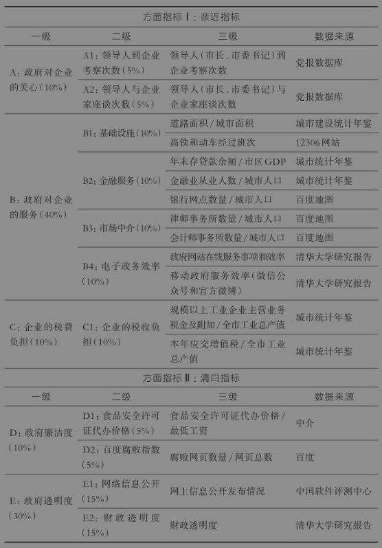

来源：聂辉华、韩冬临、马亮、张楠迪扬，2020，《中国城市政商关系排行榜2020》，中国人民大学国家发展与战略研究院报告

十八大之后，因为中央高度重视营商环境优化，因此很多机构推出了营商环境排行榜。不过，跟同类排行榜相比，人大课题组的城市政商关系报告具有以下四个鲜明的特色。第一，在研究对象上，人大报告是国内第一份专门反映政商关系的城市排行榜。如前所述，营商环境的定义非常广泛，市场环境、政务环境、文化环境，几乎无所不包。有人开玩笑说，现在“营商环境是个筐，什么都可以往里面装”。为了避免这个问题，人大报告聚焦于政府和企业之间的政商关系。因为政商关系是营商环境的核心内容，而且是短期内可以改进、地方官员可以有所作为的内容。据我们所知，这是全国唯一对城市层面的政商关系进行持续评价的报告。第二，在研究框架上，人大报告是第一份从“亲”和“清”两个方面对政商关系进行评价的报告。第三，在研究范围上，人大报告提供了全国地级市的政商关系细分指标，这也由此成为第一批地级市层面的制度环境指标。在此之前，学者们只能使用省级层面的制度环境数据，例如樊纲等人编撰的“市场化进程指数”（樊纲等，2011）。第四，在数据来源上，人大报告综合使用了官方数据、网络数据和企业调查数据，并且与全国工商联基于4万名企业主的营商环境调研结果吻合。

### 三、哪些地方营商环境更好？

#### 1. 城市营商环境排行榜

利用前面的政商关系指数评价体系和各种大样本数据，我们人大课题组对2017－2021年这五年期间大约290个地级以上城市的营商环境进行了评价，地级以上城市包括地级市、副省级城市和直辖市。为了剥离新冠疫情造成的不确定性的影响，我们先以2019年的数据为代表。然后，我们再根据2017－2021年这五年大样本数据，总结出城市营商环境的五个规律性特征。

首先，我们绘制了2019年中国292个城市的政商关系指数地图（图8-4）。在下面这幅地图上，每一个不规则的小图块表示一个城市，每个小图块的颜色越深，表示这个城市的政商关系指数越高，即营商环境越好。白色的部分表示该城市数据缺失，多数是西部少数民族自治地区，例如自治州、盟和行署，它们与普通的行政市不太一样，因此不影响我们的分析。政商关系指数地图显示了一个非常明显的特征：左边颜色浅，右边颜色深。然后，我再画一条线，从黑龙江的瑷珲（今天的黑河）连到云南的腾冲，这条线就是著名的“胡焕庸线”。如今，在胡焕庸线的东边，有大约43%的国土和94%的人口；在胡焕庸线的西边，有大约57%的国土和6%的人口。胡焕庸线可以看作中国东西部发展极不平衡的分界线。[^13]有趣的是，我们计算的城市政商关系指数也体现了类似的特点：91%的分值位于胡焕庸线的东边。这几年，很多人都在讨论中国南方和北方的经济差异。有趣的是，这个政商关系指数地图告诉我们：中国经济真正的区域差异不是南北差异，而是东西差异。

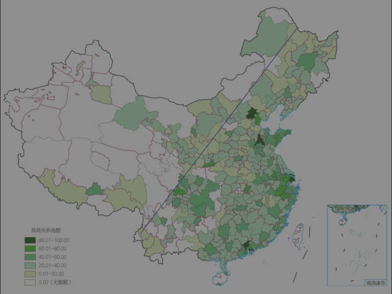

图8-4 中国城市政商关系指数地图（2019年）

从营商环境上看，投资真的不过山海关吗？其实，从政商关系指数地图上看，东北地区的颜色虽然没有东南沿海地区那么深（颜色越深，营商环境越好），但是跟中西部比并不算浅。因此，我们可以初步得到结论：山海关外的营商环境不是最差的。后面，我们还会进行区域比较。

其次，我们根据分值排列了2019年营商环境最好的20个城市名单（图8-5）。第一名是深圳，之后依次是北京、广州和上海，“北上广深”四个一线城市尽占前四名。第5名到第10名依次是：济南、东莞、珠海、青岛、无锡、厦门。大家看这个top 20榜单，几乎全是东部城市，西部城市只有一个西安。但是，如果区分南北，差异要小得多。这再次证明中国经济差异主要是东西差异，而不是南北差异。因此，要缩小中国地区差距，实现城市之间的均衡发展，起码要努力提高西部地区的基层治理水平。

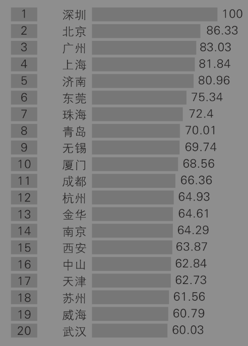

图8-5 2019年政商关系指数前20名城市

注：以第1名深圳作为基准（100）

再次，需要说明的是，任何主观评价都难免会有争议。毕竟，“一千个读者眼里就会有一千个哈姆雷特”。前面的内容都是基于人大课题组的城市政商关系指数分析，可能算是“孤证”。下面，我们用一个第三方的权威数据库进行交叉验证。在一次有民营企业家、媒体主管和管理咨询专家参与的学术研讨会上，我当面问大家，有什么指标能够比较靠谱地反映一个城市的营商环境？有一位民营企业家认为，最能反映营商环境的指标之一是风险投资的分布。因为风险投资对营商环境最敏感，进入、退出也比较容易，所以它们的选择在很大程度上反映了市场偏好，可谓“春江水暖鸭先知”。正好，我指导的一个硕士生周香芋就用了全国风险投资的数据完成了硕士学位论文（周香芋，2023）。

图8-6是2022年全国风险投资基金的投资金额空间分布，来自周香芋的硕士论文。该图显示，风险投资主要集中在京津冀、长三角和珠三角地区，这三个地方也是中国最重要的三个地区增长极。在中西部地区，风险投资主要集中在武汉、成都、重庆等直辖市或者副省级市。对比一下前面我提供的2019年中国城市政商关系指数地图，我们可以发现两者高度相似。再看东北地区，颜色还算比较深，这说明东北地区的营商环境其实并不比中西部地区更差。

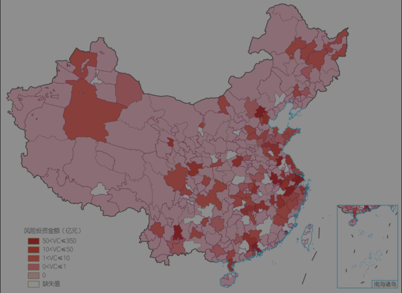

图8-6 2022年全国风险投资基金投资金额的空间分布

为了进一步考量“投资不过山海关”的观点，周香芋还描绘了2003－2020年东北地区的风险投资事件数和金额占全国的比例。图8-7显示，东北地区的风险投资事件数在全国的比例比较平稳。就风险投资金额而言，除了2004年和2008年这两年剧烈波动，东北地区的风险投资金额在全国的比例一直维持在2%－4%。2022年东北三省GDP总量为5.8万亿元，占全国GDP121万亿的比例为4.78%。总体上，GDP的占比和风险投资金额的占比相差不大，说明风险投资对东北三省并不存在明显的地域歧视。总之，近20年来，东北地区的风险投资水平没有明显的变化，营商环境也没有明显的恶化。

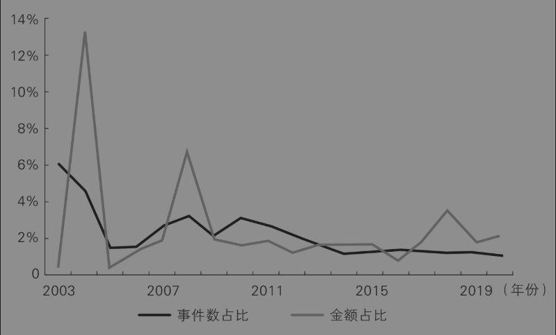

图8-7 2003－2020年东北地区风险投资事件数和金额占比

#### 2. 中国城市营商环境变迁规律

为了更好地从总体上把握中国城市营商环境的变化特征，下面我们使用2017－2021年大约290个地级城市的政商关系指数进行五个方面的分析。

第一，从排名前列的城市名单来看，“优胜俱乐部”效应逐渐显现，前10名的城市名单变动很小。表8-2显示了五年间每年政商关系指数最高的10个城市，它们代表营商环境方面的第一方阵。可以看到，除了2021年，每一年北上广深都名列前十，地位稳如泰山。2021年是新冠疫情影响的第二年，一线城市在“外防输入”方面压力更大，在维护政商关系方面成本更高。相反，一些二线城市反而可以轻装上阵，加强政商关系。可见，“危机危机，危中有机”。正如英国前首相丘吉尔的一句名言：永远不要浪费每一次危机。对城市政府和基层政府来说，改善营商环境和构建亲清政商关系，同样如此。

表8-2 2017－2021年营商环境前10名城市名单

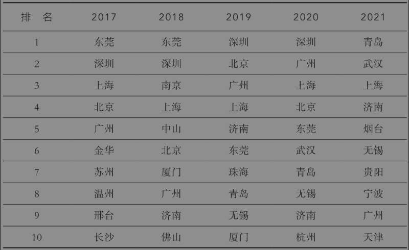

我们还进一步计算了每年前20名城市名单之间的相关性。除了2017年，2018－2021年的前20名名单可以说是高度相关，相关系数最高达到了94.6%，最低也高达84%。这意味着，在营商环境方面，其他城市要想挤进“优胜俱乐部”，不敢说“难于上青天”，但肯定是“道阻且长”。

第二，从行政级别来看，高级别城市对低级别城市的优势是全面的、压倒性的。而且，高级别城市与普通地级市的差距还在扩大。图8-8显示，在所有年份，直辖市的政商关系指数得分都是最高的，其次是副省级城市，然后是省会城市（不含副省级城市），最后垫底的永远都是普通地级市。这再次证明了我在本书中多次强调的一个道理：中国的城市是一个等级体系，级别越高，权力越大，资源越多。这也从一个侧面反映了基层治理面临的严峻环境，即如何应对高级别城市、高层治理的压倒性优势。

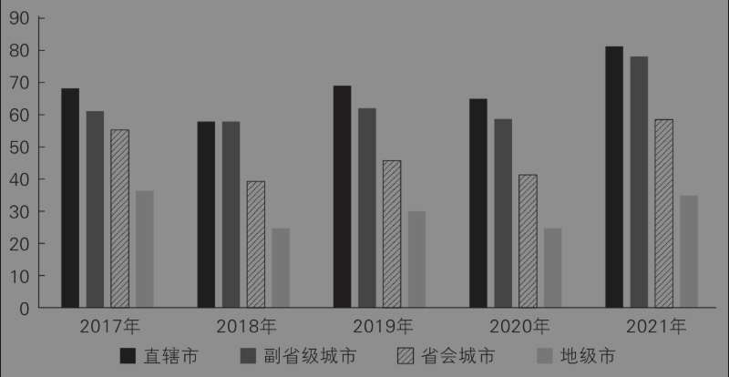

图8-8 2017－2021年不同等级城市的政商关系指数比较

第三，从省份来看，直辖市优势明显，此外，浙江、山东名列前茅，中西部和东北地区的一些省份排名靠后。图8-9显示，上海高居榜首，并且前三名都是直辖市。省份排行榜的最后五名，主要是中西部省份。套用作家托尔斯泰的一句话：营商环境好的地方都是类似的，不好的地方各有各的缺点。

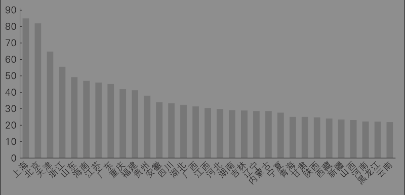

图8-9 2017－2021年各省（区、市）政商关系指数均值

第四，从区域来看，华东地区稳居第一，其次是华北和华南地区，东北地区有所下降，西南和西北地区殿后。图8-10表明，除了华东地区独占鳌头，其实东北地区和华中、西南及西北地区都差不多，甚至东北地区在前几年还稍好一些。

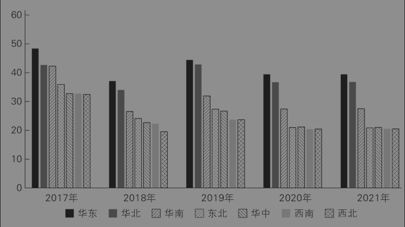

图8-10 2017－2021年区域政商关系指数比较

第五，从影响因素来看，城市政商关系指数和地区经济发展水平高度相关。我们构建了2017－2021年中国城市政商关系指数的面板数据，然后进行了基于最小二乘法的计量经济学回归，并发现政商关系指数与人均GDP、人口增长率、消费水平、企业数量和服务业比例显著正相关，与农业比例、财政供养人口比例显著负相关。可见，营商环境好的城市都是经济比较发达、城市化水平比较高的地区，而营商环境相对不理想的城市大多是经济不太发达、城市化水平低以及打破头都想考“编制”的地区。这对于基层治理的启示是，要改善本地的营商环境，就要努力增加人口数量，提供优质的公共服务，并吸引更多企业投资或者鼓励创业活动。

## 思考题

1. 你觉得应该如何稳定边疆城市的人口？

2. 你是否同意放开北京、上海、广州这样的“超大城市”的落户限制，理由是什么？

3. 你觉得有什么公开指标可以度量一个地方的“清白”程度？

## 注释

[^1]: 传统的产品周期理论是弗农（Raymond Vernon）提出的。哈佛大学经济学教授波尔·安特拉斯（Pol Antràs）从不完全契约理论的角度，为这种新型的产品周期理论提供了一个解释（Antràs，2005）。

[^2]: 这篇文章1984年在《瞭望周刊》第2期至第5期连载（费孝通，1984）。

[^3]: 拉文斯坦以《迁移定律》为题，先后发表了两篇重要的同名论文，其主要观点可以概括为“人口迁移的七大定律”（安介生，2014）：一是距离律，即移民的总数随着迁移距离的延长而递减；二是递补律，即移民潮是阶梯式出现的，第一批移民先进入商业与工业中心，然后更远的移民填补之前移民的空白；三是双向律，即对于某一特定区域而言，迁出与迁入总是相对进行的；四是城乡律，即与乡村居民相比，城镇居民更少移动性；五是性别律，即女性移民在短途迁移中数量更多，然而参与较长距离迁移的妇女数量不及男子；六是经济律，即大多数移民的发生都是出于经济方面的因素；七是技术促进律，即经济与交通的发展都会刺激移民的增加。

[^4]: 张克中和陶东杰（2016）利用2001－2012年地级市的面板数据，发现高铁开通不仅没有给沿线城市带来好处，反而使它们的人均GDP增长率降低1.5%。并且，与区域中心城市（一般就是大城市）距离越近的沿途地级市，受到的高铁“虹吸效应”越强。

[^5]: 研究者基于2010－2018年的调查数据发现，中国城市房价每上涨10万元，妇女生育率就下降14%（Liu et al.，2023）。而且，基于全球跨国数据的样本也证明了房价和生育率之间的负相关关系（Li，2024）。

[^6]: 陆铭（2022）同样强调了行政城市和城市体系的区分，并在进一步阐发城市首位度时引入了都市圈的概念（第116页）。

[^7]: 相关的论证细节，可参考我们的文章（江艇等，2018；聂辉华，2018）。

[^8]: 哈佛商学院教授、竞争战略之父迈克尔·波特（Michael Porter）在其名著《竞争战略》（2014）一书中指出，最重要的竞争战略其实就是两种：成本领先战略、差异化战略。差异化会赋予产品一定的市场势力，因此可以提高价格。他提到的第三种战略“聚焦”，在一定程度上与前两者是交叉的，因为不是一个维度。

[^9]: 关于不完全契约理论，除了前文已提及的哈特（2006），还可参见杨瑞龙和聂辉华（2006）。

[^10]: 《文旅项目“先上车，后买票”，民企老板被判非法采矿罪》，《南方周末》，2023年8月16日。

[^11]: 我曾询问该案的辩护律师，得知二审时减刑了9个月。

[^12]: 中国城市政商关系指数将持续更新。感兴趣的读者可以从我的个人网站“白鲨在线”（http://www.niehuihua.com）上找到自2017年以来的公开数据，或者通过该网站的链接申请可公开的数据。

[^13]: 关于胡焕庸线的早期研究，可参考胡焕庸（1990）；关于胡焕庸线后期的特征事实，可参考李佳洺等（2017）。
