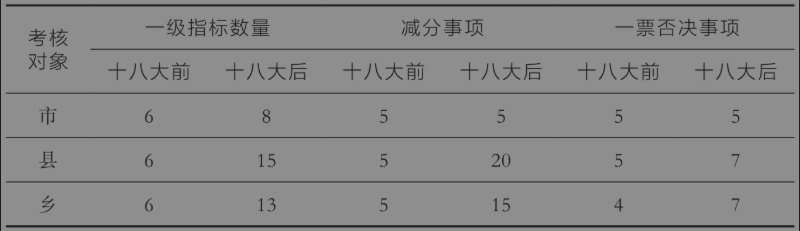
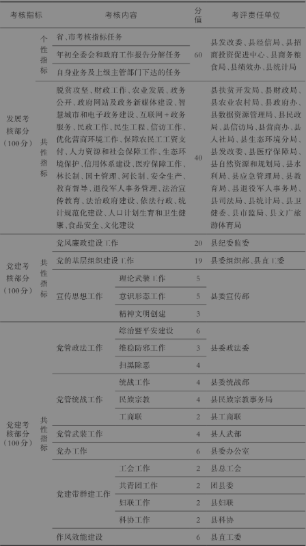
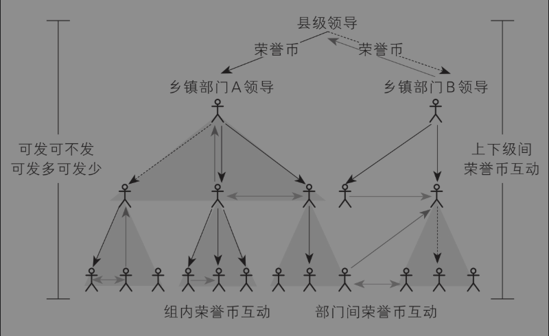

# 第六章 基层公务员的激励

<!-- 按来源截图6-1.png、6-2.png顺序整理；阅读器导航与装饰线已省略；正文恢复为可复制文本；2张表格与1幅示意图保留原图并存于img目录；15条注释恢复为Markdown脚注；原始截图备存于本书“原始图片”目录。 -->

在任何科层组织中，信息不对称都是管理者面对的基本难题。对国家治理而言，由于上级不可能掌握下级的所有信息，因此必须激励下级努力工作。最主要的激励手段无非是两种：物质报酬和政治晋升。由于薪酬水平通常由当地的经济发展水平决定，因此同一个地方、同一个单位的干部在物质报酬方面差异不是很大，真正的差异在于晋升，即如何不断提高行政级别。并且，行政级别的晋升通常会伴随物质报酬的提高。可见，只有抓住了“官帽子”，才算是抓住了干部激励的“牛鼻子”；只有理解了干部的晋升逻辑，才能理解基层治理。为此，本章将从激励的角度讨论基层治理之策。

在第二章第三节，我们讨论官员晋升时，主要的样本是地市级以上领导干部，属于“政治精英”。然而，广大乡镇干部才是基层治理的主体，可惜很少有学者研究乡镇干部的晋升。为此，本章第一节聚焦乡镇公务员的升迁之路，并与中央部委和区县的公务员进行对比。晋升作为一种激励手段，除了为广大干部提供动力，还要确保晋升过程公平、公正和公开，这就离不开干部考核。第二节介绍基层干部的考核问题，重点是十八大前后考核指标的变化及其原因，同时我们还将讨论“一票否决”这种独特的考核指标所带来的影响。第三节分析数字时代的基层治理，重点是讨论数字技术是否可以替代激励手段，它将给基层治理和干部考核带来怎样的新变化以及新问题。

## 第一节 乡镇公务员的曲折升迁之路

### 一、一次饭局引发的感慨

几年前，我到一个南方乡镇调研营商环境问题。调研结束，镇党委H书记请我们吃了顿饭。在饭桌上，H书记感慨地说：“教授啊，还是你们中央单位好啊。”我连忙问：“哪里好？”他接着说：“你看啊，一个研究生如果到我们这个小乡镇工作，好不容易当了一个副乡长，然后才能当党委委员，接着才能当党委副书记，但是级别还是原地踏步。这样一辈子到头，最多也就熬个副处级退休了。但如果他去了中央部委，七八年就可以升副处级。那聂教授你说说，这公平不公平？”我听完有点吃惊，乡镇公务员升迁这么困难吗？中央部委是不是这么容易呢？

调研回北京之后，我找了几位乡镇干部和部委干部做了一些访谈，也查阅了一些文件资料。结合本人这些年对官员晋升以及相关的政治经济学论文的理解，我给大家谈谈我对这个问题的思考：乡镇公务员是不是面临不公平的升迁前景？

### 二、乡镇和中央公务员的升迁之路

为了方便对比乡镇公务员和部委公务员的职业前景，我们以一个应届硕士毕业生为例。如果一个硕士生通过公务员考试进入乡镇，能力突出、各方面顺风顺水，而且一步都不耽误的话，他的升迁路径大概是这样的：

硕士毕业（一年试用期）→普通科员（两年）→副乡长（三年）→乡长（三年）→乡党委书记或部门长（两任，六年）[^1]→副县长（副处级）。

按照上述升迁路径，一个研究生通过地方公务员考试进入乡镇工作，快的话15年可以升到副处级。不过，这是按“一步都不耽搁”的速度计算的。实际情况是，我认识不少县乡公务员，能在15年内从乡镇升到副处级领导的，可以说几乎没有。调整设定再来看，如果一个乡镇公务员能力不突出、没有任何特殊背景，并且运气一般，那么他的升迁路径很可能就是这样的：

硕士毕业（一年试用期）→普通科员（若干年）→副乡长（若干年）→乡党委委员（若干年）→乡党委副书记（若干年）→人大主席（若干年）→乡长（若干年）→乡党委书记或普通局长（若干年）→财政局局长或发改委主任（若干年）→工业园区主任或副县长（副处级）。

要是按照上述升迁路径，那么一个普通乡镇公务员从25岁进入官场，每一级算三年的话，大概要花25年，等到50来岁终于熬到副处级了，那时又要退居二线了，所以副处级就是他们职业升迁的“天花板”了。事实上，这应该是多数乡镇公务员的职业路径。

接下来，看看一个研究生在中央部委的升迁路径。如果他能力突出、各方面也顺风顺水，而且一步都不耽误的话，他的升迁路径很可能是这样的：

硕士毕业（一年试用期）→副主任科员（相当于副乡长，三年）→主任科员（相当于乡长，三年）→副处级（副处长或调研员）。

按这个路径，一个硕士研究生在中央部委升到副处级最快要7年时间。[^2]根据我对部委公务员的了解，这个升迁速度是比较普遍的。当然，以上是常态，不考虑破格提拔、特殊原因提拔（例如竞聘、少数民族或者民主党派身份的晋升）。

那么问题来了：同样是升到副处级，为什么一个乡镇公务员至少需要15年，通常需要25年甚至是一辈子，而一个部委公务员却只要七八年呢？这是因为，个人升迁的空间取决于职级的上限，而职级上限又取决于工作机构的行政级别。本书第二章第二节《中国官员的行政等级》指出，中国的机构级别和行政辖区的级别是对应的。中央部委通常是省部级机构，本身级别很高，个人升迁空间自然很大；而乡镇通常是科级机构，县通常是正处级机构，因此个人升迁就很容易触及“天花板”。

而且，当工作机构级别很低，人数又多时，领导为了让大家都有“奔头”，就会人为地拉长升迁的链条。一个办法是设置各种“隐性台阶”，美其名曰“重用”。正如开头提到的乡镇党委书记H的话，从副乡长到乡党委委员再到乡党委副书记，看上去“进步”了两次，但其实都是副科级，只不过实权更大了一点，或者说“职务含权量”[^3]提高了一点点。我认识一个乡镇公务员朋友C，他是先当副乡长，接着当乡纪委书记，然后换一个乡当人大主席。从他2000年开始参加工作算起，20多年过去了，真的只升了一级。

### 三、各有利弊的选择

通过上面的对比，我们得到一个基本结论：乡镇公务员比部委公务员升迁更慢。那么，这是否对乡镇公务员来说不公平呢？如果你问乡镇公务员，他们肯定会说这当然不公平。但如果你问部委公务员，他们会反问：如果你觉得部委公务员更好，当初为什么不参加国考呢？

其实，乡镇公务员和部委公务员各有利弊，每个人需要根据自己的情况去权衡取舍，并非像表面上看到的那样不公平。如果一个研究生选择担任乡镇公务员，特点是：进入门槛低，竞争少，升迁慢，可以说是“前高后低”；如果选择部委公务员，特点是：进入门槛高，竞争激烈，升迁快，可以说是“前低后高”。毕竟，参加“国考”是在跟全国考生竞争，而参加“省考”，竞争者就少多了。至于副处级以后的升迁，究竟是地方更快还是部委更快，目前尚无定论，也缺乏这方面的实证研究。

上述对比是有数据支持的。第一，乡镇公务员录取分数线更低。已有数据表明，在全省组织的公务员考试中，省直单位岗位分数线最高，市直单位和主城区区直单位其次，县直单位又次，乡镇最低。第二，乡镇公务员报名限制条件更少。省直、市直乃至县直机关大多会在学历（例如研究生）、专业、政治面貌、工作经验上设置较多限制性条件，而乡镇岗位限制性条件很少。第三，乡镇公务员相对于省市公务员来说，可能前期升迁更快。我们前面讨论过，一个单位的升迁受到领导职数比例的限制。在很多省市机关，领导职数和非领导职数严重倒挂，导致领导比兵还多，反而升迁更慢。比如某个省直部门，一个处有处长一个，副处长两个，处级调研员一个，副调研员一个，真正干活的兵（科员）就只有两个人。这种情况下，就算科员劳苦功高，领导想提拔他们也难，因为不可能一个单位都是领导。而乡镇的普通公务员较多，分母足够大，因此第一步升副科级一般比较快。

在一次学者访谈中，一位乡镇公务员就坦言：想进体制，不能挑岗位，最好先在乡镇“上岸”，然后再慢慢努力。有了稳定工作，生活能安定下来，买房结婚生孩子。工作不稳定，想相亲，中间人都不好给介绍对象。[^4]这说明，报考乡镇公务员岗位其实是一种非常理性的选择。经济学的精髓是，每个人都是在约束条件下作出最优选择。因此，不管是乡镇公务员还是部委公务员，只要能发挥自己的专长，能实现自我满足，每个人的选择都是最优的，没有必要横向对比。

这些年，伴随城镇化进程的不断加快，城乡差距实际上有所扩大。相对而言，城市工作岗位带来的各种社会福利比乡镇更多了，这体现在子女入学、老人就医以及生活便利等多个方面。这种城乡巨变对基层公务员队伍带来了巨大的冲击，导致更多的乡镇公务员想进城或回城，而想下乡的公务员就更少了。例如，河北省某地市报名参加2021年向上交流的乡镇干部有1000多人，而参加向下交流的省直、市直干部仅9人，而且9人中有8人是领导子女，剩下1人是某市领导的秘书。[^5]如果城乡差距小，或者说竞争导致城里公务员和乡镇公务员的“净收益”相等，那么理论上，参加向上、向下交流的人数应该差不多，但是，实际上组织部门每年都无法完成上下交流的工作任务。为了解决上下不平衡的问题，组织部门不得不出台向下倾斜的政策，从最初的“同级别上下交流”，修改为“向上交流降半级，向下交流升半级”。比如，某人在市局是普通科员，如果愿意去乡镇，可以直接提拔为副科实职，担任副乡镇长。这种倾斜政策的效果如何，是否会对已有的乡镇公务员晋升带来负面冲击，恐怕还有待观察。

但是，即便将来城乡差距很小了，地方公务员和中央公务员的待遇、晋升路径也不可能完全趋同。这是因为中央和地方的治理结构不同，治理任务不同，对人才的选拔当然也就不同。我在日本访问时，曾经问过一位国会议员，日本人考公务员时是不是也倾向于中央公务员？他回答说，的确如此。日本有公务员分级制度。一个人如果一开始考取了地方公务员，那么他就只能一直在地方公务员系统里升迁，不可能跳跃到国家公务员系统，而且国家公务员系统待遇更好。如果想去中央工作，就必须重新考取国家公务员。因为待遇、职位都是公开信息，制度也很稳定，所以他认为这不是不公平。我告诉他，中国的公务员系统不存在严格的中央和地方公务员之分，中央公务员可以下到基层，基层公务员也可以通过遴选上调到中央。他表示很吃惊，因为这种人才流动在日本是很罕见的。

## 第二节 干部考核指标越多越好吗？

对于任何组织而言，管理或者治理的目的都是让组织的全体成员为了一个共同目标，就是所谓的远景或使命而努力奋斗。那么，怎么保证所有成员都努力呢？一种最重要的手段就是进行绩效考核。在中国古代的国家治理过程中，官员也是要考核的。例如，在明朝时期，京官每六年“京察”一次，地方官每三年“大计”一次。也就是说，在京城的官员每六年考核一次，地方官每三年考核一次。但是，当时的首辅张居正觉得吏治腐败，考核流于形式，于是提出了“考成法”。张居正的做法是：六部和都察院把官员应办的事情登记在账簿上，并且要逐月检查，最后将结果抄送六科和内阁，未完成任务的官员，降级或者撤职。在张居正担任首辅的十年里，他凭借“考成法”撤换了30%的不称职官吏。可惜的是，他死后，万历皇帝将“考成法”废除，可谓“人亡政息”。

本节将讨论当代中国的基层干部考核，主要涉及三个问题。第一个问题是，改革开放以来，中央都是怎么考核干部的？特别是，十八大之后，中央对干部的考核有什么新要求、新理念？第二个问题是，很多基层干部反映，干部考核指标中“一票否决”的指标越来越多了。这是为什么呢？第三个问题是，如何科学地看待当前的干部考核制度？现在的干部考核制度是不是还有进一步改革创新的空间呢？

### 一、干部考核体系有什么变化？

我们先来梳理一下改革开放之后，不同层级干部考核制度的变迁。在第二章第三节，我提到了“官员晋升锦标赛”的观点。该观点认为，官员发展经济的绩效影响了官员晋升。但是这个观点引起了很多质疑。例如，现任教于香港中文大学（深圳）的陶然教授认为，其实中国并没有这样一套针对官员个人的考核体系。他认为，20世纪80年代后期，部分市和县出现过对地方党政领导班子的考核方法，但不是对个人的考核方法。到了90年代中期，“地方党政领导班子综合目标责任制考核”才开始逐渐推广，这种考核方法直到21世纪初期才在全国范围内推广。

为了考察干部考核体系的变化，有必要梳理一下相关政策。首先，根据有据可查的中央文件，1998年中组部第一次制定了《党政领导干部考核工作暂行规定》（中组发〔1998〕6号）。这个暂行规定提出了比较抽象的考核原则，并没有具体指标。直至2006年，中组部才发布了《体现科学发展观要求的地方党政领导班子和领导干部综合考核评价试行办法》（中组发〔2006〕14号）。这个文件明确提出了干部考核的“德、能、勤、绩、廉”五个原则。2009年，中组部更新了考核办法，又发布了《地方党政领导班子和领导干部综合考核评价办法（试行）》（中组发〔2009〕13号），提到了一个新词“实绩分析”。地方党政领导班子和领导干部的实绩分析主要包括经济发展水平、经济发展综合效益和城乡居民收入等十几个可以量化的指标。相对于前面提到的抽象原则，这次算是做实了经济发展方面的指标。

十八大之后，中国特色社会主义进入了新时代。2019年4月，中共中央办公厅印发了《党政领导干部考核工作条例》（以下简称《条例》），对干部考核方式进行了多个方面的改革。与十八大之前的考核规则相比，我认为至少有四个方面的变化。

（1）在考核方式上，十八大之后《条例》包括平时考核、年度考核、专项考核、任期考核。四种考核方式中，除了专项考核，其他三种考核都是顾名思义的。所谓专项考核，是指对领导班子和领导干部在完成重要专项工作、承担急难险重任务、应对和处置重大突发事件中的工作态度、担当精神、作用发挥、实际成效等情况所进行的针对性考核。在十八大之前，基本上只有任期考核或者换届考核，十八大之后考核频率更高了。

（2）在考核标准上，《条例》明确“坚持把政治标准放在首位”。也就是说，讲政治是第一位的，而过去没有这么突出。

（3）在考核内容上，《条例》强调要突出考核贯彻党中央重大决策部署，统筹推进“五位一体”总体布局和协调推进“四个全面”战略布局、贯彻落实新发展理念的实际成效。这就是说，十八大之后的考核更加看重党政领导干部对中央精神的理解和对中央的政治忠诚。

（4）在考核原则上，《条例》列出的第一条就是“党管干部”，然后才是道德和业绩原则。这也跟十八大之前不同，并且有心人会看出差别很明显。一句话来概括：过去更看重政绩，现在更看重政治。“政绩”和“政治”虽然只有一字之差，但是含义高度不同。

中央层面的考核制度变化，必然导致地方层面考核制度的相应变化。在地方，针对领导干部的考核可以分为两类：一类是针对地区的，包括市、县和乡这些“块块”；另一类是针对职能部门的，包括党委和政府下属的委办局，它们属于“条条”。为了进行前后对比，我特意选择了某个省及其下属市、县在十八大前后发布的考核规定，这些考核规定对应的考核对象是市、县、乡镇或街道这些“块块”，考核名称是所谓的“综合目标绩效考核”。然后，我们将对比结果简要概括如下（表6-1）。这个对比揭示了以下信息。第一，从考核的一级指标上看，十八大之后明显增多，特别是对县和对乡的考核指标，数量都翻倍了。第二，减分事项增多了，或者说负面激励事项更多了。第三，一票否决事项更多了。所谓“一票否决”事项，就是只要某个方面出现了问题，那么其他方面干得再好也属于不合格。例如，一个单位只要出现了群体性上访事件，那么当年该单位就被取消评优资格。总体上看，十八大之后考核更规范、更严格、更全面。

表6-1 十八大前后基层考核对比

为了帮助大家更直观地了解基层干部考核制度，下面我以中部地区某县《2020年综合目标管理绩效考核评价实施办法》为例，进行详细解读。之所以选择中部地区该县，是因为该县具有代表性，不是很穷，也不是很富，而且正如我之前说的，县是中国最完整的基层单位，具有“解剖麻雀”的价值。从内容上看，在我看过的几十上百份各级政府的考核规定中，我认为它颇具代表性。表6-2是该县对经济开发区（相当于乡镇级别）的考核指标评价体系全貌。

表6-22020 年某县开发区综合目标管理绩效考核指标评价体系

说明：开发区发展与党建共性指标考核评价与乡镇考核同步进行，考核细则相同

一个完整的考核文件，通常包括如下基本要素：

（1）考核的领导机构。肯定是党委和政府，在县一级就是县委和县政府。具体工作由一个绩效考核工作领导小组负责，日常工作由小组下面的“考核办”负责，有的地方叫“绩效办”。

（2）考核对象。县一级文件的考核对象包括各乡镇、开发区和县直单位，但不包括学校和医院。注意，这里不是针对干部个人进行考核，而是对工作单位进行考核，但是它跟每个干部密切相关。有意思的是，上面这个文件还进一步区分一类、二类和三类乡镇，并针对不同类型的乡镇制定了不同的考核指标。

（3）考核内容。在十八大之前，主要考核经济社会发展，特别是财政收入和招商引资工作。例如，我手里有一份某地2009年度乡镇经济发展目标考评方案的实施细则。满分是100分，其中招商引资占27分，财政收入占25分，农业农村工作占23分，在剩余赋分中，农村基层党建工作只占5分。但是，再看十八大之后该地的考核文件，发现考核内容分成了发展考核、党建考核两个部分，每个部分各占100分，或者各占50%的权重。跟过去党建只占很少部分相比，确实突出了“讲政治”的新特征。

（4）考核指标的依据。这份文件说得很清楚，首先是省、市下达的年度目标任务，然后是本县的重点工作，再次是市直部门下达的分解指标和县直部门的主要职责，最后是省、市、县的临时性重大任务。

（5）考核结果。根据考核得分，分为优秀、良好、一般、较差四个等级。那么，考核优秀有什么好处呢？第一，单位有奖金，并且等级越高，奖金越高，这就让本单位每个人都有好处和动力；第二，考评结果为优秀的单位，其党政主要负责人（也就是两个“一把手”）的个人年度考核自动评为优秀；第三，连续三年考评结果为优秀的单位，党政“一把手”可以优先推荐提拔或重用。总而言之，针对基层干部的考核，是“胡萝卜”和“大棒”混搭。用苏州一任市委书记的话来说，就是“把考核结果与干部的帽子、票子、板子挂钩”。[^6]帽子、票子、板子，“一个都不能少”，这就是中国官员激励的密码。

### 二、为什么“一票否决”指标越来越多？

在面向基层的考核文件中，我注意到一个值得重视的现象，不仅指标越来越多，而且“一票否决”的指标越来越多。毫无疑问，“一票否决”的威力很大。不管你工作干得多好，只要触动了“一票否决”事项，毫无商量。问题是，“一票否决”指标那么多，真的有利于实现考核目标吗？真的有利于调动干部的工作积极性吗？下面我们就分析一下这个问题。

仍以县委、县政府的考核文件为例，其考核对象是乡镇、街道和县直部门。在21世纪初，被列入“一票否决”的事项一般是如下五项：党风廉政建设、社会稳定、安全生产、环境保护、人口和计划生育。这些被列入“一票否决”的事项，除了党风廉政建设是政治底线之外，其他四项无一不是当时的重点工作，特别是我们前面多次谈到的社会稳定和安全生产，有些地方现在合称“安全维稳”。至于计划生育，那基本上是乡镇工作的两件头等大事之一，另一件是收农业税，这个之前提到了。

但是，近年来一票否决事项总体上越来越多了，有些地方已经远远超过了五项。例如，下方的专栏记录了某县现行目标责任综合考核“一票否决”的范围。

粗略看这里“一票否决”指标是六项，但实际上远不止六项，因为第一项对应的情况就可能包含很多种。例如，脱贫攻坚没完成任务，环保督察发现了问题，卫生防疫出现了纰漏，都属于“贯彻落实党中央重大决策部署不力”的情况，都要“一票否决”。第二项是说单位领导或员工被调查，这种事情根本就是防不胜防。单位的领导或者同事是否被调查，完全是一种外生冲击，这不是个人能力决定的。全面从严治党，强调“反腐永远在路上”。前文提到一个县级市连续五任书记被抓，读到报道时我以为这是“黑天鹅”现象，结果一查，发现连续多任领导被查并非孤例。这种情况对个人来说就属于不确定性事件了。上面六项中的最后两项，其实都跟舆情有关。在第五章第二节《乡镇党委书记的挑战》里，我们提到了乡镇党委书记要熟悉舆情导控。现在，任何一件事情，先不管对错，一旦引发了重大舆情，都会引起上级的严重关切，对今天的干部来说，“网络无小事”。

#### 专栏 某县“一票否决”的否决指标

> **一、党风廉政建设“一票否决”的条件**

> 1. 贯彻落实党中央重大决策部署不力，造成严重不良影响，受到上级通报批评的。

> 2. 党委履行党风廉政建设主体责任不到位，推进全面从严治党不力，单位领导班子有3名及以上，或单位职工（含领导干部）总人数30人以下的有15%以上（含15%）、总人数30人以上的有5人以上（含5人）因违纪违法问题，当年受到立案审查调查，或受到党纪政务处分的。

> 3. 党风廉政建设考核评为“较差”等次的。

> **二、安全生产**

> 1. 发生1起以上较大及以上生产安全责任事故的。

> 2. 瞒报生产安全事故社会影响恶劣的。

> 3. 重大安全隐患整改不力造成严重后果的。

前面的例子虽然表明“一票否决”事项比较多，但说起来也都在情理之中。在调研过程中，我发现比较“奇葩”的是，一些地方居然把“食品药品安全”“森林防火”“秸秆禁烧”和“统计造假”也都列入了“一票否决”事项。我估计，这可能跟地域特点有关。比如，河北对燃烧秸秆抓得比较紧，因为北京周围的空气质量比较受关注。

关键问题是，为什么考核的指标越来越多，“一票否决”的指标也越来越多呢？我的解释是，在一个“条块结合，以块为主”的治理架构下，考核指标是不同的行政单位为了争夺“注意力分配”，以便获得更多的控制权收益的必然结果。

首先，在一个自上而下的权力科层中，考核就是指挥棒。抓住了考核，就抓住了对下级单位的控制权，本部门的工作就有了抓手。而且，本部门也从具体的工作落实部门变成了督查部门，实现压力向下传导，指标向下分解。因此，每个部门都希望自己的工作被纳入党委和政府的综合考核范围。其次，党委和政府主要领导的注意力是有限的，不可能每件事都关注，更不可能把所有资源平均分配到每件事情上。因此，各个部门，尤其是职能部门，本来对下级单位就只有“指导”权，没有“领导”权，就更是希望将本部门的工作纳入党政主要领导的“法眼”。一旦本部门工作纳入了考核指标，有了考核指挥棒，像市农业农村局、教育局这样的职能部门在县农业农村局、教育局眼里就从“指导”地位变成了“领导”地位。过去，县乡的主要工作是抓经济社会发展；现在，中央强调全面从严治党，要讲政治，因此相关的职能部门，包括条管单位，例如纪检监察，相对地位大大提升，在地方党政领导面前的话语权也相对提高，这就导致更多职能部门的工作业绩被地方党委政府纳入综合考核范围。再次，考核指标纳入考核范围之后，强势的部门会凭借自己的政治地位和个人能力，进一步把本部门的业绩从一般的考核指标上升为“一票否决”指标，这样下级单位在诸多指标中就会优先考虑这些指标。例如，中部某县的综合目标绩效考核办法规定：实行人口和计划生育、社会治安综合治理、环境保护和节能减排、安全生产和重大安全生产事故风险、党风廉政建设、扶贫开发“一票否决”。县卫健委、县综治办、县环保局、县发改委、县应急管理局、县纪委监委、县扶贫办于2019年3月底前向县考核办提供“一票否决”情况。可见，负责“一票否决”考核的，全是县级职能部门。对乡镇来说，它们相当于手握“尚方宝剑”的钦差大臣，可万万得罪不起。

最后，还有一个现象，就是某些指标一旦纳入了考核范围，想减下来就难了。毕竟，存在既得利益的情况下，做减法是得罪人的。这么看来，考核指标居然也有“棘轮效应”。因此，这些年考核指标越来越多，“一票否决”指标也越来越多。

### 三、对干部考核制度的反思

最后，我们来探讨一下，现在的干部考核制度还有进一步改革创新的空间吗？答案当然是肯定的。如果有，应该从哪些方面进一步改革呢？

第一，干部考核不是“一考就灵”，不是所有工作都适合考核。使用考核最多、最频繁的单位，应该是企业。但即便在企业里，也不是所有指标都适合考核，比如以下几种情况。第一种，有些指标天然存在滞后性，当期无法体现业绩。例如，对药物企业来说，一种新药的研发平均要耗费七年时间才能成功。上级显然不能等七年后再来考核，也不可能预测七年后的业绩。第二种，有些指标是隐性的，难以量化。比如员工忠诚度，企业好的时候，连老板都会说“企业是你家，兴旺靠大家”；一旦企业要裁员了，老板会让你“毕业”“优化”。第三种，个人的业绩往往和大环境以及所在团队等外部因素密切相关，想在考核中分离出来，识别因果关系，其实非常困难。上面三种情况，政府部门同样存在：对应第一种情况，脱贫攻坚的投入不是短期内能见效的；对应第二种情况，政治忠诚至关重要，但很难量化；对应第三种情况，前面提到了一些地方将本单位被查处人数的比例纳入“一票否决”，这个根本就超出了个人能力范围。

除了前面提到的三点，2014年诺贝尔经济学奖得主、法国经济学家让·梯若尔（Jean Tirole）在一篇经典论文（Tirole，1994）中指出，政府不同于企业，它还有三个地方比较特殊。第一是它天然面对多目标管理，而不是像企业那样只追求利润最大化，因此很容易导致目标冲突。中国的地方政府是实行“政治承包制”，从经济增长到社会稳定，从解决就业到推动创新，几乎无所不包。然而，有些目标在考核指标体系中是相互冲突的。比如，一方面鼓励大胆创新，另一方面又对负面事件实行“一票否决”，这会让官员进退维谷。第二是它缺乏竞争，很难找到合适的对照组。一个县有十个乡镇，但十个乡镇的地理位置、资源禀赋可能差异很大，能否用一把尺子度量所有乡镇呢？但如果一事一议，又缺乏比较。第三是它要面对不同服务对象的不同偏好。举个例子，各地都在力推电子政务，甚至连12345市长热线都改为人工智能了，以为这样就更先进。但是，老年人可能因为不太习惯，成为数字时代的弱势群体。

第二，考核本身也有成本，而且成本还非常高。经济学原理告诉我们，任何事情都要考虑成本与收益。因此，应该尽量减少考核成本，避免得不偿失。首先，频繁的考核明显地增加了基层负担。有学者在调研中发现，某个乡镇不仅每天都要接待两三拨督查，而且都要乡镇一把手亲自接待，其中有两天接待了三批县纪委不同工作的督导检查。其次，考核指标过多会使得下级工作缺乏主次，难以聚焦。马克思主义主张“抓主要矛盾，抓矛盾的主要方面”。但是，在庞大的考核体系下，县乡基层工作不再像过去那样有明确的主次、轻重、缓急之分，一定程度上是在穷于应付。再次，基层干部疲于奔命，损害身心健康。因为考核项目增多，分值又相差不大，所以乡镇只好“分秒必争”，恨不得针对每个考核指标都建一个微信群，以至于有的乡镇工作人员光是考核的工作群就加了几十个。每个群都要频频通报进展，而且动辄“@”主要领导，让基层工作人员疲于奔命，连固定的休息时间都没了。

第三，“一票否决”指标应该越少越好。均为诺贝尔经济学奖得主的霍尔姆斯特伦（Bengt Holmstrom）和米尔格罗姆（Paul Milgrom）提出了一个多任务代理模型（Holmstrom and Milgrom，1991）。主要的洞见是，如果一个当事人同时承担了两项任务，那么对任务A的“一票否决”，会导致对任务B的努力完全作废，这造成了巨大的负外部性。因此，一旦任务A存在较大的不确定性，那么当事人对任务B就可能放弃努力，或者只维持最低水平。简单地说，就是会导致顾此失彼。理论上，在一般的效用函数假设下，“一票否决”政策几乎不可能是最优的解决方案。因此，“一票否决”指标，应该越少越好，越精炼越好。

## 第三节 数字时代的基层治理

在自上而下的等级体系下，上级（委托人）对下级（代理人）发出工作指令，但上级不可能随时监督下级的工作，因此上下级之间一定会存在某种程度的信息不对称。这个问题被称为“代理问题”。在信息不对称条件下，代理人可能会出现偷懒、卸责、渎职或贪污等道德风险问题。为了解决这些道德风险问题，委托人会设计一些机制来激励代理人。这些激励机制包括给予代理人奖金、股权等物质报酬，或者给予代理人晋升、荣誉等非物质报酬。有了这些激励机制，在信息不对称的前提下，代理人就会按照委托人的最大利益行动，并且这样做也符合代理人自身的利益，这就是所谓的“激励相容”。[^7]

在国家治理体系中，在信息不对称的前提下，上级如何激励下级努力工作呢？一方面是给予正面激励，例如制定以GDP为核心的考核指标体系，并且将考核结果与下级官员的奖金和晋升挂钩；另一方面是给予负面激励，典型的激励方式就是对一些指标实行“一票否决”政策，对无法完成考核指标的下级官员进行批评教育，甚至予以降级或者撤职处分。正是通过正面和负面两种激励机制，压力型体制能够驱动基层官员努力工作，甚至“5+2”“白+黑”地加班加点，这也是地方政府竞争推动中国经济高速增长的重要原因。[^8]

然而，数字时代的来临，为解决代理问题提供了一种新的答案。以人工智能、区块链、云计算、大数据体系为代表的新一代数字技术日新月异，催生了数字经济这一新的经济形态，同时也为国家治理提供了新的思路。那么，在数字时代，数字技术能否解决国家治理过程中的信息不对称问题？有了数字技术，上级部门似乎“无所不知，无所不晓”了，那么还有必要激励下级官员吗？数字技术究竟是给基层减负了，还是增加了新的数字负担呢？本节将探讨上述三个问题。

### 一、一项对基层干部进行数字化考核的实验

十几年前，我在江西一个乡村调研时，一位乡镇干部C告诉我们：现在土地很值钱了，地方政府的主要收入就是卖地。但是我们现在不敢乱搞，不敢擅自变更土地用途。我问，什么叫变更土地用途？C说，就是把农业用地变成非农用地，然后搞房地产开发。我又问：为什么现在不敢搞了呢？是指标减少了吗？C回答：不是，是上级用了卫星遥感技术监测。上级的卫星年初在我们这个地方上空飞一下，拍下一张图片，然后年末又拍一次，两次一对比，就知道你这个地方是不是占用了农业用地。我当时挺震惊，意识到信息技术开始引入基层治理了，而且好像威力还挺大。[^9]十几年后再看，我们会发现信息技术在基层治理中已经“无孔不入”了。

基层治理的核心问题是官员治理，官员治理的核心问题是绩效考核。然而，长期以来，基层的干部或者公务员考核存在一些众所周知却难以解决的问题。第一个问题是考核主体单一。几乎所有的考核都是由上级或者同事打分。但实际上，基层干部的主要服务对象是广大群众，最了解他们工作表现和效率的人群之一，也是广大群众。问题是，了解干部的人未必拥有评价干部的权力，而有权评价干部的人，未必了解干部的表现。第二个问题是考核结果缺乏区分度。这是因为每个被评价者是相互独立得到考核分数的，一般不会有相互牵连的制度设计，从而每个评价者都可以给每个被评价者差不多的分值（比如最高分均为100分），不存在“顾此失彼”的分配问题，因此容易出现评分“通货膨胀”。不仅政府机关如此，在大学里学生对任课教师的评价同样如此。例如，某大学某学院2024年春季学期本科课程评估结果表明，全院75个教师中，最高分是100分，最低分是95分。某位教师的评分高达98分，但仅仅位列第40名，甚至低于平均水平。第三个问题是考核指标设计有偏。按照法律法规，公务员平时考核涉及德、能、勤、绩、廉五个方面。但在实际操作过程中，德、能、廉往往难以量化，而勤、绩相对更容易量化。这就容易出现“重要的权重不高，不重要但好统计的权重高”这种结构性偏误。

从2021年开始，广西壮族自治区兴安县探索利用新型数字技术设计了一套新的考核方式，叫“全员考课App”，据说反响不错。为了了解数字技术在基层治理中的应用，我们曾于2024年4月前往兴安县实地调研。我们发现，“全员考课”有针对性地提出了解决上述三个考核难题的一套方法。[^10]

首先，为了解决考核主体单一的难题，兴安县引入了群众评价办法。全员考课App为每名公务员生成了一个个人二维码。群众在政务大厅窗口办完事情，出来时可以看到墙上每个公务员的照片、姓名和二维码。不需要下载和注册App，办事群众可以随时扫码、匿名评价。

其次，为了解决评分通胀的难题，兴安县创造性地设立了“荣誉币”这种主观的、有弹性的评价办法。荣誉币类似于社交软件中的红包，其总量是固定的，并且经过平台精心计算，甚至可以说借鉴了区块链的思路。平台为每名公务员每天生成一个荣誉币，每人可自行选择向谁发放或者不发放，可以发给上级，也可以发给下级或者同事。每个季度结束对未发放的荣誉币清零，这使得每名公务员必须珍惜手中的荣誉币，基本不会平均发放。而且，不同等级公务员的荣誉币的分值不同。例如，县委书记的一个荣誉币，可能相当于普通干部同事的200个荣誉币，这就体现了评价主体的重要性。此外，荣誉币的币值可以传递，链条越远，递减越快，这就体现了直接评价和间接评价的结合。图6-1描述了荣誉币在不同层级之间的发放，其中实线表示直接评价，虚线表示间接评价（杨晓婷等，2024）。

图6-1 荣誉币发放示意图

再次，为了解决考核指标设计有偏的难题，兴安县拓展了客观评价的范围。他们的客观评价内容包括日常工分、奖惩记录和错情记录三个功能。其中，日常工分属于基础评价，主要是公务员的代表性任务的任务量。奖惩记录主要对工作中一些明显的成绩和疏忽进行统计。兴安县制定了《兴安县公务员优秀积分激励暂行办法》，公务员如果在媒体上发表文章、获得上级表彰或者通报批评等，都有相应的计分规则。错情记录是对公务员工作中一些细微的疏忽或者过错进行统计，例如开会迟到、没有按时完成日常工分任务等。

最后，平台将每个人的荣誉币、群众扫码、日常工分、奖惩记录、错情记录等信息进行量化和加权。其中，群众扫码的分值根据群众评分的平均分和群众评价人数两项指标进行量化，其他指标由平台直接统计原始分值。在此基础上，各单位还可以针对公务员的岗位职责差异调整各项分值的权重。最后一步，平台以本单位各项指标的第一名为基准进行标准化，从而得到每个公务员的个人综合分数和单位内的排名。

实行数字化考核之后，效果如何呢？一名受访的镇领导Z表示：“对于一些小机关来说，每个人做了哪些任务，领导一清二楚。而像我们镇有一百多名干部，我不可能每天盯着所有干部，看看他们都做了什么。现在有了数字化，镇里所有干部的工作任务实时汇总，我就能了解每个干部每周的工作情况了。”[^11]

### 二、监督能够替代激励吗？

看上去，数字化考核带来了很多便利。一是能够减少基层干部考核的误差。因为所有数据都有据可查，在后台保存着，所以不必等到考核时凭个人记忆或主观印象来打分。二是能够降低考核成本。传统的考核方式利用纸张记录，并且需要各级考核负责人亲笔签名。数字化考核可以用电子文档代替纸质文档，而且可以使用数字签名代替亲笔签名，这样不仅节约了纸张，而且提高了资料建档的效率，特别是它不依赖现场办公。[^12]三是减少了信息不对称。借助手机拍照、摄像头监控、大数据技术以及人工智能技术，数字化考核最大的便利应该是极大地降低了上级和下级之间、被考核者和工作对象之间的信息不对称程度，而这是传统考核方式做不到的地方。例如，前面提到的利用卫星遥感技术来监测土地用途，就是信息技术减少信息不对称的典型例子。现在，交警、城管和市场监管等部门的工作人员进行现场执法时，都必须佩戴执法记录仪。发生盗窃、交通事故、生产安全问题时，人们第一时间都会想到调取监控记录，就连小区物业的保洁人员清扫道路或清除污渍时，都会先用手机拍照，这些都表明信息技术在基层治理过程中发挥了重要的作用。

数字化考核带来的最大冲击，不仅仅是考核手段的创新，更是考核理念和考核导向的根本性改革。在官员考核上，大数据、人工智能等数字技术减少了委托人和代理人之间的信息不对称，可能从两个方面改变了考核导向。一是委托人对代理人的考核从结果导向转向过程导向。在信息不对称的前提下，委托人只能通过代理人的产出来推测其努力水平，因此在治理方式上会强调激励，包括物质激励和晋升激励。当信息不对称减少时，委托人不仅可以观测到产出，还能部分地观测到努力。于是，为了降低激励成本，委托人会加强监督，减少对产出信息的依赖，即从强调激励转向强调监督。二是委托人对代理人的考核内容从单一指标转向多元指标。数字技术降低了监督成本，使得委托人可以从多个维度收集代理人的努力和产出信息，根据多样性预测定理（diversity prediction theorem），委托人可以更加精准地度量代理人的努力水平，从而提高激励效果。前面介绍的越来越多的“一票否决”指标，就是明证。而“一票否决”指标越多，也就意味着过去那种主要考核GDP或财政收入的考核理念已经被放弃了，现在会更多地强调经济社会发展的全面问责，即从政绩驱动转向问责驱动。[^13]

从强调激励转向强调监督，从政绩驱动转向问责驱动，这两个转变在本质上是数字技术对国家治理的影响，符合我们在第一章提到的“内外冲突的双均衡分析框架”。在第一章中，我们推导了命题5：交通网络和通信技术会影响治理成本；其他条件不变，交通网络越是发达，或者通信技术越是发达，最优的组织形式就越是倾向于集权。大数据、人工智能等数字技术就是前沿的通信技术，它们的大规模应用一方面降低了中央的协调成本，另一方面降低了中央对地方的激励成本，因此会使均衡的制度从分权向集权方向移动。在集权制度均衡中，加强监督、看重官员的忠诚、强调政策的“一刀切”与集权本身是兼容的；相反，在分权的制度均衡中，加强激励、看重官员的能力、强调政策的多样化与分权本身是兼容的。这也可以解释我们在第二章第三节《中国官员的晋升规律》中概括的现象，即十八大之后更加强调官员的政治忠诚，相对弱化了对GDP等政绩指标的权重。

既然数字技术的引入降低了委托人和代理人之间的信息不对称，那是否意味着代理问题不再存在，是否意味着监督从此替代了激励呢？答案是否定的。不妨考虑一个极端情形：假设在一个教室里安装了360度无死角的摄像头，那么教师上课是否就不再需要激励呢？当然不是的。这是因为，无论是国家治理还是教书育人，本质上都是一种人力资本密集型的社会生产过程。而人力资本与物质资本最大的不同是，人力资本是一种“主动的财产”[^14]，天然需要激励。因为人力资本属于知识资本，属于人类头脑中看不见、摸不着、偷不走的东西，并且其质量是不可验证的，所以它的质量取决于人的主动性和积极性。例如，校长当然可以通过摄像头监控教师的上课过程，但是无法通过监控识别教师上课是否带有感情，是否充满理性，是否具有启发性。本质上，在人力资本密集型行业中，委托人（上级、学校或学生家长）和代理人（下级、教师）之间的契约关系都是一种不完全契约。类似地，政府固然可以在办公大楼安装打卡机、摄像头，并且要求公务员外出执法时携带执法记录仪，却没法保证公务员上班时的精神状态、责任感和创造性。因此，即便在数字时代，激励仍然是重要的治理手段，监督和激励可以相互补充，但不能完全替代。

### 三、警惕新的形式主义

如前所述，将数字技术引入干部考核，可以减少信息不对称、节约考核成本。但经济学告诉我们，“天下没有免费的午餐”。数字技术在提高干部考核效率的同时，也可能带来新的问题。

一是技术不是万能的，不可能完全取代传统的现场考核方式。仍以卫星遥感技术为例，虽然它有利于从宏观上监测各地土地的使用，但是在具体实施过程中，可能存在识别精度不够、缺乏动态优化以及覆盖面不足等弊端。例如，2023年网上就有一篇文章，反映卫星遥感图片（简称“卫片”）“折腾”基层干部的情况（王波，2023）。在一次调研中，某个乡镇的一个地方种了树，被卫星拍到，“三调”数据显示此处应该是基本农田，因此必须拔树整治。于是，某天上午乡镇规划办和县林业局带来十几个人、几台挖掘机将林地变成了耕地。然而，作者经过了解后发现了一系列问题。首先，“三调”将此地认定为基本农田，这与“二调”将此地认定为林地的划定相互矛盾。其次，种树的时候树苗不大，因此卫片认定这是农田，没做处理。但是等树苗成形之后，卫片又认定为林地，因此必须整改。短短几年，这片土地的性质经历了“耕地→林地→耕地→林地→耕地”的变化，让人哭笑不得。更让人匪夷所思的是，林地还原成耕地之后不能荒，必须种上粮食。政府必须想办法求着农民去种地，必要时甚至“出钱雇人种地”。好消息是，可能是受这篇文章影响，自然资源部发现了基层在使用卫片时的“简单粗暴”，当即发布了整改通知。[^15]

二是警惕数字时代产生新的形式主义。有些地方在基层治理过程中，过于迷信和依赖数字技术，把手段当成了目的，动辄要求拍照留痕，而且不管现场的实际效果，只在乎呈现出来的数字化结果，从而导致了一种“指尖上的形式主义”。吕德文（2024）在一篇文章中提到了一个荒谬的形式主义例子：现在的村支书兼任了各种“长”，网格片长、林长、河长、田长，而且每个部门都有自己的App，隔段时间就要通过App巡查上报，比如，每周巡河一次，每次500米以上，不少于十分钟。村支书说，他们对本村情况了若指掌，但硬是要高科技整基层，证明给上级看。

三是数字化的考核可能给基层和群众带来新的负担，即“数字负担”。数字技术的优点是，可以不停地更新迭代，不断优化。但是，政府的政策本质上要求它稳定、可预期。这两者之间就容易产生一种冲突。有时，基层工作人员和办事群众刚熟悉了一种软件操作，上面又更新了软件，不仅要投入人力物力去适应新的软件，而且有时新旧软件不太兼容，会产生额外的负担。例如，A区（所在省为A省）税务部门推行了“互联网+税务”的服务改革。这些种类繁多的线上系统伴随着新的端口、新的用户交互界面（UI）和运行错误，导致纳税人在学习使用时负担极为沉重。在访谈时，学者们发现（梁平汉等，2024），一位企业的办税员表示：一些新的办税系统说是简化，实际上反而更麻烦了。比如之前系统上要合并申报不同的税种，但是每个税种的期限都是不一样的，我都不敢报了，但又怕过期。还有税务人员表示：有次我电话里辅导一个企业更正企业所得税，结果App的界面就是对不上。我找了办税服务厅的同事也是这样。最后才发现，他用的是总局版（国家税务总局电子税务局），而我们一般说的都是省局版（A省税务局），两个局的App页面差异很大。

## 思考题

1. 在你了解的国企或事业单位，是否也存在晋升的“隐性台阶”？如果存在，请结合事实分析，最优的“隐性台阶”数量取决于哪些因素？

2. 有人认为，不同的省份承担的功能不同，应该采取不同的绩效考核指标。比如，有的地方应该强调经济发展，而有的地方应该强调社会稳定。请问你是否同意这个观点？

3. 请使用多任务代理模型分析你在工作中面临的任务冲突难题，并尝试提供解决方案。

4. 你认为，数字技术能够完全消除信息不对称吗？请举例说明。

## 注释

[^1]: “部门长”是指县委县政府下属职能部门的负责人，包括各委办局的“一把手”。通常来说，晋升副处级职位之前，要在两个正科级职位工作过，因此这里算两任，最少要6年。

[^2]: 如果是博士生，那么一年试用期转正后通常可以直接确定为正科级，因此可以比硕士生快三年（正好是读博士的年限）。

[^3]: 具体参考本书第三章第四节《哪些职务的“含权量”更高？》。

[^4]: 这个案例来自强舸（2023），他对乡镇公务员“回城”的动力、策略以及影响做了详尽的分析。

[^5]: 这个案例来自《去乡镇给实职副科，再想回城有多难？》，“乡镇工作的小丁”微信公众号文章，2024年11月11日。

[^6]: 《苏州市委书记：帽子要戴到有能力的人头上》，澎湃新闻，2020年3月6日，网址为https://www.thepaper.cn/newsDetail_forward_6366210。

[^7]: 在信息经济学或契约理论中，“激励”（incentive）是一个非常重要的名词，它特指在信息不对称条件下如何让代理人作出符合委托人利益的行为或者选择。解决激励问题的基本思路是满足激励相容（incentive compatibility）原则，它是2007年诺贝尔经济学奖得主赫维茨（Leonid Hurwicz）提出的概念（Hurwicz，1973）。要理解契约理论、激励理论或者机制设计理论的主要内容，可参考Bolton和Dewatripont（2005）。

[^8]: 详见尹振东和聂辉华（2020）的研究，对地方官员推动辖区经济增长的主要动力进行了分析总结。

[^9]: 根据新闻报道，国土资源部（现自然资源部）早在2006年就开始使用卫星遥感技术监测各地的土地使用情况。参考《国土资源部利用卫星遥感技术对土地违法进行检查》，中国政府网，网址为https://www.gov.cn/jrzg/2006-03/27/content_237766.htm。卫星遥感技术主要用于两个方面：一是监测耕地“非农化”，所谓“非农化”是指耕地被用于农业生产以外的生产经营活动，包括占用耕地绿化造林、占用永久基本农田扩大自然保护地、占用耕地从事非农建设；二是监测耕地“非粮化”，“非粮化”是指耕地上种植的作物从粮食作物转变为非粮食作物，如从玉米、水稻、小麦等转变为种植棉花、油料作物、糖料作物、蔬菜、苗木花卉和饲草饲料等。

[^10]: 杨晓婷等（2024）详细介绍了兴安县“全员考课”系统的理念、运行方式和实际效果。作者之一李靖博士正是我们团队成员之一，他两次参与了兴安县的调研。因此，本小节相关部分内容参考了他们的文章。

[^11]: 这段访谈记录来自杨晓婷等（2024）。

[^12]: 我们在西南地区某县调研时，看到陈列室有很多厚厚的考核档案。不过，有人提示我们，虽然采用了数字化考核，但是年终的考核表格仍然必须由主管领导和被考核者本人签字才有法律效力。由此看来，政府文档的电子化仍然存在一些滞后的地方。

[^13]: 李靖和聂辉华（2024）概括了“两个转变”的特征事实，并建立了一个权衡发展和安全的组织经济学模型，从数字技术的角度解释了官员治理机制的变化。尹振东和聂辉华（2020）分析了政绩驱动的增长模式为什么不可持续，以及问责驱动的增长模式可能带来的问题。

[^14]: 产权经济学家巴泽尔（Barzel，1977）在研究奴隶制度时发现了一个有趣的现象，有些奴隶可以通过努力工作，攒钱把自己从奴隶主那里赎身。这是因为奴隶主无法完全控制奴隶的人力资本，或者这样做的成本太高了，所以就必须给予奴隶一定的自由。张五常（1984）、周其仁（1996）等经济学家从中得到启发，从“主动的财产”（full-fledged property）这个角度论证了企业中人力资本的重要性。这对于我们理解人力资本密集型组织具有重要的启发。

[^15]: 2023年12月，自然资源部发布了《关于统筹规范耕地保护卫星遥感监测工作的通知》（自然资发〔2023〕258号），网址为https://www.gov.cn/zhengce/zhengceku/202312/content_6922027.htm。通知指出，卫片监测是及时掌握耕地变化情况的“辅助工具”，要认识到卫片监测只是提供问题线索，不能直接作为作出行政处罚的依据，必须坚持实事求是，开展实地核查，依据事实和政策，客观作出耕地变化合法性判断。
