# 第四章 国家治理的毛细血管

<!-- 按来源截图4-1.png至4-3.png顺序整理；阅读器导航与装饰分隔线已省略；正文恢复为可复制文本；5幅插图、6张表格（其中1张含续表）保留原图，共12个图片文件，存于img目录；14条注释恢复为Markdown脚注。原始截图备存于本书“原始图片”目录，便于核对。原文个别交叉引用的编号按截图保留。 -->

如果把一个国家看作一个人体的话，那么在国家治理体系中，中央、省、市、县等行政区域就是头脑、手、脚等关键部位，而街道、城市基层岗位（科级或股级）、乡镇和村等基层单位就是毛细血管。缺乏关键部位，人体没法灵活行动；缺乏毛细血管，器官就无法运转。国家治理同理。中央和高层制定大政方针，基层将大政方针贯彻到每一个基层单元和家家户户，并通过刺激—反馈的调节模式保持国家治理的有效实现，这正是“上下同治”的体现。本书先谈国家治理，然后谈基层治理，这属于自上而下的宏大分析。然而，国家治理以及权力运行同时也是一个自下而上的实现过程。越到基层，契约越是不完全，非正式制度越是重要，熟人社会越是占主导。因此，在基层治理过程中，国家权力就像是毛细血管一样延伸到每一个遥远的村庄，每一个偏僻的角落，每一天的日常生活。因此，本章的主题是“国家治理的毛细血管”。[^1]

在第一节，我们分析街道办事处（简称街道办）这一城市基层治理单元的基本职能和权力清单。街道和乡镇一样，属于“块块”。在第二节，我们介绍“条条”部门的基层单位，即城市各类基层职能部门的工作状况。第三节介绍中国最基层的干部群体——年轻的乡镇公务员——的职业发展路径。第四节介绍中国最底层的行政单元——村庄的治理以及“村官”（乡村干部）的发展前景。

## 第一节 别不拿街道办当干部

一提到街道办，很多人都会对几年前的一条新闻记忆犹新。一位南京大学副教授、美国哈佛大学博士后，选择到深圳某个街道办事处担任副主任。[^2]哈佛博士后去街道办是否大材小用、学历贬值？这引发了广泛的讨论和争议。眼尖的网友们又发现了新例子，在2022年的公考中，有一名北京大学核物理专业的女博士成功考上北京某个街道的城管执法岗位。

为什么大家对于哈佛博士后去街道办任职会觉得不可思议呢？一个重要原因是，在很多人眼里，街道办的工作就是管老百姓那些家长里短、鸡毛蒜皮的小事。其实，很多人误会了，那些调解邻里纠纷、维修房屋和清理过道的琐事，其实是社区居委会的职能，早就不属于街道办事处管了。在20世纪八九十年代，大学生很少[^3]，而且一毕业就是“干部”身份（现在全日制普通大中专院校毕业生，在所在单位办理完转正定级后，也拥有“干部身份”。但此“干部身份”是公民身份的一种区分，相对的是农民身份和工人身份），因此街道办确实没几个大学生，而且当时经济不发达，街道办的很多职能确实和现在的社区居委会类似。在老一辈人的眼里，街道办都是“养闲人”的地方，是解决很多干部家属就业的清闲单位。那时，人们普遍认为，大学生就是去企业，也比去街道办强。所以，老一辈人一听说哈佛博士后居然去街道办上班，估计下巴都要惊掉了。

然而，时过境迁，情况已经发生了很大的变化，今天的街道办绝对不是居委会。本节将回答以下问题：第一，街道办究竟是一个什么样的单位？它和乡镇政府有哪些区别？第二，街道办有多大的权力？是不是只能管鸡毛蒜皮的小事？第三，街道办和社区居委会有什么区别？本节试图从国家治理的高度，透视不同的基层单位所承担的国家治理职能，以及如何理顺基层和上层、行政机关和自治机构的工作关系，从不同的角度论证“上下同治”。

### 一、街道办和乡镇政府有什么区别？

在城市，街道办是最基层的行政单位；在县里，乡镇是最基层的行政单位。[^4]那么，街道办和乡镇政府有什么区别呢？

街道办和乡镇政府在三个方面相同。第一，两者的行政级别是一样的。很多县区都平行设置了乡镇政府和街道办，可见它们的级别是相同的。一个典型的县级政府组织结构如下图所示（图4-1）。县政府下辖若干乡镇政府和街道办事处，它们都属于“块块”；此外还有若干职能部门，比如公安局、税务局等，它们属于“条条”。实线表示隶属关系，虚线表示协作关系。在图4-1中，乡镇政府或街道办和公安局派出所之间不存在隶属关系，只是协作关系。如果所在地区是市辖区，那么街道办事处和乡镇政府都是乡科级。也就是说，通常街道办事处主任和乡镇党委书记、乡镇长都是正科级干部。如果所在地区是副省级市（比如深圳和青岛）或者直辖市（比如北京和上海），那么街道办事处和乡镇政府都是正处级单位，[^5]这意味着街道办主任的行政职级是正处级，和县委书记、县长一个级别。从这个角度看，一个哈佛博士后到政府部门直接担任副处级或者副县级，就行政级别而言已经是很多乡镇公务员的天花板了，而且后者若从最基层的公务员干起，可能要15年左右才能升到副处级。

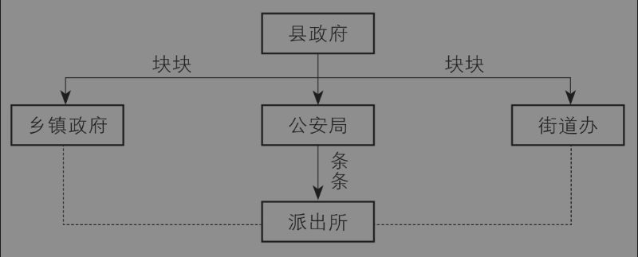

图4-1 县级政府机构设置图

第二，从机构设置上看，街道办和乡镇政府都是最基层的行政单位，都是没“腿”的“块块”。和乡镇一样，街道办一般下设几个综合办公室，例如党工委办公室、政务办公室、城市管理科、社会事务管理科、经济发展科。不同的街道可能有不同的名字，但大体上就是这些下属部门。每个部门负责对接县区的职能部门，例如社会事务管理科要负责对接人力资源和社会保障、民政、卫生、食品药品安全、人口和计划生育、教育、科技、文化、广播电视等多个区县的职能部门。这些区县的职能部门属于上级的条管单位，不归街道办管，因此街道办领导只是“联系”而不是“分管”这些部门。从这里再次可以看出，对于最基层的单位来说，真的是“上面千根线，下面一根针”，啥事都要接得住，想太清闲是不可能的。

第三，从治理方式上看，街道办和乡镇政府都实行党委和行政合署办公。所谓党政合署办公，不是说党委书记和行政首长是一个人，而是说它们的最高领导机构是党委委员和行政副职混搭的，而不是分设两套班子。在县里，党委是一套班子，政府是一套班子，两套班子甚至未必在同一栋大楼里办公。但乡镇和街道办是最基层单位，本来人就不多，通常都是党政合署办公。比如，街道办的党委负责人叫党工委书记，他是街道办真正的“一把手”。人们熟知的街道办事处主任，是行政“一把手”，实际上是“二把手”，因为他是由党工委副书记兼任的。剩下的班子成员，还有党委委员和街道办副主任，但两者可能不是完全重合的。根据2023年初西南地区某街道办事处公布的一份关于调整领导班子成员分工的通知，我们整理了该街道办事处领导班子成员的分工及具体说明（表4-1），显示了党政合署办公、成员分工负责的治理模式。可以看到，街道和乡镇的治理架构是高度类似的。在乡镇，党委书记是一把手，镇长兼任党委副书记，大部分副镇长都是党委委员，但有几个党委委员是专门负责党务的，比如组织委员（相当于县里的县委常委兼组织部部长）、宣传委员（相当于县里的县委常委兼宣传部部长）。

表4-1 某街道部分领导班子成员的分工（2023年1月）

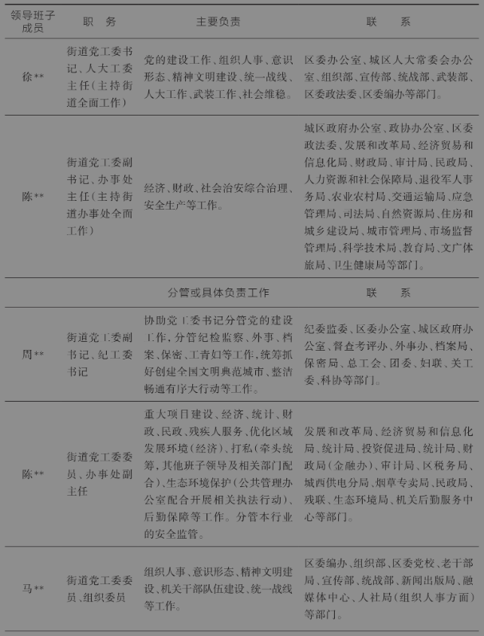

续表

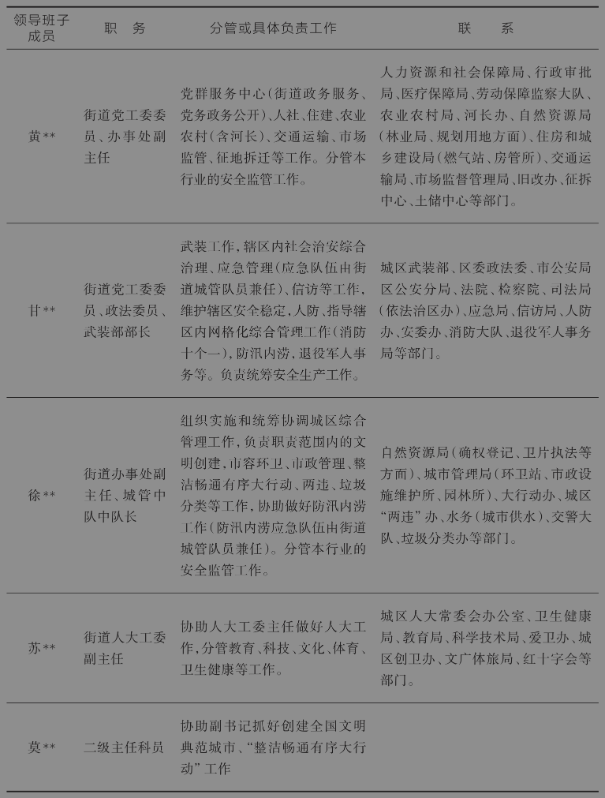

接下来，我们重点谈一下街道办和乡镇政府在三个方面的不同点，这些不同点主要源于两者所在的行政单位不同，即街道和乡镇的不同。

第一，最大的区别是，街道不是一级行政区划，而乡镇是一级行政区划。宪法第三十条规定，中国的行政区划包括省、市、县、乡，并不包括街道。这说明，街道不是国家规定的行政区划，虽然它在行政级别上和乡镇是同级的。

既然行政区划里没有街道，那怎么会有街道办呢？它的合法性来自《中华人民共和国地方各级人民代表大会和地方各级人民政府组织法》，第八十五条规定：市辖区、不设区的市的人民政府，经上一级人民政府批准，可以设立若干街道办事处，作为它的派出机关。20世纪90年代，很多地方还有“地区行政公署”。其实，街道办的性质和地区行政公署是一样的，都是派出机构。后来，很多地区公署改为地级市政府了，只有少数地方保留了行政公署。比如，我的老家以前属于江西省“抚州地区”，后来改叫“抚州市”。因此，街道办和乡镇政府的性质就完全不同，它是一个县政府或区政府的派出机构。那么，这是不是与行政区划有什么关系呢？当然有关系了。根据宪法第一百零七条规定：省、直辖市的人民政府决定乡、民族乡、镇的建置和区域划分。这就意味着，如果一个乡镇要撤销或者改名，或者合并，都需要省级政府批准；但是，一个街道办的撤并，只需要地级市政府就可以批准了。后面再谈街道办或者乡镇的设立与撤并问题。

#### 专栏 宪法关于行政区划的规定

> 第三十条 中华人民共和国的行政区域划分如下：

> （一）全国分为省、自治区、直辖市；

> （二）省、自治区分为自治州、县、自治县、市；

> （三）县、自治县分为乡、民族乡、镇。

> 直辖市和较大的市分为区、县。自治州分为县、自治县、市。

> 自治区、自治州、自治县都是民族自治地方。

> 第三十一条 国家在必要时得设立特别行政区。在特别行政区内实行的制度按照具体情况由全国人民代表大会以法律规定。

第二个区别是，街道一级没有人民代表大会，街道办的领导班子成员是由上级直接任命的，而乡镇政府的行政领导是由当地人民代表大会选举产生的。这一区别源于两者的机构性质差异。因为街道办是县区的派出机构，所以领导班子的设立、下属机构的设立都相对灵活，完全由上级决定。但是，乡镇作为一级行政区划，必须有当地的人民代表大会。宪法规定，人民代表大会是我国的权力机关，人民代表大会制度是我国的根本政治制度。因此，乡镇的乡镇长，不管正副，都应该通过乡镇的人代会选举产生。在党领导政府的体制下，上级党委可以“任命”乡镇长，但必须由人代会“决定任命”。不要小看这个差异。如果某个乡镇长工作太差，人大代表不满意，这就可能出现政治问题了。换一个角度讲，派出机构不是一个群众可以通过人代会进行问责的机构，但上级可以问责。当然，街道没有人代会，但会设立人代会工作委员会，简称“人大工委”。它是县区人大常委会在街道的派出机构，受县区的人大常委会和街道党工委的双重领导，并没有选举和罢免官员的职能。

第三个区别是，街道办的服务对象是市民，而乡镇政府的主要服务对象是农民，两者代表不同的城镇化进度。同样是县区政府的下属行政单位，为什么有的叫街道，有的叫乡镇呢？各省都有明确的规定。例如，东北某个省是这么规定的：拟设街道区域前两年全口径财政收入或人均可支配收入位于所在不设区的市或市辖区下辖乡（镇）的前30%，第二、三产业增加值位于所在不设区的市或市辖区下辖乡（镇）的前30%。其实就是人口多、非农户口比例高并且经济实力强的地方，可以从乡镇改为街道。其实，类似的逻辑也适用于“撤乡改镇”。一个乡的人口多了，经济发达了，就可以改为镇。不仅名字好听一些，而且表明其政治地位更高一些。过去，很多地方为了加快城镇化进程，把很多乡镇都改为街道了。然而，最近有些地方又开始“撤街设镇”。例如，黑龙江省伊春市乌翠区撤销四个街道，设立翠峦镇、乌马河镇；同属黑龙江省的齐齐哈尔市碾子山区撤销富强街道，设立华安镇。为什么在全国大力推进城市化的大背景下，东北某些地方居然逆向调整呢？原因很简单，人口流失了，经济下行了，政府没有那么多钱来提供足够的市政服务了。但是要注意，这绝不是东北某些地方独有的现象，根据中国城市规划设计研究院院长王凯的统计，过去十年间337个地级及以上城市中，150个城市的市域人口减少3637万，比上一个十年（2000—2010年）人口减少的城市增加了61个。[^6]城市的逆向调整，也会带来该地公务员岗位和级别的相应调整，面对城市收缩的大趋势，乡镇和街道的公务员有可能面对岗位难以逆向调动的尴尬境地。

### 二、街道办的权力清单

接下来，我们讨论第二个问题：街道办究竟有哪些权力？这几年，国家大力强调依法行政，各级党政机构都要公布“权力清单”和“负面清单”。这是执政透明化方面的进步。首先，我们从法律上看，根据《中华人民共和国地方各级人民代表大会和地方各级人民政府组织法》第八十六条规定：街道办事处在本辖区内办理派出它的人民政府交办的公共服务、公共管理、公共安全等工作，依法履行综合管理、统筹协调、应急处置和行政执法等职责，反映居民的意见和要求。从字面意思上看，街道办主要承担两方面的职责：行政执法和公共服务。一些街道办把自己的权力清单归纳为几个方面：决策权、执行权、监督权。这跟一个乡镇政府具有的职能其实差不多。

需要提醒大家的是，看待地方政府或者行政机构的职能要全面、客观、深入。首先，如前所述，中国的上级和下级之间、中央和地方之间、上层和基层之间，是一种典型的不完全契约，即无法将双方在未来的所有权利和义务都“一网打尽”，必然是有漏洞的，必然是存在灰色地带甚至是空白地带的。这是因为人都是有限理性的，不可能预测到未来所有可能的情况，也不可能用双方都能理解的语言清晰地描述所有的争议，并且信息不对称还会导致一些条款难以被第三方证实。[^7]除了事实上的不完全契约，还要考虑中国特色的属地管理。属地管理的本质是“政治承包制”。所谓政治承包制，就是辖区内“一把手”实际上对本地区的所有事务负有领导责任。不完全契约加上政治承包制，就会导致事实上的无限责任制。[^8]否则，如果契约是完全的，即便实行政治承包制，责任也是有边界的。如果责任是无限的，那么为了确保责任落实到位，权力就必须无限扩张、政府就必须无所不管，否则就会出现权责不对等。也因此，“小政府，大社会”这一理念在中国是很难落地的。作为本书一个非常重要的分析视角，上述推论可以概括为下面这个“公式”：**不完全契约+政治承包制=无限责任制=权力无边界。**

在政治承包制的视角下，其实街道办几乎无所不管。如前所述，街道办的主要职责是行政执法和公共服务，前者包括社会治安、文化娱乐、安全生产、环境保护等，后者包括招商引资、基础设施建设等。下面是某个街道办事处在2023年某一个星期的主要工作内容（表4-2）。

表4-2 某街道办一周工作重点

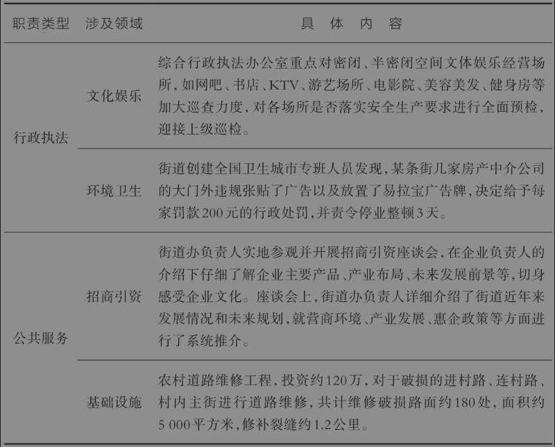

由于街道办的职责几乎无所不管，它显然不是一个清闲单位。特别是在一些特殊时期，街道办的工作更是事无巨细，责任重大。从人员车辆进出、物流环节执行，到辖内企业运作、群众生活基本需求，等等，无一不与街道办的工作产生交集。这下，你还敢不拿街道办当干部吗？

### 三、街道办与居委会的关系

很多人之所以觉得街道办是一个清闲的养老单位，是因为混淆了街道办和居委会的职能。有一次，我在小区公园里散步，遇到一个老太太和一个大姐，两人因为一点小事争执起来。老太太急了，当时就说，要去街道办找人来评评理。可见，那个年代的人，第一很相信组织，第二搞错了街道办和居委会的职能。因此，我觉得有必要介绍一下街道办和社区居委会有什么区别。

街道办和居委会有两个方面的不同。

第一是机构性质不同。社区与乡镇下面的行政村类似，是最基层的组织，但它不是一级行政组织，其管理单位是社区居民委员会，简称居委会。社区居委会是社区居民自我管理、自我教育、自我服务的基层群众性自治组织，不是官方机构，也不是政府派出单位。而街道办事处是一个街道的行政机关，负责管理各个社区。正式的说法是，社区党支部（党总支、党委）在街道党工委的指导下开展工作，而社区居委会在街道办事处的指导下开展工作。请注意，这里没有用“领导”，而是“指导”，是因为两者不是严格的上下级隶属关系，因为居委会是群众自治组织。

第二是工作人员的身份和待遇不同。街道办是行政机关，因此在编的工作人员是公务员，下面的事业单位也有编制，当然还可以外聘无正式编制的人员。而社区居委会是群众自治组织，其工作人员没有编制，不是公务员，也不是事业编。当然，有部分地方会面向社区党组织书记、社区居委会主任等招录乡镇公务员，具有行政编制；也有一些地方将社区两委（党委和居委）班子纳入乡镇事业编制管理。除此之外，在社区居委会工作的全职人员，都是市场化聘用的合同工，当然还有一些是兼职人员。

当前中国的基层各级组织之间的关系还没有完全理顺。例如，专家指出，社区居委会作为居民自治组织而不是行政主体，无权以自己名义在特殊情况下实施封小区、封楼、限制出行等行政强制行为（杜仪方，2022）。因此，严格来讲，社区居委会盖章的封禁通知都是没有法律效力的。街道不能将行政职权下放给社区，应该以指导和监督代替命令和管理，帮助社区实现居民自治。

## 第二节 城市基层岗位很清闲吗？

前面介绍了县域治理过程中街道和乡镇面临的困难和挑战。一些人认为，县政府、乡政府这些“块块”单位都是综合性部门，工作压力肯定很大，但是像县社保局、教育局这些“条条”单位（职能部门），或者一些省直部门或者市直部门的下属事业单位，工作压力应该很小，属于清闲岗位。毕竟，一方面，在城市里总比在乡镇工作条件要好；另一方面，在职能部门总比决策部门压力更小。真的有压力小、收入高但竞争又不激烈的基层岗位吗？不同岗位在工作职责、薪酬水平、工作压力和工作绩效方面是否存在某种绝对优势呢？本节将分析城市基层岗位的性质和工作环境。

首先澄清一个定义，究竟什么是“基层岗位”。很多人以为，基层工作就是指县区、乡镇或街道办的工作岗位，这是不准确的。下方专栏援引了一个比较权威的官方解释，来自海南省2021年度考试录用公务员通告文件的附件，里面有一个报考指南，专门对这个问题进行了说明。

#### 专栏 何谓“基层岗位”？

> 18．基层工作经历如何界定？

> 基层工作经历，是指在县级及以下党政机关、国有企事业单位、村（社区）组织及其他经济组织、社会组织等工作的经历。在军队团和相当于团以下单位工作的经历，退役士兵在军队服现役的经历，可视为具有基层工作经历。报考省直单位的人员，在省级及以下所属企业和事业单位（非参公）、中央所属企业和事业单位（非参公）的二级及以下单位的工作经历视为具有基层工作经历。报考地（市）直单位的人员，在地（市）级及以下所属企业和事业单位（非参公）、省属企业和事业单位（非参公）的二级及以下单位的工作经历视为具有基层工作经历。

> 应届毕业生在校期间的社会实践经历，不能视为基层工作经历。

这个权威解释透露的一大重点是：“基层”的定义原来是相对的。如果一个人报考公务员时，想报考省直部门，那么在市直部门下属的企事业单位工作过，也算基层经历。需要注意的是，有两种情况不算“基层经历”：一种是在政府机关的工作经历，另一种是在“参公”管理的事业单位的工作经历。所谓“参公事业单位”，就是参照公务员管理的事业单位，在地方主要包括党校，以及工会、团委、妇联和社科联等群众团体，在中央还包括银保监会、证监会等监管部门。按照这个权威解释，基层的范围确实比多数人理解的要大，这也意味着本书结论的适用对象更广。在之前的内容里，我们并没有讨论事业单位的问题，本节将事业单位一起纳入广义的政府部门范围，从而为大家理解基层治理、岗位运行以及进行职业选择提供更广阔的参考价值。在第一部分，我先提供一个分析框架，从国家治理的高度，厘清地方政府、职能部门和事业单位的关系。在第二部分，我会从实权大小、级别高低两个维度，将政府部门和事业单位的所有岗位分为四种类型，然后逐一分析每种岗位的优点和缺点，从而为大家理解这些岗位从业者的行为或绩效，也顺便为有志于从事公务员职业的读者提供参考依据。

### 一、“条条”“块块”和企事业单位的关系

首先，我将通过一个分析框架，从国家治理的高度来解释不同的政府部门以及企事业单位之间的工作关系。理顺了它们之间的关系，理解了它们的功能差异，才能理解不同部门之间的行为和绩效差异，理解为什么有的单位很忙碌，有的单位很清闲，有的单位晋升快。

我们可以从两个维度来分析。第一个维度是单位性质。我把我们讨论的体制内单位分为四种类型：（1）政府部门，包括省、市、县（区）和乡（街道），中央是特殊的全国政府。在图4-2中，我用黑色框线表示这些“块块”，它们是国家治理最主要的单元。（2）政府职能部门，包括中央和各级政府部门的下属部门，例如中央的工信部、省级工信厅、市级工信局和县级工信局。我用灰色框线表示它们，这些是所谓的“条条”。再次提醒，块块之间是领导关系，条条之间是指导关系。为了区别，我用实线箭头表示领导关系，用虚线箭头表示指导关系。同时，块块和下属职能部门之间也是领导关系，我也用实线箭头表示。（3）事业单位，这里说的事业单位专指政府职能部门下属的辅助单位，包括之前从政府部门剥离的、没有行政执法功能的部门。我用黑线段表示它们。（4）企业单位，它们在图的最右侧，我用灰色方块表示它们。在市场化改革之后，政府和国有企业不属于同一个系统，不应存在隶属关系，因此用虚线连接两者。

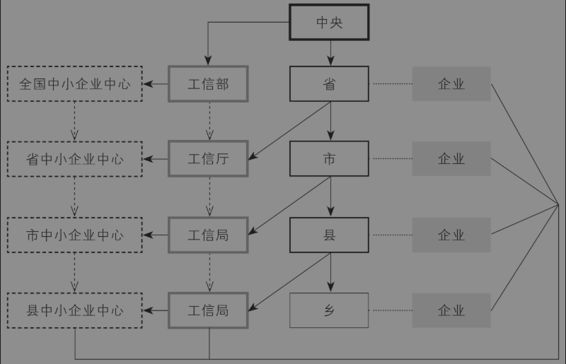

图4-2 行政单位与企事业单位的关系

这里说的事业单位不是指医院、学校、报社等事业单位，而是指政府的下属部门中的事业单位。以中央部委为例，每个部委的下属部门都包括若干行政单位和事业单位，前者是公务员编制，后者是事业编制。那怎么区分两者呢？一个简单方法是：一般情况下，凡是名字叫司、局（处、办）的，就是行政单位；凡是名字叫“中心”的，就是事业单位。例如，表4-3根据财政部官方网站的信息整理了其下属的机构设置情况。其中，部机关和各地监管局是行政单位，最下面的各个中心就是事业单位了。省市职能部门的下属单位也是类似的。

表4-3 财政部机构设置

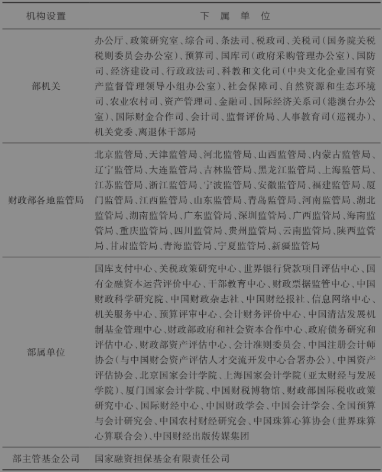

资料来源：财政部官方网站

虽然没有执法权，但不要小看这些事业单位在资源分配中发挥的作用。例如，工信部下面有一个全国中小企业发展促进中心，它承担中小企业政策研究、咨询评估、管理培训、融资服务、会议展览、宣传推广、创新创业支持、数字化智能化改造、“专精特新”培育服务等各项业务。如果省、市、县的中小企业要申请专精特新“小巨人”等各种荣誉和获得优惠政策，恐怕就要考虑参加该中心的各种培训和咨询了，因为专精特新“小巨人”评选的组织方正是工信部，充分了解信息才能“近水楼台先得月”。这也从一个角度体现了企业和政府部门及事业单位的关系。

第二个维度是权力性质。前面三类广义的政府部门拥有不同的权力，我把它们分为四种类型：（1）决策权。这里说的决策权是制定本辖区路线、方针和政策的权力，也包括在上级政策框架下结合本地实际情况制定本地化政策的权力。按照我们的定义，只有处于领导地位的“块块”拥有决策权。因此，在图4-2中，只有中央、省、市和县拥有决策权。（2）执行权。这里说的执行权是指在本辖区内贯彻执行上级路线、方针和政策的权力。在图4-2中，省、市、县和乡都拥有执行权。请注意，乡镇或者街道是最基层的行政单位，因此它们都只有执行权，而没有决策权。为此，我用最细的线条表示乡的方框。（3）指导权。这里说的指导权是指导、监督或督促下级单位执行本辖区党委和政府制定的路线、方针和政策的权力。在图4-2中，“条条”中的上级部门对下级部门拥有指导权。例如，省工信厅可以根据国家工信部和省委、省政府的精神，指导市工信局开展工作。（4）辅助权。这里说的辅助权是指事业单位向所属的政府职能部门提供信息、技术、服务和决策咨询的权力。别以为辅助权不是权力，它能在一定程度上影响职能部门制定的政策，而职能部门作为各级政府下属部门，又能间接影响各级政府（也就是“块块”）制定路线、方针和政策。上述三类政府部门之间存在相互连接的通道。事业单位的副处级及以上领导，可以不经过公务员考试，直接调入政府部门，完成从事业编到公务员的身份转变。总之，对副处级以上干部来说，党政机关、事业单位和国企之间是存在“旋转门”的。

下面举例说明三种单位之间的工作关系。2023年7月31日，为了促进消费，拉动经济增长，国务院办公厅转发了国家发展改革委关于恢复和扩大消费措施的通知（国办函〔2023〕70号）。这个政策以国务院办公厅的名义转发，就代表了国务院的意见，属于国务院制定的政策。在这里，国务院作为最大的“块块”行使了决策权。但是，国办转发的文件，其实是由国家发改委这个“条条”制定的。而国家发改委在制定这个文件的过程中，可能征求了发改委下属的事业单位中国宏观经济研究院的意见，因为中国宏观经济研究院就是专门研究宏观经济形势的智库机构和支持单位。而中国宏观经济研究院在起草或者修订政策的过程中，很可能又征求了很多专家学者以及企业家的意见，并且要到各个地方调研。这个例子也可以直观地体现出，中国的大政方针是集体决策的结果，是“上下同治”的结晶。

现在，我们把三种广义的政府单位（不包括国企）和四种权力结合起来分析，这就形成了一个3×4的矩阵。比如，省政府既有决策权，又有执行权，但需注意乡镇政府只有执行权。因此，省政府可以将压力传导给下级单位，但是乡镇政府就不能。这就是为什么说越是基层政府，工作越累、压力越大的原因。那么，这是不是就意味着作为条条的职能部门和事业单位就一定更舒服、发展空间更好呢？当然不一定。职能部门只有指导权，没有决策权，这意味着能够调动的资源少、实惠少。这里说的“实惠”，是指显性的或隐性的各种福利。下面就来具体分析一下。

### 二、天下没有完美的岗位

接下来回答一个问题：真的有压力小、收入高但竞争又不激烈的单位吗？经济学的核心思想是，凡事都需要权衡取舍（即tradeoff），通俗地说就是“天下没有免费的午餐”。你在得到一些东西的同时，一定会失去另一些东西，因此你在作出选择时就需要权衡成本和收益究竟哪个大。

岗位设置和岗位选择也是如此。为了比较政府部门各类岗位的工作条件，我基于前面的分析框架，画了一个二维图（图4-3）。在这个“级别—实权二维分析图”中，横轴是实权大小，纵轴是行政级别高低，这样横轴和纵轴两个维度构成了四个象限。

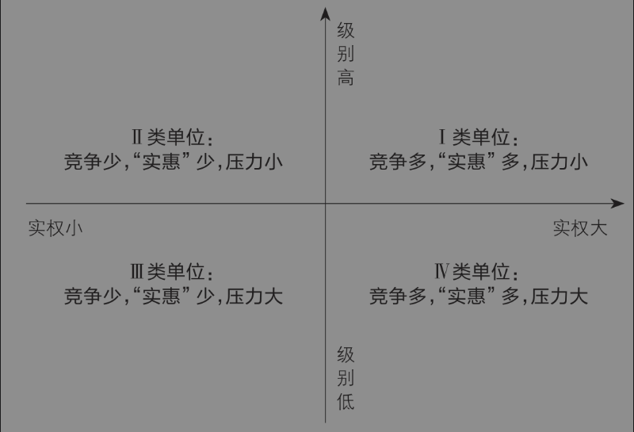

图4-3 级别—实权二维分析图

（1）右上角是第一象限，它表示实权大、级别高的单位，我们称之为“Ⅰ类单位”。

所谓实权大，就是拥有更多的决策权。根据前面的分析框架，这类权力属于作为“块块”的单位，包括省、市、县。而各级党委和政府在履行自己决策权时，都是通过自己的办公机构——党委办公室或者政府办公室来体现的，它们俗称“两办”，也是党委和政府的中枢机构。不同级别的辖区，两办的名称略有差异。例如，省政府的办公机构叫办公厅，市政府和县政府的办公机构叫办公室，而直辖市、副省级城市和省会城市为了与一般地级市区分，也把自己的办公机构叫作办公厅，但级别并不一定是正厅级。

所谓级别高，这就显而易见了。根据我们之前介绍的行政等级体系，所有的机构从上到下分为国家级、省部级、厅局级、县处级和乡科级五大类，越往上级别越高。

很多人会以为Ⅰ类单位就是最好的单位。的确，实权大、级别高的单位人人都羡慕。实权越大，影响力越大，社会地位就越高，一般来说收入水平也越高；级别越高，就可以通过决策权和执行权将压力向下传导，因此落在自己手上的压力就越小。例如，市里收到了省里的考核文件，甚至可以一字不改，直接就转发到县里，压力自然传导到了县和乡镇。但是，凡事都有两面。实权大、级别高的单位大家都想去。因此，这种Ⅰ类单位，要想考进去，竞争就非常激烈。至于考进去的人，每天工作都如履薄冰，各种显性和隐性的竞争很多，所谓“高处不胜寒”，说的就是这个意思。

一位资深基层工作者曾给我分享过这样一个真实案例：有一个小伙子在省里某个职能部门的研究室工作，因为学历高，文章写得好，就被借调到省政府办公厅去了。这本来是挺好的事情，结果在省办工作的同事怀疑他是自己晋升副处长的竞争对手，就在领导面前说他坏话。说什么呢，就说他自以为学历高，恃才傲物，不把老同志放在眼里。结果可想而知，他辛辛苦苦干了三个月，又回到了原单位。关键是，原单位的领导本来以为他要高升了，这下子反而觉得他政治上不成熟，搞砸了，从此就开始冷落他。本来借调到核心部门是一件好事，结果因为不慎得罪人，好事变坏事了。真的是凭运气进去了，却凭实力被挤出来了。

正如老子所言：“祸兮福之所倚，福兮祸之所伏”。

（2）左上角是第二象限，它表示实权小、级别高的单位，我们称之为“Ⅱ类单位”。

这类单位一般是那些政治地位比较高，但是没有决策权，只有指导权或者辅助权的单位。典型的例子是政协。在一个辖区中，政协是和党委、人大、政府平行的四个系统之一，因此政协的下属部门或者事业单位，级别比较高，但是事情并不多。Ⅱ类单位虽然清闲，但是“实惠”少，因为实权小。

（3）左下角是第三象限，它表示实权小、级别低的单位，我们称之为“Ⅲ类单位”。

这类单位因为实权小，所以实惠少；因为级别低，所以压力大。乍听上去，这应该是“最遭人嫌弃”的单位了。但是，它有一个好处：竞争少，因为没有几个人愿意去这样的单位。想养老的“机关老油条”不会去，因为压力大，吃不消；有背景的人不会去，因为油水少。只有真正干事的人才能待得住。在这种单位，干得好，且有机会时，还可以平调或者提拔后调动到更合适的单位。这也是一种“曲线救国”的方法。前段时间我到中部一个相对欠发达地区的政府部门调研，领导介绍大家时，我发现居然有一个公务员是浙江人。吃饭时，私下一问才知道，原来江浙地区公务员竞争太激烈了，于是经熟人介绍，就先考到中部地区来，有了条件之后再想办法调走。

（4）右下角是第四象限，它表示实权大、级别低的单位，我们称之为“Ⅳ类单位”。

这类单位，主要是市县职能部门中的“肥水”单位，比如财政局。因为实权大，所以“实惠”多。十八大之前，我曾经去某县财政局调研，局长热情招待，拼命劝酒，口出豪言：财政的酒是吃不完的！当然，十八大之后，几乎所有基层招待都不饮酒了，我觉得这是非常明显的进步，尤其是深得公务员们夸赞，因为再也不用找理由不喝酒了。不过，因为级别低，自然压力大。而且，同样是在基层，大家级别都低，压力都不小，如果你这个单位实惠太多，难免引起同僚眼红，因此竞争自然十分激烈。同样是在县财政局，我认识的一个大学生工作十年了都没提副科，而且每到年终进行财政结算时，都没日没夜地加班，还说这是财政局的常态。

下面，我结合第一部分对三类单位的分析，和第二节对四类单位的分析，主要以市县为样本，将不同类型的单位归类如下（表4-2）。这个表格告诉大家一个简单的道理：在自由择业和竞争压力下，均衡中所有岗位的净收益其实都是相等或相近的。世上没有完美的岗位。

表4-4 四类单位的特征和示例

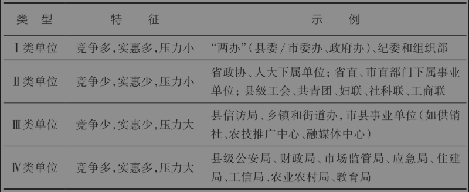

前面比较了不同岗位的工作压力和竞争程度，下面补充介绍一些读者们一定最关心的收入情况。我认为目前很多人对公务员岗位在收入的认知方面存在如下三个误区。

误区之一：单位级别越高，工资越高。真实情况是，党政机关和事业单位的工资水平主要取决于地区的经济发展水平。通常来讲，经济越是发达，公务员收入水平越高，而且可能明显高于企业职工水平。例如，深圳、苏州都是经济发达地区，其公务员收入水平也是业内闻名的。在同一个地区，公务员的工资水平取决于行政级别，不同单位之间差别很小。有差异的可能是津贴、补贴。津贴过去跟单位福利有关，现在都没人敢私设“小金库”了，因此同一地区都差不多。补贴则跟岗位有关，比如下乡扶贫的干部有专门的下乡补贴。我有一个朋友，之前在某个市辖区担任公务员，后来调到省直部门。他跟我“吐槽”，之前区里比较有钱，年收入是十来万，现在调到省里后工资少了好几万，而且搞不好今年津贴也还要降。可见，从低级别单位到了高级别单位，虽然压力小了，但是“实惠”未必多了，这就需要权衡取舍。

误区之二：单位压力越小，岗位压力越小。网上有不少人建议，要想在体制内“躺平”，最好是去工、青、妇以及老干部处等清闲单位。然而，即便是同一个单位，不同的岗位工作压力也可能完全不同。比如说老干部处吧。有些单位成立时间不长，只有十几个退休人员，但按规定也要配一两个人负责老干部工作，那这种岗位确实比较清闲；但是，有些级别高的单位，退休人员有一千多，但老干部处也是几个工作人员，一年到头可能忙得焦头烂额。

误区之三：所有部门都可以按好坏排序，具有普遍参考意义。很多人关心单位福利和晋升情况，希望找到一个普遍规律，但这恐怕是一厢情愿。真实情况是，单位好坏是相对的，完全是因人而异。在公务员退出机制还有待完善的情况下，对于一个50岁、没有晋升希望的公务员来说，只要他想，哪里都可以“躺平”；但对于风华正茂的年轻人来说，再清闲的单位也不可能真正“躺平”。想想看，哪个单位的领导会让一帮年轻人闲着呢？

## 第三节 乡镇年轻公务员的出路

说到官员，大家通常关注的是行政级别较高的县级干部、地市或者省级干部。国内外学者们在研究官员晋升时，几乎也都是关注这些“政治精英”。这主要是因为这些政治精英职位高、权力大、影响大，同时他们的简历比较容易公开获取。然而，对于基层治理来说，如同国家治理的毛细血管，数量庞大的乡科级干部和年轻的乡镇公务员才是真正的主角，这一领域无疑值得研究者们予以更多关注。[^9]

这些年，我们团队多次到乡镇和农村调研，从东北边陲到青藏高原，从巴蜀盆地到茫茫大漠。我们看到的乡镇公务员大部分都非常年轻，文质彬彬，言语得体，学历不低。说实话，这跟我们小时候在农村接触过的“土八路”干部的形象完全不同。毕竟，时代进步了。然而，我们也发现，乡镇的年轻公务员们既充满希望又带着迷茫，既充满干劲又陷入困境。这些朝气蓬勃的年轻人，从昔日的小镇做题家变为今天的小镇公务员，以后可能成为高级领导人。他们的状态值得我们关注，他们的前程关乎基层的前途。因此，下面就来谈谈乡镇年轻公务员的那些事儿。

第一部分主要介绍如何成为乡镇公务员，包括什么是乡镇公务员，国家公务员考试和省级公务员考试有什么不同，省级公务员考试中的乡镇公务员在招录和考试要求上又和其他层级的公务员有什么不同？第二部分从晋升、压力和家庭这三个方面谈谈乡镇年轻公务员的困境，并探讨破解之道。

### 一、乡镇公务员的来源

很多人以为，在乡镇党委和政府工作的人都是国家公务员，都是体制内的“铁饭碗”。这其实是一种误解。为了让大家对乡镇工作人员的岗位编制情况有一个直观的认识，我们以位于河北省的某乡镇作为例子（张欢，2021）。图4-4展示了Y镇机关工作人员的构成，目前Y镇在岗工作人员共118人。其中公务员48人，占总人数40.7%；事业编41人，占34.7%；人事代理人员18人，占15.3%；临时人员5人，占4.2%；其他人员（如劳务派遣、“三支一扶”工作人员或“大学生村官”、就业保障局招聘的见习岗、实习岗人员）6人，占5.1%。

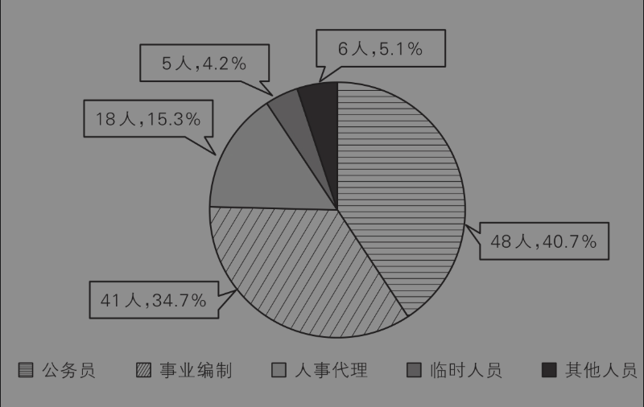

图4-4 河北省某乡镇工作人员构成

人事代理、临时人员和其他人员合称“临时外聘人员”，都属于没有编制的岗位。简单地说，从岗位编制角度，一个乡镇机关主要包括三类人员：公务员（行政编）、事业编和外聘人员。为了避免样本偏差，我们在调研中还收集了其他地方的乡镇工作人员统计数据，发现多数乡镇这三类人员的比例各占三分之一。而且，行政编和事业编的比例差不多，差异大的主要是临时外聘人员。

严格意义上的乡镇公务员是指有行政编制、工作关系隶属乡镇的公务员。进入乡镇公务员队伍的渠道主要是两个：一是参加省级公务员考试，考取相应岗位，这是主要渠道；二是选调生，包括中央部委的选调生和省级选调生，他们都要在乡镇锻炼两年。县里垂直管理部门派驻乡镇的干部，例如县市场监管局驻乡镇市场监督管理所、税务局驻乡镇分局以及公安派出所的公务员，都不属于这里说的乡镇公务员。

公务员考试是一个非常便捷的角度，可以帮助我们从选才的维度理解中央和地方治理的差异，下面简单概括一下国家公务员考试（简称“国考”）和省级公务员考试（简称“省考”）的差异。

（1）工作去向不同。国考的全称是中央机关及其直属机构录用公务员考试，由中组部牵头，国家公务员局组织。这里说的“中央机关”是广义的，包括中共中央、国务院、全国人大、全国性群团组织以及其他参照公务员法管理的事业单位及其在全国各地的直属单位。例如，厦门海关属于中国海关的直属机构，其工作人员并非地方公务员。因此，中央公务员不一定在北京工作，也可能在外地工作。省考是由各省份公务员局组织的省级公务员考试，工作去向是本省的省、市、县、乡四级机关。

（2）招考对象不同。国考属于全国性考试。这里说的“全国性”包括两个方面：一是考生来源是全国性的，不限地域；二是工作地点是全国性的。省考属于地方性考试，多数情况下全国各地的考生都可以报名，但是有一部分职位因为工作需要或者岗位性质，会有户籍上的限制。例如，一些省考招录简章上会注明“限本县（市、区）户籍或生源报考，须在本市艰苦边远地区县乡机关最低服务5年”。这句话不仅限制了报考对象，而且限制了工作去向。有户籍限制的主要是县乡公务员岗位，大概占全省总岗位数的5%。

（3）考试时间不同。每年都是国考在前，省考在后。背后的逻辑是，国家先选才，地方再选才，避免时间冲突。

（4）考试难度不同。国考和省考都包括笔试和面试，笔试都是两个公共科目：行政职业能力测验、申论。此外，部分岗位还有专业笔试。总体上，因为国考是面向全国考试，岗位层次高，录取的人又少，因此竞争更加激烈。[^10]相对而言，省考招录人数更多，又有户籍和地域限制，因此竞争程度相对更弱。第三点和第四点结合起来，或许可以从一个角度说明，中央层面的公务员在人才来源方面优于地方公务员，并且这种差异会影响不同层级的国家治理水平。

虽然乡镇公务员主要是通过省考选拔，但在省考中，乡镇公务员和其他公务员的考试也不一样。以中部某省2023年省考为例，我总结了不同层级岗位在招录人数、政治面貌、学历要求、年龄要求和考试内容五个方面的差异（表4-5）。该省公务员的招录职位分为五个层级：省级、省级垂管单位、地级市（官方叫“设区市”，因为少数市属于副省级）、县区和乡镇。

表4-5 中部某省省考中不同层级岗位的招录信息

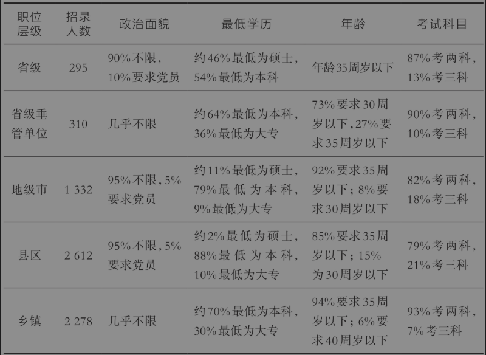

说明：在年龄方面，博士可放宽至40岁。

从上表中可以看出，乡镇公务员和省考选拔的其他公务员有五个方面的差异。

（1）从招录人数看，乡镇招录人数较多。比如，上表显示中部某省2023年总共招录6827人，其中县区和乡镇分别招录2612人和2278人。大致来说，省市两级招录不到三分之一，县区招录超过三分之一，乡镇招录约为三分之一。

（2）从政治面貌上看，省级、市级和县区级的部分公务员职位要求中共党员才能报考，而乡镇公务员和省级垂管单位的公务员几乎没有这类要求。

（3）从学历要求上看，省级公务员的报名要求最高，一半左右要求硕士，另一半要求本科，其次是地级市，要求最低的是乡镇公务员。乡镇公务员岗位中有大约三分之一只要求最低学历是大专，而没有最低学历要求是硕士的。

（4）从年龄上看，省级垂管单位要求最严格，大部分要求30周岁以下，而乡镇公务员岗位对年龄要求最低，绝大部分岗位要求35岁以下，甚至还有6%的岗位要求40岁以下。

（5）从考试科目上看，市级和县区级公务员职位要求较高，有20%左右的职位要加试第三科，而乡镇公务员职位很少需要加试。

从具体岗位上看，乡镇公务员招录的岗位包括：乡镇机关、综合岗、文秘岗、会计岗、计算机岗、新闻岗、旅游岗、财经岗、环境保护行政管理岗、规划岗、驻村岗等等。其中，综合岗人数最多，又包括三类：主要从事机关综合业务、综合协调等工作；主要从事工程管理、建筑、规划等工作；主要从事综合执法等工作。此外，乡镇公务员还有特殊通道。有一部分职位专门面向优秀村干部、社区干部、“大学生村官”、退役士兵、“三支一扶”工作人员、特岗教师等定向招录。

总之，乡镇岗位属于“竞争少，实惠少，压力大”的Ⅲ类岗位。与此同时，为了防止一些人利用乡镇公务员岗位作为跳板，进行“体制内套利”，2014年中共中央办公厅印发了《关于加强乡镇干部队伍建设的若干意见》，规定新录用乡镇公务员必须在乡镇最少干满五年，其间上级机关一般不得借调和选调。五年服务期，时间比较长，压力比较大，杂事比较多，这就产生了下面要讲的三重困境问题。

### 二、乡镇公务员的三重困境

在一次乡镇调研中，几名211大学毕业的年轻公务员向我诉苦，基层工作不好干，个人前途比较渺茫。归纳起来，乡镇年轻公务员面临的挑战主要是三重困境：晋升困境、压力困境和家庭困境。

一是晋升困境。

毕业于武汉大学的L说：“乡镇公务员起点低，晋升慢，职业天花板太低。因为起点低，所以进一步导致岗位轮换机会少，最终只能‘龟速’晋升。事实上，对绝大多数乡镇年轻公务员来说，正科级就是天花板。相比之下，如果像我同学那样本科或研究生毕业就进入中央部委或者省级机关，如果不犯错误，基本上最终都能成为厅级干部。所以我觉得目前的情况对我们这些在乡镇工作的大学生来说不公平。”

在我们的基层调研中，L的观点颇具代表性，但这并不表明我们作为研究者应该“照单全收”。这里其实涉及两个问题，一是客观事实，二是主观公平。真相是由事实（fact）构成的，但不完整的事实可能离真相更远。根据我们的调研和访谈，我在这里提供两个事实。

客观事实一：乡镇公务员的起点低，但首次晋升并不慢。影响一个人晋升的因素很多，年龄、学历、能力、关系都非常重要，但大家往往忽视了环境因素，就是所在单位的领导职数限制。领导职数跟普通干部（科员）的数量成正比。一般来说，县区直属机构的科级领导职数核定为1正2副。比如，县林业局只能设1个局长（正科级），2个副局长（副科级）。职能比较单一或编制较少的科级单位核定为1正1副，极少数任务较重、编制较多或加挂牌子的单位可以核定为1正3副。同样是科级单位，相比于县林业局这样的县区直属机构，乡镇因为公务员编制多，所以领导职数比较多。首先，正科级就有3个：乡镇党委书记、乡镇长和人大主席。其次，党委委员（也就是班子成员）还有7个。如果再加上不是党委委员的副乡镇长、人大副主席，除去兼职，那么一个乡镇的副科级以上领导可能有12位左右，大的乡镇可能有15位左右。因此，虽然县区公务员的起点比乡镇公务员更高，但因为领导职数少，晋升并不一定快。相反，这几年乡镇大量招聘公务员，导致非领导职务多，因此按比例设领导职数可以更多，年轻人进入乡镇后的第一步，即从科员升到副科级干部（一般是副乡长）的位子变多了，升迁速度比县区公务员更快。

前面说的是通过省考进入乡镇的普通公务员，如果是中央或省里的选调生，那么他们的晋升通道就完全不受乡镇的影响。他们的组织关系本来也不在乡镇，来乡镇工作两年只是历练。两年之后，他们要调回中央或省里。只要干得不错，以后的前途不会比通过国考或省考进来的普通公务员差。我们后面再谈选调生的问题。

客观事实二：乡镇公务员的流动性较强，出路并不算差。除了起点，决定晋升速度的另一个因素是岗位轮换频率，即流动性。郭立丹（2022）曾详细分析了北方某县乡镇公务员的流动情况。2011—2021年，该县通过省市县乡四级联考模式，总共招录了乡镇公务员319人。这批公务员的概况如下：男女比例比较平衡，多数是25—35岁，本科学历最多，大约三分之一是研究生，四分之一是副科级以上干部职位，将近一半是本县人。这些统计特征，跟我们在乡镇调研的情况基本符合。

接下来看流动性（表4-6）。这11年招录的319名乡镇公务员中，截至2021年有120人离开了原录用乡镇，流动比率大约是38%。但更有参考意义的是2014年实行五年最低服务年限规定之后的情况。2014年之后，乡镇公务员的流动性逐渐降低，稳定在20%左右。这个比例与我们了解到的广东、浙江等发达地区的乡镇公务员流动比例比较接近。

表4-6 北方某乡镇公务员的流动性

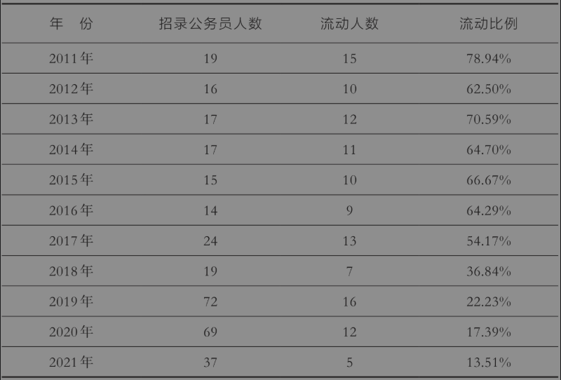

那么，他们是通过什么渠道流动的呢？流动的120名乡镇公务员中，比例最高的是通过遴选[^11]离开，共65人，占流动人数的54.17%；其次是借调，有25人，比例超过20%；再次是调离，有23人，比例接近20%；剩下大约6%的人是辞职离开。

最后，流动的乡镇公务员去了哪里呢？如图4-5所示，去市直机关的最多，有68人，比例为56.67%；其次是去本县县直单位，有29人，比例为24.17%；再次是去市直以上机关，有16人，比例为13.33%；剩下的7人是辞职。

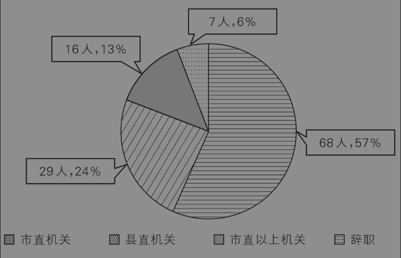

图4-5 北方某乡镇公务员流动去向

上面这个案例表明，乡镇公务员的流动性其实非常高。相比之下，县市级以上行政机关、大学、医院和国有企业，流动性很少能达到20%。结合前面的客观事实一，可以比较确定地说：乡镇年轻公务员的确起点低，而且有五年服务期，但是留在本乡镇的人五年内基本上能够晋升，而流出的人则在县市及其以上机关找到了更广阔的舞台。

说完了客观事实，然后说主观公平。从结果上看，中央部委或省级机关的公务员，退休时多半能获得正处级以上待遇，而乡镇公务员退休时多半只能获得正科级待遇。但这是否意味着不公平呢？我为此专门询问了一个在中央部委工作的公务员，他是这么回答的：首先，我要说的是，公平不是结果一样，而是在能力和努力差不多的情况下，最终结果差不多。你同意不同意？公务员考试好比高考，如果考上普通本科高校的毕业生和考上985高校的毕业生，毕业后的待遇差不多，那么谁还努力去考985大学呢？如果你觉得985大学的文凭含金量更高，那么理性的做法不是去抱怨结果不一样，而是努力学习，争取考高分，选好大学。何况，乡镇公务员在服务五年之后，一样有机会继续参加中央以及各个省份组织的公开遴选或公开选调。所以，我的观点是，进入不同层级政府当公务员，主要是个人选择问题，不存在公平问题。

二是压力困境。

很多人将乡镇工作与县城机关工作进行对比，认为机关工作都是在室内上班，上班时间比较有规律，周末能正常休息。而乡镇工作要经常下乡，跋山涉水、风吹日晒；上班时间不固定，加班时间不确保，经常是“5+2”“白+黑”。

我们在调研中了解到的情况是，总体上乡镇工作比多数县城机关要辛苦一些，但这种辛苦往往是阶段性的。比如，在脱贫攻坚阶段，的确有很多乡镇公务员要成天往村里跑。但网上的说法有些夸张，有些是把“大学生村官”、社区的工作内容和乡镇公务员的工作内容混在一起，还有些是选择性对比。

从工作压力上说，其实乡镇公务员的日常工作和大多数县城公务员并没有本质差异。乡镇综合岗的工作，基本上就是四样：撰写材料、开会协调、党建工作和服务群众。一位乡镇长告诉我：这些常规性工作，正常考上大学的人都能搞定。至于一些专业技术岗，比如税务专员岗、市场监管岗和基层司法岗，要经常跑到企业和群众家里去，的确非常辛苦，但这些岗位属于县政府下属各局在乡镇的分支机构，即垂直管理部门，并不属于我们说的“乡镇公务员”。其实，乡镇公务员基本上到点就下班，周末也很少加班。因为街上的市民和村里的农民并没有晚上去政府办事的习惯，即便有事也是行政村和社区的工作人员挺在第一线。再说了，乡镇领导几乎都住在县城，领导经常加班的话，住哪儿啊？要说加班，最严重的应该是县委、县政府机关和一些核心部门，特别是“两办”和组织部，那里“5+2”“白+黑”是标配，加班是常态，不加班是“变态”。

在自上而下的国家治理架构下，很多人都很向往在国家中枢机关工作，因为那里是国家治理的核心机关。我就给大家讲个真实的故事吧。我有一个同事曾经被借调到中央机关工作，在那里工作了一周，然后遇到了大领导。大领导关心地问：在这里加班还习惯吧，几天回一次家啊？我同事小心地回答：这个星期回了一次家。大领导说：哦，那还可以，这里很多同志半个月才回一次家呢。借调任务完成后，我同事多一天都不肯留下，因为太累了。权力就像一座围城，城外的人挤破了头都想进去，而城里的人却想着出来。

三是家庭困境。

很多人抱怨在乡镇工作通勤成本高，没时间监督子女的学习情况，而且，乡镇优质教育资源少，不如城市的教育资源那么丰裕。这个基本上是事实。这些年，优质的教育资源不断向区县集中，面对县城中学的压倒性优势，农村中学的优质生源不断流失，这对农村中学来说的确不太公平。不过，很多乡镇公务员的子女和当地居民及农民的子女一样，能去县城中学的都去了。带孩子的乡镇公务员，也基本上都住县城了，在这一点上他们和县城公务员没有差别。[^12]

这里分享一个很有意思的调查研究。为了分析大学生的家庭背景，一个硕士生（廖晨芳，2018）在湖南省两所985大学（湖南大学和中南大学），面向2017级新生发放了570份调查问卷，回收了534份有效问卷。从大学生父亲的职业背景上看，“专业技术人员”（主要是教师和医生）比例最高，为14.98%，第二是“国家与社会管理人员”（主要是公务员），为13.48%。母亲的职业背景相对更弱，比例最高的也是“专业技术人员”（17.42%），但次高的是“城市无业或半失业人员”（15.92%），第三高的是“农业劳动者”（11.42%），第四高的是“国家与社会管理人员”（10.49%）。把父母双方的职业背景结合起来考虑，我们基本上可以推断：在中国的大多数省份，父母是教师或者乡镇公务员的家庭，子女考上985大学的概率最高。为什么这里推断“国家与社会管理人员”主要是乡镇公务员呢？因为从居民构成和就业机会的角度（前文我们已经在“撤县改市”等内容中提及）来看，只有在乡镇当公务员的男性，其妻子才最有可能是城市失业人员或农民，在省、市、县工作的公务员不太可能，因为有更多的就业机会。

其实，不管是晋升困境，还是压力困境和家庭困境，归根结底都是一种心态困境。心态好，才是真的好。那么，在乡镇工作时，如何保持好的心态呢？这里给大家分享一个基层公务员的三点心得。

第一，不要给自己设定太高的目标，因为有时运气非常重要。不要总是想着多少岁之前要上正科级，多少岁之前要上正处级，那只是一厢情愿。只要自己尽力了，问心无愧了，其余的就交给命运吧。

第二，要相信机会还是留给有准备的人。我讲一个发生在我们当地的真实故事。有一次，省委书记到某乡镇视察，随口问了一些细节问题，陪同的县委书记不太清楚，在场的镇长却回答得非常清楚，从而给省委书记留下了深刻的印象。之后，镇长很快被提拔为镇党委书记，然后担任县委常委、县委副书记，下一步就是担任区长或县长了。你看，平时多学习，勤思考，多汇报，关键时刻命运很可能会垂青于你。

第三，不要盲目攀比。大家老是说，“没有对比，就没有伤害”。然而，盲目的对比，“伤害性不大，但侮辱性极强”。我们都是普通老百姓，如果非要跟王安石、张居正这样的官场“顶流”相比，那不是自取其辱吗？全中国有几百万公务员，有几个人能升到正处级？[^13]乡镇公务员只要不犯错，一般能在退休时指望当上四级调研员，相当于副处级干部，但说实话这已经是人中龙凤了。

## 第四节 “村官”不是“官”

说乡镇是国家治理的毛细血管，可能有读者会问，那村呢？从法律上讲，中国正式的行政区划只有省、市、县和乡四级，并没有村。村并不是一级行政单位，村委会主任，也就是我们俗称的“村长”也不是政府官员。但是，从历史上讲，村却是中国最古老的国家治理单元之一。根据住建部的城乡建设统计年鉴，截至2023年底，全国有约48.9万个行政村，233.2万个自然村。看起来，一个村似乎不起眼，一般也就几百人到几千人。但是，考虑到中国地区差异很大，村与村之间的差别可能非常大，有些村经济实力特别强，简直“富可敌市”。例如，著名的华西村，号称“天下第一村”，位于江苏省江阴市华士镇。2012年的时候，华西村总收入就高达524.5亿元，比一个普通地级市的GDP还高。我去年暑假去江苏调研时，刚好有机会去参观了一下华西村。我自己的感觉是，整个村就是一个企业集团，村民就是企业职工。因此，村民的福利和全村的前程，很大程度上取决于这个企业集团的市场竞争力，当然也得益于政府的大力扶持。另一个著名的“中国经济十强村”是山东省邹平市的西王村，2013年时它便拥有四家上市公司，被称为“中国上市公司第一村”。相形之下，很多中西部的地级市连一家上市公司都没有。

从感情上讲，不管我们今天是工人家庭还是知识分子家庭，往前追三代，祖上基本上都是农民，都曾长期在乡村生活。小时候，有一首歌曲的第一句歌词就是“在那遥远的小山村”。虽然乡村历史悠久，大家又充满感情，但是现在的农村就像儿时的童谣，与我们渐行渐远，日渐模糊。2023年上半年，在大二学生的一堂课上，我问了全班40个学生两个问题。我先问：有多少人来自农村？所谓来自农村，就是有农村户口。结果举手的学生只有五六个。我再问：有多少人在农村生活过？就是干过农活，插过秧、收过稻子。结果，全班居然没有一个人举手。

农村是国家治理的“神经末梢”，中国革命的成功经验之一，就是“农村包围城市”，中国经济改革的源头，也是从农村开始的。农村的治理情况非常有必要专门介绍一下。本节第一部分介绍农村的治理结构，主要包括“两委”和村干部的身份；第二部分介绍“大学生村官”这个特殊的岗位，解答“村官是不是官”这个疑惑；第三部分介绍这些年农村正在发生一些重要的变化，说明今天的农村确实不是过去的农村了。

### 一、农村的治理结构

在我小时候，我们村里人喊村长叫“队长”，把乡政府叫“公社”。直到现在，我们村很多上了年纪的农民，还是这么称呼。因为在改革开放之前，一直就是这么叫的。[^14]后来，人民公社、生产大队、生产队这样一套农村的治理结构随着家庭联产承包责任制的推行而解体，农村的组织结构变成了自然村和行政村。对当地农民来说，他们眼里的“村”就是指自己所在的自然村，或者村民小组，而政府文件上提到的村，通常是指行政村。一般来说，一个乡镇有10个行政村，一个行政村有三四个自然村。如果你是一个大学生，暑假或者寒假参加农村调研，问当地农民“你们村长是谁”，他们有可能不知道你在问谁。

在今天的中国农村，我认为其治理结构可以用一句话概括：“两个法规，两套班子，两职合一。”

“两个法规，两套班子”，是指一个行政村有两套领导班子或者领导集体：一套是村民委员会，简称村委会；另一套叫村党支部委员会，简称村支部。两套班子加在一起，简称村“两委”。

先说村委会，这是村民经常需要打交道的领导班子。因为农村不是一级行政单位，所以农村的管理机构不属于政府部门，村领导班子（也就是“村官”）不是政府工作人员，也没有编制和工资。总之，“村官”不是官。那农村怎么管理呢？根据《中华人民共和国村民委员会组织法》（以下简称《村民委员会组织法》），村民委员会是村民自我管理、自我教育、自我服务的基层群众性自治组织，实行民主选举、民主决策、民主管理、民主监督。村委会由哪些人组成呢？它由主任、副主任和委员共3—7人组成。因此，根据法律规定，行政村的行政一把手，不应该叫“村长”，而应该叫“村民委员会主任”，简称“村主任”。虽然我们经常口头上提到“村长”，但实际上这个职位并不存在。同样根据法律规定，为了体现平等，村委会必须有妇女成员，民族村还应当有少数民族成员。

既然村主任是“一村之长”，对于农民来说，谁当“村长”肯定涉及切身利益。如果这个村非常富裕，又或者属于“城中村”，那么谁当村主任对当地企业来说也非常重要。比如在北京，一个“村长”的权力，恐怕比中西部地区一个乡长的权力都大多了。问题是，什么人可以当“村长”呢？根据《村民委员会组织法》，有三类人可以参选村主任：一是户籍在本村并且在本村居住的村民，即“户在人在”；二是户籍在，人不在本村，但本人表示参加选举的村民，即“户在人不在”；三是户籍不在本村，但是人在本村居住一年以上，本人申请参加选举且经村民会议或村民代表会议同意参加选举的村民，即“人在户不在”。这个参选资格意味着，如果你是一个“大学生村官”，或者是在本村创业的外乡人，又或者是住在本村的乡镇工作人员，只要在本村住满一年，就符合当村主任的条件了。

然后说村支部。在中国体制下，党委领导行政，因此任何公共组织都有党政两套系统。行政村也不例外。根据《中国共产党农村基层组织工作条例》，以村为基本单元设置党组织。具体怎么设置，主要看村里的党员人数。超过3个党员的村，应当成立党支部；不足3人的，和邻近村联合成立党支部；超过50个党员的，或不足50人但确因工作需要的，可以成立党的总支部；超过100名党员的，可以成立党的基层委员会，下设若干党支部。在人数上，支部委员会一般3—5人，总支部委员会一般5—7人；党的委员会一般5—7人，最多不超过9人，其中包括书记1人。党员多的支部，可以设副书记1人，纪检委员1人。

前面说了村委会，这里又有村支部。两者有什么不同呢？

（1）机构性质不同。村委会是群众自治机构，由全体村民选举产生；而村支部是党的组织，由全村党员选举产生。

（2）与乡镇的关系不同。村委会是群众自治组织，与乡镇党委和政府之间不存在领导关系或隶属关系。《村民委员会组织法》第五条规定：乡、民族乡、镇的人民政府对村民委员会的工作给予指导、支持和帮助，但是不得干预依法属于村民自治范围内的事项。但是，村支部作为党的基层组织，必须接受上级党组织的领导。因此，乡镇党委和村支部之间是领导和被领导的关系。这也就意味着，村委会主任只能由村民选举，但是村支部书记，可以由上级党委任命。这是一个非常关键的区别，跟后面的内容有关。

前面解释了“两个法规，两套班子”，接下来解释有所冲突的“两职合一”。这里面有故事。因为村委会是村民选举产生，而且是一人一票，直接选举。这就导致一个问题。在一些单姓村，某个家族人多势众，或者某个宗族在杂姓村中势力特别大，他们的代表就很容易被选上村主任。还有一些在本地或者外面做生意、赚大钱的企业主，就是所谓的村庄“能人”，财大气粗，再加上给村里许点承诺、搞点慈善，就很容易得到村民支持。此外，在部分地方，还存在一些带有黑社会性质的“带头大哥”，通过恐吓、贿赂等手段谋取选票。举个例子，老实巴交的村民张三，今天出门要参加村委会选举，路上碰到一个“能人”李四。李四跟他说，把你的选票给我，或者直接写上我的名字，我给你50块钱。张三想了想，几百个人投票，多我一票不多，少我一票不少，那还不如直接拿了这50块钱更实惠，还免得耽误我干半天农活，于是同意了。很多人一说到这个例子，就忍不住批评：你看你看，农民素质就是低，不珍惜手中的选票，不爱护神圣的民主权利。不过从经济学上分析，因为投票的人很多，所以你投票成功的边际收益近似于0，但是边际成本肯定是正的，因而考虑到边际收益小于边际成本，就会有人选择放弃。按这个逻辑，压根就不应该有人去投票，投票是“非理性”的行为。但是这又无法解释很多人踊跃投票的现实，这就是公共经济学中说的“投票悖论”。因此，要让村民珍惜民主权利，关键是提高民主的实际收益。

党政两套领导班子的结构，可能还会导致一种棘手的情况出现。比如，大宗族凭借亲缘关系、“能人”凭借金钱开道，甚至有些地方存在“带头大哥”凭借暴力获得了多数选票的情况。当选为村主任的人很可能不是乡镇党委看重的人，而乡镇党委看重的人，只能在村支部安排。此时，村主任和村支书之间就会产生矛盾。有时候，村主任并不是“坏人”，只是出于个人利益而与村支书展开竞争，此时谁能占据主导地位，就取决于上层关系和下层力量的博弈。这种内部矛盾的结果往往是两败俱伤，而且会导致村集体公共物品缺失，集体资产流失，领导班子瘫痪。

那怎么办呢？需要从制度上解决这个问题。城市里发生过国企里董事长和党委书记的内耗，最后的解决方案是让董事长和党委书记“一肩挑”，两职合一，这就理顺了党委和董事会的关系。农村的问题也是这么解决的。一些地方较早地探索了村支书和村主任“一肩挑”的做法。例如，2018年3月发布的《中共湖北省委湖北省人民政府关于推进乡村振兴战略实施的意见》明确提出：“继续全面推行村党组织书记通过法定程序担任村委会主任。”地方的成功经验得到了中央的认可，并且在全国范围内推广。2018年9月，中共中央、国务院印发了《乡村振兴战略规划（2018—2022年）》，明确提出到2022年村党组织书记兼任村委会主任的村比例要达到50%。在2019年初，中共中央印发了《中国共产党农村基层组织工作条例》，其中第十九条明确规定：村党组织书记应当通过法定程序担任村民委员会主任和村级集体经济组织、合作经济组织负责人，村“两委”班子成员应当交叉任职。这就从党内法规上，以制度的形式确认了村支书和村主任“一肩挑”的任职形式，并且要求两个班子成员交叉任职。同时，为了便于交叉任职，新修改的《村民委员会组织法》也将每届村委会的任期从过去的三年延长到了五年，正好和村支部的每届任期是一样的。不管是“一肩挑”还是“交叉任职”，其制度安排和国企都是类似的。在此过程中，我们再次发现，中国的很多顶层设计，都是先从基层探索、试错，然后经由中央确认并推广到全国。这再次体现了“上下同治”的智慧。

村支书和村主任“一肩挑”的制度安排虽然解决了两个“一把手”的矛盾，但是又带来了新问题。一方面，村支书兼任村主任会大幅度增加其工作负荷，相当于一个人干两个人的活，会影响其工作效率。另一方面，之前村支书和村主任之间实际上存在一种制衡关系，现在两个岗位被“一肩挑”了，可能会引发一些其他问题。

### 二、“大学生村官”

既然“村官”不是“官”，那为什么有“大学生村官”的说法呢？下面结合国家相关政策，简要介绍一下“村官”的选拔情况。

（1）起源。“大学生村官”项目可以追溯到1995年江苏省徐州市丰县实施的“雏鹰工程”，当时该县选拔了13名大学毕业生到村里任职。目的是解决大学生就业，同时推动乡村振兴。现在，“大学生村官”已经上升为一项国家战略。

（2）工作性质。“大学生村官”岗位性质为“村级组织特设岗位”。聘期一般为2—3年。

（3）选聘对象。本科及以上学历的大学毕业生或归国留学人员。

（4）工作安排。第一年，是中共正式党员的，一般担任村党组织书记助理；是中共预备党员或非中共党员的，一般担任村委会主任助理。第二年，担任村“两委”委员或以上职务并明确分工，工作内容包括帮助村民搞活经济、搞好文体活动、调解矛盾纠纷、代办各项事务。

（5）待遇保障：因为“大学生村官”不是公务员，也非正式工作岗位，而是属于派选项目，所以以工作、生活补助形式按月发放补贴，费用由中央和地方财政共同承担。由此，各地补贴金额不一，每个月大约3500元，参照事业单位的规定享受社保，艰苦地区有津贴。

（6）未来发展。有留村任职工作（前面说了可以当“村长”）、考录公务员、自主创业发展、另行择业、继续学习深造等“五条出路”。拥有“大学生村官”经历还可以享有一些政策优惠：第一，可参加选调生统一招考；第二，可参加面向“大学生村官”等基层服务人员的公务员定向招录；第三，可优先参加县乡事业单位招聘；第四，报考研究生享受加分政策；第五，有的地方可以解决户口，例如，在北京农村工作的“大学生村官”，在任职满两年并考核合格后，可以落实北京户口。那么“大学生村官”的实际去向如何呢？根据《2015中国大学生村官发展报告》，大约三分之一进入公务员队伍，大约1%考取研究生，剩下的一多半是自主创业或者另行择业。

上面这些都是官方政策。“大学生村官”是不是一个好工作？有人认为，它就是廉价的“乡村临时工”。还有人专门编了顺口溜：“劝架催款发传单，拔草种树爬高山；春天插秧割草，夏天防汛抗旱，秋天割麦打谷，冬天铲雪防滑，全年防火防盗防人缠。”其实，世上没有完美的工作，只有合适的工作，而合适与否，取决于个人目标。如果你想考公务员，一次没考上，先当“大学生村官”，为自己积累经验和人脉，两年之后再去报考基层公务员，把握也会大很多。如果你想去乡村创业，那么“大学生村官”等于给你提供了带薪的官方实习机会。如果你想考研，除了直接加分，两年的基层工作经验绝对是隐性加分项。要知道，绝大多数城里人，一辈子没在乡村生活过，“大学生村官”绝对是稀有的人生体验。所以，虽然“大学生村官”不是公务员，也没有事业编，但是如果人生目标清晰，那么它不仅不是“临时工”，而且可以成为有潜力的“管培生”。

### 三、农村治理的四大变化

最后谈谈农村治理的新变化。每当逢年过节，很多人返乡后都会在网上感慨“失去的童年”“回不去的故乡”，甚至发出了“每个人的故乡都在沦陷”的悲鸣。其实，时代潮流，滚滚向前，我们要用动态的、发展的眼光看待中国的问题。今天的农村确实不是过去的农村，因此，想了解中国基层治理，特别是将来可能在乡镇创业或进入体制内工作的年轻人，一定要把握十八大之后农村治理的新变化。我下面要讲的农村治理的四大变化，也在一定程度上呼应了前面提到的农村治理难题。

第一个变化是专业化选才。过去，村主任、村支书等“村官”只能从本村的农民里选，而且“村官”的工作都是兼职的。我小时候看到的“村官”，农忙时节也要下地种田的。选择面窄，合适的人就少，选出来了也难以专心去干管理工作。十八大之后，一方面，中央强调了对“村官”的专业化选才，要求通过县委组织部面向社会公开招聘村级后备干部，重点是招聘四类人才：一是本乡本土退伍军人，二是本乡本土大学毕业生，三是外出务工、经商返乡人员，四是本乡本村的致富能手。另一方面，很多地方已经要求“村官”逐步向专职过渡。过去每个月可能要求15天上岗，现在要求经常性坐班了。

第二个变化是财政化保障。如果要求“村官”经常性坐班，那就必须给予足够高的补贴。“村官”不是“官”，所以没有像公务员一样的正式工资，但是有津贴，且津贴可以提高，而且是财政掏钱。2019年5月5日发布的《中共中央国务院关于建立健全城乡融合发展体制机制和政策体系的意见》明确，健全以财政投入为主的稳定的村级组织运转经费保障机制。过去村主任一个月的津贴可能只有四五百块钱，现在可能有四五千块钱，那么村主任自然就更有工作积极性了，也可以比较专心地参与管理工作了。

第三个变化是行政化治理。过去的村干部，主要就干三件事：收农业税，抓计划生育，修建集体工程（水利设施、公路）。现在，农村治理逐渐向城市治理靠拢，从过去的强调自治到现在更加强调公共服务，因此农村治理的行政化趋势日益明显。《中共中央国务院关于建立健全城乡融合发展体制机制和政策体系的意见》提出，要打造一门式办理、一站式服务、线上线下结合的村级综合服务平台，完善网格化管理体系和乡村便民服务体系。为什么要在农村提供政务服务呢？一位研究乡村治理的学者跟我解释：过去，村民要办个什么事情，比如开证明、办结婚证、办身份证，都要去县城才能办，来回跑路，一趟还不一定能办成，成本很高。现在，一些村建了村务服务大厅，这类业务的办理权限逐渐下放到村里了。这对老百姓来说是很方便的。当然，也有人质疑，如果村级组织都行政化了，这与简化政府层级、提高政府效率的目标是不是背道而驰了？我认为不是这样的。第一，中国的国情决定了建设“小政府”的目标是不现实的。第二，中国的人口规模巨大，一个稍大一些的行政村就可能有三五千人，放在美国相当于一个市镇（city），因此对应的公务人员其实并不算多。

第四个变化是制度化反腐。前面说了，如果村支书“一肩挑”之后，只手遮天怎么办？过去，“村官”腐败纪委是没法管的，因为他们不属于国家干部。十八大之后成立了监察委员会，监委可以调查“所有行使公权力的公职人员”，也包括村级组织。根据中纪委国家监委公布的数据，仅2023年上半年，全国就有3.1万名现任或原任村党支部书记、村委会主任被立案。因此，“村官”的贪腐问题有望得到遏制。

## 思考题

1. 从社会的角度讲，而不是从个人选择的角度讲，你认为哈佛博士后去街道办是屈才吗？

2. 有一个网友问：我今年40岁，正科级，是去街道当副处级领导还是去市直机关当副处级干部？你觉得呢？

3. 有人认为，是否加班、薪酬高低，外人是无法知道的。但是，女性比例越高的单位，单位的竞争压力应该越小，工作应该越清闲。你觉得这个简易指标可靠吗？

4. 乡镇和街道这些基层单位是国家治理的前线，在经济发展和安全稳定方面面临的矛盾最为突出，从理论上讲需要能力很强的公务员。但事实上，长期留下来的公务员通常不是能力很强的，这从公务员考试报名的学历要求上就可以看出。请问，你有什么办法减少或解决这种“倒挂”现象？

5. 一些经济学者的研究发现，单姓村的村干部专制腐败的概率更高，但另一些经济学者发现，单姓村更可能保障村集体公共物品的提供。在你熟悉的乡村中，单姓村和杂姓村哪一种治理得更好？

## 注释

[^1]: 福柯（2003）批判性地比较了两种关于权力的来源的思潮，一种是霍布斯的契约理论，另一种是马克思的阶级理论。他们都把权力理解为一种自上而下的强制能力，而福柯把权力看作一种网络关系，每个人既是权力的施加者，又是权力的服从者。这是一种去中心化的、自下而上的微观权力观。要理解权力在日常生活中的“润物细无声”，可以参考王森（2015）的著作。

[^2]: 根据最新消息，这位副主任已经转任深圳市南山区科技创新局副局长，总算是“人尽其才”了。

[^3]: 一组历年高考录取人数可以展示当时的大学生有多么稀缺：1977年高考录取人数为27万人，录取比例为4.74%；1987年约为62万人，比例为23.31%；1997年约为100万人，比例为35.97%；2007年约为566万人，比例为56.04%；2017年约为700万人，比例为74.31%；2023年约为1042万人，比例为80.71%。

[^4]: 村不是政府部门，因此不属于行政单位，下文将会分析。

[^5]: 副省级市的内设机构为处级。参考第二章第二节《中国官员的行政等级》。

[^6]: 《“收缩城市”是一个贬义词吗？》，澎湃新闻，2022年3月17日。

[^7]: 不完全契约理论（incomplete contracts theory）是哈佛大学教授奥利弗·哈特在2016年获得诺贝尔经济学奖的主要贡献。关于这方面的论述，请参考哈特（2006）。

[^8]: 这为“压力型体制”（杨雪冬，2012；荣敬本，2013）的来源提供了一个解释。关于“压力型体制”，具体探讨见本书第五章《地方主官的挑战》。

[^9]: 关于乡镇公务员的职业发展，一些社会学或政治学著作有所涉及，例如吴毅（2018）和杨华（2022）。

[^10]: 2023年国考竞争最激烈的一个岗位是，国家税务总局青海省曲麻莱县税务局的一级行政执法员岗位，报录比超过6000：1。

[^11]: 遴选是专门从在职公务员队伍中选拔优秀人才到中央、省级或市级机关工作的公开考试。

[^12]: 关于县域中学的现状、困境和出路，可参考林小英（2023）。

[^13]: 据不完全统计，中国大约有700万公务员，其中县处级干部大约60万，只占总数的8.6%；厅局级干部大约4万人，只有千分之六；省部级干部大约5千人，只有万分之七。

[^14]: 这里给大家总结一个名称转换的公式：人民公社=乡镇，生产大队=行政村，生产队=自然村。
