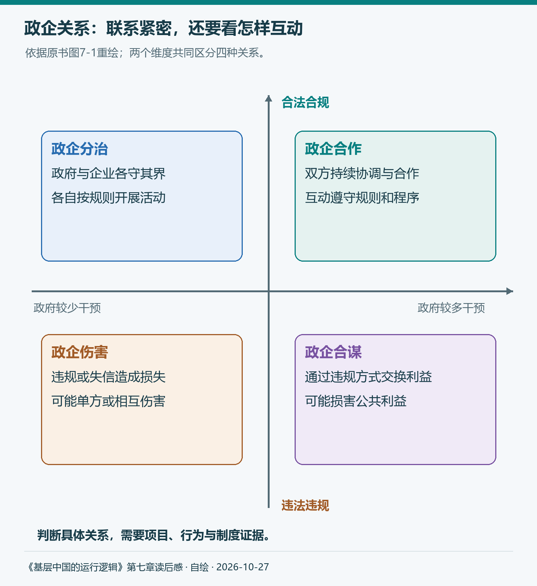
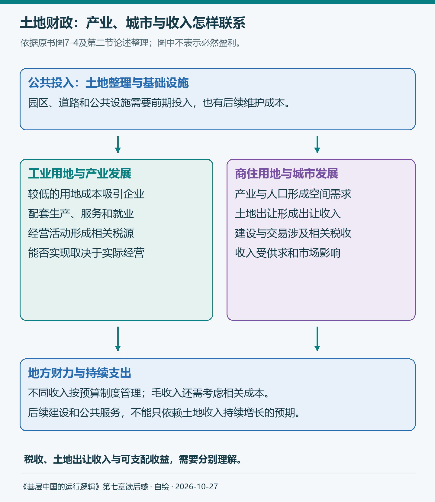
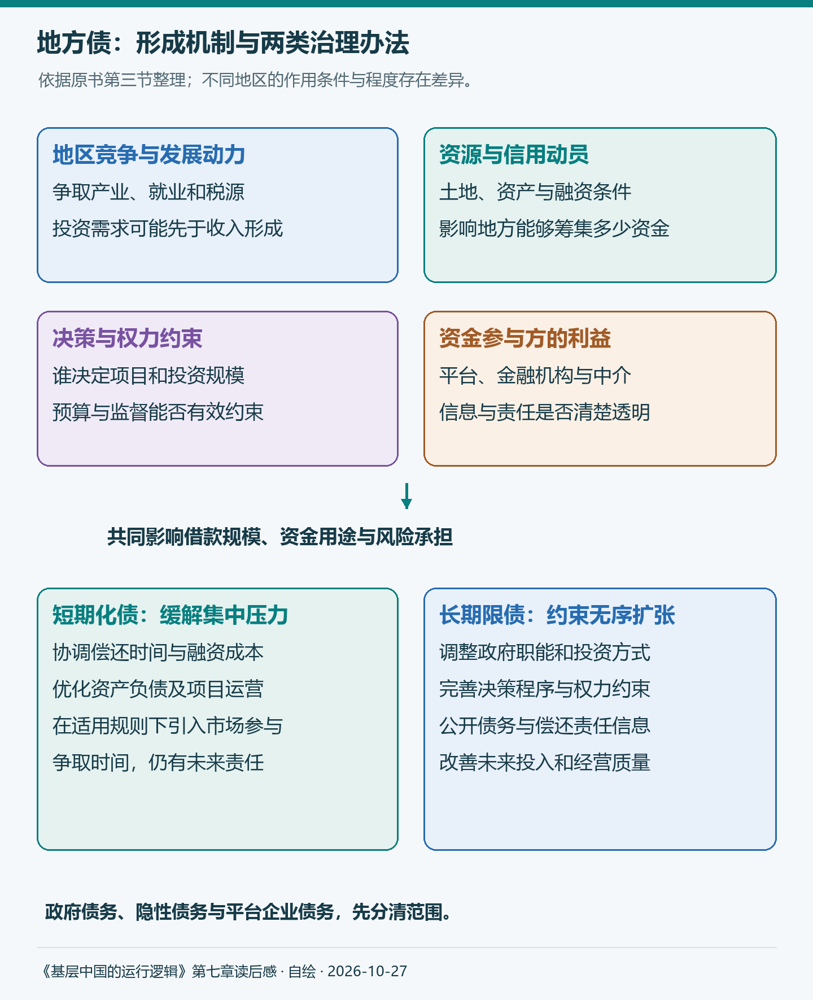
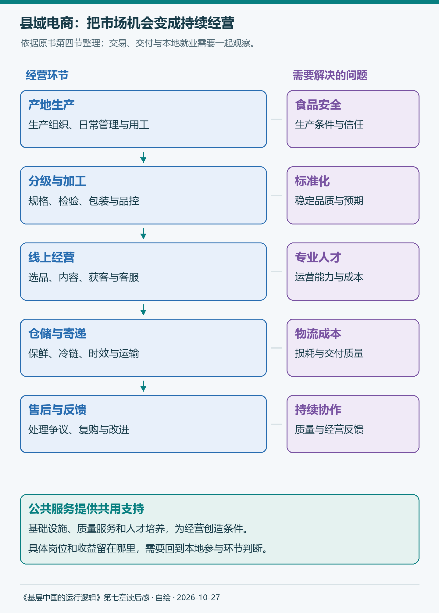

# 《基层中国的运行逻辑》第七章：基层治理的困境

第四章让我看见基层由哪些组织和人员构成，第五章让我看见地方主官的日程怎样被维稳、招商和借债占据，第六章又追问，考核与晋升如何影响这些人的选择。到了第七章，我开始把目光移向支撑这些日常工作的另一组条件：产业、财力与人口。

以前看到招商签约、园区建设、城市扩张，我容易把它们分别理解为发展成绩。读这一章，才开始继续问：企业为什么愿意来，公共设施由谁投入，收入能否覆盖持续支出，今天的项目又会留下怎样的未来责任？

原书的四节依次讨论招商引资、土地财政、地方债和县域电商。这个顺序很有意味：先看地方怎样争取发展，再看发展怎样获得资金、积累风险，最后回到一个更具体的问题——当旧有办法受到约束，人口流失的小县城还能怎样创造就业。

> 本文对应《基层中国的运行逻辑》第七章，保留原书四节、十二个内部小节及其顺序。作者的调研、案例与分析明确归于原书，个人理解随正文展开；四张图依据原书自绘。补充资料查阅截至2026年10月27日，历史材料、制度要求与后续实践分别说明。

## 第一节 基层招商引资的秘诀

原书从各地争取比亚迪项目的故事写起。汽车产业链长，龙头企业落地可能带来上下游配套与就业，因此一个项目会吸引多个地方竞争。书中2022年多位市委书记密集拜访企业的材料，让第五章抽象的“招商压力”变得具体。

不过，理解招商不能只看负责人跑了多少趟、签下多少金额。企业最后为什么选择某个地方，政府投入以后得到什么，合作能否持续，才是这一节接下来要解释的问题。

### 一、从政企博弈理解招商引资

作者先提醒，地方主要负责人存在任职变化，企业也会根据经营条件选择区位。招商因此包含双方的选择、承诺与预期，不能简单理解成政府发出命令，企业就来投资。

这里的流动能力需要放回具体条件。负责人有任期，企业的厂房、设备、供应商和员工却可能难以迁移。项目落地前后，双方的选择空间会变化，这也是为什么事前的热情接洽，不能替代事后的稳定规则。

原书用两个维度区分政企关系：政府是否干预企业经营，互动是否符合法律规则。由此形成政企合作、政企分治、政企伤害、政企合谋四种类型。

*图1：依据原书图7-1重绘。横轴表示政府干预程度，纵轴表示互动是否合规；四象限是作者的分析框架，不能据此给某个地区直接贴标签。*

图里最值得细看的，是合作与合谋都可能表现为双方联系紧密。政府帮助协调资源，企业承诺投资，表面上可以很相似；区别还要看程序、规则，以及有没有通过违规利益交换损害公共利益。

作者进一步把长期预期和监督引入分析。双方如果有持续合作的收益，就更有动力维护关系；监督能否发挥作用，又会影响这种关系沿什么方式发展。第五章谈到的“激励相容”，在这里从负责人怎样推动工作，扩展到政府与企业怎样形成长期合作。

我由此改变了一个直觉：评价营商环境，既要看办事是否便利，也要看承诺是否可信、规则是否稳定。热情服务能够帮助企业开始投资，持续经营则需要更可靠的制度条件。

### 二、各显神通的招商秘诀

原书概括了四种模式。把它们放在一起看，地方吸引企业所能提供的资源，其实并不只有优惠政策。

**第一种是乡情招商。** 老乡、侨胞和商会网络，使双方更容易接触、沟通与建立初步信任。原书通过侨乡与返乡投资说明这种作用。但乡情能打开谈话的门，企业是否长期经营，仍要回到成本、市场和配套条件。

**第二种是产业招商。** 已有产业形成供应商、客户与技术人才，新企业进入以后就不必从零建立所有联系。原书机器人产业港的例子，重点在于把龙头、上下游、系统集成和服务支持逐步接起来。真正有吸引力的，是企业进入后能够使用的一整套生产条件。

**第三种是平台招商。** 园区提供土地整理、基础设施、政务服务等共同条件。平台层次与资源获取存在联系，但对企业而言，还要看这些条件能否真正降低经营中的反复与不确定性。一个园区的牌子，与园区持续服务的能力，需要一起观察。

**第四种是政府风投。** 书中合肥与蔚来的案例，说明地方通过国有资本、产业基金等参与投资，可能帮助企业渡过早期困难，并带动产业发展。这里同时涉及公共政策目标、投资管理与风险承担，不能只用一次成功退出或股价上涨评价整个模式。

2025年公开的政府投资基金指导意见，为这部分讨论增加了新的制度背景。它强调专业运作与较长周期评价，也明确不以招商引资为目的设立政府投资基金，并严格控制县级新设基金。原书描述的历史模式，需要与后续政策定位一起理解。[指导意见](https://app.www.gov.cn/govdata/gov/202501/07/523418/article.html)

这四种模式可以组合。一个项目可能同时依靠产业基础、园区配套和资本支持。对我来说，阅读它们的价值，是学会问地方到底提供了什么条件，企业又为什么认为这些条件值得投入。

### 三、招商乱象与陷阱

成功案例容易被看见，失败项目却可能长期留在土地、账款和未完成的厂房里。原书接着提出三点提醒。

首先是互害式招商。地区为了争取企业，可能不断提高补贴或降低承诺门槛。如果企业只是改变注册地，实际生产没有增加，地区之间争夺的就主要是既有税源。签约的一方短期看似获益，整体却未必创造相应价值。

其次是理性看待合肥模式。作者指出，人们熟悉成功项目，却容易忽略同一时期的失败投资。照搬一个结果，还可能漏掉当地产业基础、专业团队与财政承受能力。政府参与投资的理由，需要落实到它能够弥补什么条件，而不能只因为别的地方赚到了钱。

最后是避免政企伤害。原书用汉能等案例说明，政府也可能面对不兑现的企业承诺：土地和资金已经投入，预期中的生产与就业却没有出现。此时，事前的合作愿望会转成事后的损失与争议。

2026年4月，深圳市政府网站介绍，市国资委将其签署的招商引资协议等纳入公平竞争审查对象。这提供了一个程序细化的例子：合作内容进入审查，才有机会在投入以前识别规则问题。[地方安排](https://www.sz.gov.cn/cn/xxgk/zfxxgj/bmdt/content/post_12744387.html)

读到这里，我会把“签约、落地、投产、持续经营”分别看。它们是不同阶段，需要不同证据。判断一个招商项目，还要继续看产业是否匹配、承诺是否可信、公共投入能否承受，以及失败时由谁承担责任。

而无论哪种模式，园区、道路与服务设施都需要资金。这就进入第二节：地方为什么会高度依赖土地财政？

## 第二节 土地财政还能持续吗？

### 一、土地财政的由来和现状

作者把土地财政放回改革与发展的历史过程：市场化和出口导向带来产业机会，园区建设需要成片土地与配套设施，国企改革、分税制及住房制度变化，又共同改变了地方的收入与投资选择。

这些背景放在一起，才能理解地方为什么积极建设园区。企业落地有望带来税收、就业和配套产业，而前期整理土地、修建道路、完善供水供电，却要先发生支出。公共投入与收入形成之间，存在时间差。

原书进一步比较工业用地和商住用地。工业企业能够在地区之间比较条件，地方为了吸引它们，可能压低土地成本；城市发展吸引人口和住房需求，商住用地则可能带来较高出让收入。地方借此继续改善设施、支持产业和城市建设。

*图2：依据原书图7-4及相邻论述整理。土地出让收入与相关税收分别标识；箭头表示作者分析的联系，实际收益取决于产业、人口、市场与公共投入等条件。*

这套机制让产业、就业、城市扩张和地方收入联系起来。理解它曾经带来的发展动力，也就更容易理解地方为什么逐步形成依赖：建设改善条件，条件吸引产业与人口，土地增值又支持进一步建设。

但每一步都需要条件。产业能否经营，人口是否进入，住房是否有人购买，都会影响后续收入。把一个阶段出现过的正向联系，视为可以无限维持的循环，风险就开始累积。

原书用多张图比较全国、省份与城市的土地财政状况。阅读时有个重要区别：土地出让收入占GDP的比例，与土地出让收入相对一般公共预算收入的比例，分母不同，不能直接互相排序。前者帮助观察与经济规模的关系，后者更接近比较地方的收入结构。

2026年10月23日财政部公布，前三季度国有土地使用权出让收入16087亿元，同比下降27.9%。这是当年累计口径，不能与书中某个全年数额直接相比，但它提醒我，未来财力不能简单沿用过去土地收入持续增长的预期。[财政部发布会](https://www.mof.gov.cn/zhengwuxinxi/caizhengxinwen/202610/t20261023_4003429.htm)

### 二、土地财政的后果

原书从五个方面分析代价。它们把前面看似顺畅的发展过程，重新放回居民、资源与风险之中。

**第一是高房价。** 当地方收入与商住用地出让紧密相连，土地价格和供应方式便会影响住房成本。理解这个机制，并不意味着住房价格只由土地财政决定；人口、住房供求与信贷条件也在起作用。作者提醒的是，地方的收入目标与居民的居住负担可能产生张力。

**第二是贫富差距。** 房产构成家庭财富的重要部分，资产价格变化会使已有房产与尚未购房家庭的处境不同。这里要把收入和财富分开：工资是一定时期的流量，房产等资产形成存量，两种分布可以出现不同程度的不平等。

**第三是资源错配。** 建成设施与创造持续价值之间，还有距离。原书讨论“鬼城”和低回报基础设施，重点在于公共投入如果偏离真实需求，留下的可能是维护成本和偿还责任。楼建起来、路修起来，尚不足以说明资源得到了有效使用。

**第四是腐败风险。** 土地、工程与规划涉及集中利益，决策、交易和监督的安排因此重要。这里与第三章的权力边界接上了：越是能影响重大利益的决定，越需要清楚的程序和外部约束。

**第五是金融风险。** 土地与房地产的预期收益，可能同时影响企业融资、居民负担和地方偿还能力。收入增长时不容易显现的脆弱性，会在销售、地价或现金流变化时集中暴露。

我觉得这一节最有用的，是把“收入多少”继续拆开：土地出让毛收入并非都可自由支配，还要考虑征拆、整理与相关支出。用收入判断偿还能力，需要对应成本、期限和债务主体，不能只拿几个大数字作比较。

### 三、土地财政的出路

既然土地财政难以按原有方式持续，是否换一个收入来源就够了？原书依次讨论土地制度调整、收购住房转作保障用途，以及“股权财政”等思路，随后把问题推向政府职能。

增加土地供应，可以改变一部分供求条件，但地方如何获得持续收入仍需回答。收购住房转为保障用途，可以同时讨论去库存与居住保障，却还要面对资金、运营和需求匹配。不同办法回应的是不同问题，不能把其中一种直接看作解决全部财政困难的开关。

“股权财政”尤其容易与第一节的政府风投混在一起。支持一个产业、持有一项资产，与形成可稳定安排的财政收益，并不是同一件事。投资需要时间，也有亏损和退出的不确定性，基金规模或账面估值不能直接变成当期可用财力。

作者最后强调，要从发展型政府逐步向服务型政府转变，重新理解政府和市场的边界。我读到的重点是：地方不必把所有发展机会都变成自己主导的投资项目，也需要持续提供规则、基础设施和公共服务。

收入和支出应一起看。减少低效投资，和保障教育、医疗、基本运转，可以属于同一项长期调整。转型需要具体辨认哪些事情应当做、怎样做得更有效，而不只是笼统地要求少支出。

但即便新的安排开始形成，过去项目留下的偿还责任仍然存在。土地收入和增长预期一旦变化，债务就更加突出。

## 第三节 天量地方债出路何在？

### 一、地方债的现状

原书先回答三个问题：全国规模怎样变化，各地区余额有何差别，哪些地方负担更重。书中统计显示，全国法定地方政府债务余额从2015年的约13.78万亿元，增加到2023年的约40.74万亿元。这组历史数据说明了扩张过程。

不过，规模之外更重要的是范围。地方政府依法发行的债券、违法违规形成的隐性债务，以及融资平台企业本身的债务，不能因为都与地方建设有关，就直接加总成性质相同的一笔钱。企业借款是否形成政府偿还责任，还需要进一步识别。

余额和负担也需要区分。经济规模较大的省份，可能债务余额较高，负债率却较低。原书使用的负债率，是债务余额相对GDP的比例；若换用财政收入等作为分母，指标含义就不同。更高余额，并不自动意味着更弱偿还能力。

此外，城投债券、银行贷款、商业票据具有不同合同与统计范围。出现某种票据逾期，不能直接推出地方政府债券已经违约。读到“地方债风险”时，先问债是谁借的、以什么形式借的、由谁偿还，会比先被总量吓住更有帮助。

### 二、产生地方债的原因

原书用独山县说明债务可能超出地方财力的情形。真正值得追问的，是为什么一个财力有限的地方，有动力、也有能力借到远超当期收入的资金。

作者按四个方面解释。

**第一是地区竞争。** 发展能够带来税源、就业与政绩，地方就有动力争取项目、扩大投资。收入形成需要时间，借款则可能使建设先开始。第六章讨论的激励，在这里进入了地方的投资选择。

**第二是“无限责任公司”特征。** 这是作者的分析比喻：地方承担广泛责任，也能够动员土地、国有资源及信用等条件。放贷者可能据此形成不同于普通企业的风险预期。它并非地方政府的法定组织形式，也不能据此推定任何债务最终都会由中央兜底。

**第三是缺少充分约束的“一把手”权力。** 当负责人有强烈的发展愿望，决策又难以受到有效审议和约束，超过本地承受能力的项目就更容易推进。独山县的故事因此需要与预算、决策程序和监督一起看，不能只解释为个人想做事。

**第四是隐性的政企合谋。** 项目资金要进入，还需要金融机构、中介与平台等参与。若参与方通过不透明安排获得收益，公共部门却承担损失，就会出现作者所说的合谋。第一节的政企关系框架，在这里再次发挥解释作用。

四点连接起来，我才更容易理解债务如何形成：发展激励推动需求，资源与信用影响融资能力，决策和监督影响用途，各参与方的利益又影响资金进入的方式。约束其中一个环节，并不意味着其他环节的问题会自动消失。

### 三、化解地方债的出路

原书把办法分为短期化债与长期限债。这一区分让我觉得很清楚：先缓解集中到期和现金流压力，再减少无序扩张的条件，两件事需要同时推进。

短期方面，作者依次讨论中央协调、地方优化资产负债安排，以及适当扩大市场化参与。延长时间、降低成本、盘活资产或改善项目运营，可以分别影响当期偿还安排，但不会产生完全相同的效果。

2026年10月的财政部发布会披露，1—9月用于置换存量隐性债务的专项债券发行18977亿元，完成全年2万亿元限额的95%。这说明置换政策的执行进度；债务成本与期限可能因此调整，但不能把这个比例当作全部地方债已经化解的比例。[执行进展](https://www.mof.gov.cn/zhengwuxinxi/caizhengxinwen/202610/t20261023_4003429.htm)

市场化参与同样需要看制度背景。原书谈到PPP等办法，2023年公开的新机制则聚焦使用者付费、采取特许经营模式。作者的历史讨论与今天具体项目可采用的安排，需要分别理解。[国家发展改革委解读](https://www.ndrc.gov.cn/xxgk/jd/jd/202311/t20231117_1362068_ext.html)

长期方面，原书依次提出政府职能转型、约束地方主要负责人权力、提高融资平台债务透明度。背后的共同问题是：谁决定投资，谁承担责任，谁能够看到全部信息，又由谁对不合理安排提出约束。

*图3：依据原书第三节整理。上部归纳发展动力、融资条件与决策监督，下部区分短期化债和长期限债；图示没有表示某项措施必然降低多少债务。*

我对“化债”的理解因此从一个金额，变成一组相互联系的安排。置换争取了时间，这段时间是否用于改善运营、保障公共服务、减少低效投资，影响着未来压力能否真正减轻。

而减少无效投资以后，地方仍需要工作岗位和持续收入。对于人口流失的小县城，新的机会在哪里？第四节转向县域电商。

## 第四节 电商能救活小县城吗？

### 一、“每个人的故乡都在沦陷”

原书从作者与县委书记聊天的经历进入人口流失。一位负责人担心，短期压力是安全稳定，长期压力却是人越来越少。这句话把第四章的人与岗位、第五章的发展任务，再次连接起来。

人口减少既影响市场，也会改变教育、医疗和公共设施的使用需求。年轻人离开以后，留下的人仍需要服务；原来按较大人口规模安排的设施，也需要重新考虑运营和维护。县城的变化因而不只是街上少了多少行人。

作者还用2011—2020年的数据讨论县域经济：总量可以上升，占全国的份额却下降。这两个现象并不矛盾。份额下降说明相对位置发生变化，不能直接改写为所有县域经济都在绝对萎缩，统计范围和行政区划变化也会影响比较。

“故乡沦陷”的表达容易引发感慨，我更愿意顺着它继续问：年轻人为什么离开，什么条件能让人留下？收入、教育、医疗、家庭支持和职业空间都在其中。乡情可以使人牵挂家乡，长期生活仍需要现实条件。

原书把农产品电商视为一个重要突破口。它试图回答的，是县域怎样越过有限的本地市场，接触更大范围的需求。

### 二、为什么只有电商才能救活小县城？

这是作者提出的一个很强的判断。我会沿着原书的五个理由理解其依据，再看这些理由需要什么条件。县域仍可能拥有制造业、文旅或其他服务业机会，电商提供的是值得认真考察的一条道路。

#### 1. 产业规模足够大，就业带动效应足够强

原书从沙集镇的淘宝创业讲起：农户通过网络找到客户，再组织生产和交付，逐渐形成产业联系。此后的电商业态又扩展到直播、短视频、社交等渠道。

我觉得就业意义要沿着整个经营过程看。除了主播，还需要生产加工、拍摄设计、运营客服、包装仓配与售后。县域能获得多少岗位，取决于实际承接了哪些环节，全国交易规模不能直接换算成本县居民收入。

2026年8月的商务部发布会介绍了县乡物流网点升级，以及农产品分拣、预冷、初加工设施建设进展。这让我看到，电商规模的背后，还有一套让商品适合销售、能够交付的服务体系。[发布会实录](https://interview.mofcom.gov.cn/detail/202608/ff808081a018349901a018e9e7fb0007.html)

#### 2. 国家高度重视，政策支持力度大

作者梳理“数商兴农”等政策，说明政府在基础设施和营商条件方面提供支持。对于单个小经营者来说，共用的物流、网络和服务设施，可以降低进入市场的门槛。

不过，政策提出目标、设施建设完成、企业经营改善，是需要分别观察的阶段。一个直播基地建成以后，有没有适合的产品、持续的订单与能够承担运营的人，仍然决定其后续价值。

#### 3. 电商是地方政府推动经济社会发展的有力抓手

原书用丁真与地方文旅的联动，说明网络传播可以使一个地区迅速进入公众视野。地方政府、媒体、平台与经营者共同参与，电商因此超出了个人开店的范围。

但“被看见”只是开始。关注能否转成持续订单，游客来了以后服务能否跟上，本地企业和居民留下多少收益，需要继续观察。文旅出圈与农产品电商又有不同经营条件，不能用一次热搜证明所有产业都已经受益。

#### 4. 电商能够体现后发优势的原则

互联网为一些地方提供了跨越空间距离、直接接触客户的机会。没有大型线下渠道的县域经营者，也可能把产品展示给远处消费者，这是作者强调的后发优势。

不过，接入网络并不意味着所有经营者条件相同。产品品质、品牌、人才、资金和履约能力仍会造成差异。技术打开机会以后，还需要把生产和服务做好，才能把机会留住。

#### 5. 县域电商符合“长尾理论”的经济规律

原书借“长尾理论”说明，小众产品可以在更广阔的市场里找到足够多的消费者。某种地方特产，在本县需求有限，面向全国以后，分散的需求就可能聚合起来。

这个解释很有吸引力，也需要把成本算进去。消费者容易找到商品，不代表经营者可以免去品控、运输、获客和售后的成本。特色只有在品质可信、价格合适且能够稳定交付时，才更可能形成持续生意。

五个理由读下来，我理解作者的期待：电商让县域不必只依靠本地人口形成市场。但市场接触范围扩大以后，经营能力和收益分配仍需具体分析，也不能仅由交易增长就推定人口一定回流。

### 三、县域电商的发展瓶颈和对策

原书没有停在期待上，而是继续提出四个瓶颈。把它们接到前面的机会后面，这一节才完整。

**第一是食品安全。** 消费者隔着屏幕，难以判断产品的生产条件与真实品质。平台评价、检测认证、经营组织和可追溯信息，都可能参与建立信任；一张拍得漂亮的照片，不能独自承担这些任务。

**第二是标准化程度低。** 同一种水果，也可能因为地块、气候、采摘与保存方式出现差异。商品规格、分级、包装和售后安排，影响消费者能否形成稳定预期。作者讨论“龙头公司＋农场”等组织方式，是想改善生产管理与品控，实际采用时仍要看农户关系、用工和经营条件。

**第三是物流成本。** 生鲜产品尤其需要控制损耗、时效和温度。网上卖得出去，只完成了交易的一部分，接下来还要把符合承诺的商品送到消费者手里。

2026年5月，江苏省邮政管理局介绍固城湖大闸蟹的寄递实践：产地揽收、包装、冷链专线与销售环节相衔接。这个例子帮助解释，物流改善可以深入到产品经营本身。它依托高淳已有的养殖与市场条件，适合用来理解协作过程，不能直接复制成所有县的方案。[实践报道](https://js.spb.gov.cn/jssyzglj/c102452/c102454/202605/ee48c6ac25e34b4fb926a16ba214874d.shtml)

**第四是人才匮乏。** 从选品到运营、设计和客服，每一步都有专业要求。原书提出，将部分运营功能放到更容易吸引人才的城市，生产环节留在当地，可以作为一种配置办法。

这个思路让我继续追问：哪些工作必须在产地，哪些可以跨地区协作，哪些岗位与收益最终留在本县？电商发展不必等同于所有总部与人才都搬回县城，但也不能只看到交易额，却忽略本地真正获得了什么。

*图4：依据原书第四节整理。经营环节与四类瓶颈对应，公共服务提供支持；图中没有把流量、交易额与农民收入画成自动转换关系。*

到这里，第四节又回到了第一节。地方可以支持共用设施、质量服务和人才培养，企业则需要面对真实需求与经营成本。电商换了产业场景，政企关系、财政投入与持续运营的问题仍然存在。

## 读完这一章，我会怎样理解发展的可持续性

这一章让我把地方发展的几件大事连起来看。招商关心企业为什么来，土地财政关心建设怎样获得资金，地方债关心投入留下什么责任，县域电商则重新把讨论带回居民的就业与生活。

过去看到项目落地，我容易先想到增长；现在还会继续问，产业是否适合当地，经营能否持续，公共投入有没有形成值得承担的长期价值。一个地方既需要争取机会，也需要保留应对风险和保障基本服务的能力。

第四章提出任务与资源的关系，第五章呈现主官承受的压力，第六章讨论这些压力怎样进入行为选择。第七章进一步提醒我，理解地方治理，还要看财力如何形成、风险由谁承担，以及居民能否在发展中获得持续的工作与服务。

原书第一道思考题问，政企合作为什么会变成政企伤害？我会沿着全章回看：是不是承诺失去约束，投资偏离需求，收益预期过于乐观，或者责任与信息始终不清？把问题落到这些具体环节，才能从理解困境，继续走向判断改进的方向。

## 参考与说明

- 《基层中国的运行逻辑》，第七章“基层治理的困境”。书中招商案例、历史财政数据、地方债分析与电商论述均归于原书。
- [国务院办公厅关于促进政府投资基金高质量发展的指导意见](https://app.www.gov.cn/govdata/gov/202501/07/523418/article.html)，文件落款2025年1月2日，1月7日公开。
- [深圳市国资委公平竞争审查操作规程修订介绍](https://www.sz.gov.cn/cn/xxgk/zfxxgj/bmdt/content/post_12744387.html)，深圳市政府网站，2026年4月20日。
- [财政部2026年前三季度财政收支情况新闻发布会实录](https://www.mof.gov.cn/zhengwuxinxi/caizhengxinwen/202610/t20261023_4003429.htm)，2026年10月23日。文中土地收入与置换发行进度均保留累计时期及范围。
- [国家发展改革委关于政府和社会资本合作新机制的解读](https://www.ndrc.gov.cn/xxgk/jd/jd/202311/t20231117_1362068_ext.html)，2023年11月17日。
- [商务部关于激发下沉市场活力活跃县域消费的发布会实录](https://interview.mofcom.gov.cn/detail/202608/ff808081a018349901a018e9e7fb0007.html)，2026年8月18日。
- [南京市快递服务现代农业项目入选全国典型案例](https://js.spb.gov.cn/jssyzglj/c102452/c102454/202605/ee48c6ac25e34b4fb926a16ba214874d.shtml)，江苏省邮政管理局，2026年5月11日。项目做法归于报道，不据此推算全国效果。
- 本文使用AI辅助整理与起草；四张中文图依据原书自绘并保留源码。个人理解与作者观点随文区分，公开补充材料用于帮助理解原书提出的问题。
