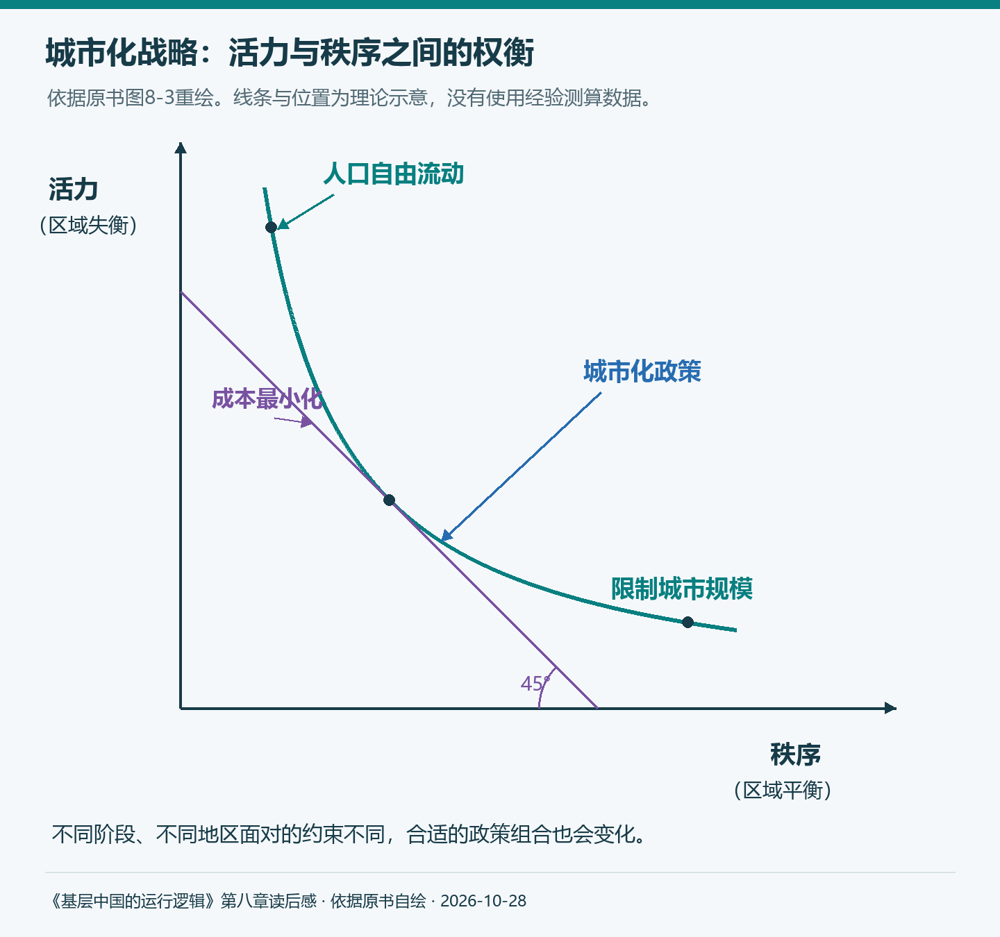
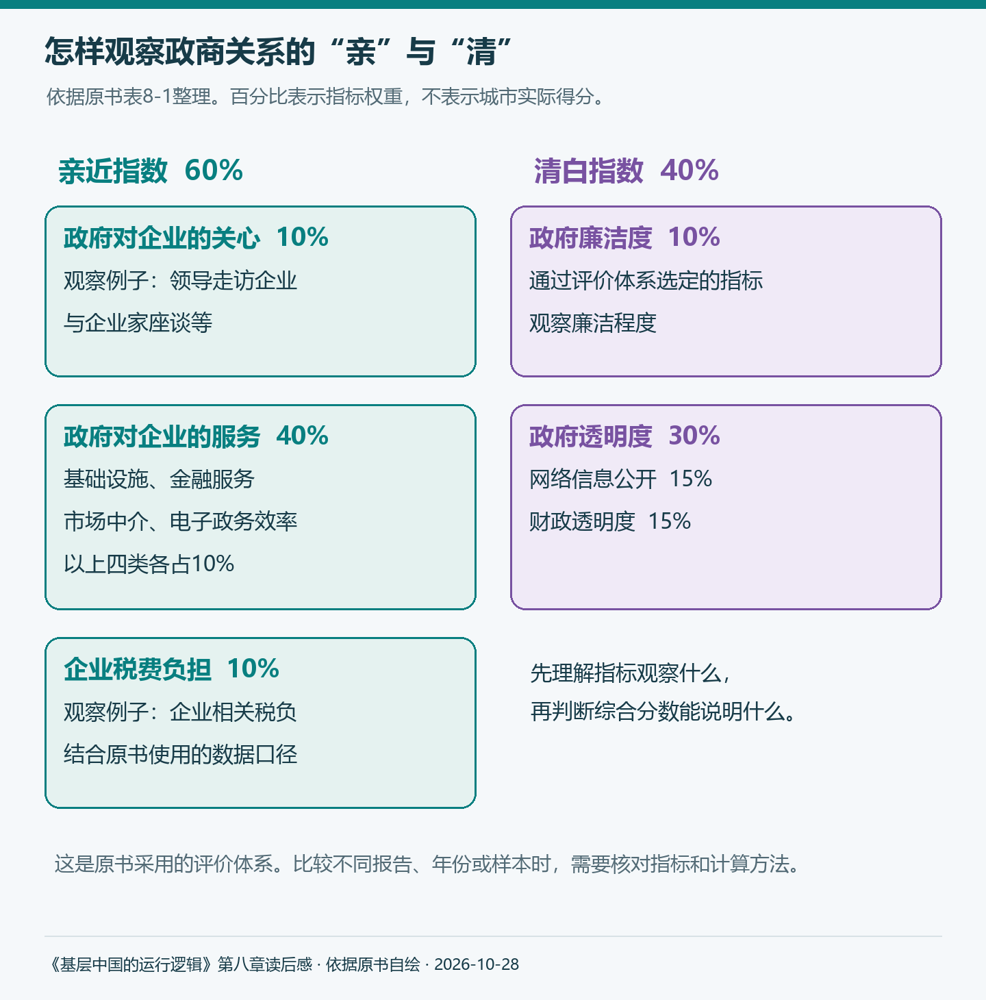
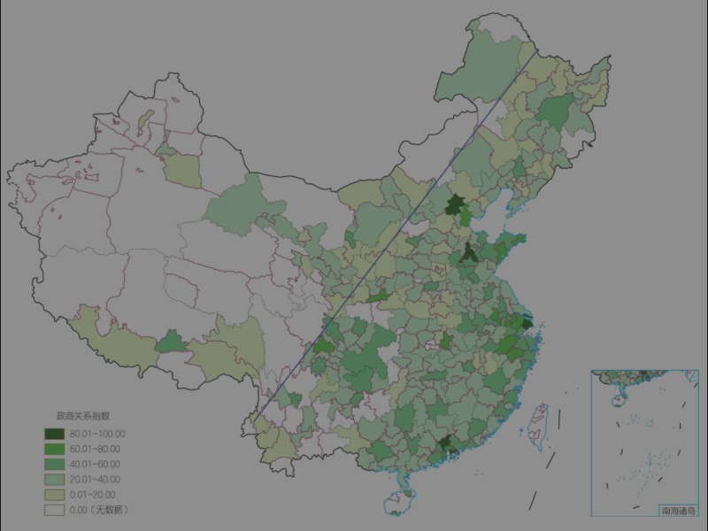
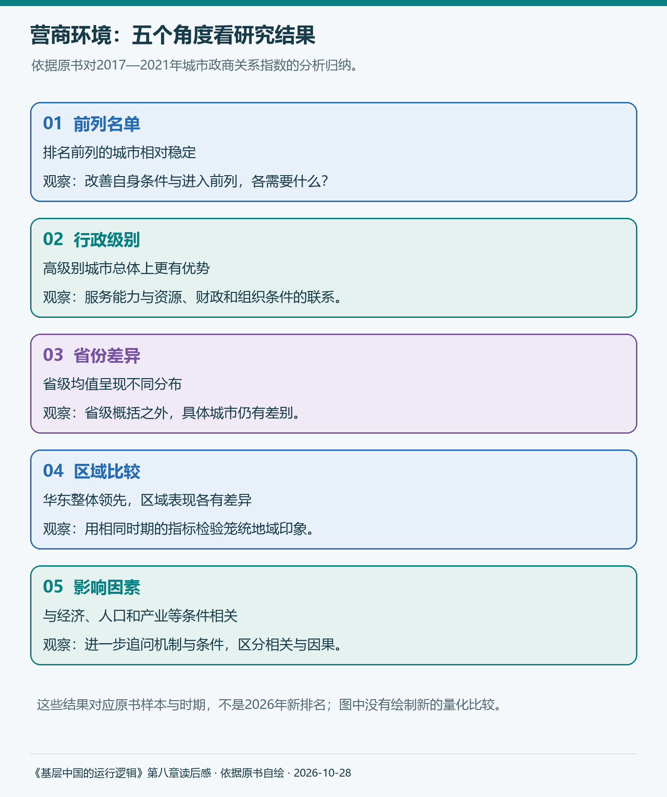

# 《基层中国的运行逻辑》第八章：区域协同发展之路

第四章让我看到基层由哪些组织和人员构成，第五章又把地方主官放回维稳、招商、借债的日常工作。读到第八章，视野进一步打开：一个地方的发展，会怎样影响周边城市？人口和企业不断流动，公共服务与制度安排又怎样跟上？

以前谈城市发展，我容易把问题理解为“大城市好还是小城市好”。就业机会、住房成本、孩子上学、生活节奏，各有各的道理。这一章让我意识到，个人选择之外，还有一个更大的问题：不同规模、不同条件的城市，怎样组成一个能够分工协作的体系？

原书从统一大市场讲起。共同的制度规则、庞大的人口与需求，构成了重要基础；地区间的差异与互补同样重要。生产、加工、研发、物流与消费分布在不同地方，一个城市的发展往往依靠其他地区提供人员、原料、配套和市场。理解这层联系，才能进入本章的“区域协同”。

> 本文对应《基层中国的运行逻辑》第八章，保留原书两节、六个主要小节及内部编号顺序。作者的研究、案例与判断归于原书，个人理解随文展开；三张图依据原书自绘，一张地图保留原书图。补充资料查阅截至2026年10月28日，历史排名与后续制度实践分别说明。

## 第一节 大国大城还是均衡发展？

原书先展示城市之间的悬殊差异。按书中2022年的口径，重庆全市常住人口超过3200万，而部分地级以上行政区域只有二三十万人。经济规模也有类似差距：上海GDP超过4万亿元，一些地区却只有几十亿元。

这些数字说明，讨论城市化时，面对的是条件差别很大的对象。这里的重庆人口包括其所辖区县，不能直接当作同一个连续城区的人口。行政市、城区、都市圈和城市群，需要先分清统计范围。

这场讨论还在继续。国家统计局公布，2025年末全国常住人口城镇化率达到67.89%。人口继续向城镇转移，意味着就业、教育、住房和公共服务仍需持续调整。[国家统计局人口解读](https://www.stats.gov.cn/sj/sjjd/202601/t20260119_1962338.html)

面对差异，城市化应该着重让大城市继续扩大，还是支持更多中小城市发展？作者先把两种思路的理由摆出来。

### 一、“大城论”vs.“小城论”

#### 1. “大城论”

“大城论”强调规模经济和集聚效应。企业、人口和服务集中以后，许多原本需要各自承担的固定成本，可以由更多使用者共同分担；供应商、客户和专业人才彼此接近，也能增加合作机会。

原书借马歇尔的分析，把集聚的好处概括为降低“运物、运人、运思想”的成本。运物涉及生产与物流，运人涉及通勤和交往，运思想则涉及知识传播与创新。一个企业寻找零部件、技术人员和专业服务时，周围已有相关机构，往往比从头建设整套条件容易。

这里也要区分规模与多样性。更多人使用同一项设施，可以摊薄成本；不同经验的人频繁交流，则可能产生新的创意。两者共同帮助解释，为什么一些产业持续向城市集中。

作者接着介绍陆铭的城市首位度，以及任泽平对城市经济份额、人口份额的比较。这些分析试图回答：中国的大城市是否仍有进一步集聚的空间？如果一个城市创造的经济份额明显高于它占全国的人口份额，人口继续进入就可能具有吸引力。

我觉得这类指标的价值，是把直觉变成可以讨论的依据。但从全国人口占比判断潜力，还需要继续看具体城市的住房、交通、资源和服务能力。国际比较也应统一范围：东京圈与北京市全域，并非天然就是同一种统计对象。

#### 2. “小城论”

“小城论”更重视人口转移的过程，以及大城市集中可能带来的社会成本。原书介绍费孝通从小城镇起步、逐步推进城市化的思路：农村人口可以先在附近获得非农就业，再随着经济发展，逐渐进入规模更大的城市。

把这个观点放回改革开放初期，比较容易理解。大量农村劳动力需要新的工作，乡镇企业就近吸纳就业，也减少了跨越很远距离重新安家的成本。小城镇提供了一种能够承接转变的空间。

作者还提醒，今天一些大型企业，早期正是乡镇企业。它们的起点说明，生产与组织能力能够在不同地方形成，城市发展的道路也与当时条件有关。

不过，随着产业链越来越复杂，分散布局会遇到新的困难。道路、供电、排污、仓储等设施需要投入，专业服务需要一定需求规模；如果企业和人口过于分散，这些条件就可能成本更高、使用不足。

读到这里，我对两种主张的理解有了变化。“大城论”提醒我看效率和合作机会，“小城论”提醒我看转移过程与承接能力。把各自试图解决的问题说清楚，才有条件讨论什么阶段、什么地方更适合哪种安排。

### 二、最优城市化战略分析

#### 1. 活力—秩序分析框架

作者把第一章的治理分析引入城市化，提出活力与秩序之间的权衡。

允许人口和要素自由流动，有助于让企业、劳动者寻找更合适的机会，也会给城市带来竞争压力。与此同时，发展水平不同可能使人口和资源持续集中，地区差距、边疆人口流失与社会保障问题由此更加突出。

如果更加侧重区域平衡，就需要考虑公共资源配置、欠发达地区支持和城市规模调节。这有助于改善部分地区的承接条件，也可能影响要素配置效率。不同政策组合，收益和成本会由不同的人、企业与地区承担。

*图1：依据原书图8-3重绘。纵轴为活力，横轴为秩序；曲线、切点及45°线用于说明作者的理论框架，没有表示经验测算值或全国统一的最优政策。*

这张图让我更容易理解作者为什么强调发展阶段。经济水平、交通条件、公共服务能力改变以后，同一种政策的成本与收益也会变化。东部沿海与部分中西部地区，即便处在同一年，也可能面对不同的约束。

对个人而言，这也解释了一个常见感受：大城市提供更多工作选择，住房和通勤却可能更加昂贵；小城市生活成本相对较低，一些专业机会又可能有限。政策需要处理的是这些条件之间的关系，个人则需要结合自己的职业与家庭作判断。

#### 2. 对“大城论”和“小城论”的评价

原书评价“大城论”时，先谈资源约束等常识问题，再谈成本，最后谈比较方法。

一个城市即使经济规模很大，也仍需水、土地、交通与环境承载条件。居民每天花在通勤上的时间，也是实实在在的成本。城市占全国人口的百分比不高，并不能直接消除这些具体压力。

区域之间还可能出现不对称影响。交通改善使中心城市与周边联系更紧，某些服务和产业也可能向中心集中。原书引用的高铁研究，用特定时期、特定样本讨论了这种虹吸效应。它提示我们，在评价连通性时，还应问新增机会最终落在哪里。

房价、收入、生活成本与生育选择，同样可能发生联系。理解这些关系，需要保留研究条件。城市规模只是相关因素之一，不同家庭、行业和政策环境中的体验也可能不同。

方法上，作者特别提醒统计口径与样本选择。拿某个外国城市证明“北京还可以更拥堵”，并不能直接回答新增拥堵是否值得承受；拿一个都市圈和一个行政市比较，也需要说明范围差别。

对“小城论”，作者则把注意力放在过度分散的代价。产业难以共享配套，政府提供设施和服务的平均成本可能更高，居民消费和就业的选择也可能受到限制。人口已经持续流出的地方，如果仍按原来的规模扩建设施，还可能留下维护和运营压力。

我觉得这里最值得保留的，是追问成本的承担者。中心城市享受到的收益，周边是否分享？人口进入以后，学校和社区有没有新增能力？原地留下的居民，能否继续获得基本服务？这些具体问题，帮助我们评价城市化的质量。

### 三、中国城市化的第三条道路

作者提出，在公平竞争的基础上，形成市场化、多元化和协同化的城市体系。原书按三个层次展开。

**第一，城市之间需要更公平的竞争条件。** 第二章已经讨论过，城市行政等级会影响公共资源、融资和人才条件。人口向某地聚集，可能同时受到市场机会与资源配置的影响。要判断集聚是否合理，就要继续辨认这些作用。

第五章让我理解地方为什么积极招商，这里又多了一层认识：每个地方都有发展动力，地方政策还需要放进全国共同规则中评价。2025年施行的《公平竞争审查条例实施办法》，将招商引资等涉经营者政策措施纳入审查范围，也对外地经营者面临的歧视性要求作出约束。这使公平竞争落实到具体政策内容。[实施办法](https://www.samr.gov.cn/zw/zfxxgk/fdzdgknr/fgs/art/2025/art_2084c3ba225943c2a670d27e85fb00be.html)

**第二，城市应形成多元的生态系统。** 有些地方适合研发和专业服务，有些地方具有生产、物流或生活配套优势。不同规模城市能够分工协作，才更容易让各自条件发挥作用。均衡发展也可以体现为基本服务更加可及、机会更能共享，各地无需具有相同的人口和产业规模。

**第三，城市体系需要动态调整。** 当前人口结构、产业需求和生活方式都在变化，公共资源配置也应随之变化。人口流入地需要增加承接能力，人口流出地则需要根据实际居住人口，安排仍然必要的教育、医疗和照护服务。

2026年公开的常住地基本公共服务实施意见，为这个问题提供了新的制度回应。它涉及随迁子女教育、医疗保障与服务共建共享，并要求各地结合条件循序推进。文件还提出，探索跨行政区合作办学办医等安排。[国务院实施意见](https://www.mee.gov.cn/zcwj/gwywj/202605/t20260525_1155865.shtml)

这与第四章自然接上了。人口移动以后，需求会落到具体学校、医院、街道和社区。政策提出服务方向，人员、经费与跨部门协作还需共同支持办理。区域协同因此既关乎产业布局，也关乎一个家庭换了城市以后，生活怎样连续下去。

城市规模与分工影响发展机会，企业能否持续经营，又取决于当地的规则和服务。原书由此进入第二节。

## 第二节 投资不过山海关？

营商环境看似是企业的问题，其实也影响就业、创业和生活。一个地方能否提供稳定预期、可靠服务，会影响企业进入，也会影响人们是否愿意长期留下。

“投资不过山海关”“投资不过南宋界”等说法，给出了很强的地域判断。作者接下来先解释营商环境的重要性，再介绍评价方法，最后用数据检验这些说法。这一顺序值得保留：先明确依据，再讨论结论。

### 一、为什么营商环境很重要？

如果生产成本低、商品又有销路，企业为什么还要格外关注制度环境？原书用不完全契约回答这个问题。

人无法预见未来所有情况，合同也难以把全部意外与责任事先写尽。供应链中断、政策变化、合作方更替，都可能使原有安排需要重新协调。这个时候，产权、履约程序、争议处理与公共服务，就会影响企业能否继续经营。

作者用乌克兰小麦贸易说明突发冲突怎样打断供应链，又用租房和购房说明权利保障对行为的影响。对我来说，这两个例子都在提醒：比较一笔交易的收益时，还要考虑遇到意外之后，原来的权利如何得到保护。

原书中的东平文旅项目则更贴近地方招商。按书中材料，一位投资者回乡参与项目，当地也有领导协调支持；但项目建设涉及审批与用地等问题，后来引发刑事案件。作者借此讨论，地方的支持与默契，并不自动形成完整、可执行的权利安排。

读这个案例，我会把几个环节分开看：项目是否受到重视，审批是否完成，具体授权和合同怎样写，争议出现以后如何处理。它们影响的是不同方面。早期合作顺利，仍需要为后续变化留下清楚的程序。

这也让我重新理解第五章的招商压力。地方希望项目尽快上马，企业希望尽早经营，双方可能都有合作意愿；要使合作延续，还需要可信的承诺与稳定的规则。领导关注可以推动协调，持续经营则涉及更长的时间。

好的营商环境，因而包含降低日常办事成本，也包含降低意外发生后的不确定性。过去我更容易注意优惠给了多少，现在也会问，人员变化、经营困难或利益冲突出现时，企业依靠什么继续维护权利与安排生产。

### 二、如何度量营商环境？

重要性讲清楚以后，问题变成：怎样比较一个地方的营商环境？作者领衔的人大课题组，将评价重点放在政商关系，围绕“亲近”和“清白”构建指标。

按原书表8-1，亲近方面包括政府对企业的关心、政府对企业的服务和企业税费负担，权重合计60%；清白方面包括廉洁度和透明度，权重合计40%。

*图2：依据原书表8-1整理。百分比为该评价体系的权重；图中展示一级指标及部分观察例子，没有表示某个城市的实际得分。*

这个划分让我看到，政商关系的健康程度需要从多个方面观察。政府能够提供基础设施、金融与专业服务，也需要公开信息、依法履职和接受监督。不同方面共同影响企业的经营条件。

作者概括报告的四个特点：研究对象聚焦政商关系，评价同时考虑“亲”与“清”，提供地级市层面的指标，并综合使用官方、网络与企业调查等数据。这样做，是把笼统的“环境好不好”，转化成可以进一步检查的具体观察。

不过，读综合分数之前，仍应理解指标怎样形成。领导走访次数提供了一种关心企业的可观察线索，透明度反映信息公开的条件，税费负担又涉及企业经营成本。它们各有解释范围，权重则决定不同观察在总分中的作用。

这与此前读《AI工程》评估章节时的认识相通：先说明“好”由哪些要求组成，再判断指标有没有捕捉到这些要求。这里借鉴的是阅读方法，真正需要理解的仍是政商关系本身。

对普通读者而言，可以从公开信息开始观察：办事需要什么材料，是否有清楚的时限；相关信息是否容易查到；遇到争议，是否存在明确的受理与反馈渠道。原书第三道思考题问怎样度量“清白”，这些公开线索就提供了继续查证的起点。

### 三、哪些地方营商环境更好？

#### 1. 城市营商环境排行榜

原书先选2019年作为代表年份，绘制292个城市的政商关系指数地图，再列出排名前20名的城市。地图与榜单分别帮助我们看空间分布和具体对象。

*图3：保留原书图8-4。颜色对应2019年政商关系指数，白色部分表示数据缺失；地图用于理解书中研究，不能作为2026年城市排名。*

作者借胡焕庸线讨论东西差异，并指出，图中的东北地区并非整体最差。书中2019年榜单的前四名是深圳、北京、广州、上海；前20名大多位于东部，西部入围城市较少。

这些结果帮助检验了笼统的地域说法，也需要放回相应指标和年份。某个区域的平均表现，无法代替对具体城市、行业和企业需求的判断。选择工厂区位、研发机构或养老地点，关注条件本来就可能不同。

原书接着引入风险投资数据。作者的理由是，风险资本对经营条件敏感，真实投资行为能够提供另一种观察。相关分布同样集中在重要经济区域，东北也存在持续投资活动，这为前面的区域比较增加了材料。

我觉得这个验证思路很有启发：一个评价体系得出的特征，可以再用不同来源的数据观察。但风险投资还会受到产业类型、融资阶段与退出条件影响，因此它主要帮助补充判断，无法独自概括所有企业的经营体验。

同样需要留意时间。原书图8-6标注2022年，邻近论述还使用2003—2020年风险投资资料。阅读时分别保留它们的时期，才能理解哪些是在看空间分布，哪些是在讨论历史变化。

#### 2. 中国城市营商环境变迁规律

为了观察持续特征，作者进一步使用2017—2021年的数据，按五个方面分析。

**第一，前列城市存在“优胜俱乐部”现象。** 排名前列的名单相对稳定，说明优势条件可能具有持续性。一个城市改善服务，与其他城市相比上升到什么位置，是可以分别讨论的问题；其他城市也在同时变化。

**第二，行政级别越高的城市，总体优势越明显。** 原书依次比较直辖市、副省级城市、省会与普通地级市。这与第二章的等级和资源分析接上，也让我回想第四章的基层能力：服务需要人员、设施和财政支持，评价工作时要看到这些条件。

**第三，不同省份的均值存在差异。** 直辖市及部分东部省份表现较好，一些中西部与东北省份靠后。省级概括帮助辨认分布，省内城市仍有差别，不能把一个均值变成每个地方相同的标签。

**第四，区域比较进一步检验地域印象。** 在原书研究时期，华东整体领先，其他区域各有差异；东北与部分中西部地区的比较，也呈现出比口号更复杂的结果。“投资不过山海关”由此需要接受具体数据与对象的检验。

**第五，政商关系指数与发展条件存在相关性。** 原书发现，指数与人均GDP、人口增长、消费水平、企业数量和服务业比例等变量正相关，与农业比例、财政供养人口比例等负相关。它们帮助提出机制问题：经济发展怎样支持服务改善，制度条件又怎样影响企业进入？

这里的关联不能直接变成一个简单处方。增加人口需要工作与服务，吸引企业也需要产业和市场；相应条件往往共同变化。要理解改善路径，需要继续看具体投入、协作和反馈。

*图4：依据原书2017—2021年分析归纳。五项分别对应名单、行政级别、省份、区域与影响因素，文字表示研究特征，没有绘制新的排名或因果估计。*

那么，城市之间除了比较排名，还能怎样共同改善条件？2026年施行的《上海市促进长三角政务服务“一网通办”规定》，提供了一个具体方向：通过跨地区流程协作，对需要迁出迁入、转移接续的事项，实行一地申请、多地接续办理，并推进材料和办理标准衔接。[协同规定](https://www.shanghai.gov.cn/nw12344/20260401/b83261592788473788f20e95dc2ec690.html)

同年5月，上海市政府网站转载的报道介绍，长三角远程虚拟窗口已设置650个点位，覆盖41个地级及以上城市。这个进展首先说明服务布局；实际办理是否顺畅，还可以继续看具体事项和使用反馈。[实践报道](https://www.shanghai.gov.cn/nw4411/20260516/bad9f29d6e9e4284940154dbdd72ad34.html)

这个例子把两节连在了一起。人口和企业跨地区活动，办理工作就可能涉及多地。窗口只是可见的一端，背后还需要责任分工、数据和材料衔接、部门协作。把这些关系接起来，也是区域协同的一部分。

## 读完这一章，我会怎样理解区域发展

这一章使我把城市规模、发展机会与制度条件放在一起看。集聚可以创造效率，公共服务影响人能否安顿下来，可靠规则则帮助企业和居民形成长期预期。不同城市怎样分工、怎样分享机会，决定了这些条件能否相互支持。

第四章让我看见具体组织和人员，第五章让我理解地方主官争取发展的压力。第八章又提醒我，很多事情需要跨出本地才能解释：人员从哪里来，服务由谁提供，项目与产业怎样连接，跨地区发生争议或需要办事时，责任如何接续。

回看原书关于超大城市落户限制的思考题，我会先列出需要了解的条件：就业能否承接，住房怎样供给，学校和医疗是否匹配，经费由谁承担，周边城市能否共同提供服务。讨论人口总量时，把这些具体条件一起摆出来，判断才能更加完整。

对我来说，区域协同最终落在这些可以继续追问的事情上：企业能够跨城组织生产，一个家庭能够在迁居后接上服务，不同规模城市也能够在共同规则中找到适合自己的位置。

## 参考与说明

- 《基层中国的运行逻辑》，第八章“区域协同发展之路”。书中的城市化理论、历史榜单、指标体系与研究判断均归于原书。
- [国家统计局2025年人口情况解读](https://www.stats.gov.cn/sj/sjjd/202601/t20260119_1962338.html)，2026年1月19日发布。文中城镇化率对应2025年末。
- [公平竞争审查条例实施办法](https://www.samr.gov.cn/zw/zfxxgk/fdzdgknr/fgs/art/2025/art_2084c3ba225943c2a670d27e85fb00be.html)，2025年2月28日公布，4月20日起施行。
- [国务院关于推行常住地提供基本公共服务的实施意见](https://www.mee.gov.cn/zcwj/gwywj/202605/t20260525_1155865.shtml)，落款2026年5月18日，所引公开删减文本于5月25日发布。
- [上海市促进长三角政务服务“一网通办”规定](https://www.shanghai.gov.cn/nw12344/20260401/b83261592788473788f20e95dc2ec690.html)，2026年3月31日通过，5月1日起施行。适用于上海市相关工作，并规定与苏浙皖协作的安排。
- [长三角政务服务“一网通办”实践报道](https://www.shanghai.gov.cn/nw4411/20260516/bad9f29d6e9e4284940154dbdd72ad34.html)，上海市政府网站，2026年5月16日，来源《解放日报》。窗口数量与覆盖情况按报道时期呈现。
- 本文使用AI辅助整理与起草，个人理解与作者观点随文区分。图1、图2、图4依据原书自绘并保留源码，图3保留原书图8-4。

