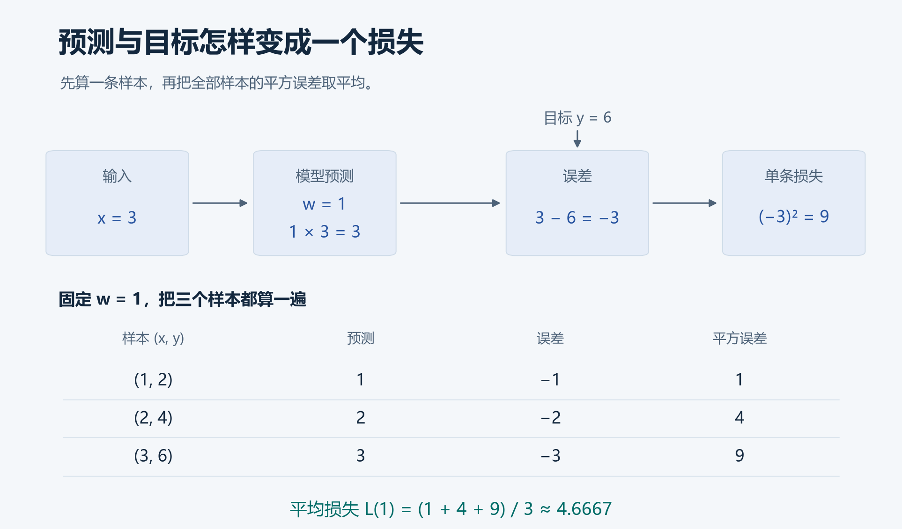
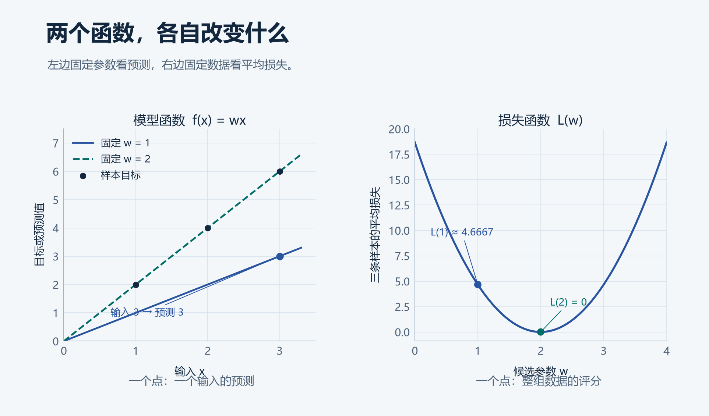
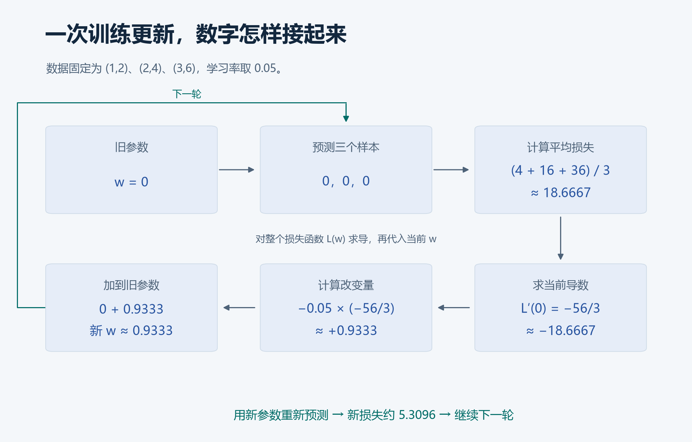

# 基础概念：从一条样本到一次训练

这份文档按“会读简单代码、知道导数”的起点解释前两课的术语。每节都有定义、数字例子和代码对应。初读可以先看图和例子，读课文时也可以回来查某个词。

我们先用三个已知例子 $(1,2)、(2,4)、(3,6)$，让程序预测输入对应的输出。模型暂时用“输入乘以一个数”这条规则。这个数可以调整，我们希望调整之后预测更接近已知答案。



*上半部分从左到右算一条样本，目标值 6 从上方进入误差计算。下半部分把三条样本的损失取平均。图中固定参数 w=1。*

## 1. 样本、输入、目标值和预测值

**样本**是用于学习或评估的一条数据。本课的样本包含一个输入和一个对应的目标值，写成 $(x,y)$。

例如 $(3,6)$ 表示输入是 3，已知目标是 6。**输入**是交给模型处理的量。**目标值**是数据中用于核对预测的数。**预测值**是模型根据输入算出来的数，记作 $\hat y$，“帽子”表示它是预测出来的。

| 数量          |      这个例子中的数 | 代码                        |
| ----------- | -----------: | ------------------------- |
| 输入 $x$      |            3 | `x = 3`                   |
| 目标 $y$      |            6 | `target = 6`              |
| 预测 $\hat y$ | 取 $w=1$ 时为 3 | `prediction = weight * x` |

目标值和预测值可以相等，也可以不同。要知道这次预测做得怎样，下一步就比较它们。

## 2. 模型、参数和权重

**模型**是从输入计算出预测的规则。前两课采用的都是带可调整数值的函数。第 1 课的模型写成 $\hat y=wx$，含义是输入乘以 $w$。

**参数**是模型内部可以通过训练调整的数值。本例中的参数只有 $w$，它也叫**权重**。固定 $w=1$，输入 3 得到 3；固定 $w=2$，同一个输入得到 6。改变参数就改变了模型给出的预测。

程序员选择 `weight * x` 这个计算形式，训练过程从数据出发调整 `weight`。我们先限定候选规则都是经过原点的直线，再从这些直线中寻找合适的一条。

**偏置**是加在预测中的可学习常数。第 2 课把规则扩展为 $\hat y=wx+b$。取 $w=2,b=1,x=3$，预测就是 $2\times3+1=7$，代码是 `weight * x + bias`。

## 3. 误差和单条损失

**误差**是预测与目标之间的差。本系列统一用“预测减目标”，即 $e=\hat y-y$。预测 3、目标 6 时，误差是 $-3$，负号表示偏低。预测 8、目标 6 时，误差是 $+2$，正号表示偏高。

**损失**是用来评价预测差距的数值。本课把单条误差平方作为这条样本的损失。误差 $-3$ 对应损失 9，误差 $+2$ 对应损失 4。

`error = prediction - target` 保留了偏高或偏低的信息。`squared_error = error ** 2` 把这次差距转换成非负的评分。这样误差为 $+2$ 和 $-2$ 的两次预测都会贡献 4，汇总时不会相互抵消。平方还会放大较大的偏差，误差绝对值翻倍，平方误差变为四倍。

## 4. 均方误差和损失函数

**均方误差**是各条样本平方误差的平均值，英文是 Mean Squared Error，缩写为 MSE。

对 $(1,2)、(2,4)、(3,6)$，取 $w=1$，三个预测为 $1、2、3$，三个误差为 $-1、-2、-3$，三个平方误差为 $1、4、9$。MSE 就是 $(1+4+9)/3=14/3\approx4.6667$。

**损失函数**规定怎样由预测和目标计算损失。固定模型形式和数据后，还可以把这个计算看成一个关于参数的函数，记作 $L(w)$。给它不同的候选 $w$，就得到不同的平均损失。比如 $L(1)=14/3$，$L(2)=0$。



*左图每条线是一个参数已经固定的模型，横轴取不同输入。右图每个点是用某个参数预测完全部三个样本后得到的平均损失，横轴取不同参数。*

下面的短程序直接计算两次评分。`loss` 函数里的数据固定，传进去的 `weight` 可以变化。

```python
def loss(weight):
    data = [(1, 2), (2, 4), (3, 6)]
    squared_error_sum = 0.0
    for x, target in data:
        error = weight * x - target
        squared_error_sum += error ** 2
    return squared_error_sum / len(data)


print(f"{loss(1):.4f}")  # 4.6667
print(f"{loss(2):.4f}")  # 0.0000
```

**训练目标**是通过调整参数尽量减小所选的损失。在这个例子中，我们希望找到使 $L(w)$ 尽量小的 $w$。

## 5. 从导数到梯度

你熟悉的导数，描述函数在当前位置随自变量变化的局部变化率。这里求的是**损失对参数的导数**。

用这三条样本可以化简得到 $L(w)=\frac{14}{3}(w-2)^2$。它的导数是 $L'(w)=\frac{28}{3}(w-2)$。在 $w=1$ 时导数约为 $-9.3333$，意味着从这里把 $w$ 增大一小点，损失会下降。把 $w$ 从 1 改成 1.01，损失实际从约 4.6667 变成 4.5738。

**偏导数**把这个想法扩展到多个参数。对于 $L(w,b)$，固定 $b$、只改变 $w$，就是求对 $w$ 的偏导；固定 $w$、只改变 $b$，就是求对 $b$ 的偏导。计算时可以把固定的那个参数当成常数，再做一元求导。

**梯度**是把对所有参数的偏导按顺序放在一起得到的向量，也就是一组有顺序的数。只有 $w$ 时用 $L'(w)$ 表示；有 $w,b$ 时有两个分量。第二课初始位置的梯度为 $(-68/3,-10)$，两个数分别说明只改 $w$ 或只改 $b$ 时损失的局部变化率。

## 6. 学习率、更新和梯度下降

**更新**指把参数从旧值改成新值。**学习率**是控制改变量大小的正数，本系列用 $\eta$ 表示，代码里叫 `learning_rate`。**梯度下降**每次先计算当前位置的梯度，再沿它的反方向更新参数。

在第 1 课中，从 $w=0$ 开始，导数为 $-56/3$，学习率取 0.05。参数改变量是 $-0.05\times(-56/3)\approx+0.9333$，所以新参数为 0.9333。用新参数再算损失，会从约 18.6667 降到 5.3096。



*所有数字属于同一次更新。下一轮用新参数重新计算。导数给出局部变化率，较大的步子可能跨过最低点，第 1 课会对比两种学习率。*

**训练**是按照选定的目标和更新方法，从数据中求出参数的过程。上图的计算重复执行，就构成训练循环。**优化器**是决定参数如何更新的算法，梯度下降是其中一种。学习率和训练次数这类由我们设定、控制训练行为的数值叫**超参数**。

## 7. 训练集、验证集和推理

**训练集**是参与计算梯度、直接影响参数更新的一组样本。**验证集**是事先留出的带目标值样本，用当前参数对它们做预测并打分，用于检查效果，也可以据此选择模型或训练设置。

第二课用 $(1,3)、(2,5)、(3,7)$ 训练，另留 $(0,1)、(4,9)$ 验证。验证损失的计算也需要目标值。如果只得到一个输入 $x=4$，可以算出预测，但还需要目标值才能计算这次预测的误差。

**推理**是用已有参数计算预测的过程。训练期间、验证期间、训练完成后，都可能调用相同的预测函数。训练还会根据训练损失求梯度并更新参数，验证则用当前参数计算留出样本的表现。

## 8. 读公式时遇到的符号

| 符号 | 怎样读 | 在本系列中的含义和例子 |
| --- | --- | --- |
| $\hat y$ | 预测的 $y$ | 模型算出的结果，例如 $1\times3=3$ |
| $i$ 和 $n$ | 第 $i$ 条，共 $n$ 条 | 三条样本时 $n=3$，$x_2=2$ |
| $\sum_{i=1}^n a_i$ | 从第 1 项加到第 $n$ 项 | $n=3$ 时就是 $a_1+a_2+a_3$ |
| $L$ 和 $L'$ | 损失函数及其导数 | $L(1)$ 是一个评分，$L'(1)$ 是该位置的变化率 |
| $\Delta w$ | $w$ 的改变量 | 新值减旧值，例如 $0.9333-0$ |
| $\eta$ | 希腊字母 eta | 学习率，例如 0.05 |
| $\partial L/\partial w$ | $L$ 对 $w$ 的偏导 | 固定其他参数，只考察 $w$ |
| $\nabla L$ | $L$ 的梯度 | 按顺序收集各参数的偏导 |
| $w_t$ 和 $w_{t+1}$ | 第 $t$ 次与下一次的参数 | $t$ 记录更新次数，$w_0$ 是初值 |
| $\approx$ | 约等于 | 可以表示四舍五入，也用于局部近似 |

完整推导在[第 1 课](../1-单参数模型/1-单参数模型.md)与[第 2 课](../2-线性回归/2-线性回归.md)。每学完一个词，都可以对着图回答两个问题：它接收什么量，计算出的量接下来用在哪里？
