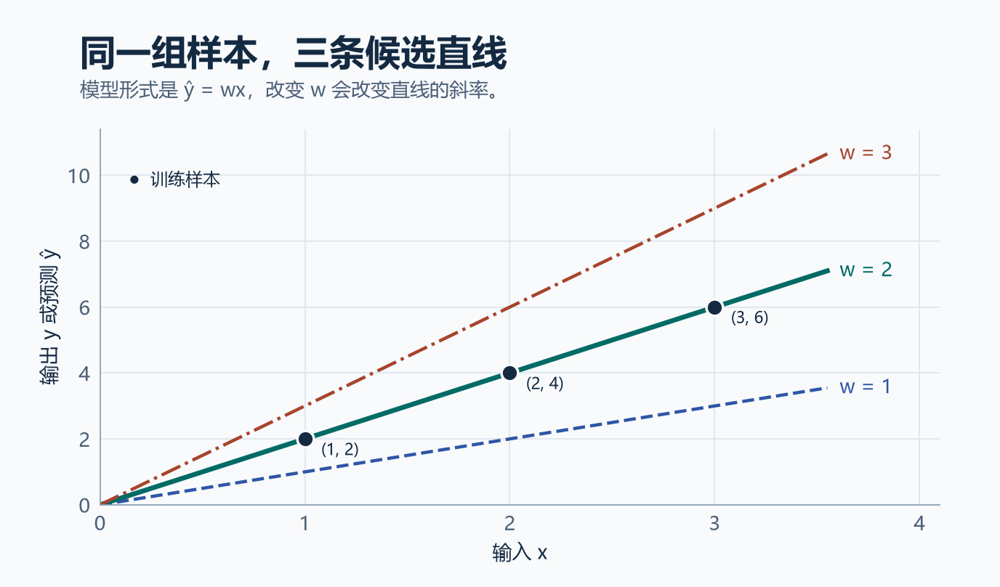

# 第 1 课：单参数模型

**模型 · 参数 · 损失 · 梯度下降**

给程序三个例子：输入 1 时输出 2，输入 2 时输出 4，输入 3 时输出 6。我们只告诉程序「请用一个数乘以输入」，让它自己找出应该乘以几。这个实验只有一个待学习的数，整个训练过程可以手算，也可以用纯 Python 跑完。

本课用到一元函数求导和链式法则。学完后，你可以从样本算出一次参数更新，读懂训练日志，并解释为什么学习率太大会让误差越来越大。

## 1. 给程序什么，让它学什么

把一条样本写成 $(x, y)$。$x$ 是输入，$y$ 是我们已有的目标值。在本课里，训练数据一共三条。

| 样本 | 输入 $x$ | 目标 $y$ |
| --- | ---: | ---: |
| 1 | 1 | 2 |
| 2 | 2 | 4 |
| 3 | 3 | 6 |

每条样本都有对应的目标值，训练时用目标值评估模型的预测。这种从**带目标值的样本**中学习的方式叫**监督学习**。我们要预测的是一个可以连续取值的数，这类任务叫**回归**。

我们选的模型形式是

$$
\hat{y} = f_w(x) = wx
$$

$\hat{y}$ 读作「预测的 $y$」。$w$ 是模型的**参数**，也叫权重。给定一个具体的 $w$，函数就确定了。例如 $f_1(x)=x$，$f_2(x)=2x$。从所有允许的 $w$ 中选值，就相当于在一组候选函数中选一个。这里的候选函数画出来都是**经过原点的直线**，$w$ 决定直线的斜率。

在代码里，模型的形式是乘法表达式，参数是变量 `weight`。程序员写下 `weight * x`，训练数据通过后面要讲的损失和更新规则影响 `weight` 的取值。预测时，$x$ 可以换成任意新输入，同一个 `weight` 会用于每一次预测。



*图 1. 横轴是输入 $x$，纵轴是输出。三条直线使用同一个模型形式，各自使用不同的参数 $w$。*

## 2. 把预测的好坏变成一个数

假设现在 $w=1$。把三个输入分别代入，预测是 $1,2,3$，真实目标是 $2,4,6$。我们规定**误差**为预测减目标：

$$
e_i = \hat{y}_i - y_i = wx_i - y_i
$$

$e_i$ 保留了预测偏高还是偏低的信息。比如两条样本的误差是 $+2$ 和 $-2$，直接取平均会得到 0。为了让两次偏差都计入损失，这里用每条样本的**平方误差**作为单样本损失：

$$
\ell_i(w) = (wx_i-y_i)^2
$$

平方误差非负，只有预测恰好等于目标时才为 0。误差绝对值从 1 增大到 2，平方误差会从 1 增大到 4，因此这项损失对大偏差更敏感。

| $x$ | 目标 $y$ | 当 $w=1$ 时的预测 | 误差 $e_i$ | 平方误差 $e_i^2$ |
| ---: | ---: | ---: | ---: | ---: |
| 1 | 2 | 1 | −1 | 1 |
| 2 | 4 | 2 | −2 | 4 |
| 3 | 6 | 3 | −3 | 9 |

再把三条样本的损失取平均，就得到**均方误差**（Mean Squared Error，MSE）。在固定的训练集上，它是一个关于 $w$ 的函数，也是我们要最小化的**训练目标**：

$$
L(w) = \frac{1}{n}\sum_{i=1}^{n}(wx_i-y_i)^2
$$

当 $w=1$，$L(1)=(1+4+9)/3=14/3$。当 $w=2$，三个预测全对，$L(2)=0$。对这组数据还可以把 $L(w)$ 化简：

$$
\begin{aligned}
L(w)
&= \frac{(w-2)^2+(2w-4)^2+(3w-6)^2}{3}\\
&= \frac{1+4+9}{3}(w-2)^2\\
&= \frac{14}{3}(w-2)^2
\end{aligned}
$$

现在问题从「找一条拟合数据的直线」变成了「找一个让 $L(w)$ 尽可能小的 $w$」。图 1 的横轴是输入 $x$，下图的横轴是参数 $w$。**下图的每一个点，都代表用同一个 $w$ 预测完三条样本后算出的平均损失。**


*图 2. 左侧切线斜率为负，增大 $w$ 会使附近的损失降低。右侧斜率为正，减小 $w$ 会使附近的损失降低。*

## 3. 让程序用梯度决定往哪走

**梯度**是损失函数对各个参数的一阶偏导数组成的向量。本课只有一个参数，所以只需看导数 $L'(w)$。它描述的是在当前位置稍微增大 $w$ 时，损失会如何变化。用一阶近似可以把这个关系写出来：

$$
L(w+\Delta w)\approx L(w)+L'(w)\,\Delta w
$$

- $L'(w)<0$ 时，给 $w$ 一个小的正增量，右边的变化项为负。
- $L'(w)>0$ 时，给 $w$ 一个小的负增量，变化项同样为负。
- $L'(w)=0$ 时，这条一阶更新规则给出的改变量为 0。本例是开口向上的抛物线，零梯度出现在最低点 $w=2$。

**梯度下降**（Gradient Descent）把这个方向写成一条更新规则：

$$
w_{\text{new}} = w_{\text{old}} - \eta\,L'(w_{\text{old}})
$$

$\eta>0$ 是**学习率**（Learning Rate）。同一位置的梯度确定后，学习率越大，每一步改动就越大。`weight` 的值由训练更新，`learning_rate` 由我们设置，它是控制训练行为的**超参数**。根据梯度等信息更新参数的算法通常叫**优化器**，本课用的就是梯度下降。

### 手算第一步

初始化 $w_0=0$。此时三个预测都为 0，损失为 $(4+16+36)/3=56/3$。对上一节的损失函数求导：

$$
L'(w)=\frac{28}{3}(w-2),\qquad L'(0)=-\frac{56}{3}
$$

取学习率 $\eta=0.05$，做一次更新：

$$
w_1=0-0.05\left(-\frac{56}{3}\right)
=\frac{14}{15}\approx 0.9333
$$

用 $w_1$ 重新计算三个预测，得到约 $0.9333,\,1.8667,\,2.8000$。它们都比初始预测更接近目标，平均损失也从约 $18.6667$ 降到了 $5.3096$。第二步要在 $w_1$ 的位置重新求导，再按同样的公式更新。

### 代码里的梯度从哪里来

上一段可以直接对化简后的 $L(w)$ 求导。写通用程序时，可以从任意一组 $(x_i,y_i)$ 出发，对每条样本使用链式法则：

$$
\frac{d}{dw}(wx_i-y_i)^2
=2(wx_i-y_i)\underbrace{\frac{d}{dw}(wx_i-y_i)}_{x_i}
=2e_ix_i
$$

导数与求和可以交换，因此整个训练目标的导数为

$$
L'(w)=\frac{1}{n}\sum_{i=1}^{n}2e_ix_i
$$

所以代码可以在同一轮循环里累加 `error ** 2` 和 `2 * error * x`，最后各自除以样本数量。在 $w=0$ 时，三条样本贡献的导数分别是 $-4,-16,-36$，平均仍是 $-56/3$。这一写法可以直接用于你换进程序的其他样本。

## 4. 把计算串成训练循环

**训练**是在数据和训练目标的约束下，求出一组参数的过程。每一轮先用**同一个**当前参数计算所有样本的预测和梯度贡献，算完平均梯度，再做一次更新。因为每次更新都使用了全部训练样本，这里用的是**全批量梯度下降**。


*图 3. 循环箭头返回预测步骤。参数已经更新，下一轮的预测和梯度也随之改变。*

把下面的代码复制到 `lesson01.py`，运行 `python lesson01.py`。代码只使用 Python 自带的功能。

```python
training_data = [(1, 2), (2, 4), (3, 6)]
weight = 0.0
learning_rate = 0.05
training_steps = 10

for step in range(training_steps):
    squared_error_sum = 0.0
    gradient_sum = 0.0

    for x, target in training_data:
        prediction = weight * x
        error = prediction - target
        squared_error_sum += error ** 2
        gradient_sum += 2 * error * x

    sample_count = len(training_data)
    loss = squared_error_sum / sample_count
    gradient = gradient_sum / sample_count

    # 这行记录本次更新前的状态。
    print(
        f"step={step:2d}  w={weight:8.4f}  "
        f"loss={loss:9.4f}  gradient={gradient:9.4f}"
    )

    weight -= learning_rate * gradient

# 训练结束，保留当前参数来预测一个新输入。
new_x = 4
print(f"训练后的 w = {weight:.6f}")
print(f"x = {new_x}，预测 = {weight * new_x:.4f}")
```

预期看到的部分输出如下：

```text
step= 0  w=  0.0000  loss=  18.6667  gradient= -18.6667
step= 1  w=  0.9333  loss=   5.3096  gradient=  -9.9556
step= 2  w=  1.4311  loss=   1.5103  gradient=  -5.3096
...
训练后的 w = 1.996276
x = 4，预测 = 7.9851
```

`step=0` 是初始状态，`step=1` 是第一次更新后的状态。循环打印最后一行训练日志时还有一次更新待执行，所以最后单独打印的权重比 `step=9` 那一行更接近 2。

**推理**（Inference）是用已有参数给新输入做预测的过程。最后的 `weight * new_x` 就是一次推理。它只需要输入和训练得到的权重。要评估这次预测，还得另外有真实的目标值。比如已知这道练习题的规则是 $y=2x$，那么 $x=4$ 的目标就是 8。

## 5. 学习率为什么会影响训练

运行三遍代码，只把 `learning_rate` 分别设成 `0.01`、`0.05`、`0.25`。可以先对照图 4，再看你自己的日志。


*图 4. 左边记录每次更新后的参数，右边记录同一时刻的损失。损失轴使用对数刻度，便于同时看清下降和上升的曲线。第 0 步是初始状态。*

梯度给出的方向来自当前位置。步子太大时，可能一步跨到最低点另一侧，甚至比出发点离最低点更远。这个例子可以精确算出会发生什么。令 $d_t=w_t-2$，表示第 $t$ 次更新后参数与最优值 2 的有符号距离。把 $L'(w)$ 代入更新公式：

$$
\begin{aligned}
d_{t+1}
&=w_t-\eta\,\frac{28}{3}(w_t-2)-2\\
&=\left(1-\frac{28}{3}\eta\right)d_t
\end{aligned}
$$

每更新一步，距离就乘上同一个系数。系数的**符号**决定下一步是否跨过最低点，系数的**绝对值**决定是靠近还是远离。

| 学习率 $\eta$ | 距离每步乘以 | 会看到什么 |
| ---: | ---: | --- |
| 0.01 | 约 0.907 | 从同一侧慢慢靠近 2 |
| 0.05 | 约 0.533 | 从同一侧更快靠近 2 |
| 0.25 | 约 −1.333 | 每步换到另一侧，离 2 越来越远 |

从任意非最优初值出发，要在这个例子里收敛，必须满足 $\left|1-\tfrac{28}{3}\eta\right|<1$，解得 $0<\eta<\tfrac{3}{14}$。这个上限来自**本课这组数据的损失曲线**。以后改数据或模型，就需要重新观察损失对更新步长的反应。

## 6. 训练损失小，能告诉我们什么

本例选择了经过原点的直线，所以 $w=2$ 一旦确定，$x=4$ 的预测自然是 8。这是模型形式决定的外推。仅看前三条样本，还可以构造出一个在样本上完全吻合的函数：

$$
g(x)=2x+(x-1)(x-2)(x-3)
$$

当 $x$ 是 1、2、3 时，后面的乘积为 0，两个函数的训练损失都为 0。当 $x=4$ 时，$g(4)=14$，而 $f_2(4)=8$。如果我们只有三个训练样本，就需要额外数据来判断哪个预测更接近真实结果。

**拟合**描述模型在已有样本上贴合目标的程度。**泛化**描述模型在训练时没见过、且与目标使用场景相关的数据上表现如何。下一课会留出一些带目标值的样本，用来评估训练后的预测。

## 7. 这一步在语言模型里对应什么

训练小 GPT 时还会看到同样的顺序：**预测 → 计算损失 → 求梯度 → 更新参数**。那时输入是一段 token（模型处理的文本单位），目标是原文里紧接着出现的 token，模型为候选 token 计算概率。损失通常用**交叉熵**，在这个任务里，模型分给正确 token 的概率越小，单次预测的损失就越大。

本课只更新一个标量。神经网络会同时更新许多参数，后面会用反向传播和自动求导来计算梯度。到了那一课，可以回头看这里的 `2 * error * x`：它就是链式法则在最小例子里算出来的一项。

## 8. 练习

先预测实验结果，再改代码验证。每次只改一个地方，方便从日志看出变化的原因。

1. **换初值。** 令 `weight = 3.0`，学习率仍是 `0.05`。手算第一次更新。核对梯度的符号、更新后的权重，以及损失是否下降。
2. **找到过冲。** 令初值回到 0，学习率改成 `0.25`。算出前两次更新后的 $w$。用上一节的公式解释 $w-2$ 为什么交替变号、它的绝对值为什么增大。
3. **换训练数据。** 用 `[(1, 3), (2, 5), (3, 7)]`，仍然只学 $w$。先分别求出每条样本要完全拟合时各自要求的 $w$。比较这些值，然后运行程序，看看为什么多训练几轮仍会留下误差。

<details>
<summary>做完后核对</summary>

1. $L'(3)=28/3>0$。更新后 $w_1=3-0.05\times 28/3\approx2.5333$，损失从约 4.6667 降到 1.3274。
2. 距离每步乘以 $-4/3$。由 $d_0=-2$ 得到 $w_1=14/3\approx4.6667$，$w_2=-14/9\approx-1.5556$。
3. 三条样本分别要求 $w$ 等于 $3$、$2.5$ 和 $7/3$，一个权重无法同时满足三个条件。这组数据满足 $y=2x+1$，因此可以在模型里加入一个同样可学习的参数 $b$，得到 $\hat y=wx+b$。$b$ 叫**偏置**，它允许直线在 $x=0$ 时取非零值。

</details>

下一课会从第三题开始，推导损失分别对 $w$ 和 $b$ 的偏导，在同一次更新里训练两个参数。
