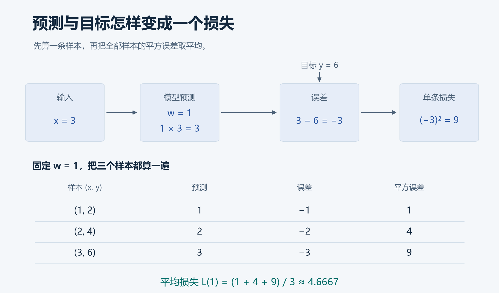
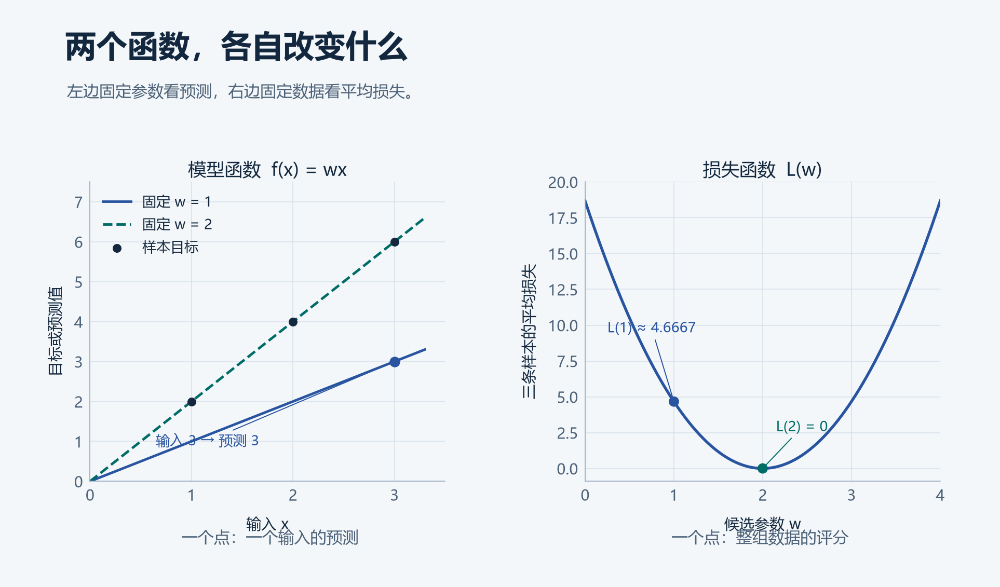
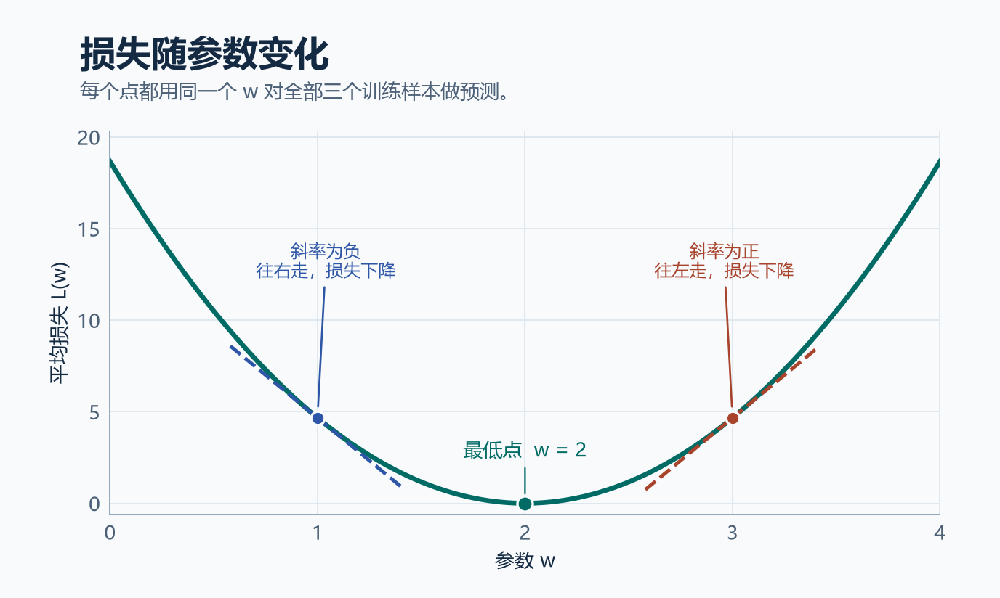
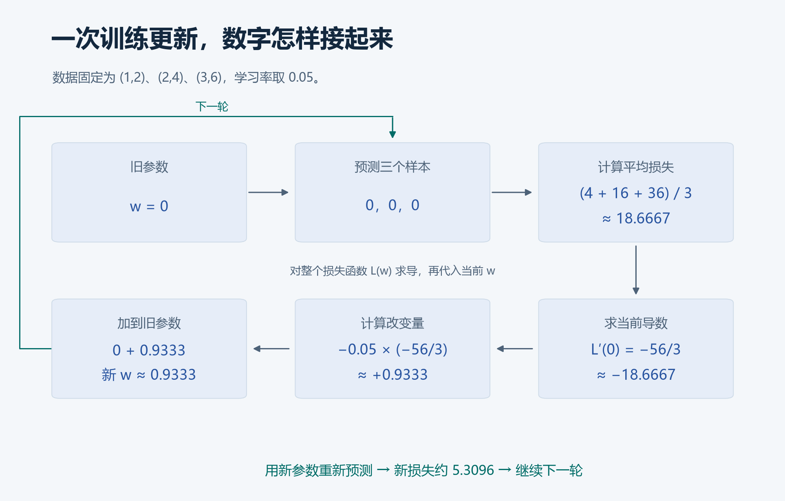
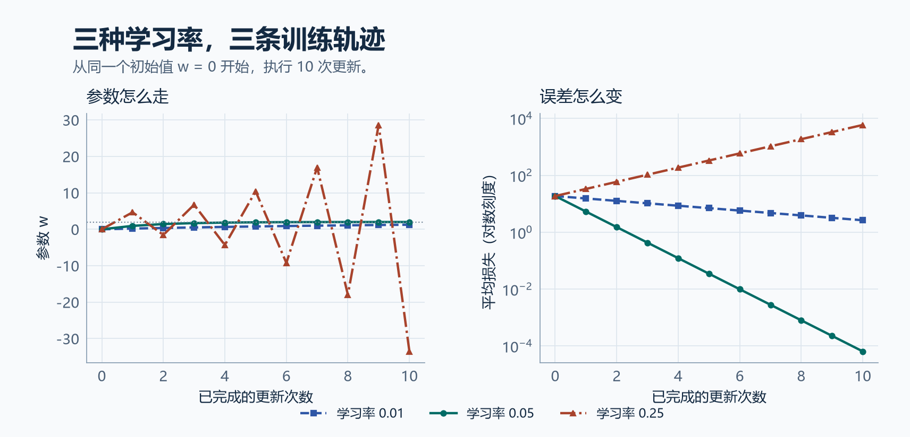

# 第 1 课：单参数模型

**模型 · 参数 · 损失 · 梯度下降**

假设你要让程序预测一个数字，规则很简单：把输入乘以一个数 $w$。输入是 3 时，取 $w=1$ 会预测 3，取 $w=2$ 会预测 6。现在给程序几个已有答案的例子，能不能让它自己把 $w$ 调到合适的位置？

本课从这一个数开始。你会先学会给预测打分，再用一元函数的导数判断参数该增大还是减小，最后把这几步写成纯 Python 程序。正文的手算用到一元求导。想知道代码里的梯度公式是怎么来的，可以在跑通之后再看链式法则推导。

第一次读，可以按“预测 → 比较 → 打分 → 求导 → 更新”的顺序走。每一步沿用同一组样本。术语和符号的查询页是[基础概念](../0-基础概念/0-基础概念.md)，本课也会在首次使用时解释。

## 1. 给程序什么，让它学什么

一条**样本**由一个输入 $x$ 和一个已知的目标值 $y$ 组成，记作 $(x,y)$。例如 $(3,6)$ 表示输入 3 时，我们手里的正确值是 6。本课使用以下三个样本。

| 样本 | 输入 $x$ | 目标 $y$ |
| --- | ---: | ---: |
| 1 | 1 | 2 |
| 2 | 2 | 4 |
| 3 | 3 | 6 |

**模型**是从输入算出预测值的规则。本课的规则是「用 $w$ 乘以 $x$」。

$$
\hat{y} = f_w(x) = wx
$$

$\hat y$ 读作「预测的 $y$」，样本里的 $y$ 则是拿来核对预测的目标值。**参数**是模型里可以通过训练调整的数。本课就一个参数 $w$，也叫**权重**，它决定直线的斜率。在代码里，`weight * x` 是模型的计算规则，`weight` 是要调整的参数。

$f$ 是函数名，下标 $w$ 提醒我们这条预测规则使用了哪个参数。求预测 $f_w(x)$ 时改变的是输入 $x$，参数 $w$ 已经选好。

试一个 $w$ 时，要用它预测**所有**样本。比如选 $w=1$，输入 1、2、3 就依次得到 1、2、3。选 $w=2$，同样三个输入就得到 2、4、6。有了这两个结果，我们可以问：有没有一个统一的分数，用来比较哪个 $w$ 整体预测得更好？


*图 1. 这是预测图。选定一条线，就相当于固定一个 $w$。沿横轴换一个输入 $x$，读出的纵轴值是这条线给出的预测。黑点是我们已有的三个样本。*

用带目标值的样本学习参数，叫**监督学习**。本课要预测的是一个可以连续取值的数，这类任务叫**回归**。两个术语分别描述我们拿什么数据来学，以及要预测什么。

先把“预测”写成一个可以调用的函数。下面只使用输入和当前参数，目标值还没有进入计算。

```python
def predict(x, weight):
    return weight * x


print(predict(3, 1))  # 3
print(predict(3, 2))  # 6
```

这两次调用使用相同的输入 3，分别试两个候选参数。要比较哪个参数合适，下一步才需要拿目标值 6 来核对。

## 2. 把预测的好坏变成一个数

**误差**是预测值和目标值的差。本课用「预测减目标」，在代码里是 `error = prediction - target`。例如 $w=1$ 时，输入 3 得到预测 3，目标是 6，所以误差是 $3-6=-3$。负号表示预测偏低，正号表示预测偏高。

$$
e_i = \hat{y}_i - y_i = wx_i - y_i
$$

下标 $i$ 指第 $i$ 条样本。要把多条误差汇成一个分数，直接取平均会遇到正负抵消。比如误差 $+2$ 和 $-2$ 的平均值是 0，可两次都偏了 2。**单条样本的损失**是衡量这次预测有多不准的数。本课选用**平方误差**，即 `error ** 2`。上面的两次误差平方后都是 4。

$$
\ell_i(w) = (wx_i-y_i)^2
$$

$\ell$ 是希腊字母 ell，这里用 $\ell_i$ 记第 $i$ 条样本的损失。后面用大写 $L$ 记整组样本的平均损失。

平方误差非负，只有预测恰好等于目标时才为 0。误差绝对值从 1 增大到 2，平方误差会从 1 增大到 4，因此这项损失对大偏差更敏感。



*图 2. 先读上半部分的一条样本，再读下半部分的三条汇总。误差的正负记录方向，平方误差参与最后的评分。*

| $x$ | 目标 $y$ | 当 $w=1$ 时的预测 | 误差 $e_i$ | 平方误差 $e_i^2$ |
| ---: | ---: | ---: | ---: | ---: |
| 1 | 2 | 1 | −1 | 1 |
| 2 | 4 | 2 | −2 | 4 |
| 3 | 6 | 3 | −3 | 9 |

表格最后一列取平均，得到 $L(1)=(1+4+9)/3=14/3\approx4.67$。这个平均分叫**均方误差**（Mean Squared Error，MSE），越小表示这组预测越贴近目标。如果换成 $w=2$，三个误差都是 0，所以 $L(2)=0$。

**损失函数**规定怎样根据预测和目标计算差距。本课选用平均平方误差。把数据固定后，可以进一步把这个计算看成参数 $w$ 的函数 $L(w)$：给定一个候选 $w$，用它预测完三条样本，再返回一个平均分。这里 $L(1)$ 是 4.6667，$L(2)$ 是 0。代码可以直接表达这个过程。

```python
training_data = [(1, 2), (2, 4), (3, 6)]


def loss(weight):
    squared_error_sum = 0.0
    for x, target in training_data:
        prediction = weight * x
        error = prediction - target
        squared_error_sum += error ** 2
    return squared_error_sum / len(training_data)


print(f"{loss(1):.4f}")  # 4.6667
print(f"{loss(2):.4f}")  # 0.0000
```

`loss` 是函数名，`loss(1)` 是这次调用计算出的数。后面的完整训练代码用变量 `loss` 保存每轮的评分，阅读时可以根据是否带括号区分。

把三条样本的平均写成通用公式时，会出现求和符号 $\sum$。它表示“逐项相加”。$n$ 是样本总数，$i$ 是样本的编号，$x_i$ 就是第 $i$ 条样本的输入。三条样本的式子先展开，再缩写如下。

$$
L(w)=\frac{(wx_1-y_1)^2+(wx_2-y_2)^2+(wx_3-y_3)^2}{3}
$$

若手上共有 $n$ 条训练样本，就写成

$$
L(w) = \frac{1}{n}\sum_{i=1}^{n}(wx_i-y_i)^2
$$

把本课的三个样本代入，可以化简出这条损失曲线的公式。

$$
\begin{aligned}
L(w)
&= \frac{(w-2)^2+(2w-4)^2+(3w-6)^2}{3}\\
&= \frac{1+4+9}{3}(w-2)^2\\
&= \frac{14}{3}(w-2)^2
\end{aligned}
$$

本课的**训练目标**就是找到一个使平均损失 $L(w)$ 尽可能小的参数。下面并排画出预测与评分这两种计算，先比较横轴，再读纵轴。



*图 3. 左图一个点来自一次预测，右图一个点来自对全部三个样本的评分。比如右图的 (1, 4.6667)，由三个平方误差 1、4、9 取平均得到。*

下面把右边的曲线单独放大，用切线观察参数怎样改变损失。



*图 4. 这是损失图。左边标出的点是 $w=1$ 时的平均损失 $14/3$，最低点是 $w=2$ 时的平均损失 0。两段虚线是切线，下一节会用它们判断往哪边改。*

## 3. 让程序用梯度决定往哪走

知道怎么给 $w$ 打分后，假设程序现在站在 $w=1$。如果只改一点点，它应该把 $w$ 增大还是减小？你已经知道导数是曲线在某一点的切线斜率。对上一节的损失函数求导，就能算出图 4 任意一点的斜率。

$$
L'(w)=\frac{28}{3}(w-2)
$$

在 $w=1$ 时，$L'(1)=-28/3$。斜率为负，意思是从这里往右挪一小步，损失会下降。试着把 $w$ 从 1 改到 1.1。按切线斜率估计，损失的变化量约为 $(-28/3)\times 0.1=-0.93$。代入损失函数，实际的变化量是 $L(1.1)-L(1)\approx 3.78-4.67=-0.89$。两个数都为负，说明这一步让损失下降了。数值的差异来自用直的切线近似弯曲的损失曲线。

用 $\Delta w$ 表示参数的改变量，用 $\Delta L$ 表示损失的改变量。刚才的切线估计可以写成

$$
\underbrace{L(w+\Delta w)-L(w)}_{\Delta L\text{，实际损失变化}}
\approx
\underbrace{L'(w)}_{\text{当前斜率}}\,
\underbrace{\Delta w}_{\text{参数改变量}}
$$

我们希望 $\Delta L$ 为负。只改一小步时，可以先让右边的乘积为负。

| 当前参数  | 导数        | 怎样改参数                     |
| ----- | --------- | ------------------------- |
| $w=1$ | $L'(1)<0$ | 取 $\Delta w>0$，把 $w$ 增大一点 |
| $w=3$ | $L'(3)>0$ | 取 $\Delta w<0$，把 $w$ 减小一点 |
| $w=2$ | $L'(2)=0$ | 图上是本题的最低点，按下一节的规则，参数停在这里  |

机器学习里，把针对参数计算的这些变化率收集起来，称为**梯度**。本课只需要调整一个 $w$，梯度就是刚算过的导数 $L'(w)$，代码变量叫 `gradient`。在 $w=1$ 时，`gradient` 的数值就是 $-28/3$。到了第 2 课，每个参数各算一个变化率，再把结果按顺序放在一起。

### 知道方向后，一次改多少？

**梯度下降**是在当前位置算出梯度，再朝梯度的反方向更新参数的方法。本课的更新分成两步写。

$$
\Delta w=-\eta L'(w),\qquad w_{\text{new}}=w+\Delta w
$$

第一步算**改变量**。负号负责选方向，正数 $\eta$ 负责把步长按比例缩放。$\eta$ 叫**学习率**（Learning Rate），对应 `learning_rate`。比如导数为负时，乘上负号后 $\Delta w$ 就为正，程序会把 $w$ 往右移。同一位置的梯度相同，学习率翻倍，改变量的绝对值也会翻倍。第二步把改变量加到旧参数上。合起来就是代码里的 `weight -= learning_rate * gradient`。

学习率由我们事先设定，用来控制训练过程，这样的设置叫**超参数**。根据梯度等信息更新参数的算法叫**优化器**，本课用的是梯度下降。

这里的 `-=` 是 Python 的减后赋值。例如导数为 $-18.6667$ 时，`weight - 0.05 * gradient` 会在旧权重上加上约 0.9333。负号和负导数相乘，就让参数增大。

### 手算第一步

为了和代码用同一个起点，这次从初始参数 $w_0=0$ 开始。下标 0 表示尚未更新，$w_1$ 表示完成第一次更新后的值。三个预测都为 0，所以初始损失 $L(0)=(4+16+36)/3=56/3\approx18.6667$。当前导数 $L'(0)=-56/3$，方向向右。取学习率 $\eta=0.05$，算出改变量，再加到 $w_0$ 上。

$$
\Delta w=-0.05\left(-\frac{56}{3}\right)=\frac{14}{15}\approx0.9333,
\qquad
w_1=0+\Delta w\approx0.9333
$$

用 $w_1$ 重新计算三个预测，得到约 $0.9333,\,1.8667,\,2.8000$。平均损失降到了 $5.3096$。下一步从 $w_1$ 出发，重新预测，也重新算出 $L'(w_1)$。图 5 里返回预测步骤的箭头，对应的就是这次重新计算。

把这一次更新单独写出来，可以先只关注导数如何用来改参数。

```python
weight = 0.0
learning_rate = 0.05
gradient = (28 / 3) * (weight - 2)
change = -learning_rate * gradient
new_weight = weight + change

print(f"{gradient=:.4f}")    # gradient=-18.6667
print(f"{change=:.4f}")      # change=0.9333
print(f"{new_weight=:.4f}")  # new_weight=0.9333
```

这里的 `gradient` 使用本课化简后的一元导数。完整程序会逐条累加导数，方便换数据。这两种算法会给出相同结果。

## 4. 把计算串成训练循环

**训练**是在数据和训练目标的约束下，求出一组参数的过程。每一轮先用**同一个**当前参数计算所有样本的预测和梯度贡献，算完平均梯度，再做一次更新。因为每次更新都使用了全部训练样本，这里用的是**全批量梯度下降**。



*图 5. 从旧参数 0 出发，算出损失、导数、改变量和新参数。箭头返回后，用新参数 0.9333 再次预测，下一轮的损失和导数也随之改变。*

把下面的代码复制到 `lesson01.py`，运行 `python lesson01.py`。代码只使用 Python 自带的功能。

| 刚算过的步骤        | 代码                                        | 对应的量                       |
| ------------- | ----------------------------------------- | -------------------------- |
| 用当前权重做一次预测    | `prediction = weight * x`                 | $\hat y_i=wx_i$            |
| 算单条样本的误差      | `error = prediction - target`             | $e_i=\hat y_i-y_i$         |
| 汇总平方误差并取平均    | `loss = squared_error_sum / sample_count` | $L(w)$                     |
| 汇总每条样本的导数并取平均 | `gradient = gradient_sum / sample_count`  | $L'(w)$                    |
| 应用改变量         | `weight -= learning_rate * gradient`      | $w\leftarrow w-\eta L'(w)$ |

最后一行的 $\leftarrow$ 表示“用右边计算出的数替换左边的旧值”，对应代码赋值。求导会固定样本中的输入和目标，只把 `weight` 当成要改变的量。

手算第一步时，我们直接对化简后的抛物线求导。代码里 `gradient_sum += 2 * error * x` 则逐条累加导数。在本题初始位置，两种算法都会得到约 $-18.6667$。这行的推导在代码之后。

```python
training_data = [(1, 2), (2, 4), (3, 6)]
weight = 0.0
learning_rate = 0.05
training_steps = 10

for step in range(training_steps):
    squared_error_sum = 0.0
    gradient_sum = 0.0

    for x, target in training_data:
        prediction = weight * x
        error = prediction - target
        squared_error_sum += error ** 2
        gradient_sum += 2 * error * x

    sample_count = len(training_data)
    loss = squared_error_sum / sample_count
    gradient = gradient_sum / sample_count

    # 这行记录本次更新前的状态。
    print(
        f"step={step:2d}  w={weight:8.4f}  "
        f"loss={loss:9.4f}  gradient={gradient:9.4f}"
    )

    weight -= learning_rate * gradient

# 训练结束，保留当前参数来预测一个新输入。
new_x = 4
print(f"训练后的 w = {weight:.6f}")
print(f"x = {new_x}，预测 = {weight * new_x:.4f}")
```

预期看到的部分输出如下：

```text
step= 0  w=  0.0000  loss=  18.6667  gradient= -18.6667
step= 1  w=  0.9333  loss=   5.3096  gradient=  -9.9556
step= 2  w=  1.4311  loss=   1.5103  gradient=  -5.3096
...
训练后的 w = 1.996276
x = 4，预测 = 7.9851
```

日志记录的是**本轮更新前**的参数、损失和梯度。因此 `step=0` 对应手算使用的初始状态，`step=1` 的 `w=0.9333` 和 `loss=5.3096` 对应刚完成第一次更新。此时的梯度已经是新的 `-9.9556`，下一次更新就用它。最后，`step=9` 的日志之后还有一次更新，所以单独打印的最终权重对应第 10 次更新完成后的结果。

**推理**（Inference）是用已有参数给新输入做预测的过程。最后的 `weight * new_x` 就是一次推理。它只需要输入和训练得到的权重。要评估这次预测，还得另外有真实的目标值。比如已知这道练习题的规则是 $y=2x$，那么 $x=4$ 的目标就是 8。

### 选读：代码里的 `2 * error * x` 从哪里来？

这一段用到链式法则。它描述一个计算由多步组成时，总变化率如何由各步的变化率相乘得到。这里的步骤是“参数改变 → 误差改变 → 平方误差改变”。

求导时固定这一条样本的 $x_i,y_i$，只改变 $w$。单条损失是 $e_i^2$。对误差 $e_i$ 求导得到 $2e_i$，而误差 $e_i=wx_i-y_i$ 对 $w$ 的导数是 $x_i$。用链式法则把这两项相乘，就得到单条损失对 $w$ 的导数。

$$
\frac{d}{dw}(wx_i-y_i)^2
=\underbrace{2e_i}_{\text{平方对误差的导数}}\,
\underbrace{x_i}_{\text{误差对参数的导数}}
$$

平均损失的导数可以按「先分别求导，再取平均」来算。

$$
L'(w)=\frac{1}{n}\sum_{i=1}^{n}2e_ix_i
$$

在 $w=0$ 时，三个误差是 $-2,-4,-6$，各自乘以两倍的输入，得到 $-4,-16,-36$。它们的平均值是 $-56/3$，与手算一致。代码保留逐条求导的写法，这样换一组数据也能直接计算。

## 5. 学习率为什么会影响训练

回到同一个起点 $w=0$。第一次更新之前，两种学习率看到的导数都是 $-56/3$，所以方向都向右。但选不同的学习率，第一步会停在不同的地方。

| 学习率 $\eta$ | 第一步改变量 $\Delta w$ | 更新后的 $w$ | 更新后的损失 |
| ---: | ---: | ---: | ---: |
| 0.05 | 约 $+0.9333$ | 约 $0.9333$ | 约 $5.3096$ |
| 0.25 | 约 $+4.6667$ | 约 $4.6667$ | 约 $33.1852$ |

初始损失约为 $18.6667$。学习率为 $0.25$ 时，第一步跨过最低点 $w=2$，从原来离最低点 $2$，变成离它约 $2.67$。所以损失反而升高了。训练时，梯度给的是**当前位置附近**的下降方向。学到这里可以先回代码只改学习率，核对两种设置下 `step=1` 的输出。

### 选读：下降方向、完整轨迹与收敛条件

把 $\Delta w=-\eta L'(w)$ 代回切线近似式，就能看出下降方向来自哪里。

$$
\Delta L \approx L'(w)\Delta w=-\eta[L'(w)]^2
$$

若当前导数非零，右边一定为负。这说明把学习率取得足够小时，真实损失会下降。上面用 $0.25$ 跳到 $4.6667$ 的例子，说明大步更新要按实际损失函数算，切线估计可能失效。

想对比多轮更新，可以运行三遍代码，只把 `learning_rate` 分别设成 `0.01`、`0.05`、`0.25`。图 6 记录从初始值到第 10 次更新结束的轨迹。



*图 6. 左边的横向虚线是最优值 $w=2$。右边纵轴记录平均损失，相同的竖直间隔对应固定倍数的变化。第 0 步是初始状态。*

梯度给出的方向来自当前位置。步子太大时，可能一步跨到最低点另一侧，甚至比出发点离最低点更远。这个例子可以精确算出会发生什么。令 $d_t=w_t-2$，表示第 $t$ 次更新后参数与最优值 2 的有符号距离。把 $L'(w)$ 代入更新公式：

$$
\begin{aligned}
d_{t+1}
&=w_t-\eta\,\frac{28}{3}(w_t-2)-2\\
&=\left(1-\frac{28}{3}\eta\right)d_t
\end{aligned}
$$

每更新一步，距离就乘上同一个系数。系数的**符号**决定下一步是否跨过最低点，系数的**绝对值**决定是靠近还是远离。

| 学习率 $\eta$ | 距离每步乘以 | 会看到什么 |
| ---: | ---: | --- |
| 0.01 | 约 0.907 | 从同一侧慢慢靠近 2 |
| 0.05 | 约 0.533 | 从同一侧更快靠近 2 |
| 0.25 | 约 −1.333 | 每步换到另一侧，离 2 越来越远 |

从任意非最优初值出发，要在这个例子里收敛，必须满足 $\left|1-\tfrac{28}{3}\eta\right|<1$，解得 $0<\eta<\tfrac{3}{14}$。这个上限来自**本课这组数据的损失曲线**。以后改数据或模型，就需要重新观察损失对更新步长的反应。

## 6. 训练损失小，能告诉我们什么

**拟合**描述模型在已有样本上贴合目标的程度。例如把 $w$ 调到接近 2，三条训练样本的误差都接近 0。**泛化**描述模型在训练没有用过、且与使用场景相关的数据上的表现。下一课会留出带目标值的新样本，专门检查这件事。

### 选读：相同的训练评分，也可能给出不同的新预测

本例选择了经过原点的直线，所以 $w=2$ 一旦确定，$x=4$ 的预测自然是 8。这是模型形式决定的外推。仅看前三条样本，还可以构造出一个在样本上完全吻合的函数：

$$
g(x)=2x+(x-1)(x-2)(x-3)
$$

当 $x$ 是 1、2、3 时，后面的乘积为 0，两个函数的训练损失都为 0。当 $x=4$ 时，$g(4)=14$，而 $f_2(4)=8$。如果我们只有三个训练样本，就需要额外数据来判断哪个预测更接近真实结果。

这两个函数在已有样本上的评分相同，在新输入上的预测却不同。可以把新输入和对应目标留出来，单独计算预测误差，下一课会这样做。

## 7. 选读：这一步在语言模型里对应什么

训练小 GPT 时还会看到同样的顺序：**预测 → 计算损失 → 求梯度 → 更新参数**。那时输入是一段 token（模型处理的文本单位），目标是原文里紧接着出现的 token，模型为候选 token 计算概率。损失通常用**交叉熵**，在这个任务里，模型分给正确 token 的概率越小，单次预测的损失就越大。

本课只更新一个标量。神经网络会同时更新许多参数，后面会用反向传播和自动求导来计算梯度。到了那一课，可以回头看这里的 `2 * error * x`：它就是链式法则在最小例子里算出来的一项。

## 8. 练习

先预测实验结果，再改代码验证。每次只改一个地方，方便从日志看出变化的原因。

**先做识别与代入。** 对样本 $(3,6)$，取 $w=1$。分别写出输入、目标、预测、误差、平方误差。再说明 $L(1)$ 为什么还需要另外两条样本。答案依次为 3、6、3、−3、9，$L(1)$ 对全部训练样本取平均。

1. **只判断方向。** 令 `weight = 3.0`，学习率仍是 `0.05`。先看导数的符号，判断程序会把 $w$ 调大还是调小，再用前两行日志核对。
2. **比较步长。** 令初值回到 0，分别用 `0.05` 和 `0.25` 跑一次。看两次的 `step=1`，哪次跨过 $w=2$？哪次损失升高？读过选读部分后，可以再用距离公式算出 $0.25$ 时第二次更新的位置。
3. **换训练数据。** 用 `[(1, 3), (2, 5), (3, 7)]`，仍然只学 $w$。先分别求出每条样本要完全拟合时各自要求的 $w$。比较这些值，然后运行程序，看看为什么多训练几轮仍会留下误差。

<details>
<summary>做完后核对</summary>

1. $L'(3)=28/3>0$，所以 $w$ 会调小。日志里的权重由 3 变成约 2.5333。
2. `0.25` 的第一次更新跨过 $w=2$，损失从约 $18.6667$ 升到 $33.1852$。选读题里，$w-2$ 每步乘以 $-4/3$，由 $d_0=-2$ 得到 $w_1=14/3\approx4.6667$，$w_2=-14/9\approx-1.5556$。
3. 三条样本分别要求 $w$ 等于 $3$、$2.5$ 和 $7/3$，一个权重无法同时满足三个条件。这组数据满足 $y=2x+1$，因此可以在模型里加入一个同样可学习的参数 $b$，得到 $\hat y=wx+b$。$b$ 叫**偏置**，它允许直线在 $x=0$ 时取非零值。

</details>

下一课会从第三题开始，推导损失分别对 $w$ 和 $b$ 的偏导，在同一次更新里训练两个参数。
