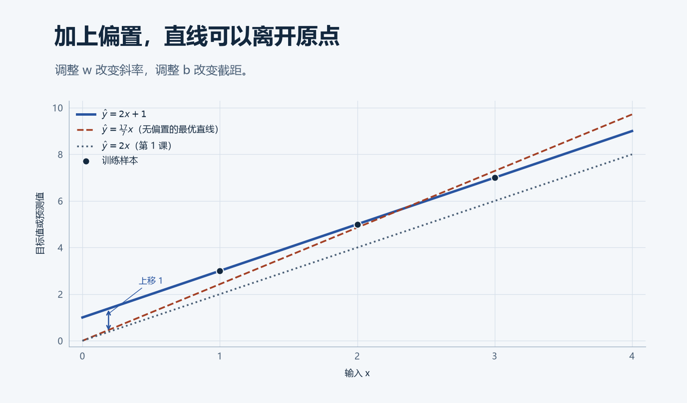
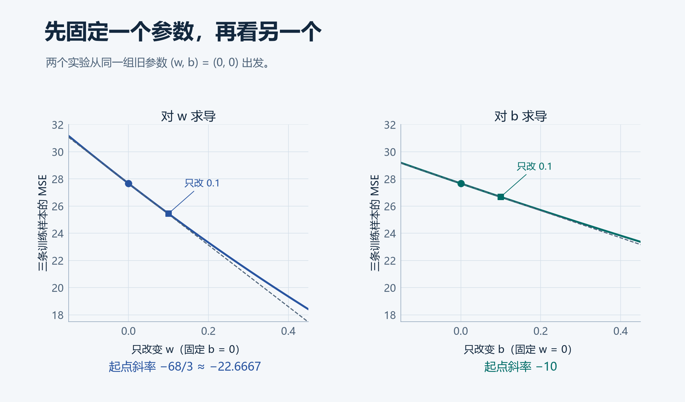
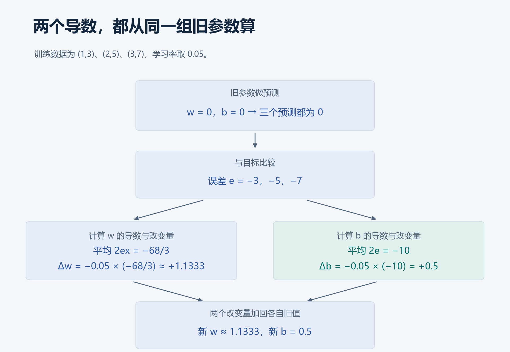
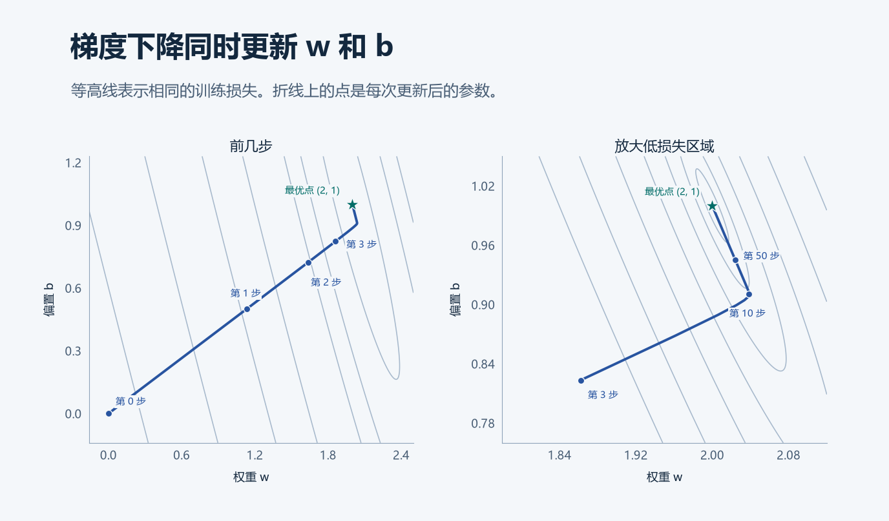
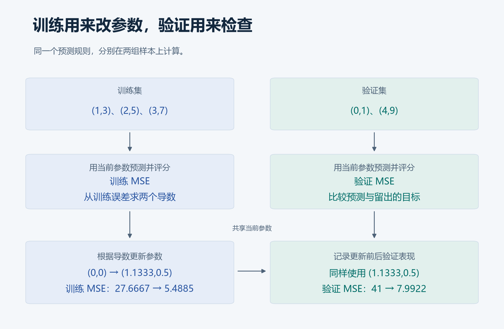
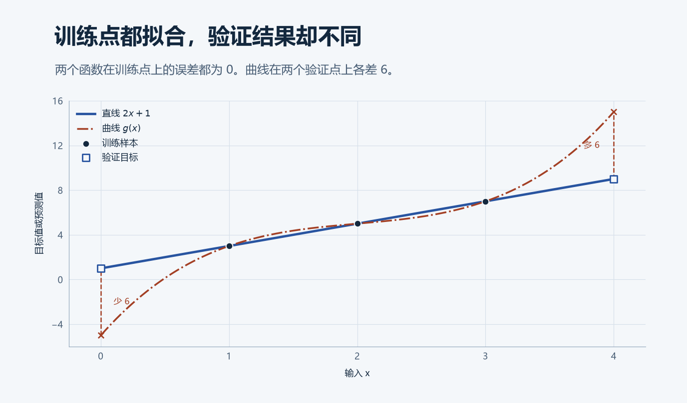

# 第 2 课：线性回归

**偏置 · 两个参数的梯度 · 训练集与验证集**

第 1 课用 $(1,2)、(2,4)、(3,6)$ 训练了模型 $\hat y=wx$。课末练习把每个目标值都加了 1，得到 $(1,3)、(2,5)、(3,7)$。本课从这三条新数据出发，给直线加上偏置，手算一次包含两个参数的更新，再在留出的样本上检验预测。

本课用到的数学从一元导数开始。“偏导”会通过固定一个参数来解释，“梯度向量”会在两个导数都算出来后介绍。遇到术语也可以查[基础概念](../0-基础概念/0-基础概念.md)。

## 1. 为什么要加偏置 $b$

先沿用 $\hat y=wx$。要让第一条样本预测正确，需要 $w=3$。第二条要求 $w=5/2$，第三条要求 $w=7/3$。三个条件要求不同的斜率，因此任何一个 $w$ 都会留下误差。原因在模型的形式里：无论 $w$ 取多少，$x=0$ 时预测永远是 0。改变斜率只能让直线绕原点转动。

给模型加入一个可学习的常数项：

$$
\hat y=f_{w,b}(x)=wx+b
$$

- **权重 $w$** 是直线的斜率。输入每增加 1，预测值就变化 $w$。代码里对应 `weight`。
- **偏置 $b$** 是每次预测都加上的常数，也是 $x=0$ 时预测的值，即直线的截距。固定 $w$，增加 $b$ 会让直线整体上移。代码里对应 `bias`。
- **一元线性回归**用一个输入特征的线性项加截距，预测连续的目标值。「一元」指只有一个输入特征 $x$。这个模型有 $w$ 和 $b$ 两个参数。

这里的**特征**就是交给模型的一项输入量，本课只有一个数 $x$。权重和偏置都是从数据里学习的参数。

从 $2x$ 到 $2x+1$，斜率保持为 2，整条直线上移 1。模型因此能同时得到 $3、5、7$ 三个目标值。答案可以看出来，下面的程序会从 $w=b=0$ 开始，用每条样本的误差算出参数怎么变。



*图 1. 横轴取输入，纵轴读预测。蓝线从 $2x$ 上移到 $2x+1$。橙色虚线展示只调斜率时的折中结果，$17/7$ 的推导留在后面的选读练习。*

## 2. 先给两个参数算一个评分

**均方误差**（MSE）就是把每条预测的误差平方后取平均。仍然用“预测减目标”定义误差。例如先试 $w=1,b=1$：

| 输入 | 目标 | 预测 $x+1$ | 误差 | 平方误差 |
| ---: | ---: | ---: | ---: | ---: |
| 1 | 3 | 2 | −1 | 1 |
| 2 | 5 | 3 | −2 | 4 |
| 3 | 7 | 4 | −3 | 9 |

整组评分为 $(1+4+9)/3=14/3$。我们把这次计算记为 $L(1,1)$，括号里按顺序放 $w$ 和 $b$。候选参数变化，评分也随之变化，于是损失是一个二元函数 $L(w,b)$。

先把评分过程写成代码。下面固定训练数据，换一对参数就算一个平均分。

```python
training_data = [(1, 3), (2, 5), (3, 7)]


def loss(weight, bias):
    squared_error_sum = 0.0
    for x, target in training_data:
        prediction = weight * x + bias
        error = prediction - target
        squared_error_sum += error ** 2
    return squared_error_sum / len(training_data)


print(f"{loss(1, 1):.4f}")  # 4.6667
print(f"{loss(2, 1):.4f}")  # 0.0000
```

用 $i$ 表示样本编号，$n$ 表示样本总数，$\sum$ 表示逐项相加，可以把刚才的计算缩写如下。

在线性回归里，预测与目标的差也叫**残差**，这里记作 $e_i$。沿用“预测减目标”，得到

$$
e_i=(wx_i+b)-y_i,\qquad
L(w,b)=\frac1n\sum_{i=1}^{n} e_i^2
$$

### 固定 $b$，只改变 $w$

先固定 $b=0$。这时所有预测都是 $wx$，只有 $w$ 在变，直接回到熟悉的一元函数：

$$
L(w,0)=\frac{(w-3)^2+(2w-5)^2+(3w-7)^2}{3}
$$

对 $w$ 求导，使用平方求导和链式法则，得到

$$
\frac{d}{dw}L(w,0)
=\frac{2(w-3)+4(2w-5)+6(3w-7)}3
=\frac{28w-68}3
$$

在 $w=0$ 时，这个导数是 $-68/3$，说明固定 $b=0$ 时，从 $w=0$ 往右改一点会降低损失。例如 $L(0,0)\approx27.6667$，改成 $L(0.1,0)\approx25.4467$。

### 固定 $w$，只改变 $b$

另做一次考察，仍从 $(0,0)$ 出发，固定 $w=0$。三个预测都等于 $b$，损失只随 $b$ 变化：

$$
L(0,b)=\frac{(b-3)^2+(b-5)^2+(b-7)^2}{3}
$$

对 $b$ 做一元求导，得到

$$
\frac{d}{db}L(0,b)
=\frac{2(b-3)+2(b-5)+2(b-7)}3
=2b-10
$$

在 $b=0$ 时，导数是 $-10$。例如 $L(0,0)\approx27.6667$，改成 $L(0,0.1)\approx26.6767$。



*图 2. 两个面板起点都是参数 (0,0)。左图横轴是 w，右图横轴是 b，纵轴都表示对同一组三条训练样本计算的 MSE。虚线是起点切线，方块表示单独改动 0.1 后的损失。*

### 给刚才的两种求导一个名称

**偏导数**是多元函数在固定其他自变量时，对某一个自变量的导数。刚才两次都固定了一个参数，所以算出的分别是损失对 $w$ 和对 $b$ 的偏导。记号 $\partial L/\partial w$ 读作“L 对 w 的偏导”，$\partial$ 用来标明正在对多个变量中的一个求导。

**梯度**是把各参数的偏导按顺序放在一起得到的向量，也就是一组有顺序的数。我们约定先放 $w$ 的偏导，再放 $b$ 的偏导，用 $\nabla L$ 表示这一组数，$\nabla$ 读作 nabla。在初始位置：

$$
\nabla L(0,0)=(-68/3,\,-10)
$$

每个数告诉我们单独改变对应参数时，损失的局部变化率。把两个数交给同一条梯度下降规则，就能决定这一步怎样同时改变参数。

### 从三条样本推广到任意样本

下面保留通用推导。链式法则就是沿着“参数 → 误差 → 误差的平方”这条计算顺序，把每一段的变化率乘起来。对每条样本，有

$$
\begin{aligned}
\frac{\partial e_i^2}{\partial w}
&=2e_i\frac{\partial (wx_i+b-y_i)}{\partial w}
=2e_i x_i \\
\frac{\partial e_i^2}{\partial b}
&=2e_i\frac{\partial (wx_i+b-y_i)}{\partial b}
=2e_i
\end{aligned}
$$

区别来自预测式。$w$ 增加 $\Delta w$ 时，第 $i$ 条预测改变 $x_i\Delta w$，所以权重的梯度里有因子 $x_i$。$b$ 增加 $\Delta b$ 时，每条预测都改变同样的 $\Delta b$。因此若有一条 $x_i=0$ 的训练样本，它能通过残差影响 $b$ 的梯度，对 $w$ 的梯度贡献为 0。

把样本的梯度贡献分别取平均，组成**梯度向量**：

$$
g_w=\frac{\partial L}{\partial w}=\frac{2}{n}\sum_{i=1}^{n}e_i x_i,\qquad
g_b=\frac{\partial L}{\partial b}=\frac{2}{n}\sum_{i=1}^{n}e_i,\qquad
\nabla L=(g_w,g_b)
$$

这里 $g_w$ 是对 $w$ 的偏导的短写，$g_b$ 是对 $b$ 的偏导的短写。代码分别叫 `weight_gradient` 和 `bias_gradient`。与刚才的固定参数实验对应，代入 $w=b=0$ 后仍然得到 $-68/3$ 和 $-10$。

梯度下降在**同一组旧参数** $(w_t,b_t)$ 上计算这两个偏导，然后更新：

下标 $t$ 记录已经完成的更新次数，$t=0$ 表示初值，$t+1$ 表示下一步。$\eta$ 仍然是学习率，控制每次改动的大小。

$$
(w_{t+1},b_{t+1})=(w_t-\eta g_w,\;b_t-\eta g_b)
$$

「同时更新」说的是两个梯度的计算起点相同。Python 可以顺序执行两条赋值，只要赋值前已把两个梯度算好。如果先更新 $w$，再用更新后的 $w$ 重算残差和 $g_b$，两项就来自不同位置，得到的是另一种更新规则。

## 3. 手算第一次更新

初始化 $(w_0,b_0)=(0,0)$，三个预测都为 0。逐条计算残差与梯度贡献：

| $x_i$ | 目标 $y_i$ | 残差 $e_i$ | 平方误差 $e_i^2$ | 对 $w$ 的贡献 $2e_ix_i$ | 对 $b$ 的贡献 $2e_i$ |
| ---: | ---: | ---: | ---: | ---: | ---: |
| 1 | 3 | −3 | 9 | −6 | −6 |
| 2 | 5 | −5 | 25 | −20 | −10 |
| 3 | 7 | −7 | 49 | −42 | −14 |
| **平均** | | | **$83/3$** | **$-68/3$** | **$-10$** |

两个偏导都为负，说明在当前位置稍微增大任一个参数都能降低损失。沿用第 1 课的学习率 $\eta=0.05$：

$$
\begin{aligned}
w_1 &= 0-0.05(-68/3) = 17/15 \approx 1.1333 \\
b_1 &= 0-0.05(-10) = 0.5
\end{aligned}
$$

用新参数预测，得到约 $1.6333、2.7667、3.9000$，训练 MSE 从 $27.6667$ 降到 $5.4885$。下一步要用这些新预测重新算梯度。每项参数的更新方向也可以变。例如第 10 步时 $w$ 已经略大于 2，$b$ 还小于 1，后续迭代中 $w$ 降下来，$b$ 继续上升。



*图 3. 中间的两条支路共用旧参数和同一组三个误差。只有两项导数都算好之后，才执行底部的参数更新。下一轮返回顶部重新预测。*

先用短代码把两个改变量明确写出来。此处直接使用刚手算出的初始导数。

```python
weight, bias = 0.0, 0.0
learning_rate = 0.05
weight_gradient = -68 / 3
bias_gradient = -10.0

weight_change = -learning_rate * weight_gradient
bias_change = -learning_rate * bias_gradient
weight = weight + weight_change
bias = bias + bias_change

print(f"{weight=:.4f}, {bias=:.4f}")  # weight=1.1333, bias=0.5000
```

### 选读：怎样在一张图里看两项参数一起变化

下图使用**参数平面**，横轴放 $w$、纵轴放 $b$。一个点 $(w,b)$ 就代表一整个模型。取不同参数分别算训练 MSE，把评分相同的点连起来，就得到**损失等高线**。沿着同一条等高线移动，训练 MSE 相同；跨过等高线时，训练 MSE 会改变。



*图 4. 折线记录梯度下降的参数轨迹。右图放大低损失区域，两个面板的坐标范围不同。每个点已经包含一组 w、b，而纵轴本身表示参数 b。*

## 4. 训练集和验证集有什么区别

**训练集**（training set）的样本用于计算训练损失和梯度，直接影响 $w$ 与 $b$。**验证集**（validation set）是事先留出的带目标值样本。用当前参数预测这些样本，计算验证损失，检查模型在未参与更新的数据上的表现。验证集也可以用来挑模型、学习率或训练轮数。如果用验证结果做过这些选择，可以再留一份**测试集**用于最终评估。

| 数据 | 本课样本 | 在程序里的用途 |
| --- | --- | --- |
| 训练集 | $(1,3)、(2,5)、(3,7)$ | 计算训练 MSE、求梯度、更新 `weight` 和 `bias`。 |
| 验证集 | $(0,1)、(4,9)$ | 用当前参数预测并和目标比较，计算验证 MSE。 |

先做一次具体检查。在初始参数 $(0,0)$ 下，验证预测为 0、0，验证 MSE 为 $(1+81)/2=41$。完成第一次训练更新后，参数变成 $(17/15,1/2)$，验证预测为 $1/2$ 和 $151/30$，两个目标仍是 1 和 9，验证 MSE 约为 7.9922。

这次验证从头到尾用的是训练步骤刚得到的参数。我们观察新的平均误差，再回到训练样本上做下一次更新。



*图 5. 实线箭头标出本课程序中的数据流。训练分支把导数送到参数更新，验证分支把误差汇成验证评分。两边调用相同的预测规则，各用自己的样本。*

为了方便核对，两个验证点也来自规则 $y=2x+1$。它们位于训练输入范围 $[1,3]$ 两侧，所以本实验检验的是**外推**，即对训练范围之外的输入做预测。在实际任务里，应根据使用场景留出验证样本。例如，要用历史数据预测未来，可以用较早的记录训练，留出较晚的记录验证。

**拟合**描述模型对已有样本的贴合程度，训练 MSE 可以帮助我们观察拟合。**泛化**描述模型在未参与训练、且与使用场景相关的数据上的表现，留出验证样本就是为了观察这件事。这里两个验证点只展示检查方法，实际应用还需要足够多、能代表使用场景的样本。

### 选读：训练评分相同的两条曲线

现在构造另一条经过全部训练点的曲线：

$$
g(x)=2x+1+(x-1)(x-2)(x-3)
$$

当 $x$ 为 1、2、3 时，乘积项为 0，曲线和直线的训练 MSE 都为 0。到验证点时，$g(0)=-5、g(4)=15$，分别比目标低 6 和高 6，所以验证 MSE 为 36。直线在这两个点上都预测正确。

**泛化**描述模型在未参与训练且与使用场景相关的数据上的表现。一个模型在训练集上拟合很好，在这类新数据上误差却明显变大，这种现象叫**过拟合**。这里的曲线是为了演示而构造的。真实任务中，还要结合验证集的大小和来源判断训练与验证之间的差距。



*图 6. 横轴为输入 x，纵轴为目标或预测。实心点是训练样本，空心方块是验证目标，虚线标出额外构造的曲线在验证点的误差。*

## 5. 用纯 Python 训练并验证

把下面的代码复制到 `lesson02.py`，运行 `python lesson02.py`。训练集和验证集调用同一个 `mean_squared_error` 函数，梯度循环只读取 `training_data`。`step=0` 记录初始状态，后续日志行记录完成相应次数更新后的状态。

完整代码可以按四段读。先定义预测和评分函数，再准备两组数据，然后用训练集求两个导数并更新，最后打印验证点的预测。英文 MSE 是均方误差，`train_mse` 对训练集评分，`val_mse` 对验证集评分。

| 手算过程 | 代码里的量或表达式 |
| --- | --- |
| 同一组旧参数 | `weight`、`bias` |
| 预测并减去目标 | `error = predict(x, weight, bias) - target` |
| 每条样本对两个导数的贡献 | `2 * error * x`、`2 * error` |
| 各自累加，再除以训练样本数 | `weight_gradient`、`bias_gradient` |
| 乘负学习率并加回旧值 | 两条 `-=` 更新语句 |
| 用更新到当前状态的参数检查留出数据 | `mean_squared_error(validation_data, weight, bias)` |

```python
def predict(x, weight, bias):
    return weight * x + bias


def mean_squared_error(data, weight, bias):
    squared_error_sum = 0.0
    for x, target in data:
        error = predict(x, weight, bias) - target
        squared_error_sum += error ** 2
    return squared_error_sum / len(data)


training_data = [(1, 3), (2, 5), (3, 7)]
validation_data = [(0, 1), (4, 9)]
weight, bias = 0.0, 0.0
learning_rate = 0.05
training_steps = 800
log_steps = {0, 1, 2, 10, 50, 200, training_steps}

for step in range(training_steps + 1):
    if step in log_steps:
        train_mse = mean_squared_error(training_data, weight, bias)
        val_mse = mean_squared_error(validation_data, weight, bias)
        print(
            f"step={step:3d}  w={weight:.6f}  b={bias:.6f}  "
            f"train_mse={train_mse:.6g}  val_mse={val_mse:.6g}"
        )

    if step == training_steps:
        break

    weight_gradient_sum = 0.0
    bias_gradient_sum = 0.0
    for x, target in training_data:
        error = predict(x, weight, bias) - target
        weight_gradient_sum += 2 * error * x
        bias_gradient_sum += 2 * error

    sample_count = len(training_data)
    weight_gradient = weight_gradient_sum / sample_count
    bias_gradient = bias_gradient_sum / sample_count

    weight -= learning_rate * weight_gradient
    bias -= learning_rate * bias_gradient

for x, target in validation_data:
    prediction = predict(x, weight, bias)
    print(f"x={x}  prediction={prediction:.6f}  target={target}")
```

预期输出节选如下。很小的损失以科学计数法显示。

```text
step=  0  w=0.000000  b=0.000000  train_mse=27.6667  val_mse=41
step=  1  w=1.133333  b=0.500000  train_mse=5.48852  val_mse=7.99222
step= 10  w=2.038628  b=0.910486  train_mse=0.001145  val_mse=0.00611882
...
step=800  w=2.000003  b=0.999994  train_mse=5.75619e-12  val_mse=3.16387e-11
x=0  prediction=0.999994  target=1
x=4  prediction=9.000005  target=9
```

初始状态下，训练 MSE 是 $83/3$，验证 MSE 是 $(1^2+9^2)/2=41$。这两个数都在同一组参数上计算，各自衡量不同样本上的误差。代码固定运行 800 步，让我们能看到参数逐渐逼近本题的已知解 $(2,1)$。

日志最后的 `5.75619e-12` 表示 $5.75619\times10^{-12}$，是非常接近零的正数。`step=1` 的参数与手算相同，`val_mse=7.99222` 则与前面的验证计算相同。`step=800` 记录最后一次更新已经完成后的状态。

## 6. 选读：这一步在神经网络里对应什么

如果同时有多个输入特征，可以把它们组成向量 $\mathbf x$，用 $\hat y=\mathbf w^\top\mathbf x+b$ 计算一个输出。如果同时要多项输出，再把权重排成矩阵，就得到 $\mathbf z=W\mathbf x+\mathbf b$。这正是下一课要写的**线性层**。矩阵的每一行权重对应一项输出，每项输出也有自己的偏置。训练时，每个权重和偏置都有独立的梯度分量，它们都从同一个损失求出。

## 7. 练习

先做下面三道基础题。后面的计算和推导题可以在跑通代码后继续完成。

- **识别概念。** 在 `weight * x + bias` 中，哪个量来自样本，哪两个量会通过训练改变？给 `weight=2,bias=1,x=4`，算出预测。
- **只看变化。** 固定 $w=2$，把 $b$ 从 0 改成 1。三个预测分别怎样变化？每条预测增加多少？
- **检查数据流。** 把验证目标 $(4,9)$ 改成 $(4,10)$，模型会在 $x=4$ 处更接近 10 吗？根据“哪些样本参与梯度循环”解释，再运行程序。

基础题核对如下。$x$ 来自样本，$w,b$ 是参数，预测为 9；三个预测由 $2,4,6$ 变为 $3,5,7$，各增加 1；只改验证目标会影响验证评分，参数更新仍由训练数据决定。

### 计算与推导练习

1. **手算第 2 步。** 从 $w_1=17/15、b_1=1/2$ 出发，先算三条训练残差，再算 $g_w、g_b$，对照代码中 `step=2` 的参数。
2. **冻结偏置（选读推导）。** 去掉更新 `bias` 的那一行，让 $b$ 保持在 0。推导最终的 $w$ 和训练 MSE，再运行代码验证。
3. **只改验证集。** 把验证样本 $(4,9)$ 改成 $(4,10)$。先预测最终的 $w$、$b$、训练 MSE 和验证 MSE 分别会发生什么变化，再运行代码。
4. **量化过拟合示例（选读推导）。** 把图 6 里的乘积项乘以常数 $c$。推导训练 MSE 和验证 MSE 关于 $c$ 的表达式，再取 $c=0.5$。

<details>
<summary>做完后核对</summary>

1. 残差为 $-41/30、-67/30、-31/10$。两个梯度为 $g_w=-454/45\approx-10.0889$、$g_b=-67/15\approx-4.4667$。更新后 $w_2\approx1.637778、b_2\approx0.723333$。
2. 令 $g_w=0$，得到 $w=\sum_i x_i y_i/\sum_i x_i^2=34/14=17/7$。由于 $b$ 固定为 0，任何斜率都无法同时拟合三个点。把 $17/7$ 代回可得最优训练 MSE 为 $1/7$。
3. 参数和训练 MSE 与原实验完全相同。模型在 $x=4$ 的预测依旧接近 9，目标改为 10 后，这一项的平方误差接近 1。另一项接近 0，因此验证 MSE 接近 $0.5$。
4. 三个训练点上的乘积项都为 0，因此训练 MSE 始终为 0。验证残差为 $-6c$ 和 $6c$，验证 MSE 为 $36c^2$。取 $c=0.5$ 时，验证 MSE 是 9。

</details>

下一课会在线性层之后加入**激活函数**，用具体例子解释为什么多层神经网络需要非线性。
