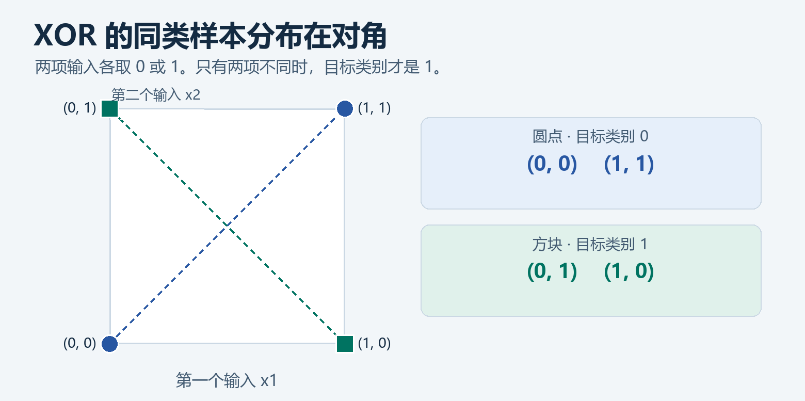
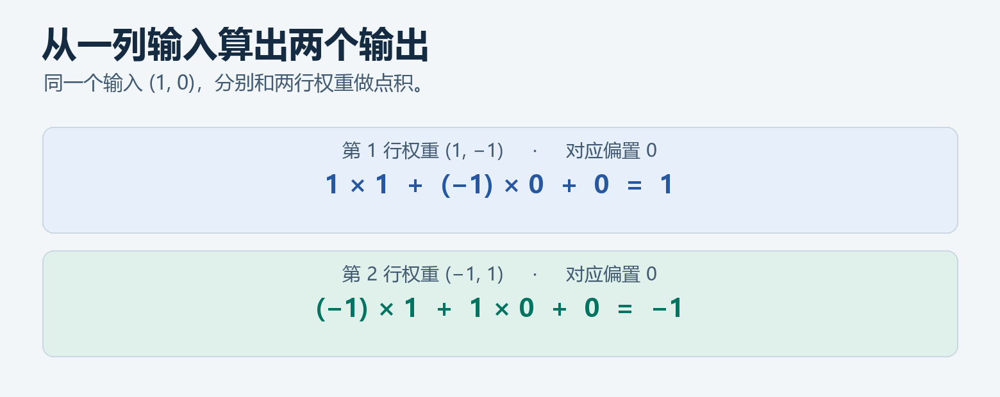
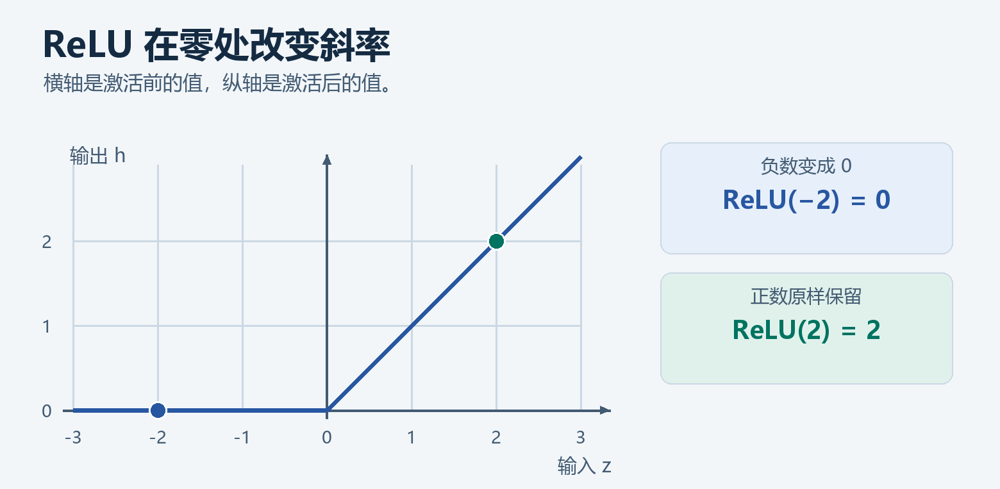
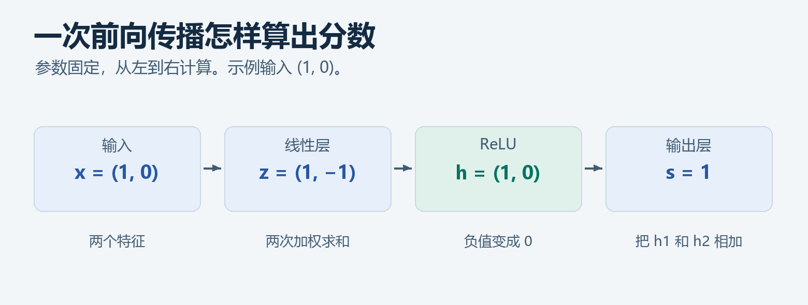
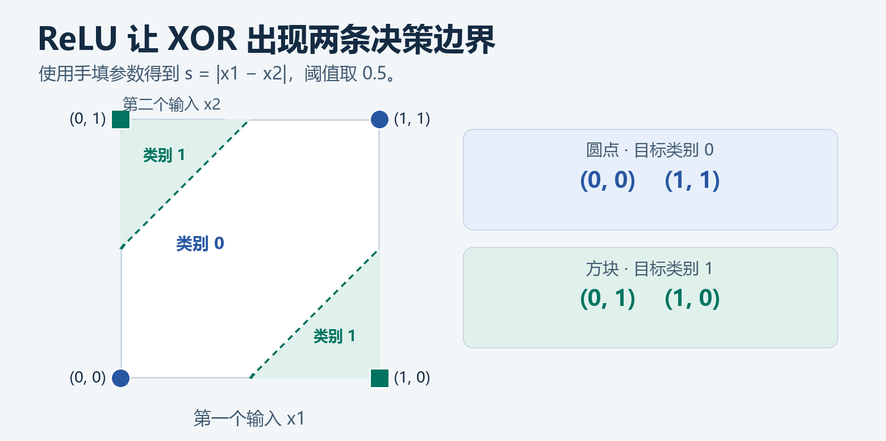
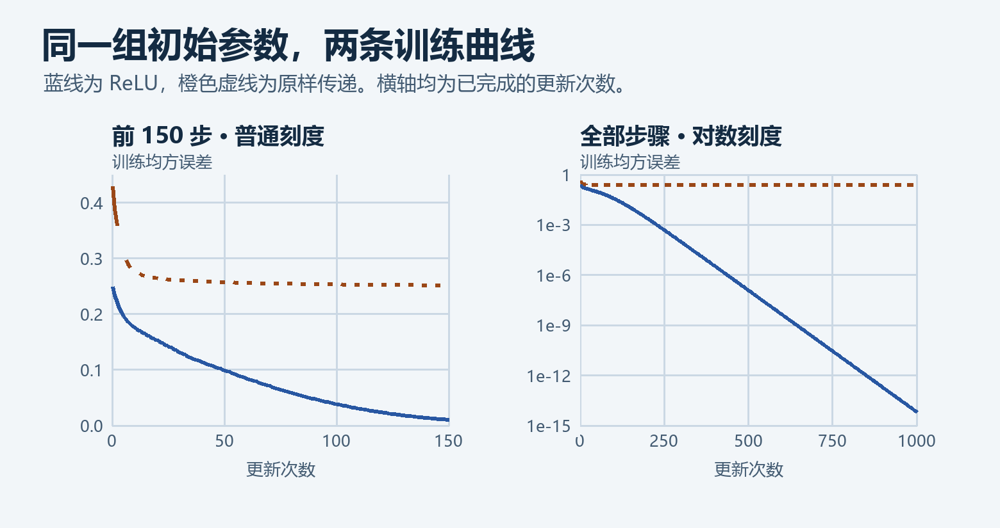

# 第 3 课：多层神经网络

**线性层 · 隐藏层 · ReLU · 前向传播**

第 2 课用一条直线预测一个数。本课给模型两个二值输入，要求它在「恰好一个输入为 1」时输出 1。这是异或（XOR）。我们会先证明一条直线为什么分不开这四个点，再加一层 ReLU，手算四次预测，最后用 PyTorch 从给定的初始参数训练同样大小的网络。

可以先读[第 2 课：线性回归](../2-线性回归/2-线性回归.md)。本课把两个输入排成一列。遇到矩阵时，可以先照图逐行做乘法和加法。术语复习见[基础概念](../0-基础概念/0-基础概念.md)。

## 1. 为什么一条直线分不开 XOR

**二分类**是从两个类别中选一个。本课用 0 和 1 给类别编号。$x_1,x_2$ 是两个**输入特征**，也就是给模型的两项输入值。目标 $y$ 由 XOR 的规则给出。

| $x_1$ | $x_2$ | 目标类别 $y$ |
| ---: | ---: | ---: |
| 0 | 0 | 0 |
| 0 | 1 | 1 |
| 1 | 0 | 1 |
| 1 | 1 | 0 |

把第 2 课的模型多加一个输入项，得到分数 $s=w_1x_1+w_2x_2+b$。本课约定 $s\ge 0.5$ 时判为 1，其余情况判为 0。**阈值**是把连续分数变成类别的分界值，代码里写作 `int(score >= 0.5)`。输入平面上满足 $s=0.5$ 的点组成**决策边界**。只要 $w_1,w_2$ 至少有一个非零，这条边界就是直线。两个权重都是零时，模型对所有输入给出同一分数。



*图 1. 圆点是类别 0，方块是类别 1。两条虚线连接同类样本，在正方形中心相交。*

可以直接用四个分数验证。对类别 1 的两个点，$s(1,0)+s(0,1)$ 必须至少为 $1$。对类别 0 的两个点，$s(0,0)+s(1,1)$ 必须小于 $1$。但把公式代入，两边都是 $w_1+w_2+2b$。同一个数无法同时满足这两个条件。无论训练多久，这种形式都无法把四个类别全部判对。

## 2. 从一个分数到一层，再到多层

**层**是网络里承担一段计算的模块。一层可以输出多项数值。先看一个**线性层**的例子，输入是 $(1,0)$，我们想用两套权重分别算一次。第一套权重是 $(1,-1)$，第二套是 $(-1,1)$，两项偏置暂时都设成 0。



*图 2. 每一行权重对应一个输出。第一行算 $1\times1+(-1)\times0+0=1$，第二行算 $(-1)\times1+1\times0+0=-1$。*

把两套权重各写一行，就构成了权重矩阵 $W$。把输入 $(1,0)$ 的两个数排成一列，就得到**列向量** $\mathbf x$。矩阵乘以列向量时，把一行权重与各输入逐项相乘，再把乘积相加，这一步叫**点积**。每行点积完成后，加上这一行的偏置。输入有 $d$ 项，输出有 $m$ 项时，可以把所有行压缩成一个式子。

$$
\mathbf z=W\mathbf x+\mathbf b,\qquad W\in\mathbb R^{m\times d},\quad \mathbf b\in\mathbb R^m.
$$

式中的 $m\times d$ 表示 $W$ 有 $m$ 行、$d$ 列，也就是每项输出有 $d$ 个权重。比如 `nn.Linear(2, 2)` 接收两个输入特征，给出两个输出，具有 $2\times2$ 个权重和两个偏置。带偏置的变换在数学上叫**仿射变换**，PyTorch 沿用工程里的名称 `Linear`。参见 [PyTorch 的 Linear 文档](https://docs.pytorch.org/docs/2.15/generated/torch.nn.Linear.html)。

先用两个标量体会叠层。第一层算 $z=2x+1$，第二层算 $s=3z-4$。代入得到 $s=3(2x+1)-4=6x-1$，两层刚好合并成一条直线。矩阵的情况道理相同。

如果把两个线性层直接连起来，展开式子就会得到

$$
W_2(W_1\mathbf x+\mathbf b_1)+\mathbf b_2
=(W_2W_1)\mathbf x+(W_2\mathbf b_1+\mathbf b_2).
$$

合并后的模型仍然是同一种仿射变换。对于只输出一个分数的模型，分类边界依然至多是一条直线。想分开 XOR，我们需要在两层之间加入一次无法并入矩阵乘法的变换。

**激活函数**把一层算出的数再转换一次。本课用 **ReLU**（Rectified Linear Unit，修正线性单元），对每个分量独立执行 $h_j=\max(0,z_j)$。负数变成 0，正数原样保留。虽然左右两段分别是直线，跨过 0 时斜率会改变，所以整个函数无法用同一个仿射式表示。代码里，单个数对应 `max(0.0, z)`，一组数可以交给 `nn.ReLU()`。参见 [PyTorch 的 ReLU 文档](https://docs.pytorch.org/docs/2.15/generated/torch.nn.ReLU.html)。



*图 3. 横轴取激活前的值 $z$，纵轴读激活后的值 $h$。后面反向传播时会用到两段各自的斜率。*

## 3. 手算一遍前向传播

**前向传播**是固定当前参数，按网络定义从输入一步步算到输出。把一组计算连成 $\mathbf x\rightarrow\mathbf z\rightarrow\mathbf h\rightarrow s$，其中 $\mathbf h$ 是送给下一层的中间表示，也叫**隐藏层的输出**。它的每一项称为一个**隐藏单元**。本课的隐藏层有两个单元，所以隐藏层宽度为 2。

先人为选定参数，让第一个单元提取 $x_1$ 比 $x_2$ 大的部分，第二个单元提取相反的部分。

$$
\begin{aligned}
z_1 &= x_1-x_2, & h_1 &= \max(0,z_1),\\
z_2 &= x_2-x_1, & h_2 &= \max(0,z_2),\\
s &= h_1+h_2.
\end{aligned}
$$

第二层把两个隐藏值相加，所以 $s=|x_1-x_2|$。两个输入相同时，两个单元都输出 0。输入不同时，正的那一项变成 1，另一项变成 0。



*图 4. 输入、隐藏层和输出的维度是 2、2、1。图中的参数由我们选定，下一节会用训练求出另一组参数。*

| 输入 $\mathbf x$ | 线性层输出 $\mathbf z$ | 隐藏层输出 $\mathbf h$ | 分数 $s$ | 判定类别 |
| --- | --- | --- | ---: | ---: |
| $(0,0)$ | $(0,0)$ | $(0,0)$ | 0 | 0 |
| $(0,1)$ | $(-1,1)$ | $(0,1)$ | 1 | 1 |
| $(1,0)$ | $(1,-1)$ | $(1,0)$ | 1 | 1 |
| $(1,1)$ | $(0,0)$ | $(0,0)$ | 0 | 0 |



*图 5. 阈值 0.5 把输入平面分成三带。两端正好各包含一个类别 1 的样本，中间带包含两个类别 0 的样本。先看图 1 中的四个点，再看这张图里它们各落在哪个区域。*

下面只做前向计算，可以直接用 Python 运行。

```python
def xor_score(x1, x2):
    z1 = x1 - x2
    z2 = x2 - x1
    h1 = max(0.0, z1)
    h2 = max(0.0, z2)
    return h1 + h2


for x1, x2 in [(0, 0), (0, 1), (1, 0), (1, 1)]:
    score = xor_score(x1, x2)
    print((x1, x2), score, int(score >= 0.5))
```

公式里省写了值为 0 的偏置。隐藏层的权重矩阵是 $\begin{bmatrix}1&-1\\-1&1\end{bmatrix}$，输出层的权重是 $(1,1)$。如果在第一层和第二层之间删掉两次 `max`，输出就是 $(x_1-x_2)+(x_2-x_1)=0$。

## 4. 从手填参数到程序训练

把下面的程序复制到 `lesson03.py`，在安装了 PyTorch 的 Python 环境中运行 `python lesson03.py`。这组数据只有四条，可以用 CPU 完成。第一次安装可选择自己系统对应的 CPU 版本。参见 [PyTorch 安装指南](https://docs.pytorch.org/get-started/locally/)。

两次实验都从同一组参数出发，用相同的数据、均方误差、学习率和更新次数。唯一改变的计算是中间层有没有应用 ReLU。`nn.Identity()` 会原样返回输入。

本课沿用第 2 课的**均方误差**，把类别编号 0、1 当作目标值来评分。输出 $s$ 是实数分数，可以小于 0 或大于 1。训练用 `scores` 计算损失，训练完成后才用阈值把分数变成类别。PyTorch 的**张量**是能参与这类计算的多维数组。`inputs` 的形状是 `(4, 2)`，一行是一个样本，包含两个特征。`targets` 和 `scores` 的形状都是 `(4, 1)`，一行对应一个目标或分数。

| 操作 | 代码中的位置 |
| --- | --- |
| 隐藏层的权重和偏置 | `model[0].weight`、`model[0].bias` |
| 对两项隐藏值应用 ReLU | `nn.ReLU()` |
| 按层的顺序运行前向传播 | `scores = model(inputs)` |
| 计算四条样本的平均平方误差 | `((scores - targets) ** 2).mean()` |
| 计算各参数对损失的梯度并更新参数 | `loss.backward()`、`optimizer.step()` |

`nn.Sequential` 把模块按顺序连接。`torch.no_grad()` 让手动写入的初始值和最后的评分计算跳过梯度记录。`torch.optim.SGD` 在这里执行第 2 课的更新规则「旧参数减学习率乘梯度」。每一步都用完整的四条训练样本求梯度，所以这个实验仍是**全批量梯度下降**。训练循环先清掉上一轮存下的梯度，再求当前梯度，最后更新参数。第 4 课会把这三步拆开计算。

```python
import torch
from torch import nn


inputs = torch.tensor([[0, 0], [0, 1], [1, 0], [1, 1]], dtype=torch.float64)
targets = torch.tensor([[0], [1], [1], [0]], dtype=torch.float64)


def train(activation):
    model = nn.Sequential(
        nn.Linear(2, 2, dtype=torch.float64),
        activation,
        nn.Linear(2, 1, dtype=torch.float64),
    )
    with torch.no_grad():
        model[0].weight.copy_(inputs.new_tensor([[0.8, -0.3], [-0.5, 0.9]]))
        model[0].bias.copy_(inputs.new_tensor([-0.25, -0.2]))
        model[2].weight.copy_(inputs.new_tensor([[0.3, 0.4]]))
        model[2].bias.copy_(inputs.new_tensor([0.1]))

    optimizer = torch.optim.SGD(model.parameters(), lr=0.05)
    for step in range(1001):
        optimizer.zero_grad()
        scores = model(inputs)
        loss = ((scores - targets) ** 2).mean()
        if step in {0, 25, 100, 1000}:
            print(f"step={step:4d}  mse={loss.item():.6g}")
        if step == 1000:
            break
        loss.backward()
        optimizer.step()

    with torch.no_grad():
        scores = model(inputs).squeeze(1)
        print("scores:", [round(score, 6) for score in scores.tolist()])
        print("classes:", (scores >= 0.5).to(torch.int64).tolist())


print("Identity")
train(nn.Identity())
print("ReLU")
train(nn.ReLU())
```

`step=0` 是初始评分，`step=1000` 是完成 1000 次参数更新后的评分。`squeeze(1)` 把形状 `(4, 1)` 变成 `(4,)`，便于打印。下面是运行结果节选。

```text
Identity
step=   0  mse=0.428625
step= 100  mse=0.25379
step=1000  mse=0.250049

ReLU
step=   0  mse=0.249913
step= 100  mse=0.0387034
step=1000  mse=6.74045e-15
scores: [0.0, 1.0, 1.0, 0.0]
classes: [0, 1, 1, 0]
```



*图 6. 横轴是已完成的更新次数，纵轴是训练均方误差。左侧放大前 150 次更新。右侧展示全程，纵轴相邻刻度之间相差固定的倍数，可以同时看到很大的损失和接近零的损失。两种模型在更新前就可能得出不同预测，因为它们在隐藏层使用了不同的函数。*

这里的四条样本已列出二值输入的全部可能组合。训练日志检查的是这四个组合能否被模型表示和拟合。要像第 2 课那样考察泛化，需要另选一个存在更多输入组合的任务。

### 选读：为什么无激活版本会靠近 0.25

仿射分数满足 $s(0,0)+s(1,1)=s(1,0)+s(0,1)$，所以类别 0 和类别 1 的**平均分数相同**，设为 $m$。同类两个分数的平方误差平均值，至少等于「同类平均分数与该类目标值的差」的平方。这可以用恒等式 $\tfrac12[(a-y)^2+(b-y)^2]=(\tfrac{a+b}{2}-y)^2+\tfrac{(a-b)^2}{4}$ 验证。

两类各占一半，整体 MSE 至少是 $\frac12[m^2+(m-1)^2]=(m-0.5)^2+0.25$。始终输出 0.5 就能达到这个下界。本实验里无激活版本的损失靠近 0.25，符合这个模型的表达限制。

## 5. 练习

1. **手算前向传播。** 用第 3 节的固定参数算 $(0,1)$，依次写出 $\mathbf z,\mathbf h,s$。
2. **比较有无激活。** 把固定参数代码的两个 `max` 去掉，先预测四条输出，再运行验证。
3. **计算参数个数。** 把隐藏层宽度从 2 改成 3，输入输出维度保持 2 和 1。分别算两层的权重和偏置有多少。
4. **读训练日志。** 解释 `step=0` 为什么就有不同的损失。再指出哪一行求梯度，哪一行更新权重。

<details>
<summary>做完后核对</summary>

1. $\mathbf z=(-1,1)$，$\mathbf h=(0,1)$，$s=1$。
2. 四条都是 0，因为两个线性组合相加恰好抵消。
3. 第一层 $3\times2$ 个权重、3 个偏置，第二层 $1\times3$ 个权重、1 个偏置，一共 13 个可训练参数。ReLU 没有可训练参数。
4. 权重虽然相同，激活这一步已经改变了部分隐藏值。`loss.backward()` 计算并存入梯度，`optimizer.step()` 用梯度改参数。

</details>

下一课固定一个样本和一组便于手算的参数，把这套 $2\rightarrow2\rightarrow1$ 网络的梯度从输出层一路算回第一层。见[第 4 课：反向传播](../4-反向传播/4-反向传播.md)。
