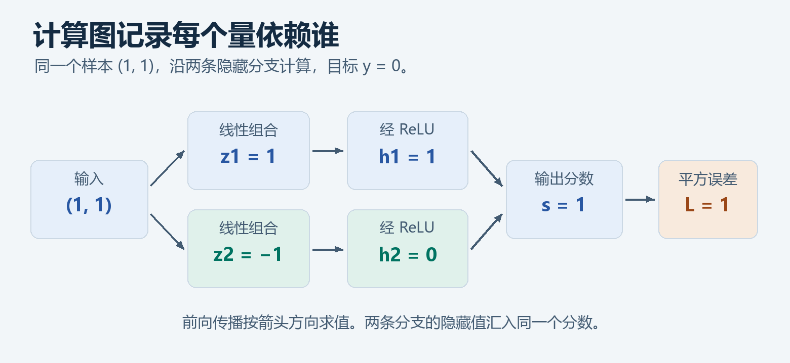
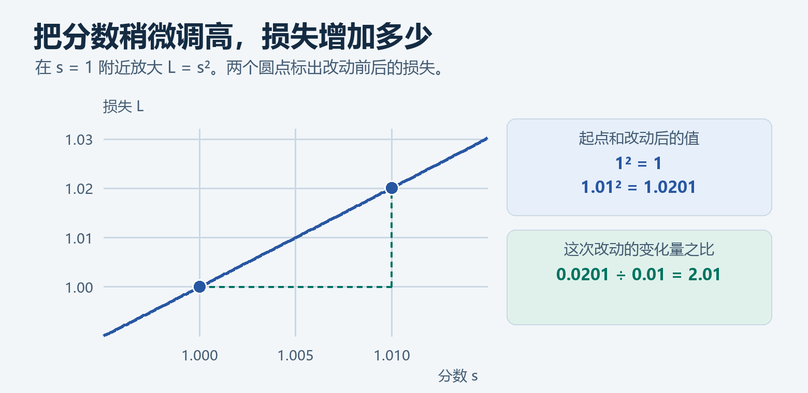
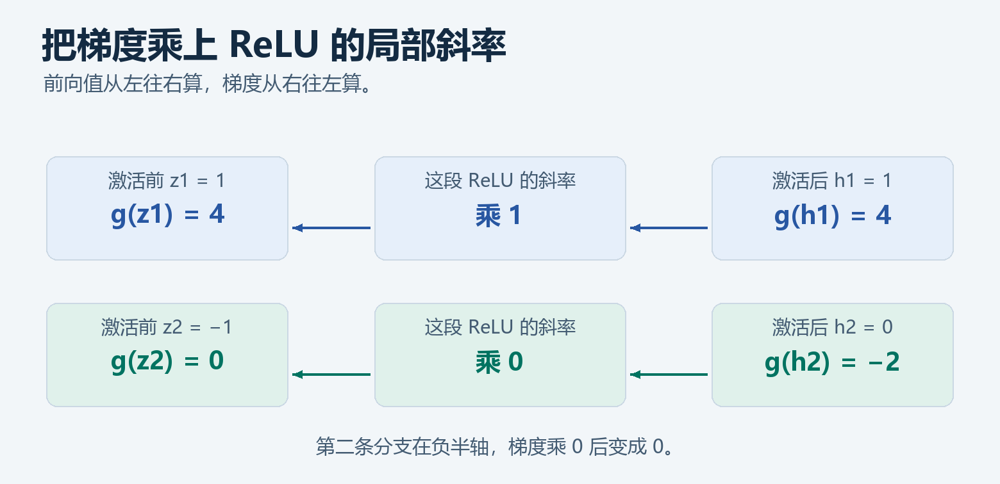
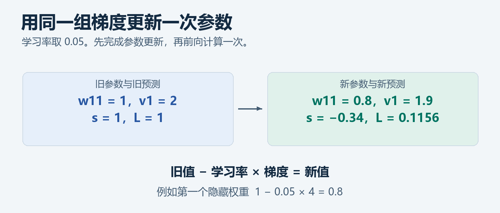
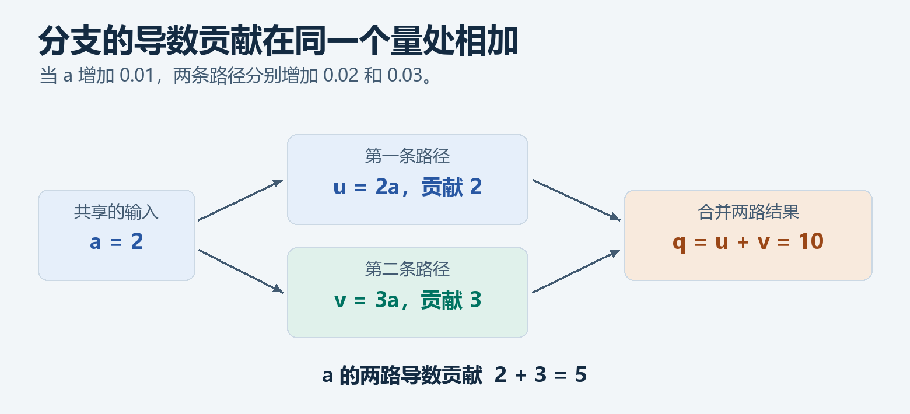
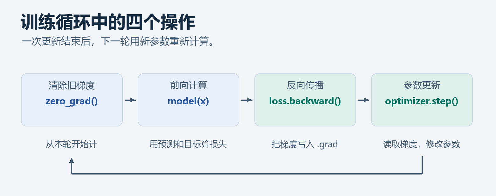

# 第 4 课：反向传播

**计算图 · 局部导数 · 梯度累加 · PyTorch 自动求导**

[第 3 课](../3-多层神经网络/3-多层神经网络.md)用两个隐藏单元做 XOR。我们知道了输入怎样一路变成分数，也见过 `loss.backward()` 和 `optimizer.step()`。本课用一个样本、一组容易计算的参数，逐项算出 `backward()` 得到的数，然后检查 `step()` 如何使用这些数。

如果对导数生疏，可以先把它理解成「在当前值附近，输入每增加一点，输出大约改变多少」。正文每次只看两个相邻的量，先用数字判断变化方向，再写相应的导数。训练和梯度的术语可查[基础概念](../0-基础概念/0-基础概念.md)。

## 1. 把一次预测拆成几步

仍用两个输入、两个隐藏单元、一个输出的网络。选 XOR 样本 $\mathbf x=(1,1)$，目标 $y=0$。下面的初始参数专门选来做手算。

| 计算位置 | 算式 | 本次结果 |
| --- | --- | ---: |
| 第一个隐藏单元的线性组合 | $z_1=1\cdot x_1+1\cdot x_2-1$ | 1 |
| 第二个隐藏单元的线性组合 | $z_2=1\cdot x_1-1\cdot x_2-1$ | −1 |
| ReLU 后的隐藏值 | $h_1=\max(0,z_1),\ h_2=\max(0,z_2)$ | $(1,0)$ |
| 输出分数 | $s=2h_1-h_2-1$ | 1 |
| 单条样本的平方误差 | $L=(s-y)^2$ | 1 |

把上表中每个中间量都画成节点，用箭头连接「哪个值被下一步用到」，得到一张**计算图**。前向传播按依赖顺序算节点的值，反向传播沿同一套依赖关系计算损失对各个量的导数。



*图 1. 从左往右读前向数值。第二个隐藏单元得到 −1，经过 ReLU 后变成 0。目标值和各层参数在表格里保持固定。*

## 2. 沿着一条路径，为什么要乘

先只问一个问题。**如果把输出层连接 $h_1$ 的权重稍微调高，损失会怎么变？** 把这个权重记为 $v_1$，原值为 2。其他参数和样本固定时，$h_1=1$，所以 $v_1$ 加 $0.01$，分数 $s$ 就加 $0.01$。损失从 $1^2$ 变为 $1.01^2=1.0201$，增加 $0.0201$。变化量之比是 $0.0201/0.01=2.01$。把改动缩小到 $0.001$，这个比值就变成 $2.001$，更接近 2。



*图 2. 图中放大了 $s=1$ 附近。把横向改动继续缩小，损失变化量与分数变化量的比会趋近 2。*

在当前点，$\partial L/\partial s=2(s-y)=2$。这个记号读作「损失 $L$ 对分数 $s$ 的偏导」，表示在目标 $y$ 固定的前提下，$s$ 的小改动如何影响损失。相邻两个节点之间的导数，比如 $\partial s/\partial v_1=h_1$，叫**局部导数**。它只描述当前这一步计算。

现在把两段变化接起来。$v_1$ 的小改动先乘 $h_1$ 变成分数的改动，分数的改动再乘 $2(s-y)$ 变成损失的改动。因此两段的放大倍数相乘。这是**链式法则**。

$$
\frac{\partial L}{\partial v_1}
= \frac{\partial L}{\partial s}\frac{\partial s}{\partial v_1}
= 2\cdot h_1=2.
$$

**反向传播**是一种用链式法则求梯度的算法。它从损失端出发，算出一个中间量的梯度后，把这个结果交给它直接依赖的上一批量。同一个中间结果可以被多个参数复用。例如这里算一次 $\partial L/\partial s=2$，就能继续求两个输出权重和一个输出偏置的梯度。最后得到的**参数梯度**是各个可训练参数对损失的偏导，形状与对应的参数一致。

## 3. 从输出层一路算回第一层

记 $g_a=\partial L/\partial a$。下标 $a$ 放哪个量，$g_a$ 就表示损失对哪个量的导数。比如 $g_s=2$ 表示损失对分数的导数。输出层写成 $s=v_1 h_1+v_2 h_2+c$，其中 $v_1=2,v_2=-1,c=-1$。

### 输出层的参数

把 $v_j$ 稍微调高，分数随之改变 $h_j$ 倍，所以 $g_{v_j}=g_s h_j$。偏置 $c$ 增加多少，分数就增加多少，所以 $g_c=g_s$。

$$
g_{v_1}=2\cdot1=2,\qquad g_{v_2}=2\cdot0=0,\qquad g_c=2.
$$

### 两个隐藏值与 ReLU

这次固定输出权重，考虑改变隐藏值 $h_j$。分数改变 $v_j$ 倍，所以 $g_{h_j}=g_s v_j$，算得 $(g_{h_1},g_{h_2})=(4,-2)$。

下一步往回看 $z_j$。在正半轴上，ReLU 原样传出输入，局部导数是 1。在负半轴上，把输入在原处稍微挪动，输出仍为 0，局部导数是 0。$z_1=1$ 走正半轴，$z_2=-1$ 走负半轴。

$$
g_{z_1}=4\cdot1=4,\qquad
g_{z_2}=(-2)\cdot0=0.
$$



*图 3. 从左往右看前向值，从右往左看梯度。第二条分支的 $g_{h_2}=-2$，经过负半轴的 ReLU 时乘以 0，变成 $g_{z_2}=0$。*

ReLU 在 $z=0$ 的左右斜率不同，经典导数在这里没有定义。PyTorch 在这个点取反向值 0。本课的两个 $z$ 都远离 0，可以直接用各自那段的斜率。参见 [PyTorch 自动求导说明](https://docs.pytorch.org/docs/2.15/notes/autograd.html#gradients-for-non-differentiable-functions)。

### 隐藏层的参数

把第 $j$ 个隐藏单元的两个权重记为 $w_{j1},w_{j2}$，偏置记为 $b_j$。例如 $z_1=w_{11}x_1+w_{12}x_2+b_1$。轻微改变 $w_{11}$，$z_1$ 的变化倍数是 $x_1$。偏置 $b_1$ 的变化原样加进 $z_1$。所以

$$
g_{w_{ji}}=g_{z_j}x_i,\qquad g_{b_j}=g_{z_j}.
$$

两个输入都为 1。第一行的两个权重各得到 4，偏置得到 4。第二行对应的 $g_z$ 是 0，三个梯度都是 0。把结果按参数的形状放回去。

| 参数组 | 参数原值 | 梯度 | 对应代码里的属性 |
| --- | --- | --- | --- |
| 隐藏层权重 $W$ | $\begin{bmatrix}1&1\\1&-1\end{bmatrix}$ | $\begin{bmatrix}4&4\\0&0\end{bmatrix}$ | `model[0].weight.grad` |
| 隐藏层偏置 $\mathbf b$ | $(-1,-1)$ | $(4,0)$ | `model[0].bias.grad` |
| 输出层权重 $V$ | $(2,-1)$ | $(2,0)$ | `model[2].weight.grad` |
| 输出层偏置 $c$ | $-1$ | $2$ | `model[2].bias.grad` |

### 用梯度更新一次

沿用第 2 课的更新规则「旧参数减学习率乘梯度」。取学习率 $0.05$，例如 $w_{11}$ 从 $1$ 变成 $1-0.05\times4=0.8$，$v_1$ 从 $2$ 变成 $2-0.05\times2=1.9$。



*图 4. 求梯度时，各层使用同一组旧参数。更新以后，再用新参数跑一次前向传播，才能得到新的分数和损失。*

全部参数更新后，第一个隐藏单元得到 $0.8+0.8-1.2=0.4$，第二个隐藏单元仍输出 0。新分数是 $1.9\times0.4-1.1=-0.34$，损失为 $(-0.34-0)^2=0.1156$。分数越过了目标 0，但离目标的距离变小了。

## 4. 同一个量走两条路，为什么要加

同一条计算路径上的局部导数相乘。如果一个量被两条不同路径使用，两条路径各自对结果造成的变化需要相加。

用一个不含神经网络的例子。令 $u=2a,v=3a,q=u+v$，取 $a=2$。把 $a$ 增加 $0.01$，左支的 $u$ 增加 $0.02$，右支的 $v$ 增加 $0.03$，相加后 $q$ 增加 $0.05$。于是 $dq/da=5$。写成导数，就是 $1\times2+1\times3=5$。



*图 5. 正向在 $q$ 处相加两个值。反向回到 $a$ 时，相加两条路径各自给出的导数贡献。*

第 2 课把多条样本的梯度先加起来、再除以样本数，也是同样的做法。一个**批次**是这一次计算损失和梯度所用的一组样本。同一个参数服务多个样本，平均损失对它的导数，就是每条样本给出的导数的平均值。

## 5. 用 PyTorch 核对手算

**自动求导**（autograd）是由程序记录参与求导的运算关系，再根据运算的求导规则计算梯度。这里仍用第 3 课的 `Linear → ReLU → Linear`，只是展开三次模块调用，便于查看中间值。常规情况下，梯度会存入被训练参数的 `.grad`。临时想检查中间量的梯度，可以在反向之前对它调用 `retain_grad()`。参见 [PyTorch 自动求导教程](https://docs.pytorch.org/tutorials/beginner/basics/autogradqs_tutorial.html)。

把下面的代码复制到 `lesson04.py`，用安装了 PyTorch 的环境运行 `python lesson04.py`。脚本会核对两层的全部参数梯度，以及更新后的分数。

```python
import torch
from torch import nn


x = torch.tensor([1.0, 1.0], dtype=torch.float64)
target = 0.0
model = nn.Sequential(
    nn.Linear(2, 2, dtype=torch.float64),
    nn.ReLU(),
    nn.Linear(2, 1, dtype=torch.float64),
)
with torch.no_grad():
    model[0].weight.copy_(x.new_tensor([[1.0, 1.0], [1.0, -1.0]]))
    model[0].bias.copy_(x.new_tensor([-1.0, -1.0]))
    model[2].weight.copy_(x.new_tensor([[2.0, -1.0]]))
    model[2].bias.copy_(x.new_tensor([-1.0]))

optimizer = torch.optim.SGD(model.parameters(), lr=0.05)
optimizer.zero_grad()

z = model[0](x)
h = model[1](z)
score = model[2](h).squeeze(0)
for value in (z, h, score):
    value.retain_grad()
loss = (score - target) ** 2
loss.backward()

print(f"before: score={score.item():.4f}, loss={loss.item():.4f}")
print("grad score:", score.grad.item())
print("grad h:", h.grad.tolist())
print("grad z:", z.grad.tolist())

expected = {
    "0.weight": [[4.0, 4.0], [0.0, 0.0]],
    "0.bias": [4.0, 0.0],
    "2.weight": [[2.0, 0.0]],
    "2.bias": [2.0],
}
for name, parameter in model.named_parameters():
    print(name, parameter.grad.tolist())
    torch.testing.assert_close(parameter.grad, x.new_tensor(expected[name]))

optimizer.step()
with torch.no_grad():
    new_score = model(x).squeeze(0)
    new_loss = (new_score - target) ** 2
    torch.testing.assert_close(new_score, x.new_tensor(-0.34))
    print(f"after:  score={new_score.item():.4f}, loss={new_loss.item():.4f}")
```

预期输出如下。`-0.0` 和 `0.0` 在这里数值相同。

```text
before: score=1.0000, loss=1.0000
grad score: 2.0
grad h: [4.0, -2.0]
grad z: [4.0, 0.0]
0.weight [[4.0, 4.0], [0.0, 0.0]]
0.bias [4.0, 0.0]
2.weight [[2.0, 0.0]]
2.bias [2.0]
after:  score=-0.3400, loss=0.1156
```

`squeeze(0)` 把只有一个分量的输出转成标量。`named_parameters()` 返回参数的名字及张量，名字开头的 `0` 和 `2` 是模块在 `Sequential` 里的位置。`torch.testing.assert_close()` 检查张量里的数值和手算结果是否在允许的误差内。

### 多次更新时，哪些值要重算



*图 6. 反向传播和参数更新是两个操作。下一轮从更新后的参数重新前向计算。*

常规训练循环在每轮清理参数的梯度，再用新一轮前向计算出的损失调用 `backward()`。PyTorch 会把新得到的梯度加到参数已有的 `.grad` 上，所以 `optimizer.zero_grad()` 把一轮与下一轮的结果隔开。`optimizer.step()` 读取当前梯度并修改参数。参见 [PyTorch 优化循环教程](https://docs.pytorch.org/tutorials/beginner/basics/optimization_tutorial.html)。

下面对同一个可求导张量做两次独立的前向和反向计算。第一次得到导数 2，第二次得到导数 3，`.grad` 中变成 5。清理后重新计算第二段，`.grad` 就只记录 3。

```python
import torch

a = torch.tensor(2.0, requires_grad=True)
(2 * a).backward()
print(a.grad.item())  # 2.0
(3 * a).backward()
print(a.grad.item())  # 5.0
a.grad = None
(3 * a).backward()
print(a.grad.item())  # 3.0
```

图 5 是同一次反向传播里，不同路径对一个量的贡献相加。刚才的代码演示的是两次独立调用 `backward()` 后，结果会在同一个参数的 `.grad` 中累加。

### 选读：用自动求导复核第 2 课

回到三个样本 $(1,3),(2,5),(3,7)$，让 $w=b=0$。下面把第 2 课手写的两个偏导换成 `backward()`。

```python
import torch

x = torch.tensor([1.0, 2.0, 3.0], dtype=torch.float64)
y = torch.tensor([3.0, 5.0, 7.0], dtype=torch.float64)
w = torch.tensor(0.0, dtype=torch.float64, requires_grad=True)
b = torch.tensor(0.0, dtype=torch.float64, requires_grad=True)
loss = ((w * x + b - y) ** 2).mean()
loss.backward()
print(f"dw={w.grad.item():.6f}, db={b.grad.item():.6f}")
```

输出 `dw=-22.666667, db=-10.000000`，对应第 2 课的 $-68/3$ 和 $-10$。张量设为 `requires_grad=True`，就可以在反向传播后读取它的梯度。

## 6. 练习

1. **手算输出层。** 保持输入和初始参数，将目标值临时改成 $0.5$。先算 $g_s$，再算 $g_{v_1},g_{v_2},g_c$。验证时同步调整脚本里的期望值。
2. **追踪负半轴。** 为什么本课 $g_{h_2}=-2$，但同一分支的 $g_{z_2}=0$？用图 3 中的前向值解释。
3. **检查累加。** 在 `.grad` 示例里把第二次计算改成 $(4a)$。预测清理前后第二、三个输出，再运行。
4. **选读推导。** 沿 $w_{11}\rightarrow z_1\rightarrow h_1\rightarrow s\rightarrow L$ 写出各段局部导数，并乘起来。把 $w_{11}$ 加 $0.01$，用损失变化量除以 $0.01$ 检查结果。

<details>
<summary>做完后核对</summary>

1. $s$ 仍为 1，所以 $g_s=2(1-0.5)=1$。三个梯度分别为 1、0、1。复跑完整脚本时，各参数梯度应是原来的二分之一。用同一学习率更新后，新分数为 $1.95\times0.7-1.05=0.315$。
2. $z_2=-1$，所在位置的 ReLU 局部导数为 0，所以 $g_{z_2}=-2\cdot0=0$。
3. 同时把清理前后两处 `3 * a` 改成 `4 * a`，三个输出依次是 2、6、4。
4. 使用同一组旧参数，沿路径的局部导数依次是 $1,1,2,2$，乘积为 4。把 $w_{11}$ 加 $0.01$ 后，$z_1$ 加 $0.01$，分数加 $0.02$，损失变成 $1.02^2=1.0404$，差商为 4.04。进一步缩小改动，差商会更接近 4。

</details>

下一周把预测对象从数字换成字符。第 5 课会先给字符编号，再用条件概率表示「看到这个字符后，下一个字符可能是什么」。
