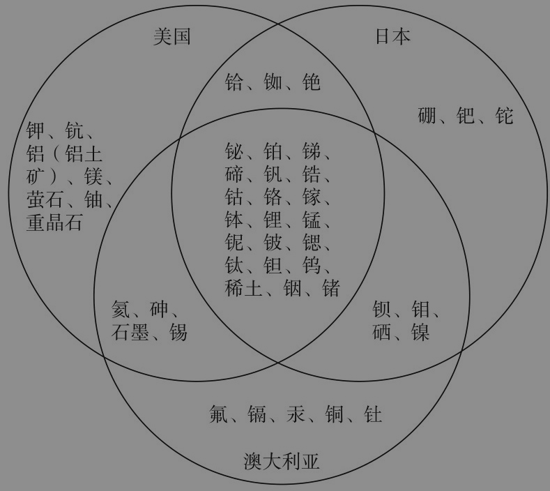

# 第一章 什么是战略性矿产

战略性矿产资源，如同深藏于地壳脉络中的“工业血液”和“创新基石”，其重要性在21世纪的科技革命浪潮中越发凸显，成为大国博弈的焦点领域。当下，中国面临百年未有之大变局，战略性矿产已不再是传统意义上的原材料，而是直接关系到国家经济命脉、国防安全以及全球科技领先地位的核心战略资产。要理解围绕这类矿产的激烈竞争和战略布局，必须首先厘清其内涵，并从历史的纵深中探寻其地位演变的轨迹。

## 历史回溯及启示：从石油、铁矿到战略资源博弈

战略性矿产资源的重要性并非仅在近代才受到人类关注。中国是世界上最早开发利用矿产的国家之一，早在春秋战国时期，青铜器上就记载着“克狄淮夷，抑燮繁汤，金道锡行，具既卑方”的铭文，体现了掌握战略资源与取得军事胜利、保持政权稳固的直接关联。千百年来，战略性矿产的内涵随着全球经济格局、技术革命、地缘政治局势以及大国权力对比的演变而不断深化。回顾历史，我们可以清晰地看到，自工业革命以来，围绕着矿产的战略价值，有着一条从传统大宗矿产到现代关键矿产的认知演进主线，其中的每一次转折都深刻地重塑了国家间的竞争法则与安全观念。

### 石油危机：大国资源战略的第一个转折点

20世纪70年代，发生时间相隔仅有五六年的两次石油危机（1973年、1978年末—1979年）如同一声惊雷，彻底改变了世界对资源属性的传统认知，标志着资源安全正式成为全球地缘政治博弈的核心议题。在此之前，石油虽被视为支撑工业文明运行的“血液”，但无论是政府还是产业界，对其安全的关注和考量更多聚焦于经济层面的稳定供应与合理价格。然而，1973年第四次中东战争（十月战争）期间，阿拉伯石油输出国组织（OAPEC）为打击以色列及其支持者，选择将石油作为政治武器，实施了禁运和大幅减产，导致国际油价瞬间飙升数倍，给严重依赖石油进口的西方发达国家经济带来了滞胀的沉重打击。这一事件颠覆性的启示在于，一种看似普通的商品，一旦被赋予政治意涵，便能超越纯粹的市场规律，成为足以撼动全球经济格局、胁迫大国改变外交政策的战略武器。石油危机迫使主要消费国，尤其是美国及其盟友，深刻反思其国家安全体系的脆弱性，即过度依赖外部且不稳定的能源供应，无异于将经济命脉置于他人之手。由此，建立战略石油储备、推动能源来源多元化、扶持替代能源技术等举措，迅速从学术讨论上升为国家战略。

事实上，石油危机及其应对从根本上确立了“战略性资源”的现代范式，即战略性资源安全不再仅仅是商业问题，而是关乎国家生存与自主性的最高层级的安全议题。这一认知不仅重塑了全球对于“资源安全”的定义和理解，也为后来将所有可能面临供应中断风险的关键矿产纳入战略管理范畴，并运用多元化策略工具开展国家之间的博弈奠定了思想基础，提供了行动依据。

### 铁矿石博弈：定价权、控制权与供应链

如果说石油危机凸显了资源作为地缘政治“硬武器”的威力，那么进入21世纪后，围绕铁矿石展开的长达十余年的激烈博弈，则揭示了在全球化和金融资本深度介入的背景下，资源竞争如何演变为一场围绕定价权、产业链控制权和供应链韧性的复杂体系对抗，大规模商业需求、强势的资本利益以及纠葛的国家立场相互交织，为大宗矿产领域的国际贸易赋予了诸多非市场因素。

在这场重量级矿产博弈中，作为全球市场上铁矿石的主要买方，中国面对定价权缺位的困境，在十余年内承受了工业和人口大国前所未有的巨大需求压力。进入21世纪，随着工业化、城镇化进程狂飙突进，国内对钢铁的需求呈爆炸式增长，中国迅速成为全球最大的铁矿石进口国。然而，国际铁矿石贸易长期被巴西淡水河谷、澳大利亚必和必拓以及英国力拓三大矿业巨头所形成的卖方寡头垄断格局所主导，每年一度的长协定价谈判犹如一场没有硝烟的战争。尽管中国作为最大客户本应凭借市场势力，在价格谈判中拥有话语权，却因钢铁行业内部协调、国际金融规则、矿山股权结构等诸多因素，在相当长的时期内难以将市场需求优势转化为定价话语权，屡屡被迫接受国际铁矿石卖方的大幅涨价，导致巨额利润从中国钢铁产业向上游矿商转移。其中，澳大利亚凭借其全球品位最优越的铁矿这一得天独厚的自然禀赋，获得了长期而稳定的资源红利。澳大利亚将成本在40美元/吨左右的矿石卖到100美元/吨，利润率一度高达150%，而下游中国重点钢铁企业平均销售利润率却不足1%。2024年，澳大利亚卖出了近10亿吨铁矿石，将200亿美元的利润收入囊中。同年，作为世界第一钢铁大国的中国生产了约10亿吨钢铁，消耗了大概16亿吨铁矿石，整体利润仅有30多亿美元。由此可见，在大宗矿产领域，定价权是经济收益归属的决定性因素，在某种程度上就等于资源安全。

同时，这一阶段的博弈将资源安全的焦点从“断供”的极端危险，扩展至“议价能力不足”这一类更为常态化的经济安全挑战。铁矿石定价及交易谈判深刻揭示了在现代全球贸易体系中，资源安全不仅意味着“买得到”，更关键的是能否“买得实惠”，即如何避免承受不公平的输入性成本，从而维护本国产业的国际竞争力。也要看到，严峻的资源博弈形势产生了一定的倒逼作用。一方面，我国连续打出不断优化行业组织结构、压缩淘汰落后产能、持之以恒地以创新驱动降本增效、加快绿色低碳转型的组合拳，重塑中国产业格局，增强在国际铁矿石谈判桌上的实力；另一方面，通过开辟非洲等新资源供给地、引导国内矿企走出去参股或控股海外资源、加快建设海外权益矿、积极发展期货市场等举措，谋求铁矿石定价影响力，提升中国要价的底气。经过全力整合国内采购力量，中国逐步开始以对供应链全链条的控制力来提升安全边际。

全球资源博弈的铁矿石时代给矿产圈和产业界留下了很多“故事”，至今仍是颇有话题性的领域。同时，铁矿石谈判对参与双方核心利益的扰动推动了大国资源安全战略从被动防御向主动布局、从单一商品谈判向全产业链掌控的深刻转型，也成为中国钢铁行业数轮体制改革、产能治理、技术路线优化、产业组织结构调整以及供应链重塑最直接的外部诱因之一。

### 迈向战略性矿产的“新战略时代”

当前，我们正置身于一场由全球能源绿色低碳转型（“双碳”目标）和新一轮科技产业革命（数字技术、人工智能、新能源）共同驱动的“新战略时代”。与之相伴，战略性矿产家族迎来了历史性的扩张，一批如锂、钴、镍、稀土、铂族金属、锗、镓、铟等以往相对小众的金属元素，因其在清洁能源、新兴产业和国防军工中的不可或缺性，被共同冠以“关键矿产”或“战略性矿产”的名号，登上了大国竞争的中心舞台。

与石油和铁矿相比，战略性矿产“新”的特征极为鲜明。首先，战略性矿产的战略价值直接与国家的长远发展潜力相关联，是构筑未来竞争优势的“技术金属”。其中，锂、钴、镍是动力电池和储能系统的核心；稀土是高性能永磁体的关键，广泛应用于新能源汽车、风力发电和精确制导武器；而锗、镓、铟等则是半导体芯片、高速通信和光电设备的基石。这些金属是实现产业升级和“双碳”目标的物质基础，保障其供应就是保障国家能源转型与科技创新的基本盘。其次，战略性矿产的安全保障风险更具复杂性和隐蔽性。相当一部分战略性矿产的地质分布极度集中，例如全球大部分钴供应依赖政治局势不稳的刚果（金），而稀土冶炼分离能力则高度集中于中国。更关键的是，风险可能潜伏在供应链的某个特定环节（如精炼加工），形成“卡脖子”的瓶颈。这些风险分布在地理空间、供应链条上的不同位置，并且互相关联，使得围绕战略性矿产的国际博弈形势错综复杂。最后，战略性矿产具有突出的不可替代性，在当前技术路径下，这些矿产在特定功能上往往缺乏经济可行的替代方案。因此，新时代的资源安全，本质是技术主权安全和供应链韧性安全。大国对战略性矿产的争夺已不再是简单的原料获取，而是对未来科技制高点和产业标准制定权的争夺，这使得资源安全与国家安全的绑定比历史上任何时期都更加紧密和深刻。

## 战略性矿产的定义：从“工业粮食”到“半导体之基”

基于历史脉络的梳理，我们要进一步从理论层面为战略性矿产勾勒出一幅清晰的画像。实际上，战略性矿产并非一成不变的静态标签，而是一个随着国家发展战略、科技水平、消费升级和国际格局演变而不断丰富的动态体系，其内涵形成、与大宗矿产的本质区别以及其内在的核心属性，共同构成了对当前大国资源竞争的认知基础。

### 不止于矿产：概念流变与时代内涵

战略性矿产这一概念的演变，大体上经历了三个显著阶段，深刻反映了工业文明、科技革命以及国家战略需求的时代变迁。在工业化早期，战略性矿产主要涵盖煤炭、铁矿石等“大宗矿产”，这些矿产在大规模生产中扮演了“工业粮食”的角色，其战略价值或定位主要体现在庞大的开采量和用量，以及其对工业生产的基础性作用上，是一国（地区）实现工业化的物质前提。

进入20世纪中后期，尤其在冷战背景下，战略性矿产概念焦点转向与国防安全和尖端科技紧密关联的“关键矿物”，如用于核武器与航天的铀、钛，以及用于精密制导系统和夜视仪的稀土元素。这一时期，此类矿产的价值不再仅取决于经济规模，更在于其对维护国家主权和军事优势的不可替代性。

21世纪以来，随着全球能源转型提速和数字经济的兴起，战略性矿产的外延进一步扩展，锂、钴、稀土、铂族金属、锗、镓等数十种矿产被纳入战略性矿产的范畴，其内涵也迎来了深刻变化。当代意义上的战略性矿产不仅是“国防矿产”，更被赋予“技术矿产”与“气候矿产”的新时代属性，成为支撑新能源汽车、半导体芯片、人工智能、风电光伏等新兴产业，以及实现“双碳”目标的核心物质基础。

由此，可以将战略性矿产界定为在高技术产业以及国防军事工业中应用广泛、支撑产业升级与能源转型的重要资源。可见，战略性矿产的概念已超越传统资源范畴，逐渐演变为“战略性”与“关键性”的融合体，其供给安全直接关系到国家能否在科技革命和产业变革中占据主导地位，并牵动经济、国防乃至气候安全的全局。各国相继发布并定期更新其战略性矿产名录，并对此类矿产普遍采取了清单管理的方式。关键矿产清单，如图1-1所示。

**图1-1 关键矿产清单**

*资料来源：根据相关国家关键矿产名录整理。*

### 战略性矿产与大宗矿产的差别

为深入理解战略性矿产的独特属性，需将其与传统大宗矿产进行系统性对比，以揭示二者在经济学逻辑和战略属性上的本质差异。大宗矿产，如铁矿石、煤炭、铝土矿等，是构成工业经济的“基础量”，其市场需求总量大、应用广泛且基础，全球贸易活跃，市场体系相对成熟。对大宗矿产而言，其核心安全风险主要源于价格波动和运输安全。由于大宗矿产在全球分布相对分散且具有一定替代性，纯粹的“断供”风险并非人们首要关切的问题，战略保障重点在于以稳定低成本保障大规模供应，维护经济运行效率。

相比之下，战略性矿产则如同工业体系中的“关键点”或“维生素”，尽管绝对用量可能很小，但单位价值高，并具备极强的专用性和不可替代性，其风险图谱呈现出更为复杂严峻的特征。从全球供求格局的现状及趋势观察，战略性矿产的首要安全威胁是供应中断，这在很大程度上源于其地理分布的极端集中性以及供应链环节（尤其是精炼加工）的高度垄断性。一旦关键环节出现扰动，就可能对下游高端产业造成系统性冲击。因此，战略性矿产的战略焦点已超越经济成本考量，转向对供应链韧性、技术主权和产业安全的全面维护。大国对战略性矿产的争夺，实质上是争夺未来产业的核心要素、关键原材料以及技术标准制定权。简言之，大宗矿产决定经济体的“体量”和“规模”，而战略性矿产则决定其在高端竞争中的“功能”与“活力”。

### 三大核心属性：大国竞争的深层动因

纵观全球，主要经济体纷纷将数十种矿产列为“关键”或“战略性”矿产，其根本动因在于这些矿产共同具备三大相互交织的核心属性。

#### 1. 稀缺性

这一特征属性不仅源于有限的地质储量，更体现为经济稀缺与供应链稀缺。地质分布的高度不均衡是客观基础，而开发周期长、技术门槛高、环境社会约束强等外部因素共同导致了供给难以快速响应需求，形成结构性瓶颈。更重要的是，若供应链中任何环节（从开采、选冶到精深加工）的技术、产能高度集中于少数国家或企业，即使资源本身分布广泛，也会引发极具冲击性的供应风险，正如当前西方国家在稀土和锂电材料等领域所面临的困境。

#### 2. 战略性

这是战略性矿产最本质的属性，意味着其对国家核心利益具有全局性、长期性和决定性影响。在大国竞争背景下，战略性矿产资源的安全直接关系到国防现代化、经济转型升级和科技自主可控，失去对其的控制权，国家就可能在新的工业革命中处于被动。

#### 3. 不可替代性

目前或在可预见的未来中，战略性矿产在特定高端应用领域缺乏在性能、成本或稳定性上可比的替代材料。例如，稀土永磁体在电机高效化、小型化方面的优势，以及锂离子电池在电动汽车领域的成熟应用，均已形成了一定的技术路径依赖，极大限制了消费主体的替代空间，从而放大了供应风险。当然，对于绝大部分战略性矿产，理论上讲，其不可替代性是相对的、动态变化的，受技术水平、成本价格、产业政策、环境规制及地缘条件等多重因素影响。

总体而言，战略性矿产的稀缺性构成了矿产竞争的客观基础，战略性赋予其竞争以紧迫意义，不可替代性则使竞争难以通过技术手段回避。三者的叠加，共同将战略性矿产推向全球战略博弈的前沿。

## 大国矿产清单：如何掌控未来命脉

如前所述，战略性矿产的价值最终体现在各国实际制定的战略清单与具体行动中。主要经济体通过发布战略性矿产清单这一举措，清晰划定了这场资源博弈的“竞技场”，清单内涵、外延及甄别标准的演变直接反映出国家战略重点的转移和对未来风险的前瞻性判断。分析比较不同国家的战略性矿产清单及其背后的战略布局，为揭示不同国家在全球资源格局中的真实处境、薄弱环节与战略意图等提供了关键依据。

### 美、日、欧的战略性矿产清单：绿色与高科技并行时代的矿产战略导向

美国、日本、欧盟等发达经济体在战略性矿产战略的制定上起步较早，整体呈现出高度协同性与前瞻性。其清单内容显著聚焦于锂、钴、稀土、铂族金属等支撑绿色能源转型和数字高科技产业的矿产品种，反映出对传统供应链脆弱性的深刻忧虑及对未来技术主导权的强势争夺意图。美国的战略着重于供应链安全化，构建内外并举，联盟护航的路径：对内通过《国防生产法》等政策法规激励国内开采、加工与回收；对外积极构建以“友岸外包”为特征的排他性联盟[如“矿产安全伙伴关系”（MSP）]，旨在绕开地缘政治竞争对手。日本作为资源匮乏的技术强国，其策略精髓在于海外权益布局与技术锁定，一方面依托综合商社与政府机构，系统性参股海外资源项目；另一方面凭借材料科学优势，在高端应用环节构筑技术壁垒，以确保下游制造业的原料安全。欧盟的战略则强调战略自主与循环经济双轮驱动，其《关键原材料法案》设定了对任何第三方国家依赖度不超过65%的明确底线，同时通过强化内部回收循环利用和推动替代材料研发，构建更具韧性的闭环供应链体系。总体来说，尽管美、日、欧的战略侧重点有所不同（美国侧重联盟安全、日本强调技术优势、欧盟注重可持续自主），但它们有着一致的核心逻辑，即通过国家力量的强势介入，重塑战略性矿产供应链，降低对竞争对手的依赖，从而保障其在绿色与高科技时代的产业链安全与国家竞争力优势。

### 中国的战略演进：确保自主安全与整合全球资源

中国的战略性矿产保障战略，经历了从以国内资源开发利用为核心的自给自足模式，到在强化国内资源保障前提下，积极参与全球资源配置双向发力模式的深刻演进。在工业化初期，中国主要立足国内资源，重点保障煤炭、铁矿石等大宗矿产，以及钨、锡、锑等传统优势矿产的供应，以支撑独立工业体系建设。随着经济腾飞和城镇化快速发展，我国资源需求结构发生显著变化。为适应矿产资源消费结构转变，国家制定出台了一系列相关政策法律法规。2016年发布的《全国矿产资源规划（2016—2020年）》首次系统制定了“战略性矿产目录”，标志着其管理进入科学化、系统化阶段。该目录涵盖石油、天然气、铀等能源矿产和铁、铜、铝等大宗矿产，并前瞻性纳入稀土、钨、锡、锑等优势矿产以及锂、钴、镍等新兴矿产，体现了保障基础、巩固优势、抢占前沿的立体化战略思维。

中国在战略性矿产领域的战略布局呈现出巩固优势、弥补短板、全球布局的鲜明特征。一方面，对稀土、钨等优势矿产采用控制开采总量、建立国家储备和规范出口管制等一揽子政策工具，推动此类资源优势转化为产业与技术优势；另一方面，通过“一带一路”倡议等合作机制，支持国内企业以投资、参股、联合开发等形式走出去，参与海外矿产项目开发，构建多元化进口供应网络，以此降低对单一资源进口来源地的依赖。当前，面对国际环境的复杂变化与供应链“脱钩断链”压力，中国战略性矿产保障战略正转向“内外兼修、循环互补”的新模式，即在深化全球资源合作的同时，更加注重提升国内保障能力、发展循环经济、加强技术革新，以实现供应链安全与产业竞争力的精细平衡。

### 新兴矿产的崛起：锂、钴、稀土何以成为“新黄金”

近年来，锂、钴、稀土等新兴战略性矿产在各国清单和地缘竞争中被反复强调，其地位跃升为“新黄金”，这是历史进程与技术革命交会的必然结果。这些金属的核心价值在于作为物质桥梁，它们连接了全球绿色低碳转型与数字经济爆发这两大潮流，它们在人类矿产开发利用中的历史地位及全球矿产品贸易中的时代角色，均由技术变革、结构转型和地缘竞争共同赋予。

锂是质量最轻、电化学性能最佳的金属，锂离子电池也是最具实用性的诺贝尔奖成果之一。在现行技术路线下，锂是动力电池不可替代的负极材料，其需求直接与电动汽车普及和储能电网建设挂钩，是新一轮能源革命的“晴雨表”。但由于锂具有非常活泼的化学属性，意味着其在储能技术的产业化应用中存在不足和局限性，未来仍有被其他技术路线取代或者优化的可能性。

钴在三元锂电池中作为关键稳定剂，能够显著提升能量密度和热稳定性，清洁能源转型催生的需求使钴成为关键金属博弈中的重要角色。近年来，随着低钴化技术趋势不断增强，全球钴的安全形势虽有所改善，但其在中短期内仍对电池性能和安全至关重要，也是全球清洁能源技术体系中最受关注的金属之一。

稀土，特别是钕、镨、镝等元素制成的永磁体，具有迄今已发现的最强磁能积，是实现电机高效率、小型化的核心材料，被广泛应用于新能源汽车驱动、风力发电、工业机器人等高端装备之中，是提升能源转换效率和精密控制的材料基石。尽管稀土在地壳中的储量被一再证实并不“稀有”，部分轻稀土元素的全球储量甚至是黄金等稀贵金属的数百倍，但由于其有别于矿石型金属的独特成矿机理、分散的赋存条件以及长期形成的不对称全球开发利用体系，使之成为大国博弈不断升级且极具“话题感”的矿物。

值得注意的是，这些被称为“新黄金”的矿产，其战略稀缺性不仅源于地质分布的高度集中，如锂富集于“锂三角”（玻利维亚、智利、阿根廷三国交界处）和澳大利亚，钴依赖刚果（金）；更在于其生产环节，特别是精炼加工能力的地理集聚性，如中国在稀土分离冶炼领域的绝对优势。资源稀缺、生产集中与技术瓶颈相互交织叠加，决定了谁能掌控这些“新黄金”，谁就把握了未来清洁技术与数字产业的命脉。正因如此，锂、钴、稀土等战略性矿产被推向大国地缘经济竞争的前沿，这既折射出战略性矿产内涵深化和外延扩展的方向性趋势和规律，也是当前世界范围内，人们广泛关注关键金属、频繁讨论战略性矿产的话题，并在产业和国家层面强化其安全保障的战略依据和策略出发点。
