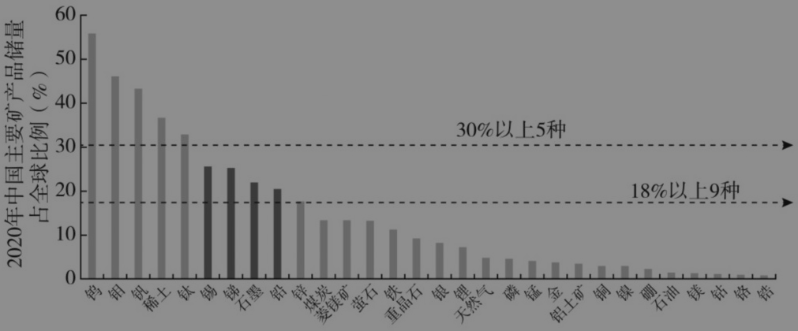
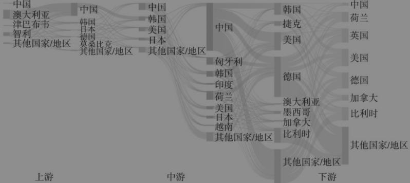
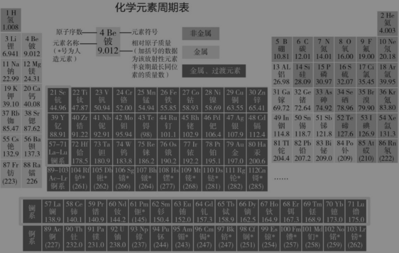
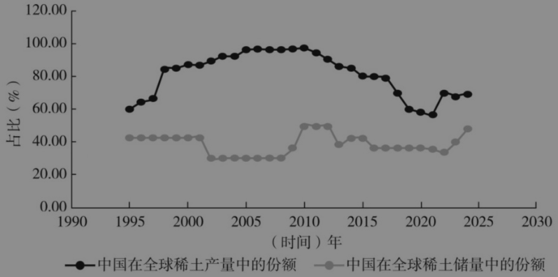
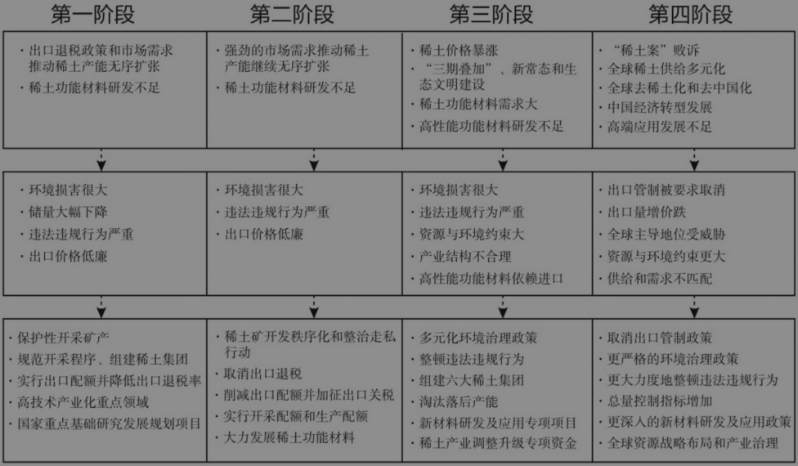
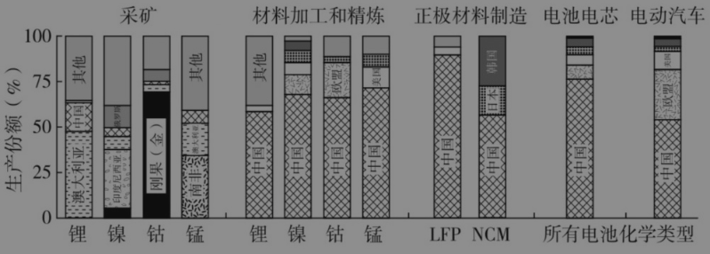

# 第七章 中国在战略性矿产全球格局中的大国地位

整体而言，中国战略性矿产资源丰富，是战略性矿产开采、生产、消费和出口大国，在全球格局的供需两侧都占据重要地位。其中，稀土、钨、锑、锂、镓、石墨等多个矿种在全球供应链上已形成一定掌控力。

## 中国：无可争议的矿产资源大国

客观来说，无论是从供给端还是需求端看，中国在资源赋存、产能和产业链、市场规模、应用领域、存量积累等方面均具备较为显著的体系性优势，在战略性资源国际格局中扮演着难以动摇的重要角色。

### 资源博弈硬实力：中国战略性矿产的整体优势

我国矿产资源品类丰富，多个品种的储量排名世界首位。2020年，中国钒、钨、锡、钼、锑、稀土、锶7种矿产储量居全球第一，国内储量全球占比超过30%的矿种有钨、钼、钒、稀土、钛5种；中国储量占比在20%～30%的有锡、锑、石墨、铅4种(见图7-1）。

**图7-1 2020年中国主要矿产储量占全球的比重**

注：图中18.8%的水平线相当于中国人口全球占比。

*资料来源：中国地质调查局/中国地质科学院全球矿产资源战略研究中心，《全球矿产资源形势报告(2021)》。*

从近几年的情况来看，中国的锡、锑、石墨、铅、锌、菱镁矿、萤石、煤炭、铁人均储量高于中国人口的全球占比。但也要看到，我国战略性矿产的资源优势是相对的。2020年，中国储量全球占比10%以下的有重晶石、银、锂、磷、锰、金、铝土矿、铜、镍、硼、镁、钴、铬、锆等15种非能源矿产，铂族金属、铌、钽等战略性金属国内基本没有资源赋存。即使是稀土等传统优势矿产，我国已探明的资源普遍品位偏低，开采条件差，锂、钾盐等战略性资源虽有分布，但资源地偏远，开采成本高企，生态环境影响显著。

### 生产消费贸易规模世界第一，供应链地位凸显

凭借完整的产业体系和大规模产能优势，中国已成为全球矿产品生产第一大国，产量全球占比超过50%的非能源矿产有13种。在消费方面，中国世界第一的地位更加突出。目前，中国有36种矿产消费量位居全球第一。其中，战略性矿产消费总量居世界第一位。2022年，中国锂、钴、稀土消费量分别占全球总消费量的65.9%、42.8%和57.0%。辩证地看，中国的产能优势和市场规模对战略性资源安全保障产生了“双向”影响。

一方面，从长远来看，近40种矿产消费量全球占比超过人口占比的现实情况决定了中国矿产供求关系总体偏紧，战略性矿产安全形势不容乐观，拓展资源边界、“开源节流”的压力和动力长期存在。强劲的国内生产消费和出口需求导致中国矿产品进口依存度不断上升。2020年，中国进口非能源矿产品总额1867亿美元，有11种进口量超过全球一半，包括钴矿、铬矿、铀矿、贵金属矿、铝土矿、镍矿、铌钽锆钒矿、锰矿、锡矿、铜矿、铁矿石。就国际竞争激烈的“能源转型矿产”而言，除稀土、石墨，中国的铜、锂、钴、镍等能源金属对外依存度高且进口来源单一，矿产进口来源高度集中在大洋洲、拉美和非洲地区。如何在激烈的国际竞争中稳定此类矿产供给，更好地满足“双碳”目标下国内不断激增的下游生产、消费和出口需求，是战略性矿产安全保障的重点和难点。

另一方面，作为新能源、新能源汽车、储能电池世界第一的生产和消费国，一些中国企业快速成长为相关行业的链主，凭借中下游环节的市场势力不断将产业链掌控力向上游的资源供给端渗透，加之中国矿业企业通过并购等方式加强海外资源开发，推动中国对锂、钴等矿产的影响力从需求端传导至供求两侧，进而获得重要能源金属的全产业链影响力（见图7-2)。

**图7-2 全球锂电池产业链及主要参与方**

*资料来源：《全球贸易与产业增长实验室》数据库。*

### 加大力度整合海外资源

开发利用海外矿产资源一直是中国对外投资和企业走出去的重要领域。然而，由于全球矿产资源勘探开发深受地缘政治、资源地国内矿业法和环境规则等因素影响，发达国家大型矿业企业在相关领域投入大、布局深，加之国内企业国际化经验不足，资本运作手段不够丰富，中国矿企走出去频遭挫折，甚至引发了一些关注度高的舆情事件。近年来，随着中国矿产品生产消费规模扩大，国内矿业整合力度加大，矿企综合实力显著增强。经过前期积淀和数轮调整，目前我国海外矿产勘探开发投资整体上呈现平稳态势，矿企走出去趋于理性，项目选择更加成熟，全球化资源配置体系逐步完善。尽管我国矿业海外投资取得了一定进展，但仍存在区位布局不尽合理、战略支点不够清晰、与“一带一路”倡议下国际产能合作关联有待加强等突出问题，而在微观层面上，不少海外项目尚处在前期阶段，运营状态不稳定，预期收益有很大不确定性。

### 优势矿产定价能力有所增强

国际市场上稀土等战略性矿产买方与卖方的市场结构存在较大差异，不对称的市场势力和行业组织结构导致即便在优势矿产上，中国也难以全面掌握此类矿产品的国际定价权。近年来，全球战略性矿产供求关系收紧，需求增长和竞争加剧的市场预期趋于固化，拉动主要战略性矿产品价格震荡。我国抓住全球供求格局演变的机遇，充分利用资源优势，资源政策、税收政策、产业政策、贸易政策、环保政策、国家收储多管齐下，推动了稀土等优势矿产价格形成机制逐步完善。随着行业组织结构整合到位，稀土等战略性资源卖出“白菜价”已然成为过去时。在“双碳”目标和中美大国竞争升级刺激下，镨钕等在节能减排等领域有重要应用的稀土元素及钕铁硼等价格标杆性产品的价格经历了数轮上涨。价格能充分反映其应用价值和生态环境成本，既是中国资源政策、产业政策、贸易政策调整的目标方向，也是中国定价能力提升的体现。

### 主动应对大国竞争

资源、产能和市场“三重优势”为中国在战略资源领域应对地缘政治竞争提供了策略空间和政策工具。2023年8月，中国启动新一轮出口制裁措施，对镓、锗相关物项实施出口管制，此举是针对美国、日本、荷兰在半导体等领域对华升级技术限制与供应链挤压所采取的精准战略反制。该措施直指上游关键原材料、精准击中了上述国家产业链的结构性短板，对全球半导体和战略性资源产业链产生了连锁冲击。2024年9月，中国又对另一优势矿产—锑进行出口限控。实际上，中国作为全球锑资源的重要供应国，一直以来在锑产品生产和出口方面扮演着举足轻重的角色。中国实行出口管制措施之后，仅2024年10月锑产品出口量环比大幅下跌了97%。可见，利用优势矿产以及供应链整体优势制衡美西方技术封堵，短期内的政策效应较为显著。针对美国在关税、技术封控等方面持续收紧对华政策，2025年10月，中华人民共和国商务部连发公告，实施新一轮大力度稀土出口管制，有力地回击了美方。根据国际能源署的评估显示，中国出口管控在一定程度上固化了战略性矿产供给高度集中的全球格局，对发达国家推动多元化的安全保障起到了抑制作用。

## 优势与王牌：中国在矿产博弈中的“出牌权”

### 稀土及其他：中国在全球供应链中的话语权

#### 1. 稀土不“稀”？

稀土是指化学元素周期表中镧系元素，由原子序数57至71的元素组成，包括镧（La)、铈（Ce)、镨(Pr)、钕(Nd)、钷(Pm)、钐(Sm)、铕(Eu)、钆(Gd)、铽(Tb)、镝(Dy)、钬(Ho)、铒(Er)、铥(Tm)、镱(Yb)、镥(Lu)，以及与镧系的15个元素密切相关的2个元素—钪（Sc）和钇（Y）共17种元素（见图7-3）。

**图7-3 稀土的17种化学元素**

提到“稀土”，很多人可能会觉得它应该是非常“稀有”的矿产。然而，回溯稀土元素发现的历史，可以看出，稀土之“稀”并非真正意义上的稀少或稀缺。1787年，瑞典人斯万特·阿累尼乌斯在一个采石场中首次发现了含有钇的矿石，18世纪末到19世纪，各种稀土元素逐步被发现，最初稀土一般是以氧化物状态分离而来的，因其发现之初存在于瑞典较为稀少的矿物中，故被称为稀土(Rare Earth，简称RE或R)。这一名称虽沿用至今，但随着勘探技术的提高，稀土被证实在地壳中的分布是相当广的，其总含量甚至超过铜、铅、锌等常见的金属。其中，铈在地壳中的储量在各种金属元素中居第25位，其常见程度与铜接近，高于铅在地壳中的含量。真正稀少的稀土元素是钷等元素，但即便是稀土元素中含量最低的镥在地壳中的含量也比金高出200倍。

实际上，世界范围内稀土资源还是比较丰富的，除了我国是稀土资源大国，俄罗斯、澳大利亚、美国、巴西、印度、加拿大、越南均已发现稀土矿，而在亚洲的蒙古、缅甸、越南、马来西亚、印度尼西亚、哈萨克斯坦、朝鲜、阿富汗、斯里兰卡等国家和地区，非洲的布隆迪、南非、尼日利亚、肯尼亚、坦桑尼亚、莫桑比克、埃及等国，欧洲的挪威、土耳其、格陵兰岛等地，稀土也都有一定的储量。美国地质调查局的数据则显示了美国本土的稀土资源储量，迄今在美国14个州均已发现稀土资源，美国本土稀土储量达1300万吨，可以供美国使用数百年甚至上千年。考虑到尚有海洋和更深地层的资源未被勘探，地球上稀土的实际蕴藏量可能会远远超出估计量。

既然“稀土不稀”早已成业界共识，那么为何稀土还会成为战略性矿产中最受关注的矿种，以及大国博弈的焦点？

这在很大程度上要归于稀土元素特殊的成矿机理和赋存条件。稀土的开采条件与矿石型的金属或非金属有着很大的差别，多种稀土元素在地壳中呈高度混合分散的状态，或以伴生矿的形式存在于铁矿石等其他矿山之中，难以采用传统采矿技术实现经济性开采，其冶炼分离技术也有一定的技术门槛，而且在现有技术路线下，稀土开采、冶炼对环境的影响较大，这也是作为稀土资源大国的美国在20世纪80年代关停其本土稀土矿，转而进口价格低廉的中国稀土的主要原因。稀土成为焦点矿产的另一个主导因素在于其广泛而重要的应用，被称作“工业维生素”的稀土是影响国防科技、环保产业和新能源产业的关键金属。在现实生活中，小到手机、电脑，大到风电设备、电动汽车、航空航天装备，都离不开稀土的支撑，稀土为现代产业体系提供了不可或缺的多样化功能材料。

#### 2. 中国的“优势牌”从何而来

在全球稀土供应链中，中国长期占据着核心位置，这种地位既源于产业规模的优势，也伴随着结构转型的挑战。除稀土元素之外，中国在镓等“稀散金属”的供应链中，同样扮演着不可忽视的角色。这里仍以稀土为例，如果要给全球稀土供应链画一张“权力图谱”，中国将毫无疑问地占据突出的位置。过去20年里，中国稀土产量占全球平均份额超过85%，这一占比足以说明中国的主导地位。与此同时，中国还拥有从稀土采选、冶炼分离到功能材料制造的完整产业链，并主导着中重稀土产品、稀土永磁体等中上游产品的生产。

中国的这种优势，最初源于两方面的现实条件。一方面，20世纪80年代，中国实现了稀土冶炼分离技术突破，开始转入规模化稀土产品生产出口，彼时国内劳动力成本较低，且环保合规要求相对宽松，使得中国稀土开采和冶炼的成本在相当一段时间内远低于其他国家，逐步获得了生产出口的规模优势。另一方面，2010年以前，全球稀土需求主要依赖中国供应，而其他国家的稀土矿山，要么尚未进行大规模开发，要么因成本过高难以竞争；后者譬如美国的莫利矿业公司（Molycorp，从事稀土氧化物的生产和销售的美国公司）、澳大利亚的莱纳斯，虽然在2013年后尝试进入全球市场，但始终难敌中国稀土的价格优势。

不过，中国稀土的优势更多体现为冶炼分离环节以及供应链整体性优势，而非资源储量的绝对优势。从储量来看，1995—2024年中国稀土探明储量仅占全球平均储量的39%左右，远低于产量占比（见图7-4)。与此同时，储量结构不均衡，更稀缺、更具价值的中重稀土储量约800万吨。近年来，随着越南、格陵兰、缅甸等国家或地区陆续探明并开发稀土矿，全球稀土供给逐渐走向多元化，中国的产量占比已从高峰时的超90%，下降到2024年的69%，并且未来可能会继续下降。

**图7-4 1995—2024年中国在全球稀土产量和储量中的份额**

*资料来源：根据Chen，Jinyu等，“China’s rare earth dominance:The myths and the truths from an industrial ecology perspective”， Resources, Conservation and Recycling, 2018年,以及和USGS，Mineral Commodity Summaries，2025年整理。*

### 从资源优势到产业优势的艰难跃升

尽管中国在稀土产量和中上游环节占据主导，但在全球稀土价值链中，中国却在相当长时期内面临着“有产量、无定价权”“有规模、无高附加值”的困境。换句话说，中国手握“优势牌”，却没能充分掌握“出牌权”。就技术水平而言，我国稀土资源开采、冶炼与分离技术水平相对较为先进，而在尖端应用技术方面，特别是稀土在高技术领域的应用水平与发达国家相比，仍有差距；从产品结构来看，我国稀土产品生产和出口资源性产品仍占较大比重，高附加值、深加工产品较少。根据2018年的统计数据，我国88%的稀土出口是初级产品（如冶炼分离产品），而日本、德国等发达国家出口的稀土产品中，终端产品的占比分别高达59%和39%。这意味着中国严重滞后于稀土价值链的“微笑曲线”两端，在高附加值的研发设计和终端应用方面存在短板。以稀土永磁体为例，这一核心应用将占2030年稀土总需求的约40%。其中，全球53%的相关专利由日本申请，而中国仅占10%。这说明国内企业生产的稀土永磁体还需要依赖进口的高端磁粉或应用技术。

定价权的缺失则更为直接。由于中国稀土出口商数量多、规模小，在与国外大型进口商的谈判中往往处于弱势；加上早期环保成本未被完全纳入生产成本，中国稀土出口价格长期偏低，宝贵的稀土资源被卖出“白菜价”一度成为行业发展的痛点。这在很大程度上源于定价机制不合理，环境成本长期被排除在价格形成机制之外。2001—2013年，赣州氧化镧的生态环境成本是其市场价格的14.5倍，如果将环保成本计入，稀土产业甚至可能处于亏损状态。2010年，中国曾尝试通过出口配额调控稀土价格，但这一政策最终因违反世界贸易组织规则遭遇败诉，中国于2015年被迫取消出口配额和关税，此后稀土出口再次出现“量增价跌”的趋势。

### 政策演进：从“被动应对”到“主动布局”

针对稀土资源优势长期无法上升为资源优势的行业发展堵点、痛点，国家先后多轮出台力度大的产业政策，集中解决违法违规开采、产业组织结构不合理、低价无序竞争等突出矛盾。梳理1985年以来中国稀土政策的演进历程，能清晰看到一条从“被动应对问题”到“主动规划全局”的脉络，大致可分为四个阶段（见图7-5)。

第一阶段，1985—2004年，鼓励出口、规范开采。当时的中国经济需要通过出口换汇，故自1985年起对稀土实行出口退税政策，叠加全球半导体产业对稀土的需求，使得稀土出口量从1991年的8204吨，增长到2004年的5.33万吨。但大量资本的涌入也导致产业无序竞争，表现为稀土出口均价从1.25万美元/吨暴跌到0.93万美元/吨，同时还引发了严重的资源浪费和环境污染，譬如赣州因稀土开采而成为全国酸雨发生率超90%的城市之一。这一时期，政府虽然出台了保护性开采、规范程序等政策，但力度较为温和，未能根本解决问题。

**图7-5 中国稀土产业政策的阶段性演进**

*资料来源：根据周美静等.中国稀土政策演进逻辑与优化调整方向，《资源科学》，2020年整理。*

第二阶段，2005—2010年，转向“出口数量管理”。这一阶段，政府开始意识到“以资源换外汇”的不可持续性，因此在2005年取消了稀土出口退税，反过来加征稀土出口关税；与此同时，2005—2010年出口配额从6.56万吨削减至3.03万吨。这些政策在一定程度上提高了出口价格，但非法开采和走私依旧严重，2006—2008年，中国与国外的稀土进出口数据每年都会相差2万～3万吨。此外，环保问题也未能得到有效缓解。

第三阶段，2011—2014年，聚焦“行业治理与结构调整”。2011年出台《国务院关于促进稀土行业持续健康发展的若干意见》，密集推出环境治理（如污染物排放标准）、结构调整(如企业兼并重组）、秩序整顿（如打击走私）等方面的政策。这一时期，稀土行业淘汰了落后产能，组建了大型企业集团，但高附加值环节的短板仍未补齐。

第四阶段，2015年至今，供给侧结构性改革推动行业高质量发展。2015年，中国在世界贸易组织败诉被迫取消出口管制后，面对全球供给多元化、国内需求增长等新形势，政策重心转向全产业链升级。一方面调整开采配额，放开部分外商投资限制；另一方面推进环保税改革，加强稀土追溯体系建设，同时鼓励企业走出去，参与海外稀土项目，积极主动布局全球资源。

纵观四个阶段的政策动因，早期政策多是问题倒逼下的被动应对，比如环境恶化了才出台治理政策，走私严重了才开展专项打击；而近年来，政策逐渐转变为目标导向，开始主动对接“双碳”目标、战略性新兴产业发展等国家宏观战略，适时调整自身在全球供应链格局中的位置。

随着中美大国博弈升级，稀土作为应对工具的战略价值显著提升。一方面，我国对稀土资源、技术、冶炼分离指标等方面实施了更为系统性的管控，以充分释放其作为重要战略资源以及我国综合优势最强矿产在大国竞争中的策略空间；另一方面，加大科技投入力度，进一步整合优化行业组织结构。从市场结构和产业组织来看，近年来在国家一系列政策作用下，稀土产业整合已见成效，中国稀土集团的成立标志着南北稀土产业格局进一步集聚。同时，在产业链中下游，一大批高水平稀土功能材料的专利成果加快涌现，引领中国稀土产业创新日益活跃，产业发展整体水平实现跃升，对稀土磁材等关键领域的掌控力显著增强，加快推动中国由稀土资源大国迈向稀土材料强国，大大提升了中国在稀土全产业链上的话语权，为大国资源博弈增添了信心和底气。

### 不止稀土：镓的“中国因素”

除稀土外，中国在另一种战略性金属“镓”的全球供应链中，同样具有不可替代的地位。镓被称为“green minor metal”，即绿色稀散金属，是太阳能光伏、风电、电动汽车等绿色技术的核心材料。目前，全球九成以上的原生镓由中国供应。中国的镓优势，是与铝产业高度绑定的。全球90%的镓是铝生产的副产品，而中国作为全球最大的铝生产国，具备镓产能的先天优势。不过，这种副产品依赖也带来了一定的潜在风险。随着国内铝存量逐渐饱和，加之产能调控，中国铝生产进入峰值期，原生镓的供应可能随之受到影响。但这种风险可通过提高镓的回收效率和工艺效率以减少镓消耗来化解。在全球绿色转型背景下，镓的需求将持续增长，其他国家也可能进一步释放镓生产产能，全球镓供应链仍具备弹性。总体来看，中国在镓的生产技术、成本控制上仍具有优势，即便未来其他国家增加镓产量，中国对全球镓供应链的影响依然显著。

### 话语权的未来：从“规模优势”到“综合实力”

对于稀土、镓等战略性矿产，当前中国在供应链中的话语权，本质上依附于“规模优势”与“结构短板”并存的现状。因此，如果要巩固并提升这种话语权，未来可以从以下四个方面进行突破。

一是优化资源开发战略。对于稀土，需要根据市场需求动态调整开采配额，同时优先布局海外中重稀土资源；对于镓，需平衡铝产业调控与镓供应，探索从锌冶炼残渣中提取等其他来源。二是突破高附加值环节。稀土产业应激发企业研发热情，构建“政府引导、市场主导”的产、学、研网络，譬如在稀土永磁体、高端磁粉等领域加大专利布局；镓产业则可以提升在CIGS（铜铟镓硒）光伏、氮化镓LED等终端应用的技术能力。三是完善环保与成本机制。将矿山修复、废水处理等方面的环境成本全面纳入生产成本，通过环保税、资源税等政策，倒逼产业绿色转型。2020年实施的《中华人民共和国资源税法》，将轻稀土税率调整为7%～12%，中重稀土税率调整为20%，就是重要的一步。四是推进全球协同治理。面对全球供应链重构，中国应当与其他国家建立关键金属的供应合作机制，参与国际标准制定并将非法矿产排除在供应链以外，同时通过战略储备、产能共享等举措，降低地缘政治对供应链的冲击。

总而言之，中国在稀土等战略性矿产供应链中的地位，既是过去产业发展的结果，也是未来全球绿色转型的关键变量。话语权的提升，不再单纯通过追求产量规模，而更要通过技术创新、结构升级和全球合作，将“优势牌”真正转化为“可持续的出牌权”。

## 从开采到终端的产业链主动权：以清洁能源转型为例

在着力推进低碳转型的今天，新能源产业链的运转，始于地底矿产的开采，终于电动车、光伏板等应用场景。这一漫长链条中，每个环节的主动权分配，既取决于资源禀赋，也依赖技术积累和产业布局。目前，中国虽然并未全盘掌握新能源产业链的各个环节，却凭借综合优势，在关键转化与制造环节形成了强大能力，同时在应用端通过政策与市场需求强化了这种优势。从开采到终端，中国的主动权呈现出清晰的“中间强、两端不均”特征，而这正是数十年产业政策、技术突破与全球分工共同作用的结果。

### 上游开采：资源分布决定战略起点

新能源产业链的第一环是矿产开采。这一阶段的主动权高度依赖自然资源的地理分布。拥有储量丰富、易于开采的矿产，也就手握产业链“起点话语权”的基础。从开采格局来看，尽管在少数矿产上仍具备一定优势，但中国并不能掌控所有矿产的源头，对多数战略性矿产的开采仍依赖全球供应。

对于锂这一动力电池的核心矿产，2020年全球主要的开采国是澳大利亚(49%）、智利(27%)、中国(16%)和阿根廷(7%）。尽管中国的开采份额并不高，却掌控着锂矿“从开采到加工”的关键流转节点，譬如澳大利亚产出的锂将有99%被运往中国进行后续加工。钴的开采则更依赖单一地区，刚果（金）是全球钴矿的主要来源，其产量在全球钴供应中占比极高。中国企业通过投资刚果（金）的矿山，间接参与钴矿开采，但并未直接掌控开采环节的主动权。镍矿的开采则集中在印度尼西亚、菲律宾和新喀里多尼亚，中国虽有镍矿可供开采，但电池级镍的供应仍依赖俄罗斯、加拿大等国家。在石墨这一电池负极制造的关键材料开采中，中国展现出明显的优势：根据国际能源署2022年发布的报告，全球近八成的石墨开采集中在中国，且中国掌控了从石墨矿开采到负极材料制造的全链条。这种“开采—加工”一体化优势，让中国在石墨这一细分领域，直接从源头掌握了主动权。

总体来看，对于上游开采环节，中国的主动权呈现出“局部优势”的特点。除石墨外，新能源产业所需的战略性矿产的开采仍要依靠全球资源供给。近年来，中国通过投资、贸易等多种方式，将开采环节与后续加工环节紧密绑定，为争取中游环节的主动权提供了有力支撑。

### 中游材料加工：核心转化环节，中国是“不可替代的枢纽”

如果说上游开采是为了获取原材料，那么中游材料加工就是将原材料转化为可用部件。这一环节是新能源产业链的价值转化核心，也是中国掌握最强主动权的环节。无论是锂、钴、镍等电池矿产，还是多晶硅等光伏材料，其脱离矿石形态的蜕变，大多依赖中国的加工产能。

在锂的加工环节，中国的枢纽地位尤为突出。如前所述，澳大利亚开采的锂有99%运往中国，经过精炼后转化为电池级碳酸锂和氢氧化锂。而在全球尺度下，2020年，中国承担了全球59%的电池级锂加工，而智利（29%）、阿根廷（9%)和美国（3%）的加工份额远低于中国。这种加工能力不仅来源于规模优势，更体现在技术成熟度上：中国企业在锂精炼的纯度控制、成本控制方面已经形成壁垒，全球多数电池企业均需要依赖中国加工的锂材料。

作为光伏组件的核心原料，多晶硅的加工同样是中国的突出优势领域。根据2025年中国硅产业链大会发布的数据，2005—2024年，我国多晶硅产能从300吨/年持续增长至287万吨/年，全球占比从0.6%提升至94.4%；产量则从60吨/年持续增长至184万吨/年，全球占比从0.2%提升至94.2%。更关键的是，对于多晶硅加工后的硅片和电池片环节，中国的主导地位得到进一步强化，根据国际能源署2022年的报告，全球97%的硅片产能、85%的电池片产能集中在中国。从多晶硅到硅片，再到光伏电池，中国已形成“加工—制造”的无缝衔接，任何国家想要发展光伏产业，都难以绕过中国的中游加工环节。

在电池材料加工环节中国的优势更为明显。根据国际能源署2022年公布的数据，在动力电池的正极材料和负极材料领域，中国的产能占比分别达到70%和85%；全球80%的NCM（镍钴锰酸锂）正极材料由中国企业生产，而LFP（磷酸铁锂）正极的加工几乎完全依赖中国，达到惊人的90%～93%的比重。除了规模，这种加工优势还体现在技术专利上，中国企业在LFP材料的晶体结构优化、掺杂改性等方面拥有大量核心专利。在中游材料加工环节，中国的主动权并非偶然形成，而是通过长期的规模效应、技术研发和环保标准提升，形成了“全球原材料进来、中国加工品出去”的枢纽格局。正是这种格局，让中国成为新能源产业链中难以被替代的主导方。

### 下游制造：电池和组件生产，中国的“规模与技术双优势”

中游加工提供了“可用材料”，下游制造则将这些材料组装成最终的核心部件，包括动力电池、光伏组件等。在这一环节，中国依旧凭借规模效应与技术积累，形成难以撼动的主动权，全球多数终端企业都需要依赖中国的制造产能。

动力电池是中国下游制造的王牌领域。2024年，我国动力电池领域持续领跑全球，产量占比达70.3%。宁德时代与比亚迪稳居全球动力电池装机量前两位，6家中国企业合计占据全球67.1%的市场份额。这种产能并非低水平重复，而是涵盖了从电芯到电池包的全流程制造。宁德时代、比亚迪等不仅产能规模全球领先，还具有电池管理系统、热管理等核心技术优势。

光伏组件制造的优势同样显著。从硅片切割到组件封装，中国企业掌握了全套制造技术，且成本控制能力突出，根据国际能源署2022年的报告，中国光伏组件的生产成本较印度低10%，较美国低20%，较欧洲低35%。这种技术叠加成本的双重优势，让中国光伏组件占据全球70%以上的市场份额。值得注意的是，中国在下游制造环节的主动权，还体现于技术路线的选择。以动力电池为例，中国企业主导了LFP技术的商业化：LFP电池因成本低、安全性高的特性，成为全球中低端电动汽车的主流选择，而中国占据全球LFP电池90%以上的制造产能。而对于NCM，中国占全球的制造份额也达到57%，形成两种技术路线均占优的格局。

由此可见，下游制造环节的主动权，本质上在于规模效应与技术壁垒的结合。中国通过庞大的国内市场需求支撑产能扩张，然后以产能扩张降低单位成本，形成“越造越便宜、越便宜越能造”的产业发展正向循环，同时投入研发打造技术门槛，最终使其他国家难以在短期内复刻中国的制造优势。

### 终端应用：政策与市场驱动，中国的“需求牵引”优势

新能源产业链的最后一环是终端应用，在该环节，中国基于政策引导与市场需求，不仅形成全球最大的终端市场，还通过“需求牵引”进一步巩固中游与下游的主动权，培育“应用—制造—加工”的全链条优势。

电动汽车的终端应用是最典型的案例。中国是全球最大的电动汽车市场，预计2025年销量超过1100万辆，占据全球总销量的2/3。[1]庞大的市场需求不仅支撑了国内的电池制造产能，还进一步推动了技术迭代。例如，用户对长续航、快充电的需求，倒逼电池企业研发更高能量密度的电池。同时，中国采取的“双积分制”(新能源汽车积分与平均燃油消耗量积分)进一步强化了需求：生产电动汽车，车企可获得积分，而积分可交易，这推动车企扩大了电动汽车生产。

中国在光伏终端的应用同样具备优势，中国是全球最大的光伏装机市场，根据欧洲光伏协会预测，中国新增装机规模约占全球53%。庞大的装机需求带动了光伏组件的制造规模，而组件制造规模的扩大又降低了成本，进一步推动光伏应用的普及。这种“需求—制造—成本—需求”的良性循环，让中国在光伏终端应用与制造环节进一步形成相互强化的优势。

储能终端的应用则是中国新兴的优势领域。中国是全球最大的储能市场，根据国家能源局发布的《中国新型储能发展报告(2025)》，截至2024年，中国新型储能装机规模达7376万千瓦/1.68亿千瓦时，装机规模占全球总装机比例40%以上，稳居世界第一。储能需求的增长带动了储能电池的制造，根据伊维经济研究所(EVTank)等研究机构发布的数据，2024年中国储能电池厂商的全球市场占有率高达93.5%，几乎垄断全球市场。同时，中国的峰谷电价差、储能补贴等激励政策，进一步刺激了需求，形成“政策引导需求、需求拉动产业”的格局。

通过庞大需求与政策引导的结合，中国崛起为新能源产业链的“世界需求中心”；全球上游矿产开采、中游材料加工和下游制造，其布局日益紧密地围绕中国的终端应用需求而展开。这种“需求牵引”的优势，是中国在新能源产业链中掌握主动权的重要支撑。

从开采到终端，中游材料加工和下游制造是中国的核心优势环节（见图7-6)，上游开采利用全球资源，终端应用则通过需求牵引强化整体优势。这种格局既源于中国的产业政策与技术积累，也得益于全球分工中的比较优势。未来，中国若要进一步巩固主动权，需要在两个方向发力：一是上游环节，通过海外投资、技术合作等方式，提升对锂、钴、镍等关键矿产的掌控能力，降低资源依赖风险；二是高端材料环节，加大对固态电池、钙钛矿光伏等前沿技术的研发，突破海外专利壁垒，在下一代能源技术中继续占据主导地位。

**图7-6 动力电池及其材料供应链的地理分布格局**

*资料来源：根据Cheng，Anthony L.等，“Electric vehicle battery chemistry affects supply chain disruption vulnerabilities”，Nature communications,2024年整理。*

新能源产业链的主动权之争，本质是围绕资源、技术、市场的综合竞争。中国目前的优势并非终点，而是新一轮竞争的起点—只有持续在技术创新与产业布局上发力，才能在全球新能源格局中既有好牌又能长久手握“出牌权”。

[1]截至本书出版时，相关数据尚未公布。—编者注

## 突破资源短板与安全风险

### 新能源矿产：锂、钴、镍进口与安全挑战

在全球低碳转型的浪潮中，锂、钴、镍这三种新能源矿产，成为支撑电动汽车、储能电池、风电光伏等关键技术的基石。没有锂，动力电池难以实现高能量密度；没有钴，电池的稳定性和寿命会大幅下降；没有镍，高容量的三元锂电池将无从谈起。然而，中国作为全球新能源产业规模最大的国家，在这三种矿产的供应上却长期面临“对外依存度高、进口来源集中、风险叠加”的三重压力，锂、钴、镍的供应也成为中国战略性矿产格局中最容易被“卡脖子”的领域之一。

#### 1. 锂：“白色石油”的对外依存

锂被称为“白色石油”，是动力电池的核心原料，一辆纯电动汽车的动力电池大约需要5～10千克锂。随着全球电动汽车和储能产业的爆发，中国对锂的需求呈指数级增长，但国内锂资源的供应却难以匹配需求，进口依赖成为常态。2022年，中国锂资源的对外依存度超过50%，属于典型的“需求大国”“资源小国”。全球锂资源的开采高度集中在少数国家，2020年澳大利亚贡献了全球49%的锂矿产量，智利占27%，中国仅占16%。但是在锂开采下游的精炼环节，中国贡献了全球59%的电池级锂加工产能。中国进口的锂矿中，澳大利亚产出的锂矿尤为关键，其中99%会被运往中国进行精炼加工。这一组数据意味着，中国虽掌控了锂的中游精炼环节，但上游资源却仍依赖其他开采国。

更值得关注的是锂的供应风险。从资源属性来看，锂的储量静态范围和资源静态范围虽不算极低，但回收利用率仅为1%，远低于铝(60%)、铜(53%)等金属，这意味着短期内难以通过二次资源缓解供应压力。同时，锂的未来技术需求增长显著，预计到2040年，中国能源部门对锂的需求量将较2020年增长18倍，而全球锂矿产能的扩张速度如果跟不上需求增长，将可能进一步加剧进口依赖。此外，锂的主要供应国譬如智利，近年来因环保政策收紧、矿业投资波动等因素，可能出现锂矿出口不稳定的现象，给中国锂供应带来额外风险。

#### 2. 钴：“黑色黄金”的供应链隐忧

如果说锂是动力电池的“能量核心”，那么钴就是“安全卫士”。它能够提升电池的稳定性、延长电池寿命，是三元锂（镍钴锰酸锂、镍钴铝酸锂）电池不可或缺的成分。对于这种重要的金属，中国的钴供应堪称全球最集中的“风险链”。中国钴的进口依存度高达90%以上，在锂、钴、镍三种动力电池矿产中依赖程度最高。更严峻的是，当前钴的进口来源高度集中在单一国家—75%的钴矿来自刚果（金）。刚果（金）的政治局势动荡、矿业监管政策多变，且当地部分钴矿存在“手工采矿”等合规性问题，而钴也是美国通过“冲突矿产”法案干预较多的矿产，一旦发生生产停滞、出口限制或地缘冲突，中国钴供应就面临着中断风险。例如，刚果（金）曾宣布将钴的权益金比率上调至10%，直接推高了全球钴价，给中国电池企业带来成本压力。此外，钴的供应风险还来源于其“伴生”属性。世界范围内钴很少以独立矿床形式存在，85%的钴是作为铜、镍矿的副产品被开采，这种“伴生金属依赖性”意味着钴的产量无法独立调控，而是受主矿种的生产计划影响。譬如，若全球铜需求下降导致铜矿开采减少，钴的供应也会随之收缩，形成“牵一发而动全身”的危局。此外，尽管中国有着占全球比例可观的钴冶炼分离产能，但上游资源的断供风险，让中游冶炼优势转化为供应链主动权的过程受限。

#### 3. 镍：高容量电池的“资源瓶颈”

镍是高容量三元锂电池（如NMC 811，即镍锰钴电池，三种金属的比例为8：1：1）的核心原料，随着电动汽车对续航里程的要求提升，高镍电池的渗透率快速增长，中国对镍的需求也随之激增。但镍的供应同样面临“资源在外、风险在内”的被动局面。目前，中国镍的进口依存度同样超过90%，进口来源高度集中于东南亚地区，主要来自菲律宾和印度尼西亚。近年来，印度尼西亚为推动国内冶炼产业发展，逐步实施镍矿出口禁令，迫使中国企业必须在当地投资建设镍冶炼项目才能获取资源；这不仅增加了投资成本，还面临着当地政策、环保合规等不确定因素。菲律宾台风、地震等自然灾害频发，发生过矿业权纠纷，所以镍矿供应的稳定性不足。从资源属性来看，镍的供应还受制于资源品位。中国国内已探明的镍矿多为品位相对较低的红土镍矿，开采和冶炼成本较高，而高品位的硫化镍矿主要分布在加拿大、俄罗斯等国。从消费趋势看，镍的未来需求增长迅猛，预计2020—2040年中国能源部门对镍的需求量将增长11倍，若进口来源无法多元化，供需缺口可能持续扩大。此外，镍的价格也会受到金融投资影响，国际镍价的剧烈波动会直接推高中国电池企业的生产成本，影响产业链稳定性。

#### 4. 锂、钴、镍的共性安全挑战

锂、钴、镍的进口依赖背后，还隐藏着多重共性安全挑战，这些挑战贯穿产业链上下游，进一步放大了此类战略性矿产的安全风险。首先是地缘政治风险高度集中。三种矿产的主要供应国多存在政治不稳定、政策变动频繁等问题：刚果（金）的内战风险、菲律宾的地缘政治博弈、智利的矿业政策摇摆，都可能成为切断中国供应的“导火索”。此外，美国曾联合澳大利亚、加拿大等国组建“关键矿产联盟”，试图在锂、钴、镍等资源的控制上制衡中国，进一步加剧全球资源争夺的复杂性。其次是产业链两端仍有薄弱环节。中国在三种矿产的中游冶炼精炼环节虽有优势，但上游资源勘探和下游高端材料技术存在短板。上游方面，中国对海外锂、钴、镍矿的直接掌控力还有待提升，多数依赖贸易进口而非自主开采；而在下游，中国金属功能材料及其制造装备的研发能力和应用水平仍有弱项，短期内难以完全摆脱技术依赖。最后是环境与回收短板。三种矿产的开采和冶炼过程均伴随较高的环境成本：锂矿开采消耗大量水资源，钴矿开采易引发土壤重金属污染，镍精炼排放高浓度污染物。当前对这三种矿产的回收利用率也普遍偏低：现阶段锂的回收利用率仅1%，镍约30%，即使回收利用率较高的钴，也因回收技术不成熟而尚未实现规模化推广。如果无法通过回收缓解资源压力，进口依赖的“枷锁”仍将长期存在。

锂、钴、镍的进口与安全挑战，并非单纯的资源短缺问题，而是全球产业链分工、地缘政治博弈、技术实力差距等多重因素交织的结果。对中国而言，要破解战略性矿产受制于人的被动局面，既需要通过走出去加强对海外矿产资源的自主掌控，推动进口来源多元化，也需要加大国内资源勘探力度，提升伴生矿综合利用水平；更需要突破下游高端材料技术瓶颈，构建“资源—精炼—材料—回收”全链条的自主可控体系。唯有如此，才能让这三种新能源矿产从产业链短板，转变为支撑“双碳”目标的“长板”。

### 半导体与高端制造：稀缺矿产制约产业创新发展

以半导体为代表的高端制造是产业升级的引擎，而支撑这一领域创新的，正是一组看似不起眼却不可或缺的稀缺矿产，从芯片的核心基材到高端设备的精密部件，从新能源汽车的永磁电机到5G基站的信号组件，几乎每一项关键技术的突破，都离不开特定矿产的支撑。然而，中国在这些稀缺矿产的供应链中，长期面临“供应集中、技术依赖、回收滞后”的三重困境，部分矿产甚至对创新发展产生制约，有赖于在技术升级与资源管理体系层面取得系统性突破。

#### 1. 半导体产业：芯片背后的“矿产密码”

半导体芯片的制造是一场原子级的精密工程，从硅晶圆的制备到晶体管的构建，每一步都依赖特定矿产的独特属性。这些矿产中，既有支撑芯片基材的基础矿产，也有决定芯片性能的关键掺杂剂，更有赋能高频、高功率场景的化合物半导体材料，其供应安全直接影响芯片产业的创新节奏。

硅是半导体产业最基础的矿产，几乎所有芯片都以高纯度硅晶圆为基材。尽管硅在自然界中含量丰富，占到地壳含量的28%，但半导体级硅的纯度要求极高，需要达到99.999 999 999%以上。这种超纯硅的制备工艺复杂，且长期被少数国家垄断。中国虽能生产工业硅，但高端半导体级硅晶圆仍需进口，特别是在12英寸[1]及以上大尺寸晶圆上。这种“低端自给、高端依赖”的格局，使中国在芯片制造的第一道门槛上就受制于人。

如果说硅是芯片的“骨架”，那么硼和磷就是控制电流的“开关”。在半导体制造中，硼被注入硅晶格形成P型半导体（携带正电荷），磷则形成N型半导体（携带负电荷），二者交替排列构成的PN结，是晶体管、二极管等核心器件的基础。全球硼矿的供应高度集中于土耳其，占全球产量的70%以上；磷矿虽分布较广，但高纯度电子级磷的提纯技术仍被少数企业掌控。中国硼矿的对外依存度较高，同时，尽管中国也是主要的磷矿生产国，但对电子级磷的需求满足仍依赖进口。这种依赖导致芯片制造的导电控制环节存在供应链风险。

而在5G、雷达、卫星等高频高功率场景中，传统硅半导体已难以满足需求，此时镓和锗制成的化合物半导体成为核心选择。镓与砷结合形成的砷化镓，具备高频、低噪声的特性，是手机射频芯片、卫星通信器件的关键材料；镓与氮结合的氮化镓，则因耐高温、高功率的优势，广泛运用于5G基站、新能源汽车充电桩的功率器件。锗则因电子迁移率高于硅，是高端通信设备的“信号接收器”，常被用在高速集成电路和光纤通信的光探测器中。从供应链来看，根据美国地质调查局数据，中国占据全球超过90%的原生镓产量，并控制着全球近96%的镓冶炼分离；但镓的生产高度依赖铝产业，90%的镓是铝生产的副产品，如果国内出现铝产能调控，镓供应将直接受到影响。锗的全球产能则集中在中国和美国，但中国锗的深加工能力不足，高端锗基半导体材料仍需要进口。此外，镓和锗的回收利用率极低，仅为个位数，进一步增加了供应压力。

此外，在半导体显示领域，铟是不可或缺的透明导电材料。由铟和锡制成的铟锡氧化物薄膜，兼具高导电性与高透光性，是智能手机、平板电脑、液晶显示器、有机发光二极管的核心组件。中国是全球最主要的铟生产国，但铟作为锌矿的副产品，产量受锌矿开采规模限制，难以随着显示产业的需求提升而同步增长。更严峻的是，根据黄健柏等人2020年的研究，铟的回收利用率仅1%，且高端ITO薄膜的制备技术被日韩企业垄断，中国虽为铟生产大国，但在下游应用环节的话语权仍有待进一步提升。

#### 2. 高端制造：精密部件背后的“关键支撑”

除半导体外，高端制造还涵盖新能源汽车、航空航天、精密机床等领域。这些产业对材料的性能要求极为苛刻，既要高强度、耐高温，也要轻量化、高磁性。能满足这些要求的，正是一组战略性矿产，其中以稀土和钴最为关键。新能源汽车的驱动电机、风力发电机的永磁转子、航空航天的精密仪器，其稀土永磁体是“动力之源”。其中，钕与铁、硼形成的钕铁硼永磁体，是目前应用最广泛的高端永磁体，磁能积是传统永磁材料的3～10倍；镝和铽作为“添加剂”，能显著提升钕铁硼永磁体的耐高温性能，使得永磁体能够在150～200℃的高温环境下保持磁性稳定，这对新能源汽车电机、航空航天设备而言非常关键。

从供应链来看，中国虽占据全球稀土产量的85%以上，但存在两大风险：一是镝、铽等重稀土产量与储量占比不平衡，重稀土元素是制造高性能永磁材料的关键成分，中国是全球重稀土的主要供应国，尤其以南方离子吸附型稀土矿为主要来源，但重稀土的储量仍显著低于轻稀土；二是高端永磁体技术发力有限，尽管近十年来中国钕铁硼永磁体专利申请量居世界第一，但排名第二的日本在纳米晶复合磁体等前沿领域仍旧维持技术领先。此外，稀土的回收利用率极低，全球仅有不到1%的稀土从废弃产品中回收，进一步加剧了资源消耗。

钴则在高端制造中具有双重作用：一是作为锂电池的正极材料，支撑新能源汽车、储能设备的能量存储；二是作为半导体金属化层的材料，用于芯片内部的微细导线，来提升电流传输的可靠性。尤其是在高端芯片中，钴的耐腐蚀性和导电性均优于传统的钨，因而成为7纳米及以下先进制程的关键材料。

如前所述，全球钴的供应格局较稀土而言更为集中。刚果（金）贡献了全球75%的钴产量，但当地矿业合规性问题突出，供应链稳定性较差。中国钴的对外依存度高，尽管在全球钴冶炼中占主导地位，但上游资源完全依赖进口。一旦刚果（金）发布出口限制或发生地缘政治动荡，将直接影响中国高端芯片和新能源汽车产业的创新进程。此外，根据黄健柏等人2020年的研究，钴的回收利用率达68%，但回收主要集中于低端领域，高端芯片和动力电池的钴回收技术仍不成熟。

#### 3. 核心矛盾：供应、技术与回收的三重挑战

以半导体为代表的高端制造的创新发展，“成也”稀缺矿产，“败也”稀缺矿产。之所以会被这些矿产制约，本质上是“高需求与低供应弹性”“高技术壁垒与低自主能力”“高资源消耗与低回收效率”三大矛盾的叠加。首先，高端制造面临着需求激增与供应集中之间的矛盾。随着5G、人工智能、新能源汽车等产业的爆发，稀缺矿产的需求呈指数级增长。到2030年，稀土永磁体的需求将占全球稀土总需求的40%，镓的需求也将在5G基站和新能源汽车的普及下迅猛增长。然而，这些矿产的供应高度集中于少数国家或依赖副产品生产（镓依赖铝、铟依赖锌、钴依赖铜），供应弹性极低，难以匹配需求增长，导致价格波动剧烈，直接增加企业的研发和生产成本。

其次，技术壁垒与产业升级之间的矛盾也在时刻威胁着高端制造的生存。在稀缺矿产的下游应用环节，中国“低端产能过剩、高端技术有待突出”。半导体级硅晶圆的制备、高端ITO薄膜的涂层技术、高端稀土永磁体专利，均或多或少被欧美日企业掌握在手中；中国虽在锂加工、钴精炼等中游冶炼环节占据优势，但一方面对上游资源的掌控不足，另一方面下游技术部分依赖进口，导致“资源—冶炼—应用”的产业链存在短板，难以支撑高端产品的创新。

最后，高端制造迫切要求缓和资源消耗与回收滞后之间的矛盾。多数稀缺矿产的回收利用率极低：一方面，镓、铟等矿产在产品中高度分散，回收难度大、成本高；另一方面，相关政策激励和技术投入仍较显乏力，导致企业回收意愿低。随着资源消耗加剧，原生矿产储量减少，此时如果回收体系无法进一步完善，未来供应缺口将继续扩大。

因此，中国若要破解高端制造领域的材料“卡脖子”问题，必须从多维度进行突破，以保障稀缺矿产的供应链安全：一是推进供应来源多元化，通过海外投资、国际合作，降低对单一国家的依赖；二是突破高端技术壁垒，加大研发投入，在半导体材料提纯、稀土永磁体专利、矿产回收技术等领域实现自主可控；三是构建循环经济体系，完善回收政策，提升稀土、镓、铟等矿产的二次供应比例。通过前瞻布局、多管齐下，才能将“矿产短板”转化为“创新支撑”，为以半导体为代表的高端制造全面突破扫清障碍。

[1]1英寸约合2.54厘米—编者注。
