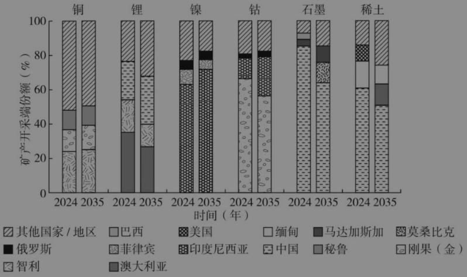
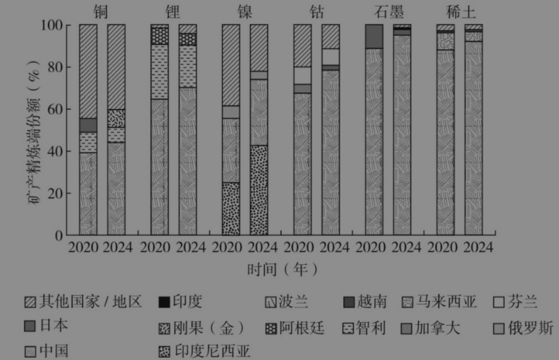
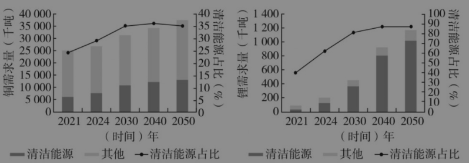
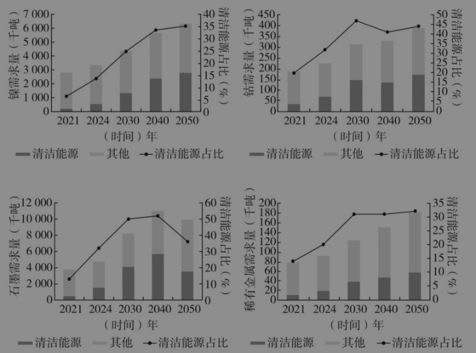

# 第三章 变化中的全球供求格局

近年来，新一轮科技革命推动全球产业朝着数字化、绿色化、融合化方向转型发展，以稀土为代表的战略性矿产在新一代信息技术、新材料、智能装备、清洁能源等领域应用日益广泛。同时，随着越来越多的国家和地区相继确立“净零排放”或“碳中和”目标，主要工业国加快能源转型。在需求侧，可以观察到电动汽车、储能技术的快速发展刺激铜、锂、钴、镍等所谓“能源金属”的需求急剧增加，风能、节能电机等清洁能源和低碳产品对稀土等战略性矿产形成了强劲的需求；而在供给端，地缘形势紧张对矿产品贸易网络的稳定性和贯通性造成了冲击，加剧了战略性矿产全球供应链风险，供求关系长期偏紧的局面难以扭转，但由于下游应用相对聚焦，不同矿种的供需缺口和关键度出现分化，全球供求格局在不平衡的总基调下加快重构。

## 生产与供给：谁手握“矿产王牌”

### 资源为什么总集中在少数国家

#### 1. 自然地质因素：矿床形成的“先天禀赋”决定基础分布

战略性矿产的形成对特殊地质过程十分依赖，而放眼全球，分布不均匀是此类矿产资源条件的典型特征。总体来看，战略性矿产的很多品类在地壳中的总储量不大，矿石类型繁多，成矿条件特殊，资源品位偏低，共生伴生是常态，资源基础、勘查技术、开采工艺及开发利用的环境影响具有突出的多样性和复杂性，这种独特的赋存条件决定了战略性关键矿产在世界范围内分布极不均衡，储量和生产集中度相对较高（见表3-1）。以稀土为例，位于中国内蒙古自治区的白云鄂博矿区，拥有全世界最大的稀土矿床。这一得天独厚的资源禀赋，脱胎于古老陆块与板块碰撞带的独特构造。然而，这种独特的地质环境和成矿机理在世界其他地区并不常见，与白云鄂博条件相似并形成大规模稀土矿床的仅有美国芒廷帕斯、澳大利亚韦尔德山等少数几处。

**表3-1 主要战略性矿产的储量和生产集中度**

| 矿产 | 产量集中度(C3) | 储量集中度(C3) | 主要供给方及占比 | 主要资源地及占比 |
| --- | --- | --- | --- | --- |
| 稀土 | 91.7% | 79.1% | 中国（68.6%）、美国（12.2%）、缅甸（10.9%） | 中国（40.0%）、越南（20.0%）、缅甸（19.9%） |
| 锑 | 80.7% | 62.5% | 中国（48.2%）、塔吉克斯坦（25.3%）、土耳其(7.2%) | 中国（32.0%）、俄罗斯（17.5%）、缅甸（16.5%） |
| 铍 | 92.1% | ≥60% | 美国（57.6%）、中国（22.4%）、巴西（12.1%） | 具体资源分布地数据暂缺，前三位国家占比≥60.0% |
| 钴 | 85.1% | 74.5% | 刚果（金）（73.9%）、印度尼西亚（7.4%）、俄罗斯(3.8%) | 刚果（金）（54.5%）、澳大利亚（15.5%）、印度尼西亚（4.5%） |
| 萤石 | 86.7% | 62.9% | 中国（64.8%）、墨西哥（11.4%）、蒙古（10.5%） | 中国（23.9%）、墨西哥（24.4%）、南非（14.6%） |
| 镓 | 99.7% | 93.3% | 中国（98.4%） | 中国（90.9%） |
| 锗\* | 97.2% | — | 中国（67.9%），俄罗斯(28.5%) | — |
| 石墨\* | 92.1% | 72.7% | 中国（82.0%）、巴西(6.8%) | 土耳其（28.1%）、中国(22.8%）、巴西（21.8%） |
| 铟 | 92.4% | 77.7% | 中国（65.7%）、韩国(20.2%)、日本（6.5%） | — |
| 铂族金属 | 87.4% | 98.2% | 南非（49.1%）、俄罗斯（29.6%）、赞比亚（8.7%） | 南非（88.7%）、俄罗斯（7.7%）、赞比亚（1.7%） |
| 锂 | 90.6% | 68.2% | 澳大利亚（47.8%）、智利（24.4%）、中国（18.4%） | 智利（33.2%）、澳大利亚（22.1%）、阿根廷(12.6%) |
| 钨 | 87.8% | 74.3% | 中国（80.8%）、越南(4.5%) | 中国（52.3%）、澳大利亚（13.0%）、俄罗斯（9.1%） |
| 钽 | 77.5% | — | 刚果（金）（40.8%）、巴西（21.7%）、乌干达（15.0%） | — |
| 铌 | 99.4% | 99.0% | 巴西（90.4%）、加拿大(8.4%) | 巴西（94.1%） |
| 钛\*\* | 68.6% | 68.8% | 中国（36.0%）、莫桑比克（18.6%）、南非（11.6%） | 中国（30.4%）、澳大利亚（26.1%）、印度（12.3%） |
| 钒 | 97.1% | 94.2% | 中国（68.0%）、俄罗斯（20.0%）、南非（9.1%） | 澳大利亚（44.7%）、俄罗斯（26.3%）、中国(23.2%) |
| 锆+铪 | 65.6% | 85.4% | 澳大利亚（31.3%）、南非（25.0%）、印度尼西亚（8.8%） | 澳大利亚（74.3%）、南非（3.5%）、塞内加尔（3.1%） |
| 铋 | 86.8% | — | 中国（80.0%）、韩国（4.3%） | — |

注：表中选取的18种战略性矿产为美、欧、日关键矿产清单均列入的矿种；\*为2021年的数据，其他均为2023年的数据；\*\*指钛铁矿；因美国地质调查局未公布表中多种矿产本土储量和产量，部分矿种的美国数据缺失；C3指产量或储量前三位占比之和。

*资料来源：U.S.Department of the Interior & USGS，Mineral Commodity Summaries 2024，<https://pubs.usgs.gov/periodicals/mcs2024/mcs2024.pdf>。*

同样，锂资源开采集中的现状也与特定地质条件有关。南美洲的“锂三角”是全球锂资源最为富集的地区之一，该区域覆盖智利、玻利维亚、阿根廷三国交界地带，存在新生代盐湖盆地，且气候干旱，利于锂盐富集。受益于地质条件与气候因素的组合，南美洲“锂三角”坐拥全球一半以上的可开采锂资源，形成了其他地区难以复制的资源优势。再看动力电池生产所需的另一个重要金属钴，其资源主要伴生于铜镍矿床，而作为钴供应核心的刚果（金），地处中非地区的铜钴成矿带，有着全球54.5%的钴储量，而且该地区较浅的矿床埋藏深度有利于降低钴矿开采成本，由此进一步提升了刚果（金)对于钴供应的天然优越性。

值得注意的是，部分地区的极端自然地理条件也会限制矿产资源的开发，尽管一些国家和地区的地质构造使之保有高价值矿床，譬如，俄罗斯北极地区拥有丰富的稀土资源，但当地极寒气候、永久冻土与矿产资源并存，导致其开发成本高于澳大利亚等中低纬地区，至今难以形成规模化的稀土供应。与之形成反差的是，澳大利亚的领土面积虽不及俄罗斯，但矿床品位高、地质勘探力度大，多种矿产资源具备良好的经济开采价值，从而使该国在全球供应链体系和世界矿产格局中长期占据主导地位。此外，气候较北极更为严酷的南极洲，除自然条件限制外，还受国际公约禁止商业开采的规定保护，因此虽已探明锂、钴等资源，但也在未来相当长时期内排除了其成为矿产商业化供应地的可能性。

#### 2. 经济技术因素：市场和技术门槛强化“强者恒强”

战略性矿产开发兼有高投资和长回报期的特征，加之这一领域有较强的专业性，使普通投资者“望而生畏”，进入门槛相对较高。以大型锂矿项目为例，单个项目的投资通常超过10亿美元，而且从项目启动到实现盈利，整个投资回收期长达5～10年，其间还往往伴随着环保压力、财务风险、政局动荡、地缘冲突、突发事件等诸多不确定因素。现阶段世界上只有少数国家，包括中国、澳大利亚、加拿大等，凭借雄厚的资本实力和完善的矿业配套设施，有能力承担这种高风险的投资；而许多发展中国家，由于资金短缺、基础设施薄弱，即便拥有一定的矿产资源，也难以筹集足够的资金进行大规模开发，或是无法承受漫长的投资回报期所带来的财务压力，因此很难在全球战略性矿产供应链体系中占据有利位置。

战略性资源产地之间竞争的另一个特征是供给侧存在类似马太效应的局面，这进一步加剧了全球资源分布的不均。纵观全球矿产量，世界级矿床占据了极高的比例。这类大型矿床具有显著的规模效应，即开采规模越大，单位成本越低，价格优势越显著。以智利的埃斯康迪达铜矿为例，该矿床蕴藏着世界上最具开采价值的铜矿资源，其产量在全球占比巨大，吨铜开采成本比中小型矿床低40%左右。一旦具备这种成本优势，那些拥有世界级矿床的少数国家，便可以更低的价格向全球市场供应矿产，而其他国家和地区的中小型矿床，因受制于成本劣势，难以在全球竞争中立足，进而强化了少数国家在特定矿种供应链前端的垄断地位。

战略性矿产的加工技术同样具有门槛，从而进一步强化了资源供应权的集中。最典型的例子是稀土。由于独特的成矿条件，稀土的分离提纯技术极为复杂，需要经过数十道工序。为开发利用宝贵的稀土资源，中国几代科学家和工程师付出了艰苦的努力，经过数十年的技术研发和积累，发明了串级萃取等原创性技术，在稀土分离提纯领域取得领先地位，并形成了完整的生产加工体系，据国际能源署统计，目前中国已占据全球91%的分离提纯产能。对于美国、澳大利亚等本土拥有稀土原矿的国家，即便开采了稀土矿，但由于自身缺乏先进的分离提纯技术，加之本国环境规制的限制，也需要将原料运往中国进行深加工—这种技术上的自主掌控力，使得中国在全球稀土供应链中占据核心地位，短期内其他国家难以突破技术门槛进入这一关键环节。

技术门槛的影响也体现于锂电池级材料加工领域，譬如电池级碳酸锂的生产，对高精度提纯技术有着高要求。以天齐锂业为代表的中国企业，在这方面的技术领先优势非常突出，占据了全球六成以上的产能。而澳大利亚等锂原料生产国，虽然拥有丰富的锂矿资源，但在高纯度电池级材料加工方面技术相对薄弱，因此在很大程度上依赖中国的加工能力。由此可见，资源开发技术的主导权，不仅体现在产能上，更表现为对产品质量和成本的控制。

#### 3. 政治和产业因素：矿业政策与市场干预固化供应格局

围绕矿产资源开发的地缘竞争，部分国家和地区为固化自身在战略性矿产供应中的主导地位，采取具有资源民族主义色彩的矿业立法、税收政策、环境规制、贸易许可管控，通过多种手段限制矿产外流。譬如，智利通过《矿业法》将铜矿资源国有化，使其国有铜矿公司—智利国家铜业公司(Codelco)控制了全国25%的铜产量，并针对外资开采高品位铜矿设置严格限制，以此巩固智利在全球铜供应中的第一位置。再如，印度尼西亚目前的镍产量已占据全球总量的40%，从2020年起禁止镍矿出口，强制要求企业在本土建设冶炼厂，以推动自身从单纯的镍矿出口国转变为镍加工国。这些资源民族主义政策，导致矿产供应更加集中于政策制定国，降低了全球供应体系的弹性。

此外，大型矿业跨国公司对全球资源的集中布局也扮演了重要角色，通过并购、合资等方式，西方国家的大型矿企掌控了全球大量优质矿产。其中，瑞士嘉能可通过收购刚果（金）的钴矿企业，控制了全球19.3%的钴产量，而刚果（金）本土企业由于技术和资金不足，只能参与低附加值的手工采矿，在当地钴产量中的占比仅为10%～20%。再如，澳大利亚必和必拓、英国力拓等公司，对智利、澳大利亚等地优质铁矿床进行长期深度布控，占据了全球铁矿石出口的40%，并主导了铁矿石的定价权。这些跨国公司的全球布局，致使矿产供应进一步集中于少数与之紧密合作的资源国。

需要注意的是，围绕着矿产开发形成的产业链体系对当今全球矿产资源供应格局产生了日益深远的影响。中国自20世纪80年代起，通过实施一系列稀土产业政策，逐步构建起从开采、分离、材料应用到回收的全产业链体系，形成了完善的产业生态。尽管近年来其他国家也试图发展稀土产业，但由于中国在产业规模、工艺技术、专业人才、配套设施、下游应用等方面已经形成强大的先发优势，后来者很难突破。与中国演化路径相反，美国在20世纪80年代之前曾是稀土供应大国，但随着其国内环保政策收紧，稀土加工产能逐渐转移至中国，美国从稀土生产环节退出，目前其80%以上的稀土进口依赖中国。

综上所述，战略性矿产资源之所以集中在少数国家，并非单一因素导致的巧合，而是自然地质禀赋、经济技术能力、市场势力与政策干预等多重条件逐层叠加的结果。当然，资源在少数国家的集中格局并非永久不变，而是可能随着勘探技术进步、新矿山开发以及技术替代等进程出现调整。譬如，新能源车企对磷酸铁锂电池技术的应用推广，可以减少对刚果（金）钴资源的依赖。未来锂、稀土等金属也能够通过回收报废电池、旧电机等渠道获得，进而降低对原生矿产资源的需求。当然，供应格局的变化尚需时日，短期内战略性矿产的命脉仍将掌握在少数国家手中。

### 全球主要生产国：谁在主导供给侧

战略性矿产供应链“命脉掌控权”的归属，并非简单由“谁藏得多”“谁挖得多”决定，而是受原矿开采的地理分布、材料精炼的技术与产能优势，以及产业链背后的实际控制主体等方面的综合影响。

#### 1. 铜：拉非供原矿，中国掌中游

铜在开采端相对分散，但在精炼端较为集中。从国际能源署发布的《全球关键矿产展望2025》(Global Critical Minerals Outlook 2025)来看，2030年，智利作为全球最大的斑铜矿集中地，将凭借科亚瓦西(Collahuasi)等世界级铜矿，贡献约24%的产量；刚果（金）产量占16%，以卡莫阿-卡库拉(Kamoa-Kakula)等铜钴伴生矿为主；秘鲁占11%，有着拉斯邦巴斯(Las Bambas)这样的一流铜矿资产—上述三国合计掌控全球超过半数的铜矿产量。不过，这些资源国的开采环节也有着中资企业的参与：卡莫阿-卡库拉目前由紫金矿业主导运营，预计2028年产能将达到130万吨；秘鲁的部分矿山也有五矿集团等中资企业参股，通过长期协议锁定铜精矿产出。而在精炼环节，2024年中国占据全球五成左右的铜精炼产能，刚果（金）是全球第二大精炼铜生产国，产能约占全球8%，但其绝大多数冶炼产能由华友钴业等中资企业投资、建设并控股。作为全球铜精炼的主导者，中国凭借湿法冶金等技术，以及生产中的规模效应，铜精炼成本较低，对下游供应起着举足轻重的作用。

#### 2. 锂：澳智供矿，中国炼“芯”

当前，全球锂供应链呈现出“开采端新兴资源产地崛起，精炼端中国一家独大”的市场格局。在开采端，澳大利亚坐拥全球最大的硬岩锂矿格林布什(Greenbushes)，产量位居全球第一；中国凭借青海盐湖、四川锂矿等产地，其产量到2030年预计将跃居世界第二；智利因阿塔卡马盐湖带来的禀赋，是传统的盐湖锂生产国，在未来仍将继续保持全球前三地位。上述主产国掌握着大比例的锂矿份额，根据《全球关键矿产展望2025》，它们在2024年包揽了全球锂开采77%的份额。需要注意的是，近年来在急剧增长的需求刺激下，高度集中的全球锂生产格局有所改变，阿根廷、津巴布韦、纳米比亚等国家在锂的供给端崭露头角。2024年，全球锂开采供应增长35%，其中30%来自这些新兴产地。这意味着锂的开采在一定程度上出现了“去中心化”的迹象，全球尺度锂供应的多元化值得持续关注。

在精炼端则呈现出产能集中于中国的局面。2024年，中国拥有全球锂化学品70%的精炼产能，全球约有95%的锂辉石精矿在中国加工。高度集中的精炼产能结构在一定程度上是中国技术优势的结果，中国具备锂精炼的核心技术能力，牢牢掌握了全球锂的精炼环节。而作为原矿开采大国的澳大利亚，一方面其格林布什股权的26%为中国天齐锂业所有，另一方面该国产能相对薄弱的锂精炼需依赖中国技术转移，譬如奎纳纳（Kwinana)厂的技术乃是来自赣锋锂业。中国凭借技术实力成为当之无愧的锂精炼大国，掌握关键技术使得中国企业能够解锁低品位盐湖锂资源，由此进一步提高了技术门槛。因此，纵观整条供应链，尽管下游需求巨大使得中国需要进口大量锂资源，但凭借“上游参股+精炼技术+市场规模”等多重能力和条件，中国已成为全球锂供应链当之无愧的主导方。

#### 3. 镍：印尼采矿，中资炼矿

镍是高能量密度电池的关键材料，其原矿开采由印度尼西亚掌控。根据《全球关键矿产展望2025》，印度尼西亚凭借苏拉威西岛的红土镍矿禀赋，2024年的镍矿产量同比增长达25%之多；展望2030年，作为资源大国的印度尼西亚，镍矿产量将占据全球总量的67%。同样地处东南亚的菲律宾，虽然镍开采量在全球排名第二，但2024年产量大幅下降25%，预计2030年仅占6%的份额，甚至不及印度尼西亚所占份额的零头。高度集中乃至“一家独大”的资源开采格局还将持续，2024年，全球前三大镍开采国总产量在全球占比77%，而到2040年，这一数字将有可能飙升至84%，其中，印度尼西亚在供应链前端的主导地位有望更加稳固。

镍精炼的环节则是印度尼西亚和中国“双主角”的格局，两个国家精炼的产量分别占全球的四成和三成。但印度尼西亚当地的精炼产能有相当一部分由中资企业投资形成。如印度尼西亚的韦达湾工业园、北莫罗瓦里产业基地，其80%的股权由青山控股集团、江苏德龙等中资企业控股，这些企业在印度尼西亚开采镍矿，并在当地进行精炼，生产硫酸镍等化合物，再将产品运回中国或供给其他中资企业，为下游国内动力电池制造提供关键原材料。从精炼环节的投资和生产布局来看，镍精炼产品主要包括用于不锈钢的镍铁和硫酸镍，后者是动力电池前驱体材料的关键组成部分，中国是包括硫酸镍在内的最终镍化学品的核心供应国。近年来，在本国产业政策的支持下，印度尼西亚加快镍化学品精炼产能的建设，且增长速度高于中国，但产能释放尚需时间，因此，至少到2040年，中国仍将保有在锂精炼领域的引领性地位。

#### 4. 钴：刚果挖矿，中国提纯

钴是战略性矿产全球供给格局“极端集中”的典型矿种，无论是在开采还是精炼环节，到2030年，全球62%的钴矿将来自刚果（金）；位列第二的印度尼西亚则是钴的新兴产地，其钴供应主要作为镍矿开采的“副产品”，到2030年占全球开采量的18%，预计到2040年或将把刚果（金）的份额拉下全球占比50%的神坛。其他生产国，或是如俄罗斯因制裁产量持续萎缩，或是存在矿山品位低、开采成本高的局限，与产量排名前两位的国家，特别是刚果（金）之间几乎没有竞争的可能。2040年，以刚果（金)和印度尼西亚为主的前三大钴开采国仍将占据82%的产量份额，高度集中的供给格局以及极少数国家的垄断地位短期内难以撼动。值得一提的是，刚果（金）的工业级钴矿，主要由中国企业运营，如洛阳钼业控股的腾科-丰谷鲁美矿业(Tenke Fungurume，TFM)和基桑富(Kisanfu），都是全球钴矿的核心产能。目前，刚果（金）也在积极引入沙特、欧盟等投资方，意在实现外资多元化，分散开发风险。

钴的精炼环节甚至比开采更为集中。从《全球关键矿产展望2025》来看，到2030年，中国精炼钴产量将占全球77%，排名第二的芬兰(6%）和第三的印度尼西亚(3%)加起来也还不到10%。到2040年，中国精炼钴的全球份额仍将保持在75%以上。而作为钴开采大国的刚果（金），虽然产钴多，但几乎不具备精炼能力，当地所开采的钴精矿大多出口到中国精炼。比如，腾科-丰谷鲁美矿业的产品被全部运往中国，加工成硫酸钴后再供应给电池企业。通过“钴开采控股+钴精炼优势”模式，中国稳稳掌控了钴产业链的多个增值环节，有力支撑起保障国内规模庞大的动力电池产业发展。近年来，随着全球范围内新一轮资源民族主义兴起，刚果（金)也加入其中，出台了钴出口禁令，给中国下游企业带来了原料断供风险。面对复杂地缘形势的挑战，中国企业采取短期囤积库存、长期本地生产及分散来源等策略，积极应对政策动荡带来的不确定性，从而为动力电池和新能源汽车健康有序发展提供原材料保障。

#### 5. 石墨：中国全链条主导

在电池负极制造中具有核心地位的石墨，无论出自天然还是合成，都需要加工成球形石墨才能用于动力电池产业。在这一领域，中国几乎实现了从开采到加工的完全掌控。根据《全球关键矿产展望2025》，到2030年，全球79%的天然石墨开采量将来自中国，其他产地包括马达加斯加(3%）、日本（3%），所占份额可以说是微乎其微。实际上，世界范围内石墨矿并非仅为中国集中拥有，但同样有着此类资源禀赋的其他产地，比如莫桑比克、坦桑尼亚等非洲国家，因政治动荡、物流不畅等问题而产量暴跌，使得中国的资源优势更加突出。

除上述外在因素之外，中国相较竞争对手的开采优势还在于成本较低和配套能力较完善。总体来看，天然石墨的开采成本不高，但中国的天然石墨矿相对具有更高的品位，从而进一步压低了成本，在人工成本远高于其他国家的情况下，目前中国石墨开采成本仅为非洲国家的一半。同时，中国有着完整的“开采一粗加工”产业链，能快速将石墨矿加工成精粉，而非洲国家缺乏加工能力，只能出口原矿。因此，至少中短期内，中国石墨开采仍将牢牢占据全球领先地位。

在石墨精炼环节，中国的掌控力更加突出。经过粗加工后，天然石墨精粉还需进一步加工成球形石墨，或是用石油焦制成合成石墨，在这两个领域，中国都是绝对意义的主导方。2030年，中国电池级石墨精炼将占据全球87%，日本（4%)和印度尼西亚（3%)是少数其他供应国。其中，在合成石墨领域，中国的产业领导力无以撼动。中国现阶段几乎包揽了全球合成石墨产能，凭借长轴石墨化等核心技术，国内企业具备了大幅削减能耗、降低成本的自主力。需要引起注意的是，中国对石墨精炼技术和产能的掌控激发了西方国家的危机感。近年来，欧美也在推动石墨精炼新项目建设[如挪威维亚诺德（Vianode)公司、美国诺沃尼克斯(Novonix)公司]，但合成石墨关键原料的主要产能仍掌握在中国手中，且欧美短期内仍然难以追平中国在石墨加工技术上的长期积累。

#### 6. 稀土：中国控分离，全球靠进口

在战略性矿产诸多矿种中，稀土无疑是中国综合优势最为突出的品类。当前，全球磁用稀土（钕、镨、镝、铽等）开采的前三名分别是中国、澳大利亚和缅甸。其中，中国的稀土来自内蒙古白云鄂博矿（轻稀土）和南方离子型稀土矿（重稀土）；澳大利亚主要依靠韦尔德山，是中国之外最大的稀土矿；缅甸则以离子型稀土为主，但其国内动荡形势持续影响其出口量和供应稳定性。总体而言，受美国布局供应链“去中国化”等因素影响，世界范围内稀土开采的集中度出现了缓慢下降的趋势，根据《全球关键矿产展望2025》，2024年，全球产量前三的国家所占份额为86%，预计到2030年将降至74%左右，这一过程主要由澳大利亚、巴西等地正在开发的新项目所推动。

对稀土精炼而言，由于稀土元素在矿石中相互掺杂，需要复杂的化学工艺才能将各种元素分开，因而“分离提纯”成为技术核心。目前，全球大多数稀土离心萃取专利由中国掌握，其他国家的稀土矿大都需要将精矿运到中国进行分离。即便像产自澳大利亚莱纳斯稀土公司（Lynas)的稀土精矿大部分运往马来西亚精炼厂，其下游精炼厂的分离技术也需要中国企业的支持。正是坐拥这般技术优势，中国才能占据全球稀土精炼产量的九成，其他供应国短期内几乎无法形成可以与之匹敌的产能。

在了解了主要矿产的供给格局及其特征后，再度审视“谁在真正掌控命脉”这一发问，可以认为，战略性矿产全球供应格局的动力机制是“地理集中”与“技术-资本控制”双重博弈的结果。在开采端，智利、印尼、刚果（金）、澳大利亚等少数国家，凭借资源禀赋占据开采主导；但锂、稀土等矿产的开采也正缓慢分散，非洲、拉丁美洲新兴国家也逐渐崭露头角（见图3-1)。

**图3-1 2024年和2035年（预)全球主要战略性矿产开采端的份额分布**

*资料来源：根据国际能源署《全球关键矿产展望2025》整理编制。*

在精炼端，中国则是毫无疑问的“王者”，以手握核心技术和巨大产能的“双保险”，占据了铜、锂、镍、钴、石墨、稀土等矿产精炼环节的主导地位（见图3-2）。需要强调的是，矿业及其下游环节受资本、技术、政策的复杂影响，产地与控制权分离的现象相当普遍，催生出战略性矿产供应链的“隐形掌控者”，各类参与方的控制和渗透形式多种多样，充满变化，“台前”的热闹并不一定是幕后角力的真实显现，这也为构建矿产资源战略体系带来了难度和困扰。

**图3-2 2020年和2024年全球主要战略性矿产精炼端的份额分布**

*资料来源：根据国际能源署《全球关键矿产展望2025》整理编制。*

总体而言，高度集中是战略性矿产全球供应格局的突出特点，这既是风险，也是动力。风险在于，一旦主要供应国出现政策变动乃至战乱，清洁能源、新能源汽车等能源转型产业的产业链将遭遇“断链”的危机；动力则在于，这可以倒逼政府和企业推动战略性矿产勘探开发和循环利用技术进步。当然，短期内中国在供给侧较为全面、系统的优势仍是全球能源转型的重要依托，中国已成为全球清洁能源技术及相关矿产开发利用的最主要贡献方。在高技术产业和民生环保领域，作为先进材料体质改性“工业味精”的矿种更多，战略性矿产的应用相对更加广泛，这或许在一定程度上分散了公众的关注度，但并不会削弱这些领域战略性矿产博弈的复杂性和激烈程度。

## 贸易与流通：一场看不见的“矿产暗战”

### 关键通道与节点：海运、陆运及地缘博弈

在能源转型的大潮下，钴、铜、镍等战略性矿产从主要位于非洲的矿山到全球电池厂的旅程，远比人们想象中复杂。这些重要资源的流通不仅依赖物理意义上的运输线路，更受制于国家间的合作与竞争，并由此演绎出一场围绕关键通道与节点展开的“矿产暗战”。陆路的铁路、海运的港口，看似是再普通不过的基础设施，实则是掌握矿产命脉的核心环节；而背后的资金支持、政策协调与地缘博弈，更决定了这些通道为谁服务、如何运转。

#### 1. 陆运：跨境铁路，面向矿产的“多级较量”

提到非洲矿产运输，最棘手的难题之一莫过于“有矿运不出”。回望过去，在西方设定的路径下，非洲国家的历史充满殖民压迫，长期以来经济发展滞后、基础设施薄弱。特别是非洲的铁路网络不甚发达且老旧低效，缺乏升级所导致的低效运营也让运输费用居高不下。这严重影响到矿产开采这一当地经济命脉：非洲虽然坐拥以赞比亚钴矿带、刚果（金）铜矿带为代表的关键矿区，却长期受困于铁路设施联通的不畅，矿产运输费用不菲是一方面，同时，许多矿产埋藏在没有出海口的国家，只能沿着铁路绕行多国直至海港进行联运，不仅耗时久、成本高，还时常因边境手续、物流衔接等问题出现延误。因此，摆脱交通方面的发展约束，是非洲国家最为紧迫的挑战之一。

近年，非洲国家积极推动“走廊化”发展战略，通过共建“一带一路”和中非合作论坛等机制，促进非洲经济互联互通进程。从贯通东非和中南非的坦赞铁路，到采用中国标准一次性建成的本格拉铁路，再到“东非高原生命线”亚吉铁路，中非在铁路技术、人才、管理上的全方位合作，推动非洲铁路朝着现代化转变，助力当地经济发展和社会进步。同时，这些交通上的“硬联通”，改善了相关地区战略性资源的陆海联运网络，譬如，坦赞铁路连接起赞比亚中部的矿山与坦桑尼亚的港口城市达累斯萨拉姆，帮助盛产铜矿却地处内陆的赞比亚更高效安全地进行出口。2024年中非合作论坛期间，中方宣布愿意在非洲实施多个基础设施联通项目，与当地携手推进高质量共建“一带一路”，打造陆海联动、协同发展的中非互联互通网络。这将进一步促成双方的共赢：非洲矿产的出口命脉更加畅通；经济收入的基石得到巩固；中国也能更稳定地获取所需资源，以此保障供应链安全。

中非之间的基础设施合作，引发了西方国家对这一领域的高度紧张：刚果（金）、赞比亚、安哥拉等铁路沿线国家拥有极其丰富的矿产资源，与中国的基建合作将转化为中国在战略性矿产贸易中的优势。洛比托大西洋铁路公司(Lobito Atlantic Railway，LAR)在这一隐忧下诞生，核心目的是与中国“一带一路”倡议相抗衡，旨在为铜钴等矿区矿产提供替代出口路线，减少对中国援建的基础设施的依赖。该项目由欧盟、美国、非洲三方主要推进：运营层面，由拓克集团（Trafigura)、莫塔-恩吉尔公司（Mota-Engil）和维克图里斯（Vecturis)组成的欧洲企业联合体负责；资金层面，南部非洲开发银行(DBSA)与美国国际开发金融公司(DFC)共同批准2亿美元资金来对铁路进行修复扩建。项目规划的最终成果“洛比托走廊”，西起安哥拉大西洋沿岸的洛比托港，向东延伸至刚果(金)的铜带矿区，将矿产产地与出海口相勾连。这一项目将首先聚焦现有铁路的修复与运营，而后计划新建一条约800千米的铁路，将线路进一步延伸至赞比亚（即“赞比亚—洛比托铁路项目”），把赞比亚的矿产也纳入其中。

事实上，即便洛比托大西洋铁路的最终意图是与中国分庭抗礼，这一项目的肇始与推进也无法脱离与中国的协作。首先，打造洛比托走廊的基础是获得本格拉铁路30年的运营特许权，而正是中国在2006—2014年对这条全程4300千米，却毁于内战的大动脉进行了修复，如果没有中国在安哥拉内战后实施这一数十亿美元的修复工程，以及对战后满目疮痍的洛比托港进行扩建深化，西方国家的宏大构想恐怕是无本之木。同时，洛比托走廊的铁路新建离不开与中国的贸易往来，以及来自中国的技术，铁路运输所用的集装箱和车厢大多从中国采购。另外，中资矿业公司至少在当前仍是洛比托大西洋铁路公司的主要客户，这一项目的正常营收仍高度依赖面向中国的运输供应业务。

#### 2. 海运：港口依赖，内陆矿山的“出海瓶颈”

对非洲许多内陆国家的矿产而言，铁路只是第一段旅程，最终必须通过海运，才能抵达全球市场，但“海上的旅程”充满了挑战。刚果（金)、赞比亚等矿产大国多数地处内陆，没有自己的出海口，只能依赖周边国家的港口进行转运，其中最主要的便是安哥拉的洛比托港、南非的德班港，以及坦桑尼亚的达累斯萨拉姆港。

这些港口看似是“救命通道”，帮助内陆国家的矿产价值变现，实则容易成为锁喉的“瓶颈”。以刚果（金)的铜为例，从铜带矿区出发，首先要通过铁路或公路运到港口，然后再装船运往中国、欧洲等地。对于这一过程，港口的装卸效率、仓储能力、边境清关速度，每一个环节都可能造成延误，从而引发显著的物流困难。延误的原因包括但不限于矿石在港口堆积等待装船，或不同国家的货运标准不一导致衔接断层。对于将矿产出口视作命脉的国家来说，频繁的延误不仅意味着资金被占用，更有可能使产品错过市场窗口期；而对全球买家而言，则意味着供应链的不稳定乃至潜在断供风险。

战略性矿产供应链体系中的“港口依赖”实际上是地缘经济不平衡的真实反映。重要港口的收费标准和运营能力在很大程度上由港口所在国决定，内陆矿产国则缺乏话语权。譬如，一旦安哥拉因为物流罢工导致洛比托港停运，刚果（金）的铜矿出口便会受阻。同样，如果坦桑尼亚提高港口服务费，赞比亚的钴矿成本也会随之上升。由此可见，港口等基础设施作为关节流通节点虽不直接参与矿产生产，却通过左右矿产的出海权，影响战略性矿产物流效率及供应链安全。

#### 3. 地缘博弈：通道背后的“权力争夺”

无论是洛比托铁路，还是达累斯萨拉姆港，这些关键通道的建设与运营，从来都不是纯粹的经济行为，而是大国之间地缘博弈的舞台，其核心是谁能掌控非洲战略性矿产的流通权。

中国在较长时期内参与非洲矿产开发利用及相关基础设施建设，为非洲工业化输入了资金、技术和人才，既对当地矿业可持续发展做出了有目共睹的贡献，也由此形成自身在战略性矿产地缘博弈中的主动权。而对于美国，这场博弈与其对供应安全的焦虑密不可分：在能源转型进程中，美国有着对钴、石墨、锰等战略性矿产资源的高度进口依赖，特别是对中国的依赖。随着全球新能源汽车、储能电池需求激增，这种依赖可能让美国在这一轮清洁能源转型的技术竞争中陷入被动。非洲，正被美国视为破解这一依赖困局的战略要地：刚果（金）是钴供应大国，赞比亚也在铜生产中占有一席之地，这些矿产对美国的能源转型至关重要。

现实中，美国在非洲矿产博弈中的竞争对手绝不止中国。近年来，一些海湾国家也参与到非洲战略性矿产的开发中。2023年，阿联酋先是与刚果（金）国有矿业公司萨基马(Sakima)签署了一项价值19亿美元的协议，共同开发四个战略性矿产项目；同年，又在赞比亚签署了11亿美元的投资协议，以收购莫帕尼铜矿(Mopani Copper Mines) 51%的股份。沙特阿拉伯也积极寻求在非洲进行战略性矿产交易，与刚果（金）、埃及和摩洛哥签署了矿业投资谅解备忘录，并成立了马纳拉矿业公司(ManaraMinerals) 来投资全球矿产资源。这两个国家在非洲战略性矿产领域与中国存在经济合作潜力：此前，中国已经与之在可再生能源领域建立了广泛的经济伙伴关系，这种合作将可能随着对上游矿产的共同开发而为双方带来更显著的经济效益；同时，沙特等国也在积极吸引中国投资者参与矿产开采项目，这种务实的合作策略能使之更加受益于中国的关键技术。

为此，美国开始加快在非洲的布局行动，试图塑造与中国竞争的优势，同时也防范被其他国家抢占先机、分走市场份额。为了能在博弈中占据主动，美国围绕矿产贸易的关键通道和供应链，拟采取一系列战略部署与行动：一是优先推进美国、刚果（金）、赞比亚三方备忘录，意图将其转化为“有生产力的合作伙伴关系”，而这需要以联合美国电池产业链、利用洛比托铁路等通道来运输矿产为前提；二是增加DFC在非洲的存在感，推动DFC对加工能力建设、关键通道建设等“更具战略针对性”的项目进行投资；三是将非洲国家纳入美国主导的“矿产安全伙伴关系”，通过多边机制联合盟友支持非洲的通道建设，同时确保矿产能够稳定供给盟友国家；四是试图补齐“商业外交”短板，计划重开位于刚果（金）卢本巴希（铜带矿区核心城市）的领事馆，并加强美国商务部的资源配置，以此让美国官员更加贴近矿山与通道，能够及时协调解决运输和贸易中的问题。

### 进出口方：谁在买、谁在卖，贸易流向如何演变

当价值链终端的用户给电动汽车充电、用手机刷视频时，或许不会想到，这些设备里的战略性矿产早已完成了横跨大洲的“旅行”：锂从澳大利亚的矿山出发，经中国精炼后变成电池原料；钴从刚果(金)的矿区启程，待中国加工成正极材料后运向欧洲；钕和镝则很大一部分在中国被制造成永磁体，最终被安装在德国的风电机组里。战略性矿产的贸易如同一张看不见的网，串联起资源国、加工国和消费国，后续还会连接回收国，而“谁在卖、谁在买”的格局，也在被悄然重塑着。

锂无疑是锂电池的“心脏”，它的贸易链清晰地展现为“原料出口一中国精炼一全球分销”三个环节。2022年，全球原生锂矿开采量为183000吨，贸易总量达83000吨（以锂金属当量计），其中近95%的贸易都绕不开中国。在出口端，澳大利亚和智利是“原料霸主”，其中澳大利亚贡献了全球43%的锂矿开采量。这些硬岩锂矿几乎全部被运往中国，仅2022年一年，澳大利亚对中国的锂矿贸易就达到7.9万吨，占全球锂矿贸易总量的95%；智利则是盐湖锂的核心出口国，2022年出口41000吨以碳酸锂为代表的基础化学品，主要流向韩国、日本等电池制造国。进口端的分工同样清晰，中国是全球最大的锂进口国，但进口的多是初级原料，2022年进口的锂矿占全球贸易量的95%，这些原料在国内精炼成电池级碳酸锂、氢氧化锂后，再出口到下游产业链；而韩国、日本是“精炼品买家”，在2022年分别进口19000吨和9000吨锂基础化学品，用于本土电池生产；美国也需要进口8000吨锂基础化学品，但本土缺乏精炼能力，只能依赖中国和智利的加工品。

过去10年，锂的贸易已从澳大利亚或智利直供全球模式变成中国中转模式。2015年以前，大部分锂矿还会直接运往欧美精炼。此后，锂矿精炼产能逐渐转向中国，中国的精炼品再流向全球。这种转变反映出产业链主导权的交接，在急剧扩张的下游需求和持续的技术研发投入推动下，中国掌控了锂价值链的核心环节。

如果说锂的贸易是“中转模式”，那钴的贸易则表现出“极端集中”的特征。研究发现，1988—2020年，全球钴贸易总量从21600吨暴涨20倍以上，2020年达到529000吨，核心贸易线路围绕“刚果（金）—中国—欧美”展开。在原料出口端，刚果（金）是核心主角，2020年全球前五大钴矿出口国贡献了超90%的矿石贸易，刚果（金）是其中最大的出口国，其矿石主要流向中国；钴废料的出口则由美国主导，作为全球最大的钴废料出口国，在过去10年中，累计的钴废料出口量已经超过其累计的材料进口量。进口端的分工更能体现价值链差异，中国是全球最大的钴矿进口国，2020年从刚果(金)等出口国进口大量矿石，在国内精炼成钴硫酸、钴金属等中间产品后再出口；欧盟则侧重于进口半成品，2020年仅德国一国就进口了全球9%的钴材料，以及12%的钴终端产品，主要包括钴合金、钴磁体等，用于汽车和电子设备制造。

2000年以前，刚果（金）的钴矿还会直接运往比利时、法国精炼；到了2020年，超75%的刚果（金）钴矿先运到中国进行加工，精炼成钴硫酸、钴金属等中间产品，而后出口到欧盟和美国。中国由此成为全球最大的精炼钴生产国，产量占到全球近一半。刚果（金）虽为核心出口国，但仅参与上游原料供应，尚未深度涉足中游精炼和下游制造环节。这种“资源国卖原料、加工国主导中游制造”的格局，正是钴贸易的真实写照。

镍的贸易则在近10年发生了颠覆性变化。印度尼西亚作为主要资源国从“卖矿石”转向“卖炼品”，中国以主要需求方的身份从“买矿石”转向“买炼品再制造”。2021年，全球有232个国家地区参与镍贸易，镍铁、硫酸镍等中间产品的贸易量达2405000吨，占总贸易量的41%。也是在这一年，印度尼西亚作为世界最大镍出口国，净出口镍848000吨，仅对中国的产品总贸易量就达657000吨，且其出口的不再全是矿石，还有加工后的镍铁和硫酸镍；俄罗斯曾是第三大镍出口国，出口份额一度占全球8%，但目前受地缘政治影响，俄罗斯镍出口严重受限。进口端的变化同样明显，中国从“买矿石”转向“买炼品”。2021年，中国进口了1059000吨镍中间产品，其中50%来自印度尼西亚，这些炼品被加工成电池级硫酸镍，供应宁德时代、比亚迪等全球动力电池的头部企业；美国则是“成品买家”，当年从中国进口57000吨镍基成品，包括电池、不锈钢等，用于电动汽车和家电制造。应该看到，全球镍供应链格局这场变革的主要推手是印度尼西亚2020年颁布的《矿产和煤炭矿业法修正案》，该法令禁止印度尼西亚镍矿石出口，强制要求本土精炼，中国企业随即在印度尼西亚投资建设炼厂，譬如青山集团的韦达湾工业园。2021年，印度尼西亚本土精炼镍出口量暴涨，中国则通过“投资炼厂一进口炼品一制造成品”的模式，掌控了76%的镍电池材料生产，显著影响了全球镍贸易的流向。

钕作为永磁电机的核心原料，其全球贸易量从1990年的两千吨持续增长，2019年达到峰值8.2万吨。其中，钕铁硼永磁体是最主要的贸易商品，2020年占全球所有钕贸易商品的51%，主要从中国流向欧盟和其他地区。在钕贸易中，澳大利亚是重要的钕金属出口国，该国的莱纳斯稀土公司是全球唯一在中国以外拥有显著稀土分离能力的企业，支撑该国在钕金属贸易中的地位；中国是全球主要的钕出口国，在半产品和终端产品出口中保持主导地位；日本聚焦原料进口与磁体、电子设备制造，并试图从土库曼斯坦、印度等国进口原料，以降低对中国的依赖；欧盟则以进口磁体为主，将其用于汽车电机、风电涡轮机等终端产品，是下游应用的核心区域。

2009年可被视为钕贸易的转折点。此前中国仍出口钕原料，而2009年之后，中国实施稀土出口配额(2015年取消)，钕原料出口开始下降并维持低位，同时逐步转向出口高附加值的钕铁硼磁体。受国内需求快速增加等因素影响，2020年，中国的贸易角色进一步转变—从钕原料净出口国转为净进口国，原料主要来自缅甸、土库曼斯坦和澳大利亚，形成“进口原料—本土精炼—出口磁体”的产业模式，在钕价值链的中游精炼和下游磁体制造环节保持主导地位。

镝是重稀土元素，能够提升永磁体的耐高温性能，是风电和高端电机的刚需品。镝的贸易以中国为绝对主导，中国的影响力从原料精炼到成品出口贯穿全链条。1988—2021年，中国累计出口镝初级产品2674吨、中间产品6354吨、最终产品3897吨，全球几乎所有的镝精炼分离环节集中在中国，目前尚无其他国家能够形成替代能力。中国也是全球唯一具备镝全链条供应能力的国家，欧盟境内的爱沙尼亚等国虽曾开展少量镝精炼，但2015—2019年累计仅生产16吨氧化镝当量，规模可忽略不计。缅甸是除中国外最主要的镝原料供应国，2015—2021年贡献了非中国产能中89.6%的镝矿产量，缅甸出产的矿石几乎全部被运往中国进行精炼，无法形成独立的贸易链。进口端的需求同样呈现区域集中特征，欧盟是镝在新能源领域的核心需求方，2021年其电动汽车与产业机器人制造用镝达26吨，也对进口镝磁体有着高度依赖；日本是全球最大的镝初级产品进口国，2021年进口量达133吨，在本土加工为电机磁体后，供应给丰田、本田等汽车企业。应该看到，镝的贸易流向虽以“中国主导”为长期特征，但在2000年后整体呈现复杂变化的趋势，2020年还受新冠疫情影响，出现轻微贸易冲击。同时，由于需求弹性较大，镝的价格极易发生剧烈波动。实际上，中国实施稀土出口配额后，全球氧化镝的平均价格从2010年水平暴涨465%，2011年达1024美元/千克，同期中国镝金属出口价格年涨幅也达532%。更为严峻的是，1988—2021年在全球累计开采的38580吨镝中，仅有不到3%(1012吨)被回收，且回收仅限于制造环节的新废料，终端产品的报废回收几乎从未开展，这意味着全球镝需求高度依赖新矿开采，一旦原料端出现供应中断，整个产业链将面临显著冲击。

纵观上述矿产的贸易流向，当下全球战略性矿产供需关系在多个环节和节点上呈现出多变性和脆弱性。整体而言，资源国大多只能卖原料，赚取少量的价值链收益；具备精炼产能的国家掌控着加工环节，特别是中国，占据着锂、钴、镍、稀土等矿产的绝大部分加工产能，但部分产品的附加值有限；欧美国家和日本等消费国则专注于购买成品或半成品，规避原料开采和加工的环境成本，并凭借高端终端产品获取分工地位和较高的附加值。更为关键的是，迄今为止，大部分战略性矿产的回收体系仍较为薄弱，这意味着世界范围内此类矿产的需求尚高度依赖原矿开采，贸易流向的任何变动，都可能引发供应链的连锁反应。贸易网络中的这场“暗战”没有硝烟，却决定着新能源转型的主动权；谁能掌控贸易流向，谁就能在未来的绿色竞争中占据先机。

## 消费端：新能源、芯片与未来需求

### 消费变迁史：从传统工业到高科技之争

战略性矿产看似离我们非常遥远，实则在现代人类社会中处处可见。如果留意过身边的变化，会发现日常生活中到处都有战略性矿产的印迹：家里的汽车从“喝油”变成了“耗电”，屋顶多了能发电的太阳能板，家乡的山丘上转着硕大的风机，手机越做越薄，性能却越来越强……这些日常变化的背后，隐藏着战略性矿产所促成的“消费革命”。从支撑钢铁、内燃机的传统工业时代，到驱动新能源、芯片的高科技时代，战略性矿产的用武之地正经历着一场重塑；而这种变迁，也让全球矿产供需格局迎来了新的挑战。

#### 1. 传统工业时代：矿产是“工业的骨骼”

在高科技尚未成为主流的年代，战略性矿产的角色仿佛骨骼一般，支撑着钢铁、化工、传统汽车等基础产业的运转。那时的矿产消费，有着鲜明的“重制造、大用量”特点。比如铅，在很长一段时间里，它的核心用途是制作铅酸电池。这种电池成本低且技术成熟，几乎每一辆传统内燃机汽车都离不开它，启动发动机、点亮车灯等最基本的功能都仰赖它的运作。除了汽车，铅酸电池还被用于传统的不间断电源设备(UPS），保障着医院、数据中心等重要地点的电力稳定。因此，传统工业时代的铅消费与传统交通和基础电力保障等场景深度绑定。

钨和铌这类矿产是传统制造业的“硬帮手”。钨的硬度极高，常被制成硬质合金，用于机床刀具、矿山钻头。无论是加工汽车零件，还是开采煤炭铁矿，钨的锋利特性都能大显身手。铌则是钢铁的强化剂，添加少量的铌（通常不到0.05%）就能让钢铁的强度大幅提升，被广泛用于建筑钢筋、高压输油管和汽车车架，帮助这些传统工业品变得更加耐用。还有作为“导电能手”的铜：传统工业里，从发电厂的输电线路，到家用电器的内部布线，再到内燃机汽车的线束，都依赖铜的导电性能。

由此可见，传统工业时代的矿产消费，大多围绕“如何让工业生产更高效、传统产品更耐用”的主要目标展开，矿产的供需格局也相对稳定，比如铁、铜、铅等矿产的开采和应用都有成熟技术保驾护航，主要消费国通常集中在工业发达的地区，供应端也有开采量长期较为平稳的矿山作为支撑。

#### 2. 高科技崛起：矿产成为“绿色与数字的核心”

近年来，全球气候形势日益严峻，“碳中和”成为世界各国共同追求的目标，而随着新一轮科技革命和产业变革深入发展，数字化浪潮也正在席卷全球，战略性矿产的消费版图由此被改写。锂、钴、稀土、铂族金属（铂、钯、铑）等矿产，作为新能源、芯片等高端制造的关键材料，推动许多高科技产品的问世及推广，支撑一系列战略性新兴产业的崛起，同时驱使日常生活朝着绿色化和数字化转型。此外，这些矿产的消费，不再意味着“大用量”，而是“高精度、高价值”，有的材料在高科技产品中仅需要几克，却是其不可替代的核心材料。

作为低碳重要抓手的电动汽车，其动力电池离不开锂、钴、镍等矿产。锂是电池的“能量载体”，决定电池能够储存的电量；钴可以提升电池的稳定性和寿命，镍则能够提高电池的能量密度，让电动汽车跑得更远。根据达沃斯论坛于2019年发布的报告，随着汽车电动化的纵深推进，到2030年，全球电池需求相比2018年预计增长14倍，对锂、钴、镍的需求也将随之激增。除了电池，风电也是新能源产业的重要组成，而它的“动力核心”永磁体，高度依赖稀土元素钕和镝。钕能产生强磁场，让风电叶片稳定转动；镝则像“稳定剂”，能让永磁体在户外高温环境下保持磁性。在欧洲，风电用的永磁体已占据钕消费的较大份额，而随着风电装机量的增加，对钕和镝的需求还在增加。

被绿色转型赋予新使命的还有铂族金属，特别是铂、钯、铑这三类。这些“稀贵”金属原本主要在内燃机汽车的尾气净化器中发挥作用，以此减少汽车的污染物排放。但随着转型推进，铂成了燃料电池的关键催化剂，能让氢气和氧气反应产生电能，从而驱动燃料电池电动汽车（FCEV)；同时，铂也被用于电解器，将可再生能源产生的电能转化为氢气，储存起来以供后续使用。不过，全球91.3%的铂储量集中在南非，形成“一家独大”的格局，使得铂的供应面临地缘政治风险，矿山罢工、政策变动之类的事件都可能影响全球供应。与铂相比，钯和铑目前虽然仍主要用于尾气净化器，但随着电动汽车的推广进程加快，它们的传统需求会逐渐下降，未来可能转向化工催化等领域。

社会生活的数字化使我们每日都难以和手机或电脑分离，就在这些设备的芯片与屏幕背后，也有着战略性矿产的身影。比如铟，它常和锡一同被制成铟锡氧化物，这种材料既透明又导电，是电子屏幕的“透明电极”。正是因为铟的使用，我们才得以与清晰的液晶屏幕相伴。还有镓，它是芯片和LED的重要原料，常用于制造半导体材料和发光二极管，让电子设备更轻薄、性能更强。钽则是电子设备的“电力保障员”，由它制成的电容器能在高温高压环境下稳定工作，因而广泛被用在手机、电脑、汽车电子的电路板中，以避免电子设备因电压波动而被损坏。

#### 3. 变迁中的“争夺”：供需矛盾与挑战

从传统工业到高科技产业，战略性矿产的消费变迁，虽然推动了绿色与数字化转型，却也带来了新的“争夺战”，需求激增、供应集中、技术瓶颈等问题，正让全球矿产供需格局趋向紧张。

典型的“供不应求”矿种之一是钴，虽然当前电池技术向着“低钴”甚至“无钴”的方向发展，回收技术也在持续进步，但即使在最乐观的技术场景下，2028—2033年全球仍会出现钴供应短缺。原因很简单：电动汽车和储能的需求增长太快，而全球70%的钴来自刚果（金），矿山建设周期长，部分矿山还存在环保、劳工等问题，短期内很难快速扩大供应。镍也面临着类似问题，达沃斯论坛2019年发布的报告显示，高纯度镍产量需要增长24倍才能满足未来需求，而新矿山的开发需要时间和资金，很难跟上需求增长的速度。

同时，很多高科技依赖的矿产供应都高度集中，这种“卡脖子”的供应格局容易引发地缘风险。中国主导稀土在全球的开采和加工，铂的供应依赖南非，钴依赖刚果……这种“单一来源”的格局，让消费国遭遇潜在的供应瓶颈。以欧盟为例，它所需要的稀土、钴、锂等矿产几乎全部依赖进口，一旦供应国出现政策变动或发生地缘冲突，欧盟所有的高科技产业链都可能遭受影响。铂族金属的情况也类似：南非的铂矿一旦出现罢工（譬如2014—2015年的大规模罢工），全球铂供应便会锐减，随后价格就会出现大幅度波动。此类地缘风险的存在，让供应链安全成为各国争夺的重点，很多国家开始通过投资海外矿山、开发国内资源等举措，寻求矿产供应多元化的可能性。

除供应多元化外，为了应对供需矛盾和地缘风险，技术创新和回收利用两类技术路线也被提上日程。技术上，电池企业着力研发磷酸铁锂等无钴电池，稀土在永磁体中的用量也在逐渐减少；回收上，人们从废旧动力电池中提取锂、钴、镍，从废旧电子设备中回收铟、镓。这些办法确实能起到一定的效果，比如弗劳恩霍夫研究所(Fraunhofor)2019年发布的报告指出，到2050年，回收的钴可满足40%的全球需求。但要注意的是，回收废旧材料需要完善的回收体系和成熟技术，它们短期内很难大规模推广；除此之外，技术创新也需要一定时间，譬如无钴电池的能量密度还需要进一步提升，才能更好地满足长续航电动汽车的需求。因此，技术和回收能够缓解矛盾，但在当前尚不能完全解决短期供应瓶颈。

矿产消费的变迁史见证着时代的转型，从传统工业的“骨骼”，到高科技的“核心”，战略性矿产的消费变迁，本质上是人类社会从高碳制造向绿色数字转型的缩影。实现这一长远愿景有赖于这些战略性矿产，但也必须直面其中的供需矛盾和地缘风险。未来，如何平衡需求增长与供应安全、如何通过技术创新减少对外依赖、如何建立更公平透明的全球供应链，将是各个国家、地区、企业和科研机构需要共同解决的问题。

### 需求爆发背后：哪些国家正在“囤货”

当充电桩越发密集、太阳能板铺满屋顶、手机芯片迭代升级……终端产品的数量级增长催生原料需求爆发，围绕战略性矿产的“囤货”竞赛由此拉开序幕。当然，这里的“囤货”并非简单地把已开采出来的矿产买到手、存起来：有的国家“封矿储备”，能买到就不用自己的；有的国家掌控资源储量，“坐地为王”；有的则通过整合产业链“卡住关键环节”；还有的靠协议和投资“锁定供应链”。这场“隐形争夺”已在全球上演。

#### 1. 欧盟：依赖进口的“供应链囤货者”

作为全球高科技产业和新能源转型的重要推手，欧盟对战略性矿产的需求很大，但自身供应能力却严重不足。尽管战略性矿产产生的加工产业为欧盟带来了数百万个就业岗位，并支撑了下游制造业增加值的四成，但尴尬的是，欧盟自身是矿产进口大户，不仅大量进口矿石，还要进口各种金属和矿物衍生产品，尤其是新能源产业必需的锂、钴、稀土等核心矿产。原因在于，欧盟矿业早就今非昔比。20世纪初，欧洲矿业还能占到全球产量的40%，如今却只能占2%～3%。目前，欧盟境内活跃的矿山屈指可数，主要分布在奥地利、芬兰、希腊、爱尔兰等少数国家。由于缺乏统一、清晰、可预期的矿产开发监管框架，同时深层地质调查、资源勘探开展相对不足，且矿业作为传统资本密集型产业被长期贴上“低端、脏乱、劳动强度高”等负面标签，矿业对很多成员国的吸引力极低，这意味着，很少有企业愿意在欧盟对矿产勘探和开采进行大量投资。

既然自己挖得少、冶炼得少，欧盟就以“囤供应链”为战略重点。当然，欧盟在战略性矿产领域的布局并不仅限于囤积矿产本身，而是通过贸易谈判、战略协议，与资源丰富的国家建立稳定合作，来确保矿产能被持续运到欧洲。譬如，欧盟2024年3月通过的《关键原材料法案》所明确的三大支柱目标中，有一条即是推动实现供应多元化以避免对单一国家的依赖。同时，欧盟也不排斥“自供”，并在尝试“内部挖潜”，推动建立区域矿产价值链，将采矿、加工、回收等环节整合起来。一方面欧盟近年来在芬兰、瑞典这些矿业吸引力高的国家加大勘探力度，另一方面通过循环经济提高矿产回收利用率，用二次资源来补充供应。对欧盟而言，“囤货”的核心不是拥有多少矿产储量，或储备多大规模的矿产品现货，而是能否牢牢抓住一条稳定的供应链，毕竟自身的资源禀赋决定了其战略保障的导向，囤货的意图是在复杂动荡的供应链形势下，尽量避免下游相关产业沦为“无米之炊”。

#### 2. 资源富国：坐拥宝藏的“储量囤货者”

如果说欧盟的战略难点在于“巧妇难为无米之炊”，那么部分国家则是“家里有矿，心中不慌”。这些资源富集国家本身就是战略性矿产的“宝库”，凭借对海量资源储备的掌控，成为全球“囤货”竞赛中的“重量级玩家”。2023年的一项统计指出，全球资源最丰富的经济体前十名分别是：俄罗斯、美国、沙特阿拉伯、加拿大、伊朗、中国、巴西、澳大利亚、伊拉克、委内瑞拉。这些国家手里有着丰厚的“矿家底”，仅以排名前三名为例，俄罗斯以75.5万亿美元的自然资源总价值位居第一，在2019年和2020年，俄罗斯拿到手的矿产资源租金分别占其GDP（国内生产总值）的0.353%和1.865%；美国紧随其后，自然资源价值约45万亿美元，同期矿产租金占GDP的0.0115%和0.071%；沙特阿拉伯的矿产租金也高达34.4万亿美元，占GDP的0.019%和0.148%。

从整体上看，资源大国的“囤货”方式相当直接，即靠自身的资源储量成为全球矿产供应的“压舱石”。澳大利亚和加拿大是锂、镍、铁等矿产的主要出口国，全球许多动力电池的锂原料都出自这两个国家；巴西在铁矿和镍矿方面占有重要地位，很大程度上支撑着全球的钢铁和电池产业；俄罗斯不仅有着石油、天然气的禀赋，还坐拥大量稀土、镍、钴资源，是欧洲重要的矿产供应来源；沙特阿拉伯和伊拉克以石油闻名于世，但也拥有丰富的金属矿产，正在尝试将资源优势进一步延伸至新能源领域。对这些国家来说，“囤货”就是守护好自己的矿产储量，通过合理开发和出口，在全球供应链中占据主导地位。它们不需要像欧盟那样依赖外部供应链，因为自身就是供应链的“起点”，只需控制好出口节奏与合作对象，便能在需求爆发的时代掌握主动权。

#### 3. 中国：“产能和需求”双加持下的产业链主导方

在全球战略性矿产格局竞赛中，中国的角色很特别。我们既是需求大国，也是全球矿产加工的核心枢纽，靠着抓牢“产业链”和拓展下游需求，在全球供应链中占据了关键位置。

中国是全球最大的钴消费国之一，所消费的钴主要应用于电池、磁性材料等领域。这些产品随后又被出口到全球其他地区，这意味着全球很多手机、笔记本电脑里的电池，其核心原料钴都在中国完成精炼加工。中国如同一个世界级的矿物加工厂，掌控着从矿产到半成品的关键环节。从某种意义上讲，这也算是一种策略性“囤货”行为：不是囤矿产本身，而是累积“将矿产变成可用材料”的能力。而在需求端，中国是全球新能源汽车和光伏产业最大的市场，对锂、钴、镍、稀土等矿产的需求极大。巨大的需求让中国在全球矿产贸易中拥有很强的话语权，不少资源国都愿意与中国合作，以增强矿产出口的稳定性；中国也以海外投资、合作开发等方式，在澳大利亚、非洲等资源丰富的地区布局矿产开采，以确保自身需求能够得到稳定满足。

站在中国的角度，激烈资源博弈下的“囤货”显然不等同于简单地储备矿产，而是通过加工能力与庞大需求的结合，在全球矿产价值链中牢牢把握住关键节点。由此，中国既能消化全球的矿产原料，又能满足自身产业需求，还能通过出口加工产品影响全球市场。这种“全产业链发力”的策略，让中国在需求爆发的时代，不但保障自身供应，而且能在全球竞争中占据优势。

纵览各种“囤货”方式容易发现，这场竞赛的本质并非“谁开的矿多、谁买的矿多”，而是在需求爆发的时代确保自身供应链安全。欧盟靠“囤供应链”，解决“无矿可用”的问题；资源富国靠“囤储量”，守住“有矿可卖”的优势；中国靠延展“产业链”，平衡“需求大、加工强”的特色。看似各异的策略围绕着同一个逻辑：战略性矿产已成为能源转型和科技发展的命脉，没有稳定的供应，再宏大的产业计划都无法落地。未来，随着相关产业的进一步发展，战略性矿产的需求还会持续增长，“囤货”竞赛也将继续。但这场竞赛不该是零和博弈，如果各国能加强合作，推动资源国合理开发、加工国提高效率、消费国循环利用，也许能让有限的矿产资源支撑更多国家的发展，真正实现“靠矿产推动可持续未来”的目标。

## 未来战略性矿产的“战略图谱”

在全球能源结构转型与技术革命不断深化的背景下，战略性矿产已成为支撑绿色低碳发展的战略性资源。从电动汽车、风力发电到高效储能系统，这些技术的普及离不开铜、锂、钴、镍、稀土等一系列战略性矿产的稳定供应。然而，资源分布不均、供应链脆弱、地缘政治风险等因素使得战略性矿产的供需关系日趋复杂。系统描绘未来战略性矿产的“战略图谱”，能够揭示其供需趋势、区域格局与潜在风险，并为政策制定与产业布局提供科学依据。

### 战略性矿产需求的结构性增长与清洁能源驱动

根据国际能源署发布的《全球关键矿产展望2025》，在“既有政策情景”(Stated Policies Scenario，STEPS)下，多数战略性矿产的需求将在未来30年内呈现爆发式增长。图3-3展示了铜、锂、镍、钴、石墨及稀有金属（如稀土）在2021—2050年的需求量（含预测），并特别区分了“清洁能源用途”与“其他用途”的占比变化。从图中可以清晰看出，几乎所有被列出的战略性矿产在清洁能源领域的消费比例均呈现显著上升趋势，凸显出能源转型对矿产资源的深远影响。

**图3-3 既有政策情景下全球战略性矿产需求量（含预测)**

**图3-3 既有政策情景下全球战略性矿产需求量（含预测)(续）**

*资料来源：根据International Energy Agency:Global Critical Minerals Outlook 2025整理编制。*

以铜为例，作为电力基础设施与电动汽车电机的核心材料，其总需求量预计从2021年的约25000千吨增长至2050年的超过35000千吨，增幅约达48%。更为重要的是，清洁能源领域对铜的消费占比从2021年的24%上升至2050年的35%。这一结构变化反映出电动汽车充电网络、风电与光伏电站，以及电网升级对铜资源的强烈依赖。

镍的需求增长同样引人注目。尽管不锈钢等传统工业仍是镍的主要消费领域，但电池正极材料对高纯度镍的需求正迅速攀升。图3-3中显示，到2050年，镍的总需求量预计超过6000千吨，其中清洁能源用途占比预计约35%。这一趋势与电动汽车产业的快速发展密切相关。值得注意的是，尽管高镍电池技术在提升能量密度方面具有优势，但其对镍资源品位与供应链稳定性的要求也更高。

石墨作为锂离子电池负极材料的主要组成部分，其需求增长尤为迅猛。天然石墨与人工石墨在电池制造中均占有重要地位。随着动力电池与储能产业的扩张，清洁能源用途已成为石墨的主要需求来源。另外，锂的需求增长最为显著，其几乎完全由清洁能源应用驱动。根据预测，清洁能源领域的锂消费占比将从2021年的约40%大幅提升至2050年的约87%，总需求量大幅增长。

在稀有金属方面，钕、镝等稀土元素因在永磁电机与风力发电机中的关键作用，其清洁能源占比从2021年的约14%显著上升至2050年的约32%。尽管稀土总需求量相对较小，但供应集中度高、替代性差，使其成为对地缘政治最为敏感的矿产之一。

总体来看，清洁能源转型正在重塑战略性矿产的需求结构。从物质流的角度分析，这一转变不仅体现在总量的增长上，更体现在用途结构的根本性变化中。正如《全球关键矿产展望2025》所指出的，实现《巴黎协定》气候目标所需的矿产投入将远高于当前水平，尤其是在锂、钴、镍等电池金属领域。例如，一辆电动汽车所需的矿产资源是传统燃油车的6倍，而一座陆上风力发电厂所需的矿产资源是同等规模天然气发电厂的9倍以上。这种资源密集型的能源转型模式，使得战略性矿产成为未来绿色经济的基础与瓶颈。

### 供需失衡风险与时间窗口：以钴为例的系统分析

尽管战略性矿产整体需求上涨，但不同矿种面临的供需风险并不相同。其中，钴因其资源高度集中、供应链脆弱且缺乏成熟替代品，成为最具代表性的高风险矿产之一。学者们通过动态物质流分析，系统模拟了全球及五个重点区域（中国、美国、日本、欧盟和其他地区）在1998—2050年的钴循环过程。该研究揭示了即使在最乐观的技术与回收情景下，全球钴供应仍将在2028—2033年出现短缺，这一结论对当前电动化战略提出了严峻挑战。该研究构建了包括四种电池技术路径（从高钴三元电池到无钴锂铁磷酸盐电池)与多种回收率情景的综合模型。结果显示，尽管无钴电池技术的推广可以显著降低长期需求，但在2030年之前，由于电动汽车市场的爆发式增长与电池产能的快速扩张，钴需求仍将保持高速增长。在“基准情景”下，即假设现有电池技术路径不变、回收率维持当前水平，全球钴需求将在2030年达到峰值，累计需求在2050年前超过已知储量。即使在“最乐观情景”中，假设无钴电池从2030年开始普及、回收率提升至95%，钴的供需缺口仍将存在于2028—2033年。这一时间窗口的短缺主要源于矿产开发周期长、资本投入大，以及资源勘探进展缓慢等结构性因素。

进一步从区域尺度分析，中国、美国、欧盟、日本等主要经济体面临的钴供应风险存在显著差异。中国作为全球最大的钴精炼国与电池生产国，其国内钴资源匮乏，高度依赖进口。尽管中国企业通过投资刚果（金）等资源国试图保障供应链安全，但地缘政治、贸易政策与资源民族主义等不确定因素仍使其供应风险居高不下。美国与欧盟通过控制海外矿业公司与推动电池本土化战略，在一定程度上缓解了供应压力，但在全球资源竞争加剧的背景下，其供应链韧性仍面临考验。日本则因国内资源极其有限、海外资源控制力较弱，而成为钴供应风险最高的发达经济体。

值得注意的是，回收作为缓解初级资源压力的重要手段，其在短期至中期内的作用十分有限。研究表明，尽管钴的回收率在理想情景下可在2050年达到40%，但在2030年前，由于在役产品存量的积累周期较长，回收对总供给的贡献仍较为有限。相比之下，锂的回收潜力虽然理论上较高，但由于当前回收技术仍以提取钴、镍为主，锂的回收经济性较差，实际回收率提升缓慢。稀土元素如钕、镝的回收则因永磁体收集与分选技术复杂，回收率长期处于低位。

因此，钴的案例揭示了一个普遍性规律：战略性矿产的供需失衡并不是单纯由资源稀缺性引起的结果，而是资源禀赋、技术路径、产业链布局、地缘政治与时间窗口共同作用的结果。单纯依靠技术进步或回收并不能完全解决短期至中期的供应危机，必须在扩大初级供应、优化技术路线与构建循环体系之间寻求系统化解决方案。

### 构建可持续的战略性矿产治理体系

面对战略性矿产供需关系的复杂性与不确定性，构建多层次、多尺度、多主体的全球资源治理体系已成为当务之急。从战略层面看，各国政府、国际组织与产业界需从资源勘探、技术创新、循环经济与国际合作四个方面协同发力，以应对未来资源挑战。

首先，加强资源勘探与绿色矿山建设是保障初级供给的基础。当前，全球多数战略性矿产的探明储量仍集中在少数国家与矿区，资源分布的极不均衡放大了供应链风险。以钴为例，全球约70%的产量来自刚果（金），而中国控制了近60%的冶炼产能。这种“资源—加工—应用”的空间分离使得任何环节的扰动都可能引发全局性冲击。因此，推动资源勘探多元化，包括开发海底矿产、提升低品位矿利用效率，以及投资新兴资源国（如澳大利亚、加拿大、巴西等），成为降低地缘依赖的重要路径。同时，绿色矿山标准的制定与推广也有助于缓解矿产开发中的环境与社会冲突，提升资源开发的可持续性。

其次，技术替代与材料创新是降低资源依赖的根本出路。从钴的案例中可以看出，无钴电池（如磷酸铁锂电池）与低钴高镍电池的推广显著降低了对钴的需求强度。同样，在稀土领域，开发无稀土永磁材料或提升稀土利用效率的技术也正在成为研发热点。政府应通过研发资助、税收激励与标准引导，推动材料科技从实验室走向产业化，缩短技术迭代周期。此外，延长产品寿命、提升材料强度与可拆解性，也是从需求端缓解资源压力的有效手段。

再次，构建循环经济体系是实现资源可持续利用的长远之策。尽管回收在短期内难以成为供给主力，但随着在役产品存量进入报废期，城市矿山将成为不可忽视的二次资源。目前，全球锂离子电池的回收率仍不足10%，稀土永磁的回收率更低。提升回收率不仅需要技术突破，更需要建立覆盖收集、运输、拆解、再制造的全链条体系。在政策层面，应推行生产者责任延伸制度，建立电池护照与溯源系统，完善废弃物跨境转移监管机制，从而打通资源循环的“最后一公里”。

最后，加强国际合作与多边治理是应对全球资源挑战的必由之路。战略性矿产的全球性决定了任何国家都无法独善其身。国际能源署、世界银行、国际可再生能源署等组织已在推动建立战略性矿产数据平台与预警机制。未来，应进一步强化资源外交，推动形成公平、透明、稳定的矿产资源贸易规则，避免资源民族主义与单边主义对全球绿色转型造成逆转性冲击。

综上所述，未来矿产的“战略图谱”既是一片充满希望的蓝海，也布满暗礁与险滩。只有在科学预测的基础上，通过系统思维与协同行动，才能将战略性矿产从“战略负担”转化为“战略优势”，支撑全球迈向低碳、安全、包容的能源未来。
