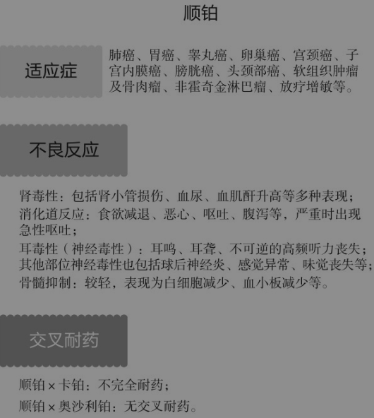

# 第二章 关键应用：无处不在的战略性矿产

当今社会，手机是每个人都离不开的电子产品。当你在刷手机的时候，你可能不知道，一部手机里居然藏着几十种矿产资源。英国普利茅斯大学的地质学家们曾经将一部iPhone4S（苹果手机4S)放到工业搅拌机中粉碎，并将碎片分装于多个培养皿。然后，将这些碎片在500°C（932°F）的高温下与氧化剂混合反应，并对生成的酸性溶液进行了一系列化学分析。结果发现，一部iPhone4S手机中，除硅、碳等非金属外，还含有33克铁、17克铬、6克铜、36毫克黄金、90毫克银在内的共23种矿产。其中，锂、钴、镍等支撑着电池续航能力。当你打开空调，它安静地运行，“静音”的背后是稀土永磁材料的功劳；当你开车上班，车用的是铁、铝、铜和镍基材料，让车更轻更快；你每天喝的净水机过滤的水，可能经过氟化物处理，变得更干净；家里的LED（发光二极管）灯用了稀土荧光粉，让光线更柔和、更节能。这些矿产就像一群“隐形英雄”，不仅有力地支撑着现代产业体系，而且已经深深地融入我们日常生活中，在推动社会进步、保障国家安全和塑造未来竞争优势的诸多高科技产品中无处不在，又不可或缺。

当前，世界正经历一场深刻的能源革命和科技变革，全球能源结构向清洁低碳转型的步伐不断加快，人工智能、5G/6G（第五代移动通信技术/第六代移动通信技术）、物联网、新一代信息技术等新技术不断突破。这一切，都使得战略性矿产的应用场景以前所未有的速度不断拓展。从我们手中的智能手机，到公路上行驶的汽车，从高耸入云的风力发电机，到翱翔蓝天的先进战机，再到守护生命健康的医疗设备，战略性矿产的身影无处不在。它们不仅是工业的“粮食”，也是改善民生福祉的“血脉”。它们为高科技赋能、驱动能源绿色转型、守护国防安全并改善我们的生活环境。这些看似离我们很遥远的矿产资源，实则与国计民生息息相关，构成了现代文明赖以存续和发展的物质基础。

## 高技术产业：“工业味精”为现代制造“提味增鲜”

高技术产业是衡量一个国家科技实力和综合国力的重要标志，而它的发展依赖一系列“三稀”矿产，铂族金属及其他金属，石墨、萤石等非金属矿产。这些矿产对高科技的发展具有重要作用，也被称为“高技术矿产”。从我们手中的智能手机到探索宇宙的航天器，从拯救生命的医疗设备到运算量巨大的超级计算机，都离不开这些“工业味精”的贡献。

### 半导体产业：从“硅基”到“化合物半导体”

半导体产业堪称信息社会的“心脏”，是所有现代电子设备的基石。而硅无疑是这颗心脏的绝对主角，我们常说的芯片，主要就是在高纯度的硅片上通过极其复杂的工艺制造出来的。制造这些高纯度硅片，本身就是一个复杂的技术过程，且离不开一种战略性非金属矿产—高纯石英砂，它是制造熔炼硅料所用石英坩埚的核心原料，其纯度直接决定最终硅片的质量和缺陷密度，任何微量杂质都可能导致整批芯片报废。

近年来，以碳化硅和氮化镓为代表的宽禁带半导体材料，凭借其更宽的禁带宽度，在高温、高频及大功率应用领域表现突出。其中，氮化镓的制备依赖金属镓。氮化镓器件能提供更高的功率和效率，广泛应用于5G通信基站、新能源汽车电控系统以及快速充电器。2024年，化合物半导体在全球5G滤波器市场表现非常抢眼，砷化镓基滤波器以超过60%的全球市场份额稳坐头把交椅，而氮化镓功率放大器更是以较传统硅基器件提升25%的能效表现，成为当之无愧的“明日之星”。此外，砷化镓和磷化铟等化合物半导体，凭借其优异的性能，在光通信、激光器和红外探测器等领域同样扮演着重要角色。中国在氮化镓、磷化铟等高端半导体材料的制备技术上已取得重要突破，有力推动了国产半导体器件的升级与产业链的自主可控。

与此同时，铟和锗这两种关键矿产的价值也日益凸显。铟在显示领域的作用尤为突出，铟锡氧化物(ITO)靶材的全球需求量与面板尺寸增长呈正相关关系。2023年，8.5代及以上液晶面板生产线陆续投产，推动全球ITO材料需求增长15%。而锗由于其独特的红外透过特性，主要应用于红外光学、光纤通信（作为掺杂材料）乃至高端芯片制造等多个尖端领域，在光电子与集成电路产业中持续发挥着不可替代的作用。

值得注意的是，在芯片内部纳米尺度的复杂金属布线中，钨、钼、铜等金属确保了数十亿晶体管之间电信号的畅通无阻，特别是铜，因其优良的导电性，已成为先进制程芯片中主流的互连材料，其电阻和电容特性直接影响芯片的运算速度和功耗。此外，超高纯度钴（>99.99%）和镍（>99.95%）也是先进半导体制造领域的关键材料，广泛应用于晶圆级封装和三维堆叠芯片的互连结构。随着摩尔定律逼近物理极限，这些金属通过磁控溅射工艺形成纳米级薄膜，在集成电路中承担扩散阻挡层、铜互连衬垫及磁性存储元件等核心功能。在新型存储器件研发中，钴基合金被用作相变存储器的电极材料，而镍则在磁阻式随机存取存储器中发挥稳定磁化方向的作用，其高纯度特性还能显著提升器件的可靠性与数据保持能力。

### 电子元器件及设备制造业：重新定义性能

在我们手中的智能设备里，无数微小的电子元器件构成了设备的“神经末梢”和“感官系统”，它们的制造也离不开战略性矿产。氧化铟锡是目前最主流的透明导电膜，它像一层既透明又能导电的隐形皮肤，广泛应用于手机、电脑、电视的液晶显示器和OLED（有机发光二极管）屏幕，使得触控操作成为可能。

铂、钯等贵金属因其卓越的催化活性，是燃料电池的高效催化剂，它们能让电极反应迅速，效率提升30%以上，稳定性也更出色；这类贵金属也用于制造高灵敏度的气体传感器，如甲醛检测仪、一氧化碳报警器，可精准捕捉有害气体分子，守护家庭安全；在医疗检测中，它们能够快速锁定病原体，让医生早一步发现健康隐患。

钌则在超级电容器和生物传感器中表现抢眼。它能像海绵吸水般快速储存电能，导电性更是远超普通材料。钌基材料近年来还被应用到生物传感器领域，凭借超强的电化学性能，正被用于开发能检测癌症标志物的“纳米探针”，目标是实现高精度的生物分子检测。

铍铜合金因为兼具高强度、高导电性和优异的抗疲劳性能，成为电子元件微型化和高可靠性的关键材料。当你的智能手机摄像头快速对焦时，音圈马达正依赖铍铜合金精准运动；当你打开笔记本电脑时，导热片中的铍铜合金将热量均匀分散；在高端连接器与继电器中，它以稳定的物理特性确保信号传输零失误。从精密机械到散热系统，这种兼具金属刚性与电子活性的材料用性能支撑着现代电子设备的可靠运行。

铷和铯凭借独特的光电性能，在电子设备中大显身手，成为制造红外探测器的重要材料之一。其中，碲化铷是制造红外成像传感器的核心材料，其红外成像传感器的响应速度比传统材料快20%以上，灵敏度更是大幅提升。这种材料如今已广泛应用于安防监控系统，在黑夜中捕捉细微温差；在自动驾驶领域，它能帮助车辆精准识别前方障碍物。

钛及其合金凭借强度高、重量轻、耐腐蚀以及良好的电磁屏蔽性能，被用于制造高端笔记本电脑外壳、服务器硬盘盘片等，在保障结构强度的同时，有效保护内部精密电路免受外界电磁干扰。2024年，钛制硬盘盘片厚度仅有0.5mm，存储密度比传统铝制盘片提升50%。在芯片架构的“神经元”层级，铪基电路凭借超低漏电特性，成功将芯片功耗降低40%。2023年这种新型晶体管材料已在7 nm以下先进制程中占据主导地位，应用比例突破七成，已成为高性能计算与人工智能芯片的核心材料。钽制造的钽电容器体积小、容量大、性能稳定、寿命长，是5G基站、数据中心服务器、军用电子设备等高端领域不可替代的元件，能在高温、高压等恶劣条件下稳定工作。2024年全球钽电容器市场规模约25亿美元，其中六成应用于5G基站及数据中心服务器，成为数字基建的重要组件。

铌酸锂是一种重要的光电功能晶体，优异的电光、声光效应使其成为高速光通信调制器、滤波器和谐振器的核心材料，是未来量子计算设备和全光网络的重要组件，能显著提升光纤通信的数据传输速率和带宽。在光纤通信领域，铌酸锂凭借其独特的非线性光学性能成为重要材料，其调制器可达100 GHz的超高带宽，将数据传输速率提升至新高度。更值得关注的是，铌酸锂的宽透明窗口和低插入损耗特性，使其在量子态制备与操控中展现独特优势，即周期极化铌酸锂波导可实现高效光子纠缠生成，为量子通信网络构建提供支撑。

### 高端制造业：更高、更快、更轻、更强

在高端制造业中，航空航天与精密装备领域对材料性能要求极为苛刻，这些领域堪称工业的“脊梁”，需要特殊的“筋骨”来支撑。钛合金以其极高的比强度、较强的耐腐蚀性和耐高温性能，成为飞机发动机叶片、机身构件和航天器外壳的首选材料，也被誉为“太空金属”。近年来，中国在钛合金三维打印技术方面取得突破，实现了复杂空心结构和点阵构件的快速成型，显著提升了制造效率并减轻了结构重量。高熔点金属钨和钼在高温合金中的应用持续拓展，被广泛应用于航空发动机涡轮叶片、火箭发动机喷口及高能粒子加速器的靶材与屏蔽部件。这类材料在极端环境下展现出优异的耐高温、抗蠕变和抗热震性能，更为稀有的金属铼，在航空发动机单晶涡轮叶片中扮演着“效能倍增器”的角色，添加3%～6%的铼可使镍基单晶合金的工作温度提升近100℃，显著提高发动机的推重比和燃油效率。另外，铍铜合金凭借其独特的非磁性与防爆特性，能够在高速旋转时既避免磁干扰，又杜绝火花产生，被广泛应用于飞机轴承、轴瓦等传动部件以及起落架等耐磨面部件的制造。尤其是在飞机起落架这类承受巨大载荷的部件中，其抗疲劳性能较传统材料提升30%，使用寿命延长两倍以上。铌及其合金在1 800°C高温环境下仍能保持结构完整性，其高温蠕变强度达250 MPa，是制造燃烧室壁衬、涡轮叶片冷却通道等核心部件的重要材料，可以确保发动机在极端条件下仍能安全稳定运行。

在智能制造装备领域，钼铜复合材料凭借高导热性和与硅芯片匹配的热膨胀系数，常被用于高功率电子器件的散热基板和封装材料。这种由金属钼与铜组成的双相材料，其导热系数是传统陶瓷基板的3倍以上。更关键的是，其热膨胀系数与硅芯片高度匹配，这种特性组合使其在散热基板和封装材料中表现优异。当大电流通过时，产生的热量能被快速导出，同时避免因热膨胀差异导致的器件翘曲或开裂。在5G基站功放模块和激光器封装中，钼铜材料通过“三明治”结构设计，将热阻降低至传统材料的1/5，显著提升器件在连续高负载下的稳定性。钨铜合金兼具了3000K耐高温特性、抗烧蚀能力和一定的导电性，不仅是电子束焊接、激光加工设备中电极、喷嘴等高精度加工工具的关键材料，还被应用于火箭喷嘴、电火花电极、真空密封、等离子切割、核工业关键件等前沿领域。

在海洋工程装备领域，铍铜合金凭借无磁特性成为关键材料。铍铜合金制成的无磁性管、钻头卡环及挠性钻探卡环等部件，能在高压(>70MPa）、低温（-20℃～80℃）及高盐雾腐蚀环境下保持机械强度与尺寸稳定性，断裂韧性达 50 MPa·m1/2，用于海洋工程装备产业中海上油气钻井设备的关键构件，使其能够在极端工况下稳定运行。钛合金以15：1的高比强度和优异的耐氯离子腐蚀能力，成为潜艇耐压壳体和深海阀门的关键材料，其服役寿命可达传统不锈钢的3倍以上，因此也有“海洋金属”之称；在高温高压的海底油气开采系统中，镍基合金(如Inconel625)可以承受70MPa压力和300℃高温，其晶格结构中的钼、铌元素会形成稳定固溶体，使井下工具在硫化氢腐蚀介质中能够保持机械完整性。而锆石陶瓷凭借12GPa维氏硬度和0.2的超低摩擦系数，被加工成深海泵叶轮的“无声旋翼”，在盐雾浓度达50g/m³的严苛工况下，其表面微裂纹扩展速率低于1×10−6 m/s，可显著延长设备维护周期。

### 新材料产业：“锻造”新未来

每一次新材料的诞生，都将推动科技革命和产业变革，因此新材料产业是未来科技的竞技场。锂、稀土、石墨等战略性矿产，凭借其各自独特的物理化学性质，赋予材料轻量化、耐高温与强导电等特性，已成为研制高性能合金、先进陶瓷、复合材料的核心材料。以锂为例，锂及其化合物是新能源材料领域的关键原料。以镍钴锰酸锂、镍钴铝酸锂为代表的三元材料，因其优异性能成为高性能锂离子电池正极材料的主流选择。此外，锂在化工、建材等行业也发挥着重要作用。在冶金领域，在铜冶炼中添加百万分之一至万分之一的锂，可细化晶粒，优化铜的内部结构，提升其导电性能；在铸造优质铜铸件的过程中，锂能有效清除熔体中的杂质与气体，保障铸件品质。

稀土元素如镨、钕、铽等，虽然不直接构成芯片本身，但它们制成的高性能钕铁硼永磁材料却被广泛应用于制造芯片的光刻机、刻蚀机等超精密设备的磁悬浮导轨、精密电机和控制系统，保障设备运行的稳定性、高速性和精度。此外，稀土永磁材料还被广泛应用于微型硬盘驱动器的音圈电机、机器人关节的执行器中，实现设备的快速响应和精确定位。而稀土发光材料，因其优异的发光效率、色纯度和可调性，成为OLED显示技术的关键原料。例如，铕配合物能发射出明亮的红光，铽配合物则可产生高饱和度的绿光。将它们与其他蓝色发光材料组合，便能让红、绿、蓝三色光在光谱上交织成白色，实现全彩显示。

在电子陶瓷领域，经氧化钇稳定的氧化锆因在高温下具备优异的氧离子导电性而成为固体氧化物燃料电池中应用最广泛的电解质材料，能够高效地将化学能转化为电能。稀土掺杂的透明陶瓷，如钇铝石榴石晶体（YAG），因其独特的光学优势，在激光器与红外探测器领域的应用范围持续扩大，成为固体激光器、热障涂层中重要的功能材料。此外，YAG还被应用于科研设备、工业加工等领域，例如深紫外光刻的辅助激光器、半导体晶圆定位检测等。

作为元素碳的一种同素异形体，石墨具有典型的层状分子结构，展现出许多独特的物理性质。其莫氏硬度很低（硬度1～2），质地非常柔软，甚至能带来滑腻的触感。这种特性使得石墨在许多应用中展现出独特的优势，如耐高温性（熔点高达3850℃±50℃）、优异的导电与导热性能、良好的润滑性、优良的化学稳定性、良好的可塑性、出色的抗热震能力等。目前，石墨及其衍生物已被广泛应用于耐火材料、导电材料、耐磨润滑材料、耐腐蚀材料、高温冶金材料等领域。例如，因具有耐高温、抗热震、导电性好的特点，高功率石墨电极主要用于电弧炉炼钢，它能在数千度的高温电弧下稳定工作，是短流程炼钢的关键耗材；高性能碳石墨密封材料则广泛应用于核电站主泵、化工厂高速离心压缩机等关键设施的压力容器、管道连接处，确保系统的绝对密封与安全，防止有毒有害介质泄漏。此外，石墨烯作为一种新兴的二维材料，可用于提升传统材料的性能。例如，将少量石墨烯添加到塑料、橡胶或金属等基体中，可以显著提升复合材料的强度、刚性、导电性和导热性。目前，石墨烯已在航空航天、汽车制造、柔性电子等多个领域实现突破性应用，因而被誉为“新材料之王”。

此外，萤石作为各国关键矿产清单上的“常客”，是现代高端氟化工的基础性原材料，在湿电子、光化学等领域有重要应用，也是附加值非常高的先进材料。

## 清洁能源转型：从“调味剂”到“关键原材料”

当前，一场由清洁能源驱动的深刻变革正在全球范围展开。这是一个从技术萌芽到产业发展，再从政策引导到市场选择的完整链条，各方力量正汇聚成一股不可逆转的洪流，旨在重塑未来的能源格局。中国要实现2030年“碳达峰”和2060年“碳中和”的目标，大力发展清洁能源是必由之路。这场势不可当的清洁能源革命，本质上是一场材料革命，离不开一系列战略性矿产的强力支撑。其中，锂、钴、镍、稀土、石墨等战略性矿产尤为突出，它们不仅是传统工业的“调味剂”，更是新能源产业的“主食”。可以说，清洁能源领域不仅与战略性矿产形成了复杂耦合，也是联合国、国际能源署等多边机制和国际机构最为关注的战略性矿产应用方向。清洁能源领域对不同矿产的需求情况，见表2-1。

**表2-1 清洁能源领域对不同矿产的需求**

| 领域 / 矿产 | 铜 | 钴 | 镍 | 锂 | 稀土 | 铬 | 锌 | 铂族 | 铝 |
| --- | --- | --- | --- | --- | --- | --- | --- | --- | --- |
| 光伏 | 高 | 低 | 低 | 低 | 低 | 低 | 低 | 低 | 高 |
| 风能 | 高 | 低 | 中 | 低 | 高 | 中 | 高 | 低 | 中 |
| 水电 | 中 | 低 | 低 | 低 | 低 | 中 | 中 | 低 | 中 |
| 聚光式太阳能 | 中 | 低 | 中 | 低 | 低 | 高 | 中 | 低 | 高 |
| 生物质能 | 高 | 低 | 低 | 低 | 低 | 低 | 中 | 低 | 中 |
| 地热 | 低 | 低 | 高 | 低 | 低 | 高 | 低 | 低 | 低 |
| 核能 | 中 | 低 | 中 | 低 | 低 | 中 | 低 | 低 | 低 |
| 电网 | 高 | 低 | 低 | 低 | 低 | 低 | 低 | 低 | 高 |
| 电动汽车和储能电池 | 高 | 高 | 高 | 高 | 高 | 低 | 低 | 低 | 高 |
| 氢能 | 低 | 低 | 高 | 低 | 中 | 低 | 低 | 高 | 中 |

*资料来源：IEA.Net zero by 2050，国际能源署官方网址。*

### 新能源汽车电池：技术路线迭代下的关键金属

在新能源汽车领域，“当红炸子鸡”非锂莫属。这个在元素周期表上排名第三的轻金属，已成为推动清洁能源转型的关键矿产，也被称为“白色石油”。我们日常使用的智能手机、笔记本电脑，路上行驶的电动汽车，乃至提高电网稳定性的储能电站，都离不开锂离子电池的应用。近代锂离子电池的发展可以说是由钴酸锂电池开始的。1980年前后，约翰·古迪纳夫团队发现了钴酸锂材料，1985年吉野彰实现第一代锂离子电池的产业化应用[1]。钴酸锂材料虽因钴资源稀缺而成本较高，且热稳定性不足，但其具备可在高工作电压下工作且材料密度高等优势，能在同等体积下提供更高的能量密度，因此在智能手机、笔记本电脑等对空间布局要求严格的3C电子设备中仍占据重要地位。随着市场对安全性与成本的要求提高，磷酸铁锂材料逐渐崭露头角。该材料有着稳定的橄榄石结构，其关键元素铁、磷资源丰富，得以实现了极高的热稳定性与较长的循环寿命，且显著降低了原料成本。尽管能量密度与工作电压平台较钴酸锂有所降低，但在电动汽车与储能电站等注重安全与使用寿命的场景中，磷酸铁锂已成为主流技术路线。为平衡能量密度与综合性能，三元镍锰钴锂氧化物（NMC）材料体系通过引入镍、钴、锰（或铝）等多元素协同作用，在维持较高电压平台的同时进一步提升比容量与能量密度，成为目前动力电池领域的重要发展方向。三元锂电池的热稳定性相对较弱，对电池管理系统要求更高，且成本易受钴、镍价格波动影响。从钴酸锂到磷酸铁锂，再到三元材料体系，锂电池正极材料的演进直观反映出技术进步和市场需求的双重驱动作用。根据国际能源署发布的《全球关键矿产展望2025》报告，2020—2024年，全球锂需求增长了两倍，预计到2035年将在此基础上再增长两倍，达到370万吨锂当量。其中，电动汽车领域将成为锂需求的绝对主力，占新增锂需求的90%。

目前，下一代电池技术—固态电池，正在从实验室走向商业化应用。与传统锂电池使用易燃的液态电解质不同，固态电池使用安全性和能量密度更高的固态电解质，有望消除当前锂电池存在的热失控引起电池起火爆炸的风险，同时允许使用能量密度更高的电极材料，让电动车跑得更远，充电速度更快。全球的汽车行业和电池行业的大型企业都在该领域进行大规模投资。中国在固态电解质材料如氧化锂、硫化锂的研发和产业化方面，已经取得了重要进展，处于全球第一梯队。据艾默生电气集团(EMR公司)预测，全球固态电池市场规模将从2024年的约57亿元人民币，增长到2034年的1013亿元人民币，年复合增长率高达33.3%。其中，中国固态电池市场2025—2034年的年复合增长率更将达到36.8%。

正如前文提到的，钴酸锂电池是锂离子电池发展的起点，钴作为锂离子电池正极材料的关键组分，在能源转型中具有不可替代的作用。其作用主要体现在提升电池的能量密度、安全性能和循环稳定性方面。以钴酸锂为正极的电池体系虽存在热稳定性不足和成本偏高的问题，但凭借高能量密度优势，其至今仍在便携式电子设备领域保持重要地位。在后来的三元锂电池中，钴通过与镍、锰等元素形成复合氧化物，在能量密度方面虽较钴酸锂略有降低，但热稳定性和安全性更佳，加上成本相对更低，实现了能量密度、安全性和经济性的综合平衡，因而成为电动汽车及一些对电池重量和续航要求高的无人机、航模等小型电子设备的理想电源。随着新能源汽车和消费电子领域的快速发展，全球钴消费量持续增长。2024年，全球钴消费量约20万吨，同比增长7.15%。其中，中国钴消费量约12.26万金属吨，增幅5.6%。不过，由于钴资源分布极度不均且价格昂贵，推动了高镍低钴及无钴正极材料的研发进程，但在高电压、快速充放电等应用场景下，含钴材料的地位依然稳固，因为它能确保电池在严苛条件下的稳定输出。

此外，钴在超级电容器和氢燃料电池中也展现出广阔的应用前景。钴氧化物作为高性能超级电容器的电极材料，可为新能源汽车和智能电网提供瞬间大功率的快速充放电解决方案；在氢燃料电池中，钴基催化剂有望部分替代贵金属铂，通过促进氧化还原反应提升燃料电池效率。未来随着氢能技术的进一步发展，钴在清洁能源领域的应用前景将进一步拓展。

虽然不锈钢是镍最大的应用领域，但镍作为三元锂电池正极材料的核心要素，同样也是能源绿色转型的关键金属。电池的能量密度是决定续航能力的关键，很大程度上取决于镍的含量。简单来说，镍含量越高，电池单位重量或体积内能储存的电量就越多。这意味着，同样大小的电池包，镍含量高的那个电池包可以让电动汽车跑得更远；或者，在保证相同续航的情况下，电池可以做得更轻巧，从而降低整车能耗，形成良性循环。因此，为了追求更高的能量密度和更低的成本，电池正极材料正朝着“高镍化”的方向飞速发展。这条技术路径清晰可见：从最初的NMC111（即镍：锰：钴=1：1：1），演进到镍占50%、锰占30%、钴占20%的NMC532，再到镍占60%、锰占20%、钴占20%的NMC622，直至目前主流的高镍电池NMC811（镍占80%、锰和钴各占10%），以及研发中的NMC9系列（镍含量超过90%)和无钴高镍电池。目前，全球电动汽车市场呈现爆发式增长态势，对高纯度“电池级镍”的需求也呈指数级增长。根据国际能源署等机构的预测，到2040年电池领域对镍的需求可能占据全球镍总需求的半壁江山，这将改变镍资源的消费结构，引发上游采矿、冶炼技术的一系列变革。

### 储能产业：为能源革命的“巨型充电宝”充电

随着储能系统和可再生能源发电技术的快速发展，锂、钴、镍等关键矿产的应用场景也在不断扩展。除了动力电池，锂还应用在储能电池领域。风能和太阳能具有间歇性和波动性的特征，有风有太阳时才发电，这与电网需要稳定、连续供电的需求相矛盾。这就需要储能系统像“巨型充电宝”一样，把多余的电能储存起来，在需要时再释放出去，从而平滑输出、稳定电网、削峰填谷。锂离子电池是当前电化学储能的主流技术，广泛应用于电网侧、发电侧和用户侧。

此外，一项名为“熔盐储能”的技术在光热发电领域崭露头角，它利用锂基熔盐作为储热介质。这种熔盐能在白天吸收并储存太阳能集热器收集的巨量热能，在夜晚或阴天时，再利用这些热量产生蒸汽驱动汽轮发电，从而实现24小时连续稳定发电，大大提升了太阳能利用的可靠性和经济性。我国在青海、甘肃等地的光热发电示范项目已开始试点这项技术，为未来在大规模可再生能源基地推广奠定了工程实践基础。

同样，三元锂电池和镍铁电池等镍基电池，也因其高能量密度和长循环寿命，被广泛应用于大型电网储能系统和家庭储能系统。这些系统如同城市的“能量仓库”，在用电低谷时吸纳风电、光伏的富余电力，在用电高峰时释放，有效缓解电网压力，提高可再生能源的消纳比例。镍基电池也可作为工业企业的应急备用电源，确保生产流程与数据安全不受影响。值得注意的是，镍在燃料电池中的应用也在不断拓展。其中，镍氢（Ni-MH)电池常被用于氢燃料电池系统，作为辅助储能单元。镍氢电池能够协助调节功率波动，回收制动能量，并在燃料电池启动或负载突变时提供瞬时功率补偿，从而提升整个系统的动态响应能力与综合能量管理效率。

### 光伏和风电：捕“风”捉“光”的“金牌辅助”

在直接捕捉自然力量的光伏和风电产业中，战略性矿产同样起到了辅助支撑但又不可或缺的作用。目前主流的光伏发电技术包括晶体硅太阳能电池、薄膜太阳能电池两大类。晶体硅太阳能电池高度依赖硅、银和铝等矿产资源。硅是光伏电池片的基础材料，通过精炼提纯制成单晶或多晶硅片；银用于制备覆盖在电池片上的导电银浆，收集和传导电流，其导电性对组件效率至关重要；铝则主要用于制造支撑和固定光伏组件的边框和支架结构。另外，镓、铟、锗、硒、碲等稀散元素在提升光电转换效率方面也功不可没。例如，氧化铟锡因其高透光性和导电性，是制造硅基太阳能电池透明导电膜的必备材料，但因其稀缺性和成本高，行业也在积极研发碳纳米管、石墨烯等替代方案。薄膜太阳能电池分为非晶硅、铜铟镓硒、碲化镉电池三种类型。氮化镓因其高温稳定性和宽禁带特性，可用于制造高温聚光太阳能电池，其光电转换效率在实验室已突破30%，远高于传统硅基电池。碲化镉这种薄膜太阳能电池成本较低，对光的吸收效率高，且在弱光条件下表现优异，是工商业屋顶和户用电站等分布式光伏的优选方案之一。近年来，全球碲化镉装机量同比增长25%。此外，在光伏发电领域，通过掺杂稀土发光材料实现光谱转换技术，能够有效拓宽太阳能电池对太阳光谱的响应范围，进而提升光电转换效率。

风电产业中，需要用到的矿产主要有铜、铝、钼、稀土等。铜主要用于风电电缆、变流器、晶体管等部件的导电材料，铝应用于风机叶片、塔架、连接座等结构件，钼应用于风力发电机组的齿轮箱与主体结构。而稀土是风力发电机的关键原料，以钕铁硼为代表的稀土永磁材料是现代高效风电机组的核心部分。与传统电励磁机型相比，永磁同步发电机凭借其优异的磁性能，不仅能耗可降低约1/5，还能显著减少运行维护需求。

随着风电机组持续向大型化、深海化发展，以及光伏技术对效率提升的迫切需求，稀土永磁材料与功能材料在清洁能源领域的战略地位将越发显著。值得关注的是，稀土材料的创新应用正在超越传统领域。例如，在能源转化技术前沿，铈基、镧基等稀土掺杂的光催化剂在太阳能光解水制氢及二氧化碳资源化转化中展现出优异活性，为可再生能源转化提供新路径；在热电转换领域，碲化铋等稀土热电材料能够将汽车尾气、工业炉窑排放的废热直接转化为电能，提高能源利用效率；而在磁制冷技术方面，钆镓石榴石等磁制冷材料凭借其独特的磁热效应，用于研发高效节能的磁制冷空调系统，这种技术利用磁场变化实现制冷，有望替代传统压缩机空调，不使用会产生温室气体的制冷剂，降低能耗和碳排放。

[1]约翰·古迪纳夫、斯坦利·惠廷厄姆和吉野彰三位科学家获得2019年诺贝尔化学奖，正是源于他们三人对锂离子电池的发展所做的贡献。

## 环保与民生：守护蓝天和健康的“幕后英雄”

矿产资源不仅是能源转型与工业发展的物质基础，也深深融入与我们日常生活息息相关的环境保护和民生保障领域，在不知不觉中守护着我们的碧海蓝天，提升着我们的生活质量与健康水平。从污水处理到空气净化，从汽车尾气催化到高效节能家电，再到精密医疗设备，在众多关乎支撑绿色转型与提升民生福祉的应用场景背后，都离不开战略性矿产。例如，萤石助力氟化工环保技术，稀土赋能催化与永磁系统，铂族金属则在汽车尾气净化领域占据主导地位，钛与钽、铌在生物医疗及耐蚀设备中不可或缺，石墨与钴则推动着储能与硬质合金技术进步。战略性矿产一直在支撑绿色转型与民生福祉的提升。

### 生态环境：战略性矿产让天更蓝、水更清

在环保领域，一些战略性矿产是治理污染、净化环境的重要法宝。在污水处理方面，萤石作为整个氟化工产业链的基础原料，其衍生的氟化物（如氟化钠、氟化钙）能够与水中的铅、镉、汞等重金属离子发生反应，形成极其稳定且难溶于水的氟化物沉淀，从而被有效地从水中分离去除，这种技术可使重金属去除率提升至95%以上，效率比传统的碱沉淀法提高20个百分点，这对于处理电镀、冶金、矿山等行业排放的重金属废水来说尤为重要。石墨烯则凭借其独特的单原子层二维结构、巨大的比表面积和优异的导电性，被制成高性能吸附膜或过滤材料，能够通过物理吸附、静电作用等多种机制，高效地去除水中的重金属离子、有机染料、抗生素等微污染物，过滤效率可达99.5%以上，比活性炭、砂滤等传统过滤材料提高15个百分点，且部分石墨烯膜材料具备抗污染、易再生的优点。

在空气净化和工业废气治理领域，含氟材料因其独特的化学稳定性和耐腐蚀性，成为关键功能材料。氟碳聚合物如聚四氟乙烯被制成高效低阻的覆膜滤料，能够有效捕获工业烟尘中的细颗粒物（PM2.5），甚至更细的颗粒物，以及附着其上的二噁英、重金属等污染物，新型含氟微孔膜技术可实现99.9%的过滤效率，同时保持良好的透气性，广泛应用于垃圾焚烧、燃煤电厂、水泥窑等行业的袋式除尘器。石墨烯及其复合材料，凭借其巨大的比表面积和丰富的官能团，也能高效吸附并催化分解空气中的挥发性有机物、氮氧化物等有害气体，其吸附效率比常见的活性炭提高40%，且可通过光催化或电加热等方式实现再生，降低了长期运行成本。应用石墨烯基催化剂处理工业有机废气，可将有机废气的分解效率提升25%，同时使治理成本降低15%～20%。

在移动污染源治理—汽车尾气净化领域，铂族金属是催化剂的核心材料。每辆燃油车的排气管中都藏着一个三元催化转化器，其核心就是涂覆在蜂窝陶瓷载体上的铂、钯、铑这些贵金属催化剂。它们分工协作：铂和钯主要负责在高温下将未完全燃烧的有害的一氧化碳和碳氢化合物氧化成无害的二氧化碳和水；而铑则专注于将燃烧产生的氮氧化物还原为无害的氮气。三者协同工作，能在瞬间完成复杂的化学反应，将绝大部分尾气污染物转化为无害物质。据估算，每辆汽车的催化转化器平均需要使用3～5克铂族金属，其中铂和钯占比约60%，铑占40%。随着全球排放标准日益严格，如欧7(欧洲第七阶段排放标准）和未来国7（机动车污染物和温室气体协同控制标准）标准的出台，人们对催化剂转化效率要求越来越高，单车贵金属用量呈上升趋势，较10年前增加约20%。中国作为全球最大的汽车生产和消费国，对铂族金属的需求较大，2023年，作为汽车尾气催化剂的铂族金属的需求量达81.7吨，约占全球总需求的13%。为应对贵金属价格波动、资源短缺问题和满足更严苛的排放法规，行业正在进行新型催化材料的研发与应用。例如，使用铈锆复合氧化物作为助催化剂来提高贵金属的分散度和储氧能力，提升催化剂的抗老化性能；或利用纳米技术精确控制贵金属颗粒的尺寸和分布，以最大化其催化活性表面，从而在保证性能的同时减少贵金属用量。尽管新能源汽车是未来趋势，但全球存量燃油车以及混合动力汽车仍将在未来一段时间内占据重要地位，因此铂族金属在尾气净化领域的需求仍将保持稳定。

### 民生保障：美好生活离不开战略性矿产

在民生保障领域，战略性矿产同样无处不在，默默提升着我们的生活品质和健康水平。在节能家电领域，稀土永磁同步电机的应用可以使家用电器的能效水平提升20%～40%，尤其是空调、洗衣机等家电的能效提升较为明显。据测算，采用稀土永磁电机的空调系统，能效比可提高30%，制冷效率提升25%，这意味着更少的电费支出和碳排放；采用稀土永磁电机的洗衣机，洗涤效率提升20%，节水率达15%，并且运行更加平稳静音。随着家电能效标准的不断提高，稀土永磁电机在家电领域的应用比例持续上升，其在空调、洗衣机等家电中的渗透率由2022年的35%增至2024年的52%。在节能照明领域，稀土荧光粉已在LED照明器件中占据超过50%的应用份额。相比传统光源，LED灯更节能、寿命更长，还避免了传统荧光灯中汞的使用，减少了对环境的污染。

在医疗健康领域，战略性矿产的应用关乎生命健康和生活质量。钛合金因其与人体组织极佳的生物相容性、接近骨骼的弹性模量、高强度、轻质和耐体液腐蚀性，成为人工髋关节、膝关节、骨科植入物(如接骨板、螺钉)和牙种植体的首选材料，大大改善了患者术后的生活质量，提高了其活动能力，减少了排斥反应的产生，降低了二次手术的风险。钽和铌等金属也因其极佳的惰性和生物相容性，用于高端骨科植入物表面涂层或多孔结构，促进骨组织长入实现生物固定，同时也可用于心血管支架和植入式电子设备（如心脏起搏器外壳），通过表面氮化处理等技术改善耐磨性，提高支架的柔韧性和抗疲劳性能，延长其在体内的使用寿命。

在抗癌药物和血液净化设备中，铂族金属应用广泛且前景广阔。例如，顺铂、卡铂等铂类药物是治疗睾丸癌、卵巢癌、肺癌等多种癌症的一线化疗药物，拯救了无数生命（见图2-1）。新型铂基纳米药物通过靶向递送技术，能将药物更精准地富集在肿瘤部位，在提高疗效的同时降低对正常组织的毒副作用。在血液净化设备中，铂族金属涂层或组件也有助于提高血液相容性和净化效率，减少透析次数，改善患者生活质量。

**图2-1 铂族金属在药物领域的应用**

在医疗影像诊断领域，稀土材料更是不可或缺。稀土永磁体，特别是钕铁硼和钐钴磁体，是磁共振成像设备产生强大、均匀、稳定静态磁场的关键所在，其磁场强度和均匀性直接决定了成像的信噪比和空间分辨率。据测算，稀土永磁体的磁场均匀性可提高15%，成像分辨率提升20%，让医生能更清晰地观察软组织、神经系统和肿瘤的细微结构。稀土掺杂的闪烁晶体或荧光粉，如钨酸镉、硫氧化钆，应用在X射线成像、CT（计算机体层成像）扫描和正电子发射断层扫描中，能将高能射线转换为可见光，再由探测器接收形成图像，可提高图像的质量、亮度和清晰度，有助于早期病灶的发现和精准诊断。例如，在CT扫描中，稀土荧光材料的应用可使图像噪声降低30%，分辨率提高25%。

此外，在医学治疗中，还常用到钴的一种放射性同位素—钴-60。钴-60在衰变时会释放出高能量的γ射线，这种射线具有很强的穿透能力，可用于放射治疗，集中照射肿瘤组织，杀死癌细胞，尤其是在宫颈癌、头颈癌等的治疗中应用广泛。虽然近年来更先进的直线加速器逐渐取代了部分钴-60放疗设备，但在许多发展中国家和地区，钴-60治疗机因具有结构相对简单、成本低、操作维护简便、运行稳定可靠，应用仍然非常广泛。此外，钴铬钼合金因其优异的生物相容性、极高的机械强度和耐磨性，适合用于制作长期植入体内的人工关节（如髋关节假体、膝关节假体以及义齿支架），能够承受人体长期活动带来的复杂应力和磨损。

## 国防军工：现代化军队的铠甲利剑

矿产资源为武器装备制造提供原材料和能源，是保障国防安全的物质基础，其重要性无论怎样强调都不为过。现代国防军事工业是典型的高科技领域，武器装备是先进材料应用最集中的地方。随着军事技术向高精度、高机动、高可靠、智能化方向发展，对矿产的需求已从钢铁、铝等传统金属扩展到众多稀有、稀散和稀土元素。从隐形战机到精确制导导弹，从深海潜航器到太空卫星，从激光武器到综合电子信息系统，每一件现代化装备的性能提升，都依赖于这些关键材料的创新应用。

在国防装备动力系统中，稀土元素是实现装备轻量化、高效化和长航时的关键材料。凭借高效率和轻量化特性，稀土永磁材料电机正在成为无人机、无人潜航器和部分航天器动力系统的首选方案。而激光武器系统是现代国防的尖端领域，被誉为改变传统战争规则的利器，而大约90%的激光材料都涉及稀土元素。

隐身技术则是提升国防军工装备生存能力、实现突防的关键，直接关系到能否取得战争的主动权。稀土、钛基和镍基等合金正是制备先进隐身涂层和雷达吸波结构材料的核心原材料。其中，钛基隐身涂层凭借其良好的电磁波吸收性能、优异的耐腐蚀性和高机械强度，也被用于隐身战机和隐身舰艇的蒙皮和关键部位。镍基高温合金则通过表面喷涂特殊陶瓷或金属陶瓷涂层，调整其表面发射率，实现高温部件如发动机尾喷口等的红外隐身，降低被红外侦测系统发现的距离和概率。

在高能武器系统领域，战略性矿产的材料性能直接决定了武器的效能和可靠性。除了使用前述的激光材料，碳化硅因其高硬度、高热导率和在特定激光波段的高透光率，也被用于高能激光武器的光学窗口和镜坯材料，其高热导率能快速将激光产生的废热传导出去，防止光学元件因热变形而失效。氮化硼则因其卓越的热稳定性、高温绝缘性和低介电常数，被用作激光器内部的绝缘支架、热防护涂层，保护激光器内部精密元件，延长其工作寿命。在高能粒子加速器中，钨和钼凭借其高密度、高原子序数和优异的热稳定性，能有效吸收和阻挡高能粒子流，减少有害辐射泄漏和能量损失，成为靶材和辐射屏蔽材料的理想选择。钛合金则因其高比强度、优异的耐腐蚀性和抗辐射性能，常被用于加速器真空室、束流管道和冷却系统部件，确保设备在复杂环境下的长期稳定运行。在高能电磁脉冲武器中，钛基复合材料因其优异的电磁波吸收性能、轻量化和高机械强度，已开始替代部分笨重的铅基屏蔽部件，为内部精密的电子控制系统提供保护，确保其在释放强大电磁脉冲攻击敌方时，自身不会受到损害。

高超声速武器（指飞行速度超过5倍音速的武器)是未来军事竞争的制高点，其极快的飞行速度对材料提出了近乎极致的要求。飞行器与大气剧烈摩擦会产生上千摄氏度的高温，普通材料会瞬间熔化或被烧蚀。钛合金和镍基高温合金凭借其卓越的比强度和耐高温性能，被用于高超声速飞行器的机体结构、进气道和热防护系统，能在极端热负荷下保持结构完整，保护内部设备免受热损伤。稀有高熔点金属的加入能够增强武器装备的强度和韧性，确保导弹在高超声速机动飞行中的结构稳定性和控制可靠性。
