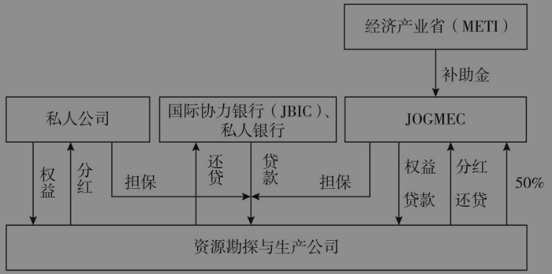
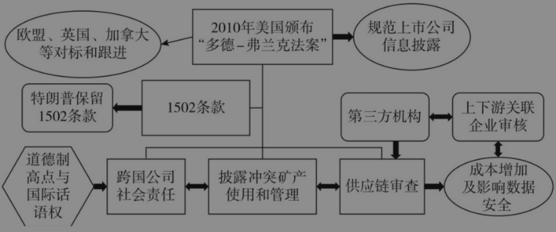

# 第五章 地缘博弈与战略性矿产的大国布局

新一轮科技革命和产业变革是矿产资源开发利用结构转型和范式变迁的根本动力。在当今世界，战略性矿产已成为科技竞争和产业发展的核心要素。稀土等战略性矿产资源在新一代信息技术、高端装备制造、新能源、新材料等战略性新兴产业和尖端国防工业中的基础性支撑作用日益凸显，其战略价值早已从传统的工业原料升级为关乎国家科技竞争力和国防安全的关键战略资源。而另一个抬升矿产资源关键度和战略性的因素必然是能源转型和低碳发展。

在全球绿色低碳转型加速的背景下，主要工业国家纷纷确立“碳中和”目标，推动新能源汽车、风电设备、高效电机等产业快速发展，带动铜、锂、钴、镍及稀土等关键矿产需求呈现爆发式增长。国际能源署发布的《全球关键矿产展望2025》报告指出，未来10年全球战略性矿产供应链脆弱性将显著加剧，其中铜和锂等战略性矿产面临的风险尤为突出，到2035年，原生铜缺口或达30%，锂缺口亦可能接近40%。[1]近年来，地缘政治冲突频发，一些焦点地区的纷争持续升级，给全球矿产资源供应链稳定带来了前所未有的系统性风险。从北极圈内格陵兰岛稀土等资源能源的控制权之争到美乌矿产合作协议等事件，无不凸显战略性矿产资源已超越经济范畴，成为大国地缘政治博弈重要筹码的事实。

鉴于战略性矿产供应安全已从单纯的经济问题跃升为关乎国家科技主权、产业安全和国防建设的重大战略问题，美、欧、日等全球主要经济体纷纷将战略性矿产供应链安全纳入国家安全战略，通过立法保障、政策引导、技术创新和国际合作等多重手段，意图掌控对战略性矿产供应链体系的主导权和控制权。中国作为全球最大的矿产资源消费国和重要的生产国，亟须构建自主可控、安全高效的矿产资源保障体系，以应对日益复杂的国际竞争环境。

[1]IEA.Global Critical Minerals Outlook 2025, https://www.iea.org/reports/global-critical-minerals-outlook-2025.

## 战略性矿产：产业变革与低碳转型的基石

### 提升新材料性能的核心杠杆

稀土等战略性矿产作为突破材料、零部件性能极限的核心驱动资源，直接决定着国家在高科技产业竞争中的位势。在数字产业中，半导体芯片是驱动算力提升、通信革新和存储技术突破的核心基石，其制造过程涉及多种金属元素，尽管许多元素用量很少，但对于芯片功能和性能提升都至关重要。智能手机的制造要用到约75种元素，其构件中的化合物、金属和复合材料都来自矿产，芯片、显示器、电池和扬声器等都由矿产品制成。[2]此外，人工智能以及大语言模型快速发展，推动着数据中心能耗持续攀升，产业对高效、小型化、高集成度电源转换器的需求日益迫切。氮化镓芯片以其高频高效、小型化、低损耗的优势，大幅提升了数据中心供电解决方案的功率密度和效率。在通信领域，氮化镓技术凭借其高频高效特性，正成为推动5G基站升级的核心驱动力，不仅显著提升了功率放大器的能效，而且通过增强功率密度和热管理能力，为未来AI驱动的智能化电信网络提供了关键的硬件支撑和扩展性保障。

在高端制造领域，钨金属因为其硬度大，熔沸点高，能耐高温、耐侵蚀等特点，通常被加工成各种硬质合金工具，如切削工具、耐磨工具、矿用工具等，素有“工业牙齿”之称；在国防工业中，可以制造穿甲弹（钨芯弹）、钨合金破片（用于高爆弹药）、防护材料等，又被称为“战争金属之王”。而且，钨特钢等广泛应用于交通运输、采掘、工业制造、军工等领域，更被誉为“高端制造业的脊梁”。此外，稀土功能材料在激光、超导等领域也具有不可替代性，如钕铁硼磁体在医疗设备和高精度传感器中的应用。

### 促进绿色低碳转型的关键支撑

锂、钴、镍、稀土、铜等战略性矿产也是支撑清洁能源、节能技术、碳捕集与循环经济的关键物质基础。当下清洁能源的开发对关键矿产的依赖度、需求量要远远高于传统化石能源时代。例如，一辆电动汽车单车整车用铜约为传统燃油汽车的四倍以上；制造光伏电池提升了铝和白银的需求；太阳能发电厂每安装1吉瓦的发电能力要耗费4000吨铜，是传统发电厂需求量的四倍；海上风机的骨架由合金结构钢、磁钢等构成，为适应风浪、洋流、低温和腐蚀环境，需要向钢材中大量添加镍、铬、钼等元素；氢能的快速发展也导致镍、锌和铂族金属需求不断增长。

《全球关键矿产展望2025》显示，清洁能源技术的广泛应用大幅提升了对战略性矿产资源的需求，2024年锂需求同比上年激增近30%，远超近十年10%的年均增长率。镍、钴、石墨和稀土需求增长6%～8%，主要源于电动汽车、储能电池、可再生能源和电网等能源应用。此外，因电网扩建和EV(纯电动汽车)充电设施建设，全球铜需求持续攀升，预计2035年全球原生铜供应缺口达30%。另据国际能源署预测，在现行政策情景下，到2040年，锂、石墨、稀土元素需求分别增长4.7倍、2.2倍和1.6倍。仅电动汽车电池一项，就将消耗全球60%的锂、40%的镍和钴。这一需求增速远超历史上的任何资源转型周期，甚至超过从生物燃料向化石燃料转型的能源革命。

[2]张生辉，王振涛，李永胜，等.中国关键矿产清单、应用与全球格局[J].矿产保护与利用，2022，42(05):138-168.

## 地缘形势交织下的大国布局

战略性矿产在美欧一般被称为关键矿产(critical minerals)、关键金属(critical metals)或关键原材料(critical raw materials），各国（或地区）根据自身安全需求、战略目标、产业布局和资源禀赋，对其界定标准、覆盖范围和侧重点也有所差异：美国强调战略性矿产在国家安全、军事、工业和民生等关键领域的重要性，尤其注重供应链韧性，主要关注非燃料矿物；欧盟以绿色转型和关键技术应用为导向，将锂、钴等清洁能源转型所需矿种列为战略性关键原材料；日本在2024年3月发布的《确保重要物资稳定供给制度》中，将战略性矿产定义为自然界稀缺或难以提取、对当前或未来工业至关重要、储量和生产高度集中且严重依赖进口、存在供应中断风险的矿物；我国对战略性矿产的界定则既包括能源矿产，也涵盖短缺和优势矿种，旨在保障资源安全、国防安全和产业可持续发展。

战略性矿产既具有大宗商品的属性，又具有高稀缺性和低替代性的特征。在供需矛盾不断加剧背景下，美、欧、日等经济体通过动态更新战略性矿产目录、强化供应链管控、构建联盟化供应体系等方式，持续升级资源安全保障机制，形成差异化治理范式。

### 美国：以安全为导向重构供应链

美国对战略性矿产的战略关注根植于其国家安全与经济竞争力的长期需求，但战略重心与实施方式随不同时期、政府更迭而呈现明显差异。其演变过程既反映了美国应对全球资源格局变化的适应性调整，也凸显了其战略思维从传统的资源获取向以安全为导向的全产业链控制转变。

一战至冷战期间，美国通过《重要战略材料储备法》《国防生产法》，建立了战时资源保障体系。冷战后期，随着全球化深入，美国降低储备规模，转而依赖国际市场供应，例如中国提供的廉价稀土资源。进入21世纪，特别是2010年9月中国启动的稀土出口管制使美国意识到供应链风险。同年12月，由白宫科学和技术政策办公室（OSTP)牵头，联合能源部、国防部等部门发布《关键矿产战略》，这是美国首次系统性应对战略性矿产供应链风险的官方文件。

2017年12月，特朗普在其第一任期签署的第13817号行政命令《确保关键矿产安全可靠供应的联邦战略》中，对战略性矿产给出了官方界定：一是对美国的经济和国家安全至关重要的非燃料矿物或矿物材料；二是存在显著的供应链脆弱性特征，易受地缘政治、自然灾害等外部因素冲击（的矿产资源）；三是在产品制造中发挥不可替代作用，其供应短缺将对国家经济体系或国防安全造成系统性风险(的矿产资源)。这标志着美国对矿产资源重要性的认知上升至国家安全层面。

2018年2月，美国首次发布《关键矿产清单草案》，2018年5月，正式公布最终版《关键矿产清单》，列出对经济及国家安全至关重要且存在供应风险的35种战略性矿产，包括稀土、锂、钴等，其中14种完全依赖进口(8种主要来自中国）。2022年，美国地质调查局在对各种矿物元素“供应风险”进行定量评估的基础上，对上述清单进行了更新，将战略性矿产数量调整为50种，新增镍和锌，同时剔除氦、钾、铼、锶和铀等5种矿产。

2025年上台的特朗普政府延续并强化了其首个任期对战略性矿产的战略布局，执政以来已密集出台多项相关行政令和政策文件（见表5-1），将战略性矿产安全提升至国家安全与全球战略的核心地位。与拜登政府强调国际合作和可持续开采不同，特朗普政府更注重单边行动和激进的本土化策略，明确将“使美国成为战略性矿产主要生产国和加工国”列为其政府的四大优先战略目标之一。2025年3月发布的总统行政令《立即采取措施增加美国矿产产量》，援引《国防生产法》加速本土开采审批、推动争议性的深海采矿、实施第232条款调查为对华矿产限制做准备，展现出更加强硬的资源民族主义倾向和地缘竞争思维。

**表5-1 美国关于战略性矿产的主要政策举措**

| 政策文件/行动名称 | 出台时间 | 制定/发布单位 | 主要内容 |
| --- | --- | --- | --- |
| 《确保关键矿产安全可靠供应的联邦战略》 | 2017年12月 | 特朗普政府(第13817号行政令） | 界定战略性矿产：对美国的经济和国家安全至关重要的非燃料矿物或矿物材料；存在显著的供应链脆弱性特征，易受地缘政治、自然灾害等外部因素冲击（的矿产资源）；在产品制造中发挥不可替代作用，其供应短缺将对国家经济体系或国防安全造成系统性风险（的矿产资源） |
| 《关键矿产清单草案》 | 2018年5月 | 美国内政部 | 首次列出35种战略性矿产，包括稀土、锂、钴等，其中14种完全依赖进口（8种主要来自中国) |
| 《解决依赖外国关键矿产对国内供应链构成威胁》 | 2020年9月 | 特朗普政府（第13953号行政令） | 宣布“国家紧急状态”，针对对中国稀土依赖（80%进口）；要求加强本土加工能力，激励历史矿区再利用，并与盟友合作构建替代供应链 |
| 《美国供应链》 | 2021年2月 | 拜登政府（第14017号行政令） | 将战略性矿产与清洁能源技术挂钩，制定可持续开采标准；推动锂、钴等电池材料回收：与日本、欧盟组建“战略性矿产买家俱乐部” |
| 《2022年关键矿产清单》 | 2022年2月 | 美国地质调查局 | 清单扩至50种，新增镍、锌等（新能源材料），剔除氦、铀等5种；细化稀土元素为15种独立矿种 |
| 《芯片与科学法案》 | 2022年8月 | 美国国会第10359条 | 资助战略性矿产循环利用技术；推动节能环保型采矿工艺；与盟友合作建立供应链风险模型 |
| 《四年期美国关键供应链审查报告》 | 2024年12月 | 美国白宫(跨部门评估） | 评估供应链脆弱性，提出加强国内勘探、回收及国际合作：美国地质调查局绘制国内资源地图，推动锂产量提高4倍：支持海底采矿政策研究 |
| 《应对美国铜进口威胁的行动》 | 2025年2月 | 特朗普政府（第14220号行政令） | 依据《贸易扩展法》第232条款启动铜进口调查，涵盖所有铜产品，分析进口依赖及本土产能缺口。目标：2035年将对外依存度从 45% 降至 30% |
| 《立即采取措施增加美国矿产产量》 | 2025年3月 | 特朗普政府（修订第14241号总统行政令） | 采取紧急措施提高美国本土矿产产量，具体包括铀、铜、钾、金，以及国家能源主导委员会（NEDC）主席指定的其他元素、化合物或材料。援引《国防生产法》，授予国防部长相应权利以采取战略和措施促进本土矿产生产，并将其列为优先工业能力发展领域 |
| 深海采矿行政令 | 2025年4月 | 特朗普政府(总统行政令） | 加速审批近海及国际海底区域采矿许可，目标是获取铜、钴、镍等资源；被批违反《联合国海洋法公约》 |
| 232 条款调查(关键矿产进口审查） | 2025年5月 | 美国商务部 | 评估对中国稀土、镁、锗等的高度依赖(如稀土72%依赖中国)，为潜在关税或限制措施铺垫 |
| 简化海上采矿政策 | 2025年6月 | 美国内政部［海洋能源管理局（BOEM）、安全和环境执法局（BSEE）］ | 缩短勘探许可审批时间（有效期延至5年）；降低竞拍底价；提前启动环境评估，放宽部分环保要求以加速开发近海关键矿产 |

*资料来源：作者根据公开资料整理。*

### 欧盟：持续深化战略性原材料战略

欧盟很早就认识到原材料对其经济的重要性，2008年起将矿产资源问题纳入政策议程，发布了《原材料倡议：满足我们对欧洲增长与就业的关键需求》(Raw Materials Initiative:Meeting our critical needs for growth and jobs in Europe，RMI)，目标是降低欧盟对关键原材料的进口依赖，尤其是市场集中度高、供应风险大的原材料。在此倡议的框架下，欧盟自2011年起发布战略性矿产清单，根据每种战略性矿产的战略地位、供应形势、供应风险指数、经济指数重要性进行动态调整，每三年发布一次，到2023年已扩充至34个，涵盖锂、稀土、石墨等清洁能源与国防工业核心材料（见表5-2)。

**表5-2 欧盟关于战略性矿产的主要政策举措**

| 政策文件/行动名称 | 出台时间 | 制定/发布单位 | 主要内容 |
| --- | --- | --- | --- |
| 《欧盟原材料倡议》 | 2008年 | 欧盟委员会 | 首次提出欧盟《关键原材料清单》(14种)，强调供应链多元化与资源效率 |
| 《关键原材料清单》首次更新 | 2011年 | 欧盟委员会 | 将《关键原材料清单》扩展至20种，提出“3R”战略：负责任采购、资源效率、回收利用 |
| 《关键原材料清单》第二次更新 | 2014年 | 欧盟委员会 | 将《关键原材料清单》增至27种，新增稀土元素、铂族金属等 |
| 《循环经济行动计划》 | 2015年 | 欧盟委员会 | 将关键原材料回收纳入循环经济战略；设定电子产品回收目标 |
| 《关键原材料清单》第三次更新 | 2017年 | 欧盟委员会 | 将清单扩展至27种材料/54种元素；新增氦、磷等 |
| 成立欧洲电池联盟 | 2017年 | 欧盟委员会 | 重点发展锂离子电池产业链；减少对亚洲电池材料的依赖 |
| 《关键原材料清单》第四次更新 | 2020年 | 欧盟委员会 | 将清单扩展至30种材料；新增锂、铝土矿等 |
| 发布《关键原材料韧性：绘制更高安全性和可持续性路线》行动计划 | 2020年 | 欧盟委员会 | 提出建立欧盟原材料联盟；加强供应链监测和预警系统 |
| 《关键原材料法案》 | 2023年3月提案,2024年5月生效 | 欧盟委员会 | 确立三大核心目标：到2030年，欧盟战略性原材料的本土开采、加工和回收能力分别达到年度消费量的10%、40%和25%；确保任何单一第三国在欧盟各战略原材料价值链任一阶段的供应占比不超过65%；加强欧盟在原材料领域的监测和应变能力，建立战略储备机制 |
| 首批47个战略项目清单 | 2025年3月 | 欧盟委员会 | 覆盖13个成员国，涉及锂、镍、钴等14种原材料；总投资225亿欧元 |
| 13个境外战略项目清单 | 2025年6月 | 欧盟委员会 | 首批位于欧盟境外的战略材料项目清单，13个新的海外战略项目 |

*资料来源：作者根据公开资料整理。*

2020年之后，欧盟战略性矿产战略进入加速发展阶段，政策重心明显转向“战略自主”和“供应链韧性”，打造安全、多元化、可负担和可持续并重的供应链成为欧盟关键原材料的战略支点。2020年9月，欧盟委员会发布《关键原材料韧性：绘制更高安全性和可持续性路线》(Critical Raw Materials Resilience:Charting a Path towards greater Security and Sustainability)，将增强供应链韧性、提升可持续性和推动技术创新为核心目标。在增强供应链韧性方面，提出构建多元化供应体系，推动与加拿大、澳大利亚、非洲等资源国的合作，同时支持本土开采、加工和回收能力建设，并建立供应链监测预警机制。在提升可持续性方面，指出实现气候目标和能源转型将拉动欧盟关键原材料需求的迅速增长，欧盟应当积极行动起来，确保关键原材料的安全和可持续供应，重点发展循环经济，提高废旧电池、电子产品中稀土和锂的回收率，并强化环保标准，确保矿产开发符合生态要求。在技术创新方面，加大替代材料研发投入，通过“欧洲原材料联盟”整合各方资源，推动公私合作。

《关键原材料法案》(Critical Raw Materials Act，CRMA)与“净零工业法案”、电力市场改革一同构成了绿色新政工业计划的核心内容，该法案不仅着眼于短期的供应链稳定，更致力于构建长期、绿色、多元的资源安全保障体系，为欧盟工业转型和能源革命提供坚实的物质基础。法案明确设定了2030年目标：至少10%的关键原材料在本土开采，至少40%在本土加工，回收利用率提升至25%；同时规定，来自单一第三国的加工关键原材料进口量不得超过欧盟年消费量的65%。为了创建安全且有韧性的关键原材料供应链，《关键原材料法案》推出三大举措：一是大幅简化审批流程，战略矿山项目许可周期压缩至24个月，加工项目缩短至12个月；二是构建多元化供应网络，依托贸易协定和欧盟出口信贷机制，保障关键原材料供应，降低海外资源获取风险；三是强化循环经济体系建设，重点提升包含关键原材料废弃物的回收利用率，推动资源利用向可持续模式转型。为了提高战略原材料生产能力，减少对外部依赖，2025年3月，欧盟出台了一份包含47个战略项目的清单。这些项目分布在13个欧盟成员国，涉及关键原材料的开采、加工、回收和替代。具体涵盖《关键原材料法案》列出的17种战略原材料中的14种，包括锂、镍、钴、锰、石墨、镁、钨及稀土等，总投资225亿欧元用于推动欧洲绿色和数字化转型，并支持国防和航空航天工业的发展。[1]2025年6月4日，欧盟又通过了首批13个境外战略项目清单，旨在使欧盟的供应来源多元化，增强经济安全。

### 日本：危机应对常态化下构筑“广积粮，高筑墙”资源保障体系

#### 1. 矿产安全保障的体系建设与经验传承

日本作为矿产资源极度匮乏的消费大国，长期以来将战略性矿产与原材料供应安全置于国家战略优先地位（见表5-3）。早在1983年，日本就出台了稀有矿产国家储备制度，规定国家和部分相关企业储备一定量的稀有金属。面对全球资源竞争加剧及国内产业安全需求，日本逐渐形成了一套全方位、多层次的资源保障体系，以强化供应链韧性并确保产业安全：在经济产业省下设立资源能源厅统筹政策制定与管理，并于2004年2月正式成立日本石油天然气金属矿产资源机构(JOGMEC），通过资源开发、金融支持、技术研发、战略储备及国际合作等运作模式，确保战略性资源稳定供给。

**表5-3 日本关于战略性矿产的主要政策举措**

| 政策文件/行动名称 | 出台时间 | 制定/发布单位 | 主要内容 |
| --- | --- | --- | --- |
| 稀有金属储备制度建立 | 1983年 | 通商产业省（现经济产业省) | 首次建立钨、钼等7种稀有金属的国家储备制度，储备量为60天消费量 |
| “资源确保方针” | 2004年 | 经济产业省 | 将石油天然气与金属矿产资源管理整合，成立 JOGMEC |
| 《稀有金属保障战略》 | 2009年 | 经济产业省 | 确立“开发—回收—替代—储备”四大支柱，将31种矿产列为战略资源 |
| 《海洋能源及矿物资源开发计划》 | 2012年 | 经济产业省、文部科学省 | 将海洋资源开发增为第五支柱，启动海底稀土泥调查项目 |
| 《确保稀土稳定供应战略》 | 2014年 | 经济产业省 | 重点强化稀土供应链，与中国以外资源国建立15个合作项目 |
| 《能源基本计划》(修订版) | 2018年 | 经济产业省 | 将锂、钴等电池材料纳入战略资源范畴，设定回收率目标 |
| 《新国际资源战略》 | 2020年 | 经济产业省 | 构建“评估—开发—储备—合作—创新”五大保障体系，重点关注电动汽车和可再生能源矿产 |
| 《经济安全保障推进法案》 | 2022年 | 内阁府 | 将战略性矿产供应链安全纳入国家安全范畴，建立审查机制 |
| 《蓄电池产业战略》(新版) | 2022年 | 经济产业省 | 加强资源保障支持力度，将电池金属材料等列为高风险矿种，扩大支持资源保障企业一揽子政策，完善中游冶炼工序。同时，加强与澳大利亚、南美洲、非洲等资源国家和地区合作，确保产业链上游安全。设定2030年电池材料自主供应目标（锂50%、镍30%、钴20%） |
| 《第四期海洋基本计划》 | 2023年 | — | 21世纪20年代后半期实现海洋矿物资源开发与利用的商业化目标，私营企业参与相关的技术和制度准备工作，并对海底热液矿床、钴矿、锰结核和稀土泥等四种海洋矿物资源进行开采 |
| 《关键矿产国际合作强化方案》 | 2024年 | 经济产业省、外务省 | 与非洲、南美等资源国签署20项矿产开发合作协议 |

*资料来源：作者根据公开资料整理。*

面对稀土供应紧张的局面，2009年7月，日本政府以稀土资源为核心推出《稀有金属保障战略》，其核心内容：通过海外资源开发实现供应渠道多元化；依托“城市矿山”建设，提升循环利用效率；加速替代材料研发，降低关键资源依赖；完善官民协同储备机制，增强应急保障能力。2010年以来，面对全球资源民族主义浪潮的兴起，日本通过强化与战略资源国的合作，资助东道国矿产资源勘探项目，提升资源评估能力；援建矿区水利灌溉系统，改善当地民生条件；开展专业技术培训计划，培育本土矿业人才。缓解东道国的民族主义抵触情绪，保障日本战略性矿产的稳定供应。

近年来，面对全球战略性矿产资源竞争格局的深刻变革，日本积极调整资源战略，构筑“海外开发+循环回收+替代研发+战略储备”资源保障体系。2020年3月，日本经济产业省发布《新国际资源战略》，将电动汽车和可再生能源设备制造所需的矿产资源供应安全提升至国家战略高度，从“评估—开发—储备—合作—创新”五方面持续发力。

一是精准施策，建立矿种差异化保障机制。从资源的偏在性（分布不均衡）、国家风险及需求预期等维度出发，对各类矿种风险进行定量评估与分类分级，并基于不同矿种的特性梳理重点政策工具（包括支持上游权益保障、完善战略储备体系、推动循环利用等），进而系统性推进战略性资源保障措施。

二是加强全球布局，推动供应链来源多元化。鉴于地缘政治形势变化，为保障上游权益，将重点支持日本企业参与金属矿物冶炼环节的独立项目（与采矿业务分离）、由勘探阶段转入开发阶段的项目等。在严格实施个别项目审查与管理的基础上，通过优化债务担保项目的遴选流程，提升制度运用的灵活性。

三是构建有弹性的分级储备制度。基于国内产业结构变化及供需紧张风险，将34种储备矿产分为三级：一般矿种原则上维持60天储备量标准；对地缘政治风险较高的矿种/品类（如稀土等）上调至180天；对供应稳定性显著提升的矿种/品类适当下调储备要求，如30天。同时，完善“官民协同储备机制”，60%的战略储备责任由国家承担，40%的储备责任由企业联盟分担，形成风险共担的保障体系。

四是深化国际合作，构建多边机制分散地缘风险。为保障稀有金属供应链安全，日本将通过JOGMEC与资源国开展多层次合作：一方面，输出矿害防治技术和卫星遥感等先进地质分析能力，协助当地进行资源开发，同时为日本企业海外项目提供支持。通过“技术换资源”的合作模式，锁定长期资源权益，有效规避资源民族主义风险。另一方面，主导组建“亚太战略性矿产联盟”，整合矿山“开发—冶炼—加工”等产业链各环节合作伙伴，构建多边机制，分散地缘风险。

五是强化支持关键矿产产业的生产与技术基础设施建设。针对稀有金属多为基础金属副产品的特性，通过JOGMEC联合企业、高校攻关矿石除杂（如砷处理）等关键技术，同时提升冶炼厂回收效率和稀土再生经济性；同步推进产学官协作，既培育有色金属冶炼领域专业人才，又通过技术输出换取海外资源开发权益，形成从生产端到回收端的全链条解决方案。通过数字技术赋能和产业基础强化，日本在保障资源安全的同时，推动相关产业绿色转型。

2022年5月，日本内阁府推出了《经济安全保障推进法案》，将战略性矿产供应链安全首次提升至国家安全高度，通过四大核心措施构建系统性保障机制：一是将战略性矿产、永磁体、半导体、尖端电子元器件以及蓄电池等11个领域的产品列为“特定重要物资”，强制企业提交供应链多元化方案（如增加储备或替代技术）；二是赋予政府供应链审查权，可要求对单一国家依赖度超50%的采购链进行整改；三是设立100亿日元基金支持稀土回收等关键技术研发；四是建立专利保密制度，防止技术外流。该法案意味着日本政府试图将包括战略性矿产供应链等经济安全保障战略在内的相关举措在法律框架下进一步完善、落实和强化。推进海洋关键矿产资源开发的本土化。为了摆脱对外依赖，作为拥有广阔海域的国家，日本一直致力于推进海底矿产资源的勘探开发，2023年4月，在日本《第四期海洋基本计划》中，提出对海底热液矿床、钴矿、锰结核和稀土泥等四种海洋矿物资源进行开采，计划到2030年实现商业化开采，减少对中国资源的依赖。

#### 2. 基于危机应对常态化筑起先进材料“护城河”

日本是危机感很强的国家。在长期应对频发的自然灾害以及各种外部冲击过程中，日本具备了抗危机能力，建立了较为完备的危机应对体系，进而形成了“化危为机”的独特体制机制：官产学民联动，战略引领，快速响应，多点投入，其围绕先进材料产业发展，全方位调动资金，布局海外资源获取与国内二次利用的做法仍有一定的借鉴价值（见图5-1）。

**图5-1 日本矿产资源开发机制示意图**

*资料来源：五矿集团，《广积粮，高筑墙—日本财团资源布局分析》，2025年。*

国际化经验：本土资源缺乏的战略选择。日本本土矿产资源十分贫乏，有储量的矿种仅十余种，且多数不具备经济开采价值。20世纪60年代以来，日本通过大财团布局海外矿产资源，境外勘查生产经营的有色金属矿山项目达到128个，其中铜矿67个、金矿15个、镍矿11个，整体保障能力增强。

体系建设：海外资源保障的“双向机制”。日本经济产业省资源厅、独立行政法人JOGMEC，以及日本国际协力机构（JICA)、日本国际协力银行(JBIC）、日本贸易保险公司（NEXI)等政府及半官方机构与财阀投资布局相配合，形成了自上而下与自下而上相呼应的完整海外资源获取体系。

资本运作：日本财团是海外矿产布局的主体。大财团（三菱、三井、住友、丸红、伊藤忠等）凭借资金实力、技术能力和国际资源网络，主导了日本矿产资源进出口、勘探和开采，不仅通过直接投资开发海外矿产，还采取技术合作、并购重组等多种方式渗透全球供应链，强化了资源保障能力。

金属战略：打造先进制造的“护城河”。构建“材料创新—工艺升级—产业协同”三位一体的技术体系，推动关键矿物“减量化、再利用、再循环”。近年来，日本在综合运用外交、贸易、财税等多种手段保障供给的同时，官、产、学协同加快技术创新步伐，日本国内以“脱稀土”为核心的减代减量、循环利用技术开发开始见效。

#### 3. 稀土磁材领域的先行者

1982年，日本发明钕铁硼，掀开了全球稀土开发利用的重要篇章。这项重量级科研成果不仅直接影响了稀土元素利用的方向和结构，而且在很大程度上改变了电子元器件和节能电机的基础材料。以佐川真人的突破性发明为起点，通过快速产业化和密集的专利网，日本在20世纪80年代至90年代成为全球钕铁硼产业的领导者。

早在20世纪70年代，日本就开始了对稀土永磁材料的探索，当时钐钴磁体虽然性能优异但成本高昂，且资源非常稀缺，促使着日本科研人员寻找替代材料。1982年，佐川真人在住友特殊金属公司(Sumitomo Special Metals，现并入日立金属)成功开发出Nd2Fe14B化合物，研制出高性能烧结钕铁硼磁体。这一发明利用储量相对丰富的钕和铁，通过添加硼优化晶体结构，使钕铁硼磁能积远超钐钴磁体。值得注意的是，几乎同时，美国通用汽车的约翰·克罗特开发了黏结钕铁硼磁体，但佐川真人的烧结工艺性能更优，也因此成为行业标准。住友特殊金属公司准确捕捉到钕铁硼材料的巨大市场潜力，迅速布局，申请了核心专利，在较短时间内分别在日本和欧洲掌控了相关材料的知识产权，并与通用汽车的北美专利形成交叉许可格局，从而奠定了日本钕铁硼技术的世界领先地位，进而在20世纪90年代凭借密织专利网和强化技术优势，主宰了全球钕铁硼市场。

专利壁垒的防范作用有着较为突出的阶段性特征。在行业发展初期，日本的钕铁硼专利虽然对中国形成了技术封锁，但中国却凭借丰富的稀土资源和更低的生产成本逐步突破钕铁硼专利合围，到2000年初，钕铁硼行业发展格局开始扭转，中国不断超越日本。目前，中国钕铁硼产量全球占比达到85%，已成为不折不扣的全球最大钕铁硼生产国。

需要注意的是，作为钕铁硼发明方的日本，其产能虽开始掉队，但日本企业在稀土磁材领域却始终积极保持着创新，一直表现出很强的研发实力和技术方向上的引领性。现阶段，日本企业在永磁材料的高性能产品和装备制造（包括氢碎设备、气流磨和自动化生产线）等产业链高附加值环节优势明显。近年来，日本国内永磁材料研发应用的主攻方向转向了稀土减量循环利用等方面的技术变革。如日立金属公司已开发出从废旧电机和硬盘中回收钕和镝的装备，回收率达90%以上。同时，日本还开发了更加环保的钕铁硼生产装备，如节能型烧结炉和低排放电镀设备，日东电工则推出了非均匀磁场取向的钕铁硼磁体，以提升电机效率，丰田等公司也在推动开发无稀土电机以替代钕铁硼材料。目前，日本钕铁硼产量在1.5万～2.5万吨/年，约占全球7%，市场规模从2024年的9.82亿美元预计增长到2033年的10.83亿～38.17亿美元(年复合增长率1.1%～2.28%）。其中，日立金属公司的市场份额为26.5%，主要专注于电动车、风电等领域的永磁材料；信越化学的市场占有率约为19.9%，主攻供应电子和医疗设备等行业；在20世纪八九十年代以生产高端磁带享誉世界的TDK公司（东京电气化学工业株式会社）也有约2000～4000吨的产能，仍是全球技术实力一流的磁材企业。在稀土磁材装备方面，日本至今掌控着高精度真空烧结炉、磁场取向压机、氢碎与气流磨设备、自动化生产线和稀土回收装备等核心装备的制造，并通过出口和授权，深刻影响全球钕铁硼行业发展。可以预见，日本将凭借钕铁硼发明、生产设备制造和蓄积的专业能力进一步聚焦高端市场，并成为美西方以技术“去稀土化”和供给“去中国化”重构全球稀土供应链体系的重要节点，同时也将继续保有以工艺技术创新、产品升级和装备贡献为导向的稀土永磁材料的关键玩家角色[2]。

[1]欧盟公布原材料战略项目清单，涵盖锂、钴、镍矿资源及稀土https://wallstreetcn.com/articles/3743977。

[2]陈占恒，日本钕铁硼产业发展历程(1970—2025)，稀土产业研究，2025年9月3日。

## “冲突矿产”的长臂管辖

### 美西方“长臂管辖”与战略性矿产供应链控制

美国既是矿产资源大国，也是全球矿产资源格局演进的主导方。长期以来，美国凭借其在经济、政治、外交等各方面的强大影响力，在全球矿产资源博弈中占据着强势地位。有关“冲突矿产”的立法实践是美国为争夺战略性矿产资源，调动其战略能力的典型例证，展现出前瞻性、联动性的鲜明特征，是战略性矿产领域大国竞争日益激烈的集中体现。

#### 1. 冲突矿产

冲突矿产是指刚果（金）非政府军事团体或非军事派别控制的冲突地区的矿区生产的金属矿物，如金、钽、钨、钴、锡等。以美国为首的发达国家认为，当地相关军事团体取得的非法采矿利润是从公民手中盗窃得来的，且在刚果（金）东部侵犯了人权，导致环境恶化。此类不符合“无冲突规范”的矿产品除了来自刚果（金），还包括来自卢旺达、乌干达、布隆迪、坦桑尼亚、肯尼亚等联合国安理会认定的产自刚果（金）矿脉的矿物。不可否认，长期以来冲突矿产的开采和贸易助长了刚果（金）东部的军事冲突。作为该地区的主要经济活动，一些矿场被极端组织控制并由此引发一系列社会和环境问题：人权侵犯、盗窃、敲诈，对矿产资源的控制和税收使用暴力，强迫劳动和违法雇用童工，手工和小规模采矿，森林无序砍伐，等等。因此，冲突矿产也被形象地比喻为“带血的矿产”。

冲突矿产在世界市场上的贸易为武装冲突各方提供了现金流，在一定程度上延长了冲突持续的时间，威胁周边地区的和平稳定。2010年，联合国安理会通过第1952号决议，呼吁各国采取措施阻止刚果(金)非法武装从自然资源贸易中获益。与之相呼应，欧盟、以美国为代表的经济合作与发展组织成员国以及国际锡业协会等行业组织纷纷采取立法、行业自律等手段，要求企业对冲突矿产的供应、贸易及使用流程进行管控。受控冲突矿产的地理范围覆盖刚果（金）及周边中非、安哥拉、布隆迪、乌干达等多个矿产资源富集的国家和地区，涉及锡、钽、钨、金等多种战略性资源。美西方针对冲突矿产的立法进程和管控方式对全球矿产品贸易格局和供应链体系产生了多重影响，引起了广泛争议。

#### 2. 美国针对冲突矿产的“长臂管辖”

美国一贯利用国内立法，对国际事务进行“长臂管辖”。2010年，美国将要求相关企业披露其供应链上锡、钨、钽原料来源的相关内容收入《多德-弗兰克华尔街改革与消费者保护法》(以下简称“多德-弗兰克法案”）。该法案的1502号条款把来自刚果（金）和安哥拉、布隆迪、中非、刚果（布）等9国的锡、钨、钽、金纳入冲突矿产监管：一是由独立第三方对相关企业供应链开展可追溯性审计；二是企业应向公众和证券交易委员会披露审计信息。该法案的运行逻辑见图5-2。由于要求全供应链信息披露，1502号条款具有很强的供应链追溯力，其管辖范围可以辐射上市公司直接或间接提供原料的全部企业。实际上，该条款在形式上有一定弹性，并不强制企业停止使用冲突地区的矿产，而仅限于信息披露。不过，由于美国社会文化氛围对企业道德责任有约束力，这一法案有效限制了冲突矿产在美国的使用。美国企业以及与美国企业有供应链关联，或在美国资本市场上市的跨国公司均承诺，停止在产品中使用冲突矿产，主动披露相关信息，并自愿接受供应链审查，这意味着美国凭借国内法的一项专门条款便撬动了具有重要战略价值的钴、钽等战略性矿产的全球供应链体系，进而掌握了获取供应链上矿产使用及相关数据和信息的法律权限，显示出了很强的战略预判和法律干预能力，这也是美西方以国内法对境外矿产实施“长臂管辖”的典型例证。

**图5-2 美国对冲突矿产的长臂管辖逻辑及供应链影响**

*资料来源：作者绘制。*

### 欧盟的响应和战略深化

美国冲突矿产的立法实践得到了欧盟的响应。欧盟发布了2017/821号条例，对锡、钽、钨、金及矿物进口商的供应链责任做出了规定，要求进口冲突矿产总量达到特定阈值以上的进口商均受规定的管制。受管制的进口商须按照经济合作与发展组织指引的要求提供供应链信息。对照美国相对聚焦、有一定弹性的1502号条款，欧盟对冲突矿产管控进一步升级，不仅适用于刚果（金）及周边地区，还扩展到全球其他高风险和冲突地区，自2021年起覆盖了95%以上的冲突矿产进口。同时，欧盟的管控措施具有强制性，通过更换供应商等方式，控制了供应链上游的风险环节。鉴于其更宽的适用范围和高标准，欧盟针对冲突矿产的策略安排实则在某种程度上已构成新型贸易壁垒，而在最新颁布的《关键原材料法案》中，欧盟对环境规制、产业政策和贸易壁垒等政策工具进行了集成，构建起更加系统的战略性矿产战略支撑体系。应该看到，欧盟的布局在很大程度上是由自身资源禀赋和供给条件决定的。与本土资源丰富的美国相比，欧盟资源相对匮乏，净零排放和地缘风险对其能源转型的压力更大。从更深层次理解，欧盟对于国际竞争的焦点领域，一向采取建制性应对策略，其战略性矿产安全保障和风险防范与其在电子商务、数据隐私、人工智能等领域的立法导向和策略选择具有一定的逻辑一致性。

## 战略趋同与中国应对

地缘竞争是战略性矿产安全保障最突出的风险因素，受地缘形势影响，主要经济体对战略性矿产的布局导向表现出趋同性较强的特征，战略性矿产资源大国竞争呈现品类高度重叠、技术创新驱动、供应链多元化布局等趋势。

### 清单矿种高度重叠

主要经济体的资源禀赋（本土供给能力）和在全球矿产供应链中的控制能力不同，列入战略性矿产的种类也有所区别，但由于需求侧的应用方向和结构较为一致，战略性矿产在矿种选择上高度重叠，主要为支撑能源转型、数字经济和国防安全的矿种。其中，重合度最高的包括锂、钴、镍、稀土、钨、石墨和萤石、铂族金属，这些矿产几乎被所有国家列入清单（见表5-4)。

**表5-4 主要经济体战略性矿产清单对比**

| 国家/地区 | 战略性矿产清单 | 主要战略导向 |
| --- | --- | --- |
| 美国 | 铝、钴、铜、镝、电工钢、氟、镓、铱、锂、镁、天然石墨、钕、镍、铂、镨、硅、碳化硅、铽、锑、砷、重晶石、铍、铋、铈、铯、铬、铒、铕、萤石、锗、铪、钬、铟、镧、镥、锰、钼、钕、铌、钯、钷、铑、钌、钐、钪、钽、碲、钍、钛、钨、铀、钒、镱、钇、锌、锆 | 聚焦半导体材料（镓、锗）和电池金属（锂、钴、镍）；12种矿产完全依赖进口（如稀土、石墨、萤石)；通过《通胀削减法案》推动本土供应链建设 |
| 欧盟 | 铝土矿、锑、砷、重晶石、铍、铋、硼酸盐、钴、焦煤、萤石、镓、锗、铪、氦、铟、锂、镁、锰、天然石墨、铌、镍、磷矿石、铂族金属、稀土（轻/重）、钪、钽、碲、锡、钛、钨、钒、锆 | 关注供应链安全，焦煤、磷矿石等非金属矿产也被列入；通过《关键原材料法案》减少对单一国家的依赖；推动循环经济，2030年目标回收率 25% |
| 日本 | 锂、铍、硼、钛、钒、铬、锰、钴、镍、镓、锗、硒、铷、锶、锆、铌、钼、钯、铟、锑、碲、铯、钡、铪、钽、钨、铼、铂、铊、铋、稀土、天然石墨、金属硅、萤石 | 依赖进口，重点保障稀有金属（如铟、镓、稀土）；推动“城市矿山”回收战略，减少对原生矿产依赖；技术导向，优化高附加值材料应用（如电子级硅） |
| 中国 | 核心矿种（12种）：铀、铬、钴、锂、稀土、锆、钨、锑、磷、钾盐、晶质石墨、萤石；2016年独有（12种）：石油、天然气、页岩气、煤炭、煤层气、铁、铜、铝、金、镍、锡、钼；2018年独有（9种）：铍、铌、钽、硒、铼、钒、镓、锗、铟 | 突出“三稀”金属（镓、锗、铟等）和稀土、钨等优势资源；强调供应链自主可控，减少对外依赖，推动“矿产资源+高端制造”协同发展 |

*资料来源：根据公开资料整理。*

### “替代技术+循环利用”双轮驱动

面对供应安全、地缘风险等多重共同挑战，主要经济体均采取了“替代技术+循环利用”并进的策略，但在具体技术路线的选择及实施方式上表现出一定的差异化。

美国通过加大投入，依托爱达荷、橡树岭、阿贡等国家实验室，以及高校、研究机构和企业，资助基础科学、技术开发，推动战略性矿产和材料的试验与中试（如通过煤和煤副产品等非常规来源生产稀土）。推进回收技术研发，开发替代材料以减少稀缺资源依赖。例如，2022年10月，美国能源部宣布为16个项目提供3900万美元的资金，用于开发商业上可扩展的技术，以增加国内清洁能源转型所需的铜、镍、锂、钴、稀土等战略性矿产供应。2023年4月，又宣布投资1600万美元支持西弗吉尼亚州和北达科他州建设稀土元素及战略性矿产提取和分离精炼厂，重点研究如何从煤矿废物中提取战略性矿产。拜登时期通过的《通胀削减法案》，提供了8亿美元用于锂离子电池回收及战略性矿物加工，推动新能源产业战略性矿产的循环利用和加工技术提升。美国国防部通过《国防生产法案》重启北卡罗来纳州锂矿，并投资稀土永磁体生产，强化了战略性矿产在国防领域的战略储备和自主供应能力。

欧盟在战略性矿产技术研发中秉持“环保优先”原则。其《关键原材料法案》要求成员国加强从采掘废物设施中回收关键原材料，提高欧盟制造业中回收关键原材料的份额及欧盟市场上特定产品和技术的稀土永磁体的可回收性，实施欧盟市场关键原材料可持续性的认证计划。法案规定：一是建立欧盟关键原材料可持续性认证体系；二是含永磁体产品须标明类型、回收成分等信息并满足回收要求；三是所有投放欧盟市场的关键原材料必须附有环境足迹声明，且需经运营商预先评估；四是供应商须确保客户可获取相关环境足迹信息。该法案通过全生命周期管理推动资源循环利用。在欧盟2024年发布的47个战略原材料项目清单中，10个项目着力于回收，还有两个项目致力于原材料替代。

日本注重构建“材料创新—工艺升级—产业协同”三位一体的技术体系，推动战略性矿产“减量化、再利用、再循环”。在资源循环领域，日本重要大宗金属实现近100%循环利用，并提出2035年固废填埋率降低到3%的目标。日本松下环保公司研发的机器人，可智能搬运、视频识别、精准定位、快速拆解智能装备，实现废旧家电高效拆解与树脂金属精细分离，铜纯度可达99%。在替代技术研发和资源高效利用方面，以稀土为例，住友金属工业公司（及原日立金属有限公司）和信越化学通过晶界扩散技术优化重稀土分布，使磁体耐温性提升50℃的同时，重稀土用量大幅减少。大金工业则通过材料替代创新，2022年推出的新型空调压缩机将重稀土用量削减95%以上，并计划于2025年实现完全无稀土化，这一技术突破使其空调产品供应链稳定性显著提升。[1]

### 供应链本土化与友岸化布局并重

美、欧、日等战略性矿产供应链的战略布局上，突出表现为“本土化与友岸化并重”。在本土加大资源开发和产能重建力度，加强供应链建设。例如，美国国防部直接注资本土企业，2025年向芒廷山口材料公司(MPMaterials)注资4亿美元，成为美国最大稀土矿的股东，以提升分离和精炼能力。欧盟2024年选定的47个项目广泛分布于13个欧盟成员国，包括比利时、法国、意大利、德国、西班牙、爱沙尼亚、捷克共和国、希腊、瑞典、芬兰、葡萄牙、波兰和罗马尼亚，打造从资源开发到终端应用的本土闭环产业链，确保战略原材料稳定供应的能力。日本在国内推动商业化海底热液矿床、钴结壳等资源的开发。

在国际层面，美、欧、日等发达经济体通过“能源资源治理倡议”(ERGI)、“矿产安全伙伴关系”(MSP）、“可持续关键矿产联盟”(SCMA)，以及关键矿产买家俱乐部等一系列多边和双边矿产合作协议，加强盟友间的战略性矿产合作，构建“友岸化”供应链联盟，试图以形形色色的“小团体”划定“朋友圈”的边界，意图以此应对中国在产业链上游、中游环节日益增强的技术和产能实力。2025年6月，七国集团（G7)在加拿大峰会期间正式启动“关键矿产行动计划”，旨在通过标准化市场规则、强化供应链韧性、推动技术创新和国际合作，减少对非同盟国家（尤其是中国）的战略性矿产依赖。

### 博弈升级：规则、标准制定权争夺加剧

美、欧、日试图通过在战略性矿产供应链可持续性、ESG标准、贸易认证等领域主导规则和标准制定，重构全球战略性矿产治理体系，将技术标准竞争转化为地缘政治工具。例如，美国联合盟友推出“采掘业透明倡议”、ESG标准等，加强对战略性矿产的监督，建立所谓的“负责任、可持续的战略性矿产供应链”。又如SCMA提出通过ESG标准促进采矿、加工和回收过程，推动可持续发展，根据相关国际公认准则对矿产供应链进行尽职调查；美国和欧盟通过贸易和技术理事会深化稀土等关键矿产国际标准制定方面的合作。

2025年下半年，G7在战略性矿产领域动作频发，其正式启动的“关键矿产行动计划”，不再仅满足于在现有市场规则下寻求供应安全，而是试图通过设立新的标准来掌握游戏规则的制定权。G7意图推广“基于标准”的战略性矿产市场，推动战略性矿产全产业链的标准统一，涵盖开采、加工、贸易等环节的环境、劳工、安全准则。通过设定“最低准入清单”，限制不符合标准的矿产产品进入G7市场，旨在削弱中国在稀土、锂、钴等领域的成本优势。同时，宣称将与广泛的“利益相关方”合作，包括工业界、国际组织、资源生产国、原住民、地方社区、工会和民间社会，共同制定这份路线图，旨在为其制定的标准赋予“全球合法性和道义吸引力”。

### 战略性矿产治理手段叠加

从表5-5和表5-6可以看出，主要经济体的策略工具选择相对聚焦，战略性矿产供给方和需求侧大国之间已经形成一定的战略默契。美国、欧盟、日本等国家和地区高度重视这类矿产的安全保障，采取更新清单、评估供应链形势、加强政府间战略合作、推进矿业项目与基础设施协同等方式，促进矿产产业链本土化和矿业可持续发展，扩大海外供给、加强循环利用等措施，缓解能源转型和产业升级引发的供求矛盾，这些发展、维护战略性矿产供应链的法律法规政策，在治理导向和工具手段选用上表现出更加突出的一致性和趋同性。

**表5-5 主要经济体的政策导向及比较**

| 政策措施 | 美国 | 欧盟 | 日本 | 中国 |
| --- | --- | --- | --- | --- |
| 清单管理和战略储备 | 以国防需求为导向，动态更新 | 每三年更新一次。设定量化目标：2030年对单一国家进口依赖不超过65% | 建立60天战略储备，应对短期供应中断 | 《全国矿产资源规划》明确24种战略性矿产(含能源矿产)。制定出口管制清单（如镓、锗、稀土磁体） |
| 供应链措施 | 本土化，通过《国防生产法》加速本土项目审批，拨款支持稀土供应链（如芒廷山口项目）；排他性，《通胀削减法案》要求电动车电池材料需来自“友岸国家" | 多元化。《关键原材料法案》要求2030年对单一国家进口依赖不超过65% | 主要围绕国内产能强化、海外布局多元化、技术自主可控三大方向展开 | 补短板、锻长板 |
| 技术替代和循环利用 | 设立关键材料研究所（CMI）、锂电池回收研发中心（ReCall），聚焦稀土分离和电池回收技术 | 投入500亿欧元研发冶炼渣资源化技术；强制电池材料回收比例（2031年锂6%、镍16%） | 深海开采技术领先，联合美国突破稀土加工技术垄断。立法要求电子产品稀土回收率超 60% | 冶炼分离技术全球领先（如稀土精炼占全球90%)，主导伴生矿综合利用（如镓、锗副产提取） |
| 财政金融支持 | 通过《通胀削减法案》提供10%税收抵免，国防部累计拨款4.39亿美元支持稀土项目 | 设立 225亿欧元战略项目基金，联合采购降低供应链成本 | — | 政策性银行支持海外矿产投资（如刚果华刚矿业），国企主导资源整合 |
| 规则和标准 | 通过“矿产安全伙伴关系”（MSP）输出32项ESG标准，将劳工、环保要求与融资准入挂钩；国防部 MIL-STD（美国国防部制定的军事标准）标准体系控制军用材料供应链 | 首创电池护照数字孪生标准（2027年强制实施）；《企业可持续发展尽职调查指令》(CSDDD）约束全产业链合规 | JIS（日本工业标准）认证体系绑定 ODA(政府开发援助)，在东盟推广绿色矿产标准；主导电动汽车材料互认协议 | 主导稀土 ISO/TC 298(国际标准化组织稀土技术委员会）国际标准制定；伴生矿综合利用国家标准被刚果（金）、印度尼西亚等资源国采纳 |
| 国际合作 | 主导“矿产安全伙伴关系”，构建排华供应链联盟 | 通过《关键原材料法案》与加拿大、非洲国家合作，避免直接与中国“脱钩” | 加入美日印澳“四方关键矿产倡议”，但资源仍依赖中国 | 与共建“一带一路”国家资源合作〔如刚果（金）钴、印度尼西亚镍]，与资源国签订长期包销协议 |

*资料来源：根据公开资料整理。*

**表5-6 部分国家和地区保障战略性矿产供给可靠性和韧性的措施**

| 国家/地区 | 战略规划 | 清单管理 | 国际协调机制 | 收储机制 | 公共投资 |
| --- | --- | --- | --- | --- | --- |
| 美国 | • | • |  | • | • |
| 欧盟 | • | • | • |  | • |
| 日本 | • | • |  | • |  |
| 加拿大 | • | • |  |  | • |
| 澳大利亚 | • | • |  |  | • |
| 英国 | • | • |  |  | • |
| 韩国 | • | • |  | • |  |
| 巴西 | • | • |  |  |  |
| 智利 | • | • |  |  | • |
| 印度 | • | • |  |  |  |

*资料来源：IEA，https://iea.blob.core.windows.net/assets/89a1aa9a-e1bd-4803-b37b-59d6e7fba1e9/GlobalEnergyandClimateModelDocumentation2024.pdf.*

### 中国的应对

地缘纷争加剧了战略性矿产领域的大国竞争，全球战略性矿产资源竞争格局正经历深刻重构，对中国矿产资源安全与产业发展形成多重挑战。

凭借完整的产业体系和大规模产能优势，中国不仅是全球矿产品最大生产国，而且在消费方面，中国也有36种矿产消费量居全球第一。应该看到，我国在部分战略性矿产领域存在显著对外依存度，复杂的地缘形势和美西方的深度布局对我国战略性矿产保供带来了四重挑战。

#### 1. 美西方结盟合围

美国主导的“矿产安全伙伴关系”、欧盟的“欧洲原材料联盟”(ERMA)和《关键原材料法案》，以及日本推进深海稀土开发（2026年试采)等举措正通过协同政策作用，加速构建“去中国化”供应链体系，对我国全球供应链的主导地位造成直接冲击。

#### 2. 地缘风险放大了国内资源和供应链的短板

总体来看，地缘政治风险通过三条路径影响中国资源安全。首先，供应来源风险：资源出口国的政局动荡（如非洲矿产国政权更迭）、地区冲突（如中非铜钴带国内冲突）可能直接导致供应中断；其次，价格波动风险：国际制裁、贸易壁垒（如战略性矿产出口管制）将加剧价格波动；最后，运输通道风险：全球90%的锂资源需经马六甲海峡这一战略咽喉运抵中国，而中欧班列必经的乌克兰顿巴斯地区、中缅油气管道沿线的东南亚冲突带，均存在供应链“动脉梗阻”隐患。

#### 3. 资源民族主义给海外矿业投资设障

资源富集国频繁调整矿业政策对中国海外资源布局构成严峻挑战。如印度尼西亚禁止镍原矿出口并发展本土加工，刚果（金）提高钴矿特许权使用费至10%，加拿大、墨西哥以“国家安全”为由强制中企剥离锂矿投资。资源民族主义抬头不仅推高了我国企业获取海外矿产资源的成本，更威胁到我国在刚果（金)（钴矿权益占70%）、印度尼西亚（镍矿投资超100亿美元）等关键资源项目的投资安全和全球战略布局。

#### 4. 技术竞争升级冲击资源优势

国际社会在战略性矿产技术领域的激烈竞争对我国技术优势形成严峻挑战。美日联合研发的稀土永磁替代材料和欧盟推动的绿色冶炼技术，正在试图绕过我国长期积累的稀土分离和伴生矿提取技术优势。特别是在深海采矿、电池回收等新兴技术领域，我国与国际先进水平仍存在明显差距。这种技术竞争态势不仅威胁我国在传统矿产加工领域的主导地位，更可能在未来重塑全球矿产供应链格局，在一定程度上弱化我国固有的资源优势。

为此，我国亟须加强战略谋划，从资源保障、技术创新和增强战略性矿产全球治理话语权等多方面综合施策，构建稳定供应保障体系，积极倡导引领战略性矿产全球治理，巩固和提升战略性矿产供应链的韧性和国际竞争力。

[1]太难了！日本被逼减少稀土使用：精炼边角料废磁铁回收提取稀土，<https://finance.sina.com.cn/tech/roll/2025-06-24/doc-infccuqv5793049.shtml>。
