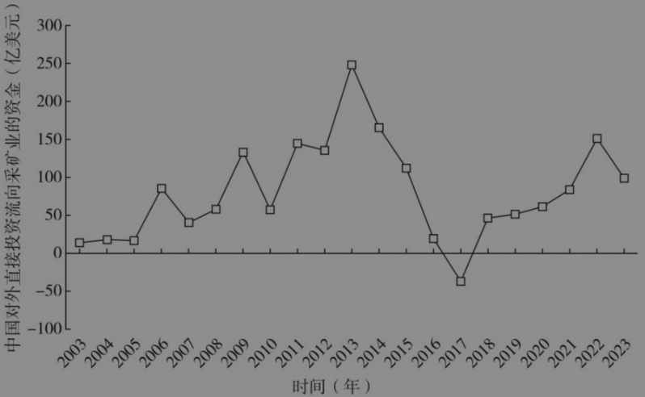

# 第八章 中国矿企走出去：披荆斩棘与扬帆远航

矿产资源被誉为工业的粮食，是支撑现代工业齿轮转动的物质基石。自古以来，得矿者，得天下。在现代文明的市场化机制下，面向全球开辟矿产资源是矿业巨头孜孜不倦的目标与追求。作为“世界工厂”，中国对矿产资源的需求度不可谓不高。“找矿”，自然就成为落在中国矿企身上的沉甸甸的责任。中国广袤的地理空间存储着海量的矿产资源，但即便如此，在开采规模、环境保护和战略部署等因素的约束下，中国每年的矿产资源生产量仍无法满足巨量的工业消耗。根据《世界能源统计年鉴2025》，中国是世界上最大的煤、油、气进口国，位居三个世界第一：2024年中国原油进口量占全球原油贸易量的份额达26%，位居世界第一；液化天然气进口量占全球液化天然气贸易量的份额达19.3%，亦居全球首位；煤炭进口量更是实现了创纪录的11.6艾焦，同样位列世界第一。然而，由于受到地缘政治、价格波动等因素的干扰，单纯依靠进口很难保障矿产资源供给稳定。在国内矿产资源紧需和国际资源供给波动双重压力下，一大批中国矿企选择“组队出海”，积极参与各国矿产资源的建设和开发。这不仅为中国资源供应链上了道“硬核保险”，更是把自大航海时代开始便由西方国家管制的国际资源话语权的话筒递往东方、传向中国。

## 中国矿企出海的历史与现实

中国矿企出海经历了三个阶段：2000—2013年的匆忙出海期、2014—2017年的出海热度消减期，以及2018年以来的常态出海期。2000—2013年，中国矿企在国内矿产短缺和投入紧需的双重挤压下仓促出海，这条出海之路与日本等发达经济体如出一辙，即便2008年爆发了全球金融危机，中国矿企的出海热情仍未被浇灭。然而，慌忙出海暴露了中国矿企海外投资的经验不足，大量出海项目陷入亏损。国内母公司面对亏损颓势，不得不收缩出海项目规模。这一形势直到2018年之后才扭转。因此，2014—2017年属于中国矿企出海的热度消减期。2018年起，中国矿企出海更加理性，海外投资重心向战略性矿产领域倾斜，海外投资规模也企稳回升。因此，2018年之后，中国矿企出海才真正步入健康可持续的常态出海期。

### 供给偏紧、国内紧需与中国矿企匆忙出海期

中国矿企出海之路与大多数发达经济体如出一辙。20世纪60年代，日本矿企开始大量参股全球矿产资源开采加工企业，主要原因在于随着日本经济快速发展，对矿产资源的需求激增。然而，彼时的日本矿企对全球主要矿产资源的控制权不足，导致日本进口矿产资源的价格波动剧烈，进而降低了日本国内进口企业的生产稳定性。与日本类似，2001年加入世界贸易组织后，中国工业部门的生产强度在开放型经济发展新模式的刺激下急剧提升，也同步造成了国内对矿产资源需求的大幅增加。然而，21世纪之初的全球地缘政治格局形势并不明朗，包括马六甲海峡在内的矿产运输海上通道成为大国博弈和小国争利的主要地带。与此同时，中俄原油管道工程建设缓慢，中国依托陆上管网进口能源矿产同样困难重重。在这样的大背景下，具有国资背景的中国矿企在国家能源和工业发展的战略安排下，开始摸着石头过河，被迫出海，探索一条依托跨国并购获取海外矿产资源的道路。根据《2024年度中国对外直接投资统计公报》提供的数据，从2005年开始，中国对外直接投资流向采矿业的流量较之前大幅提高，并在2006年、2009年出现了两波高峰。

全球金融危机的爆发没有浇灭中国矿企的出海热情。2008年，全球爆发金融危机后，世界经济形势惨淡，大宗矿产品价格持续探底，导致海外投资的中国矿企出现利润亏损。然而，这似乎并没有削弱中国矿企的出海意愿。从2008年开始，中国对外直接投资流向采矿业的流量仍然逐年上涨，尤其是2013年的投资高峰最为亮眼。这一年，中国对外直接投资流向采矿业的流量超过了248亿美元，占当年对外直接投资总量的比重高达23%。其中，石油天然气开采业、有色金属开采业、煤炭开采和洗选业、黑色金属矿采选业等是对外直接投资最主要的流入行业。从具体案例来看，根据主要公司的年度公报，2013年中国石油在海外新项目的投资并购方面取得了重大进展，收购了美国康菲石油公司、澳大利亚必和必拓公司、埃克森美孚公司在澳大利亚、伊拉克的部分权益。当年，海外业务的油气当量产量占中国石油集团油气当量总产量的9.8%。同年，紫金矿业集团股份有限公司投资了六个项目，其中有四个项目为海外项目，年度投资21.85亿元人民币，占当年公司投资总额的83.7%。

### 急促出海、问题频现与矿企出海热度消减期

#### 1. 急促出海暴露出中国矿企海外投资经验欠缺

在加入世界贸易组织之前，中国开放型经济发展的步子迈得还不够大，以本土市场为主的中国企业缺乏海外投资设厂的经验，不少企业甚至连国际化运营队伍都不健全。2013年《中国经济周刊》转引的中国矿业联合会会长的观点称，“中国矿企海外投资并购案中，有约八成的失败率”。如此高的投资并购失败率，折射出中国矿企出海背后隐含的重重问题。果不其然，2013年中国部分矿企的海外投资业务出现了利润亏损。以中国石油天然气股份有限公司为例，根据公司年度报告，2013年中国石油天然气股份有限公司负责国际投资的子公司—中石油国际投资有限公司全年亏损了38亿元人民币，海外子公司艾睿能源控股有限公司全年亏损了39亿元人民币。

#### 2. 中国矿企出海步入热度消减期

2014年前后，中国经济增速放缓，从投资驱动转向消费驱动，对原材料的需求增速放缓。同时，此前高矿产价格刺激下的全球矿业投资形成的新产能开始集中释放，导致市场供过于求，铁矿石、煤炭、铜等价格出现断崖式下跌。受此影响，从2014年开始，中国矿企出海规模开始明显收缩。2014年，中国对外直接投资流向采矿业的部分跌至165亿美元，较2013年同期下降了33.5%。此后，这一数据连年下降，甚至在2017年出现负值。原因在于，2017年境外企业归还境内投资主体股东贷款（即收回投资）金额增多。因此，从2014年开始，中国矿企出海规模开始明显收缩。

### 理性调整、战略重整与中国矿企常态出海期

#### 1. 回归理性科学布局全球矿产资源

经过2014—2017年的调整期，中国矿企的海外投资逐步趋于理性，由原来的“扫货式”无序出海，逐渐转向更具战略性的出海模式。从布局重心变化来看，2018年之后中国矿企的海外投资重心出现了战略性转移，开始聚焦与新能源相关的战略性矿产。这背后体现了中国乃至全球工业发展战略的深刻调整，即工业由粗放式增长逐步转向绿色化、数字化的精细式增长。中国矿企投资的主要矿产也从传统的铁矿、煤矿和石油等大宗矿产，逐步向锂、钴、镍、铜、铀等涉及新能源、高科技和国防安全的关键金属延伸。从出海主体来看，与中国矿企出海初期以国有企业为主体有所不同，近年来出海的中国企业中出现了包括宁德时代、华友钴业、青山控股、赣锋锂业等在内的大型民营企业的身影，这些民营企业不属于传统的国有钢铁和有色金属巨头，也并非传统意义上的矿产企业，而属于电池制造商和材料制造商。

从出海范围来看，中国矿企的出海布局呈现多元化特征。一方面，中国矿企在共建“一带一路”国家的投资继续深化。例如，2016年洛阳钼业与自由港集团达成交易，获得了后者在刚果（金）境内运营的腾科-丰谷鲁美铜钴矿区铜56%的权益，业务涵盖铜矿、钴矿的勘探、开采、提炼、加工和销售，主要的产品包括电解铜和氢氧化钴等。洛阳钼业的这次海外收购，使其成为全球领先的铜生产商，同时成为全球第二大钴生产商。另一方面，中国矿企对加拿大、澳大利亚等矿业法律健全、市场成熟度高的地区重新萌生了布局意愿，但同时为了避免潜在的政治审查风险，矿企不再采取全额并购的粗放方式来获取这些发达经济体的矿产资源，而是更多地采用参股、合资和包销协议等方式谨慎入局。2018年，宁德时代从吉林吉恩镍业收购了后者持有的北美锂业近3660万股股权，成为北美锂业的控股股东。宁德时代对北美锂业的布局为其发展壮大锂电池业务发挥了重要作用。

#### 2. 中国矿企重整旧山河，流向采矿业的对外直接投资企稳回升

随着出海主体由国有为主转向国有和民营共进，出海重心由铁、煤、石油等传统大宗矿产转向锂、钴、镍、铜、铀等新型战略性矿产，出海范围兼顾共建“一带一路”国家新市场和发达经济体老牌市场，中国矿企及与矿业相关的新兴企业实现了对中国矿业领域“旧山河”的重整，也为中国布局全球矿产资源提供了鲜活动力。

从2018年开始，中国对外直接投资流向采矿业的流量企稳回升（见图8-1），并在2022年达到了一个小高峰。2022年，中国对外直接投资流向采矿业的流量已经超过了150亿美元，逼近2014年的水平。但值得注意的是，与2010—2013年的大幅跃升以及2013—2017年的断崖式下跌有所不同，2018年之后中国对外直接投资流向采矿业的流量总体呈现稳步上升的态势，不同年份之间的大升大降次数明显减少，走势相对平缓。这也从侧面反映出，中国矿企出海在2018年之后真正回归了理性，中国矿企步入了科学出海、战略出海和有序出海的新时代。

**图8-1 中国对外直接投资流向采矿业的资金流量**

*数据来源：历年《中国对外直接投资统计公报》。*

## 全球矿业巨头“养成记”：战略能力与关键因素

矿业是典型的传统资本密集型产业。全球矿业巨头都是市值规模巨大、业务横跨内外、对大宗商品供应链拥有强大控制力的跨国工业集团。澳大利亚矿业网2025年发布的全球矿企五十强名单（以下简称“矿业巨头五十强”）[1]对全球矿企的地理分布、企业市值、主营矿种等进行了系统梳理，具有一定的影响力。因此，通过这份名单，我们可以对全球矿业巨头的分布格局及动因进行溯源和解析。进一步结合上市公司年报、重大新闻报道等公开数据，便可以对中国矿企在全球矿业巨头网络中的角色定位进行刻画，从而精准找出中国矿企与全球巨头在理念、能力等方面的差距。

### “大可敌国”的全球矿业巨头

根据矿业巨头五十强名录（见表8-1），全球矿业巨头五十强总市值接近1.5万亿美元，这一数据大致接近2024年西班牙的GDP，超过了印度尼西亚、土耳其、荷兰和沙特等一众实力雄厚的发达或发展中经济体的GDP。从国别分布来看，全球矿业五十强企业主要分布在加拿大（13家）、中国(9家）、澳大利亚(5家)、美国(5家)、南非(4家)、俄罗斯(2家)、墨西哥(2家)、印度(2家)、英国（2家），此外，哈萨克斯坦、瑞士、沙特阿拉伯、印度尼西亚、巴西、智利等国家各分布1家。从主营矿种来看，以贵金属为主营矿种的矿业巨头数量最多，达到了17家，这些企业主要分布在加拿大、南非、澳大利亚和中国。此外，以多元化矿产为主营业务的矿业巨头数量也相对较多，包括必和必拓、力拓、淡水河谷等9家矿业巨头。值得注意的是，在前十大全球矿业巨头中，有6家以多元化矿产为主营业务，可见矿业巨头大多选择多元化的发展路径。以铜为主营矿种的矿业巨头为7家，包括加拿大的第一量子矿产、艾芬豪矿业，中国的江西铜业、洛阳钼业，美国的自由港麦克莫兰，墨西哥的南方铜业，印度尼西亚的阿曼矿业，英国的安托法加斯塔。以稀土为主营矿种的企业包括中国的北方稀土和美国的芒廷山口材料公司(MPMaterials)。以铀为主营矿种的企业包括哈萨克斯坦的哈萨克斯坦原子能工业和加拿大的卡梅科。

**表8-1 2025年二季度全球矿企五十强名录**

| 排名 | 公司名称 | 国家 | 总部 | 主营矿种 | 市值（美元） |
| --- | --- | --- | --- | --- | --- |
| 1 | 必和必拓 | 澳大利亚 | 墨尔本 | 多元化矿产 | 1327亿 |
| 2 | 力拓 | 澳大利亚 | 墨尔本 | 多元化矿产 | 1013亿 |
| 3 | 南方铜业 | 墨西哥 | 墨西哥城 | 铜 | 775亿 |
| 4 | 紫金矿业 | 中国 | 厦门 | 多元化矿产 | 713亿 |
| 5 | 自由港麦克莫兰 | 美国 | 凤凰城 | 铜 | 643亿 |
| 6 | 纽蒙特 | 美国 | 丹佛 | 贵金属 | 641亿 |
| 7 | 阿格尼克鹰矿 | 加拿大 | 多伦多 | 贵金属 | 591亿 |
| 8 | 沙特阿拉伯矿业公司 | 沙特阿拉伯 | 利雅得 | 多元化矿产 | 569亿 |
| 9 | 嘉能可 | 瑞士 | 巴尔 | 多元化矿产 | 484亿 |
| 10 | 淡水河谷 | 巴西 | 里约热内卢 | 多元化矿产 | 418亿 |
| 11 | 惠顿贵金属 | 加拿大 | 温哥华 | 流媒体权/特许权业务 | 418亿 |
| 12 | 阿曼矿业 | 印度尼西亚 | 雅加达 | 铜 | 356亿 |
| 13 | 巴里克黄金 | 加拿大 | 多伦多 | 贵金属 | 356亿 |
| 14 | 卡梅科 | 加拿大 | 萨斯卡通 | 铀 | 343亿 |
| 15 | 福特斯库金属 | 澳大利亚 | 珀斯 | 铁矿石 | 339亿 |
| 16 | 极地黄金 | 俄罗斯 | 莫斯科 | 贵金属 | 325亿 |
| 17 | 英美资源集团 | 英国 | 伦敦 | 多元化矿产 | 318亿 |
| 18 | 佛朗哥-内华达 | 加拿大 | 多伦多 | 流媒体权/特许权业务 | 297亿 |
| 19 | 加阳公司（Nutrien） | 加拿大 | 萨斯卡通 | 化肥（钾肥） | 293亿 |
| 20 | 印度煤炭 | 印度 | 加尔各答 | 煤炭 | 278亿 |
| 21 | 陕西煤业 | 中国 | 西安 | 煤炭 | 258亿 |
| 22 | 安托法加斯塔 | 英国 | 伦敦 | 铜 | 257亿 |
| 23 | 洛阳钼业 | 中国 | 洛阳 | 铜/钴 | 241亿 |
| 24 | 盎格鲁黄金阿散蒂 | 南非 | 约翰内斯堡 | 贵金属 | 240亿 |
| 25 | 诺里尔斯克镍业 | 俄罗斯 | 莫斯科 | 多元化矿产 | 225亿 |
| 26 | 金田公司 | 南非 | 约翰内斯堡 | 贵金属 | 214亿 |
| 27 | 韦丹塔 | 印度 | 帕纳吉 | 基本金属 | 202亿 |
| 28 | 金罗斯黄金 | 加拿大 | 多伦多 | 贵金属 | 188亿 |
| 29 | 泰克资源 | 加拿大 | 温哥华 | 多元化矿产 | 187亿 |
| 30 | 山东黄金 | 中国 | 济南 | 贵金属 | 184亿 |
| 31 | 北极星资源 | 澳大利亚 | 珀斯 | 贵金属 | 153亿 |
| 32 | 弗雷斯尼洛 | 墨西哥 | 墨西哥城 | 贵金属 | 144亿 |
| 33 | 兖矿能源 | 中国 | 邹城 | 煤炭 | 143亿 |
| 34 | 第一量子矿产 | 加拿大 | 温哥华 | 铜 | 141亿 |
| 35 | 瓦尔特拉铂金 | 南非 | 约翰内斯堡 | 贵金属 | 131亿 |
| 36 | 北方稀土 | 中国 | 包头 | 稀土 | 124亿 |
| 37 | 美盛公司 | 美国 | 普利茅斯 | 化肥 | 115亿 |
| 38 | 哈萨克斯坦原子能工业 | 哈萨克斯坦 | 努尔苏丹 | 铀 | 113亿 |
| 39 | 伦丁黄金 | 加拿大 | 温哥华 | 贵金属 | 112亿 |
| 40 | 芒廷山口材料公司（MP Materials） | 美国 | 拉斯维加斯 | 稀土 | 111亿 |
| 41 | 化学矿业 | 智利 | 圣地亚哥 | 锂 | 110亿 |
| 42 | 艾芬豪矿业 | 加拿大 | 温哥华 | 铜 | 108亿 |
| 43 | 阿拉莫斯黄金 | 加拿大 | 多伦多 | 贵金属 | 104亿 |
| 44 | 中金黄金 | 中国 | 北京 | 贵金属 | 102亿 |
| 45 | 皇家黄金 | 美国 | 丹佛 | 流媒体权/特许权业务 | 102亿 |
| 46 | 泛美白银 | 加拿大 | 温哥华 | 贵金属 | 102亿 |
| 47 | 演化矿业 | 澳大利亚 | 悉尼 | 贵金属 | 98亿 |
| 48 | 江西铜业 | 中国 | 贵溪 | 铜 | 95亿 |
| 49 | 赣锋锂业 | 中国 | 江西 | 锂 | 93亿 |
| 50 | 英帕拉铂业 | 南非 | 约翰内斯堡 | 贵金属 | 92亿 |

*数据来源：澳大利亚矿业网。网址：<https://mining.com.au>。*

### 中国矿企在全球矿业巨头俱乐部的角色定位

#### 1. 大部分中国矿企在全球矿业巨头俱乐部中的相对实力较弱

如前所述，全球矿业巨头五十强中，有9家属于中国企业，数量占比达到了18%。然而，除紫金矿业以713亿美元的市值跻身全球第四大矿业巨头外，其余8家矿业巨头均未能挤入全球前二十强。具体来看，陕西煤业以258亿美元市值排名全球第21位，洛阳钼业以241亿美元市值排名全球第23位，山东黄金以184亿美元市值排名全球第30位，兖矿能源以143亿美元市值排名全球第33位，北方稀土以124亿美元市值排名全球第36位，中金黄金以102亿美元市值排名全球第44位，江西铜业以95亿美元市值排名全球第48位，赣锋锂业以93亿美元市值排名全球第49位。从总市值的跨国比较来看，加拿大因矿业巨头数量占优，所有矿业巨头的总市值达到了3240亿美元；澳大利亚虽然在矿业巨头数量上不足加拿大的一半，甚至仅约中国的1/2，但所有矿业巨头的总市值仍达到了2930亿美元。相比之下，中国9家矿业巨头的总市值仅1953亿美元，远低于澳大利亚的5家矿业巨头。

#### 2. 中国矿企聚焦的矿产资源领域仍以传统矿产为主

从主营矿种的分布来看，中国矿业巨头主要开展煤炭、铜、钴、贵金属、稀土和锂等矿产业务，其中从事煤炭和铜的矿业巨头有4家，总市值占跻身全球前五十矿业巨头的中国矿企总市值的比重达到37.7%。过度依赖传统矿业明显会降低中国矿业巨头的盈利能力。以陕西煤业为例，根据上市公司年报提供的数据，2023年和2024年陕西煤业归属于上市公司股东的净利润连续两年下滑，2023年同比降低39.67%，2024年又同比降低3.21%。不仅如此，绝大多数中国矿业巨头聚焦于一类矿种，仅紫金矿业主营多元化矿产。相比之下，澳大利亚的五家矿业巨头中有两家主营多元化矿产，而加拿大矿业巨头除了主营多元化矿产，还擅长以矿业权流转或特许权的方式开展灵活的矿业活动。

### 全球矿业巨头的布局因素：资源、金融与贸易

#### 1. 资源成就话语权

澳大利亚矿产资源丰富与矿业巨头林立的事实表明，丰富的矿产资源是成就全球矿业巨头的重要因素。根据加拿大自然资源部提供的数据，澳大利亚是全球最主要的铝土矿、金矿、铁矿、锂矿生产国。

全球铝土矿开采主要分布在澳大利亚、几内亚、中国、巴西、印度和印度尼西亚等国家，2023年，六国生产的铝土矿占全球的比重分别为24.8%、24.5%、23.5%、7.8%、5.8%、5.1%。从储藏量来看，全球铝土矿储藏量最多的国家是几内亚、越南、澳大利亚、巴西、牙买加和印度尼西亚。

全球金矿产量主要分布在中国、澳大利亚、俄罗斯、加拿大、美国，2022年五国金矿产量占全球的比重分别为12.3%、10.3%、10.3%、6.7%、5.7%。从储藏量来看，金矿储藏量最多的国家分别是澳大利亚、俄罗斯、南非、美国、中国，占全球比重分别为12%、11.1%、5%、3%、3%。

全球铁矿石产量主要分布在澳大利亚、巴西、中国、印度、俄罗斯，2023年五国铁矿石产量占全球的比重分别为38.6%、17.7%、11.2%、10.8%、3.5%。从储藏量来看，铁矿石储藏量最多的国家分别是澳大利亚、巴西、俄罗斯、中国、乌克兰，占全球比重分别为30.5%、17.9%、15.3%、10.5%、3.4%。

全球锂矿产量主要分布在澳大利亚、智利、中国、阿根廷、巴西，2023年五国锂矿产量占全球的比重分别为51.0%、25.9%、15.4%、4.5%、1.8%。从储藏量来看，锂矿储藏量最多的国家分别是智利、澳大利亚、阿根廷、中国、美国，占全球比重分别为33.6%、22.4%、13.0%、10.8%、4.0%。

根据澳大利亚气候变化、能源、环境与水资源部提供的数据，2023—2024年度澳大利亚一次能源产量达1.9万拍焦耳，其中2/3出口国外。丰富且多元化的矿产资源，为澳大利亚培育了必和必拓、力拓、福特斯库金属、北极星资源、演化矿业等国际矿业巨头，其中必和必拓和力拓两大矿业集团长期居于全球矿企排行榜前两位，主营铁矿石、铜、煤炭等大宗商品。

大国经济受世界经济影响，同时反作用于世界经济。同样，大矿企受全球矿业影响，也反作用于全球矿业。因此，必和必拓和力拓集团的业务状况通常被其他矿企或政府部门作为研判全球矿业发展走向的晴雨表。实际上，除了澳大利亚，哈萨克斯坦铀资源充沛和原子能矿业巨头林立的事实再次表明，丰富的矿产资源对培育全球矿业巨头意义重大。从铀的产量来看，全球铀的产量主要分布在哈萨克斯坦、加拿大、纳米比亚、澳大利亚和乌兹别克斯坦，占全球比重分别为43%、15%、11%、8%、7%。与此同时，在全球前五十大矿业巨头中，只有为数不多的矿业巨头以铀为主营矿种，其中便包括哈萨克斯坦原子能工业公司。该公司是哈萨克斯坦唯一入选全球矿业巨头五十强名单的企业，曾多年保持着全球最大天然铀销售商地位，在很大程度上主导着全球铀市场的定价权。这再次证明了矿产资源充裕度对全球矿业巨头培育的重要性。

#### 2. 发达的资本市场和多样化的资本运作手段是培育全球矿业巨头的强力推手

尽管作为矿产资源充沛国的澳大利亚吸引了众多全球矿业巨头，但我们仍能找出反例来证明，矿产资源充沛与否和全球矿业巨头数量并不完全呈正比。举个例子，大量储藏或生产丰富矿产资源的发展中国家，不一定能够吸引到足够的全球矿业巨头。例如，钴矿主要储藏在刚果（金），且生产量最大的也是刚果（金）。2023年，刚果（金）、印度尼西亚、俄罗斯、加拿大、澳大利亚钴矿产量占全球的比重分别为73.0%、7.3%、3.8%、2.2%、2%。从储藏量来看，钴矿储藏量最多的国家分别是刚果（金）、澳大利亚、加拿大、印度尼西亚、古巴，占全球比重分别为52.8%、15.0%、5.3%、4.4%、4.4%。毋庸置疑，刚果（金）是全球钴矿储量和产量最多的国家，相较于其他国家遥遥领先。铜矿主要储藏在智利和秘鲁，且生产量最大的也是智利和秘鲁。2023年，智利、秘鲁、刚果（金）、中国、美国铜矿产量占全球的比重分别为23%、12%、11%、8%、5%；从储藏量来看，铜矿储藏量最多的国家分别是智利、秘鲁、澳大利亚、俄罗斯、刚果（金），占全球比重分别为19%、12%、10%、8%、8%。然而，矿业巨头五十强中，没有一家属于刚果（金）和秘鲁。由此可见，要想培育一家全球矿业巨头，不能仅仅依赖丰富的矿产资源。

除矿产资源的充裕度外，还有什么因素主导着全球矿业巨头的分布？来自加拿大的典型事实表明，灵活且发达的资本市场对培育全球矿业巨头发挥着巨大作用。加拿大之所以能培育出一大批优秀矿企，首先离不开加拿大充裕的矿产资源。加拿大坐拥黑色金属（铁）、有色金属（铜、镍、锌、铅）、贵金属（金、银、铂族金属）、稀土及战略性矿产（锂、钴、稀土元素、铀）等多元化的矿产资源。根据加拿大自然资源部提供的数据，2023年加拿大开采矿产和金属60余种，矿产和金属产品出口占加拿大商品总出口的21%，是带动加拿大经济增长的重要引擎。与其他国家相比，加拿大是全球第四大原铝生产国，仅次于中国、印度和俄罗斯；全球第四大钴生产国，位列刚果（金）、印度尼西亚、俄罗斯之后；全球第四大黄金生产国，位列中国、澳大利亚、俄罗斯之后；全球第七大锂生产国，位列澳大利亚、智利、中国、阿根廷、巴西、津巴布韦之后。

除矿产资源丰富外，加拿大拥有矿企培育力全球领先的资本市场—多伦多证券交易所，这家交易所针对资源企业“高风险、长周期、重资产”的特点，设置了差异化、阶段性的上市门槛，尤其降低了早期项目的融资壁垒，被誉为全球资源类企业的“上市首选地”。这种模式为矿业企业提供了一个从“草根”到“巨头”的清晰化发展路径，在勘探阶段，企业便可以成立初级公司，在多伦多证券交易所募得少量资金，用于购买矿权或开展早期的勘探活动；一旦初级公司发现了良好的矿产资源，便可以进行更大规模、更高频次的融资，为大规模的开采活动提供资金支撑；在大部分初级公司具备了矿产所有权后，可以选择并入矿业巨头，或发展成为中等规模的矿产生产商。加拿大通过这种灵活的、适合矿业高风险、高门槛的资本市场模式，培育了大量矿业巨头。根据加拿大自然资源部提供的数据，2023年总部位于加拿大的上市公司拥有3370亿加元的矿业和勘探资产，其中约2/3位于加拿大之外。

#### 3. 贸易网络主导权是全球矿业巨头的“软实力”

虽然丰富的矿产资源是成就全球矿业巨头的重要因素，但不具备矿产资源优势的国家是不是就无法培育出全球矿业巨头？总部坐落于瑞士的嘉能可集团以切身经历否定了这一命题。根据澳大利亚矿业网发布的数据，嘉能可在全球矿业巨头五十强中排名第9，市值规模高于淡水河谷、惠顿贵金属等知名矿企。瑞士国土面积不足5万平方千米，地质结构主要由阿尔卑斯山、中部高原和汝拉山脉构成，缺乏形成大型金属矿床的地质条件，这导致瑞士成为一个矿产资源极度匮乏的国家。矿产资源匮乏的现实情况决定了瑞士不可能依托种类丰富、价格低廉、供给充沛的矿产资源培育全球矿业巨头。然而，瑞士坐落于欧洲的心脏地带，公路和铁路线网发达，并通过莱茵河与北海港口相连，自古便是欧洲的交通要道。不仅如此，瑞士在历史上长期奉行政治中立政策，社会环境相对稳定，成为跨国公司理想的总部所在地。

与众多矿业巨头发家于某一座矿、某一次重大勘探有所不同，嘉能可是一家从贸易商演变发展而来的全球矿业巨头，贸易的基因根植于其整个矿业运营的顶层设计与细枝末节。回溯嘉能可的发展历程，绕不开其创始人马克·里奇。马克·里奇开创了一套以短期合同、浮动定价机制和风险对冲为核心的现代大宗商品交易规则体系。在交易运营实务中，马克·里奇利用易货贸易为代表的金融手段，在地缘政治动荡的国家或地区寻找矿产资源价差、开展高风险矿产贸易。与此同时，嘉能可投资了全球多个港口和码头，拥有规模庞大的运输船队和仓储设施，据此建立起庞大的自有物流网络来保障交易矿产的妥善交付，极大程度上规避了发生地缘政治冲突时第三方物流商无法提供稳定运输服务的风险。嘉能可因此迅速崛起为全球矿产贸易巨头。

更加值得关注的是，嘉能可并不仅仅满足于成为一家矿产贸易巨头，而是在积累了一定的物质财富后利用并购手段向矿业上游延伸。2013年，嘉能可以350亿美元的价格收购了瑞士超达集团，“蛇吞象”般地吞并了规模比自己大得多的矿业生产商超达，使其一夜之间获得了大量的优质煤矿、铜矿、锌矿和镍矿资产，从矿产贸易巨头一跃成为全球顶级的矿业生产巨头，同时也实现了上游生产与下游贸易的垂直一体化整合。嘉能可由矿产贸易巨头转向综合性全球矿业巨头的崛起之路，充分表明贸易网络主导权是成就全球矿业巨头角色的强劲驱动。

[1]<https://www.mining.com/top-50-biggest-mining-companies>。

## 风高浪急：中国矿企出海的风险研判

### 开发海外矿产面临的风险

中国矿企出海主要面临三大类风险，第一类是地缘政治冲突与区位选择风险，第二类是东道国政策变动与合规性风险，第三类是经济波动与市场竞争风险。

#### 1. 地缘政治冲突与区位选择风险

在中国矿企出海面临的三类风险中，地缘政治冲突风险是近年来中国矿企海外投资设厂时面临的最频繁、最敏感的风险。国际学者达里奥·卡尔达拉和马泰奥·亚科维耶洛基于海量的新闻报道数据构建了全球地缘政治风险指数，结果发现，从2008年以来，全球地缘政治风险指数明显上升，2025年1—7月甚至一度创造了1997年以来的历史最高水平。国际研究机构斯德哥尔摩国际和平研究所发布的数据更为直观，该机构报告了全球与地缘冲突相关的死亡人数。结果发现，2023年全球与地缘冲突相关的死亡人数估计为17.07万人，较2022年上升了11.5%，达到了2019年以来的峰值。这些爆发武装冲突的国家或地区，有相当一部分属于资源型国家并且有中国矿企的投资项目，对中国矿企出海造成了巨大风险。例如，刚果（金）腾科-丰谷鲁美铜钴矿有部分权益属于中国矿企洛阳钼业，然而，刚果（金）反政府武装组织从2025年1月以来利用闪电战的方式攻占了部分资源要地，直接威胁洛阳钼业在腾科-丰谷鲁美铜钴矿项目的经济安全。又如，2023年以来，缅北地区军事冲突不断，缅甸佤邦、克钦邦、掸邦等地区分布着大量的离子吸附型稀土矿，而这些地区有相当一部分区域常年处在军事冲突的阴影之下，这对直接或间接参与该地区矿产勘探和开采的中国矿企带来了巨大的外部不确定性。

#### 2. 东道国政策变动与合规性风险

东道国的政策变动和中国矿企海外合规经营，深刻影响中国矿企的出海风险，这在资源民族主义抬头的矿业形势下尤为值得关注，也是中国矿企近期频繁遭遇的出海困境，给一些企业海外项目预期收益、经营稳定性及成本控制带来了巨大压力。以赣锋锂业为例，2022年赣锋锂业收购了墨西哥巴卡罗那(Bacanora)公司，获得了后者在墨西哥索诺拉(Sonora)锂黏土项目的矿产特许权。该项目总体的锂资源量接近882万吨碳酸锂当量，是一块巨大的锂资源宝藏。然而好景不长，在同时期墨西哥政府批准了矿业法修正案，禁止锂矿特许权，并由墨西哥国有实体统筹全国的锂矿开采经营专有权。受此影响，2023年8月，墨西哥矿业总局取消了赣锋锂业关联公司在墨西哥持有的索诺拉锂黏土项目的部分矿产特许权，尽管赣锋锂业通过子公司提出了行政复议，但仍未改变矿产特许权被收归墨西哥国有的命运。这一事件凸显了东道国政策不确定性及其引致的政策变动，为中国矿企出海带来巨大风险。

除了东道国政策变动，中国矿企在海外合规经营方面经验欠缺，也导致其遭遇了不小的出海风险。中国矿企在大规模走出去的同时，对东道国的法律法规和社会文化等不熟悉，或者涉及突发性环境事件，进而遭遇东道国政府管制或舆论攻击。以中国有色矿业为例，2025年2月，该公司在赞比亚的附属公司谦比希湿法冶炼有限公司出现了部分尾矿泄漏事件，该事件的起因是防渗膜被盗割，叠加连日的强降雨，最终造成了环境污染问题。此次事件引发当地一百余名民众向法院请愿，主张中国涉事企业设置环境修复托管账户并存入800亿美元，用于环境修复和全额赔偿。这次突发性环境事件也暴露出中国矿企在海外合规经营方面面临的不确定性风险。

#### 3. 经济波动与市场竞争风险

根据经典的跨国投资理论，只有生产率足够大且跨越一定门槛的企业，才能对外直接投资。从理论上讲，中国矿企走出去参与全球竞争必然会面临比国内更为激烈的竞争环境。从实际来看，海外市场的经济波动和市场竞争的确是中国矿企出海面临的重要风险之一。一是部分东道国宏观经济不稳定，尤其是部分欠发达国家经常出现通货膨胀率高企的问题，会推高当地矿业项目的用工成本和材料成本，导致中国矿企海外经营频繁面临项目预算失控的问题。二是中国矿企在拓展海外业务时难免会与必和必拓、力拓、淡水河谷等国际矿业巨头出现业务领域交叉，进而形成业务竞争。这些国际矿业巨头拥有全球顶尖的矿产资源、数十年的运营经验、庞大的社会关系网络和坚韧的全球供销网络，这导致中国矿企在业务竞争时往往需要付出更高的溢价，最终削弱中国矿企的海外竞争力。

## 无惧风雨行稳致远

开发利用海外矿产资源一直是中国对外投资和企业走出去的重要领域，更是中国参与矿产全球治理的必由路径。然而，由于全球矿产资源勘探开发深受地缘政治、资源地国内矿业法和环境规则等因素影响，发达国家大型矿业企业在相关领域投入大、布局深，加之国内企业国际化经验不足，资本运作手段不够丰富，中国矿企走出去一度频遭挫折，甚至引发了一些关注度高的舆情事件。近年来，随着中国矿产品生产消费规模扩大，国内矿业整合力度加大，矿企综合实力显著增强。经过前期积淀和数轮调整，目前我国海外矿产勘探开发投资整体上呈现平稳态势，矿企走出去趋于理性，项目选择更加成熟，全球化资源配置体系逐步完善。尽管我国矿业海外投资取得了一定进展，但仍存在区位布局不尽合理、战略支点不够清晰、与“一带一路”倡议下国际产能合作关联有待加强等突出问题。在微观层面上，不少海外项目尚处在前期阶段，运营状态不稳定，预期收益有很大的不确定性。为此，要培育壮大兼具国际化运营和资本运作能力的大型综合矿企，支持有实力的矿业企业走出去，加强国内紧缺战略性资源的海外勘探勘察，优化海外投资布局，增强整合全球战略性矿产资源能力。

### 多管齐下，筑牢地缘政治冲突风险防护体系

在诸多中国矿企出海的风险因素中，地缘政治冲突是最具破坏性、可控性最低的风险，这一风险超越了商业范畴，直接涉及国家间的顶层战略博弈和意识形态竞争。因此，应对这类风险需要以国家和企业为重心，构建多边参与的战略性风险防护体系。

一是在国家层面，建议政府加强中国矿企出海安全保护的顶层设计和外交护航。政府应积极关注中国矿企出海可能面临的政治风险，建立战略性矿产海外风险预警与应急协调机制，动态监测全球地缘政治热点，及时向出海矿企提供东道国潜在地缘政治冲突风险预警信息。与此同时，政府应积极与资源丰富但地缘政治关系敏感的地区签署高水平双边投资保护协定，利用全球多边平台、基础设施合建等方式，与东道国政府形成高水平互利关系。如此一来，在中国矿企遭遇突发性地缘政治冲突时，可以通过官方或非官方渠道及时保障中国矿企的海外运营安全。

二是在企业层面，建议中国矿企在东道国积极开展本地化经营策略，避免卷入东道国政治斗争。在采购、管理和初级加工环节，主动使用和培养东道国当地的技术人才，让中国矿企的海外项目惠及东道国民众，从而建立根植东道国的民意基础，形成抵御政治风波的“缓冲垫”，保护中国矿企的厂区安全和人员安全。与此同时，中国矿企还应积极探索与东道国矿业企业的利益共同体构建，降低被东道国矿业企业集体排挤和恶性竞争的风险。提升中国矿企在东道国的公司治理透明度，加强公共关系和品牌叙事。此外，中国矿企出海要善于运用国际多边机制解决出海过程中遭遇的不公平、不平等问题。对此，中国矿企要熟悉国际多边机制，与中国驻外使领馆保持密切联系。与此同时，中国矿企还应积极遵守国际多边机制的约束性条款，融入国际规则体系并获得相关的利益保障。

### 塑造全流程合规性风险应对机制

东道国的政府更迭、民意转向、法律体系不完善等引致的政策变动和合规性风险，仅次于地缘政治冲突，且相关的风险发生频次要高于地缘政治冲突，需采取与后者不完全相同的应对方式。具体而言，应建立事前和事后全流程的应对机制。在开展对外直接投资之前，矿企需要开展详尽的“尽职调查”，重点分析东道国政治生态、各党派矿业政策主张及其稳定性、关键政治人物对中国矿企的立场，系统评估东道国法律体系的稳定性和执法一致性，特别需要重点关注环境、劳工、原住民权益、反腐败等敏感领域。

在开展对外直接投资时，矿企应将风险管控融入日常运营，有条件的矿企应当设立专职风险管控团队，与当地律所、智库、媒体和咨询机构建立长期合作，确保能够第一时间获取关键信息。在环境保护、劳工权益、反腐败等方面，严格遵守东道国的法律法规。一旦中国矿企在海外的投资项目遭遇东道国政策变动和合规性风险冲击，应立即通过我国驻外使馆与东道国相关政府部门进行沟通，同时要积极动员东道国的供应链伙伴、友好商会等力量进行游说和斡旋。如果协商无效，且东道国的行为构成歧视性待遇、非法征收或未履行双边投资协定中的义务，应果断启动相应的仲裁程序。

### 增强矿企应对经济波动和市场竞争风险的韧性

与地缘政治冲突、东道国政策变动等外生性风险相比，经济波动与市场竞争风险是市场内生性风险。应对此类风险，核心在于打造以中国矿企为核心的韧性产业链，重点提升企业运营效率、市场竞争力和财务稳定性。一是通过技术创新与精益管理降本增效。中国矿企应当主动迎合数字化和智能化的时代浪潮，利用无人驾驶矿卡、远程操控等自动化采矿技术提升采矿工程的运行效率。二是利用大数据和人工智能优化勘探和开采计划、物流供应链和能耗管理，实现供应链精益化运作。同时，建立全球化的采购和供应链网络，避免对单一供应商或物流路径的依赖，增强供应链弹性。三是运用金融工具管理市场价格风险，坚持多元化的融资结构，灵活运用项目融资、绿色债券、可转换债券等多种工具。四是推动产业链纵向一体化发展。矿业巨头应积极向上游资源勘探和下游冶炼、精加工乃至材料制造延伸，形成全产业链布局；其他规模相对较小的矿企可采取抱团出海的方式，集中采购、共享物流、联合谈判，形成规模效应。
