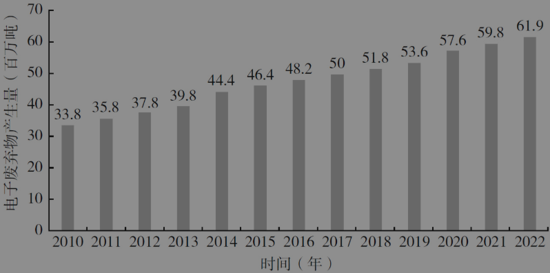

# 第十章 未来展望：我们的矿产向深海、向深地、向深空、向城市

放眼当今世界，全球工业体系的深刻变革与科技创新的日新月异，使战略性矿产资源的安全保障已不再局限于传统大陆矿山的开发与争夺。一方面，随着人类活动的疆域以前所未有的速度向深海、深地、深空拓展，其矿产资源的利用具有巨大的潜力。尤为值得高度关注的是，这些矿产有一个共同的特点，在现行国际法框架下，其资源归属将突破主权划定的传统界限，为矿产开发规则体系及治理范式带来前所未有的挑战，并将对现行矿产资源格局构成难以预测的冲击。另一方面，工业化以来，人类经济社会系统中积存的废弃物里，还蕴藏着价值巨大的“城市矿产”。这场围绕资源的竞争正在从平面走向立体、从单一走向多元。对于中国而言，要想在未来几十年乃至更长时期内确保战略性矿产资源的稳定供给，就必须将目光投向这些崭新的前沿领域，前瞻性地进行战略布局与技术储备。这不仅是一场关乎资源获取的竞赛，更是一次推动发展方式转型、重塑全球资源治理格局的历史性机遇。本章将系统探讨深海、深地、深空及城市矿产这四大新兴资源疆域的潜力与挑战，进一步分析从初级矿产向高端材料价值链升级的战略路径，并最终勾勒出中国在未来全球资源治理体系中扮演关键角色的新图景。

## 深海矿产：蓝色经济下的资源争夺与前瞻布局

广袤的海洋，覆盖了地球表面近2/3的面积，是人类社会未来资源供给的蓝色宝库。这里蕴藏着远超陆地储量的多金属结核、富钴结壳、多金属硫化物等矿产资源，其中富含镍、钴、铜、锰、稀土等至关重要的战略性金属，也是未来最值得探求的矿产来源。蔚蓝的大海继给人类提供食物和能源之后，有望在矿产领域给我们带来又一个蓝色期许。近年来，随着陆地高品位矿产资源的日益枯竭和开采成本的不断攀升，深海矿产的开发已然从科学探险的范畴步入商业开发的前夜，成为全球主要大国和私营公司竞相角逐的新焦点。

### 深海资源潜力与勘探前沿

深海，作为地球上最后的资源边疆，蕴藏着极为丰富的矿产资源，这些资源主要分为三大类：多金属结核、富钴结壳和海底块状硫化物。多金属结核广泛分布于水深4000～6000米的深海平原，外形似“马铃薯”，由铁锰氧化物在漫长地质年代中凝聚形成，富含锰、镍、钴、铜等关键金属。其资源总量极为庞大，被誉为“深海锰矿”，据估计，其总量可满足全球未来数十年甚至数百年的金属需求。富钴结壳则附着于海山斜坡，以钴为核心资源，同时富含铂族元素和稀土，其钴的品位显著高于陆地矿床，是支撑新能源、航空航天等高科技产业的关键原料。海底块状硫化物形成于大洋中脊和弧后盆地等热液活动区，由热液喷发快速沉积而成，富含铜、锌、铅、金、银等金属，具有品位高、成矿快的特点，具备巨大的经济开发潜力。

当前，全球深海勘探技术正处于投入力度加大、加快突破的阶段。以自主水下航行器（AUV）、遥控无人潜水器(ROV)和高精度动力定位科考船为代表的先进装备，使人类能够对数千米深的海底实现精细探测、高清成像、精准采样与实时监测。同时，多波束测深、侧扫声呐和浅地层剖面仪等地球物理技术，为海底地形绘制与资源靶区识别提供了强有力的工具支撑。在这一全球技术浪潮之中，中国的深海勘探技术已取得显著突破。“蛟龙”号、“深海勇士”号、“奋斗者”号等系列深潜器的成功研制与应用，标志着我国已具备覆盖全球绝大多数海域的深海探测与作业能力。依托这些技术基础，中国已通过多次大洋科学考察，在太平洋及国际海底区域获得多块专属勘探矿区，涵盖多金属结核、富钴结壳和块状硫化物等多种关键资源类型，为未来商业化开发奠定了坚实的法律基础，也具备了充足的资源潜力。然而，深海环境极端复杂，高压、低温、黑暗及强腐蚀条件对装备的可靠性、耐久性与智能化提出了极为严苛的要求。如何在极端环境下实现稳定、精准、长期的勘探与开发，仍是全球深海技术竞争的前沿与核心挑战。

### 开发新模式与国际规则塑造

深海矿产的开发绝非简单的“水下采矿”，它是一项集高端装备制造、极端环境作业、生态系统保护和国际法规的严格遵从于一体的超级系统工程。在此情形下，传统的单一企业主导模式难以胜任，迫切需要探索“政产学研金”深度融合的新型开发模式，即在国家战略引导和政策支持下，组建由大型国有龙头企业牵头，吸纳顶尖科研院所、高端装备制造商、专业环保评估机构和金融资本共同参与的深海资源开发创新联合体。这种模式能够有效整合技术、资金、人才和管理优势，有助于协同攻克从海底矿石采集、水下长距离泵输到海面矿物初步处理等一系列世界级技术难题。

需要强调的是，深海开发必须直面其最严峻的挑战—生态环境影响。深海是地球上被了解最少的生态系统，人类对其整体生态结构和特性尚未完全明晰，热液喷口等特殊区域更是孕育了独特的生物群落，其对于环境变化的耐受程度尚不明确。此时若大规模开展深海采矿活动，可能对海底环境造成扰动，产生沉积物羽流，同时破坏底栖生物栖息地，而这些影响带来的长期生态效应，目前尚不明确，可能存在较大风险，因此，中国的深海战略必须将绿色开发置于核心位置。这要求我们大力发展对海底生态环境扰动最小的智能化、精准化采集技术；投资推进深海环境基线调查与长期监测网络的建设，科学评估开发活动的环境影响；预先研究采矿区的生态修复技术，以实际行动来彰显一个负责任大国的担当。

在国际层面，深海矿产资源的管理权属于国际海底管理局。国际海底管理局正在紧锣密鼓地制定关于“区域”内矿产资源开发的规章草案—“采矿法典”。这将涵盖探矿、勘探和开发的申请程序、环境保护标准、财务条款、技术标准以及惠益分享机制等。中国作为深海事务的重要利益攸关方和国际海底管理局理事会成员，绝不能仅仅被动接受规则，而应积极主动地参与并引领规则的制定和颁布。具体而言，我们需要深入研究国际海洋法体系，向国际海底管理局提交基于科学和可持续理念的政策建议；鼓励国内专家进入国际海底管理局相关技术机构和法律机构工作；加强与发达国家、发展中国家在深海科学、技术和治理方面的对话与合作。通过深度参与国际规则制定，中国既能为全球深海治理贡献中国智慧，也能在未来深海开发竞争中为自己赢得更为有利的制度环境，确保国家蓝色经济疆域的拓展行稳致远。

## 深地矿产：走向地球深处的绿色开发

在人类将目光投向深邃海洋的同时，向地球内部更深处的进军也从未停歇。深地矿产资源开发，通常指对地表以下500米至数千米深度范围内蕴藏矿产的勘查与开采。随着浅部易采资源的逐渐耗尽，向地球深部寻求资源，已成为保障全球矿产资源供给的必然趋势，也是我国矿业实现可持续发展的战略选择。

### 深地资源图谱与勘探进展

地球内部蕴藏着巨大的资源潜力。许多已成矿带在深部存在着第二甚至第三富集带，其资源规模可能远超浅部已探明储量。例如，在南非，金矿开采深度已超过4000米；在中国，胶东半岛的金矿勘探深度已突破2000米，并不断有新的重大发现，在很大程度上证实了深部巨大的找矿前景。除了传统的贵金属和有色金属，一些与深部地质过程相关的战略性矿产，如与基性-超基性岩有关的铂族元素、与碳酸岩有关的稀土元素等，也主要赋存于地壳较深部位，存在着巨大的开发潜力。

然而，无论从技术上、经济上还是规则上看，“透视”地球深部都是极其困难的。深地勘探面临着“看不清、钻不到、成本高”的严峻挑战。为应对这些挑战，深地探测技术正在经历革命性进步。其中，高精度地球物理勘探技术是解决“看不清”难题的核心手段，主要包括深层地震探测、大地电磁测深、高精度重力与磁法勘探等。这些技术如同给地球做CT扫描，能够揭示地壳深部的结构、构造和岩性差异，从而圈定出有利的成矿靶区。中国的“深地探测”专项（如深部探测技术与实验研究专项，SinoProbe)已实施了多年，积累了丰富的深部地质数据和经验。此外，用于深部钻探的超深孔钻机技术、耐高温高压的钻探工具和随钻测量系统也在不断突破，使得获取数千米以下的岩芯样品并进行原位分析成为可能。另外，通过构建“三维透明化”的地质模型，将地表调查、地球物理、地球化学和钻探数据融合在一起，科研人员能够实现对深部矿体形态、品位和规模更为精准的预测。这一系列的重要技术突破，不仅破解了深地勘探的核心难题，也为未来绿色、安全、高效的开采提供了有力的科学支撑。

### 以智能绿色开采迈向生态共赢

地球深部的矿产开采必然伴随着更高的地温、更强的岩爆风险、更复杂的地质条件和更高的提升成本。鉴于这一系列的现实困难，传统的采矿模式在深部难以为继，因此必须依靠科技创新，走出一条智能化、绿色化的新路。

智能开采是深地矿业的未来方向，其实现依赖于构建覆盖全矿山的数字化神经网络，通过布设大量传感器，实时监测深部地压、地温、通风、设备运行状态等关键参数，为后续分析提供数据基础；利用物联网技术，实现数据高速传输；最终应用大数据和人工智能算法对海量数据进行分析，实现灾害的智能预警、生产过程的智能调度和装备的远程智能控制。在应用实践层面，无人驾驶矿卡、远程遥控掘进机、自动化铲运机等智能装备将逐步替代人工在危险、高温的深部工作面作业。操作人员可以在舒适的地面控制中心，通过虚拟现实（VR)或增强现实（AR)界面，对井下设备进行监控和干预。这不仅能极大提升作业安全，还能通过优化运行路径和效率，降低能耗与成本。

绿色开发是深地矿业的社会许可证。深部采矿必须将环境影响降至最低，并努力实现与周边生态环境的共赢。首先，要从源头控制，研发和应用少废或无废的采矿方法，如高浓度充填采矿法，将选矿产生的尾砂等固体废弃物经处理后充填至采空区，既能有效控制地表沉陷，保护地表建筑物和农田，又能大量降低尾矿库的占地和环境风险。其次，要致力于资源的全元素综合利用，对共伴生矿产进行综合回收，实现“吃干榨尽”。再次，要高度重视能源管理，深部开采是能耗大户，可通过余热回收、节能设备使用、新能源应用等措施，大幅降低碳排放。最后，矿山闭坑后的生态修复与产业转型也需在开发初期就进行规划，通过土地复垦、生态重建、发展工业旅游等方式，让矿山在全生命周期结束后，能够以一种新的方式继续服务于社区和生态环境，书写“金山银山”与“绿水青山”和谐共生的新篇章。

## 深空矿产：探索利用星际资源

人类的资源视野最终突破了地球的束缚，以不断创新的科学精神和一往无前的探索勇气，将矿产开发的边界向浩瀚的宇宙延伸和拓展。月球、近地小行星等天体上蕴藏着极为丰富的矿产资源，其种类和储量远超人类的想象。虽然深空采矿在可预见的未来仍将面临技术和经济的巨大挑战，但其战略意义不容忽视，它代表着人类文明长远发展的终极资源保障和科技竞争的制高点。因此，抢占深空矿产探索利用的高地，是我国在战略性矿产资源安全保障布局中的重要一环。

### 月球与行星资源开发前景

月球是地球最近的邻居，也是当前深空资源探索的首选目标。月球表面蕴藏着丰富的氦-3，这是一种清洁、高效、安全的核聚变燃料，在地球上极为稀缺，而在月球风化层中估计有百万吨级储量，若能实现商业化利用，将彻底解决人类的能源问题。此外，月球还富含稀土元素、磷、钾、铀、钍等资源。特别值得一提的是，在月球的永久阴影区（如南极-艾特肯盆地）可能存在水冰，这些水冰不仅可为未来人类在月球的长期驻留提供生命支持，还能被分解为氢和氧，作为火箭燃料，有望使月球成为通往更深远太空的“加油站”。

近地小行星则是另一类极具潜力的资源天体。这些小行星主要由岩石、金属或冰组成。其中，M型(金属型)小行星被认为富含铁、镍、钴以及铂族金属，其品位远高于地球上最富的矿山。一颗直径几百米的小行星，其所含的铂族金属总量可能就超过人类历史上的总开采量。S型(石铁型)小行星则可能含有相当数量的水、硅酸盐矿物以及稀有金属。开采这些小行星，理论上可以为地球轨道上的空间设施建设提供原材料，从而降低从地球表面发射所带来的巨额成本。

### 太空采掘技术与国际治理前瞻

深空采矿的技术挑战是前所未有的。它涉及一系列极端环境下的复杂操作，带来了一系列技术瓶颈：在微重力或低重力环境下如何进行岩石破碎和矿物采集？如何在小行星表面进行锚定和作业？如何利用原位资源利用技术，直接在太空环境中将矿石转化为可用的金属、氧气和水？如何将开采的资源以经济可行的方式运输至地球轨道或月球基地？这些都需要革命性的技术创新，例如高度自主的太空机器人、先进的材料加工工艺[如3D（三维）打印]，以及高效的空间推进系统（如太阳能电推进）。尽管挑战巨大，但美国、日本、卢森堡等国家，以及一些私营公司已经开始了前瞻性的技术研究和概念设计。

与技术进步相伴而行的，必须是建构具有前瞻性和法理依据的国际治理框架。目前，规范外太空活动的基本法是1967年生效的《外层空间条约》。该条约规定任何国家不得通过主权要求等方式将天体据为己有。然而，对于从天体上提取和占有资源的具体权利和义务，条约规定并不明确。这引发了国际社会的广泛讨论：太空资源能否被私人实体占有和商业化？如何防止太空的“先到先得”演变为新一轮的圈地运动？如何确保太空开发的惠益能够由全人类共享？中国作为迅速崛起的航天大国，应积极参与到这一未来规则的塑造进程中。我国应坚持“外空命运共同体”的理念，倡导在《外层空间条约》框架下，制定公平、包容、可持续的太空资源治理规则。这包括推动建立太空资源开发的透明与信任措施，参与制定太空环境标准以避免太空碎片问题，并探索建立国际性的惠益分享机制，例如通过技术支持、能力建设等方式，使发展中国家也能从太空探索中受益。通过在深空领域展现负责任大国的形象，中国将为自身乃至全人类赢得一个更加和平与繁荣的太空未来。

## 城市矿山：变废为宝的资源循环革命

矿产在进入工业体系后，很大一部分并不会随着机器设备报废、产品使用而在物质上完全灭失。实际上，相当一部分金属和非金属元素仍以不同的物质形态留存在城市和产业之中。随着全球城市化进程加速，城市已成为资源消耗和环境压力最集中的区域。根据联合国人居署发布的《2022世界城市状况报告》，全球城市人口比例将由2021年的55%增至2050年的68%。为支撑城市的生产生活，自然资源不断向城市建成环境转移，城市不再只是人口和活动的聚集地，而是逐渐成为巨大的物质“库房”。而在蓄积城市矿产方面，工业化现行国以及经济体量庞大的国家，显然具有存量优势，这些国家拥有的城市矿山将使它们在未来战略性矿产安全保障和全球资源循环利用中占据重要地位。

### 城市矿产的资源潜力及其战略地位

“城市矿产”的概念最初来自20世纪80年代的日本。1988年，日本学者南条道夫从金属资源回收的角度，把地上积累的工业制品资源看作可再生的资源，首次定义了“城市矿产”。我国则在2010年由国家发展改革委、财政部下发的《关于开展城市矿产示范基地建设的通知》中，将其定义为“工业化和城镇化过程产生和蕴藏在废旧机电设备、电线电缆、通信工具、汽车、家电、电子产品、金属和塑料包装物以及废料中，可循环利用的钢铁、有色金属、稀贵金属、塑料、橡胶等资源，其利用量相当于原生矿产资源”。城市矿产是对废弃资源再生利用规模化发展的形象比喻，把这些被使用或废弃的材料视为“二次资源”，并通过回收与再制造路径使其重返供应链，是实现循环经济与材料安全的重要方向。对城市矿产的开发和利用是助力“双碳”目标实现的有效途径，也是推动联合国可持续发展目标的重要一环。

自工业革命以来，快速发展的人类社会已经将80%可工业化利用的矿产资源从地下转移到了地上。根据现有研究估算，20世纪以来全球物质存量(material stocks)增长了约23倍，到2010年已达到千亿吨级，大量的金属与非金属存量蕴藏在建筑物、道路、车辆以及各类耐用产品之中，这些“在用存量”决定了未来可供回收的物质基数并成为城市矿产的重要来源。尽管回收率在提升，整体库存增长速度仍然使得封闭循环面临巨大挑战。城市矿产是推动循环经济转型、实现可持续发展目标的关键支撑。以电子废弃物为例，根据2023年世界经济论坛的报告，2022年全球电子废弃物存量达到约6190万吨，相较2010年近乎翻倍，预计到2030年这一数字将会达到约7470万吨，既有巨大的利用潜力，同时也面临着复杂的回收处理困境。如图10-1所示，自2010年以来，全球电子垃圾的产生量几乎翻了一番，从3380万吨增至2022年的约6190万吨。电子废物是增长最快的废物流之一，预计到2030年，全球电子废物产生量将达到8200万吨。

**图10-1 2010—2022年全球电子废弃物产生量**

*资料来源：根据Charlotte Edmond，What is urban mining-and why do we need to do more of it?，World Economic Forum，2023年整理编制。*

改革开放以来，中国快速的工业化和城镇化进程带来了规模持续扩大的城市矿产存量。根据对全国337个城市中24种材料在10类产品、建筑和基础设施中的存量研究，1978—2020年，我国城市矿产在用存量从25亿吨上升至1160亿吨，具有巨大的开发利用潜力。城市矿产作为规模化发展的再生资源，具有载能性、循环性、战略性特征，是相对于地下原生矿产的另外一种重要资源，不仅存量潜力巨大，更具有重要的战略地位。预计到2030年，再生的铜、铁、铝、铅在供应中的原生替代比例将分别提升至46%、53%、25%、45%以上，我国相应资源的对外依存度将进一步降低。

如何理解城市矿产在战略性矿产安全保障体系中的角色？怎样可持续开发我们宝贵的城市矿山？

#### 1. 城市矿产是支撑循环经济发展的重要战略资源

构建“城市矿产”的回收利用产业链，可以打破传统“资源—产品—废弃物”的线性增长方式，助力构建“资源—产品—废弃物—再生资源”的循环经济发展模式。已有研究表明，“城市矿产”在提供大量稀缺资源的同时，其生产工艺和流程相较于原生矿产更具成本效益。如有研究表明，每吨废旧手机中的金浓度可达到300～350克，计算机电路板的金浓度可达到200～250克，远高于原生矿石，且从这些电子废弃物中提取金的成本与开采原生矿石相当。

#### 2. 城市矿产开发是缓解资源约束的重要途径

当前全球地缘政治风险频发，中国面临百年未有之大变局，同时国内蓬勃发展的经济需求推动了各类矿产资源需求量的增长，资源供应链安全面临着极大的风险，战略性资源短缺成为束缚社会经济发展的重要因素。例如，中国在关键金属方面对外依存度较高，其中，以铌、铬、钴、镍、锰、钯等为代表，多达12种金属的对外依存度超过50%，其中有6种甚至超过了90%（镍、钽、铬、钴、锆以及铂族）。在此背景下，管理和利用城市矿产变得尤为重要。根据2024年发布的《全球铁、铜、铝二次资源潜力评估与减碳效应》报告，全球铁、铜、铝的城市矿产二次资源存量分别为348亿吨、4亿吨和10亿吨。除此以外，近年来受到大量关注的关键金属，如锂、钴、镍等也可通过城市矿产的回收利用，得到资源承载时间的补充缓和。经过系统的探测回收和合理的管理利用，这些存量巨大、资源含量及理化特征易获取，并具有较固定组成的二次资源将成为城市可持续发展的坚实基础。

#### 3. 合理开发城市矿山是实现“双碳”目标和可持续发展目标的现实需求

与原生矿产相比，城市矿产的循环利用不仅可以减少产废量，还可以减少原生资源和能源消耗、降低温室气体排放，是实现“双碳”目标的重要抓手。伴随着城市化进程的持续推进和公众对生活品质追求的提升，更多类型和数量的材料和能源将被投入人类社会之中，与之相伴而来的还有更多的环境污染和碳排放等问题。而对城市矿产进行开发和利用，可以减少原生资源开采过程中的污染废弃物排放，同时最大限度降低矿产加工过程中的碳排放。已有研究显示，美国每回收利用800万吨金属，其直接减少的温室气体排放量，相当于公路交通车辆全年行驶所产生的温室气体总量。若在全球范围内提升住宅和汽车的材料利用效率，并积极开展再利用和回收工作，可以在2050年之前减少的全球累计温室气体排放量相当于建筑部门少排放200亿～520亿吨二氧化碳和乘用车领域少排放130亿～260亿吨二氧化碳。

### 循环技术突破与政策体系构建

尽管目前全球城市矿产总量不断累积，其进入统计体系的回收率仍然偏低，这既反映出潜在可供利用资源规模的庞大，也凸显了当前回收环节的短板与不足。作为重要的未来战略性资源储备，城市矿产的开发利用既是一场技术革命，也是对政策制度与组织能力的挑战。要把城市矿产从概念变为国家可依赖的战略供给资源，必须在两方面同时取得突破：一方面要加快“回收—分拣—提纯—再制造”一体化回收技术与工业链的成熟及商业化进程；另一方面，要以制度、标准与市场机制支撑大规模应用。

城市矿产资源化利用的核心是如何有效回收利用其中有用的组分，其前提是精准分级、分类，然后进行拆解、破碎、分选、富集、提纯等一系列的综合物理和化学的处理。其中，分选和富集技术是城市矿产资源化利用的关键。目前常用的分选方法有人工分选法、风力分选法、跳汰分选法、重介质分选法、浮选分离法、磁力分选法和电力分选法等。

部分矿产资源的回收对产品的品位有一定的要求，尤其是金属矿产资源，因此往往要通过进一步的富集来提升其回收效率和质量，包括湿法冶金和火法冶金等途径。湿法冶金基于金属可溶于盐酸等强酸或强氧化性溶液的特性，使其以离子形态融入溶液，之后再通过沉淀、溶剂萃取等工艺进行后续处理，最终获得目标回收产物。该方法可较高效率地获得纯度较高的金属，且易于达成产业化应用，但工艺流程相对复杂，与此同时，工业生产环节中常生成大量废水、废渣及废气，易造成严重的环境污染问题。火法冶金技术则是通过焚烧、熔炼、烧结与熔融等工艺，去除电子废弃物中的塑料及其他有机成分，对金属元素进行富集后，再进行处理回收。该技术主要应用于破碎分选后的粗金属冶炼与富集，同时也可用于非金属材料的减量化处置。由于该方法需在较高温度环境下开展，因而存在能耗和碳排放较高等问题。

除了技术层面的障碍，当前城市矿产领域存在回收比例偏低、回收环节不规范、企业回收不积极、政府政策不完善、回收行业尚未产业化、商业价值不高等一系列问题。其解决有赖于政策体系的完整与产业发展的规范，从而保证战略资源城市矿产的合理开发与充分供给。从现有政策法规体系来看，欧洲对于城市矿产及其资源化利用路径的探索开始较早，目前已推行了一系列统一的废旧产品回收利用法律法规，如《废旧电子电器设备的指令》(Waste Electrical and Electronic Equipment，WEEE)等，逐步建立了包含消费者、销售商、生产商和政府在内的多主体协同参与治理的回收系统。与此同时，美国、日本等国家也已形成了相对完善的政策管理体系。

相比之下，我国城市矿山开发和二次矿产管理起步稍晚，但体系完善速度与程度态势良好，颁布了一系列针对城市矿产回收利用的政策和试点方案，尝试从多部门、多级主体联动的角度出发，对城市矿产的回收与再利用进行规范管理，从而推进“无废城市”、可持续发展目标等的建设。具体来说，国家发展改革委和财政部下发了《关于开展城市矿产示范基地建设的通知》，并在辽宁、山东、四川等多地分批次设立了相应的“城市矿产示范基地”，随后颁布了《废弃电器电子产品回收处理管理条例》《废弃家用电器与电子产品污染防治技术政策》《再生资源回收管理办法》《中华人民共和国循环经济促进法》等相关政策。随着我国生态文明建设在新阶段的持续深化，城市矿产也因此备受关注，在回收产业建设、责任分配、监督管理等方面都有了相应的政策和法规约束，如《关于“十四五”大宗固体废弃物综合利用的指导意见》《关于加快构建废弃物循环利用体系的意见》等。在实践落地方面，我国已围绕现有的废旧物资交易市场，初步形成了聚集大量资源的区域性中心。通过实施“城市矿产”资源循环利用，2020年我国废钢利用量约为2.6×10⁸吨，替代62%品位铁精矿约4.1×10⁸吨；建筑垃圾综合利用率为50%；废纸利用量为5.49×10⁷吨；再生有色金属产量为1.45×10⁷吨，占国内总产量的23.5%。

**表10-1 我国废弃物循环利用相关政策**

| 名称 | 发布时间 | 主要内容 |
| --- | --- | --- |
| 《循环经济发展战略及近期行动计划》 | 2013 | 我国第一部循环经济发展战略规划，提出了循环经济发展的五大重点任务及八个方面的发展循环经济保障措施 |
| 党的十九大报告 | 2017 | 加快生态文明体制改革，建设美丽中国，提出要推进绿色发展，推进资源全面节约和循环利用 |
| 《关于制定国民经济和社会发展第十四个五年规划和二〇三五年远景目标的建议》 | 2020 | 推动绿色发展，促进人与自然和谐共生 |
| 《中华人民共和国固体废物污染环境防治法》 | 2020 | 强调对固体废物的监管和防治，规定了废物的分类、处置和处理标准，以及相关责任主体的责任 |
| 《关于加快建立健全绿色低碳循环发展经济体系的指导意见》 | 2021 | 首次从全局高度对建立健全绿色低碳循环发展的经济体系做出顶层设计和总体部署 |
| 《“十四五”循环经济发展规划》 | 2021 | 着力建设资源循环型产业体系，加快构建废旧物资循环利用体系。提升再生资源利用水平，建立健全绿色低碳循环发展经济体系，为经济社会可持续发展提供资源保障 |
| 《关于完整准确全面贯彻新发展理念做好碳达峰碳中和工作的意见》 | 2021 | 有序推进绿色低碳金融产品和服务开发，引导银行等金融机构为绿色低碳项目提供长期限、低成本资金 |
| 《关于加快废旧物资循环利用体系建设的指导意见》 | 2022 | 为废旧物资循环利用体系建设指明了方向 |
| 党的二十大报告 | 2022 | 加快发展方式绿色转型，实施全面节约战略，推进各类资源节约集约利用，加快构建废弃物循环利用体系 |
| 《关于加快推动工业资源综合利用的实施方案》 | 2022 | 此处根据政策文件总结如下：鼓励资源的综合利用，促进资源循环利用，发展循环经济 |
| 《国家发展改革委等部门关于促进退役风电、光伏设备循环利用的指导意见》 | 2023 | 积极构建覆盖绿色设计、规范回收、高值利用、无害处置等环节的风电和光伏设备循环利用体系，补齐风电、光伏产业链绿色低碳循环发展最后一环，助力实现碳达峰、碳中和 |
| 《关于全面推进美丽中国建设的意见》 | 2024 | 推动各类资源节约集约利用，实施全面节约战略，推进节能、节水、节地、节材、节矿。强化固体废物和新污染物治理 |
| 《推动大规模设备更新和消费品以旧换新行动方案》 | 2024 | 实施设备更新、消费品以旧换新、回收循环利用、标准提升四大行动 |
| 《关于推动城市高质量发展的意见》 | 2025 | 推动城市发展绿色低碳转型 |

*资料来源：根据张华等，我国废弃物循环利用体系建设路径与发展建议，中国工程科学，2024年整理编制并拓展补充。*

为更加经济、高效、可持续地挖掘城市矿山中的“宝藏”，在制度与体系重构方面，应重点推进以下举措：在产业体系方面，完善并严格实施生产者责任延伸制度（EPR）与强制回收制度，明确生产者、经销商与回收企业的责任边界；在回收标准和监管方面，制定并推广统一的再生材料质量标准与认证体系，降低再生材料进入高端制造的门槛，建立有效的激励与惩戒机制，以提高正规渠道的回收率；在创新和智能管理方面，推行数字化追溯与材料登记系统，把回收、精炼、再制造等环节的数据纳入国家级或行业级数据库，实现对关键材料流向与质量的监管，同时支持科学技术创新及其与产业发展的联动，推动产学研三方的深度合作；在激励与主动性层面，采用财政、税收及政府采购等手段，形成对再生材料长期需求的拉动，确保企业有持续的回收与再制造收益预期。

展望未来，城市矿产的规模化开发利用既需要技术上的突破创新，也需要管理体系的同步重塑，二者都需要多方的参与和共同努力。政府需要以鼓励性和强制性的政策引导方向，企业需以市场化运营实现规模，承担相应的生产责任，科研机构提供技术支持并输送人才。只有在技术与体系两端同时发力，城市矿产才能真正从“潜力”转为“战略性、可持续且可规模化”的国家资源，为中国在战略性矿产保障与产业高端化竞争中提供新的“弹药库”和制胜点。

## 从战略性矿产到战略性材料

近半个世纪的全球化进程推动着供应链体系逐步向高度互联、深度整合的复杂网络系统演进，且这一系统已经覆盖了世界上多数的经济体和商品的类别。这种结构虽然带来了经济活动效率的大幅提升，但也导致其更容易被连锁扰动所影响，且局部的扰动可能对整个网络产生巨大的影响，进而加剧了系统性风险。当前，在中美地缘政治紧张局势等多因素叠加下，战略性矿产供应链的稳定性受到了前所未有的关注。必须清醒地认识到，中国在全球供求格局中的资源大国地位和优势矿产的战略博弈空间尚未充分转化为产业链全链条优势和高值化的全生命周期利用技术路线，仍不同程度地存在创新不足、新型工艺技术亟待研发、绿色循环利用发展滞后、全生命周期管理体系尚不完善等问题和矛盾，制约着中国由资源大国向先进材料强国的迈进。

### 作为现代工业“血脉”的先进材料与产业高端化

矿产资源是材料制造的基础，材料产业是矿产资源的价值升级。战略性矿产的地理分布与初级加工能力固然重要，但若缺少中游和下游的材料制造、加工工艺等，以及由此形成的产业链掌控权，就无法体现出其战略意义。以全球钕元素的应用为例，过去30年间，全球钕元素的循环和利用呈现出不同区域扮演着各具特色但又互补的角色特点，中国虽主导着上游原材料、半成品等的供应，却在下游最终产品方面处于相对弱势的地位。与之形成对比的是，日本专注于钕应用下游的磁体与电子产品制造，美国和欧盟则在汽车产业领域具有优势，这些发达国家凭借对下游高附加值制造环节的技术优势与产业布局，在钕元素的产业链中获得了显著高于中国从上游供应与加工中获得的收益。因此，在全球新一轮科技革命与产业变革的交织演进中，战略性矿产资源的竞争已从初级资源储量上的博弈，深度延伸至高端材料创新能力上的较量。从战略性矿产到战略性材料的资源价值链升级，构成了应对地缘政治风险、保障国家安全的关键路径。

目前，我国在战略性矿产供应与关键材料制造领域面临着一系列核心基础性问题，如关键原材料、制造仪器等对外依存度高，国产装备研发模式落后且尚未开展产业应用，制造工艺引领性不足等。例如，我国显示产业规模已达到世界首位，但新型显示用材料仍然较多需要进口，暴露了我国在材料领域的整体创新能力不强，重大材料创制及突破方面的贡献与领域体量不匹配的问题。就国家角度而言，创新材料（例如半导体材料、光纤等）的发现往往会带来技术的飞跃与产业的突飞猛进，若无法在此方向获得重大突破，我国的战略性矿产及下游材料产业的供应链将可能长期受制于人。

为此，一要大力推进技术创新，保障战略资源的利用与材料的生产效率，打通下游战略性材料产业壁垒。战略材料的创新可高效利用战略资源，降低对单一稀缺元素或特定产区的依赖，降低价值链下游供给风险。同时，通过提升材料的设计可制造性、可回收性与低成本工艺，可以提升材料在整个生命周期中的供给效率，保障面对地缘政治或市场冲击时的供应安全。二要从全产业链的视角出发，提升价值创造，推进产业高端化建设。在产业高端性方面，由于价值创造与战略控制集中于价值链的中下游，具备高端材料制备、专用设备与质量认证能力，就等于掌握了进入高附加值市场和规则制定的话语权。

以上两种方式，新材料创新通过扩大技术替代与提升循环供给，直接削弱原料地缘与单点故障的冲击通道；产业高端化可增加产品的附加值，强化本地制造与质量控制能力，提升在全球分工中的战略话语权与应急响应能力。因此，新材料创新和产业高端化推动了从战略性矿产向战略性材料的价值链战略升级，是应对地缘风险、保障我国战略资源安全的重要措施。

### 全生命周期协同与供应链安全

战略性矿产及材料的产业链条复杂脆弱，从上游勘探开采、中游冶炼加工，到下游高端应用，任一环节的“断链”风险都可能引发全局性危机。因此，应将战略性矿产与战略性材料进行深度耦合，从资源勘查、采选、冶炼，材料加工、制造，产品回收等阶段进行监测与管理，覆盖战略性矿产及其材料的全生命周期，系统提升我国矿产资源产业链供给能力，并且关注这一过程中的环境与社会治理问题，保障我国战略性矿产及其材料产业供应链的安全与可持续发展。

其中，全生命周期是贯通地质勘探与矿产开采，经过选矿与冶炼、材料制备与半成品生产，到下游终端产品制造，直至产品使用期满的退役、回收再生，最终将二次资源重返供应链的完整时空过程。其中，矿产阶段包括勘探、采掘、选冶等环节，得到金属或合金。在此之后，初级金属将被加工为高纯度中间体（如电池前驱体、稀土合金粉、半导体级化学品等），再由这些中间体制造为电池、永磁体、半导体等关键器件并集成进系统（电动车、风机、通信设备等），即关键材料阶段。最终，报废的产品经过回收处理，重新成为原料（如再生铁等），并回归产业链条。战略性矿产阶段决定“量”的供给基础，材料及产品阶段决定供给的质量、附加值提升与最终服务能力，回收阶段决定了国家循环经济系统的可持续性发展。

全生命周期协同要在生命周期的各个阶段实现制度、技术与市场的深度衔接与协同完善，使得各环节不仅独立高效，而且在风险发生时能够彼此缓冲、快速调整，形成完整的战略性矿产资源风险保障机制，同时降低对环境的负面影响。在全生命周期过程中的协同，不仅要求各部门、各环节之间的信息互通与管理互补，也强调形成全生命周期上的“生产—消费—回收再生产”闭环。其战略意义在于一方面通过全环节的管理措施（如生产中的替代材料、跨国采购，回收中的循环再生等）与分散性（多元化供应、区域加工）降低某一阶段故障导致的级联风险；另一方面通过建立全生命周期的闭环系统，把回收与再制造纳入常态供应，将“在用存量”转化为可动用的战略缓冲，从而保障在面对地缘政治、贸易限制或需求突增时，下游产业的连续性与国民经济的韧性。

当前，我国虽在多种战略性矿产和材料环节具备制造和研发的优势，但在全生命周期管理上尚有明显不足，例如全生命周期监测体系不完善，难以精准掌握资源存流量演变规律；循环回收环节未打通，二次资源利用效率低；跨环节协同机制缺失，风电应对能力弱等。在未来，可首先建立数据与流量监测平台与数据库，对国家级生产流入量、在用存量与退役流量的动态数据进行监测和掌握，以精准判断回收潜力与制定相应退役策略；其次，完善当前回收利用监管和治理体系，明确各部门和环节之间的责任，针对回收与再制造能力地域与企业间差异大、回收网络在部分地区尚不健全、非正规回收与环境问题并存等影响二次资源质量与生态环境安全的问题，开展专项治理与后续治理体系的完善；最后，增加全生命周期各环节之间的协同作用，在受国际地缘政治风险影响可能出现的断供等问题的威胁下，通过技术创新、材料替代、打通回收利用环节等方式，以制度、市场与技术等多重手段实现全生命周期的协同与供应链安全。

## 重构未来：中国资源治理新图景

面对深海、深地、深空、城市矿产等新领域带来的机遇与挑战，以及价值链升级的内在要求，中国的资源治理体系也必须进行深刻的变革与重构。未来的资源治理，将不再是孤立地管理矿产开发，而是要在一个更加宏大的框架下，统筹资源、能源、环境的关系，并在全球资源开发配置、治理规则共建与合作共赢的舞台上扮演更为关键的角色。

### “资源—能源—环境”协同发展新路径

资源、能源与环境是一个相互关联、相互制约的复杂系统。传统的线性发展模式“开采—生产—消费—废弃”带来了资源枯竭、能源危机和环境污染三重挑战。因此在未来，资源开发必须转向“资源—能源—环境”协同治理的新范式。

这条新路径的核心是系统性思维和循环经济理念。首先，在战略规划层面，要将资源安全、能源安全和生态安全置于同一框架下进行顶层设计。例如，在制定新能源产业发展规划时，必须同步考虑锂、钴、镍等战略性矿产的供应保障，评估相关采矿、冶炼环节的能耗与排放，并规划退役电池的回收利用体系。其次，要大力推动技术创新，促进资源开发与能源消费的脱钩。这包括在矿业领域推广节能技术和可再生能源应用，降低采矿、选矿的能耗强度、发展短流程冶金等低碳工艺，以及利用数字化、智能化技术优化整个资源产业链的能源效率等具体的方式方法。再次，要建立资源环境承载能力的监测预警机制。对不同区域的矿产资源开发设定应基于生态环境容量的“天花板”，实施总量控制和强度管理。最后，要积极探索基于自然的解决方案，在矿产资源富集区推动生态保护修复与产业融合发展，实现资源开发与环境保护的共赢。走通这条协同发展新路，中国将能够在国内构建起一个高效、清洁、低碳、安全的现代化资源体系。

### 全球资源治理中的中国角色

中国是世界第一制造大国，也已久居全球货物贸易大国的榜首位置。作为全球资源贸易和消费的中心，国内政策的制定与矿产资源开放利用行动不仅影响自身发展，更对全球市场有着举足轻重的影响。这一地位决定了中国不能再仅仅充当国际规则的接受者，而需朝着积极的参与者、有建设性的贡献者和负责任的引领者转变。

我们要更主动地融入并引领多边资源治理体系，包括在联合国、世界贸易组织、国际海底管理局、世界银行等平台，就矿产资源贸易、投资、环境标准、供应链尽责管理等议题，提出更加契合发展中国家利益和可持续发展目标的方案。中国可以倡导建立更加透明、稳定、非歧视性的国际资源市场秩序，以清晰、有理、有力的发声，坚决反对将资源政治化、武器化的单边行为。

通过“一带一路”倡议等重要合作平台，践行新型全球资源合作观。这种合作应超越简单的资源买卖关系，致力于帮助资源伙伴国构建包括勘查、开采、加工、制造在内的完整产业链，提升其本土附加值和创造能力。同时，将中国在绿色矿业、环境保护、社区关系等方面的最佳实践和经验技术带到合作项目中，推动东道国经济、社会和环境的协调发展，树立负责任资源合作的全球典范。

要担当起沟通发达国家与发展中国家的桥梁角色。在气候变化、生物多样性保护与资源开发利用等全球性议题上，中国可以提出兼顾发展与保护、公平与效率的“中国方案”，促进南北对话与南南合作。通过分享其在资源效率、循环经济、贫困地区资源开发与扶贫相结合等方面的成功经验，为全球南方国家提供可资借鉴的发展路径。

宇宙只有一个地球，人类共有一个家园。展望未来，全球资源治理图景正在重塑。战略性矿产在地球上的分布并不平衡，矿产资源供求格局的长期稳定也并非易事，但正加快迈向现代化的中国，完全有机会也有责任引领构建一个更加包容、联动、可持续的全球资源命运共同体。这要求我们以更广阔的胸怀、更长远的眼光和更富创新精神的实际行动，将自身的资源安全保障与世界的共同繁荣紧密联系起来。通过积极创新践行“资源—能源—环境”协同发展模式，在国际上主动倡导并推动互利共赢的合作治理，中国将不仅能为中华民族伟大复兴筑牢资源根基，也必将为全人类应对资源环境挑战、实现可持续发展目标做出不可替代的重大贡献。这条道路充满艰辛，但前景灿烂光明，它呼唤着全体中国人民的智慧、勇气与担当。
