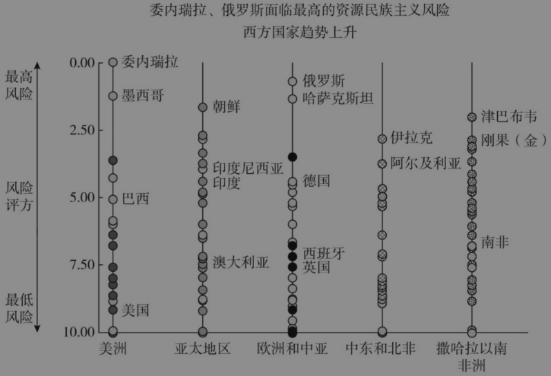

# 第四章 矿产资源国的新动向

当前，百年未有之大变局加速演进，全球经济不稳定性因素与地缘政治风险交织叠加，新一轮科技革命和产业变革深入发展，以稀土为代表的战略性矿产在新一代信息技术、新材料、智能装备、清洁能源等领域的应用日益广泛。与此同时，在“碳中和”目标的愿景下，绿色低碳、可持续发展成为全球共识，战略性矿产对全球经济发展的战略意义及支撑作用越发凸显，已成为大国竞争的核心赛道。在此背景下，拉美地区、非洲大陆、澳大利亚及东南亚等战略性矿产资源富集地区凭借先天禀赋优势，在这场全球范围内的资源争夺战中占据先机。这些国家和地区不仅掌控着全球战略性矿产的主要供应，更通过出口管控、投资规制等手段，直接影响着全球矿产市场的定价逻辑与发展走向。为在“繁荣期”把握经济主动权、谋求更大的经济利益，资源国纷纷加快制定和调整矿产资源治理策略，力求进一步提升其在全球产业链、供应链中的地位，增强矿产资源治理的主动权和话语权。

## 拉美地区：全球战略性矿产“稳定器”与绿色转型“资源库”

拉美地区是全球战略性矿产资源版图的最重要组成部分之一，拉美不仅手握丰富的矿产资源，锂、铜、银等战略性矿产储量均占全球的30%以上，更是掌控着超过一半(52%)的锂资源，是全球战略性矿产竞争的焦点地区之一。当前，拉美地区新一轮资源民族主义浪潮兴起，智利、巴西、秘鲁、阿根廷、玻利维亚等国纷纷加速国家战略性矿产战略修订步伐，各国政府主导国有化控制，尝试构建资源“寡头组织”来操控价格，着力破解“资源诅咒”，依托矿产资源禀赋谋求更大经济利益。

### 资源禀赋：全球战略性矿产供应的“稳定器”

从储量来看，拉美地区拥有海量的战略性矿产储量，是锂、银、铜、钼、锡、铁、镍等多种战略性矿产的全球集聚区。具体而言，拉美地区掌控着全球超过一半的锂资源，奠定了其在新能源时代的核心地位。同时，也是铜、银、钼的重要宝库，这三种战略性矿产资源的全球储量占比均超过三成。此外，拉美地区在锡、铁、锌、镍等战略性矿产供应上也拥有一定份额，约占15%～20%。不仅如此，拉美地区许多资源国目前的勘探程度相对较低，未来发现新资源、进一步扩大储量的潜力巨大。

从产量来看，拉美地区拥有成熟且高度集中的战略性矿产产业带。以锂生产为例，拉美“锂三角”无疑是其深度参与此轮全球矿产博弈的又一“王炸”。“锂三角”作为全球锂资源的战略重镇，位于智利、阿根廷和玻利维亚三国的交界地区，“锂三角”国家中的智利和阿根廷分别是全球第一和第二大生产国，其每年的产量规模足以对全球电池供应链产生决定性影响。再以铜生产为例，智利和秘鲁是全球除刚果（金）之外最为重要的生产国，2024年分别生产铜矿530万吨和260万吨，占比为23%和13%，二者构成了世界级的铜矿供应带，其产量的稳定性直接关系到全球工业经济的脉搏。拉美地区主要矿种储量占比及前三大生产国情况，见表4-1。

**表4-1 拉美地区主要矿种储量占比及前三大生产国**

| 主要矿种 | 拉美地区储量全球占比 | 第一大生产国 | 第二大生产国 | 第三大生产国 | 其他生产国 |
| --- | --- | --- | --- | --- | --- |
| 锂 | 52% | 智利 | 阿根廷 | 巴西 | 玻利维亚 |
| 银 | 39% | 墨西哥 | 秘鲁 | 智利 | 玻利维亚、阿根廷 |
| 铜 | 38% | 智利 | 秘鲁 | 墨西哥 | 巴西、巴拿马、阿根廷 |
| 钼 | 38% | 智利 | 秘鲁 | 墨西哥 | — |
| 锡 | 20% | 秘鲁 | 玻利维亚 | 巴西 | — |
| 铁 | 20% | 巴西 | 秘鲁 | 墨西哥 | 智利 |
| 锌 | 17% | 秘鲁 | 墨西哥 | 玻利维亚 | 巴西、洪都拉斯、智利 |
| 镍 | 17% | 巴西 | 危地马拉 | 古巴 | 哥伦比亚、多米尼加 |
| 铝土矿 | 15% | 巴西 | 牙买加 | 圭亚那 | 委内瑞拉、哥伦比亚 |
| 金 | 14% | 墨西哥 | 秘鲁 | 巴西 | 哥伦比亚、玻利维亚、阿根廷、智利、多米尼加 |

*数据来源：Gaston Siroit, Critical Minerals for Energy Transitions in Latin America and the Caribbean, Latin American Energy Organization, 2024, p30.*

### 治理策略：战略地位、国家安全与长远收益的目标交织

近年来，拉美资源富集国家聚焦国际形势变化，积极制定、调整、优化国家矿产战略，力求抓住战略性矿产的“繁荣期”，变资源优势为可持续发展的经济效益。从表4-2中可以看出，拉美各国战略性矿产政策的调整，紧密围绕战略地位、国家安全和长远收益三大核心目标展开，呈现出系统性和战略性的特点。

其一，提升战略地位。从国家战略高度重视矿产资源优势，各国纷纷发布国家级战略规划，如厄瓜多尔的《国家矿业发展计划》(National Mining Development Plan)、哥伦比亚的《矿业发展长期愿景》(A New Vision of Mining in Colombia)以及巴西的《矿产资源战略规划》(National Policy on Lritical & Strategic Minerals)，将矿业发展提升到国家经济战略的核心高度，巴西、智利等国还设立专门机构，强化国家在战略性矿产领域的管控力。

其二，保障国家安全。主要是通过提高矿业税率、增加特许权使用费、立法明确国家所有权等手段，确保国家对本国矿产资源的所有权和收益权，争夺战略性矿产领域的国际话语权。

其三，谋取长远利益。即更加着眼于矿业对经济、环境和社会的可持续贡献，主要包含两方面内容：一方面，注重环保，通过理念倡导、法规约束、技术引导等推动矿业绿色发展；另一方面，补链延链，明确提升产品附加值目标，通过缩短审批流程等举措不断优化战略性矿产项目发展环境，促进产业转型升级。

**表4-2 拉美地区主要战略性矿产资源国的政策举措**

| 国家 | 时间 | 政策（名称） | 主要内容 |
| --- | --- | --- | --- |
| 厄瓜多尔 | 2019年 | “矿业公共政策（2019—2030）” | 突出强调矿业对国民经济特别是吸引外资方面的重要作用，提出到2030年要将矿业打造成拉动经济增长、促进社会发展的关键支柱 |
| 哥伦比亚 | 2023年 | 《矿业发展长期愿景》 | 发布“为生命而采矿”（Minería Para La Vida）的矿业发展长期愿景，提出产业转型、增加附加值、企业正规化等诸多发展理念和目标 |
| 秘鲁 | 2025年6月 | 《2025年矿业发展规划》 | 预计2025年矿业投资达48亿美元，铜产量目标280万吨。重点关注南部阿普里马克和阿雷基帕地区铜矿开发。加强打击非法采矿，包括矿区巡查、完善运输监管。优化矿业审批流程，缩短环境评估周期。鼓励环保开采技术 |
| 巴西 | 2021年 | 成立专门机构 | 2021年，在矿业和能源部下设战略性矿产专门部门——战略性矿产项目分析部际委员会，巩固巴西在部分矿种生产和出口领域的优势 |
| 巴西 | 2024年 | 《矿产资源战略规划》 | 采取行动提高安全，鼓励遵循可持续实践，营造有利于研究、生产和矿产加工的投资环境，增加能源转型所需战略矿产储备，扩大粮食安全所需矿产供应，改善矿区所在城市的社会经济条件 |
| 智利 | 2023年4月 | 《国家锂矿战略指导方针》 | 宣布国家将全流程参与锂资源开发。该战略明确表示，将成立国家锂业公司，对于具有战略价值的矿产项目，国有企业必须在公私合营中占据控股地位 |
| 智利 | 2025年2月 | 成立由矿业部牵头的关键矿产专家委员会 | 成立由矿业部牵头的关键矿产专家委员会，包括公共部门、行业、学术界和民间团体代表，提出应对全球关键矿产需求增长的方案。早在2023年，针对锂矿开发，智利即成立国家锂矿和盐湖委员会，负责推进国家锂矿战略 |
| 阿根廷 | 2025年7月 | 改革矿业投资法律体系 | 大幅简化投资激励的证明流程：企业无须再提交包含上千项数据的复杂申报表，改为提交一份由独立专业人士出具的投资报告，聚焦项目实际支出和开发进度，对地质信息系统进行职能整合 |
| 智利 | 2023年 | 《矿业特许权使用费法案》 | 对年产超过5万吨精铜的大型矿企征收1%的从价税，并根据营业利润额外征收8%~26%的利润税，其中年产超过8万吨的矿企最高纳税率达到利润的46.5% |
| 巴西 | 2025年2月 | 设立关键矿产基金 | 巴西国家开发银行（BNDES）和巴西研究与项目资助机构（FINEP）提供总额50亿雷亚尔（约合8.15亿美元）的金融支持，用于构建包括锂、稀土、镍、石墨和硅在内的矿产供应链，并投资制造用于电动汽车和风力涡轮机的电池和磁铁等高附加值产品，预计带动250亿~500亿雷亚尔的后续项目投资 |

*数据来源：作者根据公开资料整理。*

### 最新动向：新一轮拉美资源民族主义浪潮兴起

#### 1. 竖起资源民族主义的旗杆

在全球能源转型和绿色可持续发展的大背景下，镍、锂、金、银等战略性矿产及贵金属价格一度大幅上涨，拉美矿产资源国迫切希望能利用自身的资源禀赋从战略性矿产这座“金山”中分得更大的蛋糕，为国家经济发展和社会福利保障提供资金。由此，拉美地区新一轮资源民族主义的主战场从油气领域转向锂、铜、锌新能源矿产领域，具有鲜明的时代特点。根据全球风险和战略咨询公司维枫公司(Verisk Maplecroft) 2024年发布的用来测算政府对能矿行业经济活动控制程度的资源民族主义指数(Resource NationalismIndex，RNI)，2020年以来，全球有47个国家RNI指数上升，包括17个主要战略性矿产生产国。尤其值得注意的是，拉美大部分矿产资源国都在列，在一定程度上反映出该地区已成为资源民族主义抬头的中心之一。2024年，RNI排名前三的国家是委内瑞拉、俄罗斯和墨西哥(见图4-1)。

从拉美国家的具体做法上看，在国家层面，2025年8月，巴西政府计划出台新政策，将战略性矿产视为国家主权问题，并要求外资企业与本土企业组成联合体开发战略性矿产。2023年4月，智利政府宣布该国国家铜业公司将与全球第二大锂生产商智利化工矿业公司（SQM）组建合资公司，并由国家铜业公司控股，主导该国主要锂矿资源开发。2023年5月，墨西哥政府批准了矿业法修正案，将锂矿列为战略资源，并将其开采权授予了新成立的国家锂业公司，同时取消了外国投资者的特许经营权，其中包括中企赣锋锂业2022年8月刚收购的Sonora锂黏土项目的9个矿产特许权，给供应链上游的资本运作带来了重大风险。

**图4-1 主要国家资源民族主义指数变化趋势**

*数据来源：Verisk Maplecroft 2024。*

在地区层面，智利、阿根廷、玻利维亚三个世界级锂资源国试图效仿石油输出国组织“欧佩克”(OPEC)成立“锂佩克”组织，即形成全球最大的锂价格垄断联盟，以谋求国际锂市场定价权，从而迫使矿产应用的中下游环节向上游产业让利，并希望借助全球新能源产业发展契机成为全球绿色转型新的重要参与者。总结而言，拉美地区新一轮资源民族主义的复兴浪潮，具体表现为通过立法、重谈合同、提高税负和推动国有化等方式，进一步强化国家对战略资源的控制，以扭转历史上“资源诅咒”下的不利地位。实际上，旨在将矿产资源禀赋转化为可持续的国家收益与发展动能，究其本质仍是资源国行使经济主权、寻求“资源解放”的体现。

#### 2. 美国“后院”的“出牌权”缺位

值得高度关注的是，拉美地区的资源民族主义政策触及了以美国为首的西方国家及其跨国公司的传统利益。作为反制手段，西方国家—尤其是美国—频繁动用“长臂管辖”手段，导致拉美国家的资源主权行使面临高昂的外部成本，陷入“行使主权即可能被孤立”的困境。一方面，美西方针对拉美国家的举措实施了系统性制裁，如对委内瑞拉石油国有化的回应，美方实施了全面的金融封锁和二级制裁（威胁第三方合作公司），旨在将其隔离于全球金融体系之外，割断其赖以生存的经济命脉；另一方面，西方国家的各种非正式阻挠打乱了拉美矿产战略布局。在智利、秘鲁等国内部关于锂、铜等战略性矿产国有化的讨论中，美国多次尝试通过外交游说、支持国内反对派，以及利用国际金融机构施加隐性压力等方式暗中对其进行干预，2026年伊始，美国更是对委内瑞拉采取了极端手段，大大增加了其国有化政策推行的内部成本与不确定性。

需要强调一点，当前全球战略性矿产供应链正处于由地缘政治驱动的深度重构期。美国为促进能源转型和高端制造业回流，力推重塑“友岸外包”供应链，核心目标在于构建一个在政治安全上高度可信、在供应链上尽可能“去中国化”的平行体系。由于拉美资源国在全球关键供应链中所处的关键位置，其成为大国竞相争夺的焦点，被迫面临一个近乎二元对立、选边站队的艰难抉择，致使其在全球矿产博弈中，手握好牌却几乎不具备真正意义上的自主“出牌权”：要么融入美国主导的“友岸外包”体系，要么维持并深化与中国的合作关系，一旦平衡不当，必将在政治和经济上付出惨痛代价。如果选择迎合美国“友岸外包”战略，加入其供应链体系，就意味着其在投融资、技术标准与市场导向上要向美国及其盟友靠拢，短期内或可为拉美资源国获取特定的政治安全保障和西方投资，但长期而言将导致其经济结构深度依附于北美市场，并且很可能牺牲与中国的合作所带来的战略灵活性。然而，中国不仅是拉美资源国最大的增量市场，更是其基础设施建设与战略性矿产开发的核心资金与技术提供者之一，拉美资源国多年来一直与中国保持着密切的投融资和市场关系。若拉美资源国选择继续深化和中国的合作关系，则可能被美国视为对其供应链安全战略的挑战，从而面临“长臂管辖”等形式的潜在报复。由此，拉美资源国陷入了全球地缘政治博弈的夹缝，其核心挑战在于，能否在高度紧张的地缘政治环境中，寻找到一条能够平衡各方利益，同时最大化自身发展自主性的路径。这一政策抉择不仅将决定拉美资源国的未来发展，亦将在微观层面上重塑全球战略性矿产供应链的格局。

除了外部地缘政治压力，拉美资源国现阶段还面临一系列内部问题，制约其将资源禀赋转化为发展动能：一是产业链单一，亟须向高附加值环节延伸。大多数拉美资源国仍停留在出口原始矿产的阶段，缺乏在国内进行精炼和制造高附加值产品的完整产业链，难以捕获产业链下游的巨额利润，且容易受到国际原材料价格波动的影响。二是矿产开发的技术与资金缺口仍然很大。先进的勘探、开采和加工技术往往掌握在少数国际公司手中，拉美资源国自身的国有公司则缺乏相关技术和人才储备，而开发新项目、建设下游产业链需要巨额投资，国家财政往往无法独自承担。三是政策摇摆带来的不确定性。受地缘政治波动影响，拉美地区政权更迭较为频繁，可能导致部分资源国的矿业政策、税收和特许权使用费制度等产生剧烈变化，政策不确定性巨大。然而，矿业投资法律政策体系本身就十分复杂，投资者必须充分了解并遵守当地的法律法规，特别是在矿产勘探、开采、土地使用以及环境保护方面的要求，因此，这种不确定性会为拉美地区矿业投资环境带来阴影，尤其影响跨国投资者的信心和矿产项目的长期稳定性。

## 非洲大陆：以矿业为核心的全球能源转型支点

非洲大陆矿产资源储备极为丰富，铬、钴、锰、铂族金属等战略性矿产在储量及产量上都占据绝对优势，许多非洲国家是全球关键矿产的生产中心。未来，非洲极有潜力成为以矿业为核心的全球能源转型支点。然而，尽管矿产资源丰富，非洲国家目前仍主要以供应矿产原料为主，处于全球战略性矿产供应链的较低端位置，其资源禀赋与发展现状之间存在巨大落差，这使得世界主要经济体对非洲大陆战略性矿产的争夺日益激烈。非洲大陆已经成为大国在资源领域竞争与合作的核心舞台，其主要的战略性矿产资源国均面临资源主权侵蚀风险。

### 资源禀赋：传统优势矿种地位稳固，战略性矿种潜力突出

非洲大陆是全球战略性矿产资源的核心富集区之一，不仅种类丰富，且多个矿种在储量和产量上均居于全球主导地位，对全球绿色能源转型与高端制造业供应链具有重要战略影响（见表4-3）。

**表4-3 非洲国家优势关键矿产储量、产量及分布情况**

| 矿产 | 核心国家 | 储量及全球排名 | 产量及全球占比 |
| --- | --- | --- | --- |
| 钴 | 刚果（金） | 600万吨，全球占比55.0%，世界第一 | 2024年产量22万吨，占比76.0%，连续多年居于首位 |
| 铂族金属 | 南非 | 6.3 万吨，全球占比95.5%，几乎垄断全球供应 | 2024年产量200吨，全球占比 75.0% |
| 铝土矿 | 几内亚 | 74亿吨，全球占比26.0%，全球排名第一 | — |
| 锂 | 刚果（金）、马里、津巴布韦、加纳和纳米比亚等国家 | 494万吨，占全球总储量的15.3%；其中，津巴布韦锂储量48万吨，占全球1.2%，非洲排名第一 | 津巴布韦2024年产量约2.2万吨，全球排名第四 |
| 铜 | 刚果（金）—赞比亚铜矿带 | 刚果（金）7500万吨，全球占比15.0%；赞比亚2 000万吨，全球占比全球3.3% | 刚果（金）2024年铜产量330万吨，全球排名第三 |
| 铬 | 南非、津巴布韦 | 南非铬储量约为2亿吨，占全球总储量的 36.0% | 南非2024年铬产量约1800万吨，全球占比44.0%，排名第一 |
| 锰 | 南非、加蓬、加纳 | 南非锰储量2.1亿吨，全球占比69.0%，全球第一；加蓬6569万吨，非洲第二；加纳1310万吨，非洲第三 | 南非2024年锰储量740万吨，占全球总产量的37.0%;加蓬460万吨，占全球总产量的23.0%；加纳82万吨，占全球总产量的 4.1% |

*数据来源：美国地质调查局。*

在储量方面，IMF（国际货币基金组织)在2024年发布的《撒哈拉以南非洲地区经济展望》报告显示，撒哈拉以南非洲地区拥有全球30%的矿产资源储量，并预测到2050年，撒哈拉以南非洲的矿产开采可推动该地区GDP增长12%以上。若逐步转向更高附加值的矿产加工环节，则将带来更显著的增长。就具体矿种而言，铬和铂族金属的储量高度集中，在全球总储量中占比高达95%和90%，钴的探明储量占全球的48.1%，锰的储量占比达47.7%；此外，该地区还拥有全球21.6%的天然石墨、5.9%的铜以及5.6%的镍资源。在产量方面，许多非洲国家已成为多种全球战略性矿产的生产中心。刚果(金)是全球钴供应链中的核心国家，钴产量占全球总产量的70%，对全球钴供应市场具有重要影响力。南非、加蓬和加纳均是锰矿的主要生产国，三国合计锰矿产量占全球的60%，构成了全球锰资源的重要供应带。总体上看，非洲国家不仅在铂族金属、铬、锰、铝土矿等传统优势矿种上地位稳固，也在钴、锂、镍等能源转型战略性矿产方面形成全球重要供应极，展现出巨大的资源潜力与发展前景。

### 治理策略：多重目标下的矿产政策体系

近年来，为提升战略性矿产价值链与掌握战略主动权，非洲各国已密集出台一系列政策举措（见表4-4)，这些政策虽在具体措施上各有侧重，但其核心目标均围绕资源主权强化、价值链升级、可持续发展与地缘合作四大方向展开，可归纳为以下四个关键维度。

**表4-4 非洲战略性矿产资源国的主要政策举措**

| 国家 | 时间 | 政策名称 | 主要内容 |
| --- | --- | --- | --- |
| 刚果（金） | 2025年2月 2025年6月 | 发布钴产品出口临时禁令 | 应对全球钴市场供给过剩，稳定价格，宣布暂停钴产品出口四个月。该禁令到期后又将钴出口临时禁令再延长三个月 |
| 津巴布韦 | 2025年1月 | 实施新矿产税政策 | 2025年1月1日起，将对国内销售和出口的锂、黑色花岗岩、采石石料以及钻石征收2%的税费，并且要求必须以交易货币支付。该税率比此前的1%提高一倍 |
| 津巴布韦 | 2022年12月 2025年6月 | 禁止锂出口 | 2022年，禁止锂原矿出口，仅允许加工后的锂精矿出口，同时对精矿征收5%的出口税。2025年，宣布自2027年1月起全面禁止锂精矿出口，仅允许硫酸锂及以上加工产品离境 |
| 赞比亚 | 2024年10月 | 构建“产量共享机制”投资战略性矿产 | 计划成立投资公司，将控制未来矿山战略性矿产至少 30%的产量 |
| 赞比亚 | 2025年4月 | 颁布贸易新规 | 资源税调整：引入矿权转让税并对矿业部门资本类支出的税收扣除比率进行降低；税收优惠：通过税收减免、土地租赁优惠以及简化审批流程等措施吸引外资和技术；加强环保：要求矿业企业实施环保措施，降低矿业活动对环境的影响 |
| 坦桑尼亚 | 2025年 | 矿业本地化政策 | 要求外资企业与本土企业合作；提高矿产加工比例，减少原材料出口 |
| 马里 | 2025年初 | 将矿产资源融入国家“整体稳定战略” | 强调对稀土等战略性矿藏的开发；推动采矿种类多元化（如锂矿投产） |
| 南非 | 2025年7月 | 首次发布《关键矿产与金属战略》 | 重点关注铂族金属、铜、锰和稀土元素，提出通过本地加工、物流基建和区域合作提升产业链价值 |

*数据来源：作者根据各国公开资料整理。*

其一，推动本土加工与产业链升级。多国不再满足于单纯出口原矿，转而通过立法激励、出口限制与财政支持等方式，推动矿产本土化加工与高附加值转化，力求打破长期依赖资源出口的产业桎梏。其二，强化资源主权与收益分配机制。非洲各国为进一步提高国家对矿产资源开发的参与度和控制力，通过提高权利金与税费比例、推动国有参股或控股、优化特许权管理等经济法律手段，确保国家在矿产经济收益与发展主导权上实现最大化。其三，加强ESG（环境、社会和治理）标准与可持续发展要求。在全球能源转型和数字化加速的背景下，国际社会及本土社区对矿产资源开发的环境与社会影响保持高度关切。为此，非洲国家正逐步将ESG要求纳入国家战略性矿产政策与法律体系中，致力于推动关键矿产资源的可持续开发与利用。值得注意的是，非洲国家对ESG的要求与其发展阶段和治理能力并不必然吻合，很多矿业项目的ESG是由大型跨国矿企带到非洲的，或者是由一些国家环境与人权机构主导、为非洲国家制定的。由于基础设施、人才、制度等保障条件不完备，矿业企业在非洲按照ESG标准运营面临更多不确定性挑战，大大增加了非洲矿业项目的成本。其四，改善投资环境与鼓励技术创新。在强化主权的同时，非洲国家也开始注重通过简化审批流程、提供税收优惠以及推动技术合作等方式，引导优质外资与先进技术融入本土战略性矿产产业链，并积极布局可能引领采矿业未来的前沿技术领域。

### 大国对非战略升级，矿产资源主权面临侵蚀风险

从全球战略性矿产供应格局来看，非洲大陆表现出明显的“富而不强”特征，即一些非洲国家虽然拥有丰富的战略性矿产资源，但主要以供应矿产原料为主，处于战略性矿产供应链的低端，在与矿产相关的规则和标准制定中往往处于被动接受的边缘地位。根据非洲矿业发展中心数据，当前非洲矿产协议中仅8%的协议包含本地加工条款，大部分矿石仍以初级产品出口，附加值流失严重，极易受国际矿产资源价格波动冲击。由于长期高度倚重矿业对经济增长和财政收入的贡献，非洲多国现已出现类似“荷兰病”效应，经济多元化进程受阻。

与此同时，非洲矿业经济发展高度依赖外部支持，且技术、投资、监管层面都存在严重缺位。例如，电力短缺就尤为突出，刚果（金）的电力供应问题是制约其铜产量的重要瓶颈，因供电不稳定导致矿山产能利用率严重不足，而中国企业在当地联合投资建设的水电站等清洁能源项目进展缓慢，短时间内难以取得显著成效。再如，矿产资源开发粗放。刚果（金）是全球最大的钴生产国，但其中20%的产量来自本地手工采矿者，他们采用原始露天开采和汞提炼技术，不仅造成了严重的环境污染，而且可能严重影响健康，尽管中铁资源等中资企业开始引入自动化设备和绿色冶炼技术（如湿法工艺等），但当地技术人才匮乏，在实际使用过程中仍严重依赖外国专家。此外，在诸多非洲国家与地区，政府治理能力薄弱且制度性监管严重缺位，劳工、环境及社区权利相关立法往往难以有效实施，进一步加剧了矿产资源开发与当地社区之间的利益冲突，还助长了规模可观的非正规采矿活动，甚至部分地区矿产开采伴随着广泛使用童工的现象，政府在矿产资源治理领域严重失灵。

在此背景下，随着全球对战略性矿产需求持续增长，非洲成为该领域大国战略竞争的焦点。近年来，为加强对全球战略性矿产供应链的主导权，同时削弱中国在非洲矿产领域的影响和优势地位，美国加速推进非洲战略性矿产金属供应链部署，特朗普政府表示希望非洲各国能够使用丰富的矿产资源来置换美国的投资支持，达成“交易型外交”。美国和平研究所发布的《非洲的关键矿产：加强安全、支持发展和减少地缘政治竞争中的冲突》研究报告直接指出，关键矿产开发应是美国对非洲政策的优先选项。除美国外，欧盟、日本、澳大利亚等主要经济体也纷纷加强对非洲战略性矿产领域的介入，通过签署合作协议、提供基础设施投资等多种方式，持续深化对非关键矿产领域战略布局（见表4-5）。西方大国争夺非洲矿产资源控制权的“野心”已经跃然纸上，非洲国家矿产主权被侵蚀的风险日益增大。由此，如何在积极引入外资与技术的同时，有效维护本国对重要矿产的主导权，如何在融入全球产业链的同时，实现自身经济实力提升，已成为当前摆在非洲资源国面前的核心课题，考验着其国家治理智慧与长远战略定力。

**表4-5 大国对非洲的矿产战略**

| 主要经济体 | 核心方向 | 主要举措 |
| --- | --- | --- |
| 美国 | 构建排他性联盟+政策驱动合作 | 1. 出台《通胀削减法案》，将非洲50种关键矿产纳入供应链，要求2027年电动车电池80%的关键矿产来自本土或自贸伙伴；2.发起“矿产安全伙伴关系”合作项目，联合英、加、澳等国，刚果（金）、赞比亚等非洲国亦被纳入其中；3. 支持洛比托走廊建设，鼓励特斯拉、KoBold Metals（美国硅谷AI矿业勘探公司）等企业投资非洲矿企 |
| 欧盟 | 规则约束+价值链绑定 | 1.发布《关键原材料法案》《新电池法案》，2027年出口欧洲电池需持“电池护照”；2.建立“关键原材料俱乐部”，与纳米比亚签矿业合同，与刚果（金）等谈判协定；3. 推进“欧盟—非洲战略走廊”（德班—卢萨卡走廊等） |
| 中国 | 供应链优势巩固+互利合作 | 1. 依托全球精炼中心地位（提炼全球 68%镍、73%钴），吸纳非洲72%的钴、28%的石墨出口；2. 组建中国矿产资源集团，推动赣锋锂业、华友钴业等在刚果（金）、津巴布韦投资；3.参与刚果（金）—赞比亚联合电池生产线 |
| 日本 | 技术支持+协议锁定 | 1.2023年与赞比亚、纳米比亚等非洲国签署矿产协议；2.承诺部署卫星技术，为非洲铜、钴、镍勘查提供支持 |
| 英国 | 战略引导+企业布局 | 1.2022年发布《关键矿产战略》，将非洲列为重点；2. 支持彭萨纳稀土公司获安哥拉隆贡若稀土矿35年采矿权 |

*数据来源：作者根据各国公开资料整理。*

## 澳大利亚：美西方矿产供应链“安全化”的急先锋

澳大利亚凭借锂、镍、稀土等多元且雄厚的矿产资源，正通过系统化的国内政策与国际合作，不断巩固其作为全球战略性资源重要供应国的战略角色。当前，澳大利亚以矿产资源为政治工具，积极配合美国，试图构建“去中国化”“安全化”的战略性矿产供应链，然而，这一做法面临着加工技术短板、巨额成本投入、美澳合作外部压力等多重挑战。

### 先天优势：“坐在矿车上的国家”

澳大利亚是名副其实的矿产资源大国，不仅拥有令全世界艳羡的铁矿石资源，锂、铜、镍、稀土等优势战略性矿种在储量、产量、出口量及全球影响力方面持续增强（见表4-6)。

**表4-6 澳大利亚战略性矿产储量、产量及分布情况**

| 战略性矿产 | 分布 | 储量及全球排名 | 产量及全球占比 |
| --- | --- | --- | --- |
| 铁矿石 | 西澳大利亚州，其中皮尔巴拉地区占 90% | 储量580亿吨，占全球总储量1/3，稳居世界第一 | 2024年产量9.2亿吨，全球第一 |
| 金 | 西澳大利亚州 | 储量8400吨，全球第一 | 2024年产量284吨，全球第三 |
| 锂 | 西澳大利亚州 | 储量700万金属吨，仅次于智利（930万吨），居全球第二 | 2024年产量8.8万吨，全球占比 36.7%，最大锂生产国 |
| 石墨 | 南澳大利亚州、昆士兰州 | 储量472万吨，占比并不突出 | 约2万吨，占比并不突出 |
| 稀土 | 西澳大利亚州、北领地 | 储量570万吨，居全球第四（中国4400万吨、巴西2100万吨、印度690万吨） | 2024年产量1.3万吨，全球占比 3.3% |
| 镍 | 西澳大利亚州(硫化镍矿) | 储量2400万金属吨，仅次于印度尼西亚（5500万吨），居全球第二 | 2024年全球占比18% |
| 钴 | 多伴生于西澳大利亚州的镍矿中 | 储量170万金属吨，仅次于刚果（金）（600万吨)，居全球第二 | 2024年全球占比2% |
| 铜 | 南澳大利亚州、西澳大利亚州 | 储量1亿金属吨，与秘鲁并列全球第二（仅次于智利1.9亿吨） | 2024年产量80万吨，全球占比 4% |
| 钨 | 北领地、塔斯马尼亚州 | 储量57万金属吨，仅次于中国（240万吨），居全球第二 | 2024年产量0.1万吨，全球占比 1.2% |
| 锌 | 昆士兰州、新南威尔士州 | 储量6400万金属吨，居全球第一 | 2024年产量112万吨，全球占比9%，排名第三 |

*数据来源：美国地质调查局。*

从储量来看，澳大利亚具备多元且雄厚的战略性矿产资源基础，在全球战略性矿产供应链中扮演着举足轻重的角色。其中，铁矿石、金、锌储量位居全球第一。锂、镍、钴、铜、钨储量位列全球第二。稀土储量在全球名列前茅。

从产量来看，澳大利亚已在多个矿产领域形成全球供应影响力。作为全球最大的锂生产国，其2024年产量占到全球总产量的36.7%；同时，也是重要的镍生产国，全球产量占比达18%；锌产量位列全球第三，占比9%。

从出口量来看，根据澳大利亚外交贸易部(DFAT)数据，2023—2024财年澳大利亚铁矿石、煤炭、天然气和黄金四大资源产品合计出口超3300亿澳元，占全国出口总额超过50%。同时，澳大利亚关键矿产行业呈现迅猛发展态势，总市值从2014年的86.7亿澳元增加至2024年的862.1亿澳元，10年间增幅达895%，成为澳大利亚经济收入的重要支柱来源，并涌现出皮尔巴拉矿业(Pilbara Minerals)、澳大利亚矿产资源有限公司(MineralResources)等全球战略性矿产行业领军企业。可以说，凭借突出的资源禀赋、持续提升的全球供应地位以及高度发达的矿产出口体系，澳大利亚正不断巩固其作为全球关键矿产重要供应国的战略角色。

### 矿业强国构想：“国内调整+国际合作”的资源战略和政策支撑体系

先天的资源优势和强势的矿业发展为澳大利亚赋予了多重博弈条件和战略能力。实际上，澳大利亚不仅手握全球最优质的矿产资源，而且在长期矿业发展中积累了厚重的资金、技术、人才和矿业标准、规制等全方位的能力，是勘探找矿、矿业投资、学术研究、资本市场的全面手，对全球矿产品交易机制和定价权也有着很强的参与度和掌控力。近几届澳大利亚政府均将战略性矿产产业定位为国家支柱产业，通过系统施策，持续强化其在全球战略性矿产供应链和价值链中的竞争力及影响力。

如表4-7所示，澳大利亚正从国内、国际双视角出发，全方位构建适合本国国情的战略性矿产政策支撑体系。在国内层面上，着力完善关键矿产领域顶层设计与产业生态，核心举措包括制定并动态调整“关键矿产清单”(Critical Minerals List)与“战略材料清单”(Strategic Materials List)，明确战略优先方向；通过《2023—2030年关键矿产战略》确立发展蓝图，并配套以规模不断扩大的关键矿产基金（CMF）、税收抵免及专项贷款等财政工具，强力驱动本土关键矿产开采、加工及下游制造能力的整体提升。

在全球层面上，积极构建基于共同标准的战略性矿产国际合作网络。其战略核心是与美国、日本、韩国及欧盟等“理念相似的伙伴”深化供应链协作，通过发布联合数据集、签署谅解备忘录、建立年度对话机制等方式，共同推动全球战略性矿产供应的多元化、透明化与标准化。与此同时，澳大利亚也注重与印度尼西亚、越南等资源国开展互补性合作，旨在整合区域资源优势，共同布局电池材料、回收创新等新兴领域。目前，澳大利亚已经形成了覆盖产业培育、资源整合与全球协作的战略性矿产政策支撑链条，为澳大利亚巩固并持续提升其在全球战略性矿产供应格局中的地位提供了重要保障。

**表4-7 澳大利亚关键矿产领域主要政策举措**

| 政策范围 | 出台时间 | 政策举措/合作对象 | 主要内容 |
| --- | --- | --- | --- |
| 本国国内层面 | 2023年6月 | 《2023—2030年关键矿产战略》 | 更新“关键矿产清单”；优先支持关键矿产项目开发；到2030年成为全球重要原材料和关键矿产生产商，并增加与盟友的合作与投资 |
| 本国国内层面 | 2023年12月 | 调整“关键矿产清单” | 动态调整“关键矿产清单”；追加设立“战略材料清单”（首批列入铝、铜、镍、磷、锡、锌） |
| 本国国内层面 | 2024年1月 | 发布关键矿产项目招商说明书 | 列出52个关键矿产项目，吸引日韩等盟友投资，强化供应链韧性，推动本土加工能力建设 |
| 本国国内层面 | 2024年2月 | 将镍列入关键矿产目录 | 使镍矿企业有资格申请约40亿澳元的政府基金支持，以应对国际镍价下跌的冲击 |
| 本国国内层面 | 2024年3月 | 贷款资助稀土项目 | 为诺兰斯稀土项目提供8.4亿澳元贷款，建设采选冶一体化设施，与另两家稀土厂共同构成国内稀土供应链网络 |
| 本国国内层面 | 2025年2月 | 《澳大利亚未来制造法案 225》 | 为31种关键矿产的加工与精炼活动提供10%的税收抵免（2028—2040年），总预算137亿澳元(其中70亿澳元专用于关键矿产)，强力扶持下游高附加值环节 |
| 本国国内层面 | 2025年4月 | 建立国家关键矿产储备 | 宣布建立国家储备，涵盖稀土、石墨、钴等战略资源，旨在保障本国供应链安全 |
| 本国国内层面 | 2025年5月 | 扩大关键矿产资金规模 | 宣布将关键矿产基金（CMF）规模再度扩大20亿美元，最终达到46亿美元，支持本土矿产开采加工项目，并强化与美国的关键矿产供应链合作 |
| 国际合作层面 | 2023年5月 | 美国 | 达成协议，澳大利亚关键矿产供应商可享有《美国国防生产法》给予美国国内生产商的优惠，获得美国资金、技术和市场准入的大力支持 |
| 国际合作层面 | 2023年8月 | 美国 加拿大 | 三国地调机构合作发布国家级地质数据集，包含40个地学数据图层，助力关键矿产勘探开发 |
| 国际合作层面 | 2023年10月 | 法国 | 签署关键矿产合作协议，联合研究供应链，明晰在清洁能源、国防等领域对电池和稀土永磁的需求，探索确保供应链安全的方法 |
| 国际合作层面 | 2023年11月 | 印度尼西亚 | 签署谅解备忘录，承诺在电池制造和矿产加工方面进行互利合作 |
| 国际合作层面 | 2024年3月 | 加拿大 | 发布联合声明，在六大领域合作：倡导将ESG标准纳入全球供应链；推动供应链透明度和可追溯性；加强供应链安全合作；支持双边贸易与投资；探索从勘探到回收的全产业链研发合作；与原住民社区建立伙伴关系 |
| 国际合作层面 | 2024年3月 | 越南 | 将两国关系提升为全面战略伙伴关系，并建立年度矿产对话机制，以推动供应链多元化 |
| 国际合作层面 | 2024年5月 | 欧盟 | 签署谅解备忘录，加强合作投资，重点在科研与技术创新、第三国开展合作以及促进采矿创新和数字服务三大方面 |
| 国际合作层面 | 2023年11月—2025年5月 | 印度尼西亚 | 合作持续深化，从竞争转向互补：充分结合澳大利亚的锂、钴与印度尼西亚的镍加工能力；共建电池材料加工链，探索在非洲、南美洲等第三方市场合作；新增资金支持电池回收与脱碳技术研发；签署区域性协议 |

*数据来源：作者根据公开资料整理。*

### 美国构建“去中国化”供应链的主要帮手

澳大利亚一直将战略性矿产视为大国博弈的重要工具。近年来，随着中美在战略性矿产领域的大国竞争态势加剧，作为美国的传统盟友，澳大利亚越发凸显出战略性矿产工具化、武器化的战略倾向，积极配合美国实现战略性矿产供应链“去中国化”“安全化”，以降低美国及其盟友对中国战略性矿产的依赖程度，试图重塑全球战略性矿产供应链格局。在其国内层面，其通过政策扶持与金融手段加速本土矿产行业发展和加工能力建设；在国际层面，积极深化与美国、日本、韩国等盟友的合作，参与所谓“民主矿产联盟”等多边机制，与“志同道合”的国家之间构建矿产伙伴关系，以提升自身在全球战略性矿产供应链中的话语权。2023年底，澳大利亚资源与北澳事务部长玛德琳·金在更新战略性矿产清单时明确指出：“国内资源稀缺性不是被列入清单的先决条件，优先考虑对我们和我们邻国具有地缘战略重要性的矿产资源。”

然而，澳大利亚以战略性矿产为政治工具配合美国构建“去中国化”供应链的战略实际上面临诸多困境：其一，加工技术存在明显短板，尽管澳大利亚自身在开采环节具备优势，但加工环节短期内难以摆脱对中国加工技术的依赖[1]。早在2021年时，中国拥有的稀土技术专利数量就超过了世界其他国家专利数量之和。澳大利亚本地重要的稀土生产商莱纳斯，占全球稀土供给份额的12%。目前该公司已在美国建立加工厂，但其在重稀土分离技术上仍面临难题，且对中国设备存在一定依赖。其二，所需经济成本巨大。当前，中国在战略性矿产领域已形成完备的产业生态和庞大的规模优势，若想绕开中国建立的独立供应链必然需要投入巨额成本，而且面临市场需求不确定性与全球产业链深度融合的现实挑战。其三，澳美同盟的可靠性存疑。“美主澳从”的合作模式将严重制约澳大利亚实现成为亚太战略性矿产强国的目标，究其原因，美国的目的是借助澳大利亚一流的矿业生产和管理能力，发展自身的关键矿产行业，促进制造业回流和增强供应链自主可控能力，而这一政策目标必然与澳大利亚进一步提升其在全球战略性矿产供应链中的地位的战略意图产生冲突。

综上，澳大利亚以矿产资源为战略工具配合美国推进“去中国化”供应链的做法，本质上是地缘政治竞争在资源领域的显性化，反映了战略性矿产资源在大国竞争中的工具化趋势。然而，受制于自身加工能力不足与中国在全球战略性矿产产业链中已经形成的结构性优势，该战略导向在落地过程中面临着技术与经济层面的多重约束，在另一层面也折射出当前全球战略性矿产供应链调整的复杂性和艰巨性。

[1]中国在战略性矿产产业链中的优势主要集中在冶炼和加工环节，中国提炼全球68%的镍、40%的铜、59%的锂和73%的钴，还掌握全球90%的稀土分离产能。

## 东南亚：中等矿产资源国的理想与现实

东南亚是世界级战略性矿产的储藏地和生产地之一，不仅拥有印度尼西亚这样在全球范围内矿产资源禀赋优势十分突出的重要矿产资源国，还拥有较多的中等矿产资源国，该地区在全球战略性矿产供应格局中占有一席之地。近年来，以印度尼西亚为典型代表，东南亚各国以前所未有的政策力度强化对矿产资源的国家控制，展现出从原材料供应商向全球战略性矿产核心参与者转型的战略决心。当前，东南亚地区以东盟为主导推进战略性矿产供应链多层次区域治理进程，并与中国在矿产领域展开紧密合作。随着中国—东盟全面战略伙伴关系与《区域全面经济伙伴关系协定》(RCEP)的双重框架确立，“中国—东盟”战略性矿产合作迎来重要机遇期，但也面临合作格局重塑的风险。

### 资源禀赋：多矿种、中等规模、成矿集中

东南亚凭借其独特的地质背景与成矿条件，在全球战略性矿产供应链中扮演着日益重要的角色，该地区虽不及非洲大陆、拉美地区一般拥有部分矿产的垄断性资源优势，但其整体矿产资源组合丰富、矿种多样，呈现出“多矿种、中等规模、成矿集中”的鲜明特征，是全球战略性矿产供应体系中不可或缺的“中等资源集聚区”。

该区域在镍、锡、钴、铝土矿、铜等关键金属的储量和产量方面表现突出（见表4-8)。储量方面，印度尼西亚是东南亚地区矿产资源禀赋最为突出的国家，其镍矿储量高达59.13亿吨，在全球总储量中占据绝对优势。此外，根据美国地质调查局2024年的数据，印度尼西亚还拥有全球第二的锡储量，全球第三的钴储量，全球第五的铝土矿储量。产量方面，印度尼西亚的表现同样抢眼，不仅是全球最大的镍生产国，2024年产量约占全球总量的60%，也是全球第二大钴生产国和第五大铜生产国。印度尼西亚与缅甸在锡矿产量上也存在较大优势，2024年分别位列全球第二和第三位，合计约占全球总产量的30%。

**表4-8 东南亚优势战略性矿产储量、产量及分布情况**

| 战略性矿产 | 核心国家 | 储量及全球排名 | 产量及全球占比 |
| --- | --- | --- | --- |
| 镍 | 印度尼西亚 | 2024年印度尼西亚镍矿总储量为59.13亿吨，全球排名第一 | 印度尼西亚是全球最大的镍生产国，2024年产量高达220万吨，占全球总产量的60% |
| 铝土矿 | 越南、印度尼西亚 | 2024年越南储量约31亿吨，占比10.69%(全球排名第三)，印度尼西亚储量约28亿吨，占比9.66%（全球排名第四） | 2024年，印度尼西亚铝土矿产量3200万吨，占全球总产量的7.11%；越南铝土矿产量420万，全球占比不足1% |
| 钴 | 印度尼西亚、菲律宾 | 2024年印度尼西亚储量约66万吨，占比6%（全球排名第三)，菲律宾储量全球占比2%（全球排名第五） | 印度尼西亚是全球第二大钴生产国，2024年产量约为2.8万吨，全球占比约10% |
| 锡 | 印度尼西亚、缅甸 | 2024年，印度尼西亚锡矿储量73万~80万吨，占比15%~17%（全球排名第二）；缅甸锡储量70万吨，占比15%~16%（全球排名第三） | 2024年，印度尼西亚锡矿产量 5.0万吨，占比 17%；缅甸锡矿产量3.4万吨，占比12%，位列全球第二和第三位 |
| 铜 | 印度尼西亚 | 印度尼西亚铜矿资源储量为2100万吨，排名全球第十 | 印度尼西亚是全球第五大铜生产国，2024年产量约为110万吨，占全球总产量的 5% |
| 金 | 印度尼西亚 | 印度尼西亚拥有3 600 吨黄金储备，全球排名第四 | 印度尼西亚是全球第九大黄金生产国，2024年产量117.5吨 |

*数据来源：美国地质调查局。*

### 治理策略：从原材料供应商向全球矿产治理核心参与者转型

在大国战略性矿产竞争加剧的背景下，东南亚各国在相关领域密集出台了一系列政策举措（见表4-9），强化对本国战略性矿产资源的控制，提升国家治理能力，推动产业向价值链高端攀升，提高环保标准与合规要求，致力于将资源禀赋优势转化为持续的经济发展动能，从而增强东南亚战略性矿产资源国在关键矿产供应链中的地位，充分展现了其从传统原材料供应商向全球战略性矿产治理核心参与者战略转型的决心。

**表4-9 东南亚地区关键矿产领域主要政策举措**

| 国家 | 时间 | 相关政策 | 主要内容 |
| --- | --- | --- | --- |
| 印度尼西亚 | 2025年10月 | 缩短配额有效期 | 采矿配额有效期从三年缩短到一年，立即生效 |
| 印度尼西亚 | 2025年8月 | 成立矿产工业局 | 主要任务包括：整合国有矿业资产，打造矿业国家队，制定国家矿产开发路线图，设定战略性矿产领域外资介入门槛，以及解锁战略性矿产的科技潜力等 |
| 印度尼西亚 | 2025年2月 | 《矿产与煤炭矿业法》修正案 | 要求矿企必须优先满足国内市场需求，以支持本土电动车电池、绿色钢铁等产业发展；赋予中小企业、宗教组织等本土实体在获取矿产资源和建设加工设施方面的优先权；清理重叠的采矿许可证 |
| 老挝 | 2025年7月 | 全面暂停新矿产项目审批 | 全国范围冻结所有新矿产项目的审批以清理“僵尸项目”，并强调矿产项目的利益分享原则是国家与企业各占50%，并审查现有立法，以确保国家获得最大利益 |
| 菲律宾 | 2025年2月 | 参议院批准禁止原矿出口法案 | 计划在法案签署五年后禁止原矿出口，以倒逼矿企投资建设本土加工厂 |
| 越南 | 2024年11月 | 《地质与矿产法》 | 规定除保障能源安全、国防安全等特定矿区外，其他矿产的采矿权需通过拍卖方式授予；规范全链条管理：对地质调查、矿产活动、矿物加工等全流程进行系统规范 |
| 马来西亚 | 2023年 | 颁布稀土战略 | 禁止出口未经加工的稀土原料 |
| 柬埔寨 | 2020年10月 | 颁布新的矿物税率和纳税条规 | 确保矿物资源收入的征收和分配更明确透明，规定中央与地方政府的收入分成比例 |

*数据来源：作者根据各国公开资料整理。*

### “中国—东盟”矿产合作：风险挑战下的重要机遇期

与拉美和非洲地区各自为营或结为“松散联盟”有着实质性不同，东南亚地区的战略性矿产治理进程在实践中呈现出显著的“东盟主导”特征。经过近20年的发展，该地区在战略性矿产领域已逐步形成以东盟为核心，涵盖东盟成员、对话伙伴、非政府组织及企业在内的利益攸关方共同参与的“多元中心”治理格局，为东南亚地区战略性矿产产业链、供应链安全发展提供了制度保障和运行环境。对内，东盟协调成员全面推进矿产“全价值链”跨领域合作，包括战略层面的推行一体化矿产勘探政策、产业层面的促进矿产相关投资和产业发展（电动汽车、电池和太阳能光伏、可再生能源技术材料、半导体），以及环境层面的扩大ESG治理成果等多元化内容。当前，已经在矿产产业链下游最终应用端取得突破性进展，一体化的“东盟区域电动汽车生态系统”及区域供应链建设正在如火如荼地开展。对外，积极与周边伙伴国共同构建跨区域的矿产供应链治理机制，有力推动全球战略性矿产领域跨区域治理协调进程。

近年来，矿产已成为中国与东盟最具活力的合作领域之一。在中国—东盟全面战略伙伴关系与RCEP的双重框架下，受益于矿业投资与矿产品贸易的自由化与便利化，中国与东盟在战略性矿产产业链、供应链方面进入重要机遇期，双方共同塑造区域矿业合作新范式，甚至推动形成覆盖整个东南亚区域的、负责任的战略性矿产供应链准则。

然而，随着东南亚国家在战略性矿产领域的治理政策发生深刻变革，中国与东盟国家在相关领域的合作也面临一定的不确定性。例如，印度尼西亚成立矿产工业局，旨在彻底摆脱“资源诅咒”的历史宿命，坚定追求工业化强国目标。这意味着中国企业将面对一个统一、强大且议价能力极强的国家级谈判对象，以往该国矿产中的一些“灰色地带”将被大大压缩，首先也是最直接的挑战体现在合规成本将急剧上升。例如，矿产工业局将统一拔高行业准入门槛，即在环保方面强制推行国际最高标准的废料处理技术，在劳工方面设定更严格的本地化比例，这都将大幅增加合作项目的初始投资和运营成本。此外，更深层次的博弈还在于要求中方转让核心技术的压力。然而，政策调整也为“中国一东盟”矿业合作的转型升级创造了新的机遇，矿产工业局作为印度尼西亚的国家机构统一管理矿产事务，缩短了配额审批周期，大大提升了当地矿业政策透明度，有效降低了矿产开发项目审批过程中的不确定性，能够为企业提供更稳定、更可预测的长期投资环境。如果中资企业能够主动适应这一转变，将自身发展与印度尼西亚新时期矿产资源国家战略深度融合，如共建技术实验室、联合培养本地人才、拓展下游加工产业链等，即有望超越单纯的资源开发者角色，成为印度尼西亚构建区域绿色矿业体系中不可或缺的合作伙伴，在变局中实现共赢。

## 破解“资源诅咒”面临困境

在全球能源转型与地缘政治冲突加剧的双重背景下，战略性矿产作为大国实力的“倍增器”、科技革命的“推进器”、产业变革的“催化剂”，成为大国竞争的焦点领域，其全球供应体格局正在经历深刻重构。然而，现实中，传统的资源富集国家似乎仍不同程度地罹患上了“荷兰病”，特别是发展中的资源国，很难摆脱对资源开发、出口的依赖（见表4-10)。战略性矿产在能源转型和高科技领域的不可或缺的应用，以及由此引发的大国之间的深度博弈，似乎为资源国破解发展路径依赖带来了某种机遇。拉美、撒哈拉以南非洲、东南亚、澳大利亚等战略性矿产资源富集地区，力图把握住这一“繁荣期”，加速推进战略性矿产资源治理进程，化解“资源诅咒”悖论，将矿产资源禀赋优势转化为源源不断的经济发展动能。

**表4-10 主要资源国的矿业贡献度(%)**

| 国家 | 矿产品出口占比（2019—2023年） | 矿业增加值占 GDP 比重（2021年） | 矿业增加值占 GDP 比重（2023年） | 矿业就业贡献率（2023年） | 矿业财政收入贡献率（2023） |
| --- | --- | --- | --- | --- | --- |
| 博茨瓦纳 | 91.6 | 0.2 | 25.0 | — | 33.0 |
| 几内亚 | 87.2 | 8.2 | 21.0 | — | 24.0 |
| 马里 | 85.4 | 16.2 | 7.0 | 1.5 | 30.0 |
| 布基纳法索 | 85.1 | 15.5 | 14.3 | 7.8 | 19.3 |
| 赞比亚 | 78.7 | 28.2 | 10.5 | 3.4 | 44.0 |
| 刚果（金） | 77.0 | 28.8 | 13.8 | 0.7 | 14.6 |
| 毛里塔尼亚 | 66.1 | 9.6 | 23.8 | 2.3 | 29.8 |
| 纳米比亚 | 61.3 | 3.2 | 11.7 | 2.7 | 19.0 |
| 秘鲁 | 60.6 | 12.1 | 15.0 | 1.7 | 14.0 |
| 智利 | 58.7 | 16.2 | 11.9 | 4.0 | 18.9 |
| 塞拉利昂 | 57.2 | 0.2 | 1.0 | 6.4 | 11.0 |
| 蒙古 | 56.4 | 26.6 | 30.0 | 9.0 | 32.0 |

*资料来源：联合国，2025。*

然而，在这一进程中，各资源国普遍面临以下四重结构性矛盾。

### 主权控制与外资依赖的矛盾

资源国虽普遍倾向于强化资源国有化控制、提升国家在矿产收益中的份额，但在勘探、开采与加工环节仍深度依赖外国资本与技术。以拉美地区为例，其矿业政策呈现开放与收紧并行的态势：一方面改革矿业管理体制、简化审批流程以吸引投资；另一方面则通过构建国家矿产资源战略、推动资源国有化来强化主权控制。这种“欲拒还迎”的姿态，折射出资源国在主权诉求与现实依赖之间的两难。

### 短期收益与长期发展的矛盾

各资源国是依赖原矿出口快速获取外汇，还是投入长期能力建设以构建本土高附加值产业链？当前，各资源国努力推动战略性矿产加工本土化，向下游不断延伸产业链，进一步提升产品附加值。但是，战略性矿产的产业链构建普遍周期长、投资规模大、不确定性高，对国家财政的持续投入与治理体系的效能提出了极高要求，资源国特别是发展中资源国的治理能力存在较大短板。

### 经济发展与环境保护的矛盾

实际上，这一矛盾在绝大多数资源型国家都是客观存在的，矿业开发伴随的生态破坏与社区冲击不容忽视，资源国往往面临如何在促进矿业发展、拉动经济增长的同时，有效履行环境保护责任、回应当地居民诉求并维护生物多样性等多种现实问题。尤为需要注意的是，在一些大型矿企和国际机构的“诱发”下，部分欠发达的矿业国家在ESG规制建设方面出现了前置性安排，这给中资企业海外矿业项目投资运营带来了更多不确定因素。

### 大国博弈与独立自主的矛盾

当前，战略性矿产领域已成为大国战略竞争焦点，中美资源争夺战愈演愈烈，全球供应链亟待重塑。资源国已经成为“友岸外包”与对华合作等外部战略的角逐场，“去中国化”在战略性矿产供应链体系中引发了“寒蝉效应”，资源阵营化、政治化凸显，资源国需要在多方博弈的夹缝中审慎权衡，既要借助外部合作获取发展资源，又要竭力避免被迫选边站队，以维护国家发展的自主性与韧性。

这四重矛盾相互交织叠加，不仅构成资源国推进矿产开发利用的关键制约因素，为其摆脱“荷兰病”增添了难度，还深刻影响着其构建资源治理体系的路径选择，甚至决定着全球战略性矿产供应格局的演变方向。
