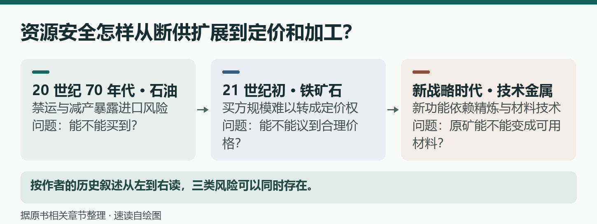
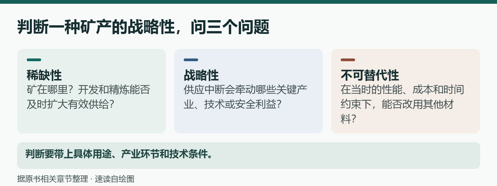
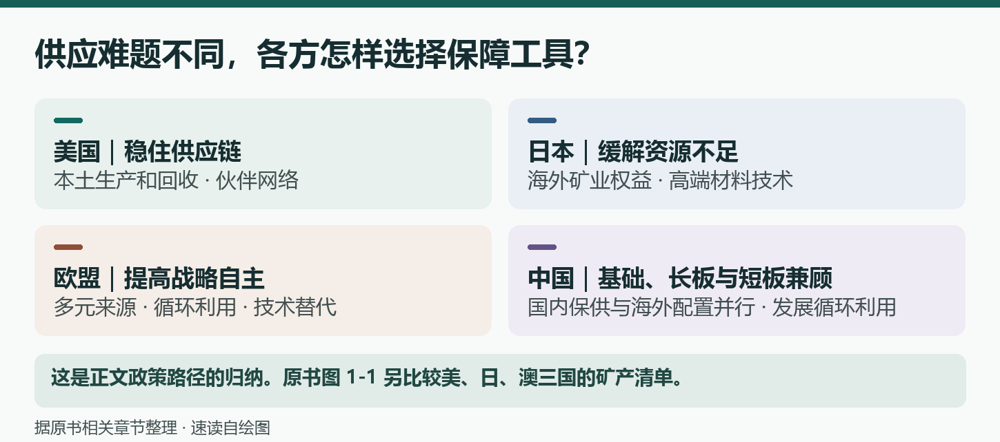

# 第一章 什么是战略性矿产

[原书第一章](<../第一章-什么是战略性矿产/第一章-什么是战略性矿产.md>)

**作者的推理路线**　先用三次变化说明资源安全的含义怎样扩大，再从中提炼判断矿产战略性的标准，最后看各国怎样把这种判断落实到清单和政策。

## 一、历史回溯｜资源为什么从商品变成安全议题？

**石油危机让人看到断供的后果。** 20 世纪 70 年代的两次石油危机中，1973 年中东战争后的禁运尤其能说明政治冲突怎样使进口经济体即便愿意购买，也可能失去供给。原书由此解释了战略石油储备、来源多元化和替代能源为何进入国家战略。资源安全首先是关键时刻能否买得到。

**铁矿石谈判把问题推进到买得起、能否议价。** 进入 21 世纪，中国成为全球最大的铁矿石进口国，还要面对少数大型矿商集中的卖方市场。钢企内部协调、矿山股权和金融规则，影响了中国能否把采购规模变成定价能力。原书举例，澳大利亚一度以约 40 美元/吨的成本出售约 100 美元/吨的矿石，按成本计算的利润率约为 150%。书中接着给出的中国重点钢企平均销售利润率不足 1%。两项指标的分母和业务环节不同，读这个例子时要看的是**谈判能力怎样影响产业链上的收益分配**。这也解释了集中采购、拓展矿源和布局海外权益矿的政策动因。

**新能源和数字技术把风险推向加工环节。** 锂、钴、稀土等用量可能小于煤铁，却能决定电池、永磁体等关键产品的性能。作者用稀土说明，原矿要经过分离、冶炼和功能材料制备，才能走向终端制造。能买到原矿，精炼产能集中仍可能限制供给。

图中三个问题逐步累加。带着它们进入下一节，就能理解作者为何从历史转向概念界定。

## 二、理论界定｜怎样判断一种矿产具有战略性？

作者先说明这个概念会随时代变动。工业化看重煤铁等规模供给，冷战提高了国防和尖端技术对特定矿种的重视，当下的能源转型和产业升级又把技术、气候需求纳入清单。

接着，作者区分两种典型风险。大宗矿产常牵动工业经济的**体量和成本**，价格和运输是重要变量。战略性矿产还牵动某项高端**功能或能力**，少量缺口就可能影响下游。铁矿石的案例同时说明，两者的角色可随用途与供应条件重叠。

**稀缺性**既包括地质约束，也包括矿山开发周期、成本、环保和加工技术。**战略性**看断供会牵动哪些产业能力或安全利益。**不可替代性**则看在当前技术、成本和应用场景下，有没有性能与供给都能满足要求的替代方案。技术换代后，第三个答案可能改变。

## 三、现实博弈｜为什么各国的清单与手段有差别？

概念弄清后，作者转向政策。各方先识别本国的高风险矿种，再针对供应链的位置选工具。

美国以本土供给和联盟合作增强供应安全。日本资源相对匮乏，依靠海外参股和先进材料技术支撑下游。欧盟把来源多元化和循环经济纳入战略自主。中国从工业化时期保障煤、铁等基础原料，逐步转向国内与海外两侧发力。2016 年发布的矿产资源规划首次系统制定战略性矿产目录，保障范围涵盖基础矿产、传统优势矿产和锂、钴、镍等新兴矿产。

原书图 1-1 比较的是**美国、日本和澳大利亚**。先找中央交集里的稀土、锂、钴等，再看三国各自保留的矿种。正文对欧盟和中国的政策分析见本节。图上的交集说明各方有共同的保障对象，至于某个矿种为何只进一国清单，还要结合产业需求、进口依赖和政策口径判断。

原书最后把锂、钴和稀土称为「新黄金」。动力电池和储能带动锂需求。钴有助于三元正极的能量密度和热稳定性，低钴路线会改变需求。稀土永磁体支撑高效电机和风电等应用，难点还在分离冶炼与材料制备。作者用这三个例子把「为什么关键」与「关键环节在哪里」重新扣在一起。

## 读完能复述什么？

作者从石油危机认识断供风险，从铁矿石博弈看到定价问题，再借锂、钴和稀土说明原矿、精炼、终端技术都可能是争夺点。于是，矿产的战略性要连着用途和供应链判断。各国清单把这些判断落到储备、开发、采购、替代和回收等政策上。
